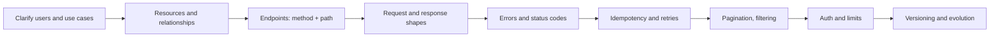

# API design questions: the building blocks

> **Before this lesson:** no web experience is assumed. If you have seen a web address and a JSON document you are ready. The answer shape from [A seven-step answer framework](#/lesson/thinking/answer-framework) applies as always.

## In plain words

A restaurant has a kitchen you never enter. You deal with a menu and a waiter: the menu lists what you may ask for, the waiter carries your request in and brings back either the dish or an apology. You do not care how the kitchen is arranged, and the kitchen can be rebuilt without you noticing, as long as the menu stays the same.

An **API** — application programming interface — is the menu and the waiter for a piece of software. It is the set of requests that other programs are allowed to make, and the form of the answers. "Design the API for X" asks you to write that menu: what can be asked for, how, and what comes back, including what happens when things go wrong.

Why it matters in a job: an API is a promise to other teams and customers. Code behind it can be rewritten in an afternoon; the API, once others depend on it, may have to be supported for years. Interviewers use these questions to see whether you design for the people on the other side — who retry, misread, send things twice and never upgrade when asked.

## How a web API call works

Most interview APIs are **HTTP APIs**. HTTP (hypertext transfer protocol) is the request-and-reply language of the web. One program, the **client**, sends a **request**; another, the **server**, sends a **response**.

A request has four parts:

| Part | Example | Meaning |
|---|---|---|
| **Method** (verb) | `GET` | What kind of action |
| **Path** | `/books/42` | Which thing |
| **Headers** | `Authorization: Bearer abc…` | Extra information about the request |
| **Body** | `{"title": "Dune"}` | Data being sent, usually in JSON |

**JSON** (JavaScript object notation) is a plain-text way of writing structured data: `{"name": "Ada", "age": 36}`.

A response has a **status code** (a three-digit number saying how it went), headers, and usually a JSON body.

The simplest possible exchange:

```text
GET /books/42

200 OK
{"id": 42, "title": "Dune", "author": "Frank Herbert"}
```

The style built on these ideas is called **REST** (representational state transfer). You will not be asked for its theory; you will be expected to follow its conventions, which the rest of this lesson lays out one at a time.

## Block 1 — Resources: design around nouns

A **resource** is a thing the API exposes: a book, an order, a user. Resource-oriented design — the approach laid out, for instance, in Google's public API design guidance — says: model the API as a set of things with a small, uniform set of actions, not as a long list of custom commands.

| Instead of (verbs) | Prefer (nouns + standard methods) |
|---|---|
| `POST /createBook` | `POST /books` |
| `GET /getBookById?id=42` | `GET /books/42` |
| `POST /deleteBook` | `DELETE /books/42` |
| `GET /getAllReviewsForBook?id=42` | `GET /books/42/reviews` |

Conventions: plural nouns for collections (`/books`); an identifier for one item (`/books/42`); nesting for things that belong to a parent (`/books/42/reviews`), but not deeper than about two levels.

Some actions do not fit "create, read, update, delete" — *cancel an order*, *send a reminder*. Two acceptable shapes: model the action as a resource of its own (`POST /orders/7/cancellations`), or use a clearly marked custom action (`POST /orders/7:cancel` or `/orders/7/cancel`). Say which you chose and stay consistent.

## Block 2 — Methods and what they promise

| Method | Meaning | Safe? | Idempotent? |
|---|---|---|---|
| `GET` | Read | Yes | Yes |
| `POST` | Create, or perform an action | No | **No** |
| `PUT` | Replace the whole resource | No | Yes |
| `PATCH` | Change part of a resource | No | Not necessarily |
| `DELETE` | Remove | No | Yes |

Two words in that table are important.

**Safe** means the call changes nothing. A `GET` must never create or modify data — browsers, caches and crawlers repeat `GET`s freely.

**Idempotent** means doing it twice has the same effect as doing it once. Pressing a lift's call button five times still calls one lift: idempotent. Putting five coins into a machine is not. `PUT /books/42` with the same body twice leaves the same book. `DELETE /books/42` twice leaves it deleted. But `POST /orders` twice creates **two orders**.

That last point is the origin of a very large share of real bugs, and it gets its own block below.

## Block 3 — Status codes

The first digit gives the family.

| Family | Meaning | The ones to know |
|---|---|---|
| **2xx** | It worked | `200 OK`; `201 Created`; `202 Accepted` (started, not finished); `204 No Content` |
| **3xx** | Look elsewhere | `301` moved permanently; `302` found (temporary redirect) |
| **4xx** | The **client** made a mistake | `400` bad request; `401` not signed in; `403` signed in but not allowed; `404` not found; `409` conflict; `422` invalid data; `429` too many requests |
| **5xx** | The **server** failed | `500` internal error; `503` unavailable |

The 4xx/5xx split matters because it tells the client what to do next: a 4xx will fail again unless the request is changed; a 5xx may succeed if retried later. An API that returns `200 OK` with `{"error": "failed"}` inside defeats every tool built on these conventions.

## Block 4 — Errors people can act on

A status code is a category. The body should say what went wrong in a form that both a program and a person can use.

```text
422 Unprocessable Entity
{
  "error": {
    "code": "INVALID_FIELD",
    "message": "price must be greater than zero",
    "field": "price",
    "request_id": "req_8f3a"
  }
}
```

Good properties: a stable machine-readable `code` (programs should never have to parse the sentence); a human `message`; which field; an identifier to quote to support. Use the same shape for every error in the API. Never leak internals — a database error message or a stack trace is both unhelpful and a security risk.

## Block 5 — Idempotency for unsafe operations

The story: a phone app sends `POST /payments`. The server charges the card. The reply is lost because the train entered a tunnel. The app sees a timeout. Did the payment happen? It cannot know. If it retries, the customer may be charged twice; if it does not, the order may be lost.

The standard remedy is an **idempotency key**: the client invents a unique random label for the *operation* and sends it with the request, repeating the same label on every retry.

```text
POST /payments
Idempotency-Key: 6f1c0a52-...
{"amount": 1999, "currency": "EUR"}
```

The server remembers each key with the response it produced. A request whose key it has seen returns the stored response **without doing the work again**. Payment APIs such as Stripe's document exactly this behaviour, including two details worth knowing: reusing a key with a *different* body is rejected as an error, and keys are kept for a limited time, such as a day.

```python-run
class PaymentServer:
    def __init__(self):
        self.seen = {}            # idempotency key -> (request body, stored response)
        self.charges = 0

    def post_payment(self, key, body):
        if key in self.seen:
            old_body, response = self.seen[key]
            if old_body != body:                      # same key, different request
                return {"status": 422, "error": "KEY_REUSED_WITH_DIFFERENT_BODY"}
            return response                            # replay: do NOT charge again
        self.charges += 1                              # the real work happens once
        response = {"status": 201, "payment_id": "pay_%d" % self.charges}
        self.seen[key] = (body, response)
        return response

server = PaymentServer()
print(server.post_payment("k1", {"amount": 1999}))    # first attempt
print(server.post_payment("k1", {"amount": 1999}))    # retry after a timeout
print(server.post_payment("k1", {"amount": 5}))       # misuse of the same key
print(server.post_payment("k2", {"amount": 1999}))    # a new, separate payment
print("cards charged:", server.charges)
```

Line by line: `seen` is the server's memory of keys. On a known key it compares the body, then returns the saved answer. Only an unseen key reaches the line that charges. The output shows two identical responses for `k1`, an error for the misuse, a second payment for `k2`, and a total of two charges — not three or four.

## Block 6 — Lists: pagination, filtering, sorting

A collection can hold millions of items; `GET /orders` cannot return them all. **Pagination** returns one page at a time.

**Offset pagination** — "skip 40, give me 20": `GET /orders?offset=40&limit=20`. Easy to understand and lets the client jump to page 7. Two weaknesses: skipping deep into a large table is slow, and if items are added or removed while someone pages, rows shift — the reader sees duplicates or misses items.

**Cursor pagination** — "give me 20 after this bookmark": the server returns an opaque token marking where the page ended, and the client sends it back.

```text
GET /orders?limit=20
→ {"items": [...20 orders...], "next_cursor": "b3JkZXJfMTAyMA"}

GET /orders?limit=20&cursor=b3JkZXJfMTAyMA
→ {"items": [...next 20...], "next_cursor": null}        ← no more pages
```

The cursor encodes "the last item you saw", so new arrivals do not disturb the reader, and the database can jump straight there using an index. The price is that there is no "go to page 7". Cursors are the usual default for large or changing lists.

Rules that apply to both: a default and a **maximum** page size, enforced by the server; a **stable sort order** with a unique tie-breaker (sort by creation time *and* id, because two orders can share a timestamp); and an explicit signal for the last page.

**Filtering and sorting** go in the query string: `GET /orders?status=shipped&created_after=2026-01-01&sort=-created_at`.

## Block 7 — Versioning and compatibility

Once clients exist, changes fall into two kinds.

| Backward compatible (safe) | Breaking |
|---|---|
| Adding a new endpoint | Removing or renaming a field or endpoint |
| Adding an optional request field | Making an optional field required |
| Adding a field to a response | Changing a field's type or meaning |
| Adding a new error code *if* clients were told to expect unknown ones | Changing default behaviour |

Design so that most changes are additive, and tell clients to ignore fields they do not recognise. When a breaking change is unavoidable, introduce a new **version** — most visibly in the path, `/v2/orders` — run both for a period, and retire the old one with notice (the deprecation process from the migration lesson).

## Block 8 — Authentication, authorisation and limits

Two different questions:

- **Authentication** — *who are you?* Commonly an **API key** (a long secret string identifying a program) or a **token** obtained by signing in, sent in the `Authorization` header. Never in the URL, because URLs end up in logs and browser histories.
- **Authorisation** — *are you allowed to do this to this item?* Being signed in as Alice does not entitle her to `GET /orders/9001` if that order is Bob's. Checking ownership on **every** request, per object, is the most commonly forgotten rule in API design.

Then the protective measures: **rate limits** (reply `429` with a `Retry-After` header when exceeded), maximum body sizes, validation of every input, and encryption in transit — HTTPS everywhere.

## A checklist to speak from



## Practice on a small case

**Prompt:** *"Design the API for a to-do list app: users have lists, lists have tasks."* Ten minutes, then compare.

<details><summary>Model answer</summary>

**Clarify.** Who calls it — our own mobile and web apps. Shared lists? Assume not yet, but do not make it impossible. Typical sizes: tens of lists, hundreds of tasks per list.

**Resources.** `List` (id, name, created_at) and `Task` (id, list_id, title, done, due_date, position).

**Endpoints.**

| Method and path | Purpose | Success |
|---|---|---|
| `GET /v1/lists` | My lists | 200 |
| `POST /v1/lists` | Create a list | 201 + the list |
| `GET /v1/lists/{id}` | One list | 200 |
| `PATCH /v1/lists/{id}` | Rename | 200 |
| `DELETE /v1/lists/{id}` | Delete with its tasks | 204 |
| `GET /v1/lists/{id}/tasks?done=false&limit=50&cursor=…` | Tasks, filterable, paginated | 200 |
| `POST /v1/lists/{id}/tasks` | Add a task | 201 |
| `PATCH /v1/tasks/{id}` | Edit, tick off, move | 200 |
| `DELETE /v1/tasks/{id}` | Remove | 204 |

A task is addressed directly as `/tasks/{id}` once created — it has its own identity — and is listed and created under its list.

**Shapes.** Task: `{"id": "t_81", "list_id": "l_3", "title": "Buy milk", "done": false, "due_date": "2026-03-01", "created_at": "…"}`. Dates in the standard ISO 8601 format, in UTC. Identifiers are opaque strings, not sequential numbers, so that clients cannot guess other people's.

**Errors.** One shape: `{"error": {"code", "message", "field", "request_id"}}`. 400 for malformed JSON, 422 for an empty title, 401 without a token, **404 for a list that is not yours** (not 403, so that we do not reveal that it exists), 429 for rate limiting.

**Idempotency.** `PATCH` to set `done: true` is naturally idempotent. `POST` to create is not: the apps work offline and retry, so `POST` accepts an `Idempotency-Key`; otherwise a retried request makes duplicate tasks.

**Concurrency.** Two devices edit the same task. Each task carries a `version`; `PATCH` may send `If-Match: 7` and receives 409 if the task has changed since — or we accept last-write-wins for a to-do app and say so.

**Auth.** A token per signed-in user in the `Authorization` header; every query is filtered by the owner.

**Evolution.** `/v1` in the path. Sharing can be added later as `POST /v1/lists/{id}/members` without breaking anything.

**Trade-off stated.** I chose cursor pagination although lists are small today, because it costs little now and avoids a breaking change later.

</details>

> [!INTERVIEW]
> Three sentences that mark an experienced API designer: **"POST is not idempotent, so creation takes an idempotency key."** **"Authorisation is checked per object, on every request."** **"I'll make changes additive so that I rarely need a new version."**

## Common mistakes

- Verbs in paths and a different naming style in every endpoint.
- `GET` requests that change data.
- `200 OK` for failures; error messages only a human can parse.
- Lists with no pagination or no maximum page size.
- Ignoring retries: no idempotency story for creating or paying.
- Checking that the caller is signed in but not that the item is theirs.
- Sequential numeric ids that let anyone walk through `/users/1`, `/users/2`…
- Designing only the happy path.

## Summary

- An API is a contract: a menu of requests and the shape of the replies.
- Model resources as nouns; use the standard methods; know which are safe and which are idempotent.
- Status codes: 2xx success, 4xx the client must change something, 5xx the server failed and a retry may work.
- Errors need a stable code, a message, a field and a request id, in one consistent shape.
- Unsafe operations that may be retried need idempotency keys.
- Paginate every list — cursors for large or changing data — with a maximum size and a stable order.
- Prefer additive change; version when you must break; authenticate, authorise per object, and limit.

## Glossary

| Term | Meaning |
|---|---|
| API | The set of requests a program accepts from other programs, and their replies |
| HTTP | The request-and-response protocol of the web |
| Client / server | The program that asks / the program that answers |
| JSON | A plain-text format for structured data |
| Resource | A thing exposed by an API, such as an order |
| Endpoint | One method-and-path combination that can be called |
| Status code | A three-digit number summarising the outcome of a request |
| Safe | A request that changes nothing |
| Idempotent | Having the same effect whether performed once or many times |
| Idempotency key | A client-chosen unique label that lets a server recognise retries |
| Pagination | Returning a long list in pages |
| Cursor | An opaque marker of a position in a list |
| Authentication | Establishing who the caller is |
| Authorisation | Deciding whether that caller may perform this action on this item |
| Rate limit | A cap on how many requests a caller may make in a period |
| Breaking change | A change that makes existing clients fail |

## Check yourself

```quiz
[
  {"q": "Which request is NOT idempotent by default?",
   "options": ["GET /orders/7", "PUT /orders/7", "DELETE /orders/7", "POST /orders"],
   "answer": 3,
   "explain": "Each POST to a collection creates a new item, so sending it twice creates two."},
  {"q": "A client's request body is missing a required field. Which status family is appropriate?",
   "options": ["2xx", "3xx", "4xx", "5xx"],
   "answer": 2,
   "explain": "The client must change the request; 400 or 422 tells it that retrying unchanged will not help."},
  {"q": "What problem does an idempotency key solve?",
   "options": ["Slow responses", "A retried request after a lost reply performing the operation a second time", "Large response bodies", "Weak passwords"],
   "answer": 1,
   "explain": "The server recognises the key and returns the stored result instead of repeating the work."},
  {"q": "Why is cursor pagination preferred for a large, frequently changing list?",
   "options": ["It lets clients jump to any page number", "It stays stable when items are added or removed and avoids slow deep skips", "It needs no sort order", "It returns everything at once"],
   "answer": 1,
   "explain": "A cursor marks the last item seen, so insertions do not shift pages and the database can seek directly."},
  {"q": "Alice is signed in and requests GET /invoices/501, which belongs to Bob. What should the API have checked?",
   "options": ["Only that the token is valid", "That the caller is authorised for that specific invoice", "That the invoice is large", "Nothing more"],
   "answer": 1,
   "explain": "Authentication says who the caller is; authorisation per object decides whether this item may be shown to them."},
  {"q": "Which change is backward compatible?",
   "options": ["Renaming a response field", "Adding a new optional field to a response", "Making an optional request field required", "Changing a number field to a string"],
   "answer": 1,
   "explain": "Clients that ignore unknown fields keep working when a field is added; the other changes break them."},
  {"q": "What is wrong with returning 200 OK and a body of {\"error\": \"payment failed\"}?",
   "options": ["Nothing", "Clients, monitoring and retry logic rely on the status code and will treat the failure as success", "The body is too short", "200 is only for GET"],
   "answer": 1,
   "explain": "Status codes are the shared convention that tools use to decide what happened and whether to retry."}
]
```

> **Source:** Google API Improvement Proposals — resource-oriented design, standard methods, pagination, errors, backward compatibility and request identification (https://google.aip.dev/general, https://google.aip.dev/121, https://google.aip.dev/158, https://google.aip.dev/193, https://google.aip.dev/180, https://google.aip.dev/155); Stripe API reference, "Idempotent requests" (https://docs.stripe.com/api/idempotent_requests); MDN Web Docs, HTTP response status codes (https://developer.mozilla.org/en-US/docs/Web/HTTP/Status). Examples, code and wording are original.
