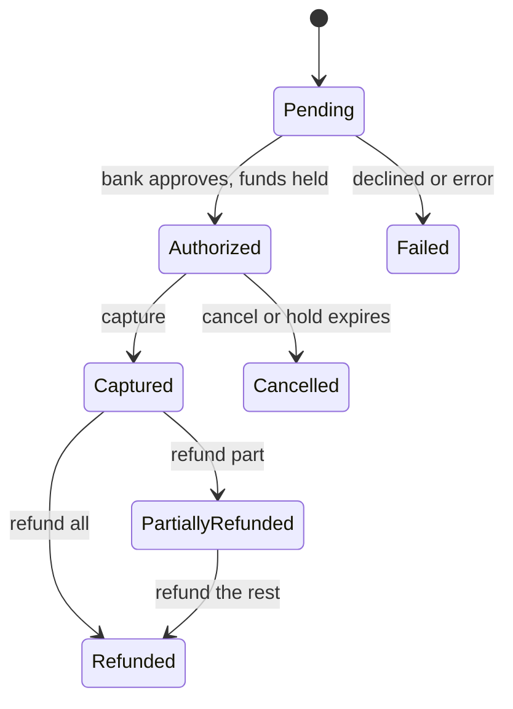
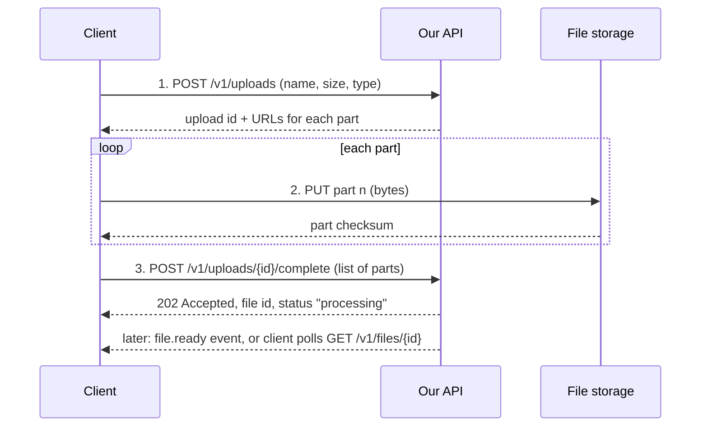

# API design, worked: a URL shortener, payments and file upload

> **Before this lesson:** read [API design questions: the building blocks](#/lesson/thinking/api-design-principles). It defines resources, methods, status codes, idempotency keys, cursors and the difference between authentication and authorisation, all of which are used here without re-explaining.

## In plain words

Reading the rules of chess does not teach you to play; games do. The previous lesson was the rules of API design. This one is three games. Each prompt looks different on the surface — short links, money, large files — and each exposes one difficulty that the plain create-read-update-delete pattern cannot handle:

- A **URL shortener** turns a long web address into a short one that redirects to it. Its API is tiny, which leaves time for the awkward questions: what if two people shorten the same address? what does a redirect return?
- A **payments** API moves money, so every design choice is about never doing something twice and always knowing what happened.
- A **file upload** API has to carry things that are too large and too slow for one ordinary request.

The order of work is the same each time, and it is worth saying aloud at the start of an interview answer:

1. Clarify users and use cases.
2. Name the resources.
3. List endpoints (method + path).
4. Show request and response shapes.
5. Errors.
6. Retries and idempotency.
7. Lists and pagination.
8. Authentication, authorisation, limits.
9. How it will evolve.

## Worked design 1 — A URL shortener

**Prompt:** *"Design the API for a URL shortening service."* Take ten minutes first.

<details><summary>Model answer</summary>

### Clarify

- Who creates links — anonymous visitors, signed-in users, other programs?
- Can a creator choose the short code ("custom alias")?
- Do links expire? Can they be edited or deleted?
- Do creators want click statistics?

**Assume:** signed-in users and programs with API keys create links; custom aliases are optional; optional expiry; owners can list, update and delete their links and see click counts; anyone can follow a link.

### Resources

One main resource, `Link`:

```text
{
  "code": "k9Xq2",                       ← the short identifier
  "short_url": "https://sho.rt/k9Xq2",
  "target_url": "https://example.com/a/very/long/path?x=1",
  "created_at": "2026-02-11T09:30:00Z",
  "expires_at": null,
  "clicks": 0
}
```

### Endpoints

| Method and path | Purpose | Auth | Success |
|---|---|---|---|
| `POST /v1/links` | Create a short link | Required | `201` + the link |
| `GET /v1/links/{code}` | Read details (not the redirect) | Owner | `200` |
| `GET /v1/links?limit=50&cursor=…` | List my links | Required | `200` |
| `PATCH /v1/links/{code}` | Change target or expiry | Owner | `200` |
| `DELETE /v1/links/{code}` | Remove | Owner | `204` |
| `GET /v1/links/{code}/stats?from=…&to=…` | Click counts over time | Owner | `200` |
| **`GET /{code}`** on the short domain | **Follow the link** | None | a redirect |

The last row is a different kind of endpoint: it is used by browsers, not by API clients, and it must be as fast as possible because it is called far more often than everything else together.

### The create request

```text
POST /v1/links
Authorization: Bearer <token>
Idempotency-Key: 4b0d…
{"target_url": "https://example.com/a/very/long/path?x=1",
 "custom_alias": "spring-sale",         ← optional
 "expires_at": "2026-06-01T00:00:00Z"}  ← optional
```

Decisions worth voicing:

- **Same long address submitted twice.** Return the existing link or make a new one? For signed-in users I would create a new link each time, because two campaigns may want separate statistics for the same destination. Retries of the *same request* are handled by the idempotency key instead.
- **Custom alias already taken** → `409 Conflict` with code `ALIAS_TAKEN`. Aliases are restricted to letters, digits and hyphens, with a length limit and a block list of reserved words such as `api`, `admin`, `login`.
- **Validation.** `target_url` must be a well-formed `http` or `https` address under a length limit → otherwise `422`. Refuse targets that point back at our own short domain (redirect loops) and check targets against a list of known harmful sites, since shorteners are a favourite tool for hiding malicious links.

### The redirect

```text
GET /k9Xq2
→ 302 Found
  Location: https://example.com/a/very/long/path?x=1
```

**301 or 302?** A `301` means "moved permanently": browsers remember it and stop asking us, which is fast and cheap but means we never see later clicks and cannot change the target. A `302` (or `307`) means "temporary": every click comes to us, so statistics and edits work. Because the product includes statistics and editable links, I choose `302`. This single trade-off is the most-asked follow-up for this prompt.

Other outcomes: unknown code → `404`; expired or deleted → `410 Gone`; a link flagged as harmful → a warning page instead of a redirect.

### Errors, limits, evolution

- One error shape with stable codes: `INVALID_URL`, `ALIAS_TAKEN`, `LINK_EXPIRED`, `RATE_LIMITED`.
- Rate limits per API key on creation (abuse) and per address on redirects (scraping) → `429` with `Retry-After`.
- Codes are random and long enough not to be guessable in bulk, so that nobody can enumerate other people's links.
- `PATCH` and `DELETE` check that the caller owns the link and answer `404` otherwise.
- Versioned under `/v1`. Additions such as link tags or QR codes are new optional fields and sub-resources.

</details>

## Worked design 2 — A payments API

**Prompt:** *"Design the API a shop's checkout uses to charge customers."*

<details><summary>Model answer</summary>

### Clarify

- Who calls it — our own checkout service, or outside merchants too?
- One-step charge, or reserve now and take the money later (hotels, pre-orders)?
- Refunds, partial refunds?
- Which currencies? Do we ever see card numbers?

**Assume:** called by merchants' servers with secret API keys; supports authorise-then-capture as well as immediate capture; full and partial refunds; many currencies; card details are collected by a separate, specially secured component and reach us only as a **token** — a meaningless stand-in for the card.

### Resources

- `Payment` — one attempt to collect money for one order.
- `Refund` — money returned against a payment.
- `Event` — a notification that something changed, delivered to the merchant.

### A payment is a state machine



**Authorising** means asking the customer's bank to set the money aside; **capturing** means actually taking it. Showing the states first makes the endpoints fall out naturally: each arrow is an operation.

### Endpoints

| Method and path | Purpose | Success |
|---|---|---|
| `POST /v1/payments` | Create a payment (authorise, optionally capture) | `201` |
| `GET /v1/payments/{id}` | Read its current state | `200` |
| `GET /v1/payments?order_ref=…&limit=…&cursor=…` | Find and list | `200` |
| `POST /v1/payments/{id}/capture` | Take the held money | `200` |
| `POST /v1/payments/{id}/cancel` | Release the hold | `200` |
| `POST /v1/payments/{id}/refunds` | Refund all or part | `201` |
| `GET /v1/payments/{id}/refunds` | List refunds | `200` |

### Shapes

```text
POST /v1/payments
Authorization: Bearer sk_live_…
Idempotency-Key: 7c9e-…
{"amount": 1999, "currency": "EUR",
 "payment_method_token": "tok_abc",
 "capture": true,
 "order_ref": "order-8841"}

201 Created
{"id": "pay_3f2", "status": "captured", "amount": 1999, "currency": "EUR",
 "amount_refunded": 0, "order_ref": "order-8841", "created_at": "…"}
```

Two details that interviewers look for:

- **Money is an integer in the smallest unit** — 1999 cents, not 19.99. Fractions stored as floating-point numbers pick up rounding errors (`0.1 + 0.2` is not exactly `0.3` in a computer), and money must add up exactly. The currency travels with every amount.
- **`order_ref`** is the merchant's own reference, so a merchant can find a payment even if our reply never arrived.

### Idempotency and the unknown outcome

Every `POST` here requires an `Idempotency-Key`. The server stores the key with the result; a repeat returns the stored result without touching the bank. The same key with a different body → `422`.

The hard case is when *we* do not know the result: we sent the request to the bank and the connection dropped. The API must not guess. It answers with the payment in state `pending` (HTTP `202 Accepted`), then finds out — by asking the bank for the status — and updates the payment. The merchant learns the final outcome by reading `GET /v1/payments/{id}` or from an event. An honest "not known yet" is far better than a wrong "failed" followed by a charge.

### Errors

Distinguish the three situations a merchant must handle differently:

| Situation | Status | Code | Merchant should |
|---|---|---|---|
| Our request was malformed | `400` / `422` | `INVALID_AMOUNT`… | Fix the code |
| The customer's card was declined | `402` | `CARD_DECLINED` + reason | Ask the customer for another method; **do not retry** |
| We or the bank had a problem | `500` / `503` | `PROCESSOR_UNAVAILABLE` | Retry later with the same idempotency key |
| Wrong state for the action | `409` | `ALREADY_CAPTURED`, `REFUND_EXCEEDS_PAYMENT` | Read the payment and decide |

### Webhooks: telling the merchant later

Some things happen after the request ends — a bank confirms hours later, a customer disputes a charge. A **webhook** is a call in the opposite direction: we send an HTTP request to an address the merchant registered. Rules for a sound design:

- Each event has an `id` and a type such as `payment.captured`.
- Delivery is **at least once**: we retry with increasing delays until the merchant answers `2xx`. Therefore merchants may see duplicates and must ignore event ids they have already processed.
- Events can arrive **out of order**; the event carries the payment's current status and a timestamp.
- Each delivery is **signed** with a shared secret so that the merchant can check it truly came from us.

### Security and limits

Secret keys only on servers, never in an app or web page; separate test and live keys; every query scoped to the calling merchant, with `404` for other merchants' payments; card numbers never accepted by this API and never logged; rate limits per key; all traffic encrypted.

### Evolution

Additive changes only inside `/v1`. Merchants are told to ignore unknown fields and unknown event types, so that new ones can be added safely.

</details>

> [!INTERVIEW]
> If you remember one thing about payment APIs: **"a timeout is not a failure — it is an unknown."** Then explain the three tools for living with unknowns: idempotency keys on every write, a status the client can poll, and signed, retried, de-duplicated webhooks.

## Worked design 3 — File upload

**Prompt:** *"Design an API for uploading files — photos and videos up to several gigabytes."*

The naive design is one request: `POST /files` with the file as the body. Start there, because it is right for small files, then show why it breaks.

<details><summary>Model answer</summary>

### Clarify

- How large — kilobytes, or gigabytes? From phones on poor connections?
- Who can read the file afterwards — only the owner, or anyone with a link?
- Do we process files after upload — virus scan, thumbnails, video conversion?

**Assume:** up to 5 GB, often from mobile networks; private by default; scanned and processed after upload.

### Why one big request fails

- A connection that drops at 95 % loses everything; the user starts again.
- Requests have time and size limits at every hop between client and server.
- Our application servers would spend their time relaying bytes instead of serving requests.
- No progress bar, no pause.

### Design: three steps



**Step 1 — start.** The client describes the file; no bytes yet.

```text
POST /v1/uploads
{"filename": "holiday.mp4", "size_bytes": 3221225472, "content_type": "video/mp4",
 "checksum_sha256": "9f2c…"}

201 Created
{"upload_id": "up_71", "part_size": 8388608, "part_count": 384,
 "expires_at": "…", "parts_url_template": "…"}
```

The server can refuse straight away — too large (`413`), a type not allowed (`415`), the user's storage quota exceeded (`403` with a clear code) — *before* gigabytes are sent.

**Step 2 — send the parts.** The file is cut into pieces of a few megabytes. Each is sent with `PUT …/parts/{n}`, ideally **directly to the storage system** using a **pre-signed URL** — a temporary address that carries its own permission, valid for one part and a short time, so that our API servers never handle the bytes. `PUT` of the same part twice leaves the same result: it is idempotent, so a failed part is re-sent on its own. Parts may go in parallel.

**Resuming.** After a crash or a lost connection the client asks what arrived:

```text
GET /v1/uploads/up_71
→ {"status": "in_progress", "parts_received": [1,2,3,5,6], "part_count": 384}
```

and sends the missing ones — here part 4 and everything after 6.

**Step 3 — complete.** `POST /v1/uploads/up_71/complete` tells the server to join the parts and verify the overall **checksum** (a fingerprint computed from the bytes; if it differs, the file was damaged on the way → `422 CHECKSUM_MISMATCH`). The answer is `202 Accepted`, not `201`: the file exists but scanning and conversion are still running.

### The file resource and long-running work

```text
GET /v1/files/f_204
→ {"id": "f_204", "status": "processing" | "ready" | "rejected",
   "filename": "holiday.mp4", "size_bytes": 3221225472,
   "download_url": null}
```

Processing that takes minutes is a **long-running operation**: start it, return immediately with something that can be asked about later, and let the client poll or receive an event. Blocking one HTTP request for ten minutes is never the design.

### Remaining endpoints

| Method and path | Purpose |
|---|---|
| `DELETE /v1/uploads/{id}` | Abandon an upload; frees stored parts |
| `GET /v1/files?limit=…&cursor=…` | List my files |
| `GET /v1/files/{id}` | Metadata and status |
| `GET /v1/files/{id}/content` | Download: redirects to a short-lived signed address; supports range requests so that downloads can resume and videos can seek |
| `DELETE /v1/files/{id}` | Delete |

### Details that show care

- Unfinished uploads expire and are cleaned up automatically, or abandoned parts accumulate cost for ever.
- Never trust the filename or the declared type: store under our own id, detect the real type from the content, and remove path characters. A file named `../../config` or a script labelled as an image is a classic attack.
- Files are private: download addresses are short-lived and issued only after an authorisation check.
- Small files may use a single-request shortcut, `POST /v1/files`, for convenience — the three-step flow is for anything above a few megabytes.
- Limits: per-file size, per-user quota, parts per upload, uploads per hour.

</details>

## What the three share

| Concern | URL shortener | Payments | File upload |
|---|---|---|---|
| The awkward question | 301 or 302? Same address twice? | What if the outcome is unknown? | What if the connection drops at 95 %? |
| How retries are made safe | Idempotency key on create | Idempotency key on every write | Parts are idempotent `PUT`s |
| Work that outlives the request | — | `pending` + webhooks | `processing` + polling or events |
| Hot path | The redirect | — | Bytes go straight to storage |
| Abuse to design against | Harmful targets, enumeration | Cross-merchant access | Hostile filenames, quota exhaustion |

## Summary

- Work in a fixed order: use cases, resources, endpoints, shapes, errors, retries, lists, security, evolution.
- URL shortener: one resource; a redirect that is `302` when statistics and edits matter; aliases conflict with `409`; codes must not be guessable.
- Payments: model the state machine first; integer amounts with currency; idempotency keys on all writes; treat timeouts as unknown; webhooks are signed, retried and may be duplicated.
- File upload: start → parts → complete; pre-signed addresses send bytes directly to storage; resumable by asking which parts arrived; processing is a long-running operation with a status.

## Glossary

| Term | Meaning |
|---|---|
| Redirect | A response telling the browser to go to another address |
| Custom alias | A short code chosen by the user |
| Token (payment) | A meaningless stand-in for sensitive card details |
| Authorise (payment) | Ask the bank to hold funds without taking them yet |
| Capture | Take funds that were authorised |
| Webhook | An HTTP call from a service to an address its customer registered, announcing an event |
| At-least-once delivery | A message is retried until acknowledged, so it may arrive more than once |
| Signature | A code proving who sent a message and that it was not altered |
| Multipart / chunked upload | Sending a large file as several separate pieces |
| Pre-signed URL | A temporary address that carries its own permission |
| Checksum | A fingerprint of data used to detect corruption |
| Long-running operation | Work that continues after the request returns; its status is queried later |
| Quota | The maximum amount of a resource a user may consume |

## Check yourself

```quiz
[
  {"q": "A URL shortener offers click statistics and lets owners change the target. Which redirect status fits?",
   "options": ["301, so browsers cache it for ever", "302, so every click still reaches the service", "200 with the target in the body", "404"],
   "answer": 1,
   "explain": "A permanent redirect is cached by browsers, hiding later clicks and edits; a temporary one keeps the service in the loop."},
  {"q": "A user requests a custom alias that already exists. Which response is appropriate?",
   "options": ["200 OK with someone else's link", "409 Conflict with a stable code such as ALIAS_TAKEN", "500 Internal Server Error", "301"],
   "answer": 1,
   "explain": "The request is valid but conflicts with current state; a machine-readable code lets the client react."},
  {"q": "Why are money amounts sent as integers in the smallest currency unit?",
   "options": ["Integers look nicer", "Floating-point fractions introduce rounding errors, and money must be exact", "JSON cannot hold decimals", "Banks forbid decimals"],
   "answer": 1,
   "explain": "Binary floating point cannot represent many decimal fractions exactly, so totals drift."},
  {"q": "The connection to the bank drops after a charge request is sent. What should the payments API report?",
   "options": ["Failed", "Succeeded", "Pending, and then determine the true outcome and notify", "Nothing"],
   "answer": 2,
   "explain": "The outcome is unknown; guessing either way can produce a lost order or a double charge."},
  {"q": "Webhook delivery is at least once. What must the receiver do?",
   "options": ["Assume each event arrives exactly once", "Ignore event ids it has already processed", "Reply with an error to stop retries", "Disable the endpoint"],
   "answer": 1,
   "explain": "Retries can produce duplicates, so handlers must be idempotent, typically by remembering event ids."},
  {"q": "What is the main benefit of splitting a large upload into parts?",
   "options": ["Smaller files on disk", "A failure costs one part, and the upload can resume and run in parallel", "It removes the need for authentication", "It compresses the file"],
   "answer": 1,
   "explain": "Each part is an idempotent PUT that can be retried alone; the client asks which parts arrived and continues."},
  {"q": "After the last part is uploaded, the server must scan and convert the file, taking minutes. What should 'complete' return?",
   "options": ["Hold the connection open until finished", "202 Accepted with a status the client can poll, or an event later", "500", "The converted file in the response body"],
   "answer": 1,
   "explain": "Long-running work is started and reported asynchronously; requests should not block for minutes."}
]
```

> **Source:** Google API Improvement Proposals — standard and custom methods, long-running operations, request identification and errors (https://google.aip.dev/136, https://google.aip.dev/151, https://google.aip.dev/155, https://google.aip.dev/193); Stripe API reference, "Idempotent requests" (https://docs.stripe.com/api/idempotent_requests); MDN Web Docs on HTTP redirections and range requests (https://developer.mozilla.org/en-US/docs/Web/HTTP/Redirections, https://developer.mozilla.org/en-US/docs/Web/HTTP/Range_requests); Donne Martin's System Design Primer for the URL-shortener exercise (https://github.com/donnemartin/system-design-primer). Designs and wording are original.
