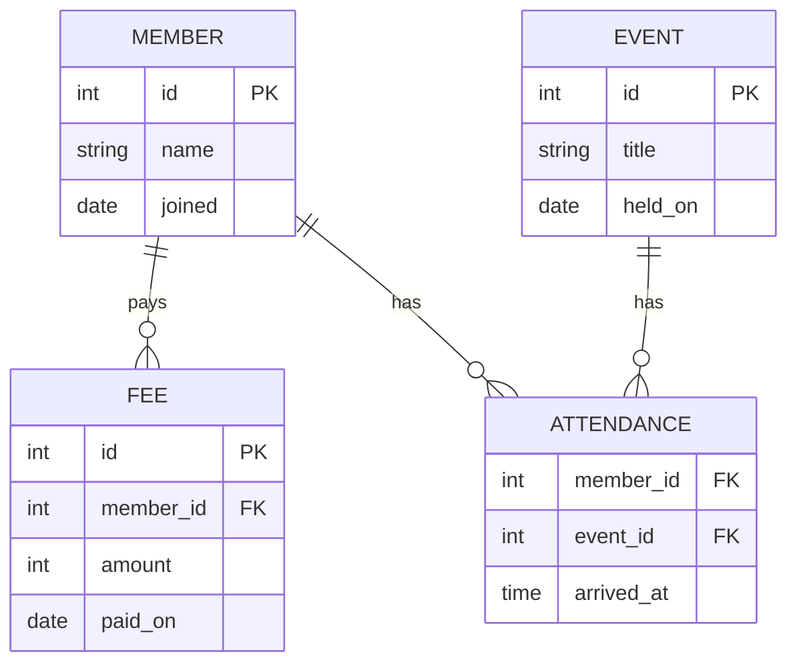
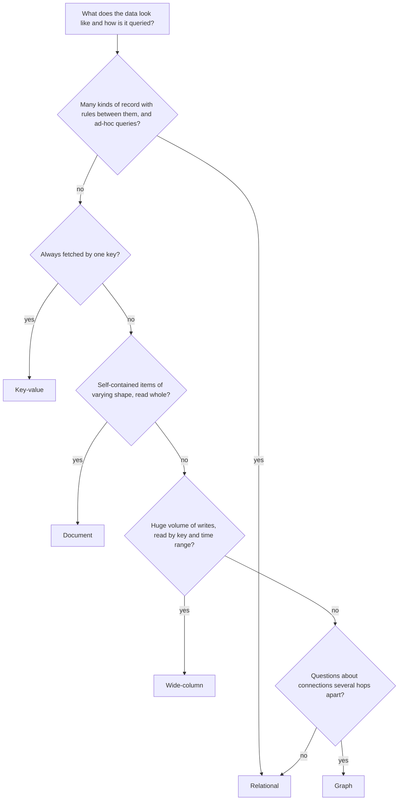

# Data modelling questions: entities, relationships and SQL versus NoSQL

> **Before this lesson:** no database experience is assumed. If you have used a spreadsheet you have the right starting picture. The SQL track on this site teaches the query language itself; here you only need to read a small table.

## In plain words

Think of a small club that keeps its records in a notebook. One page lists members. Another lists events. A third records who attended what. Nobody planned it, but the secretary has made a **data model**: a decision about which lists exist, what is written in each, and how a line in one list points to a line in another. A good set of lists makes every question easy ("who came to the March meeting?") and keeps the notebook consistent. A bad one — say, each member's address copied onto every attendance line — means that when someone moves house, forty lines must be corrected and three will be missed.

**Data modelling** is that planning, done on purpose, for software. An interviewer who says *"model the data for a ride-sharing trip"* wants to see which things you choose to record, how you connect them, and how you would store them. It matters because data outlives code: programs are rewritten every few years, but a poorly shaped database is painful and risky to change once it holds real records.

## The four building blocks

**Entity.** A kind of thing you keep records about: a member, an event, an order. In a relational database each entity becomes a **table**, a grid like a spreadsheet tab.

**Attribute.** One fact about an entity: a member's name, an event's date. Each becomes a **column**. One record is a **row**.

**Primary key.** A column whose value identifies exactly one row — a membership number. Names repeat and change; a key must not. The safest keys are meaningless generated identifiers.

**Relationship.** How rows of one table relate to rows of another. A **foreign key** is a column holding the primary key of a row in another table — the way one page of the notebook points to another.

The smallest possible example, two tables:

| **members** | | |
|---|---|---|
| **id** (primary key) | name | joined |
| 1 | Ada | 2024-01-10 |
| 2 | Grace | 2024-03-02 |

| **events** | | |
|---|---|---|
| **id** (primary key) | title | held_on |
| 10 | Spring meeting | 2025-03-14 |
| 11 | Summer picnic | 2025-07-06 |

## Three shapes of relationship

**One-to-one.** Each member has at most one locker; each locker belongs to at most one member. Rare. Usually stored as extra columns on one table, or a second table sharing the key.

**One-to-many.** One member pays many membership fees; each fee belongs to one member. The commonest shape. Rule: **the "many" side holds the foreign key.**

| **fees** | | | |
|---|---|---|---|
| id | **member_id** (foreign key → members) | amount | paid_on |
| 501 | 1 | 30 | 2025-01-05 |
| 502 | 1 | 30 | 2026-01-04 |
| 503 | 2 | 30 | 2025-03-02 |

**Many-to-many.** A member attends many events; an event has many members. Neither table can hold the other's key, because a cell holds one value. The solution is a third table — a **join table** — with one row per pairing.

| **attendance** | | |
|---|---|---|
| **member_id** | **event_id** | arrived_at |
| 1 | 10 | 18:55 |
| 2 | 10 | 19:02 |
| 1 | 11 | 12:30 |

The join table often gains attributes of its own (`arrived_at`), at which point it is an entity in its own right: an *attendance*. Spotting that a relationship has its own data is a frequent interview insight — "a booking", "an enrolment", "a trip".

The picture of entities and relationships is an **entity-relationship diagram**, or ER diagram.



Read `||--o{` as "one … to zero or many".

## Normalisation: say each fact once

Suppose the secretary had used a single big sheet:

| member | member_email | event | event_date | fee_paid |
|---|---|---|---|---|
| Ada | ada@x.org | Spring meeting | 2025-03-14 | 30 |
| Grace | grace@x.org | Spring meeting | 2025-03-14 | 30 |
| Ada | ada@x.org | Summer picnic | 2025-07-06 | 30 |

Three problems appear, known as **anomalies**:

- **Update anomaly.** Ada changes her email. It must be changed on every row; miss one and the data contradicts itself.
- **Insert anomaly.** A new member who has not attended anything cannot be recorded — there is no event to put in the row.
- **Delete anomaly.** Cancel the summer picnic by deleting its rows, and if it was someone's only event, that member vanishes too.

All three come from one cause: **the same fact is written in more than one place.** **Normalisation** is the process of splitting tables until each fact is stored once. The formal levels are called *normal forms*; three are worth knowing in plain terms.

| Level | Rule in plain words | Violation example |
|---|---|---|
| **First (1NF)** | One value per cell; no lists in a cell, no repeating column groups | `phones = "555-1, 555-2"`; columns `item1, item2, item3` |
| **Second (2NF)** | Every non-key column depends on the *whole* key, not part of it | In attendance (member_id, event_id), storing `event_title` — it depends only on event_id |
| **Third (3NF)** | Non-key columns depend on the key and on nothing else | Storing `city` and `postcode` when postcode determines city |

A sentence that summarises all three: *every non-key column should describe the key, the whole key, and nothing but the key.*

The phrase "depends on" has a precise meaning. Column B **functionally depends** on column A if knowing A always tells you B: knowing `event_id` tells you `event_title`. You can check a claimed dependency against data.

```python-run
rows = [
    {"member": "Ada",   "email": "ada@x.org",   "event": "Spring", "date": "2025-03-14"},
    {"member": "Grace", "email": "grace@x.org", "event": "Spring", "date": "2025-03-14"},
    {"member": "Ada",   "email": "ada@old.org", "event": "Summer", "date": "2025-07-06"},
]

def violates(rows, left, right):
    seen = {}
    for r in rows:
        key = r[left]
        if key in seen and seen[key] != r[right]:
            return f"{left} -> {right} is violated: {key} maps to {seen[key]} and {r[right]}"
        seen[key] = r[right]
    return f"{left} -> {right} holds in this data"

print(violates(rows, "event", "date"))
print(violates(rows, "member", "email"))
```

The function remembers, for each value of the left column, the first value seen in the right column, and reports if a later row disagrees. The output shows that `event → date` holds, and that `member → email` is broken: Ada has two different emails. That contradiction is exactly the update anomaly — it could not exist if the email were stored once, in a members table. The problem *Check a Functional Dependency* asks you to write this.

### When to denormalise on purpose

Normalised data is consistent and economical to update, but reading it may need **joins** — combining rows from several tables — which cost time. **Denormalisation** means deliberately storing a copy of a fact where it is convenient to read. Legitimate reasons:

- **Read speed.** A `comment_count` column on a post, instead of counting comments on every view.
- **History.** An order line stores the price *at the time of purchase*. This looks like duplication of the product's price and is not: "price paid" and "current price" are different facts.
- **Reporting.** A wide summary table rebuilt nightly.

The cost is that copies can drift, so every denormalised value needs an answer to "who updates it, and what if they fail?" The sound interview position: **normalise first; denormalise specific things for stated reasons.**

## Indexes in one paragraph

An **index** is an extra lookup structure on one or more columns, like the index at the back of a book: without it, finding all rows where `member_id = 1` means reading the whole table; with it, the database goes straight there. Indexes make reads faster and writes a little slower, since each must be kept up to date. Primary keys are indexed automatically. A good data-model answer names the two or three queries that will run most and the indexes that serve them.

## SQL or NoSQL?

A **relational** database stores tables with a fixed structure and is queried with **SQL** (structured query language); PostgreSQL and MySQL are well-known examples. "**NoSQL**" is a loose label for everything else. The main families:

| Family | Stores | Picture | Typical use |
|---|---|---|---|
| **Relational** | Rows in related tables | Linked spreadsheets | Orders, accounts, anything with rules between records |
| **Key-value** | A value looked up by one key | A coat-check: ticket in, coat out | Sessions, caches, shopping baskets |
| **Document** | Self-contained JSON-like documents | A folder of forms, each form complete | Product catalogues, user profiles, content |
| **Wide-column** | Rows grouped by a partition key, sorted within it | A filing cabinet: drawer per customer, files in date order | Time series, messages, activity logs at very large scale |
| **Graph** | Nodes and the links between them | A map of who-knows-whom | Social connections, recommendations, fraud rings |

Three properties drive the choice.

**Transactions.** A **transaction** is a group of changes that succeed or fail together — move money out of one account *and* into another, never one without the other. The guarantees are summarised as **ACID**: *atomic* (all or nothing), *consistent* (rules are never broken), *isolated* (concurrent transactions do not interfere), *durable* (once confirmed, it survives a crash). Relational databases provide this across any rows and tables. Many NoSQL stores offer it only within one item or one partition.

**Flexible shape.** A relational table has a **schema** — its declared columns and types — and every row obeys it. Document stores let each document differ, which suits data whose shape varies (a book has pages; a laptop has memory) and makes early changes quick. The structure still exists; it has moved from the database into your code.

**Scaling out.** When one machine is no longer enough you split the data across many, called **sharding** or partitioning. Key-value and wide-column stores are built for this: every read and write names a partition key, so it lands on one machine. Relational databases can be sharded, with more effort, and queries that cross shards become hard.

### A decision guide



Honest guidance to give in an interview:

- **Start relational unless you have a reason not to.** It handles most workloads, enforces rules and answers questions you have not thought of yet. A single well-run relational server copes with far more than most candidates assume.
- **Model from the queries when using NoSQL.** In a relational design you model the *things* and can ask anything later. In key-value and wide-column stores you design a table **per question**, because the only efficient access is by key.
- **Mixing is normal.** Orders in a relational database, sessions in a key-value store, search in a search index, pictures in file storage. Say which data goes where, and why.

## A framework for any modelling prompt

1. **Clarify** scope and scale: what must be recorded; how much; what reads and writes dominate.
2. **List entities** — the nouns.
3. **List relationships** and their shapes (one-to-many, many-to-many).
4. **Add attributes and keys**; mark what is required and what must be unique.
5. **Write down the main queries** and check each against the model; add indexes.
6. **Decide what changes over time** and whether history is needed.
7. **Choose storage** and justify it; say what you would denormalise.
8. **Stress it**: growth, concurrency, deletion and privacy.

## Practice

**Prompt:** *"Model the data for a small online bookshop: customers place orders containing several books."* Sketch tables for five minutes first.

<details><summary>Model answer</summary>

**Clarify.** Physical books, one warehouse, prices change over time, customers have several addresses. Thousands of orders a day — small.

**Entities.** Customer, Address, Book, Order, OrderItem.

**Relationships.** Customer 1—many Address. Customer 1—many Order. Order many—many Book, resolved by **OrderItem**, which carries its own facts: quantity and price paid.

```sql
CREATE TABLE customers (
  id          INTEGER PRIMARY KEY,
  email       TEXT NOT NULL UNIQUE,
  name        TEXT NOT NULL,
  created_at  TIMESTAMP NOT NULL
);
CREATE TABLE addresses (
  id           INTEGER PRIMARY KEY,
  customer_id  INTEGER NOT NULL REFERENCES customers(id),
  line1 TEXT NOT NULL, city TEXT NOT NULL, postcode TEXT NOT NULL, country TEXT NOT NULL
);
CREATE TABLE books (
  id           INTEGER PRIMARY KEY,
  isbn         TEXT NOT NULL UNIQUE,
  title        TEXT NOT NULL,
  price_cents  INTEGER NOT NULL CHECK (price_cents >= 0),
  stock        INTEGER NOT NULL CHECK (stock >= 0)
);
CREATE TABLE orders (
  id           INTEGER PRIMARY KEY,
  customer_id  INTEGER NOT NULL REFERENCES customers(id),
  status       TEXT NOT NULL,              -- placed, paid, shipped, cancelled
  placed_at    TIMESTAMP NOT NULL,
  ship_name TEXT NOT NULL, ship_line1 TEXT NOT NULL, ship_city TEXT NOT NULL,
  ship_postcode TEXT NOT NULL, ship_country TEXT NOT NULL
);
CREATE TABLE order_items (
  order_id          INTEGER NOT NULL REFERENCES orders(id),
  book_id           INTEGER NOT NULL REFERENCES books(id),
  quantity          INTEGER NOT NULL CHECK (quantity > 0),
  unit_price_cents  INTEGER NOT NULL,
  PRIMARY KEY (order_id, book_id)
);
```

**Decisions to explain.**

- `order_items.unit_price_cents` copies the price on purpose: an order must show what was paid, even after the book's price changes.
- The shipping address is **copied onto the order** for the same reason: if the customer later edits or deletes an address, past orders must still show where the parcel went. These two are the classic "looks like duplication, is history" cases.
- Money is an integer number of cents.
- `email` is unique; `stock` cannot go negative — the database enforces the rule even if the code has a bug.
- The key of `order_items` is the pair (order_id, book_id): one line per book per order.

**Main queries and indexes.** "A customer's orders, newest first" → index on `orders(customer_id, placed_at)`. "Items of an order" → served by the primary key. "Find a book by ISBN" → the unique index.

**Storage.** Relational: several entity types, rules between them, and placing an order must be a transaction — reduce stock and create the order together or not at all.

**Stress.** Two customers buy the last copy: decrement with a condition (`… SET stock = stock - 1 WHERE id = ? AND stock >= 1`) and check that a row changed. Customer asks to be forgotten: anonymise the customer row; orders must be kept for accounting, so decide which fields are blanked. Growth to millions of orders: archive old ones; the model does not change.

</details>

> [!INTERVIEW]
> Two remarks that reliably land well: **"the join table has its own attributes, so it is really an entity"**, and **"that copy is not duplication — it records a fact as it was at that moment."**

## Summary

- A data model is the set of entities, their attributes, keys and relationships.
- One-to-many: the "many" side holds the foreign key. Many-to-many: a join table, which often becomes an entity.
- Normalise so that each fact is stored once; this removes update, insert and delete anomalies. Denormalise deliberately for read speed or history, and say who keeps copies in step.
- Relational databases give transactions, enforced rules and flexible queries; key-value, document, wide-column and graph stores trade some of that for scale, flexible shape or special query patterns.
- Start relational unless a specific need argues otherwise; with NoSQL, design from the queries.
- Always test the model against its main queries, its history needs and concurrent updates.

## Glossary

| Term | Meaning |
|---|---|
| Entity | A kind of thing about which records are kept |
| Attribute | One fact about an entity; a column |
| Row | One record in a table |
| Primary key | The column or columns that uniquely identify a row |
| Foreign key | A column holding the primary key of a row in another table |
| Join table | A table whose rows pair up rows of two other tables |
| ER diagram | A drawing of entities and the relationships between them |
| Normalisation | Arranging tables so that each fact is stored once |
| Anomaly | An inconsistency made possible by duplicated facts |
| Functional dependency | Column B is determined by column A |
| Denormalisation | Deliberately storing a redundant copy for convenience or speed |
| Index | A lookup structure that speeds up finding rows by certain columns |
| Schema | The declared structure of the data |
| Transaction | A group of changes that succeed or fail as one |
| ACID | Atomic, consistent, isolated, durable: the guarantees of a transaction |
| Sharding | Splitting data across several machines by a key |

## Check yourself

```quiz
[
  {"q": "One customer has many orders; each order has one customer. Where does the foreign key go?",
   "options": ["On the customers table", "On the orders table, as customer_id", "In a join table", "Nowhere"],
   "answer": 1,
   "explain": "In a one-to-many relationship the 'many' side stores the key of the 'one' side."},
  {"q": "Students take many courses and courses have many students. How is this stored relationally?",
   "options": ["A list of course ids in a cell of the students table", "A join table with one row per student-course pair", "A column per course on the students table", "It cannot be stored"],
   "answer": 1,
   "explain": "Many-to-many needs a third table; it often gains its own attributes such as a grade, making it an entity (enrolment)."},
  {"q": "A customer's address is repeated on every row of a big sheet, and a change misses some rows. Which anomaly is this?",
   "options": ["Insert anomaly", "Delete anomaly", "Update anomaly", "No anomaly"],
   "answer": 2,
   "explain": "The same fact stored in several places can be updated inconsistently."},
  {"q": "An order line stores the unit price even though the product table also has a price. Why is this acceptable?",
   "options": ["It is a mistake", "The price paid at the time is a different fact from the current price", "Joins are forbidden", "To use more disk"],
   "answer": 1,
   "explain": "History must not change when the catalogue does; the copy records what was true at purchase."},
  {"q": "Which requirement most strongly favours a relational database?",
   "options": ["Values fetched only by a single key", "Moving money between accounts so that both changes happen or neither does", "Storing billions of sensor readings", "Items of wildly different shapes"],
   "answer": 1,
   "explain": "Multi-row transactions with enforced rules are the core strength of relational systems."},
  {"q": "What does an index do?",
   "options": ["Encrypts a column", "Speeds up finding rows by certain columns at some cost to writes", "Removes duplicate rows", "Renames a table"],
   "answer": 1,
   "explain": "It is a lookup structure the database maintains so that it need not scan the whole table."},
  {"q": "When designing for a key-value or wide-column store, what should drive the model?",
   "options": ["The alphabet", "The queries that must be served, since access is efficient only by key", "The number of developers", "Nothing; any shape works"],
   "answer": 1,
   "explain": "These stores answer by key, so tables are designed per access pattern rather than per entity."}
]
```

> **Source:** Normal forms and functional dependencies as explained in the PostgreSQL documentation and standard database texts (https://www.postgresql.org/docs/current/ddl-constraints.html); Martin Fowler, "NoSQL" and "Aggregate Oriented Database" (https://martinfowler.com/nosql.html, https://martinfowler.com/bliki/AggregateOrientedDatabase.html); the SQL-or-NoSQL section of Donne Martin's System Design Primer (https://github.com/donnemartin/system-design-primer); Mermaid ER-diagram notation (https://mermaid.js.org/syntax/entityRelationshipDiagram.html). Examples, schema and wording are original.
