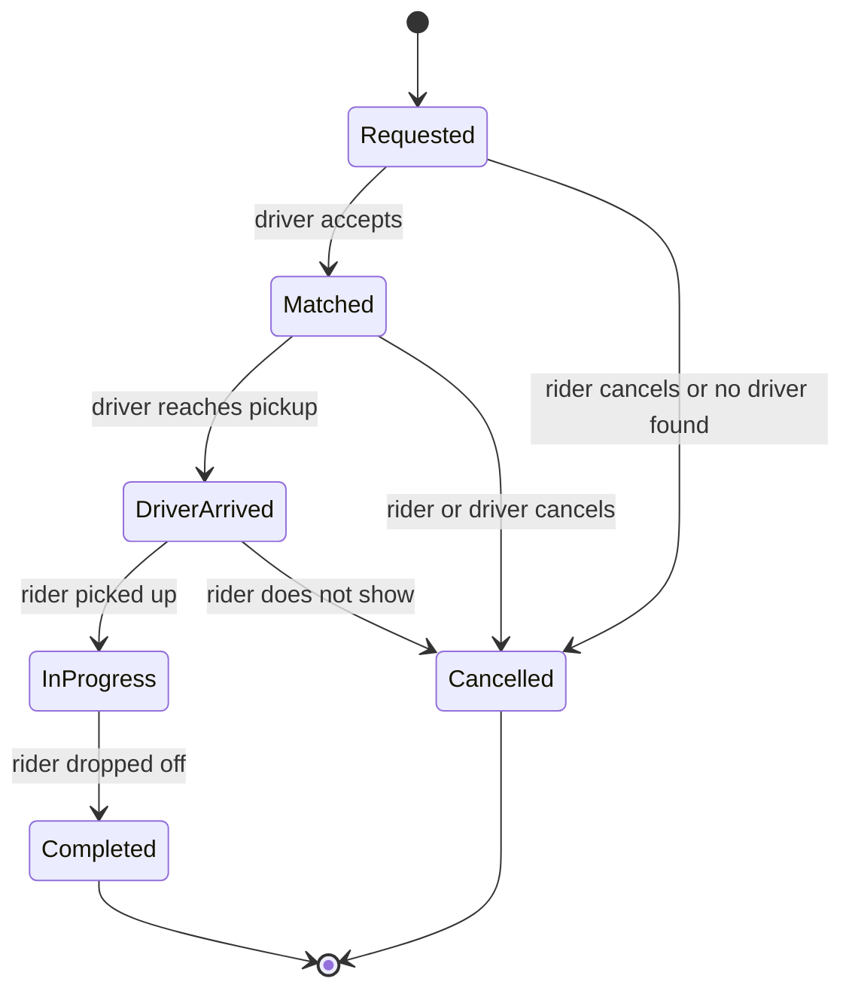
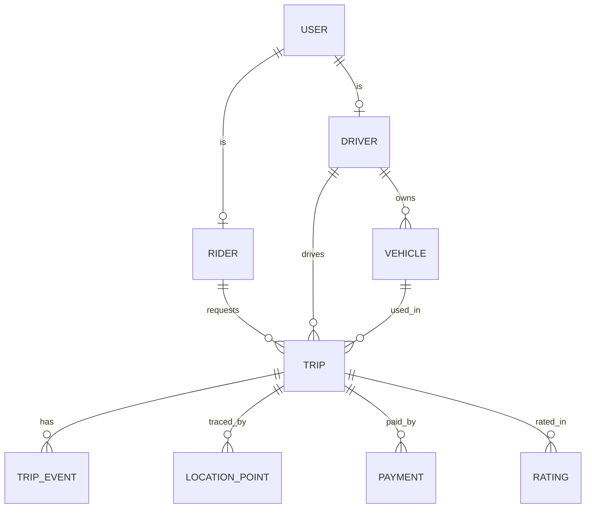
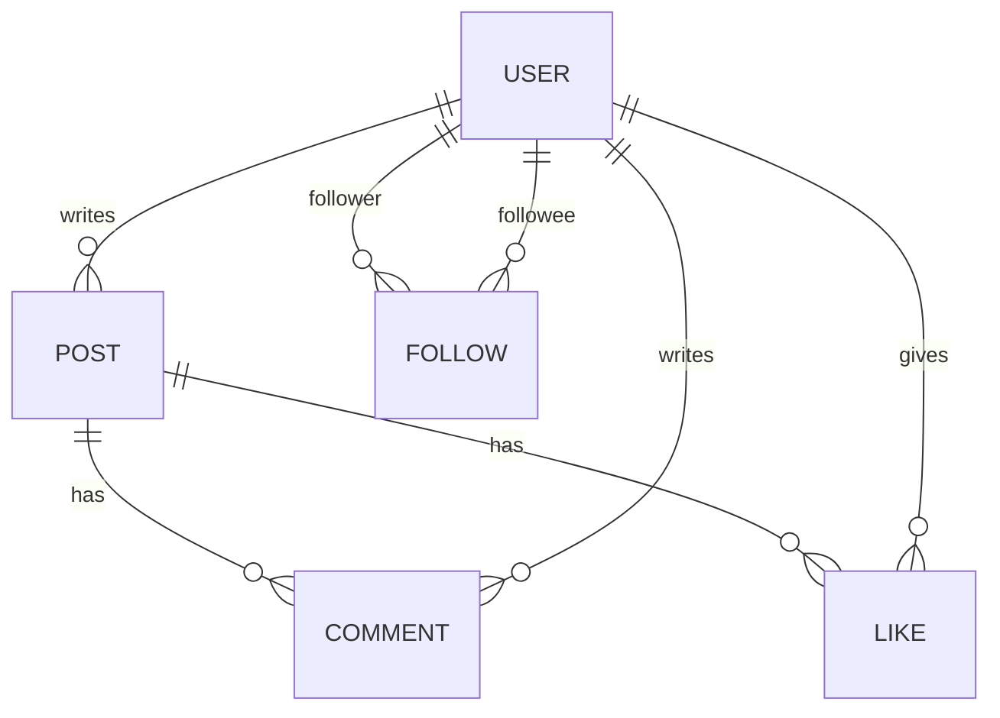

# Data modelling, worked: a ride-sharing trip, a social feed and an inventory system

> **Before this lesson:** read [Data modelling questions: entities, relationships and SQL versus NoSQL](#/lesson/thinking/data-modelling-basics) for tables, keys, relationships, normalisation and the families of database. The state-machine idea from [Modelling a device as a state machine](#/lesson/thinking/modelling-state-machines) is used for the trip.

## In plain words

An architect drawing a house starts from how people will live in it: where they cook, where they sleep, how they walk between rooms. The walls follow from the living. A data model is drawn the same way. You begin with what will be *asked* of the data — "show the driver's earnings this week", "show me the newest posts from people I follow", "how many of this item are left?" — and shape the tables so that those questions are easy and wrong answers are impossible.

This lesson works three prompts. Each brings out one idea that the bookshop example did not need:

- A **ride-sharing trip** is a record that *changes state over time* and whose history matters.
- A **social feed** is read enormously more often than it is written, which forces a decision about *computing at read time or preparing at write time*.
- An **inventory system** is about *counting correctly* when many people change the same number.

The framework from the previous lesson, in brief: clarify → entities → relationships → attributes and keys → main queries and indexes → history → storage choice → stress test.

## Worked model 1 — A ride-sharing trip

**Prompt:** *"Model the data for a trip in a ride-sharing app."* Ten minutes on paper, then compare.

<details><summary>Model answer</summary>

### Clarify

- One rider per trip, or shared rides? Assume one rider (shared rides noted as an extension).
- Do we store the route driven, or only start and end?
- Payment, ratings, cancellations?
- What must be reported later — rider history, driver earnings, disputes?

**Assume:** a rider requests; a driver is matched; the trip is driven; the rider pays and both may rate. We keep enough to settle a dispute months later.

### A trip moves through states



This matters for the model: some columns are empty until a certain state (`driver_id` is unknown while *Requested*), and we want to know *when* each step happened.

### Entities and relationships

| Entity | Notes |
|---|---|
| `Rider`, `Driver` | Two roles. A person could be both, so both point to a shared `User` |
| `Vehicle` | A driver may have several over time; a trip records the one used |
| `Trip` | The central record |
| `TripEvent` | One row per state change: the trip's history |
| `LocationPoint` | The driven route: many points per trip |
| `Payment` | One or more attempts per trip |
| `Rating` | Up to two per trip: rider→driver and driver→rider |



### The trip table

```sql
CREATE TABLE trips (
  id              BIGINT PRIMARY KEY,
  rider_id        BIGINT NOT NULL REFERENCES riders(id),
  driver_id       BIGINT REFERENCES drivers(id),      -- empty until matched
  vehicle_id      BIGINT REFERENCES vehicles(id),
  status          TEXT NOT NULL,                      -- the current state
  pickup_lat  DOUBLE PRECISION NOT NULL, pickup_lng  DOUBLE PRECISION NOT NULL,
  dropoff_lat DOUBLE PRECISION NOT NULL, dropoff_lng DOUBLE PRECISION NOT NULL,
  requested_at    TIMESTAMP NOT NULL,
  picked_up_at    TIMESTAMP,
  dropped_off_at  TIMESTAMP,
  distance_m      INTEGER,
  quoted_fare_cents INTEGER NOT NULL,
  final_fare_cents  INTEGER,
  currency        CHAR(3) NOT NULL,
  cancelled_by    TEXT,                               -- rider, driver, system
  cancel_reason   TEXT
);
CREATE TABLE trip_events (
  trip_id     BIGINT NOT NULL REFERENCES trips(id),
  seq         INTEGER NOT NULL,
  from_status TEXT, to_status TEXT NOT NULL,
  at          TIMESTAMP NOT NULL,
  actor       TEXT NOT NULL,
  PRIMARY KEY (trip_id, seq)
);
```

### Decisions to explain

- **Current state on the trip, full history in events.** `trips.status` answers "what is happening now?" quickly; `trip_events` answers "what happened, in what order, and who did it?" for support and disputes. The status column is a deliberate copy of the latest event, updated in the same transaction.
- **Facts frozen at the time.** The fare quoted, the fare charged, the currency and the vehicle used are stored on the trip. Pricing rules and the driver's car change; this trip's facts must not.
- **Timestamps in UTC**, with the city's time zone stored separately, because trips cross midnight and clock changes.
- **The route is a different kind of data.** A trip may produce a location point every few seconds: hundreds of rows per trip, billions overall, written constantly, read rarely and always "all points of trip X in time order". That is the textbook shape for a wide-column or time-series store, partitioned by `trip_id` and sorted by time — or a compressed file per trip once it ends. I would keep it out of the main relational database.
- **Payments are separate rows**, because a trip can have a failed attempt, a retry, a tip and a partial refund.
- **Ratings**: key on (trip_id, direction) so that each side rates at most once.

### Main queries and indexes

| Query | Index |
|---|---|
| A rider's trip history, newest first | `trips(rider_id, requested_at DESC)` |
| A driver's trips and earnings for a week | `trips(driver_id, dropped_off_at)` |
| The driver's current trip | a partial index on `driver_id` where status is active |
| Everything about one trip for support | primary keys of trips and trip_events |

Not in this model: "find drivers near me". Live driver positions change every few seconds and are queried by geography; they live in an in-memory spatial index, not in the trips database. Saying what does *not* belong is part of a good answer.

### Storage and stress

Relational for users, trips, payments and ratings: the rules matter, and completing a trip updates several rows together. A time-series or file store for routes.

- *Two drivers accept the same request.* Assign with a conditional update — set `driver_id` only where it is still empty and status is still Requested — and check that a row changed. Exactly one wins.
- *A driver may not be on two active trips.* Enforce with a unique constraint over active trips per driver.
- *Scale.* Trips divide naturally by city; that is the sharding key if one database is no longer enough.
- *Privacy.* Precise locations are sensitive: limit who can read routes, and reduce their precision or delete them after the dispute period.
- *Shared rides* would turn rider↔trip into many-to-many: a `trip_riders` table with each rider's own pickup, drop-off and fare.

</details>

## Worked model 2 — A social feed

**Prompt:** *"Model the data behind a social feed: users follow each other, post, and see a timeline of posts from the people they follow."*

<details><summary>Model answer</summary>

### Clarify

- Posts: text only, or media? Editable?
- Is following one-directional (like a news subscription) or mutual (like friendship)? Assume one-directional.
- Likes and comments in scope? Assume likes and comments, in a basic form.
- Feed order: newest first, or ranked? Assume newest first.
- Scale: how many users, and how lopsided — does anyone have millions of followers?

### Core entities



```sql
CREATE TABLE users   (id BIGINT PRIMARY KEY, handle TEXT NOT NULL UNIQUE, created_at TIMESTAMP NOT NULL);
CREATE TABLE posts   (id BIGINT PRIMARY KEY, author_id BIGINT NOT NULL REFERENCES users(id),
                      body TEXT NOT NULL, created_at TIMESTAMP NOT NULL,
                      like_count INTEGER NOT NULL DEFAULT 0, comment_count INTEGER NOT NULL DEFAULT 0);
CREATE TABLE follows (follower_id BIGINT NOT NULL REFERENCES users(id),
                      followee_id BIGINT NOT NULL REFERENCES users(id),
                      created_at TIMESTAMP NOT NULL,
                      PRIMARY KEY (follower_id, followee_id));
CREATE TABLE likes   (user_id BIGINT NOT NULL, post_id BIGINT NOT NULL, created_at TIMESTAMP NOT NULL,
                      PRIMARY KEY (user_id, post_id));
```

Points to make:

- `follows` is a many-to-many relationship **from users to users** — a table that joins a table to itself. The pair is the primary key, so nobody can follow the same account twice. A second index on `(followee_id, follower_id)` answers "who follows me?".
- The key of `likes` is the pair (user, post): liking twice is impossible *by construction*, and tapping "like" again is harmless — an idempotent operation designed into the data.
- `like_count` and `comment_count` are **denormalised counters**. Counting rows on every view of a popular post is too slow, so we keep a running total. They may briefly lag; a periodic job can recompute them from the real rows.

### The feed query, and why it does not scale

With these tables, a timeline is one query:

```sql
SELECT p.* FROM posts p
JOIN follows f ON f.followee_id = p.author_id
WHERE f.follower_id = :me
ORDER BY p.created_at DESC
LIMIT 20;
```

In words: find everyone I follow, gather their posts, sort by time, take twenty. This is called **fan-out on read**, or the *pull* model: the feed is assembled when someone asks for it. It is correct and simple, and it is where you should start. Its cost grows with the number of accounts a user follows, and it is paid on **every** timeline view — and timelines are viewed far more often than posts are written.

### The alternative: prepare the feed when a post is written

**Fan-out on write**, the *push* model: when Ada posts, add a small entry to the stored feed of each of her followers.

```sql
CREATE TABLE feed_entries (
  user_id    BIGINT NOT NULL,     -- whose feed this entry is in
  post_id    BIGINT NOT NULL,
  author_id  BIGINT NOT NULL,
  created_at TIMESTAMP NOT NULL,
  PRIMARY KEY (user_id, created_at, post_id)
);
```

Reading a timeline becomes "the newest twenty rows where `user_id` is me" — one lookup by key, fast and predictable. This table is the perfect fit for a wide-column or key-value store: partitioned by `user_id`, sorted by time.

The price moves to the writer. A post by someone with a thousand followers creates a thousand entries. A post by a celebrity with fifty million followers creates fifty million — slow, expensive, and mostly for people who will not open the app today.

| | Pull (fan-out on read) | Push (fan-out on write) |
|---|---|---|
| Work happens | When the feed is viewed | When a post is written |
| Read speed | Slower, varies | Fast, steady |
| Write cost | One row | One row per follower |
| Storage | Small | Large: every post copied by reference to many feeds |
| Weak spot | Users who follow thousands | Authors with millions of followers |
| New follow, delete, edit | Automatically reflected | Needs extra work to add or remove entries |

**The usual resolution is a hybrid:** push for ordinary authors; for the few authors with huge followings, do not fan out — fetch their recent posts at read time and merge them into the prepared feed. Also keep stored feeds only for recently active users and only the latest few hundred entries.

### Storage choice

- Users, follows, posts, comments: relational to begin with — relationships and rules.
- Stored feeds: a store keyed by user, sorted by time. The feed is a **derived view**: it can be rebuilt from posts and follows, so losing it is an inconvenience, not a disaster. Saying which data is the source of truth and which is derived is a mark of maturity.
- Pictures and video: file storage, with only the address in the post row.

### Stress

- *Deleting a post or blocking a user* must remove or hide entries in other people's stored feeds — filter at read time against the source of truth.
- *Pagination* must be by cursor (the timestamp and id of the last item seen); new posts arrive constantly, so offsets would shift.
- *Ranking* instead of newest-first changes the read path, not the tables.
- *Privacy*: private accounts mean the feed query must check that the follow was approved.

</details>

> [!INTERVIEW]
> "Fan-out on read versus fan-out on write, and a hybrid for accounts with very many followers" is one of the most frequently expected ideas in data-modelling and system-design interviews. State the simple pull version first, say when it stops being enough, then introduce push.

## Worked model 3 — An inventory system

**Prompt:** *"Model the inventory for a retailer with several warehouses."*

<details><summary>Model answer</summary>

### Clarify

- One location or many? Assume several warehouses.
- Do we need to know why stock changed — deliveries, sales, damage, corrections? Assume yes; auditors will ask.
- Are items reserved when added to a basket or when paid?
- Variants (size, colour)? Assume each sellable variant is its own item, called a **SKU** — stock-keeping unit, the code for one exact thing you can sell.

### The naive model and its weakness

```sql
CREATE TABLE stock (
  sku_id        BIGINT NOT NULL,
  warehouse_id  BIGINT NOT NULL,
  quantity      INTEGER NOT NULL CHECK (quantity >= 0),
  PRIMARY KEY (sku_id, warehouse_id)
);
```

One number per item per warehouse. It answers "how many are left?" and nothing else. When the shelf holds 37 and the table says 40, there is no way to find out why. It also invites the lost-update bug discussed below.

### The better model: a ledger of movements

Borrow the accountant's idea: never overwrite a balance; **record every movement** and derive the balance.

```sql
CREATE TABLE stock_movements (
  id            BIGINT PRIMARY KEY,
  sku_id        BIGINT NOT NULL REFERENCES skus(id),
  warehouse_id  BIGINT NOT NULL REFERENCES warehouses(id),
  delta         INTEGER NOT NULL,          -- +50 received, -1 sold, -3 damaged
  reason        TEXT NOT NULL,             -- receipt, sale, return, transfer, damage, count_adjust
  reference     TEXT,                      -- order id, delivery note, transfer id
  created_at    TIMESTAMP NOT NULL,
  created_by    TEXT NOT NULL
);
```

Quantity on hand is the sum of `delta` for that SKU and warehouse. Rows are only ever **added**, never changed — an *append-only* table. A mistake is corrected with a new opposite movement, so the history stays truthful.

Summing millions of rows on each page view would be slow, so keep the `stock` table as well, as a **cached balance** updated in the same transaction as each movement. The ledger is the source of truth; the balance is derived and can be rebuilt and checked against it at any time.

### Available is not the same as on hand

A customer has paid for an item that is still on the shelf. It is *on hand* and not *available*.

```sql
ALTER TABLE stock ADD COLUMN reserved INTEGER NOT NULL DEFAULT 0 CHECK (reserved >= 0);
-- available = quantity - reserved, and the database should enforce reserved <= quantity
CREATE TABLE reservations (
  id BIGINT PRIMARY KEY, sku_id BIGINT NOT NULL, warehouse_id BIGINT NOT NULL,
  order_id BIGINT NOT NULL, quantity INTEGER NOT NULL CHECK (quantity > 0),
  status TEXT NOT NULL,                    -- held, shipped, released
  expires_at TIMESTAMP
);
```

A reservation holds stock for an order; shipping turns it into a negative movement; cancelling or expiry releases it. Reserving at basket time protects shoppers but lets abandoned baskets lock stock, so those reservations must expire; reserving at payment is simpler and occasionally disappoints someone at checkout. That is a business trade-off to surface, not to decide alone.

### Other entities

`skus` (id, product_id, attributes, barcode), `products`, `warehouses`, and `transfers` — a move between warehouses is a pair of movements, minus in one and plus in the other, written in one transaction so that goods are never duplicated or lost on paper.

### The concurrency problem

Two orders arrive for the last unit at the same moment. Each program reads "quantity = 1", decides there is enough, and writes "quantity = 0". Both orders are confirmed; one cannot be fulfilled. This is a **lost update**. Three standard defences:

1. **A conditional update** — let the database check and change in one step: `UPDATE stock SET reserved = reserved + 1 WHERE sku_id = ? AND warehouse_id = ? AND quantity - reserved >= 1`, then see whether a row was changed. The simplest and usually the best.
2. **Optimistic locking** — each row has a `version` number; an update says "change it only if the version is still 7" and retries if someone else got there first.
3. **Pessimistic locking** — lock the row while you work (`SELECT … FOR UPDATE`), making others wait.

And the constraint `CHECK (quantity >= 0)` remains as a last line of defence: whatever the code does, the database refuses to go negative.

### Queries, storage, stress

| Query | Served by |
|---|---|
| Available quantity of a SKU, per warehouse and in total | `stock` primary key |
| History of a SKU | `stock_movements(sku_id, warehouse_id, created_at)` |
| Items below their reorder level | a column `reorder_level` and an index or nightly report |
| Open reservations of an order | `reservations(order_id)` |

Storage: relational — the whole point is transactions and constraints. The movement table grows without limit, so partition it by month and archive old partitions.

Stress: a flash sale concentrates thousands of updates on one row; a queue in front of that item, or splitting its stock into several buckets, relieves it. A physical stock count that disagrees with the system is recorded as a `count_adjust` movement — the discrepancy becomes data to investigate.

</details>

## Patterns across the three

| Pattern | Trip | Feed | Inventory |
|---|---|---|---|
| Current value plus history | `status` + `trip_events` | — | `stock` + `stock_movements` |
| Facts frozen at the time | Fare, vehicle | — | Movement reason and reference |
| Source of truth versus derived data | Events → status | Posts and follows → stored feeds | Ledger → balance |
| Deliberate denormalisation | Status column | Counters, feed entries | Cached balance |
| The race to guard | Two drivers accept | Double like | Two buyers, last unit |
| Data that belongs elsewhere | Route points, live positions | Media files | — |

## Summary

- Model from the questions the data must answer.
- For records that change state, keep the current state for speed and an append-only history for truth.
- Store facts as they were at the moment — prices, fares, addresses — even when it resembles duplication.
- Distinguish the source of truth from derived views; derived data may be denormalised because it can be rebuilt.
- Feeds: pull is simple, push is fast to read, a hybrid handles accounts with huge followings.
- Counting under concurrency needs a conditional update or a version check, with a database constraint as the backstop.
- Say which data does not belong in the main database at all.

## Glossary

| Term | Meaning |
|---|---|
| State | The current stage of a record that moves through steps |
| Event table | A table with one row per change, kept as history |
| Append-only | Rows are added and never modified |
| Ledger | An append-only record of movements from which a balance is derived |
| Source of truth | The data from which other data can be rebuilt |
| Derived data | Data computed from the source of truth and stored for convenience |
| Fan-out on read (pull) | Assembling a feed when it is requested |
| Fan-out on write (push) | Adding a post to each follower's stored feed when it is written |
| SKU | Stock-keeping unit: the code for one exact sellable item |
| Reservation | Stock set aside for an order and not yet shipped |
| Lost update | Two writers overwrite each other's change because both read the old value |
| Optimistic locking | Updating only if a version number is unchanged, retrying otherwise |
| Pessimistic locking | Locking a row so that others must wait |
| Partition key | The value that decides where a row is stored and how it is found |

## Check yourself

```quiz
[
  {"q": "Why keep both a status column on the trip and a separate table of trip events?",
   "options": ["It is redundant and should be avoided", "The status answers 'what now' quickly; the events record what happened, when and by whom", "Databases require two tables", "To save storage"],
   "answer": 1,
   "explain": "Current state serves fast reads; an append-only history serves audit and disputes. They are updated together."},
  {"q": "Where should the thousands of location points of each trip's route be stored?",
   "options": ["As a comma-separated string on the trip row", "In a store suited to high-volume, time-ordered data keyed by trip, or as a file per trip", "In the users table", "Nowhere"],
   "answer": 1,
   "explain": "It is write-heavy, rarely read, and always fetched by trip in time order — a different shape from transactional records."},
  {"q": "What is fan-out on write?",
   "options": ["Building a feed when the user opens the app", "When a post is created, adding an entry to each follower's stored feed", "Compressing posts", "Deleting old posts"],
   "answer": 1,
   "explain": "The work is moved to write time so that reading a feed is a single lookup."},
  {"q": "Why is pure fan-out on write a problem for an account with 50 million followers?",
   "options": ["The post is too long", "One post triggers tens of millions of feed writes, many for inactive users", "Followers cannot be counted", "It breaks the primary key"],
   "answer": 1,
   "explain": "Write cost is proportional to follower count; hybrids fetch such authors' posts at read time instead."},
  {"q": "What does a stock ledger give that a single quantity column does not?",
   "options": ["Faster reads", "A history explaining every change, from which the balance can be rebuilt and checked", "Smaller tables", "Automatic reordering"],
   "answer": 1,
   "explain": "Each movement records how much, why and by whom; the balance is derived from them."},
  {"q": "Two buyers try to purchase the last unit at once and both succeed. What is this bug called?",
   "options": ["A lost update", "A delete anomaly", "A redirect loop", "A cache miss"],
   "answer": 0,
   "explain": "Both read the same old value and wrote results based on it; a conditional update or version check prevents it."},
  {"q": "Which statement about a stored feed is right?",
   "options": ["It is the source of truth for posts", "It is derived data that can be rebuilt from posts and follows", "It must never be deleted", "It replaces the posts table"],
   "answer": 1,
   "explain": "Because it is derived, it can be denormalised and even lost without losing real information."}
]
```

> **Source:** Martin Fowler, "Event Sourcing" and "Aggregate Oriented Database" (https://martinfowler.com/eaaDev/EventSourcing.html, https://martinfowler.com/bliki/AggregateOrientedDatabase.html); feed fan-out discussion in Donne Martin's System Design Primer (https://github.com/donnemartin/system-design-primer); PostgreSQL documentation on constraints and explicit locking (https://www.postgresql.org/docs/current/ddl-constraints.html, https://www.postgresql.org/docs/current/explicit-locking.html). Models, SQL and wording are original.
