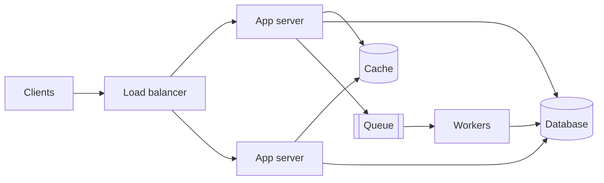
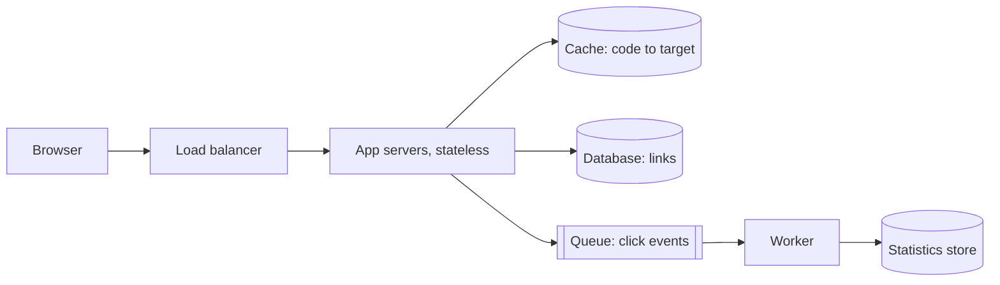
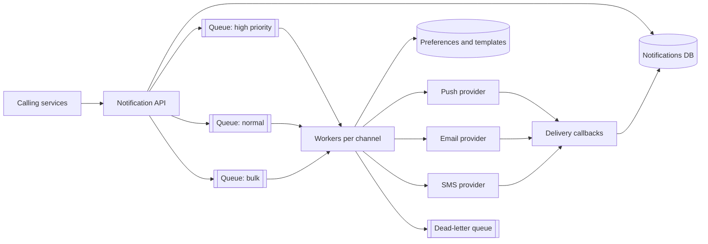

# Lightweight system design: a repeatable template, a URL shortener and a notification service

> **Before this lesson:** read [Back-of-envelope estimation](#/lesson/thinking/estimation-fermi) for sizing, [API design questions: the building blocks](#/lesson/thinking/api-design-principles) for endpoints, and [Data modelling questions](#/lesson/thinking/data-modelling-basics) for tables and database families. Every infrastructure term is defined here on first use.

## In plain words

A food stall and a large restaurant both serve meals, but the restaurant cannot be one person with one pan. It needs a front desk that seats people, several cooks so that one being busy does not stop service, a pantry so that ingredients are not fetched from the market for every order, and a ticket rail where orders wait when the kitchen is behind. Nobody invents those parts from nothing; they are the standard answers to "what if many people come at once?"

**System design** is the same exercise for software: arranging standard parts — servers, databases, caches, queues — so that a service keeps working as users multiply and as individual machines fail. The interview prompt is one line, *"design a URL shortener"*, and for junior and mid-level candidates the expectation is modest: a sensible first design, the main trade-offs, and good reactions to "what if?". Nobody expects you to have built such a system. They want to see you reason in an organised way, which is what the template below provides.

## The standard parts

| Part | What it is | Restaurant picture | Why you add it |
|---|---|---|---|
| **Client** | The app or browser making requests | The diner | — |
| **Server** | A program that answers requests | A cook | Does the work |
| **Load balancer** | Shares requests among several servers | The host seating guests at free tables | More capacity; survive a server failing |
| **Database** | Durable storage | The stockroom ledger | Data must survive restarts |
| **Cache** | Fast temporary store of recent answers | Popular dishes kept warm on the pass | Avoid repeating expensive work |
| **Queue** | A waiting line for work to be done later | The ticket rail | Absorb bursts; do slow work in the background |
| **Worker** | A program that takes jobs from a queue | A prep cook working through tickets | Process background jobs |
| **Object storage** | A store for large files | The walk-in fridge | Pictures and videos do not belong in a database |
| **CDN** | Servers around the world holding copies of files | Branch kitchens near customers | Deliver files quickly, far from the origin |

Two more ideas are used constantly.

**Scaling up and scaling out.** *Scaling up* (vertical) means a bigger machine; it is simple and has a ceiling. *Scaling out* (horizontal) means more machines; it has no ceiling, but it requires servers to be **stateless** — to keep nothing in their own memory between requests, so that any server can handle any request. State lives in the database or cache instead.

**Replication and sharding.** *Replication* keeps copies of the same data on several machines: for safety, and so that reads can be spread out. *Sharding* splits *different* data across machines — users A–M here, N–Z there — when one machine cannot hold or serve it all.

## The template

Six steps, with rough timings for a 35-minute discussion.

| # | Step | Minutes | Output |
|---|---|---|---|
| 1 | **Requirements** | 4 | What it must do (functional) and how well (non-functional); what is out of scope |
| 2 | **Estimates** | 3 | Requests per second, storage, read-to-write ratio |
| 3 | **Interface** | 3 | The two or three API calls that matter |
| 4 | **Data model** | 4 | Main tables or records, and the database choice |
| 5 | **High-level design** | 8 | A box-and-arrow diagram, and a walk-through of one request |
| 6 | **Deep dives and trade-offs** | 12 | Bottlenecks, failures, the one hard problem of this system |

**Functional requirements** are features: "create a short link". **Non-functional requirements** are qualities: how fast (**latency**), how often it may be down (**availability**), how much traffic (**scale**), and whether everyone must see the same data at the same moment (**consistency**).

Always **start with the simplest design that works** — one server and one database — and then improve it in response to a named problem. Jumping straight to twelve boxes is the commonest way to lose the interviewer.



Most beginner designs are variations of this picture. Learn to draw it and to explain each arrow.

## Worked design 1 — A URL shortener

**Prompt:** *"Design a service like a link shortener."* Take fifteen minutes with the template before opening.

<details><summary>Model answer</summary>

### 1. Requirements

**Functional.** Given a long address, return a short one. Visiting the short one redirects to the long one. Optional: custom codes, expiry, click counts.

**Non-functional.** Redirects must be fast (tens of milliseconds) and highly available — a dead short link is a broken promise printed on a poster. Creating may be slower. Once a link is created it must never be lost.

**Out of scope.** User accounts, billing, analytics dashboards.

### 2. Estimates

Assume 100 million new links per month and 100 redirects for every link created.

- Writes: $10^8$ per month ÷ $2.5 \times 10^6$ seconds ≈ 40 per second.
- Reads: 100 times that ≈ 4,000 per second on average; plan for 12,000 or more at peak.
- Storage: about 500 bytes per link. Over five years: $10^8 \times 60 \times 500 = 3 \times 10^{12}$ bytes = 3 TB.

**What the numbers say.** Storage is small. Writes are trivial. The system is **read-heavy** by a factor of a hundred. So the design should make reads cheap.

### 3. Interface

- `POST /links` with the long address → the short code.
- `GET /{code}` → a redirect.

### 4. Data model

One record: `code` (primary key), `target_url`, `created_at`, `expires_at`, `owner_id`.

Every read is "fetch by code" — a lookup by one key, with no relationships. That fits a key-value or wide-column store, which scales out easily. A relational database with an index on `code` also handles this size comfortably. I would say both are defensible; I'll pick a relational database for now, because 3 TB and 40 writes per second do not need anything exotic, and move to a sharded key-value store if growth demands it.

### 5. High-level design



**A redirect, step by step.** The browser asks for `/k9Xq2`. The load balancer picks an app server. The server looks in the cache; on a **hit** it returns the redirect at once. On a **miss** it reads the database, stores the answer in the cache, and returns. It also drops a "clicked" event on a queue, so that counting clicks never slows the redirect.

### 6. Deep dives

**How is the short code generated?** This is *the* question for this system. With 62 possible characters (a–z, A–Z, 0–9), a 7-character code has $62^7 \approx 3.5 \times 10^{12}$ combinations — far more than the 6 billion links expected.

| Method | How | Good | Weak |
|---|---|---|---|
| **Hash the long address** and take the first characters | A hash is a function that turns any input into a fixed-size scramble | No coordination needed | Different addresses can collide on the same prefix; must check and retry |
| **Random code** | Pick 7 random characters | Unpredictable | Must check the database for a collision each time |
| **Counter, encoded in base 62** | Hand out the next number and write it in 62-character digits | Never collides; short | Codes are guessable in sequence; needs a counter shared by all servers |

Base 62 is like writing a number with 62 digit symbols instead of ten: the number 125 becomes `21` (2 × 62 + 1). I would use the counter approach with a twist to remove the weak points: each app server reserves a **block** of, say, a thousand numbers from a small counter service, so that there is no shared bottleneck per request; and the number is scrambled before encoding so that codes do not reveal how many links exist or let anyone step through them.

**Making reads fast: the cache.** Popularity is very uneven — a small share of links receives most clicks — so caching the hot ones removes most database reads. Entries can be kept a long time because targets rarely change; when a link is edited or deleted, remove its cache entry. If the cache is empty after a restart, the database briefly takes the full load; it must be sized to survive that.

**Availability.** Several stateless app servers behind the load balancer; a database with a **replica** (a continuously updated copy) that can take over. Reads may be served from replicas. A replica can be a moment behind the primary — acceptable here, except for one case: a link read immediately after creation. Serve that read from the primary, or put the new link in the cache at creation time.

**Abuse.** Rate limits on creation; checks against known harmful destinations.

**If growth continues.** Shard by code: a hash of the code picks the shard. Every read knows the code, so every read reaches exactly one shard.

**Trade-offs stated.** `302` redirects so that clicks reach us, at the cost of more traffic than cacheable `301`s. Click counts are processed in the background, so they lag by seconds and a crash could lose a few — acceptable for statistics, never for the links themselves.

</details>

## Worked design 2 — A notification service

**Prompt:** *"Design a service that sends notifications — push, email and SMS — on behalf of other teams in the company."*

This system is the opposite of the shortener: nothing waits for an immediate answer, the work is done by outside providers that fail and throttle, and the central difficulty is delivering **once** — not zero times, not five.

<details><summary>Model answer</summary>

### 1. Requirements

**Functional.** Other services call "notify user 42 about event X". The service chooses channels according to the user's preferences, fills a template, and sends through an outside provider for each channel. It records what was sent and whether delivery succeeded. Users can switch categories off.

**Non-functional.** Reliable: an accepted notification is not silently lost. Not strictly real-time, but security codes should arrive within seconds while marketing may wait. No duplicates that annoy users. Must absorb bursts — a campaign to ten million users.

**Out of scope.** The content of campaigns; a user-facing inbox.

### 2. Estimates

Assume 10 million users and 5 notifications per user per day: 50 million a day ≈ 600 per second on average. But a campaign sends 10 million at once — a burst thousands of times the average. **The design must be built around bursts**, and that points straight at a queue.

### 3. Interface

```text
POST /notifications
Idempotency-Key: order-8841-shipped
{"user_id": 42, "type": "order_shipped", "data": {"order": "8841"}, "priority": "normal"}
→ 202 Accepted {"notification_id": "n_771"}
```

`202 Accepted` means "taken, will be done" — the caller does not wait for an email to be delivered.

### 4. Data model

| Record | Fields |
|---|---|
| `notification` | id, user, type, data, priority, created_at, idempotency key |
| `delivery` | notification id, channel, status (queued, sent, delivered, failed), attempts, provider reference |
| `preference` | user, category, channel, enabled; quiet hours |
| `template` | type, channel, language, text |
| `device_token` | user, device, token (the address a push provider needs to reach one phone) |

### 5. High-level design



**One notification, step by step.** A service calls the API. The API validates, checks the idempotency key, stores the notification, puts a job on the queue matching its priority, and answers `202`. A worker takes the job, loads the user's preferences, drops it if the user opted out or it is within quiet hours (or delays it), renders the template in the user's language, and calls the provider. The result is recorded. Providers later report "delivered" or "bounced" through callbacks, which update the delivery record.

### 6. Deep dives

**Why a queue?** It **decouples** the callers from the slow, unreliable part. The API stays fast whatever the providers are doing; a burst of ten million sits in the queue and is worked off at the rate the providers allow; and if a worker crashes, its job returns to the queue for another worker.

**Separate queues by priority.** With one queue, a password-reset code would wait behind ten million marketing messages. Separate queues with their own workers keep urgent traffic moving.

**At-least-once delivery and duplicates.** Queues normally guarantee that a job is delivered *at least* once: if a worker takes a job, sends the email, and crashes before confirming, the job is delivered again — and the user gets two emails. *Exactly once* cannot be guaranteed across a network; what can be done is to make repeats harmless:

- The caller's idempotency key stops the same event being accepted twice.
- Before sending, the worker records "sending n_771 by email" with a unique constraint; a second worker that picks up the same job sees the record and skips.
- Where providers accept an idempotency reference, pass one.

**Retries.** Provider calls fail. Retry transient failures — timeouts, "try later" — with **exponential backoff** (wait 1 s, then 2, 4, 8…) and a little randomness, called **jitter**, so that thousands of workers do not retry in step. Do not retry permanent failures: an invalid phone number will be invalid again. After a fixed number of attempts move the job to a **dead-letter queue**, a holding area for jobs that keep failing, where a person can inspect them.

**Provider limits and outages.** Providers enforce rate limits; workers send at a controlled rate per provider. If one provider is down, a **circuit breaker** — a switch that stops calling a failing dependency for a while instead of hammering it — pauses that channel, and a second provider takes over where available.

**User experience rules.** Preferences and unsubscribes are honoured (in many places by law). A per-user cap stops five services sending twenty messages in an hour. Invalid device tokens reported by the provider are removed.

**Observability.** Queue length and the age of the oldest job (is the system keeping up?), send success rate per provider and per channel, time from request to delivery.

**Trade-offs stated.** Asynchronous sending means the caller cannot know at once whether delivery succeeded — it queries the status or receives a callback. I choose possible rare duplicates over possible losses for most categories; for a few, such as payment reminders, I would lean harder on de-duplication.

</details>

> [!INTERVIEW]
> Notice how each design followed from one sentence in the estimates: "it is read-heavy" led to a cache; "it comes in bursts and nobody waits for the answer" led to a queue. Saying that link aloud — *"the numbers tell me this is X, so I'll build around Y"* — is the single most persuasive habit in system design interviews.

## The follow-ups you will always get

| "What if…" | A reasonable reply |
|---|---|
| …traffic grows ten times? | Find the first bottleneck from the estimates. Add app servers (they are stateless); add read replicas or a cache for reads; shard for writes or data size |
| …a server dies? | The load balancer stops sending to it; others carry on. That is why servers hold no state |
| …the database dies? | Fail over to a replica; say what data could be lost in the gap and whether that is acceptable |
| …the cache dies? | The system slows but works; the database must survive the surge, or we refill the cache gradually |
| …one user or key is extremely popular? | A **hot key**: cache it, give it dedicated capacity, or split its load |
| …two requests conflict? | Make the operation idempotent or use a conditional update |
| How would you monitor it? | Request rate, error rate, latency and saturation per component; alerts on user-visible symptoms |

## Common mistakes

- Drawing boxes before asking what the system must do.
- No numbers, so no reason for any design choice.
- Starting complex. Sharding, five caches and a message bus for 40 writes per second.
- Naming technologies instead of explaining roles. "Use Kafka" is not a design; "a queue, because bursts arrive faster than providers accept" is.
- Never mentioning failure.
- No trade-offs: every real choice gives something up.

## Summary

- System design arranges standard parts — load balancer, stateless servers, database, cache, queue, workers, file storage, CDN — to handle growth and failure.
- Template: requirements → estimates → interface → data model → high-level design → deep dives and trade-offs. Start simple and improve in response to a named problem.
- URL shortener: read-heavy, so cache; the key question is unique code generation (a counter in base 62, issued in blocks and scrambled).
- Notification service: bursty and asynchronous, so queues by priority; at-least-once delivery made safe by idempotency; retries with backoff, a dead-letter queue, a circuit breaker.
- Let the estimates justify the architecture, and always say what you gave up.

## Glossary

| Term | Meaning |
|---|---|
| Load balancer | Distributes incoming requests across several servers |
| Stateless server | A server that keeps nothing between requests, so any server can handle any request |
| Scaling up / out | A bigger machine / more machines |
| Replication | Keeping copies of the same data on several machines |
| Replica | One such copy, usually used for reads and as a standby |
| Sharding | Splitting different data across machines by a key |
| Cache hit / miss | The answer was / was not found in the cache |
| Queue | A durable waiting line for jobs |
| Worker | A process that takes jobs from a queue and performs them |
| Latency | Time to answer a request |
| Availability | The share of time a service is working |
| Hash | A function that maps any input to a fixed-size value |
| Base 62 | Writing numbers using 62 symbols: digits and upper- and lower-case letters |
| At-least-once delivery | A job may be delivered more than once but is not lost |
| Exponential backoff | Waiting longer after each failed attempt |
| Jitter | Random variation added to waits so that retries do not synchronise |
| Dead-letter queue | A holding place for jobs that repeatedly fail |
| Circuit breaker | A mechanism that stops calling a failing dependency for a time |
| Hot key | One item receiving a disproportionate share of traffic |

## Check yourself

```quiz
[
  {"q": "Why should application servers be stateless when scaling out?",
   "options": ["Stateless code is shorter", "Any server can then handle any request, so servers can be added or lost freely", "It removes the need for a database", "It makes requests encrypted"],
   "answer": 1,
   "explain": "If a server remembered things between requests, a user's next request would have to reach the same machine."},
  {"q": "A system has 100 reads for every write. Which part does that most strongly suggest adding?",
   "options": ["A queue", "A cache or read replicas", "A second load balancer", "A dead-letter queue"],
   "answer": 1,
   "explain": "Read-heavy workloads benefit from serving repeated reads from memory or from copies of the data."},
  {"q": "Why does the notification service answer 202 Accepted instead of waiting for delivery?",
   "options": ["202 is faster to type", "Sending depends on slow, unreliable providers; the work is queued and done in the background", "It hides errors", "Email cannot be confirmed"],
   "answer": 1,
   "explain": "Decoupling the caller from the slow step keeps the API fast and lets bursts be absorbed by the queue."},
  {"q": "How many distinct 7-character codes exist with 62 possible characters?",
   "options": ["About 434", "About 3.5 million", "About 3.5 trillion", "Exactly 62"],
   "answer": 2,
   "explain": "62^7 ≈ 3.5 × 10^12, far more than billions of links."},
  {"q": "A worker sends an email and crashes before acknowledging the job. What happens with at-least-once delivery, and what prevents harm?",
   "options": ["The job is lost; nothing can be done", "The job is redelivered; an idempotency record lets the next worker skip the send", "The queue deletes itself", "The email is unsent automatically"],
   "answer": 1,
   "explain": "Redelivery is expected; de-duplication by a unique record makes the repeat harmless."},
  {"q": "Why add jitter to retry delays?",
   "options": ["To make logs harder to read", "So many clients do not all retry at the same instant and overload the recovering service", "To reduce security", "To save memory"],
   "answer": 1,
   "explain": "Synchronised retries arrive as waves; random spread smooths them."},
  {"q": "What is the best first design to present for almost any system?",
   "options": ["A fully sharded, multi-region architecture", "The simplest thing that works, then improvements justified by specific problems", "Whatever the largest company uses", "No design until all details are known"],
   "answer": 1,
   "explain": "Starting simple shows judgment; each added component should answer a named need from the requirements or estimates."}
]
```

> **Source:** The four-step approach and practice list in Donne Martin's System Design Primer (https://github.com/donnemartin/system-design-primer); Google SRE Book, "Handling Overload" and "Addressing Cascading Failures" — retries, backoff and load shedding (https://sre.google/sre-book/handling-overload/, https://sre.google/sre-book/addressing-cascading-failures/); Martin Fowler, "Circuit Breaker" (https://martinfowler.com/bliki/CircuitBreaker.html). Designs, estimates and wording are original.
