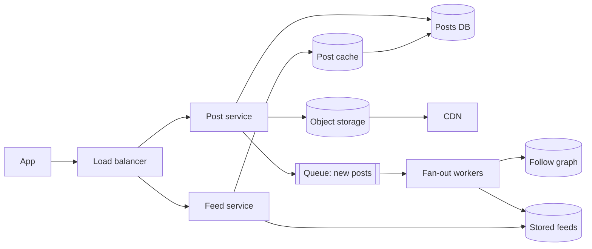
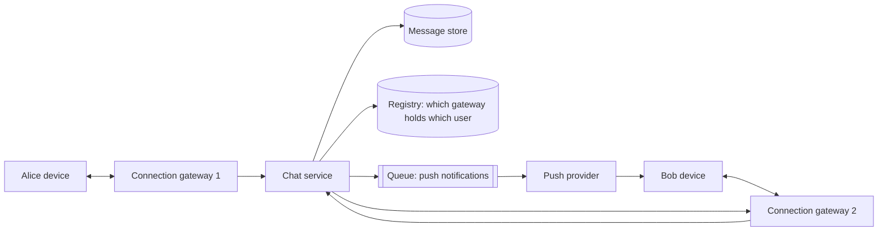

# Lightweight system design: a news feed, a chat service and the follow-ups that always come

> **Before this lesson:** read [Lightweight system design: a repeatable template](#/lesson/thinking/system-design-template) for the six-step template and the standard parts, and the social-feed section of [Data modelling, worked](#/lesson/thinking/data-modelling-worked) for fan-out on read and on write.

## In plain words

The last lesson's two systems were like a vending machine and a post office: one hands something back instantly, the other accepts a parcel and delivers it later. This lesson adds two more everyday shapes.

A **news feed** is a daily newspaper printed specially for each reader. The hard part is not storing articles; it is assembling a different front page for every person, quickly, millions of times a day.

A **chat service** is a telephone exchange. The hard part is that messages have to travel *to* people who did not ask at that moment — the server must be able to push — and that they must arrive in order, once, even when a phone goes through a tunnel.

After those two designs, the lesson collects the follow-up questions that interviewers ask about nearly every system, with a way of answering each. If you are short of time, that last section gives the most value per minute.

The template, as a reminder: **requirements → estimates → interface → data model → high-level design → deep dives and trade-offs.**

## Worked design 1 — A news feed

**Prompt:** *"Design the home feed of a social app."* Fifteen minutes with the template first.

<details><summary>Model answer</summary>

### 1. Requirements

**Functional.** Users follow others. Users post text with optional pictures. Opening the app shows recent posts from followed accounts, newest first, loaded a page at a time.

**Non-functional.** Opening the feed should feel instant — a couple of hundred milliseconds. It is acceptable for a new post to take a few seconds to appear in followers' feeds. The service should stay up even if parts are degraded; a slightly stale feed is better than an error.

That last sentence is a real design decision. The feed does not need **strong consistency** (everyone sees exactly the same latest data at once). **Eventual consistency** — everyone catches up within a short time — is enough, and it buys speed and availability.

**Out of scope.** Ranking by a model, advertisements, search.

### 2. Estimates

Assume 50 million daily users, each opening the feed 10 times a day and posting once every two days.

- Feed reads: $5 \times 10^8$ per day ≈ 6,000 per second average, perhaps 20,000 at peak.
- Posts: $2.5 \times 10^7$ per day ≈ 300 per second.
- Read-to-write ratio: about 20 to 1.
- Average followers: 200. So in a push design each post creates about 200 feed entries: 60,000 small writes per second.

**What the numbers say.** Read-heavy, with a strict latency target. Prepare feeds in advance; do not compute them on demand.

### 3. Interface

- `POST /posts` → create.
- `GET /feed?limit=20&cursor=…` → one page, with a cursor for the next.
- `POST /users/{id}/follow`.

### 4. Data model

Posts, users and follows as in the data-modelling lesson. A **stored feed** per user: a short list of (post id, author id, time), newest first, capped at a few hundred entries, kept in a fast key-value store or cache. Pictures go to object storage and are served through a CDN.

### 5. High-level design



**Writing a post.** The post service stores the post and uploads media, then puts "new post by Ada" on a queue and answers the user at once. Fan-out workers take the job, look up Ada's followers, and add the post's id to each follower's stored feed.

**Reading a feed.** The feed service reads the user's stored feed — a single key lookup returning post ids — then fetches the posts themselves from a post cache (falling back to the database), and returns the page.

Storing only ids in feeds, with post contents in one place, means an edited or deleted post is corrected everywhere at once.

### 6. Deep dives

**Accounts with millions of followers.** Fanning one post out to fifty million feeds is slow and wasteful. Hybrid: accounts above a follower threshold are not fanned out. Instead, at read time the feed service fetches recent posts from the handful of such accounts the reader follows and merges them with the stored feed. Most users follow only a few, so the extra read work is small.

**Inactive users.** Preparing feeds for people who have not opened the app in a month is wasted work. Keep stored feeds only for recently active users; build a returning user's feed on demand with the pull query, then resume pushing.

**Pagination.** New posts arrive all the time, so "page 2" by offset would repeat items. The cursor is the time and id of the last post shown: "give me entries older than this".

**Failures.**

| Failure | Behaviour |
|---|---|
| Fan-out workers fall behind | Posts appear late; the queue holds the work. Monitor the age of the oldest job |
| The stored-feed store loses data | Rebuild from posts and follows — it is derived data |
| The post cache is cold | Slower reads from the database for a while |
| The post database's primary fails | Fail over to a replica; briefly, no new posts |

**Deleting, blocking, privacy.** The feed service filters every page against current rules — post still exists, author not blocked, account still followed — because stored feeds may be seconds out of date.

**Trade-offs stated.** Push makes reads fast and writes expensive, and uses more storage. Eventual consistency means I may not see my friend's post for a few seconds — but I should always see *my own* post immediately, so the app shows it locally at once (sometimes called *read-your-own-writes*).

</details>

## Worked design 2 — A chat service

**Prompt:** *"Design a messaging service: one-to-one and small-group chat."*

<details><summary>Model answer</summary>

### 1. Requirements

**Functional.** Send and receive text messages one-to-one and in groups of up to a few hundred. See messages in real time while online. Receive missed messages after being offline. Show delivered and read marks. Use several devices.

**Non-functional.** Low latency — under half a second from send to arrival. **No lost messages**, no duplicates shown, and a consistent order within a conversation. High availability.

**Out of scope.** Voice and video calls, end-to-end encryption details, media processing.

### 2. Estimates

Assume 20 million daily users sending 40 messages a day each: $8 \times 10^8$ messages a day ≈ 10,000 per second average. At 200 bytes each that is 160 GB per day, about 60 TB per year before replication — large, append-only, and always read "latest messages of conversation X". And about 10 million devices connected at the same time.

**What the numbers say.** Write-heavy, with very many simultaneous long-lived connections. Storage should be partitioned by conversation and sorted by time: a wide-column store fits.

### 3. The key question: how does the server reach the client?

Ordinary web requests go one way: the client asks, the server answers. In chat, the server must deliver a message when the *other* person sends it. Three techniques:

| Technique | How it works | Verdict |
|---|---|---|
| **Polling** | The client asks "anything new?" every few seconds | Simple; wasteful and slow |
| **Long polling** | The client asks; the server holds the request open until there is news | Better; still one request per message |
| **WebSocket** | The client opens one connection that stays open; either side can send at any time | The usual choice for chat |

A **WebSocket** is a lasting two-way connection — a telephone line held open, where ordinary requests are like letters.

### 4. Data model

| Record | Key and fields |
|---|---|
| `conversation` | id, type (direct or group), created_at |
| `member` | (conversation_id, user_id), joined_at, last_read_message_id |
| `message` | (conversation_id, message_id), sender_id, body, sent_at, client_message_id |

Message ids increase within a conversation, so that sorting by id gives the order. `last_read_message_id` per member is all that is needed for unread counts and read marks — one number, not a flag on every message.

### 5. High-level design



**Connection gateways** hold the open WebSockets — hundreds of thousands each. They are the one deliberately *stateful* part: a given user's connection lives on one particular gateway. A **registry** records which gateway each connected user is on.

**Alice sends "hello" to Bob.**

1. Alice's app sends the message over her WebSocket with a `client_message_id` it invented.
2. The chat service **stores the message first**, assigning the next message id in that conversation.
3. It acknowledges to Alice: "stored, id 5012". Her app shows one tick.
4. It looks Bob up in the registry. If he is connected, it forwards the message to his gateway, which pushes it down his WebSocket.
5. Bob's app acknowledges receipt; Alice sees "delivered".
6. If Bob is not connected, a job goes on a queue for a mobile **push notification**, and the message waits in the store.

### 6. Deep dives

**No lost messages.** Store before acknowledging. If the server crashes after step 2, the message exists and will be delivered. If Alice's connection drops before she gets the acknowledgement, her app resends.

**No duplicates.** That resend is why the client invents `client_message_id`: the service recognises a repeat of the same id from the same sender and returns the original result instead of storing it twice — an idempotency key again.

**Catching up after being offline.** On reconnecting, each device says "my last message in conversation X was id 5007" and the service returns everything after it. Because the server is the record of truth, any device — including a brand-new one — can sync this way.

**Ordering.** Do not order by the sender's phone clock; phones disagree about the time. The server assigns ids in the order it stores messages, one sequence per conversation, and every device sorts by that. Two messages sent at the same instant get an arbitrary but **identical** order on every device.

**Groups.** A group message is stored once; delivery fans out to each member's connection or push notification. For groups of a few hundred this is fine. Very large groups hit the same fan-out problem as celebrity posts.

**Online status ("presence").** Gateways report connections and send regular **heartbeats** — small "still here" signals; a user with no heartbeat for half a minute is shown as offline. Presence changes constantly and is not critical, so it lives in a fast in-memory store and may be slightly wrong.

**A gateway dies.** Its users' connections drop. Their apps reconnect — to any other gateway, with a short random delay so that a million clients do not reconnect in the same second — and sync missed messages. Nothing is lost, because nothing was kept only on the gateway.

**Scaling.** Gateways scale out with the number of connections; the chat service is stateless; the message store is partitioned by conversation id.

**Trade-offs stated.** Storing every message on the server enables multi-device sync and search, and makes the server a privacy target; end-to-end encryption protects content at the cost of server-side features. A per-conversation sequence gives clean ordering and makes a very busy conversation a write hot spot.

</details>

> [!INTERVIEW]
> The three ideas that carry a chat answer: **a persistent connection so the server can push**, **store before acknowledging so nothing is lost**, and **server-assigned order plus a client message id so every device agrees and retries do not duplicate**.

## The follow-ups that always come

Whatever the system, the second half of the interview is questions. Here are the ones that recur, each with the idea behind a good answer.

### "How would you scale this ten times?"

Do not say "add servers" and stop. Walk the request path and name the **first** thing that breaks.

1. *App servers* — stateless, so add more behind the load balancer. Rarely the real limit.
2. *Database reads* — add a cache, then read replicas.
3. *Database writes or size* — shard by a key chosen so that most requests touch one shard.
4. *One hot item* — special handling for the celebrity, the viral link, the flash-sale product.

### "What if X fails?"

For each component, state three things: how the failure is **detected** (health checks, timeouts), what the user **experiences** (slower, stale, partially unavailable), and how the system **recovers** (failover, retry, rebuild). The quality you are showing is **graceful degradation**: doing something reduced but useful instead of collapsing.

### "Consistency or availability?"

When machines cannot reach each other — a **network partition** — a system must choose: refuse some requests to keep all copies of the data in agreement, or keep answering with data that might be out of date. This is the heart of the **CAP theorem** (consistency, availability, partition tolerance: when a partition happens you can keep only one of the first two). The practical answer is per feature: a bank balance and stock of the last item need agreement; a like count, a feed and "last seen" do not. Saying "it depends on the data — here is which is which in this system" is the strong answer.

### "Where would you put a cache, and what goes wrong with caches?"

Put it in front of data that is read often and changed rarely. Then name the problems:

- **Stale data.** Set an expiry time, and remove entries when the underlying data changes.
- **Stampede.** A popular entry expires and thousands of requests rebuild it at once; let one rebuild while the others wait or use the old value.
- **Cold start.** After a restart everything misses; the database must survive that, or the cache must be warmed.

### "How do you make sure work is not lost or done twice?"

Queues give at-least-once delivery; you add idempotency so that a repeat is harmless. Together that behaves, from the user's point of view, like exactly once.

### "How would you know it is healthy?"

Four measurements for each component — request rate, error rate, latency, and saturation — plus a few that are specific to the product: queue age, feed staleness, message delivery time. Alert on what users feel.

### "How would you keep it secure?"

Authenticate every request; authorise per object; encrypt in transit; rate-limit; validate input; keep the minimum of personal data. One or two sentences are enough unless asked for more.

### "What would you do differently with more time?"

Have an answer ready — it shows that you know your design's weakest point. "I'd revisit the fan-out threshold with real data" beats "nothing".

## Summary

- News feed: read-heavy with tight latency → prepare feeds at write time through a queue and fan-out workers; store ids only; hybrid pull for very-followed accounts; eventual consistency with read-your-own-writes.
- Chat: the server must push → persistent WebSocket connections on stateful gateways with a registry; store before acknowledging; server-assigned per-conversation order; client message ids for de-duplication; sync by last-seen id.
- Follow-ups: scale by finding the first bottleneck; for failure say detect, experience, recover; choose consistency or availability per feature; know the three cache problems; pair at-least-once with idempotency; monitor rate, errors, latency and saturation.

## Glossary

| Term | Meaning |
|---|---|
| Strong consistency | Every reader sees the latest written data immediately |
| Eventual consistency | Readers may briefly see older data but all catch up shortly |
| Read-your-own-writes | A user always sees their own latest change, even if others see it later |
| Fan-out worker | A background process that copies a new item to many recipients' lists |
| Polling | Repeatedly asking a server whether there is anything new |
| WebSocket | A lasting two-way connection between a client and a server |
| Gateway | A server whose job is to hold client connections |
| Registry | A lookup of which gateway currently holds each user's connection |
| Push notification | A message delivered to a phone through the phone maker's service when the app is not open |
| Heartbeat | A small regular signal showing that a connection is alive |
| Presence | Whether a user is currently online |
| Network partition | A fault that stops groups of machines from communicating |
| CAP theorem | During a partition a system must give up either consistency or availability |
| Graceful degradation | Continuing with reduced function instead of failing completely |
| Cache stampede | Many requests rebuilding the same expired cache entry simultaneously |

## Check yourself

```quiz
[
  {"q": "Why does the feed design store only post ids in each user's feed?",
   "options": ["Ids look tidier", "The post content lives in one place, so edits and deletions take effect everywhere and feeds stay small", "Ids are encrypted", "To avoid using a database"],
   "answer": 1,
   "explain": "Copying the full post into every follower's feed would multiply storage and make changes hard to apply."},
  {"q": "A user with 40 million followers posts. What does the hybrid feed design do?",
   "options": ["Writes 40 million feed entries immediately", "Skips fan-out for that author and merges their recent posts in at read time", "Rejects the post", "Deletes older posts"],
   "answer": 1,
   "explain": "Fan-out cost is proportional to followers; pulling the few very-followed authors at read time is cheaper."},
  {"q": "Why is an ordinary request-response connection insufficient for chat?",
   "options": ["It is too secure", "The server needs to deliver messages when someone else sends them, not only when the client asks", "It cannot carry text", "It is too fast"],
   "answer": 1,
   "explain": "A lasting two-way connection such as a WebSocket lets the server push at any moment."},
  {"q": "In the chat flow, why is the message stored before it is acknowledged to the sender?",
   "options": ["To slow things down", "So an acknowledged message cannot be lost if the server then crashes", "Because acknowledgements are optional", "To reduce storage"],
   "answer": 1,
   "explain": "The acknowledgement is a promise; it must only be given once the message is durable."},
  {"q": "What does the client_message_id protect against?",
   "options": ["Messages arriving late", "The same message being stored twice when the client resends after a lost acknowledgement", "Spam", "Low battery"],
   "answer": 1,
   "explain": "It acts as an idempotency key: a repeat with the same id is recognised and not duplicated."},
  {"q": "Why should message order come from the server and not from the sending phone's clock?",
   "options": ["Phones have no clocks", "Device clocks disagree, so every device would sort differently", "Servers are in a different time zone", "Clocks use too much battery"],
   "answer": 1,
   "explain": "A single server-assigned sequence per conversation gives every device the same order."},
  {"q": "Asked 'consistency or availability?', what is the strongest kind of answer?",
   "options": ["Always consistency", "Always availability", "It depends on the data: name which features need agreement and which tolerate staleness", "Neither matters"],
   "answer": 2,
   "explain": "Balances and stock need agreement; counters and feeds can lag. Choosing per feature shows understanding."}
]
```

> **Source:** Feed and chat-server exercises and the consistency/availability discussion in Donne Martin's System Design Primer (https://github.com/donnemartin/system-design-primer); Google SRE Book, "Addressing Cascading Failures" and "Monitoring Distributed Systems" (https://sre.google/sre-book/addressing-cascading-failures/, https://sre.google/sre-book/monitoring-distributed-systems/); MDN Web Docs, "The WebSocket API" (https://developer.mozilla.org/en-US/docs/Web/API/WebSockets_API); Martin Fowler, "CQRS" for separating read and write paths (https://martinfowler.com/bliki/CQRS.html). Designs, estimates and wording are original.
