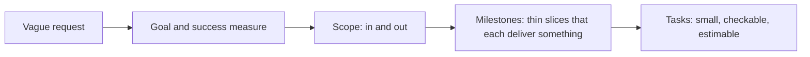

# Planning questions: breaking down a vague task, estimating a project, and a deadline that is slipping

> **Before this lesson:** read [Prioritisation questions](#/lesson/thinking/prioritisation) for value against effort and for the idea of cutting scope. The arithmetic habits from [Back-of-envelope estimation](#/lesson/thinking/estimation-fermi) are used again.

## In plain words

Suppose a friend asks you to "organise a trip to the coast next month". Nobody can do "organise a trip". What you can do is a list of small, definite things: pick a date that suits everyone, choose a town, book the train, book rooms, plan one outing. Only when the big vague thing has become small clear things can you say how long it will take ("the booking needs a week because Sam has to confirm leave"), notice what could go wrong (the trains may be full), and — if time runs short — decide what to drop (skip the outing, keep the rooms).

Those are the three skills of this lesson, and they depend on each other in that order:

1. **Breaking down** a vague task into concrete pieces.
2. **Estimating** how long the pieces will take, honestly.
3. **Reacting** when the plan is slipping.

Interviewers ask about them — *"how would you approach a project nobody has defined?"*, *"how long would this take?"*, *"you realise you will miss the deadline; what do you do?"* — because past the first year of a career, most of an engineer's value lies in finishing things predictably, not only in writing code. These are also the questions where honest, ordinary answers beat clever ones.

## Part 1 — Breaking down an ambiguous task

### From fog to tasks

A request such as *"make the app faster"* or *"add reporting"* is a wish. The route from wish to work has four stops.



**1. Goal and success measure.** Ask *why* and *how will we know it worked*. "Make the app faster" becomes "the product page should load in under two seconds for 95 % of visits, because slow pages are losing sales."

**2. Scope.** Write down what is included and — equally — what is not. "Product and search pages; not the admin screens."

**3. Milestones.** Cut the work into stages that each produce something usable or learnable.

**4. Tasks.** Pieces small enough that you can tell when each is done — a day or two each. If you cannot describe "done" for a task, it is not yet a task.

### Slice thin and end to end

The most useful single idea in planning: **deliver a thin complete slice first, then widen it.**

Picture building a bridge. One way is to build the whole left half, then the whole right half; until the last day, nobody can cross. Another is to string a narrow rope bridge across first — it carries one person — then widen it plank by plank. After day one you can cross, and you have learned whether the two banks are where you thought.

In software the "halves" are layers: the database, the server logic, the screen. Building each layer completely before the next means nothing works until the end, and every misunderstanding is discovered late. A **vertical slice** goes through all the layers for one narrow case: one report, one kind of user, no styling. It proves the pieces connect, gives people something to react to, and puts the riskiest unknowns first.

### Unknowns first

Not all tasks are equally well understood. Sort them:

| Kind | Example | What to do |
|---|---|---|
| **Known** | "Add a column and show it" | Estimate and schedule |
| **Known unknown** | "We have never used this payment provider" | Do a short, time-limited experiment — a **spike** — to learn enough to estimate |
| **Unknown unknown** | The thing you will discover in week three | Cannot be listed; cover with a margin and by delivering early slices |

A **spike** is a small investigation with a fixed time limit, done to answer a question, not to produce finished work: "spend two days finding out whether the provider's test system supports refunds".

Do risky and uncertain pieces **early**. A problem found in week one changes the plan; the same problem found in the last week breaks it.

### Try it

**Prompt:** *"Your manager says: 'customers keep asking for reporting — can you look into it?' What do you do?"*

<details><summary>Model answer</summary>

"'Reporting' could be a week or a year, so I would not start building. My first week is about replacing fog with something definite.

**Understand the need.** Who is asking, and for what? I'd read the support tickets and sales notes that mention reports and talk to three or four customers or the people who speak to them. I'm looking for the *job* behind the request: 'I need to send my boss monthly totals', 'I need to see which branch is behind'. Often five customers asking for 'reporting' want two specific things.

**Define success.** For example: 'customers can see and export monthly totals per branch without contacting support', measured by fewer such support requests and by use of the feature.

**Propose a scope, with exclusions.** In: two fixed reports, date range, export to spreadsheet. Out, for now: custom report builders, scheduled emails, charts. I would write the exclusions down, because unstated ones always come back as 'I assumed that was included'.

**Find the unknowns.** Is the data even available in a form that can be summarised? How heavy are the queries on the live database? Who may see which branches' numbers? I'd time-box a two-day spike on the first two.

**Slice it.**

1. *Thin slice:* one report, one date range, plain table on screen, for our own staff only. Proves the data and the query.
2. Export to spreadsheet.
3. Second report; access rules per branch.
4. Release to a few friendly customers; collect reactions.
5. Performance work if needed; release to all.

Each step leaves something usable, and after step 4 we may learn that the second report is not what people wanted — cheaply.

**Come back with a short written proposal**: the need, the scope, the slices, a rough estimate with its assumptions, and the open questions. Then the manager can say 'yes', 'smaller' or 'not now' — based on something real."

</details>

## Part 2 — Estimating a project

### Why estimates are usually too low

Ask someone how long their journey to work takes and they will tell you the time on a good day. Engineers do the same: they estimate the coding, as if nothing interrupts. What gets left out:

- **The work around the code**: review, testing, fixing what review and testing find, documentation, deployment, monitoring.
- **Waiting**: for another team, for access, for a decision.
- **Interruptions**: meetings, support questions, the incident on Tuesday, a day off sick.
- **Things nobody has discovered yet.**

So the honest estimate is almost always larger than the first number that comes to mind. Knowing this is half the skill.

### A method

1. **Break it down** (Part 1). You cannot estimate fog; you can estimate small tasks.
2. **Estimate each piece as a range**, not a single number: "two to four days". The width of the range shows how sure you are.
3. **Add the forgotten work**: integration, testing, review, release.
4. **Convert effort to calendar time.** A week has five days, but few engineers get more than three or four days of focused work in it. Divide effort by a realistic focus factor.
5. **Add a margin for the unknown**, larger when the work is unfamiliar.
6. **State the assumptions and the confidence.**
7. **Re-estimate as you learn**, and say so in advance.

**Three-point estimating** is a simple way to make ranges concrete. For each task give an *optimistic* time (everything goes well), a *most likely* time, and a *pessimistic* time (a real problem appears). A weighted average,

$$\text{expected} = \frac{\text{optimistic} + 4 \times \text{likely} + \text{pessimistic}}{6}$$

leans towards the likely value while letting a long pessimistic tail pull it up — which matches how software work behaves: tasks can overrun by a lot and can only finish early by a little.

```python-run
tasks = [
    # name,                 optimistic, likely, pessimistic (working days)
    ("Data query + spike",   2, 3, 8),
    ("Report screen",        2, 3, 5),
    ("Export",               1, 2, 4),
    ("Access rules",         2, 4, 9),
    ("Testing and fixes",    2, 4, 7),
    ("Release and monitoring", 1, 1, 3),
]
total = 0
for name, o, m, p in tasks:
    expected = (o + 4 * m + p) / 6          # weighted towards 'likely', pulled up by 'pessimistic'
    total += expected
    print(f"{name:24s} {o}-{p} days, expected {expected:.1f}")

focus = 0.7                                  # share of a working day actually spent on this project
calendar = total / focus
print(f"\neffort: {total:.1f} working days")
print(f"calendar time at {focus:.0%} focus: {calendar:.1f} days = about {calendar / 5:.1f} weeks")
print(f"sum of 'likely' only: {sum(t[2] for t in tasks)} days  <- the number people usually quote")
```

Each task line holds three guesses. The loop computes the weighted average and adds it up; the last lines divide by the share of time really available. Compare the final two figures: the "likely" numbers sum to 17 days, which is what an optimistic engineer would say aloud — "about three and a half weeks". The fuller calculation gives roughly five and a half weeks. That gap is where missed deadlines come from.

### How to say an estimate

A bare number invites the listener to treat it as a promise. Give four things:

> "**About six weeks** for the scope we agreed — I'd say **five to eight**. That **assumes** the data is already clean and that the design does not change. The **biggest risk** is the access rules, which nobody has specified yet; I'll know much more after the first week and will update you then."

Number, range, assumptions, biggest risk, when you will know more. If someone insists on a single date, give the one you are fairly sure of, not the hopeful one.

It also helps to know the difference between three words that get mixed up:

| Word | Meaning |
|---|---|
| **Estimate** | Your honest forecast, with uncertainty |
| **Target** | What the business would like |
| **Commitment** | What you have promised to deliver |

When the target is earlier than the estimate, the honest response is not to shrink the estimate. It is to change something real: reduce scope, add help early, or accept the later date.

> [!INTERVIEW]
> When asked "how long would this take?" in an interview, never answer with a number straight away. Say: "Let me break it into pieces first" — list them, give ranges, name the largest uncertainty, and only then total it. The interviewer is grading the method; the number is almost irrelevant.

## Part 3 — The deadline is slipping

### The first rule: say so early

A doctor who suspects bad news orders the test today; waiting changes nothing except the number of options left. A slipping project is the same. On the day you first suspect it, you can still drop a feature, borrow a colleague, or move a launch quietly. In the final week you can do none of those. **Bad news does not improve with age.** Raising a risk early is not an admission of failure; hiding it is the failure.

### The four levers

When a plan no longer fits its date, only four things can change.

| Lever | What it means | Watch out for |
|---|---|---|
| **Scope** | Deliver less: drop or postpone features, simplify | The most useful lever. Needs a clear view of what is essential |
| **Time** | Move the date | May be impossible (a contract, a regulation, an event) |
| **People** | Add help | Helps only early and only on separable work. New people need teaching, which slows the others first — the observation known as **Brooks's law**: adding people to a late project makes it later |
| **Quality** | Skip tests, review, clean-up | The lever people reach for and should not. The time saved is paid back with interest as bugs, usually at the worst moment |

A fifth "lever" — everyone works evenings and weekends — exists and wears out fast. It can cover a short final push; over weeks it produces mistakes and exhausted people, and then the project is later still.

### A method for the conversation

1. **Establish the facts.** How late, really? What is done, what remains, and what is the new honest estimate? Why did it slip — once (an unexpected problem, now solved) or systematically (everything takes twice as long)?
2. **Prepare options**, each with its cost: cut these items and make the date; keep everything and slip three weeks; a middle path.
3. **Tell the owner early**, with the options and a recommendation.
4. **Agree and re-plan.**
5. **Communicate** the new plan to everyone who depends on it.
6. **Afterwards, learn**: why was the estimate wrong, and what will we do differently?

### Try it

**Prompt:** *"You are three weeks into a six-week project and realise you are about two weeks behind. What do you do?"*

<details><summary>Model answer</summary>

"First I'd make sure I understand how far behind and why — within a day, not a week. I'd list what is finished, what remains, and re-estimate the remainder knowing what I now know. I'd also look at the cause. If we lost two weeks to one surprise that is now behind us, the rest of the plan may be sound. If every task has taken half as long again, the remaining tasks will too, and the real gap is bigger than two weeks.

Then I'd tell my manager and the product owner straight away — the same day or the next — and not arrive empty-handed. Something like: 'We are about two weeks behind. The integration with the provider took far longer than expected. Here is what is done, here is what is left, and here are three options.'

**Option 1 — keep the date, cut scope.** Deliver the core flow on time and postpone the two least essential pieces — say the export and the admin screen — to a follow-up release two weeks later. I'd point out exactly what users would and would not have on the date.

**Option 2 — keep the scope, move the date** by two to three weeks. I'd ask what the date is tied to: if it is a customer commitment or a marketing event, this may be closed to us; if it was an internal target, it may be the cheapest answer.

**Option 3 — add help.** Only if there is a self-contained piece that someone who already knows the codebase can take without much explanation. Three weeks from the end, a newcomer would cost more time than they give.

What I would *not* offer is skipping testing or review to catch up. That does not remove work; it moves it into production as bugs, with interest.

**My recommendation** would usually be option 1: protect the date with a smaller, solid release. But it is the product owner's call, because they know what the date and each feature are worth.

Once agreed, I'd re-plan the remaining weeks with the riskiest items first, set a checkpoint a week later, and tell the other teams and stakeholders who depend on us.

And at the end, a short look back: the estimate assumed the provider's integration was a three-day task; what would have told us earlier that it was not? Probably a two-day spike in week one — so next time, the unknown goes first."

</details>

**A follow-up interviewers like:** *"Your manager says: no, the date and the scope are both fixed."* A good reply: restate the gap calmly with numbers; ask which outcome is worst for the business — late, smaller, or lower quality — because one of them will happen whether we choose or not; offer the smallest version that still meets the real need; and make the quality risk explicit in writing if you are told to proceed. You can commit to working hard; you cannot commit to arithmetic that does not add up, and saying so respectfully is part of the job.

## Common mistakes

- **Starting to build before the goal and scope are clear.**
- **Building layer by layer**, so that nothing works until the end.
- **Leaving the scary part for last.**
- **One-number estimates** with no range and no assumptions.
- **Estimating only the coding.**
- **Treating a target as an estimate** — shrinking the forecast to match what someone hopes.
- **Hiding a slip** in the hope of catching up.
- **Cutting quality** to save the date.
- **Adding people late.**

## Summary

- Turn a vague request into goal and measure → scope with exclusions → thin end-to-end slices → small tasks with a clear "done".
- Tackle unknowns early with time-limited spikes.
- Estimate pieces as ranges; add the work around the code; convert effort to calendar time; add margin; state assumptions; re-estimate as you learn.
- Say an estimate as number, range, assumptions, biggest risk, and when you will know more. Keep estimate, target and commitment apart.
- When slipping: get the facts, bring options, tell the owner early. The levers are scope, time and people — scope is usually best, people only early, and quality is not a lever.

## Glossary

| Term | Meaning |
|---|---|
| Scope | What is included in a piece of work — and what is not |
| Milestone | A point at which something usable or checkable exists |
| Vertical slice | A narrow piece of functionality built through every layer |
| Spike | A short, time-limited investigation to remove an unknown |
| Time-box | A fixed limit on how long to spend on something |
| Estimate | An honest forecast, including its uncertainty |
| Target | The outcome someone would like |
| Commitment | A promise to deliver |
| Three-point estimate | Optimistic, likely and pessimistic guesses combined into one |
| Focus factor | The share of working time actually available for a project |
| Margin (buffer) | Extra time allowed for the unexpected |
| Brooks's law | Adding people to a late project tends to make it later |
| Scope creep | Work growing beyond what was agreed, a little at a time |

## Check yourself

```quiz
[
  {"q": "A manager asks you to 'add reporting'. What should happen first?",
   "options": ["Choose a charting library", "Find out who needs it, for what, and how success would be measured", "Estimate it at two weeks", "Start on the database tables"],
   "answer": 1,
   "explain": "A vague request must become a goal with a measure and a scope before it can be planned or estimated."},
  {"q": "What is the advantage of a thin end-to-end slice?",
   "options": ["It uses more people", "It proves the layers connect, gives early feedback and exposes risks sooner", "It avoids testing", "It delays the release"],
   "answer": 1,
   "explain": "Something narrow that works from screen to database reveals misunderstandings while they are still cheap."},
  {"q": "A task is optimistic 2 days, likely 4, pessimistic 12. What is the three-point expected value?",
   "options": ["4 days", "5 days", "6 days", "9 days"],
   "answer": 1,
   "explain": "(2 + 4×4 + 12) / 6 = 30 / 6 = 5 days; the long pessimistic tail pulls the figure above 'likely'."},
  {"q": "An engineer has 15 days of effort to do and can give this project about 60% of their time. Roughly how much calendar time is that?",
   "options": ["9 working days", "15 working days", "25 working days", "60 working days"],
   "answer": 2,
   "explain": "15 / 0.6 = 25 working days, about five weeks."},
  {"q": "Halfway through, you suspect the deadline will be missed. When should you raise it?",
   "options": ["In the final week, when it is certain", "As soon as you have the facts — within a day or so — with options", "Never; work harder", "After the deadline"],
   "answer": 1,
   "explain": "Early warning preserves options such as cutting scope or moving a date; late warning leaves none."},
  {"q": "Which lever should NOT be used to rescue a date?",
   "options": ["Reducing scope", "Moving the date", "Skipping tests and review", "Adding an experienced helper early on a separable task"],
   "answer": 2,
   "explain": "Cutting quality moves the work into production as bugs and usually costs more time than it saves."},
  {"q": "Why does adding people late in a project often make it later?",
   "options": ["New people work slowly on purpose", "They need teaching and coordination, which takes time from those already productive", "Offices become crowded", "Salaries rise"],
   "answer": 1,
   "explain": "Training and extra communication cost more than the newcomers can contribute in the time left."}
]
```

> **Source:** *Software Engineering at Google*, ch. 1 "What Is Software Engineering?" and ch. 5–6 on leading teams and making trade-offs explicit (https://abseil.io/resources/swe-book/html/ch01.html, https://abseil.io/resources/swe-book/html/ch05.html); DORA capability guidance on working in small batches (https://dora.dev/capabilities/working-in-small-batches/); Martin Fowler, "Purpose Of Estimation" (https://martinfowler.com/bliki/PurposeOfEstimation.html). Brooks's law is from Frederick Brooks, *The Mythical Man-Month* (1975), cited by name only. Examples and wording are original.
