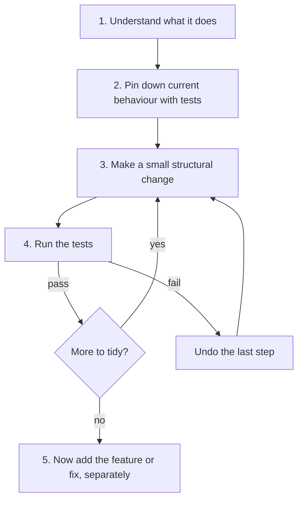

# Changing legacy code safely: refactoring questions

> **Before this lesson:** read ["Review this code"](#/lesson/thinking/code-review-snippets) for how to read a function critically, and the expand–migrate–contract idea in [Migration and rollout planning](#/lesson/thinking/migrations-rollouts). You need to be able to follow a short Python function.

## In plain words

You have moved into an old house. The wiring works, mostly, but nobody knows which switch controls which socket, the fuse box is unlabelled, and the previous owner made repairs with tape. You need to add a socket in the kitchen. A reckless electrician starts pulling wires. A careful one first finds out what each circuit does and labels it, tests that everything works *before* touching anything, makes one small change, and tests again — so that if the lights go out, they know exactly which change did it.

**Legacy code** is that old house: code that is in use and valuable, that you did not write, that has few or no tests, and that people are nervous about changing. **Refactoring** means improving the internal structure of code *without changing what it does* — re-labelling and re-routing the wiring while every light keeps working. Interview questions on this topic — *"you inherit a 2,000-line function with no tests and must add a feature; what do you do?"* — test whether you are the careful electrician. They matter because most professional programming is changing existing code, not writing new code on an empty page.

## Three words to keep apart

| Activity | What changes | Example |
|---|---|---|
| **Refactoring** | Structure only; behaviour is identical | Split a long function into three; rename a variable |
| **Bug fix** | Behaviour, to make it correct | The discount is now applied before tax, as intended |
| **Feature** | Behaviour, to add something new | Support a new payment method |

The single most useful discipline is to **do one of these at a time.** If a change both restructures the code and alters what it does, and something breaks, you cannot tell which half caused it — and neither can the reviewer. The phrase to remember, due to Kent Beck: *make the change easy, then make the easy change.* First refactor so that the feature will slot in neatly (behaviour unchanged, tests still pass); then add the feature as a small separate change.

## Why legacy code is frightening — and the way out

The fear has a precise cause, usually called the legacy code dilemma: *to change code safely you need tests; to add tests you often need to change the code.* The function reads the clock, calls the database and sends an email all in the middle of its logic, so no test can run it in isolation.

The way out is a fixed sequence:



### Step 1 — Understand before touching

- **Read it**, top to bottom, without judging. Sketch what calls what.
- **Run it** with realistic inputs and watch what comes out.
- **Look at its history.** Version control shows who changed each line and why. A strange-looking check often has a commit message such as "handle customers with no postcode" — it is there for a reason.
- **Ask.** Someone may remember.
- **Find who depends on it**: every caller, every scheduled job, every report.

A principle worth quoting is **Chesterton's fence**: if you find a fence across a road and cannot see why it is there, do not remove it until you have found out. Odd code in an old system frequently encodes a lesson learned from a painful incident.

### Step 2 — Pin the behaviour down: characterisation tests

In normal testing you know what the code *should* do and check that it does. With legacy code you often do not know what it should do — only what it *does*, and that customers currently live with that. A **characterisation test** records the present behaviour, right or wrong, so that you will notice if you change it by accident.

The recipe:

1. Call the code with an input.
2. Look at what it returns.
3. Write a test asserting exactly that.
4. Repeat for many inputs, especially odd ones.

You are not approving the behaviour. You are taking a photograph of it. If the function returns a surprising result for an empty basket, the test records the surprise — and you raise it as a question, separately.

Here is a small legacy function. It works, it is ugly, and it has no tests.

```python-run
def calc(o):
    t = 0
    for i in o["items"]:
        t = t + i["p"] * i["q"]
    if o["cust"]["type"] == "gold":
        t = t - t * 0.1
    if t > 100:
        t = t - 5
    if o["country"] != "DE":
        t = t + 12
    t = t + t * 0.19
    return round(t, 2)

order = {"items": [{"p": 40, "q": 2}, {"p": 30, "q": 1}], "cust": {"type": "gold"}, "country": "FR"}
print(calc(order))
```

Before changing a character, photograph it. The next block builds a table of inputs and records what the function currently returns.

```python-run
def calc(o):
    t = 0
    for i in o["items"]:
        t = t + i["p"] * i["q"]
    if o["cust"]["type"] == "gold":
        t = t - t * 0.1
    if t > 100:
        t = t - 5
    if o["country"] != "DE":
        t = t + 12
    t = t + t * 0.19
    return round(t, 2)

def make(prices_qtys, cust="std", country="DE"):
    return {"items": [{"p": p, "q": q} for p, q in prices_qtys], "cust": {"type": cust}, "country": country}

cases = {
    "empty basket":            make([]),
    "one cheap item":          make([(10, 1)]),
    "exactly 100":             make([(100, 1)]),
    "slightly over 100":         make([(100.01, 1)]),
    "gold, falls to 99":       make([(110, 1)], cust="gold"),
    "gold, stays above 100":   make([(120, 1)], cust="gold"),
    "abroad":                  make([(10, 1)], country="FR"),
    "abroad, empty":           make([], country="FR"),
    "gold abroad big":         make([(40, 2), (30, 1)], cust="gold", country="FR"),
}
for name, order in cases.items():
    print(f"{name:24s} -> {calc(order)}")
```

Read the output as a list of facts about today's behaviour. Three are worth noticing, and each becomes a *question*, not a fix:

- An **empty basket shipped abroad costs 14.28** — shipping plus tax on nothing. Intended?
- **Exactly 100 gets no 5 off**, while 100.01 does. Is the rule "over 100" or "100 or more"?
- A gold customer spending 110 drops to 99 after the 10 % discount and then **misses** the 5 off. The order of the two discounts matters. Is that the intention?

Each printed pair becomes an assertion — `assert calc(make([(100, 1)])) == 119.0` and so on — and now there is a safety net.

### Step 3 — Small steps, each one checked

With the net in place, improve the structure one tiny move at a time, running the tests after every move. Common moves, each with a standard name:

| Move | What it does |
|---|---|
| **Rename** | Give a variable or function a name that says what it is |
| **Extract function** | Take a block that does one thing and make it a named function |
| **Replace magic number with a named constant** | `0.19` becomes `VAT_RATE` |
| **Extract variable** | Name a complicated sub-expression |
| **Inline** | The reverse: remove a name that adds nothing |
| **Introduce parameter** | Pass in something the function used to fetch for itself (the clock, a rate table) |
| **Move** | Put a function with the data it works on |

The same function after six such moves, with behaviour unchanged:

```python-run
GOLD_DISCOUNT = 0.10
BULK_THRESHOLD = 100
BULK_REBATE = 5
FOREIGN_SHIPPING = 12
VAT_RATE = 0.19
HOME_COUNTRY = "DE"

def subtotal(items):
    return sum(item["p"] * item["q"] for item in items)

def apply_discounts(amount, customer_type):
    if customer_type == "gold":
        amount -= amount * GOLD_DISCOUNT
    if amount > BULK_THRESHOLD:               # note: strictly greater, as in the original
        amount -= BULK_REBATE
    return amount

def shipping(country):
    return 0 if country == HOME_COUNTRY else FOREIGN_SHIPPING

def order_total(order):
    net = apply_discounts(subtotal(order["items"]), order["cust"]["type"])
    net += shipping(order["country"])
    return round(net * (1 + VAT_RATE), 2)

def make(prices_qtys, cust="std", country="DE"):
    return {"items": [{"p": p, "q": q} for p, q in prices_qtys], "cust": {"type": cust}, "country": country}

expected = {                                   # the photograph taken earlier
    "empty basket": (make([]), 0.0),
    "exactly 100": (make([(100, 1)]), 119.0),
    "gold, falls to 99": (make([(110, 1)], cust="gold"), 117.81),
    "abroad, empty": (make([], country="FR"), 14.28),
    "gold abroad big": (make([(40, 2), (30, 1)], cust="gold", country="FR"), 132.09),
}
for name, (order, want) in expected.items():
    got = order_total(order)
    print(f"{name:20s} {got:8}  {'same' if got == want else 'CHANGED! expected ' + str(want)}")
```

Every line prints "same": the photograph still matches. The code now has names for each idea, and the three questionable behaviours are visible as single lines that can be discussed. The comment on the threshold line records that the oddity was kept deliberately.

Notice what was **not** done: none of the three questionable behaviours was "fixed". Changing them is a behaviour change and may affect invoices already promised to customers. They go to the product owner as questions; if the answer is "yes, fix that", it is a separate, small, reviewed change with its own test.

### Step 4 — Getting untestable code under test: seams

Often you cannot even call the function in a test, because it reaches out to the real world.

```python
def send_reminders():
    today = datetime.date.today()                      # depends on the real clock
    for inv in database.query("SELECT ..."):           # depends on the real database
        if inv.due_date < today:
            smtp.send(inv.email, "Your invoice is overdue")   # sends real email
```

A **seam** is a place where you can change what the code does without editing the logic you want to test. The simplest way to make one is to **pass dependencies in** instead of reaching for them — a technique called **dependency injection**.

```python-run
import datetime

def overdue_invoices(invoices, today):                # pure logic: easy to test
    return [inv for inv in invoices if inv["due"] < today]

def send_reminders(invoices, today, send):            # dependencies handed in
    for inv in overdue_invoices(invoices, today):
        send(inv["email"], "Your invoice is overdue")

sent = []                                              # a stand-in that records instead of emailing
fake_send = lambda to, text: sent.append(to)
invoices = [{"email": "a@x.org", "due": datetime.date(2026, 1, 10)},
            {"email": "b@x.org", "due": datetime.date(2026, 3, 1)}]
send_reminders(invoices, datetime.date(2026, 2, 1), fake_send)
print(sent)
```

The decision ("which invoices are overdue?") is now a function of its inputs alone, and the test supplies a chosen date and a stand-in sender — a **fake** — that records calls. The output shows that only the invoice due in January was reminded, and no email left the building. The first change to create the seam is made with great care and by the smallest possible edit, since it happens before the tests exist; modern editors perform renames and extractions mechanically, which makes them far safer than editing by hand.

### Step 5 — Releasing the change safely

Tests reduce risk; they do not remove it. For anything important, add protection at release time, using tools from the migration lesson:

- **Small releases.** Ship the refactoring separately from the feature.
- **A feature flag** to switch between old and new code paths.
- **Run both and compare.** In production, call the old and the new implementation with the same inputs, serve the old result, and log any difference. This *shadow* or parallel-run technique finds the cases your tests never imagined.
- **Monitor** error rates and business numbers after the switch, and keep the old path until you are confident.

## The big question: rewrite or refactor?

*"This system is a mess. Shouldn't we rewrite it from scratch?"* Engineers are drawn to rewrites, and interviewers ask this to see whether you know the risks.

| | Rewrite from scratch | Refactor gradually |
|---|---|---|
| Appeal | Clean start; modern tools | Continuous delivery; lower risk |
| Hidden cost | The old code contains years of fixes for cases nobody remembers; a rewrite rediscovers them one production incident at a time | Slower-looking; requires discipline |
| Delivery | Nothing of value until the new system reaches parity — which takes much longer than estimated | Value throughout |
| Meanwhile | The old system still needs features and fixes, so two systems are maintained and the target keeps moving | One system |
| Risk | High, concentrated at the switch-over | Spread out, each step reversible |

The usual sound answer: **prefer gradual replacement.** Put an interface in front of the old system and move one piece at a time behind it, routing traffic to new pieces as they prove themselves — the **strangler fig** pattern — until the old core can be removed. A full rewrite is defensible in narrow cases: the system is small and well understood; its technology is truly dead (unsupported, unhirable); or the requirements have changed so much that the old behaviour is no longer wanted.

## Worked question

**Prompt:** *"You join a team and inherit a 1,500-line function that calculates invoices. There are no tests. You have been asked to add support for a new tax rule. What do you do?"* Give a five-minute answer, then compare.

<details><summary>Model answer</summary>

"I'd resist both extremes — hacking the tax rule into the middle and hoping, or announcing a rewrite. Invoices are money and legal documents, so my priority is not to change any existing invoice by accident.

**Understand.** Read the function and sketch its stages — probably something like: gather line items, apply discounts, compute tax, round, format. Look at the version history around the tax section. Find every caller. Ask whoever has been here longest what has gone wrong with it before.

**Pin down behaviour.** I can't call 1,500 lines in a unit test easily, so I'd start with coarse characterisation tests around the whole function: take a few hundred real past invoices — anonymised — feed their inputs in, and record the outputs as the expected results. That is a 'golden master': a large set of known-good outputs. It tells me if any refactoring step changes any invoice.

If the function talks directly to the database or the clock, I'd first create the smallest possible seam — pass those in as parameters — using the editor's automatic refactoring tools, and have that step reviewed closely because it is done before the net exists.

**Refactor only what I need.** I'm not here to clean 1,500 lines. I'd extract the tax calculation into its own function, with a clear input and output, running the golden-master tests after each small move. Then write focused unit tests for that function, including boundary values around every threshold.

**Then add the rule.** With tax isolated, the new rule is a small, separate change: probably a table of rules keyed by region and date, with tests for the new rule and for the unchanged old ones. The pull request for the refactoring and the one for the feature are separate, so that reviewers can verify that the first changes nothing and the second changes only the intended invoices.

**Release carefully.** Behind a flag. Before switching, run old and new side by side on real traffic and compare totals; the only differences should be invoices covered by the new rule. Have finance check a sample. Then enable gradually and keep the old path for a while.

**What I'd raise.** Anything odd that the characterisation tests reveal — and there will be something — goes to the product owner as a question, not into my change. And I'd leave the area better documented than I found it: the tests themselves, plus a short note on the stages of the function.

**Time.** This is more work than inserting the rule — perhaps twice as much. I'd say so openly and explain what it buys: confidence that no existing customer's invoice changes, and a tax module that the *next* rule can be added to in a day."

</details>

> [!INTERVIEW]
> The phrases that carry this topic: **"characterisation tests first, to photograph what it does today"**, **"refactoring and behaviour change in separate commits"**, **"I only clean what I need to touch"**, and **"run old and new side by side before switching"**. And one caution that shows maturity: **"I'd find out why that odd code is there before removing it."**

## Common mistakes

- **Changing behaviour while "cleaning up"** — the classic source of mystery regressions.
- **Fixing oddities without asking.** Customers may depend on the bug.
- **Big-bang refactoring**: one enormous change that nobody can review.
- **Cleaning code you do not need to touch**, increasing risk for no benefit.
- **Deleting code you do not understand.**
- **Proposing a rewrite by reflex.**
- **Trusting tests alone** for a risky change, with no flag, comparison or monitoring.
- **Leaving no tests behind**, so that the next person faces the same fear.

## Summary

- Refactoring changes structure, never behaviour. Keep it separate from fixes and features: make the change easy, then make the easy change.
- Sequence: understand → characterisation tests → small checked steps → separate behaviour change → careful release.
- Characterisation tests record what the code does today; surprising behaviour becomes a question, not a silent fix.
- Create seams by passing dependencies in, so that logic can be tested without the clock, database or network.
- Release with flags, side-by-side comparison and monitoring.
- Prefer gradual replacement to a rewrite; old code holds knowledge that a rewrite loses.

## Glossary

| Term | Meaning |
|---|---|
| Legacy code | Valuable code in use that is hard or risky to change, typically lacking tests |
| Refactoring | Improving code structure without changing its behaviour |
| Characterisation test | A test that records what code currently does, right or wrong |
| Golden master | A large saved set of known outputs used to detect any change in behaviour |
| Seam | A place where behaviour can be substituted without editing the logic under test |
| Dependency injection | Supplying a function with what it needs instead of letting it fetch it |
| Fake | A simple stand-in for a real dependency, used in tests |
| Extract function | Turning a block of code into a named function |
| Magic number | An unexplained literal value |
| Chesterton's fence | The principle of understanding why something exists before removing it |
| Strangler fig pattern | Replacing a system piece by piece behind a stable interface |
| Regression | Something that used to work and no longer does |
| Parallel run | Executing old and new implementations together and comparing results |

## Check yourself

```quiz
[
  {"q": "Which change is a refactoring?",
   "options": ["Applying the discount before tax instead of after", "Splitting a long function into three smaller ones with identical results", "Adding a new payment method", "Fixing a rounding bug"],
   "answer": 1,
   "explain": "Refactoring alters structure only; the other three change what the program does."},
  {"q": "What does a characterisation test check?",
   "options": ["What the code ought to do according to the specification", "What the code currently does, so accidental changes are noticed", "How fast the code runs", "Whether the code is well formatted"],
   "answer": 1,
   "explain": "It photographs present behaviour, right or wrong, to provide a safety net for restructuring."},
  {"q": "While adding tests you discover the function charges shipping on an empty order. What should you do?",
   "options": ["Fix it immediately inside the refactoring", "Record the behaviour in a test and raise it as a question to the owner", "Delete the shipping code", "Ignore it"],
   "answer": 1,
   "explain": "Changing it is a behaviour change that may affect customers; it deserves a decision and a separate change."},
  {"q": "Why keep refactoring and feature work in separate commits?",
   "options": ["To increase the commit count", "If something breaks, it is clear which kind of change caused it, and review is easier", "Version control requires it", "Features cannot be reviewed"],
   "answer": 1,
   "explain": "A change that should alter nothing can be verified as such; mixing the two hides the source of a regression."},
  {"q": "A function calls datetime.date.today() in the middle of its logic. What makes it testable?",
   "options": ["Running tests only at midnight", "Passing the date in as a parameter", "Deleting the date check", "Catching all exceptions"],
   "answer": 1,
   "explain": "Injecting the dependency creates a seam, so a test can supply any date it likes."},
  {"q": "What is the main hidden danger of rewriting a legacy system from scratch?",
   "options": ["The new code will be too fast", "The old code embodies many fixes for forgotten cases, which the rewrite must rediscover", "New languages are unreliable", "Users dislike change"],
   "answer": 1,
   "explain": "Years of accumulated behaviour are rarely documented; a rewrite loses them and takes far longer than expected to reach parity."},
  {"q": "You find a strange-looking check with no comment. What is the best first move?",
   "options": ["Delete it; it is clearly useless", "Look at the version history and ask why it exists", "Rewrite the whole file", "Disable the tests"],
   "answer": 1,
   "explain": "Odd code often encodes a past incident; understand its purpose before removing it."}
]
```

> **Source:** Martin Fowler, "Refactoring" catalogue and "Definition Of Refactoring" (https://refactoring.com/catalog/, https://martinfowler.com/bliki/DefinitionOfRefactoring.html), "Strangler Fig" (https://martinfowler.com/bliki/StranglerFigApplication.html) and "Legacy Seam" (https://martinfowler.com/bliki/LegacySeam.html); *Software Engineering at Google*, ch. 22 "Large-Scale Changes" (https://abseil.io/resources/swe-book/html/ch22.html). The terms characterisation test and seam come from Michael Feathers, *Working Effectively with Legacy Code* (2004), cited by name only. Code, examples and wording are original.
