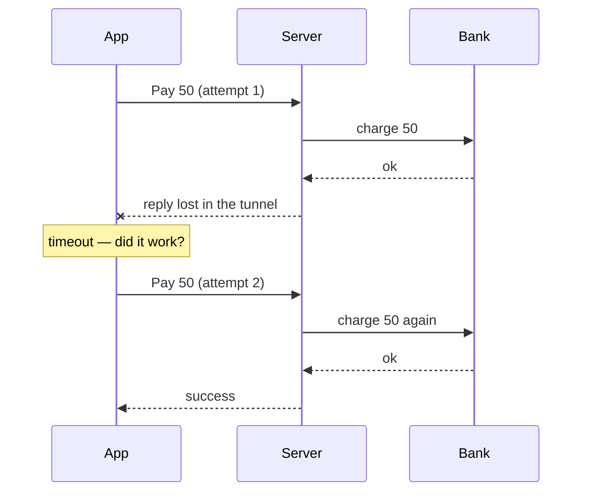
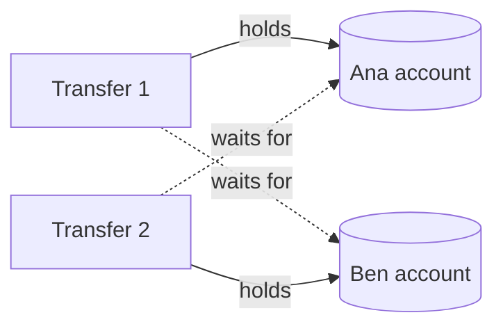

# Concurrency questions told as stories: the last item, the double charge and the lost update

> **Before this lesson:** you should be able to read a short Python function. Idempotency keys were introduced in [API design questions: the building blocks](#/lesson/thinking/api-design-principles); this lesson explains them again from the beginning.

## In plain words

Two people share a bank account. On the same morning, at different cash machines, each checks the balance — 100 — and each decides to withdraw 80. Each machine has looked, seen enough money, and paid out. The account is now at minus 60, although neither person did anything wrong and neither machine has a fault that would show up if you tested it alone.

That is a **concurrency** bug: a mistake that only happens when two things overlap in time. "Concurrent" means *happening during the same period*. Such bugs are the hardest in software because they hide. They do not appear when one tester clicks through the product. They appear in production, on a busy day, once in ten thousand requests, and they cost real money: an item sold twice, a customer charged twice, a counter that is quietly wrong.

Interviewers raise them as stories — *"two users click Buy on the last item at the same instant; what happens?"* — because the stories need no special vocabulary to state, and because your answer shows whether you think about what happens *between* the lines of a program. This lesson tells four such stories. Each has the same three parts: **what goes wrong**, **why**, and **the standard cures**.

## The idea underneath: interleaving

A program's steps look as if they happen together. They do not. Even `stock = stock - 1` is three steps for the machine: *read* the value, *compute* the new one, *write* it back. When two requests run at once, their steps can shuffle together like two decks of cards — an **interleaving**. Most shuffles are harmless. A few are not.

Here is the smallest demonstration. Two "buyers" each run the same three steps on one unit of stock. The code plays out one particular order of steps by hand, so that you can see it.

```python-run
stock = 1
log = []

# Buyer A and buyer B each do: read stock, check it, write stock - 1.
a_seen = stock                      # A reads 1
b_seen = stock                      # B reads 1   <- before A has written
if a_seen >= 1:
    stock = a_seen - 1              # A writes 0
    log.append("A: order confirmed")
if b_seen >= 1:
    stock = b_seen - 1              # B writes 0 (based on its old reading)
    log.append("B: order confirmed")

print(log)
print("stock in the system:", stock, "| units actually promised:", len(log))
```

Each buyer's logic is correct when read alone. The trouble is the order: B read the stock *before* A wrote, so B acted on information that was already out of date. The output shows two confirmed orders and a stock of 0 — one unit, sold twice. The pattern has a name worth memorising: **check-then-act**. Whenever code *checks* something and later *acts* on the result, ask: "could the thing have changed in between?"

A situation whose outcome depends on the timing of such overlaps is a **race condition**. The stretch of code that must not be interleaved is a **critical section**.

## Story 1 — Two buyers, one item

**The interview prompt:** *"Two users click Buy at the same moment and one item is left. What happens, and how do you make it correct?"* Think for three minutes, then open.

<details><summary>Model answer</summary>

"With naive code — read the stock, check it is at least one, then write stock minus one — both requests can read 'one left' before either writes. Both pass the check, both confirm, and we have promised two customers the same item. It is a check-then-act race.

The cure is to make 'check and decrease' a single indivisible step — **atomic** — so that nothing can slip between the check and the write. There are four standard ways.

**1. Let the database do both in one statement.**

`UPDATE products SET stock = stock - 1 WHERE id = 42 AND stock >= 1`

The database runs this as one atomic operation. Then I look at how many rows were changed: one means I got the item; zero means it was gone. The second buyer's statement finds `stock >= 1` false and changes nothing. This is the simplest fix and my first choice.

**2. Pessimistic locking.** Inside a transaction, read the row with a lock — `SELECT … FOR UPDATE`. A second request trying the same must *wait* until the first finishes. 'Pessimistic' because it assumes a conflict will happen and blocks in advance. Safe; slower under heavy contention, and locks held too long cause queues.

**3. Optimistic locking.** Add a `version` number to the row. Read the row and its version, say 7. Write with the condition 'only if the version is still 7', and increase it. If someone else changed the row first, my write affects zero rows; I re-read and try again, or tell the user. 'Optimistic' because it assumes conflicts are rare and only checks at the end. No waiting; needs a retry path.

**4. A queue.** Put purchase requests for a hot item in a line and let one worker process them in order. No two are ever handled at once. Good for flash sales where thousands compete.

And as a last line of defence, a database constraint — `CHECK (stock >= 0)` — so that even if the code has a bug the database refuses to go negative.

**The user experience matters too.** The loser should hear 'sorry, that has sold out' immediately, not after entering card details. So I would reserve the item when checkout begins, with a time limit, and release it if the customer does not pay.

**Which I'd choose.** For an ordinary shop: the single conditional update, plus the constraint. For a ticket sale with huge demand on few items: a queue or waiting room in front."

</details>

The fixed version, playing the same hostile ordering as before — but now the check and the write cannot be separated:

```python-run
stock = 1
log = []

def try_buy(who):
    """Atomic compare-and-decrease: the check and the write are one step."""
    global stock
    if stock >= 1:            # in a real system the database guarantees that nothing
        stock -= 1            # can run between these two lines for the same row
        log.append(who + ": order confirmed")
        return True
    log.append(who + ": sold out")
    return False

try_buy("A")
try_buy("B")
print(log, "| stock:", stock)
```

One confirmation, one "sold out", stock 0. In this toy the two lines are safe only because nothing else runs between them; the point of the four cures above is to *get that guarantee* in a real system with many requests at once.

### Optimistic locking in slow motion

Because the version-number idea is asked about often, here it is step by step.

```python-run
row = {"stock": 5, "version": 7}

def save(expected_version, new_stock):
    """Write only if nobody else has written since we read."""
    if row["version"] != expected_version:
        return False                       # someone got there first
    row["stock"], row["version"] = new_stock, row["version"] + 1
    return True

a = dict(row)                              # A reads: stock 5, version 7
b = dict(row)                              # B reads the same
print("A saves:", save(a["version"], a["stock"] - 1), row)
print("B saves:", save(b["version"], b["stock"] - 2), row)   # B's reading is stale

b = dict(row)                              # B re-reads: stock 4, version 8
print("B retries:", save(b["version"], b["stock"] - 2), row)
```

A's save succeeds and bumps the version to 8. B's save is refused, because B's reading carried version 7. B reads again, sees the true stock of 4, and its retry succeeds, leaving 2. Without the version check B would have written 3 — silently discarding A's sale. That silent overwrite is the **lost update**.

## Story 2 — The customer who was charged twice

Maya is on a train, buying a concert ticket. She taps **Pay**. The app shows a spinner. The train enters a tunnel. After ten seconds the app says "Something went wrong — try again." She taps Pay again. The next morning her bank statement shows two charges.

**What went wrong.** The first request *did* reach the server and her card *was* charged. Only the reply was lost in the tunnel. The app could not tell "the request never arrived" from "the request arrived and the answer got lost" — from the outside they look identical: silence. So it invited a retry, and the retry was treated as a brand-new payment.



This is the central fact of all networked software: **a timeout is not a failure; it is an unknown.**

**The cure: make the operation idempotent.** An operation is **idempotent** if doing it several times has the same effect as doing it once. Pressing the button at a pedestrian crossing is idempotent: press it five times and the lights still change once.

To make "pay" idempotent, the app invents a unique random label *before* the first attempt — an **idempotency key** — and sends the same label with every retry of that purchase. The server keeps a record of the labels it has processed. When a request arrives with a known label, it does not charge again; it returns the result it saved the first time.

```python-run
processed = {}          # idempotency key -> saved result
charges = []

def pay(key, amount):
    if key in processed:                 # we have seen this exact purchase before
        return processed[key]            # return the saved answer; do not charge
    charges.append(amount)               # the real work happens once
    result = "paid #" + str(len(charges))
    processed[key] = result
    return result

print(pay("maya-ticket-7f3a", 50))       # attempt 1: reply is lost in the tunnel
print(pay("maya-ticket-7f3a", 50))       # attempt 2: same key
print("charges made:", charges)
```

Both calls print the same result and the card is charged once.

**Details that interviewers probe.**

- *Where does the key come from?* The client, created once per purchase — not per attempt. A new key on each retry would defeat the purpose.
- *What if two copies of the request arrive at the same instant?* The check "have I seen this key?" and the recording of it must themselves be atomic — in practice, insert the key into a table with a unique constraint *first*; whichever request inserts it wins and the other waits for or reads its result. Otherwise the race from Story 1 reappears one level down.
- *What if the same key arrives with a different amount?* Reject it; it is a client bug.
- *How long are keys kept?* Long enough to cover retries — commonly a day.
- *What should the button do?* Disable itself after the first tap. That helps, and is never enough alone, because retries also come from the network layer, from background jobs and from impatient reloads.

## Story 3 — The counter that could not count

A video site shows a view counter. A popular video's counter reads 1,000,000 when the analytics team's logs say 1,040,000 people watched. Nothing crashed. Nobody noticed for months.

**What went wrong.** The code was:

1. read `views` from the database → 1000
2. add one → 1001
3. write 1001

Two viewers arrive together. Both read 1000, both write 1001. Two views, one increment. On a busy video this happens constantly. It is the lost update again, in its commonest disguise: **read-modify-write.**

**The cures.**

- **Ask the database to do the arithmetic**: `UPDATE videos SET views = views + 1 WHERE id = …`. The database applies each increment atomically. For counters this is almost always the answer.
- **Use an atomic counter** in a store that offers one — an operation such as "increment" that the store guarantees is indivisible.
- **Do not keep a counter at all**: record each view as its own row or event (an append never conflicts with another append) and compute the total from those. This is the ledger idea from the data-modelling lesson.

The general lesson: **send the database your intention ("add one"), not your result ("set to 1001").** A result is only correct if nothing changed since you read; an intention is correct regardless.

## Story 4 — The two transfers that froze

A bank's system processes two transfers at the same moment: Ana sends money to Ben, and Ben sends money to Ana. Both transfers stop and never finish. Other transfers involving Ana or Ben pile up behind them.

**What went wrong.** To be safe, each transfer locks both accounts while it works. The first locks Ana's account and then asks for Ben's. The second has locked Ben's account and is asking for Ana's. Each holds what the other needs, and each waits for ever. This is a **deadlock**. Picture two people meeting in a narrow corridor, each politely waiting for the other to step aside.



**The cures.**

- **Always lock in the same order.** For example, lowest account number first. Then both transfers try for Ana's account first; one gets it, the other waits, and the first can proceed to Ben's. A fixed global order makes the circular wait impossible. This is the classic answer.
- **Timeouts.** Give up waiting for a lock after a short time, undo, and retry. Databases detect deadlocks and cancel one of the transactions for this reason; the application must be ready to retry it.
- **Hold locks briefly**, and never while waiting for something slow such as a network call.
- **Avoid needing two locks** — for instance by recording the transfer as one new ledger row.

## A way to answer any "what if two…" question

1. **Narrate the bad interleaving** step by step, with names: "A reads 1, B reads 1, A writes 0, B writes 0."
2. **Name the pattern**: check-then-act, read-modify-write, duplicate request, or circular wait.
3. **State what must be true** — the **invariant**: "stock never below zero", "one charge per purchase".
4. **Choose a cure** from the short menu, and say why it fits:

| Cure | Idea | Good when |
|---|---|---|
| Atomic conditional update | Check and change in one database statement | The rule fits in one row |
| Database constraint | The database refuses invalid states | Always, as a backstop |
| Unique key | A second insert of the same thing fails | Preventing duplicates |
| Pessimistic lock | Make others wait | Conflicts are frequent, work is short |
| Optimistic lock (version) | Detect a conflict at write time and retry | Conflicts are rare |
| Idempotency key | Recognise a repeated request | Anything that may be retried |
| Queue, one worker per item | Process strictly one at a time | Very hot items; ordering matters |
| Append instead of update | Never overwrite; add a record | Counters, ledgers, histories |

5. **Say how you would test it**: fire many simultaneous requests at one item and check the invariant afterwards — "100 buyers, 10 units: exactly 10 confirmations, stock exactly 0".

> [!INTERVIEW]
> Begin by *telling the story of the failure* before offering any fix. "Both requests read stock = 1 before either writes" shows that you understand the mechanism. Jumping straight to "use a lock" sounds memorised — and is often the wrong tool.

## Common mistakes

- **"It works when I test it."** One tester cannot overlap with themselves.
- **Checking in application code what the database should guarantee.**
- **Locking in the application's memory** when there are several servers; each has its own lock, so nothing is protected.
- **Relying on a disabled button** to prevent duplicates.
- **A new idempotency key for every retry.**
- **Reading a value, computing, and writing it back** instead of sending the change.
- **Taking several locks in different orders** in different parts of the code.
- **Holding a lock during a slow call.**

## Summary

- Concurrency bugs come from interleaving: steps of two requests shuffling together.
- Check-then-act and read-modify-write are the two shapes to recognise; both produce lost updates and oversells.
- Cure by making the step atomic: a conditional update, a lock (pessimistic or optimistic), a queue, or append-only records — with a database constraint as backstop.
- A timeout is an unknown. Retries are inevitable, so make operations idempotent with a client-chosen key recorded atomically.
- Deadlock is a circular wait; a fixed locking order removes it.
- Answer by narrating the bad interleaving, naming the pattern, stating the invariant, choosing a cure and describing a test.

## Glossary

| Term | Meaning |
|---|---|
| Concurrency | Several activities in progress during the same period |
| Interleaving | One particular order in which the steps of concurrent activities mix |
| Race condition | A bug whose occurrence depends on timing |
| Critical section | Code that must not be interleaved with other code touching the same data |
| Check-then-act | Testing a condition and later acting on it, with a gap in between |
| Read-modify-write | Reading a value, changing it, and writing it back |
| Lost update | One writer's change silently overwritten by another's |
| Atomic | Performed as one indivisible step |
| Lock | A marker that makes others wait before using a piece of data |
| Pessimistic locking | Locking first, assuming conflict |
| Optimistic locking | Proceeding without a lock and checking for conflict at write time |
| Version number | A counter on a row used to detect that it has changed |
| Idempotent | Having the same effect whether done once or many times |
| Idempotency key | A unique label that lets a server recognise a repeated request |
| Deadlock | Two or more activities each waiting for something the other holds |
| Invariant | A statement that must always be true |

## Check yourself

```quiz
[
  {"q": "Two requests each read stock = 1, then each write stock = 0 and confirm an order. What is this pattern called?",
   "options": ["Deadlock", "Check-then-act race", "Idempotency", "Normalisation"],
   "answer": 1,
   "explain": "Both acted on a check that had become stale between reading and writing."},
  {"q": "Which statement fixes the oversell with the least machinery?",
   "options": ["SELECT stock, then UPDATE in the application", "UPDATE products SET stock = stock - 1 WHERE id = ? AND stock >= 1, then check rows changed", "Disable the Buy button", "Add more servers"],
   "answer": 1,
   "explain": "The database performs the check and the decrease as one atomic statement; zero rows changed means sold out."},
  {"q": "A payment request times out. What does the client know?",
   "options": ["The payment failed", "The payment succeeded", "Nothing certain: the request or the reply may have been lost", "The server is permanently down"],
   "answer": 2,
   "explain": "From outside, a lost request and a lost reply look identical, so retries must be safe."},
  {"q": "For idempotency to work across retries, when must the key be generated?",
   "options": ["Freshly for every attempt", "Once per logical operation, and reused for each retry", "By the bank", "After the payment succeeds"],
   "answer": 1,
   "explain": "A new key per attempt would make every retry look like a new operation."},
  {"q": "A view counter loses increments under load. Which change fixes it?",
   "options": ["Read the value more often", "UPDATE videos SET views = views + 1 instead of read, add, write", "Cache the counter in the browser", "Use a longer variable name"],
   "answer": 1,
   "explain": "Sending the intention to the database lets it apply each increment atomically."},
  {"q": "Transfer 1 locks account A then wants B; transfer 2 locks B then wants A. What prevents this deadlock?",
   "options": ["Always acquiring locks in the same fixed order", "Using larger accounts", "Retrying faster", "Removing all locks"],
   "answer": 0,
   "explain": "A consistent order makes a circular wait impossible: both go for the same lock first."},
  {"q": "When is optimistic locking a better choice than pessimistic locking?",
   "options": ["When conflicts are rare", "When every request conflicts", "When there is no database", "Never"],
   "answer": 0,
   "explain": "It avoids waiting and only pays a retry in the uncommon case of a conflict."}
]
```

> **Source:** PostgreSQL documentation on transaction isolation and explicit locking (https://www.postgresql.org/docs/current/transaction-iso.html, https://www.postgresql.org/docs/current/explicit-locking.html); Stripe API reference, "Idempotent requests" (https://docs.stripe.com/api/idempotent_requests); Martin Fowler, "Optimistic Offline Lock" and "Pessimistic Offline Lock" (https://martinfowler.com/eaaCatalog/optimisticOfflineLock.html, https://martinfowler.com/eaaCatalog/pessimisticOfflineLock.html); Google API Improvement Proposal 155, request identification (https://google.aip.dev/155). Stories, code and wording are original.
