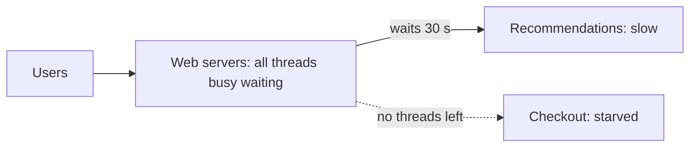

# Failure scenarios in distributed systems, told as stories

> **Before this lesson:** read [Concurrency questions told as stories](#/lesson/thinking/concurrency-stories) for idempotency and the idea that a timeout is an unknown. The words queue, cache, replica and load balancer come from [Lightweight system design](#/lesson/thinking/system-design-template).

## In plain words

One cook in one kitchen either has the soup ready or does not. Now imagine a restaurant chain whose kitchens phone each other for ingredients. New kinds of trouble appear that a single kitchen never had. A phone line goes dead mid-sentence — did they hear the order? One branch is so busy that it answers every call a minute late, and everyone waiting on it falls behind too. Two managers each believe they are in charge after the head office goes quiet. A note arrives twice, or after the note that was written later.

A **distributed system** is software that runs on several machines talking over a network — which today means nearly every product. Its special difficulty is **partial failure**: some parts are working, some are broken, some are merely slow, and nobody can be sure which is which. Interviewers bring this up with questions such as *"service B is slow; what happens to service A?"* or *"what can go wrong when two services talk to each other?"* They are checking that you do not assume the network is a reliable wire. At work, this knowledge is the difference between a small hiccup that users never notice and an outage that spreads through an entire company.

As in the previous lesson, each topic is a story: what happened, why, and the standard defences.

## The four facts behind every story

Keep these in mind; every failure below is one of them in disguise.

1. **Messages can be lost, delayed, duplicated or reordered.**
2. **You cannot tell "slow" from "dead".** Silence is all you observe.
3. **Machines fail independently**, at any moment, including halfway through a task.
4. **Clocks disagree.** No two machines have exactly the same time.

## Story 1 — The slow service that sank the whole site

An online shop's product page shows a small "customers also bought" strip, fetched from a recommendations service. One afternoon that service becomes slow — it answers in thirty seconds instead of fifty milliseconds. Within minutes the *entire shop* is down: the home page, the basket, the checkout. Nothing was wrong with any of them.

**What happened.** Each web server can handle a limited number of requests at once — say 200 — because each request occupies a **thread** (a worker inside the program that handles one thing at a time). Every product-page request called the recommendations service and waited. With no time limit on the wait, each waiting request held its thread for thirty seconds. Within moments all 200 threads were waiting on recommendations. A visitor to the *checkout*, which never uses recommendations, found no free thread. The slow service had not crashed anything; it had quietly eaten all the waiters.

This spread of trouble from one component to others is a **cascading failure**. Note the uncomfortable lesson: **a slow dependency is more dangerous than a dead one.** A dead service fails instantly and frees the thread; a slow one holds it.



**The defences.**

- **Timeouts on every call.** Decide the longest you are willing to wait — here perhaps 200 ms — and give up after that. A call with no timeout is a promise to wait for ever. This is the single most important habit in distributed programming.
- **Graceful degradation.** If recommendations do not answer in time, show the page without the strip. Decide in advance which parts of each page are essential and which are optional.
- **Circuit breaker.** After several failures in a row, stop calling the troubled service for a short while and fail immediately instead — like the fuse that cuts a faulty circuit so that the rest of the house keeps its power. After a pause, let one test call through; if it succeeds, resume. Martin Fowler's description of the pattern uses those three states: closed (normal), open (not calling), half-open (testing).
- **Bulkheads.** Give each dependency its own limited pool of threads or connections, so that one cannot use up everything. The name comes from the walls that divide a ship's hull into compartments so that one leak does not sink it.

## Story 2 — The helpful retries that made it worse

A payments service has a brief hiccup: for ten seconds it is slow. Every client is written to retry three times on failure. Suddenly the service is receiving four times its normal traffic — each original request plus three retries — exactly when it is least able to cope. It falls over completely. As it restarts, the waiting clients all retry again at the same instant and knock it down again. The ten-second hiccup becomes a forty-minute outage.

**What happened.** Retries are meant to hide brief faults, and for a single client they do. Multiplied across thousands of clients, they turn a small overload into a large one: a **retry storm**. It gets worse in layers. If the web tier retries three times and the service behind it also retries three times, one user action becomes up to nine calls at the bottom; three layers make twenty-seven.

```python-run
normal_load = 1000                      # requests per second in normal times
for retries in (0, 1, 3):
    for layers in (1, 2, 3):
        worst = normal_load * (retries + 1) ** layers
        print(f"retries={retries}, layers={layers}: up to {worst:>6,} calls/s reach the bottom service")
    print()
```

The loop computes the worst case: with `retries` extra attempts per layer, each layer multiplies the load by `retries + 1`. The last line of output — 64,000 calls per second from a normal 1,000 — is how a small fault becomes an outage.

**The defences.**

- **Exponential backoff.** Wait longer after each failure: 1 second, then 2, then 4, then 8. This gives the struggling service room to recover.
- **Jitter.** Add a random amount to each wait. Without it, thousands of clients that failed together retry together — in waves. With it, their retries are smeared out.
- **Retry budgets.** Limit retries to a small share of normal traffic — for example, at most 10 % extra — so that retries can never multiply the load.
- **Retry at one layer only**, usually the one nearest the user, not at every level.
- **Retry only what is safe**: errors that are temporary (a timeout, "unavailable") and operations that are idempotent. Never retry "your card was declined" or "invalid request".
- **Load shedding** on the receiving side: when overloaded, reject excess requests immediately and cheaply — "try later" — instead of accepting everything and doing all of it badly. Serving 80 % of users well beats serving 100 % of them a timeout.

Here are backoff and jitter in a few lines.

```python-run
import random
random.seed(7)                           # fixed seed so the output is repeatable

def delays(base=1.0, cap=30.0, attempts=6, jitter=True):
    out = []
    for n in range(attempts):
        wait = min(cap, base * 2 ** n)   # 1, 2, 4, 8, 16, 30 (capped)
        if jitter:
            wait = random.uniform(0, wait)   # "full jitter": anywhere from 0 to the backoff value
        out.append(round(wait, 1))
    return out

print("no jitter :", delays(jitter=False))
print("client A  :", delays())
print("client B  :", delays())
```

The first line shows plain doubling, capped at 30 seconds. The next two show two clients using jitter: each picks a random wait below the doubling value, so their retries no longer coincide.

## Story 3 — The stampede at the empty cache

A news site keeps its front page in a cache, rebuilt from the database every sixty seconds. Building it takes two seconds and a heavy query. At a busy moment the cached copy expires. In the next two seconds, 5,000 visitors arrive, each finds the cache empty, and each starts the heavy query. The database collapses under 5,000 identical queries, so nobody's rebuild ever finishes, so the cache stays empty.

**What happened.** A **cache stampede** — also called the *thundering herd*: many requests discover the same missing entry at the same time and all try to rebuild it.

**The defences.**

- **Let one rebuild, and make the rest wait** for its result (or receive the previous copy meanwhile).
- **Serve stale while refreshing**: keep handing out the old copy for a moment and rebuild in the background.
- **Stagger expiry times** with a little randomness so that many entries do not expire together.
- **Rebuild popular entries before they expire**, on a schedule, so that they are never missing.

## Story 4 — Two leaders

A database is run as a pair: a **primary** that accepts writes, and a **standby** that copies it and is ready to take over. A monitoring process promotes the standby if the primary stops answering. One night the network link between the two fails. The primary is healthy and still serving the customers who can reach it. The standby cannot see it, concludes that it has died, and promotes itself. Now there are **two** primaries, each accepting different writes from different customers. When the link returns, the two histories contradict each other and some customers' orders have to be thrown away by hand.

**What happened.** **Split brain**: after a network partition, two parts of a system each believe they are in charge. It is fact number 2 in action — the standby could not tell "dead" from "unreachable".

**The defences.**

- **Quorum.** Use an odd number of members — three or five — and require a **majority** to agree before anyone acts as leader. In a group of three split into two and one, the side with two members carries on; the lone member knows it is a minority and stops. Two groups can never both have a majority.
- **Fencing.** When a new leader is chosen, the old one is forcibly cut off — its access to storage is revoked — so that even if it is still alive it cannot write.
- **Prefer refusing writes to accepting conflicting ones**, for data where conflict is costly. This is the consistency side of the consistency-versus-availability choice.

The arithmetic behind quorum: with $N$ members, a majority is $\lfloor N/2 \rfloor + 1$, and the group survives the loss of $N$ minus that many.

| Members | Majority needed | Failures survived |
|---|---|---|
| 1 | 1 | 0 |
| 2 | 2 | 0 |
| 3 | 2 | 1 |
| 4 | 3 | 1 |
| 5 | 3 | 2 |

Two members are no safer than one, and four no safer than three — which is why such groups are sized in odd numbers.

## Story 5 — The message from the future

A document-editing app stores each change with the time from the server that received it, and when two people edit the same paragraph, "the latest timestamp wins". One server's clock is running ninety seconds fast. A user connected to that server makes an edit. For the next minute and a half, every edit by anyone else — made *later* in real life — carries an earlier timestamp and is silently discarded.

**What happened.** **Clock skew**: machines' clocks drift apart, by milliseconds normally and by much more when something is misconfigured. Ordering events by wall-clock time taken on different machines is unreliable, and "last write wins" based on it quietly loses data.

**The defences.**

- **Do not use wall-clock time to decide order across machines.** Have one place assign a sequence number (as the chat design did per conversation), or use version numbers and reject stale writes (optimistic locking).
- **Use logical clocks**: counters that increase with each event and travel with messages, giving a consistent order without any real clock.
- **Keep clocks synchronised and monitor the drift** — necessary, and never sufficient alone.
- **For durations, use a monotonic clock**, one that only moves forward. The ordinary clock can jump backwards when it is corrected, which breaks any code that computes "how long did that take?" by subtracting two readings.

## Story 6 — The message that arrived twice, and the one that came early

A warehouse system receives events from the shop through a queue: "order placed", then "order cancelled". Twice in one week it shipped a cancelled order. Investigation finds two different causes. In one case "order placed" was delivered **twice** — once before the cancellation and once after — and the second copy re-opened the order. In the other, "cancelled" arrived **before** "placed", was ignored as nonsense, and then "placed" was processed normally.

**What happened.** Queues usually guarantee **at-least-once delivery** — a message is retried until acknowledged, so duplicates are normal — and often do not guarantee order, especially with several workers.

**The defences.**

- **Idempotent consumers.** Give each event a unique id; remember which ids have been processed; ignore repeats.
- **Make handling depend on state, not on arrival order.** Treat the order as a state machine: "placed" arriving for an order already in *Cancelled* is ignored; "cancelled" arriving for an unknown order is recorded, so that a later "placed" is rejected.
- **Carry a version or sequence number** in each event and discard anything older than what has already been applied.
- **Where order truly matters, send related events through one ordered channel** keyed by, say, order id — one line per order.

And a neighbour of this story: the **poison message** — one malformed event that makes the worker crash, returns to the queue, is picked up again, and crashes the next worker, for ever, blocking everything behind it. Defence: count attempts and, after a few, move the message to a **dead-letter queue** for a person to look at.

## The toolkit, in one table

| Tool | Protects against | One-line description |
|---|---|---|
| **Timeout** | Slow dependencies | Never wait without a limit |
| **Retry with backoff and jitter** | Brief faults, without storms | Wait longer each time, with randomness |
| **Retry budget** | Retry storms | Cap retries as a share of traffic |
| **Idempotency** | Duplicates from retries and redelivery | Doing it twice equals doing it once |
| **Circuit breaker** | Hammering a failing dependency | Stop calling for a while after repeated failure |
| **Bulkhead** | One dependency exhausting shared resources | Separate limited pools per dependency |
| **Load shedding** | Overload | Reject the excess quickly to serve the rest well |
| **Graceful degradation** | Loss of a non-essential part | Serve a reduced page instead of an error |
| **Health checks** | Sending traffic to a broken instance | Regularly ask "are you well?" and remove those that are not |
| **Quorum and fencing** | Split brain | Majority agreement; cut off the old leader |
| **Sequence and version numbers** | Clock skew, reordering | Order by counters, not by wall clocks |
| **Dead-letter queue** | Poison messages | Set aside what keeps failing |

## Worked question

**Prompt:** *"Service A calls service B to complete every request. B becomes slow and intermittently fails. Walk me through what happens and how you would protect A."* Five minutes aloud, then compare.

<details><summary>Model answer</summary>

"First, what happens if we do nothing. A's requests wait on B. If A has no timeout, each waiting request holds one of A's threads or connections; soon all of them are waiting on B and A cannot serve anything — even requests that do not need B. A's own callers start timing out and retrying, which adds load. So a problem in B becomes an outage of A and of whatever depends on A: a cascading failure.

Now the protection, in layers.

**1. A timeout on the call to B**, set from B's normal behaviour — a little above its usual slow-end latency, not a round number such as thirty seconds. That alone stops threads being held indefinitely.

**2. Decide what A does without B.** Is B essential to the request? If B provides something optional, A returns the response without it or with a cached or default value. If B is essential — say B is the payment step — A fails that request quickly with a clear message, and keeps serving everything else.

**3. Careful retries.** One retry, maybe two, only for errors that are likely to be temporary and only if the operation is idempotent — if not, I'd add an idempotency key so that it becomes safe. Backoff with jitter. And a retry budget, so that when B is struggling A does not double its load.

**4. A circuit breaker.** If B's error rate passes a threshold, A stops calling it for some seconds and goes straight to the fallback. That protects A from wasting time and protects B from being hammered while it recovers. Then it probes with single requests before resuming.

**5. A bulkhead.** Calls to B get their own limited pool of connections, so that even in the worst case B can only consume that pool, not all of A's capacity.

**6. Take work out of the request path if possible.** If the call to B does not need an immediate answer — sending a notification, updating a search index — put it on a queue. Then B's slowness delays that work and does not touch users at all.

**7. See it.** Dashboards and alerts on B's latency and error rate *as measured from A*, on the circuit breaker's state, and on A's own saturation — so that we learn of this from a graph.

**On B's side**, I would want load shedding — reject excess quickly — and to know why it became slow.

**How I'd test it.** Deliberately inject the fault in a test environment: make B slow and flaky, and check that A's unrelated endpoints stay fast, that the breaker opens, and that A recovers without help when B does. Faults that are never rehearsed are handled by code that has never run.

**Trade-offs.** Each protection has a cost. Too short a timeout turns B's ordinary slow moments into errors; a fallback can show stale or incomplete information; retries add load; a queue makes the result eventual. So the settings come from measurements of B, not from guesses."

</details>

> [!INTERVIEW]
> If you can offer only three sentences on distributed failure, make them: **"Every network call needs a timeout and a plan for when it fires." "Retries need backoff, jitter, a limit and idempotency, or they make outages worse." "Slow is worse than down, so isolate dependencies from each other."**

## Common mistakes

- **No timeout**, or the library's default of "for ever".
- **Retrying everything immediately**, at every layer.
- **Retrying operations that are not idempotent.**
- **Treating a dependency as either up or down** and forgetting slow.
- **Sharing one pool** of threads or connections across all dependencies.
- **Trusting timestamps from different machines** to order events.
- **Assuming a message arrives exactly once and in order.**
- **Two-member "high availability" pairs** with automatic promotion and no tie-breaker.
- **Never testing failure handling** until a real failure tests it for you.

## Summary

- Distributed systems fail partially: messages are lost, delayed, duplicated or reordered; slow cannot be told from dead; machines fail independently; clocks disagree.
- A slow dependency without timeouts exhausts its callers and cascades. Use timeouts, fallbacks, circuit breakers and bulkheads.
- Unbounded retries multiply load. Use backoff, jitter, budgets, one retrying layer, and only for safe operations; shed load when overloaded.
- An expired popular cache entry causes a stampede: let one request rebuild, serve stale, stagger expiry.
- Split brain is prevented by majority quorum and fencing.
- Do not order events by wall clocks; use sequence or version numbers.
- Expect duplicates and disorder from queues: idempotent, state-based consumers and dead-letter queues.

## Glossary

| Term | Meaning |
|---|---|
| Distributed system | Software running on several machines that communicate over a network |
| Partial failure | Some parts working while others are broken or slow |
| Thread | A unit within a program that handles one task at a time |
| Timeout | The longest a caller will wait before giving up |
| Cascading failure | A fault in one component spreading to others |
| Circuit breaker | A switch that stops calls to a failing dependency for a period |
| Bulkhead | Separate resource limits per dependency, containing damage |
| Retry storm | Retries from many clients multiplying load on a struggling service |
| Exponential backoff | Doubling the wait after each failed attempt |
| Jitter | Random variation in waits so that retries do not coincide |
| Load shedding | Deliberately rejecting some requests when overloaded |
| Cache stampede (thundering herd) | Many requests rebuilding the same missing cache entry together |
| Split brain | Two parts of a system each believing they are the leader |
| Quorum | A majority that must agree before a decision takes effect |
| Fencing | Forcibly preventing a former leader from making changes |
| Clock skew | Difference between the clocks of different machines |
| Monotonic clock | A clock that only moves forward, used to measure durations |
| Poison message | A message that repeatedly crashes whatever processes it |

## Check yourself

```quiz
[
  {"q": "Why can a slow dependency be more harmful than one that is completely down?",
   "options": ["Slow services use more electricity", "Callers hold threads while waiting, exhausting their capacity; a dead service fails instantly", "Slow services send more data", "It cannot be more harmful"],
   "answer": 1,
   "explain": "Without timeouts, waiting requests pile up and starve unrelated work."},
  {"q": "Three layers each retry a failed call 3 times. In the worst case, how many calls reach the bottom service for one user action?",
   "options": ["4", "9", "12", "64"],
   "answer": 3,
   "explain": "Each layer makes up to 4 attempts, and the layers multiply: 4 × 4 × 4 = 64."},
  {"q": "What does jitter add to exponential backoff?",
   "options": ["Longer waits for everyone", "Randomness, so that many clients do not retry at the same instant", "Encryption", "More retries"],
   "answer": 1,
   "explain": "Clients that failed together would otherwise retry together in synchronised waves."},
  {"q": "A circuit breaker is 'open'. What does that mean?",
   "options": ["Calls flow normally", "Calls to the dependency are skipped and fail fast for a while", "The dependency has been deleted", "All users are logged out"],
   "answer": 1,
   "explain": "After repeated failures the breaker stops calling, then later lets a test call through to check for recovery."},
  {"q": "A cluster has 5 members. How many can fail while a majority still exists?",
   "options": ["1", "2", "3", "4"],
   "answer": 1,
   "explain": "A majority of 5 is 3, so the loss of 2 can be tolerated."},
  {"q": "Why is 'latest timestamp wins' risky across several servers?",
   "options": ["Timestamps are too long", "Server clocks differ, so a later real-world edit can carry an earlier time and be discarded", "Time zones are illegal", "Timestamps cannot be stored"],
   "answer": 1,
   "explain": "Clock skew makes wall-clock ordering unreliable; use sequence or version numbers."},
  {"q": "A queue delivers the same event twice. What makes the consumer safe?",
   "options": ["Processing faster", "Remembering processed event ids and ignoring repeats", "Deleting the queue", "Increasing the timeout"],
   "answer": 1,
   "explain": "At-least-once delivery makes duplicates normal; idempotent consumers make them harmless."}
]
```

> **Source:** Google SRE Book, "Addressing Cascading Failures" and "Handling Overload" (https://sre.google/sre-book/addressing-cascading-failures/, https://sre.google/sre-book/handling-overload/); Martin Fowler, "Circuit Breaker" (https://martinfowler.com/bliki/CircuitBreaker.html) and Unmesh Joshi's "Patterns of Distributed Systems" on quorum, fencing and logical clocks (https://martinfowler.com/articles/patterns-of-distributed-systems/); AWS Architecture Blog, "Exponential Backoff And Jitter" (https://aws.amazon.com/blogs/architecture/exponential-backoff-and-jitter/). Stories, code and wording are original.
