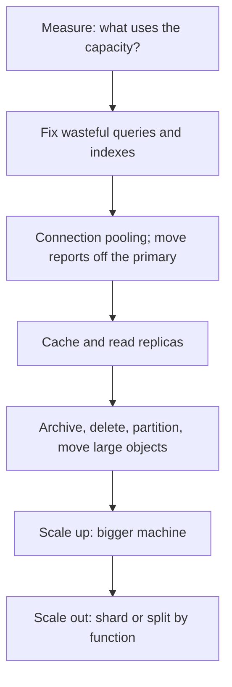

# Performance scenarios: "the endpoint is ten times slower" and "the database is at capacity"

> **Before this lesson:** read [Hypothesis-driven triage](#/lesson/thinking/hypothesis-triage) for percentiles and the clarify–scope–what-changed routine, and [Data modelling questions](#/lesson/thinking/data-modelling-basics) for tables and indexes. This lesson goes one level deeper: once you know *where* the slowness is, how do you find and fix the cause?

## In plain words

A supermarket has slow queues. The manager could buy ten more tills — expensive, and useless if the real problem is that one cashier's scanner is broken, or that every customer is being asked to fill in a form. A sensible manager first *watches* for ten minutes with a stopwatch: where does the time go? Scanning? Paying? Waiting for a price check? Whichever takes longest is the **bottleneck** — the narrowest point, which limits the speed of everything. Fixing anything else changes nothing.

Performance work in software is that stopwatch habit. Interviewers ask *"this API call used to take 200 milliseconds and now takes two seconds — what do you do?"* or *"the database is running out of room; what are the options?"* to see two things: that you **measure before you change**, and that you know the usual suspects and the usual remedies, from cheapest to most drastic. In a job this matters twice: slow software loses users, and the instinctive fix — more and bigger machines — is the most expensive one and frequently does not work.

## The golden rule: measure, then change one thing

Three steps, in a loop.

1. **Measure** where the time or the resource goes.
2. **Fix the biggest contributor** — only that.
3. **Measure again** to confirm, and repeat.

Why "only the biggest"? Suppose a request takes 1,000 ms: 900 ms in the database and 100 ms in your code. Make your code twice as fast and the request takes 950 ms — nobody notices. Make the database part twice as fast and it takes 550 ms. The possible gain from improving a part is limited by that part's share of the total; this observation is known as **Amdahl's law**. Engineers who skip the measuring step spend days polishing the 100 ms.

```python-run
total = {"database": 900, "your code": 80, "network": 20}

def after_speeding_up(part, factor):
    return sum(ms / factor if name == part else ms for name, ms in total.items())

print("now:", sum(total.values()), "ms")
for part in total:
    print(f"make '{part}' 10x faster -> {after_speeding_up(part, 10):.0f} ms")
```

The function recomputes the total with one part divided by a speed-up factor. Making the database ten times faster brings 1,000 ms down to 190; making your code ten times faster brings it to 928. Same effort, very different result.

### Where time goes: the tools

| Tool | What it shows | Everyday picture |
|---|---|---|
| **Metrics dashboard** | Rate, errors, latency, saturation of each component over time | The stopwatch readings on a wall chart |
| **Trace** | One request's journey with the time spent in each step | Following one shopper with a stopwatch |
| **Profiler** | Which functions inside one program consume the time or memory | Watching one cashier's hands |
| **Slow-query log** | Database queries that took longer than a threshold | The till that keeps calling for a price check |
| **Query plan** (`EXPLAIN`) | *How* the database intends to run a query — which indexes, how many rows read | The route a shelf-stacker will walk |

### The usual suspects

A short list accounts for most slow endpoints. Learn to recognise each.

| Suspect | Sign | Remedy |
|---|---|---|
| **Missing index** | A query reads the whole table to find a few rows; time grows with table size | Add an index on the filtered or joined columns |
| **N+1 queries** | One query for a list, then one more per item; many small queries per request | Fetch in one batched query |
| **Fetching too much** | `SELECT *`, thousands of rows returned to show twenty | Select needed columns; paginate |
| **Slow dependency** | Time is spent waiting on another service | Timeout, cache, parallel calls, make it asynchronous |
| **Sequential calls** | Five independent calls made one after another | Make them concurrently |
| **No caching** | The same expensive result computed for every request | Cache it |
| **Lock contention** | Requests wait for each other; processor is idle while latency is high | Shorter transactions; finer locks |
| **Resource exhaustion** | Processor, memory, disk or connection pool near 100 % | Fix the leak or the waste; then add capacity |
| **Bad algorithm** | Time grows much faster than input size (a loop inside a loop over large lists) | A better data structure or algorithm |
| **Large payloads** | Megabytes sent for a small screen | Compress; send less |

### Seeing the first two suspects

An **index** was defined earlier as a lookup structure, like the index of a book. Here is the difference it makes, with a search over a list standing in for a table scan and a dictionary standing in for an index.

```python-run
import time

orders = [{"id": i, "customer": i % 50_000} for i in range(500_000)]

def scan(customer):                               # no index: look at every row
    return [o for o in orders if o["customer"] == customer]

index = {}                                         # build an index: customer -> their orders
for o in orders:
    index.setdefault(o["customer"], []).append(o)

t = time.perf_counter(); a = scan(4242); t_scan = time.perf_counter() - t
t = time.perf_counter(); b = index.get(4242, []); t_index = time.perf_counter() - t
print(f"scan : {len(a)} rows in {t_scan * 1000:8.2f} ms (looked at {len(orders):,} rows)")
print(f"index: {len(b)} rows in {t_index * 1000:8.4f} ms (went straight to them)")
```

`scan` examines all 500,000 rows to find ten. The dictionary jumps directly to the answer. The printed times differ by a factor of thousands, and — the important part — the scan gets slower as the table grows while the indexed lookup barely changes. This is why "it was fine last year and is slow now, with no code change" so often turns out to be a missing index on a table that grew.

And the **N+1** pattern, counted instead of timed:

```python-run
queries = 0
def db(sql):                       # pretend database: count the round trips
    global queries
    queries += 1
    return list(range(20)) if "FROM posts" in sql else ["author"]

queries = 0
posts = db("SELECT * FROM posts LIMIT 20")
for p in posts:
    db(f"SELECT name FROM users WHERE id = {p}")       # one extra query per post
print("N+1 version:", queries, "queries")

queries = 0
posts = db("SELECT * FROM posts LIMIT 20")
db("SELECT id, name FROM users WHERE id IN (...20 ids...)")   # one query for all authors
print("batched version:", queries, "queries")
```

Twenty-one round trips against two. Each is fast alone — which is why this problem hides — but each costs a network round trip, and the page slows in proportion to the number of items shown.

## Worked scenario 1 — The endpoint is ten times slower

**Prompt:** *"The 'order history' API used to respond in 200 ms. It now takes 2 seconds. What do you do?"* Speak for five minutes, then compare.

<details><summary>Model answer</summary>

"I'd start by scoping, because the right investigation depends on the answers.

- **Measured how?** Average or a percentile? Is it every request or a slow tail?
- **Since when — a sudden step or a gradual climb?** A step suggests a change: a deploy, a configuration change, a migration. A climb suggests growth: more data, more traffic.
- **For everyone or for some?** If it is slow only for certain customers, I'd look at what they share — perhaps they have thousands of orders.
- **Only this endpoint?** If everything is slow, the cause is shared: the database server, the network, an overloaded host.

Suppose the answer is: only this endpoint, it worsened gradually over months, and it is far worse for long-standing customers.

That pattern — gradual, one endpoint, worse with more data — points at a query whose cost grows with the amount of data.

**Find where the time goes.** I'd take one slow request and look at its trace. If we have no tracing, I'd time the stages by hand: the database calls, calls to other services, and our own processing.

Say the trace shows 1.8 of the 2 seconds in the database, spread over 150 small queries. That is two findings at once.

**Finding 1 — N+1.** The code loads the customer's orders, then for each order runs a query for its items and another for its shipping status. Fifty orders means a hundred extra queries. Fix: fetch all the items for those orders in one query and all the statuses in another, and group them in memory. From 150 queries to three.

**Finding 2 — no pagination.** We are loading *every* order the customer has ever made, to display the first twenty. Long-standing customers have hundreds. Fix: fetch one page — with a cursor — ordered by date.

**Finding 3 — check the query plan.** I'd run `EXPLAIN` on the main query. If it scans the whole orders table to find one customer's rows, it needs an index on `(customer_id, created_at)`, which also serves the sort.

**Fix one at a time and measure.** Pagination first, since it removes most of the work; then the batching; then the index if the plan shows a scan. After each, I'd check the latency again — so that I know what helped, and stop when it is fast enough.

**Before releasing**, test with a realistic heavy customer, not my test account with three orders. And add the index using the database's online method so that the table is not locked while it builds.

**Then prevent a repeat.** An alert on this endpoint's latency; a test or a check that counts queries per request, since N+1 problems creep back; and a load test with production-sized data as part of the release process.

**If the trace had shown something else**, the same method applies: time in another service → add a timeout, cache its answer, or call it in parallel with our other work; time in our own code → profile it and look at the function at the top of the list."

</details>

> [!INTERVIEW]
> Notice what the answer did *not* do: it did not open with "add a cache" or "scale up the servers". Either would have hidden the problem for a while and left the wasteful work in place. Leading with **measurement and the cheapest real fix** is the signal interviewers look for.

### A word on caching

A cache is the most common performance remedy and deserves careful use. The questions to answer aloud whenever you propose one:

- **What exactly is cached**, and under what key?
- **How long is it valid?** That is, how stale may the data be?
- **How is it updated or removed** when the underlying data changes? This is called **invalidation**, and it is the hard part.
- **What happens when the cache is empty or down?** The system must still work, and the database must survive the extra load.
- **Is anything in it private?** A cache keyed without the user's identity can hand one person another's data.

Prefer fixing the wasteful query first. A cache in front of a slow query still has a slow query behind it, waiting for the day the cache is cold.

## Worked scenario 2 — The database is at capacity

**Prompt:** *"Our main database is at 85 % processor use at peak and the disk is 80 % full. Growth is 10 % a month. What are the options?"*

First, "at capacity" can mean several different things, and the remedies differ.

| Limit | Sign | 
|---|---|
| **Processor** | High processor use; queries queue |
| **Memory** | Frequently used data no longer fits in memory; disk reads rise sharply |
| **Disk space** | The volume is filling up |
| **Connections** | "Too many connections" errors; application waits for a free one |
| **Write throughput** | Replicas fall behind; writes queue |

And notice the clock: at 10 % growth a month, usage doubles in about seven months. Disk at 80 % will be full in a little over two. This is a problem with a deadline.

<details><summary>Model answer</summary>

"I'd treat this as two problems with different urgency — disk space runs out first — and work through options from cheapest to most disruptive. But before any of them, I'd find out what the capacity is being spent on.

**Step 0 — Measure.** Which queries consume the most total processor time? Usually a handful account for most of it. Which tables and indexes take the disk? Is the load reads or writes? What happens at peak that does not happen otherwise?

**Step 1 — Stop wasting (days of work, no new hardware).**

- Fix the top few expensive queries: missing indexes, N+1 patterns, queries returning far more than needed. It is common for this alone to cut processor use by half.
- Remove unused indexes — each one slows every write and takes space.
- Use a **connection pool** so that the application reuses a limited set of connections instead of opening one per request.
- Move heavy reports and analytics off the main database — they can run against a copy.

**Step 2 — Take load away with caching and replicas (weeks).**

- Cache frequently read, rarely changed data in memory in front of the database.
- Add **read replicas**: copies of the database that receive every change from the primary and serve read queries. Most applications read far more than they write, so this spreads most of the load. The catch is **replication lag**: a replica may be a moment behind, so a user who saved something a moment ago might not see it. Read-after-write requests go to the primary.

**Step 3 — Shrink the data (weeks).**

- **Archive** old rows — orders from seven years ago — to cheaper storage, keeping them retrievable.
- Delete what is truly not needed: old logs, expired sessions, soft-deleted rows.
- Move large objects — images, documents — out of the database into file storage, keeping only their addresses.
- **Partition** big tables by time, so that old partitions can be dropped or moved cheaply and queries on recent data touch less.

**Step 4 — Scale up (hours to days).** A bigger machine: more processors, memory and disk. It requires no code change and is often the right immediate move to buy time — especially for the disk, which is the urgent one. Its limits: there is a largest machine, cost rises faster than capacity, and a single machine is still a single point of failure.

**Step 5 — Scale out the writes: sharding (months).** Split the data across several databases by a key — for example, customer id — so that each holds a portion. This is the only option that raises write capacity without limit, and by far the most costly: queries that cross shards become hard, transactions across shards are no longer simple, rebalancing is delicate, and every part of the application that touches the database must know about the split. I would reach for it only when the earlier steps are exhausted. A milder version is to move one distinct, high-volume part of the data — say, the event log — to its own database.

**My plan.** This week: extend the disk or scale up to remove the two-month deadline, and start measuring the top queries. This month: fix the worst queries, add connection pooling, and archive old data. This quarter: read replicas and caching if reads still dominate. Sharding goes on the long-term roadmap only if, after all that, write volume is still heading for the limit of the largest machine.

**And plan capacity continuously.** Track usage against growth, and raise the alarm when we are six months from a limit, not six weeks.

**Trade-offs.** Each step adds complexity: caches and replicas bring staleness; archiving complicates queries over history; sharding changes how the whole application is built. The order — measure, stop waste, offload reads, shrink, scale up, shard — keeps us on the simplest architecture that works."

</details>

### The ladder, as a picture



In practice step F is often taken early as a stop-gap, because it is quick; what matters is that it is recognised as buying time and not as the solution.

## Scaling up, scaling out, and what each really gives

| | Scale up (vertical) | Scale out (horizontal) |
|---|---|---|
| What | A bigger machine | More machines |
| Effort | Small: resize | Large: the software must be built for it |
| Ceiling | The largest machine available | In principle none |
| Failure | Still one machine | Survives the loss of one |
| Best for | Databases, as a first move | Stateless application servers; reads via replicas |

Application servers are usually easy to scale out because they hold no state. Databases are hard to scale out for writes because they *are* the state. That asymmetry explains why so many performance discussions end at the database.

## Common mistakes

- **Guessing instead of measuring.**
- **Adding hardware first**, masking a wasteful query that will overwhelm the new hardware in six months.
- **Optimising the part that is not the bottleneck.**
- **Changing several things at once**, so that nobody knows which helped.
- **Caching without an invalidation plan.**
- **Testing with small data.** A query that is instant on 100 rows may take a minute on 100 million.
- **Proposing sharding early.**
- **Forgetting that indexes cost writes and space** — more is not always better.
- **Declaring victory without measuring again.**

## Summary

- Measure where time or capacity goes; fix the largest contributor; measure again. The gain from improving a part is limited by its share of the total.
- Tools: dashboards, traces, profilers, the slow-query log, query plans.
- Usual suspects: missing index, N+1 queries, fetching too much, slow or sequential dependencies, no caching, lock contention, exhausted resources, poor algorithms.
- For a slow endpoint: scope it, trace one request, fix the dominant cause, verify, and add a guard against recurrence.
- For a database at capacity, climb the ladder: stop waste → pool connections and move reports → cache and read replicas → shrink the data → scale up → shard as a last resort.
- A cache needs answers to: what, how long, how invalidated, what if empty, and is it private?

## Glossary

| Term | Meaning |
|---|---|
| Bottleneck | The slowest stage, which limits the speed of the whole |
| Amdahl's law | Speeding up one part helps only in proportion to that part's share of the total |
| Profiler | A tool showing which functions consume time or memory |
| Trace | A record of the time one request spent in each step |
| Slow-query log | A database's list of queries exceeding a time threshold |
| Query plan | The database's chosen method of executing a query |
| Full table scan | Reading every row to find the matching ones |
| N+1 queries | One query for a list plus one more for each item |
| Cache invalidation | Removing or updating cached data when the original changes |
| Connection pool | A reusable set of open database connections |
| Read replica | A copy of a database that serves read queries |
| Replication lag | The delay before a replica reflects the primary's latest changes |
| Archiving | Moving old data to cheaper storage |
| Partitioning | Splitting one large table into pieces, often by date |
| Sharding | Splitting data across several databases by a key |
| Scale up / scale out | Use a bigger machine / use more machines |

## Check yourself

```quiz
[
  {"q": "A request takes 1,000 ms: 850 ms in the database and 150 ms in application code. You make the application code five times faster. What is the new total?",
   "options": ["200 ms", "About 880 ms", "500 ms", "170 ms"],
   "answer": 1,
   "explain": "150 / 5 = 30 ms, so the total is 850 + 30 = 880 ms. The bottleneck was untouched."},
  {"q": "An endpoint slowed gradually over a year with no code change, and is worst for customers with the most data. What is the likeliest cause?",
   "options": ["A bad deploy last night", "A query whose cost grows with data volume, such as a missing index or loading everything", "A full moon", "A typo in the user interface"],
   "answer": 1,
   "explain": "Gradual slowdown tied to data size points at scans, missing pagination or N+1 patterns."},
  {"q": "A page showing 30 posts issues 31 database queries. What is this and how is it fixed?",
   "options": ["A deadlock; add a lock", "N+1 queries; load the related rows in one batched query", "A cache stampede; add jitter", "Normal behaviour"],
   "answer": 1,
   "explain": "One query for the list plus one per item becomes two queries when the related rows are fetched together."},
  {"q": "Why should 'add a cache' not be the first response to a slow query?",
   "options": ["Caches are illegal", "The wasteful query remains and returns whenever the cache is empty; caches also add staleness and invalidation work", "Caches are always slower", "Caches cannot store data"],
   "answer": 1,
   "explain": "Fix the cause first; cache what is expensive for good reason."},
  {"q": "What is the main caveat of read replicas?",
   "options": ["They cannot be read", "Replication lag: a replica may briefly miss the latest writes", "They double write capacity", "They delete data"],
   "answer": 1,
   "explain": "Reads that must reflect a change made a moment ago should go to the primary."},
  {"q": "A disk is 80% full and usage grows 10% per month. Roughly when is it full?",
   "options": ["In about two to three months", "In two years", "Never", "Tomorrow"],
   "answer": 0,
   "explain": "80 × 1.1 × 1.1 ≈ 97 and one more month exceeds 100, so a little over two months."},
  {"q": "When is sharding the appropriate step?",
   "options": ["As the first response to any slowness", "After waste is removed and reads are offloaded, when write volume or data size still exceeds one machine", "Whenever a table has more than 1,000 rows", "Never"],
   "answer": 1,
   "explain": "It raises write capacity without limit and is the most disruptive option, so it comes last."}
]
```

> **Source:** Google SRE Book, "Monitoring Distributed Systems" and "Handling Overload" (https://sre.google/sre-book/monitoring-distributed-systems/, https://sre.google/sre-book/handling-overload/); PostgreSQL documentation, "Using EXPLAIN" and "Indexes" (https://www.postgresql.org/docs/current/using-explain.html, https://www.postgresql.org/docs/current/indexes.html); scaling sections of Donne Martin's System Design Primer — replication, sharding, caching (https://github.com/donnemartin/system-design-primer). Scenarios, code and wording are original.
