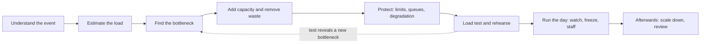

# Cost and load scenarios: "the bill doubled" and "traffic will be ten times higher next month"

> **Before this lesson:** read [Performance scenarios](#/lesson/thinking/performance-scenarios) for the measure-then-fix loop and the capacity ladder, and [Back-of-envelope estimation](#/lesson/thinking/estimation-fermi) for sizing arithmetic.

## In plain words

A household's electricity bill doubles. Nobody solves that by unplugging things at random. You look at the bill to see *which month* it jumped, you ask *what changed* — a new heater? a guest? a freezer door left open? — and you find *which appliance* is using the power. Then you fix that one thing, and you decide whether the higher use was waste (the freezer door) or something you chose and are happy to pay for (the heater in winter).

Running software in the **cloud** — on computers rented from a provider and paid for by use — produces the same kind of bill, with the same kind of surprise. *"Our cloud cost doubled this quarter; what do you do?"* is asked because cost is an engineering responsibility now: the person who writes a wasteful query or leaves a test system running is the person spending the money.

The second scenario is the mirror image. Instead of an unpleasant surprise in the past, there is a known event in the future: a television advertisement, a product launch, a holiday sale. *"We expect ten times the traffic next month — how do you prepare?"* tests whether you can plan, test and protect a system before the crowd arrives, the way a shop prepares for the first day of the sales.

Both scenarios reward the same habit as the previous lesson: **look before you act.**

## Part 1 — The bill doubled

### What a cloud bill is made of

Almost every line of a cloud bill falls into one of five kinds.

| Kind | You pay for | Typical surprise |
|---|---|---|
| **Compute** | Machines (or containers, or function runs) per hour or second of use | Oversized machines; things left running; scaling that went up and never came down |
| **Storage** | Gigabytes kept per month, by speed class | Old backups, logs and snapshots kept for ever; duplicates |
| **Data transfer** | Gigabytes moved, especially *out* to the internet or *between* regions | Large downloads; chatty services in different regions; no compression |
| **Managed services** | Databases, queues, search, machine-learning services — per request, per hour or per capacity | A new feature calling a paid service far more often than expected |
| **Observability and extras** | Logs and metrics ingested and stored; support plans; licences | Debug logging left on; a metric with millions of distinct labels |

Two ideas help in reading it.

**Fixed against variable.** Some costs exist whether or not anyone uses the product (a database that is always on). Others rise with use (per request, per gigabyte). A doubling of a variable cost may mean only that the business doubled — which is good news.

**Unit cost.** Total cost says little. Divide by something meaningful — *cost per thousand requests*, *per active user*, *per order*. If the bill doubled and so did the orders, cost per order is flat and nothing is wrong. If the bill doubled and orders did not, something is wasting money. Always ask for both numbers.

### A method

1. **Confirm and size it.** Doubled compared with what? One month or a trend? Did usage also grow?
2. **Break it down** by service, by team or project (through **tags** — labels attached to resources saying who owns them), by region and by day.
3. **Find the step.** On which day did the daily cost change? What changed that day: a deploy, a configuration change, a new feature, a new customer, a test?
4. **Classify**: growth (expected), waste (fix it), a pricing change, or an accident or abuse (fix it urgently).
5. **Fix the biggest item first**, measure, repeat.
6. **Prevent a repeat**: budgets, alerts, ownership.

```python-run
last = {"compute": 42_000, "database": 18_000, "storage": 6_000, "data transfer": 4_000, "logging": 3_000}
this = {"compute": 45_000, "database": 19_000, "storage": 7_000, "data transfer": 31_000, "logging": 44_000}

total_last, total_this = sum(last.values()), sum(this.values())
increase = total_this - total_last
print(f"bill: {total_last:,} -> {total_this:,}  (x{total_this / total_last:.2f})\n")
for name in sorted(last, key=lambda k: this[k] - last[k], reverse=True):
    delta = this[name] - last[name]
    print(f"{name:14s} {last[name]:>7,} -> {this[name]:>7,}   +{delta:>6,}   {delta / increase:5.1%} of the increase")

orders_last, orders_this = 900_000, 950_000
print(f"\ncost per order: {total_last / orders_last:.3f} -> {total_this / orders_this:.3f}")
```

The script holds two months of spending by category, computes the change in each, sorts by the size of the change, and prints each one's share of the total increase. The result is the whole investigation in miniature: the bill doubled, yet compute, database and storage barely moved; **logging and data transfer account for 93 %** of the increase. The last line shows orders grew by about 5 % while cost per order doubled — so this is waste, not growth. You now know where to look, and where not to waste time.

### The usual suspects

| Suspect | How it happens | Remedy |
|---|---|---|
| **Left running** | Test environments, experiments, machines for a finished project | Find by tags and age; shut down; expire test systems automatically |
| **Oversized** | Machines chosen generously and never revisited; processor mostly idle | **Right-size** to actual use |
| **Scaling that never came down** | Automatic scaling raised capacity for a spike; the rule to reduce it is missing or too timid | Fix the scale-down rule; set a maximum |
| **Verbose logging** | Debug-level logs enabled during an incident and forgotten; a loop logging every item | Lower the level; sample; shorten retention |
| **Data transfer** | Services placed in different regions talking constantly; large uncompressed responses; files served from the origin instead of a CDN | Co-locate; compress; cache at the edge |
| **Unbounded storage** | Backups, snapshots and old versions never deleted | Retention rules; move old data to cheaper storage classes |
| **A runaway job** | A retry loop or a misconfigured schedule calling a paid service millions of times | Stop it; add limits and alerts |
| **An expensive new feature** | A feature that calls a costly service — for example an AI model — on every page view | Cache results; call less often; use a cheaper option for easy cases |
| **Abuse** | Leaked credentials used to run someone else's workloads; a bot hammering an expensive endpoint | Revoke and rotate keys; rate-limit; treat as a security incident |
| **Inefficient code** | The wasteful queries from the previous lesson, now paid for by the hour | Fix them — performance work is cost work |

### Worked scenario

**Prompt:** *"Finance tells you the cloud bill went from 70,000 to 145,000 in one month. What do you do?"* Five minutes aloud, then compare.

<details><summary>Model answer</summary>

"First I'd establish what we are comparing. Is this one month against the previous one, and has anything in the business changed — a launch, a large new customer? If usage doubled, a doubled bill may be healthy. So I'd put cost next to a usage measure straight away: orders, active users, requests. Say orders rose 5 %. Then cost per order has roughly doubled, and I am looking for waste or an accident.

**Break it down.** By service category first. Suppose compute, database and storage are roughly flat, and two lines exploded: logging, from 3,000 to 44,000, and data transfer, from 4,000 to 31,000. That is nearly the whole increase, so I'd ignore everything else for now.

**Find the day.** I'd look at daily cost for those two lines. A sudden step on a particular day is far more informative than a monthly total. Suppose both jump on the 9th.

**What changed on the 9th?** Deploy history, configuration changes, incident log. Suppose there was an incident that day, during which someone turned on debug logging for the order service — and a new 'export all orders' feature was released the same week.

**Hypotheses.** For logging: debug level was never switched off, so every request now writes dozens of lines. I'd confirm by looking at log volume per service and per level. For transfer: the export feature is sending large uncompressed files, or a customer's script is downloading the full export every few minutes. I'd confirm by looking at which endpoint and which callers account for the outbound bytes.

**Fix — biggest first.** Turn debug logging off: immediate, safe, and it removes most of the excess. Then for the export: compress the responses, add a rate limit, and offer an incremental export so that nobody needs to download everything repeatedly; and speak to the customer whose script is doing it.

**Verify.** Watch daily cost fall back over the next days. A monthly bill is too slow a signal.

**Is anything more urgent?** I'd keep one possibility in mind from the start: if the unexplained increase were in compute, in a region we do not use, I would treat it as a possible security incident — stolen credentials being used to run someone else's workloads — and involve security immediately.

**Prevent a repeat.**

- A budget with alerts on *daily* spend and on unusual jumps, sent to the owning team — so that this is caught in a day, not at month end.
- Tags on every resource, so that cost can be attributed to a team.
- Debug logging enabled through a switch that turns itself off after a few hours.
- Cost per order on the team's dashboard, next to latency and errors.
- A cost estimate as part of the design review for new features.

**Trade-off to state.** I would not cut blindly. Some spending buys reliability — spare capacity, a second region, backups, logs kept long enough to investigate incidents. The aim is to remove waste, not safety margins; each cut should come with an answer to 'what does this cost us if things go wrong?'"

</details>

> [!INTERVIEW]
> The strongest opening to any cost question: **"Did usage change too? I'd look at cost per unit, not only the total."** It separates growth from waste in one sentence and shows you see cost as an engineering measurement, not a finance problem.

### Lasting ways to spend less

Once the accident is fixed, these are the standard, deliberate savings — each with its price.

| Lever | Saves | Costs |
|---|---|---|
| Right-sizing | Paying for idle capacity | Less headroom for spikes |
| Automatic scaling | Paying for peak capacity all night | Complexity; a delay while new capacity starts |
| Committed-use discounts | A large percentage for promising a year or more of use | Flexibility: you pay even if you need less |
| Interruptible ("spot") machines | Much cheaper spare capacity | They can be taken away at short notice; only for work that tolerates interruption |
| Cheaper storage classes for old data | Storage cost | Slower, sometimes paid, retrieval |
| Caching and CDN | Compute and transfer | Staleness; invalidation |
| Turning off non-production systems at night | Up to two thirds of their hours | A start-up delay each morning |
| Efficient code and queries | Everything | Engineering time |

## Part 2 — Ten times the traffic next month

### The shape of the answer



### Worked scenario

**Prompt:** *"Marketing has bought a prime-time television advertisement for the 20th. They expect ten times normal traffic for about half an hour. How do you prepare?"*

<details><summary>Model answer</summary>

"I'd begin with questions, because 'ten times' hides the details that matter.

- **Ten times what?** Average traffic or our current peak? If our normal evening peak is 500 requests per second and they mean ten times the *average* of 150, we are facing 1,500, not 5,000.
- **What shape?** An advertisement produces a sharp spike within a minute or two of airing, not a gentle rise. Automatic scaling that takes five minutes to add machines will be too late.
- **What will visitors do?** Mostly land on one page and browse — cheap reads — or sign up and buy — expensive writes and calls to payment providers?
- **How certain is the estimate, and what does being wrong cost?** I'd plan for more than the forecast — perhaps double — because the cost of spare capacity for an evening is small beside the cost of the site failing in front of a national audience.

**Estimate.** Say current peak is 500 requests per second and we plan for 5,000, with a quarter of visitors starting a sign-up.

**Find the bottleneck — before the audience does.** I'd walk the request path and ask of each component: what is its limit, and how close are we now?

- *Web servers*: stateless, so easy to multiply.
- *Database*: usually the real limit. At 60 % processor use at today's peak, ten times will not fit.
- *Third parties*: payment and email providers have rate limits of their own — and we cannot scale them.
- *Shared limits*: connection pools, quotas set by the cloud provider on how many machines we may start. These are the limits people forget; a request to raise a provider quota can take days.

**Reduce the load we have to carry.**

- The landing page is the same for everyone, so serve it from a **CDN** and cache it. With luck most visitors never touch our servers at all.
- Cache the catalogue and other read-mostly data in memory.
- Make anything not needed for the immediate response asynchronous: welcome emails, analytics, recommendation updates go on a queue.

**Add capacity ahead of time.** Because the spike is sharper than automatic scaling can follow, I'd **pre-scale**: start the extra web servers an hour before the advertisement, enlarge the database a day or two before, add read replicas, and raise connection limits. Request any quota increases this week.

**Protect the system if the estimate is wrong.**

- **Rate limiting** per client, so that one script cannot take a large share.
- **Load shedding**: beyond a safe limit, turn away the excess quickly with a friendly "we're busy, try again in a moment" page instead of letting everything slow to a crawl.
- A **virtual waiting room** or queue in front of sign-up, admitting people at the rate the database and payment provider can take.
- **Graceful degradation switches** prepared in advance: turn off recommendations, search suggestions and other non-essential features with one flag, to give their capacity to the essentials.
- **Timeouts and circuit breakers** on third-party calls, so that a slow payment provider does not take the site with it.

**Test it — this is the step that makes the rest real.** A **load test**: generate artificial traffic of the expected shape — a sudden spike, realistic mix of pages and actions — against an environment as close to production as possible, or carefully against production itself at a quiet hour. I'd run it to the planned level and then beyond, until something breaks, to learn *what* breaks first and *how*. Every load test finds something unexpected: a connection limit, a slow query, a cache that was not caching. Then fix and test again. I would start this at least two weeks ahead, because the fixes take time.

**Rehearse the people as well as the machines.** Who is on duty that evening? Do they have the dashboards, the runbook, the degradation switches, and the authority to use them? A short practice run costs an hour.

**On the day.** No deploys from the day before — a **change freeze** — so that if something goes wrong, the advertisement is the only variable. Capacity raised in advance and verified. People watching the key graphs: request rate, error rate, latency, database load, queue lengths, third-party error rates.

**Afterwards.** Scale back down — otherwise the next question will be 'why did the bill double?'. And a short review: how did the real traffic compare with the forecast, what was the first thing to strain, and what would we do differently?

**Trade-offs.** Over-provisioning costs money for a night and is cheap insurance. A waiting room annoys some visitors and keeps the site alive for all. Turning off features degrades the experience and protects the purchase path. I'd agree those choices with the business in advance, so that nobody is debating them at 8 p.m."

</details>

### Kinds of load test

The term covers several different exercises; naming the right one shows precision.

| Test | Question it answers | Shape |
|---|---|---|
| **Load test** | Can we handle the expected level? | Ramp to the target and hold |
| **Stress test** | Where and how do we break? | Keep increasing until failure |
| **Spike test** | Can we survive a sudden jump? | From normal to peak in seconds |
| **Soak test** | Does anything degrade over hours — a leak, a filling disk? | Moderate load for a long time |

For a television advertisement, the spike test is the essential one. What to watch during any of them: latency percentiles, error rate, and the saturation of each component — the first resource to reach its limit is the bottleneck.

Capacity arithmetic to say aloud: if one server handles 200 requests per second at an acceptable latency, 5,000 requests per second needs 25 — and then add **headroom**, because running at 100 % leaves nothing for surprises and because some servers will fail. Planning to run at about two thirds of capacity gives 39 servers; add a couple more so that losing one changes nothing.

```python-run
import math

def servers_needed(peak_rps, per_server_rps, target_utilisation=0.65, spare=2):
    base = peak_rps / per_server_rps                      # if every server ran flat out
    with_headroom = base / target_utilisation             # run each at about 65 %
    return math.ceil(with_headroom) + spare               # round up, plus spares for failures

for peak in (500, 1500, 5000, 10000):
    print(f"{peak:>6} req/s -> {servers_needed(peak, 200)} servers")
```

The function divides the peak by one server's capacity, divides again by the share of capacity you are willing to use, rounds up, and adds spares. It prints the server count for several traffic levels — and makes the point that the formula is easy; the hard part is knowing the real per-server figure, which only a load test gives.

## Common mistakes

- **Looking at total cost only**, never cost per unit of business.
- **Cutting across the board** ("everyone reduce by 20 %") instead of finding the two lines that caused the jump.
- **Waiting for the monthly bill** when daily data exists.
- **Removing safety margins** — backups, redundancy — to save money, without saying what risk was accepted.
- **Relying on automatic scaling** for a spike that arrives faster than machines can start.
- **Scaling the web tier and forgetting the database**, the third parties and the quotas.
- **Not load testing**, or testing with unrealistic traffic.
- **Deploying on the day of the event.**
- **Forgetting to scale down afterwards.**

## Summary

- A cloud bill is compute, storage, data transfer, managed services and observability. Judge it per unit of business, not in total.
- Cost method: confirm → break down by service, owner and day → find the step and what changed → classify as growth, waste, pricing or accident → fix the largest → prevent with budgets, tags and alerts.
- Common culprits: things left running, oversizing, scaling that never came down, debug logging, data transfer, unbounded storage, runaway jobs, expensive new features, abuse.
- For a known traffic event: understand its size and shape, estimate, find the bottleneck, reduce load with caching and asynchronous work, pre-scale, protect with limits and degradation, load test until something breaks, freeze changes, watch, scale down, review.
- Spare capacity is cheap insurance for a short event; every protection has a cost worth agreeing in advance.

## Glossary

| Term | Meaning |
|---|---|
| Cloud | Computing resources rented from a provider and billed by use |
| Compute | Processing capacity: machines, containers or function executions |
| Data transfer (egress) | Data sent out of a provider's network or between its regions, usually charged |
| Managed service | A component, such as a database, operated for you by the provider |
| Unit cost | Cost divided by a business measure such as orders or users |
| Tag | A label on a resource identifying its owner or purpose |
| Right-sizing | Matching a resource's size to what it actually uses |
| Automatic scaling | Adding or removing capacity in response to load |
| Committed-use discount | A lower price in exchange for promising long-term use |
| Spot (interruptible) machine | Cheap spare capacity that can be reclaimed at short notice |
| Pre-scaling | Adding capacity before an expected surge |
| Headroom | Spare capacity kept above expected load |
| Load test | A test that applies artificial traffic to measure behaviour |
| Stress / spike / soak test | Increasing to failure / a sudden jump / sustained load for hours |
| Waiting room | A queue in front of a service that admits users at a controlled rate |
| Change freeze | A period during which no changes are deployed |
| Quota | A provider-imposed limit on how much of a resource may be used |

## Check yourself

```quiz
[
  {"q": "The cloud bill doubled. What is the most useful first comparison?",
   "options": ["Against a competitor's bill", "Against usage: has cost per order, user or request changed?", "Against last year's salary budget", "Against the number of engineers"],
   "answer": 1,
   "explain": "If usage doubled too, unit cost is flat and the growth is expected; if not, look for waste or an accident."},
  {"q": "A monthly bill rose by 75,000; logging rose by 41,000 and data transfer by 27,000. Where should you look first?",
   "options": ["Compute, because it is usually largest", "Logging and data transfer, which explain most of the increase", "Every category equally", "Nowhere; wait for next month"],
   "answer": 1,
   "explain": "Rank by size of change, not size of total: those two lines account for about 90% of the rise."},
  {"q": "Why look at daily cost instead of the monthly total?",
   "options": ["Daily numbers are smaller", "A step on a particular day can be matched to a deploy, configuration change or incident", "Monthly bills are wrong", "It is required by law"],
   "answer": 1,
   "explain": "Finding the day the cost changed is the quickest route to finding what changed."},
  {"q": "An unexplained surge in compute appears in a region the company never uses. What should you suspect?",
   "options": ["A rounding error", "Compromised credentials being used by someone else; treat it as a security incident", "Normal growth", "A cheaper pricing tier"],
   "answer": 1,
   "explain": "Unknown workloads in unused regions are a classic sign of stolen keys."},
  {"q": "A television advertisement will cause a sharp spike within a minute. Why is automatic scaling alone insufficient?",
   "options": ["It is too expensive", "New capacity takes minutes to start, by which time the spike has arrived", "It only works on weekdays", "It reduces capacity"],
   "answer": 1,
   "explain": "For sudden known events, capacity is added beforehand — pre-scaling."},
  {"q": "One server handles 250 requests per second. You plan for 4,000 at 65% utilisation with 2 spares. How many servers?",
   "options": ["16", "18", "27", "40"],
   "answer": 2,
   "explain": "4,000 / 250 = 16; 16 / 0.65 ≈ 24.6, rounded up to 25; plus 2 spares gives 27."},
  {"q": "Which test is designed to find where and how the system breaks?",
   "options": ["Soak test", "Stress test", "Unit test", "Smoke test"],
   "answer": 1,
   "explain": "A stress test keeps raising load until something fails, revealing the first bottleneck and the failure behaviour."}
]
```

> **Source:** Google SRE Book, "Handling Overload", "Addressing Cascading Failures" and "Software Engineering in SRE" — capacity planning (https://sre.google/sre-book/handling-overload/, https://sre.google/sre-book/addressing-cascading-failures/, https://sre.google/sre-book/software-engineering-in-sre/); FinOps Foundation framework on allocating and optimising cloud cost (https://www.finops.org/framework/); AWS Well-Architected Framework, cost-optimisation and performance pillars (https://docs.aws.amazon.com/wellarchitected/latest/framework/welcome.html). Scenarios, figures, code and wording are original.
