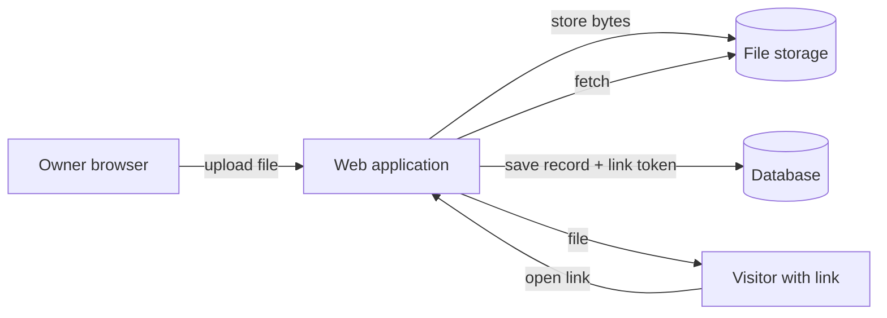

# Security thinking for generalists: threat-modelling a feature

> **Before this lesson:** the difference between authentication and authorisation is explained in [API design questions: the building blocks](#/lesson/thinking/api-design-principles), and SQL injection in ["Review this code"](#/lesson/thinking/code-review-snippets). No security background is assumed. Everything here is about *defending* systems you are responsible for.

## In plain words

Before going on holiday you walk round your home and think like a burglar for five minutes — not because you plan to burgle anyone, but because it is the quickest way to find what you forgot. The ground-floor window is on the latch. The spare key is under the obvious flowerpot. The post piling up says nobody is in. Then you spend your effort where it counts: you lock the window and move the key, and you do not bother fitting bars to the attic skylight that nobody could reach.

**Threat modelling** is that walk, done for a piece of software before or while it is built. You ask, in an organised way: what are we protecting, who might want to misuse it, how could they, and what will we do about the likely and damaging cases? OWASP, the widely used open security community, sums it up as four questions: *What are we working on? What can go wrong? What are we going to do about it? Did we do a good job?*

Interviewers ask generalist engineers — not only security specialists — *"what are the security concerns with this feature?"* because most security holes are created by ordinary feature work: a missing permission check, a field that trusts its input. A candidate who can walk round the feature like that careful homeowner is far more valuable than one who says "security would handle that".

## The vocabulary, one step at a time

| Term | Meaning | Home analogy |
|---|---|---|
| **Asset** | Something worth protecting | Jewellery, passports, the house itself |
| **Threat** | Something bad that could happen to an asset | A burglary |
| **Threat actor** | Who might cause it | An opportunist, a professional, a dishonest guest |
| **Vulnerability** | A weakness that makes the threat possible | The window on the latch |
| **Attack surface** | All the points where someone can interact with the system | Every door and window |
| **Control** (mitigation) | A measure that reduces the risk | A lock; an alarm; insurance |
| **Risk** | How likely × how bad | Ground-floor window: likely and bad. Skylight: unlikely |
| **Trust boundary** | A line where data passes from a less trusted place to a more trusted one | The front door: outside → inside |

The last term is the most useful in practice. Problems cluster at **trust boundaries**: where data arrives from a user's browser, from another company's system, from a file somebody uploaded. The rule that follows is short: **everything crossing a trust boundary is checked, every time.**

## What "secure" means: three goals

Security is usually described by three properties, abbreviated **CIA**.

| Goal | Means | A violation |
|---|---|---|
| **Confidentiality** | Only the right people can read it | Someone downloads other customers' invoices |
| **Integrity** | Only the right people can change it, and changes are detectable | Someone alters the price in a request and pays 1 instead of 100 |
| **Availability** | It is there when legitimate users need it | A flood of requests takes the site down |

For any asset, ask which of the three matters most. For medical records, confidentiality. For a bank ledger, integrity. For an emergency-call system, availability.

## A method: four questions, five steps

1. **Describe the feature** and draw how data flows through it.
2. **List the assets** and mark the trust boundaries.
3. **Ask what can go wrong** at each boundary and for each asset, using a checklist.
4. **Rank** by likelihood and impact, and choose a **control** for the important ones.
5. **Check**: is each top risk covered? How will we know if a control fails?

### The checklist: STRIDE

For step 3 people use a memory aid published by Microsoft, called **STRIDE**. Each letter is a kind of thing that can go wrong, and each has a matching defence.

| Letter | Threat | Plain question | Typical controls |
|---|---|---|---|
| **S** | **Spoofing** | Can someone pretend to be someone else? | Strong authentication; multi-factor sign-in |
| **T** | **Tampering** | Can someone change data they should not? | Validate on the server; integrity checks; permissions |
| **R** | **Repudiation** | Can someone deny having done something, with nobody able to prove otherwise? | Audit logs that cannot be edited |
| **I** | **Information disclosure** | Can someone see what they should not? | Authorisation per object; encryption; send only what is needed |
| **D** | **Denial of service** | Can someone make it unavailable or run up our costs? | Rate limits; size limits; timeouts |
| **E** | **Elevation of privilege** | Can someone gain more power than they were given? | Check roles on the server; least privilege |

You do not need to recite it. Run each letter across each arrow of your drawing and say what you find.

### Principles that produce most of the controls

| Principle | Meaning | Example |
|---|---|---|
| **Never trust the client** | Anything from a browser or app can be altered by its user | Recalculate the price on the server; do not accept it from the page |
| **Least privilege** | Give each person and program the minimum access it needs | The reporting job gets read-only access to one table |
| **Defence in depth** | Several layers, so that one failure is not fatal | Validation *and* parameterised queries *and* a database user with limited rights |
| **Fail closed** | If a check cannot be performed, deny | The permission service is down → refuse, do not allow |
| **Secure by default** | The safe setting is the one you get without doing anything | New documents are private until shared |
| **Minimise** | Data you do not collect or keep cannot leak | Do not store the card number; do not log the password |
| **Do not build your own cryptography** | Use well-tested, standard libraries | Use the platform's password-hashing function |

## A tiny example first

**Feature:** a "change my email address" form.

Walk the letters.

- *Spoofing.* Could someone change **another** person's email? If the request says `user_id=42` and the server believes it, yes. → Take the user from the signed-in session, never from the request.
- *Tampering / elevation.* Changing the email and then using "forgot password" hands the whole account to whoever controls the new address. So this small form is really an **account takeover** path. → Ask for the current password again; send a confirmation link to the *new* address before switching; send a notice to the *old* address with a way to undo.
- *Repudiation.* → Log who changed what, when, from where.
- *Information disclosure.* Does the form say "that email is already registered"? That lets anyone test which addresses have accounts. → A neutral message.
- *Denial of service.* Could someone trigger thousands of confirmation emails to a victim? → Rate limit.

Five minutes, one small form, five real findings. That is the whole technique.

## Worked example — File sharing by link

**Prompt:** *"We are adding a feature: a user can upload a file and share it with anyone by sending them a link. What are the security and privacy concerns?"* Spend ten minutes with the method before opening.

<details><summary>Model answer</summary>

### 1. Describe and draw

A signed-in user uploads a file. The system stores it and creates a link. Anyone with the link can download the file. The owner can remove the link.



**Trust boundaries:** owner's browser → application (signed in, but still untrusted input); visitor → application (anonymous, fully untrusted); application → storage and database (trusted internal).

### 2. Assets

The files' contents (confidentiality above all); the storage and bandwidth we pay for (availability and cost); our domain's reputation (we must not become a host for harmful material); users' accounts.

### 3. What can go wrong

| # | STRIDE | Threat | Likelihood | Impact |
|---|---|---|---|---|
| 1 | I | **Guessable links.** If links are `/share/1041`, `/share/1042`, anyone can step through every shared file | High | Severe |
| 2 | I | **Links leak.** Forwarded emails, chat previews, browser history, referrer information sent to other sites | High | High |
| 3 | I, E | **Missing ownership checks.** User A can delete, re-share or list user B's files by changing an id | Medium | Severe |
| 4 | T | **Malicious uploads.** A file that is really a script or malware, served from our domain to visitors | High | High |
| 5 | T | **Dangerous filenames.** A name such as `../../config` used to build a storage path | Medium | Severe |
| 6 | D | **Abuse of resources.** Huge files, millions of uploads, or a popular link used as free hosting | High | Medium |
| 7 | S | **Phishing.** Our link and our logo used to make a fake login page look trustworthy | Medium | High |
| 8 | R | **No trail.** A sensitive file is accessed and nobody can say when or how often | Medium | Medium |
| 9 | I | **Links live for ever.** A file shared for an afternoon is still reachable five years later | High | Medium |
| 10 | I | **Stored unprotected.** A storage misconfiguration exposes everything at once | Low | Severe |

### 4. Controls for the top risks

**Guessable links (1).** The token in the link must be long and random — generated by a cryptographic random source, at least 128 bits — so that guessing is hopeless. Sequential numbers are the classic mistake.

**Leaking links (2) and eternal links (9).** Links expire by default (say seven days), can be revoked, and the owner can see active links. Offer optional protections for sensitive files: a password, a limit on the number of downloads, or "only these signed-in people". Tell browsers not to pass the link on in referrer information.

**Ownership (3).** Every operation on a file checks, on the server, that the signed-in user owns it. Answer "not found" for other people's files.

**Malicious uploads (4) and filenames (5).** Never trust the declared type or name. Store files under an identifier we generate, never under the user's filename. Limit allowed types where possible and scan uploads. Serve downloads from a separate domain that has no access to our users' sessions, and with headers that make the browser *download* the file instead of running or displaying it. That way even a hostile file cannot act as our site.

**Resource abuse (6).** Limits on file size, storage per user, uploads per hour and download bandwidth per link; rate limits by account and by address.

**Phishing and harmful content (7).** A way to report a link; the ability to disable links quickly; scanning; and a plain download page that does not resemble a login screen.

**Trail (8).** Record link creation, access and revocation, and let owners see how often a link was used.

**Storage (10).** Storage is private; downloads go through short-lived signed addresses issued by the application. Encrypt files at rest. Review storage permissions as part of deployment.

### 5. Did we do a good job?

For each top risk there is a control. I would also add tests that try the attacks — request someone else's file, upload a file with a path in its name, request a link after expiry — so that the controls are verified and stay verified. And alerts on unusual patterns: one address requesting many different tokens (someone guessing), or one link downloaded thousands of times.

### Privacy, briefly

What do we keep about visitors who open a link — their address, time, device? Collect only what the audit trail needs, say so in the privacy notice, and delete it after a fixed period. When the owner deletes a file, is it removed from storage and backups within a stated time?

### What I would say first in an interview

"The core risk is that the link *is* the permission — anyone holding it can read the file. So the link must be unguessable, short-lived and revocable, and uploads must be treated as hostile. After that I'd worry about ownership checks and abuse limits."

</details>

> [!INTERVIEW]
> Open a security answer with the **asset and the single biggest risk** in one sentence, as the line above does. Then go through the rest in order of risk. A flat list of twenty concerns with equal weight is as weak in security as it is in testing.

## The weaknesses that actually cause breaches

OWASP publishes a regularly updated list of the most common serious weaknesses in web applications. A generalist should recognise these, in plain words:

| Weakness | What it is | Defence |
|---|---|---|
| **Broken access control** | The system fails to check that *this* user may do *this* to *this* item | Check on the server, per object, on every request; deny by default |
| **Injection** | Input is treated as a command (SQL, shell, page script) | Parameterised queries; escape output; never build commands from strings |
| **Cryptographic failures** | Sensitive data unencrypted, or weak or home-made methods | HTTPS everywhere; standard libraries; hash passwords with a slow, salted function |
| **Security misconfiguration** | Defaults left on: open storage, debug pages, default passwords | Hardened templates; automated checks |
| **Vulnerable components** | A library with a known flaw | Keep dependencies updated; scan them |
| **Authentication failures** | Weak passwords allowed, no limit on guesses, sessions that never end | Multi-factor sign-in; rate limits; sound session handling |
| **Insufficient logging** | An attack happens and leaves no evidence | Log security events; alert on them |
| **Server-side request forgery** | The server is tricked into fetching an address chosen by the attacker, reaching internal systems | Allow-list destinations; block internal ranges |

The first row is consistently the commonest in practice — and it is not exotic. It is the ordinary bug of forgetting one `if`.

```python-run
invoices = {101: {"owner": "ana", "total": 250}, 102: {"owner": "ben", "total": 990}}

def get_invoice_unsafe(current_user, invoice_id):
    return invoices.get(invoice_id)                       # signed in? yes. allowed? never asked.

def get_invoice_safe(current_user, invoice_id):
    inv = invoices.get(invoice_id)
    if inv is None or inv["owner"] != current_user:       # check ownership of THIS object
        return None                                        # same answer for "missing" and "not yours"
    return inv

print("unsafe:", get_invoice_unsafe("ana", 102))          # Ana reads Ben's invoice
print("safe:  ", get_invoice_safe("ana", 102))
print("safe:  ", get_invoice_safe("ana", 101))
```

The unsafe function returns whatever id is asked for; the safe one adds a single comparison. Returning the same "nothing" for a missing invoice and for someone else's avoids confirming that invoice 102 exists. The output shows Ana reading Ben's invoice through the first function and being refused by the second.

## Practice

**Prompt:** *"We want to add 'log in with a magic link': the user types their email and we send a link that signs them in. What should we think about?"*

<details><summary>Model answer</summary>

**Asset:** the user's account. **Core risk:** whoever can read the email, or obtain the link, becomes the user.

- **The token** must be long, random, single-use, and expire in minutes. Store only a hash of it, so that a leak of our database does not hand out live logins.
- **Spoofing by request:** anyone can request a link for anyone's address. That must not sign in the requester — only the person who opens the link. Also it must not reveal whether the address has an account: always answer "if that address is registered, we've sent a link".
- **Flooding:** rate-limit requests per address and per sender, or the feature becomes a tool for spamming a victim and for running up our email bill.
- **Link leakage:** corporate email scanners and chat previews often open links automatically, which can use up the single use or expose the token. Require a button press on the landing page before signing in; consider binding the link to the browser that requested it.
- **Email is now the weakest link:** this makes account security equal to mailbox security. Offer a second factor for sensitive accounts; notify on new-device sign-ins.
- **Sessions:** after sign-in, issue a fresh session; let users see and end active sessions.
- **Trail and alerts:** log requests and uses; alert on many requests for many addresses from one source.
- **Fail closed:** if the token store is unavailable, refuse sign-in.

**Trade-off:** convenience against security. Magic links remove password reuse and weak passwords, and move all the risk to the mailbox. For a newsletter site that is a fine exchange; for a bank it is not enough alone.

</details>

## Common mistakes

- **"Security is another team's job."** Most vulnerabilities are written by feature developers.
- **Thinking only about outsiders.** Curious or dishonest insiders, and ordinary logged-in users poking at ids, are part of the picture.
- **Trusting the client**: hiding a button is not access control.
- **Checking sign-in but not ownership.**
- **A flat list** with no ranking.
- **Proposing only prevention.** Detection (logs, alerts) and response matter, because some prevention will fail.
- **Inventing your own encryption or password scheme.**
- **Security by obscurity**: relying on nobody finding the address.
- **Forgetting cost and availability** as things an attacker can target.

## Summary

- Threat modelling: what are we building, what can go wrong, what will we do, did we do well.
- Find assets and trust boundaries; check everything that crosses a boundary.
- Security goals are confidentiality, integrity and availability; say which matters most for each asset.
- STRIDE prompts the question "what can go wrong": spoofing, tampering, repudiation, information disclosure, denial of service, elevation of privilege.
- Controls follow from a few principles: never trust the client, least privilege, defence in depth, fail closed, secure defaults, minimise data, standard cryptography.
- Rank by likelihood and impact; lead with the asset and the biggest risk; include detection as well as prevention.
- Broken access control — forgetting to check that this user may touch this object — is the commonest serious flaw.

## Glossary

| Term | Meaning |
|---|---|
| Threat modelling | A structured review of what could go wrong with a system and what to do about it |
| Asset | Something of value that needs protecting |
| Threat actor | A person or group who might cause harm |
| Vulnerability | A weakness that can be exploited |
| Attack surface | All the points at which a system can be interacted with |
| Trust boundary | A point where data moves between areas of different trust |
| Control (mitigation) | A measure that lowers risk |
| CIA | Confidentiality, integrity, availability |
| STRIDE | A checklist of six threat types |
| Spoofing | Pretending to be someone or something else |
| Tampering | Unauthorised modification of data |
| Repudiation | Being able to deny an action because there is no proof |
| Elevation of privilege | Gaining abilities beyond those granted |
| Least privilege | Giving the minimum access needed |
| Defence in depth | Several independent layers of protection |
| Fail closed | Denying access when a check cannot be completed |
| Account takeover | An attacker gaining control of a user's account |
| Phishing | Tricking people into revealing secrets through a fake message or page |

## Check yourself

```quiz
[
  {"q": "What are the four questions of threat modelling?",
   "options": ["Who, what, when, where", "What are we working on, what can go wrong, what will we do about it, did we do a good job", "Plan, build, test, ship", "Red, amber, green, blue"],
   "answer": 1,
   "explain": "They move from describing the system to finding threats, choosing controls and checking the result."},
  {"q": "A web page sends the price of an item to the server, which charges that amount. Which principle is broken?",
   "options": ["Least privilege", "Never trust the client", "Defence in depth", "Secure by default"],
   "answer": 1,
   "explain": "A user can alter anything their browser sends; the server must compute the price itself."},
  {"q": "A signed-in user changes /invoices/101 to /invoices/102 in the address bar and sees another customer's invoice. What is this?",
   "options": ["Denial of service", "Broken access control", "A cache miss", "Repudiation"],
   "answer": 1,
   "explain": "The system checked that the user is signed in but not that this invoice is theirs."},
  {"q": "In STRIDE, which threat is addressed by tamper-proof audit logs?",
   "options": ["Spoofing", "Repudiation", "Denial of service", "Tampering of prices"],
   "answer": 1,
   "explain": "Repudiation is denying an action; reliable logs provide the evidence."},
  {"q": "The permission-checking service is unreachable. What does 'fail closed' require?",
   "options": ["Allow all requests until it returns", "Deny requests that need the check", "Restart every server", "Disable logging"],
   "answer": 1,
   "explain": "If authorisation cannot be confirmed, access is refused rather than assumed."},
  {"q": "Why must a share link's token be long and random?",
   "options": ["To look professional", "So that links cannot be guessed or enumerated", "To save database space", "To make it easier to type"],
   "answer": 1,
   "explain": "The link is the permission; sequential or short tokens let anyone walk through other people's files."},
  {"q": "Which sentence opens a security answer best?",
   "options": ["Here are twenty things that could go wrong.", "The asset is the file contents, and the main risk is that anyone holding the link can read them.", "Security is handled by another team.", "I would add encryption."],
   "answer": 1,
   "explain": "Naming the asset and the largest risk first shows prioritisation; the rest follows in order of risk."}
]
```

> **Source:** OWASP, "Threat Modeling" and the threat-modelling cheat sheet — the four key questions (https://owasp.org/www-community/Threat_Modeling, https://cheatsheetseries.owasp.org/cheatsheets/Threat_Modeling_Cheat_Sheet.html); OWASP Top 10 (https://owasp.org/www-project-top-ten/); Microsoft, "The STRIDE Threat Model" (https://learn.microsoft.com/en-us/azure/security/develop/threat-modeling-tool-threats); OWASP cheat sheets on authorisation and file upload (https://cheatsheetseries.owasp.org/cheatsheets/Authorization_Cheat_Sheet.html, https://cheatsheetseries.owasp.org/cheatsheets/File_Upload_Cheat_Sheet.html). Examples and wording are original and defensive in purpose.
