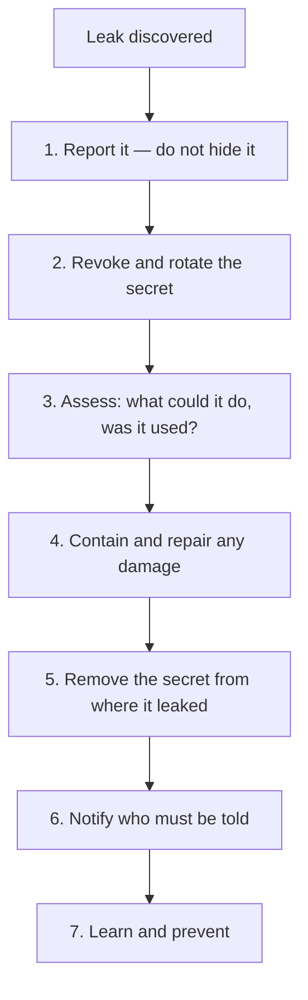

# Security and privacy scenarios: a leaked credential and handling personal data

> **Before this lesson:** read [Security thinking for generalists: threat-modelling a feature](#/lesson/thinking/threat-modelling) for assets, least privilege and the confidentiality–integrity–availability goals. The incident order of operations — mitigate before diagnosing — comes from [A bad deploy in production and the hotfix flow](#/lesson/thinking/bad-deploy-hotfix). Everything here is about protecting systems and people you are responsible for.

## In plain words

You realise your house key fell out of your pocket somewhere on the walk home. What do you do? You do not spend the evening retracing your steps hoping to find it first. You **change the lock** — because you cannot know who has picked the key up. Then you check whether anything is missing, work out how the key came to be loose in your pocket, and perhaps get a key ring.

A **credential** is the software version of a key: a password, an API key, an access token — any secret that proves "I am allowed". When one escapes — pasted into a public code repository, a chat message, a screenshot — the same logic applies, in the same order: **make the leaked secret useless first, investigate second.** Interviewers ask *"a colleague accidentally committed an API key to a public repository; what do you do?"* because the instinctive reaction (delete the commit and hope) is exactly wrong, and because it is a compact test of calm, ordered thinking under pressure.

The second half of the lesson is about a quieter responsibility. Your company holds information about real people — names, addresses, health details, messages. Handling it carelessly harms them, and in most countries breaks the law. Questions such as *"how would you handle personal data in this feature?"* check that you treat that information as something you are looking after on someone's behalf.

## Part 1 — A leaked credential

### Kinds of secret

| Secret | What it opens | 
|---|---|
| **Password** | A person's account |
| **API key** | A program's access to a service — yours or a third party's |
| **Access token** | Temporary access obtained after signing in |
| **Private key / certificate** | Proof of a server's or a person's identity; ability to decrypt |
| **Database connection string** | Direct access to the data |
| **Signing secret** | The ability to forge messages that look genuine |

All are "something that should be known only to the right party". All can leak the same ways: committed to version control, pasted into chat or a ticket, written to a log, baked into a mobile app, left in a public storage folder, shown in a screen recording.

### The order of operations



**1. Report it immediately.** To whoever handles security — and without embarrassment. A culture in which people hide such mistakes is far more dangerous than the mistake. The blameless principle applies fully: the question is how the system let a secret reach a commit, not who typed it.

**2. Revoke and rotate — first, before anything else.** **Revoking** makes the old secret stop working. **Rotating** means replacing it with a new one and updating everything that uses it. This is the lock change. Do it *before* investigating and *before* cleaning up the repository, because:

- Automated programs scan public code hosts continuously; a key published publicly should be assumed found within minutes.
- Deleting the commit does not help. Version control keeps history; copies, forks and caches exist; anyone who already cloned the repository has it for ever.

So the rule: **a secret that has been exposed is compromised, permanently. It can only be replaced, never "un-leaked".**

**3. Assess.** Two questions. *What could this credential do?* — its **blast radius**: read one bucket, or administer the whole account? *Was it used?* — check the service's access logs for the period from exposure to revocation: unfamiliar addresses, unusual times, unusual actions, new resources created, data downloaded.

**4. Contain and repair.** If it was used: remove anything the intruder created (new users, keys, machines — attackers often create their own credentials so that they keep access after yours is rotated), restore altered data, and widen the investigation.

**5. Clean up the source.** Now remove the secret from the repository history, the chat, the log — as hygiene, so that it is not found and mistaken for live later. This is tidy-up, not the fix.

**6. Notify.** Depending on what was exposed: the service provider, affected customers, and — if personal data may have been accessed — regulators, often within a short legal deadline. This is a decision for security, legal and management; the engineer's job is to supply the facts promptly.

**7. Learn and prevent.**

| Prevention | What it does |
|---|---|
| **A secrets manager** | Secrets live in a dedicated, access-controlled store and are fetched at run time, never written in code or configuration files |
| **Secret scanning** | Automatic checks on every commit and push that block anything resembling a key |
| **Least privilege** | Each key can do only what its user needs, so a leak opens little |
| **Short-lived credentials** | Tokens that expire in minutes or hours; a leaked one soon dies unaided |
| **Regular rotation** | Keys are replaced on a schedule, which also proves that rotation works |
| **Separate environments** | Test keys cannot touch production |
| **Monitoring** | Alerts on unusual use of a credential |

A point worth making in an interview: **if rotating a key is slow and frightening, that is itself a finding.** Rotation that is practised routinely takes minutes during an emergency; rotation that has never been done takes a day and breaks things.

### Worked scenario

**Prompt:** *"A teammate tells you they accidentally pushed a commit containing a cloud access key to a public repository an hour ago. What do you do?"* Answer aloud for four minutes, then compare.

<details><summary>Model answer</summary>

"First I'd thank them for saying so at once — that is exactly the right behaviour — and we'd raise it with security straight away as an incident. Then, in order:

**Revoke the key now.** An hour in a public repository means I assume it has been copied; scanners find such keys within minutes. I deactivate that key at the provider immediately. If it is in use by a running service, I create a replacement, deploy it, and then disable the old one — but I would accept a brief disruption over leaving a live key exposed. What I would *not* do first is delete the commit: the history, forks and clones still hold it, and it gives a false sense of having fixed something.

**Work out what the key could do.** Which account, which permissions? If it was a narrowly scoped key that can read one storage bucket, the exposure is limited. If it was an administrator key, the whole account is in question.

**Check whether it was used.** Pull the provider's audit logs from the time of the push until revocation. I'm looking for calls from addresses that are not ours, in regions we do not use, creating machines, users or new access keys, or reading data. A common pattern is attackers starting large machines to mine cryptocurrency — the first sign may be a billing alert.

**If it was used**, this becomes a larger incident: find and delete anything created, especially any new credentials or users they set up to keep access; rotate other secrets that the key could have read; assess whether any data — particularly personal data — was accessed; and bring in legal and management, because notification duties may apply with deadlines.

**Clean up.** Remove the key from the repository's history and ask the hosting provider to purge cached copies. Check the same commit and the rest of the repository for other secrets — where there is one there are often more.

**Communicate.** Short factual updates to the security channel: what leaked, when, when it was revoked, what the logs show so far, what remains to check.

**Then prevent it.** How did a key come to be in a source file? Probably it was pasted in for local testing. So: move secrets into a secrets manager and load them at run time; add secret scanning that blocks such a push before it leaves the developer's machine; replace long-lived keys with short-lived ones where the platform allows; narrow permissions; and add an alert on unusual use of credentials. And a blameless write-up — the teammate did the hard, right thing by reporting it."

</details>

> [!INTERVIEW]
> The answer that fails this question is "delete the commit" or "make the repository private". The answer that passes begins **"assume it is compromised; revoke and rotate first"** — and then shows the rest in order: assess, contain, clean up, notify, prevent.

## Part 2 — Handling personal data

### What counts

**Personal data** — often called **PII**, personally identifiable information — is any information relating to an identifiable person. The obvious kinds: name, address, email, phone number, identity numbers. The less obvious: an IP address, a device identifier, precise location history, a photograph, a voice recording. And data that identifies someone *in combination*: a postcode plus a birth date plus a gender picks out one individual surprisingly often.

Some categories are **sensitive** and deserve stricter care, because exposure can cause serious harm or discrimination: health, finances, precise location, biometrics, children's data, and matters such as religion, politics or sexual orientation. Passwords and payment card numbers have strict handling rules of their own.

Many countries regulate this by law — the European Union's **GDPR** (General Data Protection Regulation) is the best known — and the laws broadly agree on a set of principles. An engineer does not need to be a lawyer, but should know the principles, because they translate directly into design decisions.

### Seven principles, as engineering decisions

| Principle | Plain meaning | In the design |
|---|---|---|
| **Purpose limitation** | Use data only for the reason it was collected | Do not quietly reuse support chats to train a model |
| **Data minimisation** | Collect and keep only what you need | Ask for a birth *year* if you only need to check adulthood; do not store the card number at all |
| **Storage limitation** | Do not keep it for ever | A retention period per kind of data, with automatic deletion |
| **Security** | Protect it properly | Encryption in transit and at rest; access controls; audit logs |
| **Accuracy** | Keep it correct and correctable | Users can view and fix their details |
| **Transparency and rights** | People may know what you hold, get a copy, and have it deleted | Export and deletion built as features, not special requests |
| **Accountability** | Be able to show that you do all this | Records of what data is where, who can access it, and why |

The cheapest, strongest protection is the second row. **Data you never collected cannot leak, cannot be misused, and never needs deleting.**

### Techniques to know by name

| Technique | What it does | Note |
|---|---|---|
| **Encryption in transit** | Scrambles data travelling over a network (HTTPS) | Stops eavesdropping |
| **Encryption at rest** | Scrambles stored data | Protects against stolen disks and backups; not against someone who is legitimately logged in |
| **Hashing** | Turns a value into a fixed scramble that cannot be reversed | For passwords, with a random per-user **salt** and a deliberately slow algorithm |
| **Masking / redaction** | Shows only part: `**** **** **** 4242` | For screens, support tools and logs |
| **Tokenisation** | Replaces a sensitive value with a meaningless stand-in; the real value lives in a separate vault | Used for card numbers |
| **Pseudonymisation** | Replaces identifiers with codes; a key links them back | Reduces risk; still personal data, because it can be reversed |
| **Anonymisation** | Removes or blurs information so that individuals can no longer be identified | Hard to do properly; aggregated counts are the safest form |
| **Access control and audit** | Only those who need it can read it, and every read is recorded | The answer to "who looked at this record?" |

Two distinctions that interviewers probe. **Hashing is not encryption**: encryption can be reversed with a key, hashing cannot — which is why passwords are hashed (you never need the original back, only to check a match). And **pseudonymised is not anonymous**: if anyone can link the codes back to people, it is still personal data.

Here is masking applied to log lines — a small habit that prevents a large class of leaks.

```python-run
import re

def redact(text):
    text = re.sub(r"[\w.+-]+@[\w-]+\.[\w.]+", "<email>", text)            # email addresses
    text = re.sub(r"\b(?:\d[ -]?){13,16}\b", "<card>", text)                 # card-like digit runs
    text = re.sub(r"(password|token|secret)=\S+", r"\1=<hidden>", text)      # key=value secrets
    return text

lines = [
    "login failed for ana.lopez@example.org from 203.0.113.9",
    "payment ok card 4242 4242 4242 4242 amount=1999",
    "calling api with token=abc123example and retry=2",
]
for line in lines:
    print(redact(line))
```

Each `re.sub` call searches for a pattern and replaces what it finds: the first looks for something shaped like an email address, the second for thirteen to sixteen digits with optional spaces, the third for `password=`, `token=` or `secret=` followed by a value. The output shows the same events with the personal and secret parts removed — still useful for debugging, no longer a liability. In real systems this filter sits inside the logging library, so that nobody has to remember it.

### Where personal data hides

A deletion request is only as good as your knowledge of where the data went. Beyond the main database, look for it in:

- **Logs** and error reports — the commonest accidental store.
- **Backups** — deleted from the live database, alive in last month's backup.
- **Analytics and data warehouses**, and exports sent to spreadsheets.
- **Caches and search indexes.**
- **Third parties**: email, support, analytics and advertising services you send data to.
- **Test and development environments** loaded with copies of production data.
- **Emails, tickets and chat**, where staff paste customer details.

Knowing this map — a **data inventory** — is the precondition for every other privacy promise.

### Worked scenario

**Prompt:** *"We are adding a feature that lets customer-support agents view a customer's profile and order history to help with enquiries. How do you handle the personal data involved?"*

<details><summary>Model answer</summary>

"I'd start from what the agents actually need to do their job, because every field beyond that is risk without benefit.

**Minimise what is shown.** An agent answering 'where is my parcel?' needs the order, its status and the delivery address. They do not need the full card number, the date of birth or the password — the last two should not be visible to anyone, and the password should not even exist in readable form. So the support view is its own, reduced projection of the data: card shown as the last four digits, identity numbers masked, sensitive fields hidden by default and revealed only with a recorded reason.

**Control who can see it.** Only support staff, through their own named accounts with multi-factor sign-in — no shared logins. Least privilege by role: a first-line agent sees less than a fraud specialist. Ideally an agent can open only the records of customers with an open enquiry assigned to them, instead of being able to browse anyone.

**Record every access.** Each view of a customer record is logged: who, which customer, when, and the linked ticket. Those logs cannot be edited by the people they describe. This matters for the real-world risk here, which is mostly internal: staff looking up a celebrity, an ex-partner or a neighbour. With an audit trail we can detect it, and people who know that access is recorded rarely abuse it. I'd add alerts for odd patterns — an agent opening hundreds of records, or records with no ticket.

**Verify the caller.** The other classic risk is **social engineering**: someone phones pretending to be the customer to extract or change details. The tool should guide agents through identity checks before revealing or altering anything, and risky changes — email, address, payout details — should trigger a notification to the customer's existing contact address.

**Protect it technically.** Encrypted in transit and at rest. The support tool is internal-only, not reachable from the public internet without the company's sign-in. No ability to export in bulk. Customer details must not end up in logs, in the address bar, or in screenshots pasted into chat — I'd redact in the logging layer and make it easy to refer to a customer by an internal id instead.

**Limit how long.** Ticket notes containing personal details follow a retention period and are then deleted or anonymised. If a customer asks for their data to be deleted, the support system and its notes are on the list of places to clear.

**Test data.** Developers building this should work with generated fake customers, not a copy of production.

**Third parties.** If the support tool is a product we buy, the customer data is now also held by that vendor: we need an agreement covering how they protect it, where they store it and how it is deleted.

**Trade-offs.** Every restriction costs the agents a little speed: masked fields, reason prompts, identity checks. I'd design them with the support team so that the common cases stay fast, and reserve friction for the sensitive actions. And I'd raise the legal questions — lawful basis, retention periods, any cross-border storage — with whoever owns privacy, because those are not mine to decide alone."

</details>

### "A user asks us to delete their data"

A frequent follow-up. A good answer in outline:

1. **Verify** that the requester is the account's owner.
2. **Find everything** using the data inventory: primary database, logs, analytics, caches, search, third parties, support tickets.
3. **Decide what may be kept.** Some records must be retained by law — invoices for tax purposes, for example. Keep the minimum, restricted, and explain it to the user.
4. **Delete or anonymise.** Often you cannot delete a row outright without breaking other records (an order needs a customer). Then replace the personal fields with blanks or random values and keep the non-personal skeleton.
5. **Backups.** Deleting from every backup immediately is usually impractical; the accepted approach is that backups expire on a fixed schedule and that, if a backup is ever restored, the deletion is re-applied.
6. **Tell third parties** you shared the data with.
7. **Record that the request was fulfilled** — without keeping the deleted data as "proof".
8. **Make it repeatable**: an automated process, tested, with a deadline.

One design technique is worth naming: **crypto-shredding**. Encrypt each user's data with a key of its own; to "delete" the user everywhere — including in backups — destroy that one key, and every copy becomes unreadable.

## Common mistakes

- **Deleting the leaked secret and considering it fixed.**
- **Investigating before revoking.**
- **Hiding the mistake**, or blaming the person who reported it.
- **Long-lived, all-powerful keys** shared by many services.
- **Secrets in source code, configuration files or mobile apps.**
- **Collecting data "in case it is useful later".**
- **Personal data in logs** and in test environments.
- **Confusing encryption with hashing**, or pseudonymisation with anonymisation.
- **No idea where the data lives**, so deletion requests cannot be honoured.
- **Treating privacy as a legal checkbox** instead of a design property.

## Summary

- A leaked credential is compromised for ever: report, **revoke and rotate first**, then assess its blast radius and whether it was used, contain, clean the source, notify, and prevent.
- Prevention: a secrets manager, secret scanning, least privilege, short-lived credentials, routine rotation, separate environments, monitoring.
- Personal data is any information relating to an identifiable person; some categories are sensitive and need extra care.
- Principles become design: collect less, use it only for its purpose, keep it briefly, protect it, let people see, correct and delete it, and be able to show all this.
- Know the techniques: encryption in transit and at rest, salted slow hashing for passwords, masking, tokenisation, pseudonymisation versus anonymisation, access control with audit logs.
- Personal data hides in logs, backups, analytics, caches, third parties and test systems; keep an inventory so that deletion can be real.

## Glossary

| Term | Meaning |
|---|---|
| Credential | A secret that proves identity or permission, such as a password or key |
| API key | A secret string that identifies a program to a service |
| Revoke | Make a credential stop working |
| Rotate | Replace a credential with a new one everywhere it is used |
| Blast radius | Everything a leaked credential or a failure could affect |
| Secrets manager | A dedicated, access-controlled store for credentials |
| Secret scanning | Automatic detection of credentials in code and commits |
| Personal data (PII) | Information relating to an identifiable person |
| Sensitive data | Categories of personal data whose exposure can cause serious harm |
| GDPR | The European Union's General Data Protection Regulation |
| Data minimisation | Collecting and keeping only what is needed |
| Retention period | How long data is kept before deletion |
| Encryption at rest / in transit | Protecting stored data / data moving over a network |
| Hashing | A one-way transformation used, for example, to store passwords |
| Salt | A random value added before hashing so that equal passwords give different results |
| Masking | Displaying only part of a value |
| Tokenisation | Replacing a sensitive value with a stand-in held separately |
| Pseudonymisation | Replacing identifiers with codes that can be linked back with a key |
| Anonymisation | Altering data so that individuals cannot be identified |
| Social engineering | Manipulating people into revealing information or granting access |
| Data inventory | A record of what personal data is held, where, and why |

## Check yourself

```quiz
[
  {"q": "An API key was pushed to a public repository. What is the correct first technical action?",
   "options": ["Delete the commit", "Make the repository private", "Revoke the key and issue a replacement", "Wait to see whether anything happens"],
   "answer": 2,
   "explain": "An exposed secret must be assumed copied; only revoking it makes the leaked copy useless."},
  {"q": "Why does deleting the commit not solve a leaked secret?",
   "options": ["Commits cannot be deleted", "History, forks, clones and caches may still contain it, and it may already have been harvested", "It makes the code slower", "It solves it completely"],
   "answer": 1,
   "explain": "Removal from the visible repository does not recall copies that already exist."},
  {"q": "What does 'blast radius' refer to when a credential leaks?",
   "options": ["The size of the file it was in", "Everything that credential could access or change", "The number of engineers involved", "The length of the key"],
   "answer": 1,
   "explain": "A narrowly scoped key limits the damage; an administrator key puts everything in question."},
  {"q": "A sign-up form asks for full date of birth only to confirm the user is an adult. Which principle suggests a change?",
   "options": ["Availability", "Data minimisation", "Replication", "Idempotency"],
   "answer": 1,
   "explain": "Collect only what the purpose needs — a confirmation of age or a birth year — because data not held cannot leak."},
  {"q": "Why are passwords hashed instead of encrypted?",
   "options": ["Hashing is reversible", "The original is never needed again; a one-way hash lets a login be checked without storing something that can be decrypted", "Encryption is illegal", "Hashes are shorter to type"],
   "answer": 1,
   "explain": "Encryption can be undone with a key, so a stolen key reveals every password; a salted slow hash cannot be reversed."},
  {"q": "Customer identifiers in a dataset are replaced by codes, and a separate table maps codes back to customers. Is the dataset anonymous?",
   "options": ["Yes", "No — it is pseudonymised and still personal data", "Only on weekdays", "Only if it is encrypted"],
   "answer": 1,
   "explain": "If the link back to individuals exists, the data remains personal; anonymisation removes that possibility."},
  {"q": "A user requests deletion. Which place is most often forgotten?",
   "options": ["The main users table", "Logs, backups, analytics copies and third-party tools", "The login page", "The company logo"],
   "answer": 1,
   "explain": "Copies outside the primary database are easy to overlook; a data inventory makes deletion complete."}
]
```

> **Source:** OWASP cheat sheets on secrets management, password storage and logging (https://cheatsheetseries.owasp.org/cheatsheets/Secrets_Management_Cheat_Sheet.html, https://cheatsheetseries.owasp.org/cheatsheets/Password_Storage_Cheat_Sheet.html, https://cheatsheetseries.owasp.org/cheatsheets/Logging_Cheat_Sheet.html); GitHub Docs, "Removing sensitive data from a repository" — rotate first (https://docs.github.com/en/authentication/keeping-your-account-and-data-secure/removing-sensitive-data-from-a-repository); the principles in Article 5 of the EU General Data Protection Regulation (https://gdpr-info.eu/art-5-gdpr/); Google SRE Book, "Postmortem Culture" (https://sre.google/sre-book/postmortem-culture/). Scenarios, code and wording are original and defensive in purpose; nothing here is legal advice.
