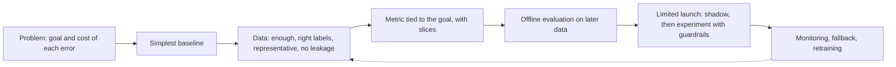

# Machine-learning questions with no single answer: when to use it, which metric, and data leakage

> **Before this lesson:** read the second half of ["Users in one region cannot log in" and "the model's accuracy dropped"](#/lesson/thinking/region-login-model-accuracy), which introduces models, features, labels and drift, and [Metrics, experiments and "a number moved — why?"](#/lesson/thinking/metrics-experiments) for A/B tests. No mathematics beyond percentages is needed.

## In plain words

There are two ways to teach someone to recognise a ripe mango. One is to give them rules: "yellow-orange skin, gives slightly when pressed, smells sweet at the stem." The other is to hand them a thousand mangoes, each already labelled ripe or unripe, and let them develop a feel for it. The first is ordinary programming: a person writes the rules. The second is **machine learning**, usually shortened to ML: a program works the rules out for itself from examples, and the result is called a **model**.

Learning from examples is powerful when the rules are too fuzzy to write down — what makes an email "spam"? — and it brings troubles that rule-writing never had. The learner is only as good as its examples. It can pick up the wrong lesson: if every ripe mango in the pile happened to be photographed on a blue table, it may learn "blue table means ripe". And it gives answers with some error rate, for ever; there is no "all tests pass".

Interviewers increasingly put open-ended ML questions to all engineers, not only specialists: *"would you use machine learning for this?"*, *"how would you measure whether the model is good?"*, *"offline accuracy is 99 % — are you happy?"* They want judgment, not formulas: knowing when ML is the wrong tool, choosing a measure that matches the real goal, and smelling a result that is too good to be true.

## Question type 1 — "Should we use machine learning here?"

### The honest default: start without it

A widely quoted first rule in Google's public "Rules of Machine Learning" is that you should not be afraid to launch a product without machine learning: a simple rule of thumb — a **heuristic** — often gets most of the benefit, and ML becomes worthwhile once you have data and a simple approach has run out. A good engineer treats ML as a cost to be justified.

**What ML costs that ordinary code does not:**

- **Data**: enough examples, with correct answers attached, representative of real use.
- **A pipeline**: collecting, cleaning, training, evaluating, deploying, retraining.
- **Monitoring for ever**: the world changes and the model silently gets worse.
- **Unpredictable errors**: it will sometimes be confidently wrong, and it is hard to say why.
- **Harder testing and debugging**: there is no line of code to point at.

### A checklist

| Question | ML is plausible if… | Prefer rules or simple code if… |
|---|---|---|
| Can a person write the rules down? | No — too many fuzzy cases (images, language, taste) | Yes — "orders over 100 ship free" |
| Is there data with known answers? | Plenty, and representative | Little, none, or biased |
| Does the pattern keep changing? | Yes — spammers adapt; a model can be retrained | No — the rule is stable |
| Is being wrong sometimes acceptable? | Yes — a poor recommendation costs little | No — every decision must be exactly right and explainable |
| Must each decision be explained? | Not strictly | Yes — by law or for trust (loan refusals, medical decisions) |
| Can success be measured? | Yes, with a clear number | No agreed measure |
| Is the gain worth the upkeep? | Large scale, real money | Small problem; a rule gets 90 % of the way |

### Worked question

**Prompt:** *"Our support team wants to route incoming tickets to the right department automatically. Should we use ML?"* Answer for three minutes, then compare.

<details><summary>Model answer</summary>

"Before choosing a technique I'd ask how it is done today and how badly it goes wrong. How many tickets a day, how many departments, how often are tickets misrouted now, and what does a misroute cost — a few minutes' delay, or an angry customer?

**Start with the simplest thing.** Many tickets can probably be routed by rules: the customer chose a category on the form; the message mentions 'refund' or 'invoice'; the customer is on the enterprise plan. I'd build that first. It takes days, anyone can read and fix it, and — importantly — it gives us a **baseline**: a number such as 'rules route 70 % correctly' that any cleverer method must beat.

**Is ML plausible as a next step?** Yes, on the checklist. Free-text messages are fuzzy; rules will miss many phrasings. We have data with answers: years of past tickets and the department that finally resolved each. Errors are tolerable, because a misrouted ticket can be passed on by a person. And success is measurable.

**So a staged plan.**

1. Rules, with the misroute rate measured.
2. If that is not good enough, a text-classification model trained on past tickets — today that might well be a general-purpose language model given the list of departments, which needs no training at all, compared against a small trained classifier on cost and accuracy.
3. Let the model act only when it is confident; send uncertain tickets to a person. That limits the damage of errors.
4. Keep a feedback loop: when an agent re-routes a ticket, that is a new labelled example.

**What I'd check about the data.** Do the historical labels mean what I think — the department that *solved* the ticket, not the one it was first sent to, or the model learns today's mistakes. Have departments been reorganised? Are some categories very rare?

**Measure.** Share routed correctly, per department — not only overall, because a rare but urgent category such as fraud reports matters most. And the business measure: time to first useful response.

**When I'd say no to ML.** If there are a hundred tickets a day and four departments, a dropdown on the form and a few keyword rules are the right answer permanently."

</details>

> [!INTERVIEW]
> For any "should we use ML?" question the winning structure is: **simplest thing first → baseline → ML only if it beats the baseline by enough to pay for its upkeep → limit the damage of errors → feedback loop.** Opening with a specific model name is the weakest start.

## Question type 2 — "How do you measure whether the model is good?"

### Why accuracy lies

**Accuracy** is the share of predictions that are right. It is the first measure everyone reaches for and often a misleading one.

A hospital screens for a disease that 1 in 100 patients has. Here is a "model" that always says *healthy*. It is right for 99 of every 100 patients — 99 % accuracy — and it never finds a single sick person. When one answer is much rarer than the other — an **imbalanced** problem, which describes fraud, disease, defects and most interesting detection tasks — accuracy rewards doing nothing.

### The four outcomes

Every yes/no prediction lands in one of four boxes, laid out in a **confusion matrix**.

| | Really positive | Really negative |
|---|---|---|
| **Predicted positive** | True positive (TP): caught | False positive (FP): false alarm |
| **Predicted negative** | False negative (FN): missed | True negative (TN): correctly ignored |

From these come the two measures that matter.

- **Precision** = TP ÷ (TP + FP). *Of the cases I flagged, how many were real?* Low precision means many false alarms.
- **Recall** = TP ÷ (TP + FN). *Of the real cases, how many did I catch?* Low recall means many misses.

A smoke alarm with high recall and low precision goes off whenever you make toast: it never misses a fire and you want to take the battery out. One with high precision and low recall stays silent for toast — and for some fires.

```python-run
def report(name, tp, fp, fn, tn):
    total = tp + fp + fn + tn
    accuracy = (tp + tn) / total
    precision = tp / (tp + fp) if tp + fp else 0.0     # of those flagged, how many were real
    recall = tp / (tp + fn) if tp + fn else 0.0        # of the real ones, how many were caught
    print(f"{name:22s} accuracy {accuracy:6.1%}  precision {precision:6.1%}  recall {recall:6.1%}")

# 10,000 patients, 100 of whom are ill
report("always says healthy", tp=0,  fp=0,   fn=100, tn=9900)
report("cautious model",      tp=60, fp=20,  fn=40,  tn=9880)
report("eager model",         tp=95, fp=900, fn=5,   tn=9000)
```

The function computes the three measures from the four counts; the `if` guards avoid dividing by zero when nothing was flagged. Read the output. The do-nothing model scores 99 % accuracy with zero recall. The cautious model flags few people and is usually right (75 % precision) but misses 40 % of the ill. The eager model catches 95 % and raises nine false alarms for every real case. Accuracy barely distinguishes them; precision and recall tell three different stories.

### The trade-off, and how to choose

Most models output a score, and a **threshold** turns the score into a decision. Lower the threshold and you flag more: recall rises, precision falls. Raise it and the reverse. You cannot have both for free, so you must decide which error is worse **in this product**.

| Situation | Worse error | Favour |
|---|---|---|
| Screening for a serious disease | A miss | Recall |
| Fraud check that blocks a customer's card | A false alarm annoys and loses customers; a miss loses money — weigh both | Depends on the cost of each |
| Spam filter | A real email lost in the spam folder | Precision |
| Search for evidence in legal documents | A missed document | Recall |
| Recommending a film | Neither is serious | Whatever drives engagement |
| Automatically deleting content | Wrongly deleting a legitimate post | Precision, with human review for uncertain cases |

The best answers put **costs** on the two errors: "a missed fraud costs us about 200 on average; a false alarm costs about 5 in support time and annoyance — so I can accept up to forty false alarms per fraud caught." That turns a vague preference into a threshold.

When one number is demanded, the **F1 score** combines precision and recall into a single value that is high only when both are; it suits cases where the two errors matter about equally.

### The metric that really matters is not a model metric

Precision and recall are **offline** measures, computed on stored data. The company cares about something else: fraud losses, support hours, purchases, complaints. A model can improve its offline score and leave the business number flat — or worse. So a complete answer names three layers:

1. **The business goal** — what are we trying to move?
2. **The model metric** that is believed to track it — and a **baseline** to compare against.
3. **Guardrails** — latency, cost, fairness across groups, complaint rate — and an **online experiment** to confirm.

And always **slice**: an average hides a group for whom the model is much worse.

### Worked question

**Prompt:** *"We built a model that predicts which customers will cancel their subscription next month, so that the retention team can call them. It has 92 % accuracy. Is that good?"*

<details><summary>Model answer</summary>

"I can't tell from that number, and I'd want three things.

**The base rate.** What share of customers cancel in a month? If it is 8 %, then a model that says 'nobody will cancel' also scores 92 %. So accuracy tells me nothing here.

**Precision and recall, at the size the team can act on.** The retention team can perhaps call 500 customers a month. So the useful question is: of the 500 the model ranks as most at risk, how many really would have cancelled? That is precision among the top 500. And what share of all the cancellers were in that list — recall. If 40 % of the 500 are real cancellers against a base rate of 8 %, the model is five times better than calling at random, and that is valuable.

**A baseline.** How well does a simple rule do — 'customers who have not logged in for 30 days'? If the rule finds nearly as many, the model is not earning its upkeep.

Then two deeper questions.

**Is predicting cancellation even the right target?** The team wants to *prevent* cancellations. Some customers will leave whatever we do; some would have stayed anyway; a call only matters for those in between — and may even prompt a contented customer to reconsider. So the true measure of success is not prediction quality; it is whether calling the listed customers reduces cancellations compared with not calling. I'd test that with an experiment: of the model's top 1,000, call a random half, and compare.

**Is there leakage?** 92 % sounds high. I'd look at which inputs the model relies on most. If one of them is 'visited the cancellation page' or 'contacted support to cancel', the model is detecting people who have already decided — too late to be useful.

So my answer: 92 % accuracy is not evidence either way. I'd ask for the base rate, the hit rate in the top 500 against a simple rule, a check for leakage, and then an experiment on what we actually care about."

</details>

## Question type 3 — "Offline results are amazing. What worries you?"

### Data leakage

**Data leakage** means the model was given, during training, information it will not have when it is used for real. It is like a student who is given the answer sheet with the practice exam: a perfect score, and nothing learned. Leakage is the commonest reason that results look excellent in development and collapse in production, and it is a favourite interview topic because it needs suspicion more than mathematics.

**Four forms.**

| Form | Example | Why it is cheating |
|---|---|---|
| **A feature that is a result of the answer** | Predicting whether a loan will default, using "number of reminder letters sent" | Reminders are sent *because* payments were missed |
| **Information from the future** | Predicting Monday's sales using a weekly average that includes Monday to Sunday | At prediction time the week has not happened |
| **Test examples resembling training examples** | Several X-rays from the same patient, some in training and some in the test set | The model recognises the patient, not the disease |
| **Preparation done before splitting** | Computing averages or picking features using the whole dataset, then splitting | Knowledge of the test data has seeped into training |

To see why, recall the basic routine. Data with known answers is divided into a **training set**, which the model learns from, and a **test set**, kept aside and used only to measure. The test set stands in for the future. Anything that lets information cross from test to training makes the measurement a lie.

**Warning signs.**

- Results that are too good — 99 % on a problem experts find hard.
- One feature that dominates everything else.
- A feature whose value is only known *after* the outcome.
- A large drop between offline and online performance.

**Defences.**

- For every feature ask: **"at the moment of prediction, would we know this?"**
- **Split by time**: train on the past, test on a later period — the model will be used on the future.
- **Split by group**: all records of one patient, customer or device go on the same side.
- **Split first**, then compute any statistics from the training portion only.
- Compare with a simple baseline; an implausible gap deserves an investigation, not a celebration.

Here is leakage happening, in a small simulation.

```python-run
import random
random.seed(1)

# Each customer either cancels or not. 'days_inactive' is weakly related to cancelling.
# 'refund_issued' is recorded AFTER cancellation, so it nearly equals the answer.
def customer():
    cancels = random.random() < 0.2
    days_inactive = random.gauss(25 if cancels else 15, 10)
    refund_issued = cancels and random.random() < 0.95
    return cancels, days_inactive, refund_issued

data = [customer() for _ in range(5000)]

def accuracy(predict):
    return sum(predict(d) == d[0] for d in data) / len(data)

print(f"always 'stays'              : {accuracy(lambda d: False):.1%}")
print(f"honest rule (inactive > 22) : {accuracy(lambda d: d[1] > 22):.1%}")
print(f"leaky rule (refund issued)  : {accuracy(lambda d: d[2]):.1%}")
```

The `customer` function invents one customer: whether they cancel, how long they were inactive (a little higher for cancellers) and whether a refund was issued — which only happens after cancelling. The three printed lines measure three predictors. The do-nothing baseline scores about 80 %. The honest rule, using information available beforehand, is no better than that on accuracy — a realistic picture of a hard problem. The leaky rule scores about 99 %, and is useless: by the time a refund exists, the customer has already gone.

### Other things to be suspicious of

- **Was the test set used repeatedly to tune the model?** Then the model has been fitted to it. This is **overfitting** — learning the peculiarities of particular examples instead of the general pattern, like memorising past exam papers. Keep a final test set that is touched once.
- **Does the test data look like real use?** A model tested on tidy studio photographs will meet blurry phone pictures.
- **Do the labels deserve trust?** Who assigned them, and how consistently?
- **Who is missing from the data?** A model trained mostly on one group may perform badly, and unfairly, for others. Report results per group.
- **Will using the model change the data?** If a fraud model blocks certain transactions, you never learn whether they were truly fraud; future training data is shaped by the model's own decisions — a **feedback loop**.

## A general frame for ML questions



Walk this left to right and you will have said most of what an interviewer hopes for, whatever the specific question.

## Common mistakes

- **Starting with the model** instead of the problem and a baseline.
- **Quoting accuracy** on an imbalanced problem.
- **No baseline**, so that nobody knows whether the model is impressive.
- **Choosing a threshold without discussing which error costs more.**
- **Celebrating a suspiciously high score.**
- **Random splits** for data with time or with repeated individuals.
- **Averages only**, with no breakdown by group.
- **Treating offline metrics as the goal.**
- **No plan for errors**: no human review, no fallback, no monitoring.

## Summary

- ML learns rules from examples. Use it when rules cannot be written, data with answers exists, errors are tolerable and the benefit outweighs permanent upkeep. Start with a simple rule and treat it as the baseline.
- Accuracy misleads when one outcome is rare. Use precision (how many flags were real) and recall (how many real cases were caught), and choose the balance from the cost of each error.
- Model metrics are stand-ins. Name the business goal, guardrails and slices, and confirm with an online experiment.
- Data leakage — training on information unavailable at prediction time — produces results too good to be true. Ask "would we know this at that moment?", split by time and by group, and split before preparing data.
- Be suspicious of over-used test sets, unrepresentative data, weak labels, missing groups and feedback loops.

## Glossary

| Term | Meaning |
|---|---|
| Machine learning (ML) | Building programs that learn rules from examples |
| Model | The learned program that makes predictions |
| Heuristic | A simple rule of thumb |
| Baseline | A simple method whose result a new approach must beat |
| Training set / test set | Examples used for learning / examples held back for measuring |
| Accuracy | The share of predictions that are correct |
| Imbalanced | One outcome being much rarer than the other |
| Confusion matrix | The table of true and false positives and negatives |
| Precision | Of the items flagged, the share that are truly positive |
| Recall | Of the truly positive items, the share that were flagged |
| Threshold | The score above which the model says "yes" |
| F1 score | A single number combining precision and recall |
| Data leakage | Training with information that will not be available at prediction time |
| Overfitting | Learning the quirks of the examples instead of the general pattern |
| Feedback loop | A model's decisions shaping the data it is later trained on |
| Human in the loop | A person reviewing some or all of a model's decisions |

## Check yourself

```quiz
[
  {"q": "A problem can be solved by the rule 'orders above 100 ship free'. Should machine learning be used?",
   "options": ["Yes, ML is always better", "No — a clear, stable rule is simpler, cheaper and exact", "Only on weekends", "Yes, to impress customers"],
   "answer": 1,
   "explain": "ML earns its upkeep when rules cannot be written down; here they can."},
  {"q": "A fraud model is 99% accurate, and 1% of transactions are fraudulent. What does this tell you?",
   "options": ["The model is excellent", "Very little: predicting 'never fraud' would also score 99%", "The model is broken", "Fraud has ended"],
   "answer": 1,
   "explain": "With a rare positive class, accuracy is dominated by the common class; look at precision and recall."},
  {"q": "A model flags 200 transactions; 50 are truly fraud. In total there were 80 frauds. What are precision and recall?",
   "options": ["Precision 25%, recall 62.5%", "Precision 62.5%, recall 25%", "Both 50%", "Precision 40%, recall 80%"],
   "answer": 0,
   "explain": "Precision = 50/200 = 25%. Recall = 50/80 = 62.5%."},
  {"q": "For a screening test for a serious disease, which error is usually worse, and what should be favoured?",
   "options": ["False alarms; favour precision", "Misses; favour recall", "Neither; favour accuracy", "Both equally; favour speed"],
   "answer": 1,
   "explain": "A missed case can be fatal, while a false alarm leads to a follow-up test."},
  {"q": "A model predicting loan default uses the feature 'number of late-payment reminders sent'. What is wrong?",
   "options": ["Nothing", "It is data leakage: reminders are a consequence of the outcome and unknown when the loan is granted", "The feature is too small", "It should be a string"],
   "answer": 1,
   "explain": "At decision time that information does not exist; using it makes offline results unrealistically good."},
  {"q": "Why should data with a time order be split by time rather than at random?",
   "options": ["Random splits are slower", "The model will be used on the future, and a random split lets future information leak into training", "Time splits use less memory", "It makes charts prettier"],
   "answer": 1,
   "explain": "Training on the past and testing on a later period mirrors real use."},
  {"q": "What is the role of a baseline such as a simple rule?",
   "options": ["It replaces the test set", "It shows whether the model is better than something cheap, and by how much", "It increases accuracy", "It removes the need for monitoring"],
   "answer": 1,
   "explain": "Without a baseline nobody can tell whether a model's result is impressive or trivial."}
]
```

> **Source:** Martin Zinkevich, "Rules of Machine Learning: Best Practices for ML Engineering" — launching without ML, simple first objectives, training–serving skew (https://developers.google.com/machine-learning/guides/rules-of-ml); Google Machine Learning Crash Course, "Classification: Accuracy, recall, precision, and related metrics" (https://developers.google.com/machine-learning/crash-course/classification/accuracy-precision-recall); scikit-learn documentation, "Common pitfalls and recommended practices" on data leakage (https://scikit-learn.org/stable/common_pitfalls.html). Examples, simulation and wording are original.
