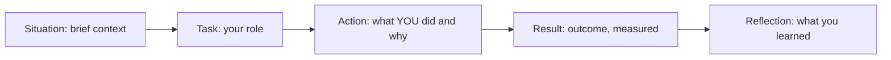

# Behavioural-technical questions: the STAR method, disagreeing about a design, and owning an outage

> **Before this lesson:** nothing technical is required. It helps to have read [How open-ended interviews work and what they score](#/lesson/thinking/how-interviews-work), because the same idea applies: interviewers write down evidence, so your job is to supply it.

## In plain words

When a friend recommends a plumber, they do not say "she is reliable and good under pressure". They tell you a story: "our boiler burst on a Sunday night; she came within the hour, found the cracked valve, showed us what had happened, and came back on Tuesday to check it." You believe the story far more than the adjectives, because it shows what the person *did*.

**Behavioural questions** work on the same principle. They begin "Tell me about a time when…" and ask for a real story from your past — a disagreement, a mistake, a deadline — on the reasoning that how you behaved before is the best available guide to how you will behave next. For engineers they are usually **behavioural-technical hybrids**: the story is about a design argument, an outage, a vague project, so the interviewer hears your judgment and your technical depth together.

They matter more than candidates expect. Most companies run at least one such round, and at senior levels it often decides the outcome. People fail it not because they lack good stories but because they tell them badly: they ramble, say "we" throughout so that nobody can tell what *they* did, or describe what they *would* do instead of what they *did*. A small structure fixes all three.

## The STAR method

**STAR** stands for **S**ituation, **T**ask, **A**ction, **R**esult. It is a way of ordering a story so that the listener gets the context quickly and the evidence clearly. Many guides add a second **R**, for **Reflection**.

| Part | Answers | Share of the time | Typical opening words |
|---|---|---|---|
| **Situation** | Where and when was this? What was going on? | about 15 % | "Last year, on a team of six building…" |
| **Task** | What was *your* responsibility or goal? | about 10 % | "I was responsible for…" |
| **Action** | What did *you* do, step by step, and why? | about 55 % | "First I… Then I… I chose that because…" |
| **Result** | What happened? With numbers if possible | about 15 % | "As a result…" |
| **Reflection** | What did you learn or change afterwards? | about 5 % | "Since then I always…" |

The proportions matter. The commonest fault is spending two minutes on the situation and twenty seconds on the action. The action is the part being scored.



### Five rules that make a STAR answer strong

**1. Say "I".** "We decided to migrate" tells the interviewer nothing about you. "I proposed migrating, wrote the plan, and persuaded two sceptical colleagues by…" does. Give credit to others where it is due — and be precise about your own part.

**2. Tell one specific story.** "Usually when I disagree with someone, I…" is a philosophy. They asked for *a time*. Name the project, the month, the people (by role).

**3. Explain your reasoning.** For each action, one clause of why: "I ran a small experiment first, because we were arguing from opinion and I wanted data."

**4. Give a result, and a number if you have one.** "Deploy time fell from 40 minutes to 6." "The incident affected about 2 % of users for 25 minutes." If the result was mixed or bad, say so; a truthful modest result beats a vague triumph.

**5. Keep it to about two minutes.** Then stop, and let the interviewer ask for more. Expect follow-ups: "what was the hardest part?", "what would you do differently?", "what did the other person think?" A real story survives them; an invented one does not.

### A weak answer and a strong one

**Question:** *"Tell me about a time you improved something at work."*

> **Weak.** "I'm always looking for ways to improve things. In my last job we had lots of problems with our tests, so we worked on making them better and things improved a lot. I think it's important to care about quality."

No situation, no specific action, no "I", no result.

> **Strong.** "(*Situation*) Last year I was on a five-person team maintaining a booking service. Our test suite took 45 minutes and failed at random about one run in three, so people had stopped trusting it. (*Task*) Nobody owned this; I asked my manager whether I could spend a week on it. (*Action*) I started by measuring: I recorded the duration and outcome of every test for a week. That showed that twelve tests caused nearly all the random failures and that one slow stage took half the time. I fixed the twelve — most were waiting a fixed two seconds instead of waiting for a condition — and split the slow stage to run in parallel. I also added a small report so that we would see a new flaky test the day it appeared. (*Result*) The suite went from 45 minutes to 11, and spurious failures from about one in three to under one in fifty. (*Reflection*) What I took from it was to measure before fixing: my own guess beforehand had been the database tests, and they turned out to be fine."

About 170 words; perhaps 75 seconds aloud. Every sentence is evidence.

## Building a story bank

You cannot invent good stories under pressure. Prepare six to eight in advance and you will be able to answer almost any question, because one story serves many prompts.

| Theme | Questions it answers |
|---|---|
| A disagreement about a technical decision | Conflict; influencing without authority; changing your mind |
| A failure or mistake of your own | Failure; learning; accountability |
| An incident or outage | Pressure; ownership; communication |
| A project with unclear requirements | Ambiguity; initiative; planning |
| A deadline at risk | Prioritisation; trade-offs; saying no |
| Something you improved unasked | Initiative; impact |
| Helping or mentoring someone | Teamwork; leadership |
| Explaining something technical to a non-technical person | Communication |
| Learning something new quickly | Growth; adaptability |
| Critical feedback you received | Self-awareness |

For each story write five lines — one per STAR part plus reflection — and one number. Do not write a script; a script sounds recited and falls apart at the first interruption. Practise each aloud two or three times until it runs to about two minutes.

**If you have little work experience**, stories from study, a group project, an internship, open-source contribution, volunteering or a part-time job are acceptable. A disagreement about how to split a university project has the same structure as one about a database schema.

**Choose stories with a real difficulty in them.** "Everything went smoothly" gives the interviewer nothing to write down. And choose ones that are recent, where you had a real decision to make, and of which you are not ashamed to be asked five follow-up questions.

## Hybrid 1 — "Tell me about a time you disagreed with a teammate's design"

### What is being assessed

Not whether you won. The interviewer is listening for five things:

1. Did you **understand the other view** before arguing?
2. Did you argue from **evidence and shared goals**, or from rank and stubbornness?
3. Did you keep it about the **design**, not the person?
4. Could you **commit** to the decision once it was made, whichever way it went?
5. Is the **relationship** intact?

A story in which you were plainly right and the other person was foolish fails on four of the five.

### A method for the disagreement itself

This is worth knowing both as a way to behave and as the skeleton of your story.

| Step | Do | Sounds like |
|---|---|---|
| **Understand** | Ask questions until you can state their position to their satisfaction | "So the main reason for a separate service is that the reporting team can deploy independently — have I got that right?" |
| **Find the shared goal** | Name what you both want | "We both want this to survive the Christmas traffic." |
| **Name the actual disagreement** | Usually it is one assumption or one priority | "I think we differ on how likely the data volume is to grow tenfold." |
| **Bring evidence** | A measurement, a prototype, a past incident, a small experiment | "I ran both against a copy of last month's data; here are the timings." |
| **Offer options and a way to decide** | Including a cheap way to find out who is right | "Could we try the simple version behind a flag for two weeks and look at the numbers?" |
| **Escalate together if stuck** | Go to the decider jointly, with both cases written fairly | "Let's each write half a page and ask the tech lead." |
| **Disagree and commit** | Once decided, support it fully | "I still have the concern I mentioned; I've noted it, and I'll make this approach work." |

**Disagree and commit** means: state your objection clearly once, and when the decision goes the other way, carry it out wholeheartedly instead of dragging your feet or saying "I told you so" later. Its counterpart matters as much: if new evidence appears, raise it; and if you were wrong, say so plainly.

Also ask how costly the decision is to reverse. A choice that can be undone next week does not merit a three-day argument; try it and see.

### A model story

<details><summary>Model answer</summary>

"(*Situation*) About a year ago my team was adding a notifications feature to our ordering system. A senior colleague had designed it so that the order service called the email provider directly while handling each order. (*Task*) I was implementing the part that triggered the notification, and I had a concern about that design that I needed either to resolve or to raise.

(*Action*) Before objecting, I asked him to walk me through his reasoning. His main point was a good one: simplicity. One service, no new infrastructure, shipped in a week. I said I agreed that was valuable, and that we both wanted orders to be reliable above all.

My worry was specific: if the email provider were slow, order confirmation would be slow too, and if it were down, orders might fail. So the real disagreement was about how likely and how bad that was. Rather than argue in the abstract, I looked up the provider's status history — four incidents in the past six months, two longer than half an hour — and I wrote a ten-line test that delayed the provider's response by five seconds. Our order endpoint took five seconds, as expected.

I showed him both and proposed two options: keep his design and add a short timeout so that a slow provider could not block orders, accepting that some emails would be lost; or put the notification on a queue, which decoupled it fully at the cost of about three extra days and a new component to operate. I said I preferred the queue and that the timeout would answer most of my concern.

He was still not convinced the extra days were worth it before the launch date. We took it to our tech lead together, each summarising the other's view first. (*Result*) She chose the timeout for the launch, with the queue scheduled for the following month. I implemented the timeout and a counter for failed sends. Three weeks after launch the provider had a forty-minute outage: orders were unaffected, about 300 emails failed, and because of the counter we knew exactly which and re-sent them. We built the queue the next month as planned.

(*Reflection*) Two things stayed with me. The measurement changed the conversation — until then it was his experience against my opinion. And the compromise was better than my original proposal would have been for that deadline; I'd been ready to spend three days we did not have."

</details>

Notice what makes it work: the colleague is treated with respect and had a real point; the disagreement is narrowed to one question; evidence is fetched; the decision went partly *against* the candidate, who carried it out properly; and the reflection includes something the candidate got wrong.

> [!INTERVIEW]
> The strongest disagreement stories are the ones where you **did not win outright**. A story that ends "and I was proved right" invites the thought "this person will be tiring to work with". A story that ends "we found a third option" or "I changed my mind" is far more convincing.

### Variations

- **"…with your manager?"** The same method, with more care to disagree in private first and to make it easy for them to change course. End with commitment either way.
- **"…and you were wrong?"** A gift of a question. Tell it straight: what you believed, what showed you otherwise, how quickly you said so, what you do differently.
- **"…with a teammate who would not budge?"** Show the escalation done fairly — jointly, with both cases — and that you did not go behind their back.

## Hybrid 2 — "Tell me about a time you caused or handled an outage"

### What is being assessed

**Ownership**: do you take responsibility, or reach for excuses? **Composure**: did you restore service before satisfying your curiosity? **Communication**: did the people affected know what was happening? **Learning**: did the system get better, or only you more careful?

The trap is to make yourself look good by shrinking the mistake — "it was really the tooling's fault" — or to perform guilt — "I felt terrible, I'm so careless". Neither helps. The mature tone is matter-of-fact: here is what I did, here is what happened, here is what we changed.

Recall the blameless principle from the incident lessons: people act reasonably given what they knew, so the useful question is *what in the system made this mistake possible and let it reach users?* Applying that principle **to yourself** is exactly the right register. It is not an excuse; it is the difference between "I'll be more careful" (which fixes nothing) and "we added a check that makes this impossible" (which does).

### The shape of an incident story

| Part | Include |
|---|---|
| Situation | The system and what users experienced, with size: who, how many, how long |
| Task | Your role: you caused it, you were on call, or you stepped in |
| Action — detect | How it was noticed, and how fast |
| Action — mitigate | What you did first to stop the harm (roll back, switch off), before understanding the cause |
| Action — communicate | Whom you told and how often |
| Action — diagnose and fix | The cause, found afterwards |
| Result | Time to recover; impact; and the lasting changes |
| Reflection | What you do differently; what the team changed |

### A model story

<details><summary>Model answer</summary>

"(*Situation*) Two years ago I was a backend developer on an internal tool used by about 400 customer-support agents. One Tuesday afternoon I deployed a change that included a database migration adding a column to the main tickets table. (*Task*) It was my change and my deploy, so the consequences were mine to deal with.

(*Action*) Within about two minutes, agents reported that the tool was frozen. I looked at the dashboard: requests were timing out. My migration was adding the column with a default value, and on a table of forty million rows that held a lock on the whole table while it rewrote every row. I had tested it on my own machine, with a few thousand rows, where it took under a second.

My first decision was not to wait for it to finish — I could not tell whether that meant two minutes or forty. I cancelled the migration, which released the lock, and rolled the application back to the previous version. The tool was responding again about nine minutes after it froze.

While doing that I had posted in the support team's channel: 'The ticket tool is down because of a change I deployed. I'm rolling it back now; next update in five minutes.' I posted again when it recovered, and I asked my manager to check with the support leads whether any work had been lost.

Afterwards I worked out properly why it had happened and wrote it up. The direct cause was the form of the migration. The contributing causes were more interesting: nothing in our process tested migrations against a production-sized table; nobody reviewed migrations specifically; and we deployed migrations together with code, in the middle of the working day.

(*Result*) Nine minutes of downtime for about 400 agents; no data was lost. I redid the change the safe way — add the column without a default, fill it in small batches, then add the default — and it ran the following week with no visible effect. As follow-ups, which I did myself: I added a check to our pipeline that flags migrations likely to lock large tables, I wrote a one-page guide to safe migrations, and we set up a copy of production data on which migrations are rehearsed. In the year after that we had no further incident of this kind.

(*Reflection*) My habit since then is to ask of any change, 'what is different between where I tested this and where it will run?' Here the difference was forty million rows. And I learned that telling people immediately, including that it was my change, cost me nothing — the support leads thanked me for the updates."

</details>

What makes it work: plain ownership in the first minute ("my change and my deploy"); mitigation before diagnosis; proactive communication; causes described as gaps in the system, including but not limited to the candidate's own; concrete follow-ups that the candidate personally carried out; and numbers throughout.

### Variations

- **"Tell me about your biggest mistake."** Choose a real one of moderate size, where the lesson is clear and the repair is yours. Not a disguised boast ("I work too hard"), and not something that would alarm an employer.
- **"…an incident you handled but did not cause."** Emphasise triage order, coordination and how you kept people informed.
- **"I have never caused an outage."** Then use a smaller slip — a bug that reached users, a wrong estimate, a broken build — or a failure in a project or course. Saying you have never made a mistake reads as either inexperience or lack of self-awareness.

## Delivering the answer

- **Take a moment.** "Let me think of a good example" followed by five seconds of silence is perfectly acceptable.
- **Start with one orienting sentence**: "I'll tell you about a disagreement over a notification design last year."
- **Watch the listener.** If they are nodding you along, shorten the situation.
- **Stop at the reflection.** Do not trail off or repeat yourself.
- **Welcome follow-ups.** They mean the interviewer is interested, and they are where depth shows. Answer honestly, including "I'm not sure I'd do that the same way now."
- **Never speak ill of former colleagues or employers.** Describe behaviour and constraints, not character.
- **Never invent.** Interviewers probe details, and a made-up story collapses at the third question.

## Common mistakes

- **No story** — general principles instead of a specific time.
- **All situation, no action.**
- **"We" throughout**, hiding your own contribution.
- **The hero story**: you were right, everyone else was wrong.
- **The victim story**: everything was someone else's fault.
- **No result**, or a result with no measure.
- **No reflection** — nothing learned.
- **A fake weakness** or a trivial mistake.
- **Five minutes without a pause.**
- **Hypotheticals** ("I would…") when asked for the past ("I did…").

## Summary

- Behavioural questions ask for evidence from your past; STAR orders the story: situation, task, action, result — plus reflection. Spend most of the time on your actions and their reasons.
- Say "I", tell one specific story, give a measured result, keep to about two minutes, and expect follow-ups.
- Prepare a bank of six to eight stories; each serves several questions.
- Disagreement: understand first, find the shared goal, narrow the dispute, bring evidence, offer options, escalate jointly, then disagree and commit. Stories where you did not win outright are stronger.
- Outage: own it plainly, mitigate before diagnosing, communicate early, describe causes as gaps in the system, and finish with concrete changes you made.

## Glossary

| Term | Meaning |
|---|---|
| Behavioural question | A question asking for a real example from your past |
| Hybrid question | A behavioural question about a technical situation |
| STAR | Situation, Task, Action, Result — a structure for telling the story |
| Reflection | What you learned and changed afterwards |
| Story bank | A prepared set of personal examples covering common themes |
| Follow-up | A further question probing the details of your story |
| Influencing without authority | Persuading people who do not report to you |
| Disagree and commit | Voicing an objection, then fully supporting the decision made |
| Escalation | Taking an unresolved decision to someone with the authority to decide |
| Ownership | Taking responsibility for an outcome, including when it goes wrong |
| Blameless | Looking for causes in systems and processes instead of in individuals |
| Contributing cause | One of several conditions that together allowed a failure |

## Check yourself

```quiz
[
  {"q": "In a STAR answer, which part should take the most time?",
   "options": ["Situation", "Task", "Action", "Result"],
   "answer": 2,
   "explain": "The actions you took, and your reasons, are the evidence the interviewer is assessing."},
  {"q": "Asked 'tell me about a time you disagreed with a colleague', a candidate replies 'I generally try to listen and find common ground.' What is wrong?",
   "options": ["It is too honest", "It gives a general philosophy instead of one specific past example", "It is too long", "Nothing"],
   "answer": 1,
   "explain": "Behavioural questions ask for a particular occasion with details, actions and a result."},
  {"q": "Why is saying 'we' throughout a story a problem?",
   "options": ["It is grammatically wrong", "The interviewer cannot tell what you personally did", "It sounds unfriendly", "It makes the story shorter"],
   "answer": 1,
   "explain": "Credit the team, but be precise about your own actions, since those are being evaluated."},
  {"q": "What is the first step when you disagree with a teammate's design?",
   "options": ["Go to their manager", "Understand their reasoning well enough to restate it", "Rewrite it your way", "Stay silent"],
   "answer": 1,
   "explain": "Understanding first often reveals a real constraint and narrows the disagreement to one point."},
  {"q": "What does 'disagree and commit' mean?",
   "options": ["Agree publicly and resist quietly", "State your objection clearly, then fully support the decision once it is made", "Never disagree", "Leave the team"],
   "answer": 1,
   "explain": "It combines honest dissent with wholehearted execution, and reopening only if new evidence appears."},
  {"q": "Which ending makes an outage story strongest?",
   "options": ["'It was really the tooling's fault.'", "'I felt awful and promised to be more careful.'", "'We added a pipeline check and a rehearsal environment, and had no repeat in the following year.'", "'Nobody noticed.'"],
   "answer": 2,
   "explain": "Concrete changes to the system show learning; excuses and vague promises do not."},
  {"q": "In an incident story, what should come before explaining the root cause?",
   "options": ["An apology lasting several minutes", "How you mitigated the impact and communicated with those affected", "The name of the person to blame", "The company's history"],
   "answer": 1,
   "explain": "Restoring service and keeping people informed come first, in the event and in the telling."}
]
```

> **Source:** Yangshun Tay, Tech Interview Handbook, "Behavioral interviews" — STAR and preparing key stories (https://www.techinterviewhandbook.org/behavioral-interview/); Google SRE Book, "Postmortem Culture: Learning from Failure" and "Managing Incidents" (https://sre.google/sre-book/postmortem-culture/, https://sre.google/sre-book/managing-incidents/); *Software Engineering at Google*, ch. 2 "How to Work Well on Teams" (https://abseil.io/resources/swe-book/html/ch02.html); Google Engineering Practices on handling disagreement in review (https://google.github.io/eng-practices/review/reviewer/pushback.html). Example stories are invented for illustration; wording is original.
