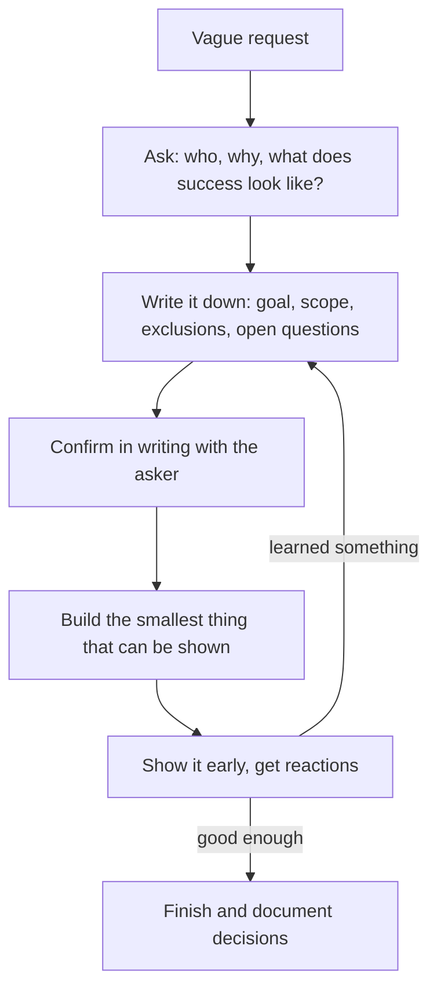

# Behavioural-technical questions: unclear requirements and explaining technical ideas to non-technical people

> **Before this lesson:** read [Behavioural-technical questions: the STAR method](#/lesson/thinking/behavioural-star) for the story structure used throughout, and [Planning questions](#/lesson/thinking/planning-estimating) for turning a vague request into scope and thin slices.

## In plain words

A customer walks into a tailor's and says, "I need something for a wedding." A poor tailor starts cutting cloth. A good one asks: whose wedding, when, indoors or out, what do you like wearing, what is your budget? — then sketches something, pins a rough version on the customer, and adjusts. And when the customer asks why the jacket costs more than expected, the good tailor does not lecture about thread counts. They say: "This cloth keeps its shape for ten years; the cheaper one will sag by next summer."

Those are the two skills of this lesson. The first is working when nobody has told you exactly what is wanted — **unclear requirements**, where a **requirement** is a statement of what something must do. The second is **explaining technical matters to people who are not technical**, in terms of what they care about. Both are tested with behavioural questions — *"tell me about a time you worked with ambiguous requirements"*, *"tell me about a time you had to explain something complex"* — and often live, when the interviewer says: *"explain an API to me as if I were your grandmother."*

They matter because requirements are almost never clear, and because most of the people who decide what engineers work on — managers, clients, support, sales — are not engineers. Someone who can only work from a perfect specification and only talk to other programmers is useful to very few teams.

## Part 1 — Unclear requirements

### Why requirements are unclear

Not because people are careless. A request is vague for one of four reasons, and it helps to work out which.

| Reason | Sounds like | What helps |
|---|---|---|
| The asker knows the **problem** but not the solution | "Customers keep complaining about invoices" | Explore the problem; propose options |
| The asker has a **solution** in mind but has not said why | "Add an export button" | Ask what they want to do with the export |
| **Different people** want different things | Sales wants speed, legal wants approval steps | Get them in one conversation; make the conflict visible |
| **Nobody knows yet** — it depends on things not yet learned | "We want to use AI somewhere" | Run a small, cheap experiment |

The second row hides a classic trap. People ask for a *solution* — a button, a report, a field — when what they have is a *need*. Build exactly what was asked and you may deliver something correct and useless. The habit that prevents this is to ask "what will you do with it?" or "what problem does this solve?" until you reach the need. One version of the habit is called the **five whys**; two or three whys are usually enough.

### A method



**1. Ask the questions that would change what you build.** Not every question — the ones whose answers lead to different work.

- *Who* is this for, and how many of them?
- *Why* now — what problem or opportunity is behind it?
- *What does success look like?* How will we know it worked?
- *What is the deadline, and what is it tied to?*
- *What must not change or break?*
- *Who decides* when there is a conflict?

**2. Write down your understanding and send it back.** Half a page: the goal, what is in scope, what is explicitly *out* of scope, your assumptions, and the open questions. "Here is what I understood — please correct me." This single step prevents more wasted work than any other, because misunderstandings surface in a day instead of in a month. It also leaves a record.

**3. Separate what you know from what you are assuming.** For each unknown, either ask, or make an assumption and state it. An assumption that is written down is a small risk; an unstated one is a trap.

**4. Start with something small and show it soon.** A sketch, a clickable mock-up, a thin working slice. People who cannot describe what they want can nearly always tell you what is wrong with something in front of them. This is why short feedback loops beat long specifications.

**5. Decide what can wait.** Not every question needs an answer before you start. Begin with the parts that are certain and that every version of the feature will need; keep the uncertain parts easy to change.

**6. Keep people informed of decisions you made on their behalf.** "The spec did not say what happens to cancelled orders; I've excluded them from the report — tell me if that is wrong."

### The two ways to get it wrong

| Too little clarification | Too much |
|---|---|
| Starts building at once on a guess | Refuses to start until every detail is specified |
| Discovers the misunderstanding at the demo | Sends forty questions; the asker stops replying |
| "But that's what the ticket said." | "I can't work with requirements like these." |

The skill is the middle: enough questions to avoid building the wrong thing, then **reasonable assumptions, stated openly, and a quick first version to test them.** Interviewers are listening for exactly that balance — initiative without recklessness.

### A model story

**Question:** *"Tell me about a time you had to work with unclear requirements."*

<details><summary>Model answer</summary>

"(*Situation*) In my previous job I was one of four developers on an internal tool for a logistics company. The operations director sent a one-line request: 'We need a dashboard for delivery performance.' (*Task*) It was assigned to me, with a rough expectation of 'a few weeks'.

(*Action*) A dashboard could have meant anything, so before writing code I asked for half an hour with him. I asked what decisions he wanted to make with it. It turned out there was one: each Monday he had to decide which depots needed extra drivers, and at that time he was doing it from a spreadsheet that someone spent a morning assembling. So the need was not 'a dashboard'; it was 'on Monday morning, show me which depots are falling behind'.

I also spoke to two depot managers, because they would be the ones judged by it. They raised something he had not: late deliveries caused by the customer being absent should not count against the depot. That was a definition question — what counts as 'late' — and I could not decide it myself.

I wrote a half-page summary: the goal, the three measures I proposed, how 'late' would be defined, what was out of scope — no driver-level data, no live map — and two open questions. I sent it to the director and the managers. He corrected one measure and settled the definition of 'late' in a ten-minute call with the managers.

Then, instead of building the whole thing, I made the smallest useful version in four days: one page, one table of depots with last week's on-time rate, sorted worst first. No charts, no filters. I showed it at his Monday meeting. Two things came out of that: he wanted to see the trend over six weeks, not one week, and nobody cared about one of the three measures I had planned.

(*Result*) The finished tool took three weeks instead of the five or six that the original, larger idea would have needed. The Monday spreadsheet was retired, saving about half a day a week of someone's time, and the director told me that the extra-driver decision went from a debate to a five-minute look. The measure nobody wanted was never built.

(*Reflection*) Since then, when a request names a solution, I ask what decision or task it is for before anything else. And I show something rough in the first week — the reactions to that first page changed the plan more than any amount of questioning beforehand would have."

</details>

What the story demonstrates: asking why; finding the real need behind the requested solution; involving the people affected; writing understanding down and confirming it; escalating a decision that was not the candidate's to make; delivering a thin slice early; and a measurable outcome.

### The live version

Sometimes the ambiguity *is* the interview. The interviewer gives a deliberately thin task — "design a system to send reminders" — and watches whether you ask or assume. Everything in the first module of this track applies: three to five clarifying questions, stated assumptions, then proceed. If they answer "you decide", they are handing you the assumption; make one aloud and move on.

> [!INTERVIEW]
> Three sentences that score well on ambiguity questions: **"I asked what decision it was for."** **"I wrote down my understanding and sent it back for correction."** **"I showed a rough version in the first week."** Each is evidence of a habit that saves weeks.

## Part 2 — Explaining technical ideas to non-technical people

### Why it is hard

Once you understand something, it becomes difficult to remember what not understanding it felt like. This is sometimes called the **curse of knowledge**. You use words that seem ordinary to you — "endpoint", "cache", "latency" — and the listener hears noise, nods politely, and leaves knowing nothing. The problem is rarely that the idea is too hard. It is that the explanation starts in the wrong place and uses the wrong words.

### A method: audience, point, picture, check

**1. Start with the audience, not the topic.** What do they already know? What do they need this for — a decision, a customer conversation, curiosity? What do they care about: cost, time, risk, their customers? The same fact is explained differently to a finance director and to a support agent.

**2. Decide your one point.** If they remember a single sentence, what should it be? Say that sentence first. Explanations fail more often from having five points than from having none.

**3. Lead with the conclusion and what it means for them.** Engineers are trained to build up to a conclusion; busy listeners want it immediately. "We need two more weeks, because…" — not three minutes of background followed by a surprise.

**4. Use an analogy from their world.** An **analogy** explains something unfamiliar by comparing it with something familiar. A good one maps the *structure* of the idea, not only its surface.

| Idea | Analogy |
|---|---|
| API | A restaurant menu and waiter: you order from a fixed list without entering the kitchen |
| Cache | Keeping the things you use daily on the worktop instead of fetching them from the cellar each time |
| Database index | The index at the back of a book, versus reading every page |
| Technical debt | Tape on a parcel: fine today, and every later handling takes more care |
| Load balancer | A host directing diners to whichever table is free |
| Encryption | A locked box that only the holder of the key can open |
| Bug versus feature request | A car that will not start, versus wishing it had a sunroof |
| Latency | The delay between asking a question and hearing the reply on a bad phone line |

Then say where the analogy stops being true, if that matters, so that it does not mislead.

**5. Replace jargon — or define it once and keep using the same word.** Do not switch between "server", "machine", "box" and "instance" for the same thing; the listener will think they are four things.

**6. Use numbers they can feel.** Not "p99 latency regressed by 400 milliseconds" but "one visitor in a hundred now waits about half a second longer for the page". Not "three nines of availability" but "about nine hours of downtime a year".

**7. Say what you need from them.** A decision? Approval? Nothing, only awareness? Make it explicit, with options if there is a choice.

**8. Check that it landed.** Not "do you understand?" — people say yes. Ask something that reveals it: "Does that change what you'd tell the customer?" or "Which of those two options sounds right for your team?" Watch faces; pause; invite interruption.

### What it is not

Explaining in plain words is not **talking down**. The listener is intelligent and an expert in their own field; they lack your vocabulary, not your brains. And it is not **being inaccurate**. A good simple explanation leaves things out; it does not say things that are false. If asked a question whose honest answer is complicated, give the short true version and offer more: "In short, yes. There is one exception, which matters only if… — shall I go into it?"

### The same message, three audiences

An engineer has found that the database must be migrated to a newer version, which will take three weeks.

| Audience | Cares about | What you say |
|---|---|---|
| **Another engineer** | How; risk; their own work | "Version 11 leaves support in June. I plan to upgrade through a replica, switch over on a Sunday, and I need you to check your service's queries against the new version by the 10th." |
| **Product manager** | Schedule; trade-offs | "For three weeks from the 1st, one engineer is unavailable for features. It cannot wait: after June we stop receiving security fixes. The reporting feature would slip by about two weeks — or we could delay the smaller export feature instead. Which would you prefer?" |
| **Finance director** | Cost; risk | "The software our database runs on stops being supported in June. After that, a security hole would stay unfixed, which is the kind of exposure our insurers ask about. Avoiding it costs about three weeks of one engineer; there is no new licence cost." |

Same facts. Different opening, different detail, different request.

### A model story

**Question:** *"Tell me about a time you explained something technical to a non-technical person."*

<details><summary>Model answer</summary>

"(*Situation*) At my last company the head of customer support came to our team frustrated. Customers kept reporting that after changing their delivery address, the app sometimes still showed the old one for a while. She had been told by someone on the team that it was 'a caching issue with eventual consistency', which meant nothing to her, and she needed to know what to tell customers and whether it would be fixed. (*Task*) I had worked on that part of the system, so I offered to explain it properly.

(*Action*) First I asked what she needed out of the conversation. It was two things: a sentence her agents could give to customers, and a sense of whether this was a serious defect.

So I started with the answer, not the mechanism: 'The address is saved correctly straight away. What's slow is that one screen keeps showing its old copy for up to five minutes. Nothing is lost, and deliveries go to the new address.'

Then I gave her a picture. I said: imagine the office keeps a master staff directory on the shared drive, and everybody prints their own copy to keep on their desk because it is quicker than opening the file each time. When someone changes their phone number, the master is updated at once — but the printed copies are wrong until people reprint them. Our app does the same thing with addresses: it keeps a copy for speed and refreshes it every five minutes.

She asked the obvious good question: 'So why not skip the printed copy?' I said that the copy is what makes the app fast for everybody else, but that she had put her finger on it — for *your own* address, right after *you* change it, we should refresh your copy immediately. That was a small, specific fix.

I finished with what each of us would do: I would propose that fix to my team that week, and meanwhile her agents could say, 'Your new address is saved; the app may take a few minutes to display it.' I asked whether that sentence would work for her team, and she adjusted the wording.

(*Result*) I wrote up the fix; it shipped about ten days later, and tickets on that subject went from roughly fifteen a week to one or two. She also began sending her team's questions to me directly, which caught two other real problems early.

(*Reflection*) What I learned was to ask what the person needs before explaining anything — I had been ready to describe how caching works, and what she needed was a sentence for customers and a yes or no on whether data was being lost. And her 'obvious' question pointed straight at the right fix."

</details>

### The live version: "explain X to me as if I were ten"

Sometimes you are asked to do it on the spot. Common subjects: an API, the cloud, a database, how the internet works, what a bug is, recursion, encryption, machine learning. A reliable pattern:

1. **One plain sentence** saying what it is.
2. **An analogy.**
3. **One concrete example.**
4. **Why it matters.**
5. **A check**: "Does that make sense? I can go deeper on any part."

<details><summary>Example — "Explain what an API is to someone who has never programmed"</summary>

"An API is an agreed way for one computer program to ask another for something.

Think of a restaurant. You do not walk into the kitchen and cook. There is a menu listing what you can ask for, and a waiter who takes your order to the kitchen and brings back the dish. You do not need to know how the kitchen works, and the kitchen can be completely rebuilt without your noticing — as long as the menu stays the same.

For example, when a weather app on your phone shows tomorrow's forecast, the app itself knows nothing about weather. It asks a weather service through that service's API — 'forecast for Lisbon, tomorrow, please' — and the service sends back the numbers, which the app turns into the picture you see.

It matters because it lets different companies' software work together. It is why you can pay with your bank card inside a shopping app, or see a map inside a taxi app: each is asking another company's program for something, through its menu.

Does that fit with how you imagined it? I can say more about what the 'menu' looks like in practice if that would help."

</details>

<details><summary>Example — "Explain technical debt to a product manager who wants only features"</summary>

"Technical debt is the extra work we pay later because we took a shortcut earlier.

It is like a kitchen in a busy restaurant where, to get through a rush, nobody washes up or puts things back. You serve that evening's meals faster. But the next day everything takes longer, because you are cooking around the mess — and if you never clear it, eventually you cannot cook at all.

Here is ours: when we launched checkout quickly last year, we handled each payment method with its own copied code. It worked. Now every change to checkout has to be made in five places, which is why last month's 'small' change took three weeks and why two of our last four incidents began there.

Why it matters to you: it is quietly slowing down every feature that touches checkout. If we spend two weeks consolidating that code, I'd expect later checkout work to take about half the time — so the three checkout features on next quarter's plan would arrive sooner overall, even counting the two weeks.

Would it help if I marked on the plan which features touch that area, so that you can see the effect?"

</details>

Notice that neither example uses a single term the listener would have to look up, and both end with something for the listener to *do*.

> [!INTERVIEW]
> In a live "explain it in plain words" exercise, the interviewer usually plays the part and asks a naive follow-up. Welcome it; answer it without going back into jargon; and never say "it's complicated". Calm, plain answers to two follow-ups are what earn the score.

## Other behavioural questions you should have a story for

Each is answered with STAR and one of the stories in your bank.

| Question | What they listen for |
|---|---|
| "Tell me about a time you failed." | Ownership; what you changed |
| "Tell me about a time you had too much to do." | How you prioritised and whom you told |
| "Tell me about critical feedback you received." | Whether you can hear it and act on it |
| "Tell me about a time you helped a colleague." | Generosity; teaching |
| "Tell me about a time you had to learn something fast." | Method of learning |
| "Tell me about a time you said no." | Reasons, alternatives offered, relationship kept |
| "Tell me about something you are proud of." | What you value; your actual contribution |
| "Why do you want to work here?" | That you have looked at what the company does |
| "What would your colleagues say you should improve?" | Self-awareness and something real |

## Common mistakes

- **Building straight from the ticket** without asking what it is for.
- **Demanding a complete specification** before lifting a finger.
- **Unstated assumptions.**
- **Clarifying only by talking**, with nothing written and confirmed.
- **Waiting until it is finished** to show anyone.
- **Opening an explanation with background** instead of the point.
- **Jargon**, and several words for one thing.
- **Analogies that entertain and do not map** to the idea.
- **"Do you understand?"** as the only check.
- **Condescension**, or its opposite, drowning the listener in detail to seem rigorous.
- **No request**: the listener does not know what you want from them.

## Summary

- Requests are vague because the asker knows the problem and not the solution, states a solution without the need, different people want different things, or nobody knows yet. Find out which.
- Method for ambiguity: ask what would change the work → write your understanding with scope, exclusions and assumptions → confirm it → build the smallest showable thing → get reactions early → report the decisions you made.
- Avoid both extremes: guessing silently, and refusing to start.
- To explain to non-technical people: know the audience, choose one point, lead with the conclusion and its consequence for them, use a structurally sound analogy, replace jargon, use numbers they can feel, say what you need, and check that it landed.
- Simple is neither condescending nor inaccurate.
- The same facts are framed differently for each audience.

## Glossary

| Term | Meaning |
|---|---|
| Requirement | A statement of what something must do or be |
| Ambiguity | Having more than one reasonable interpretation |
| Need versus solution | The underlying problem versus one proposed way of addressing it |
| Assumption | Something taken as true without confirmation |
| Scope | What is included in a piece of work, and what is excluded |
| Mock-up | A rough visual sketch of a screen or product |
| Prototype | A simple early version built to learn from |
| Feedback loop | The cycle of showing work, getting reactions and adjusting |
| Stakeholder | A person affected by, or with authority over, the work |
| Jargon | Specialist vocabulary unfamiliar to outsiders |
| Analogy | Explaining something by comparison with something familiar |
| Curse of knowledge | The difficulty of imagining not knowing what you know |
| Audience | The people you are communicating with, and what they need |

## Check yourself

```quiz
[
  {"q": "A manager asks you to 'add an export button'. What is the most useful first question?",
   "options": ["What colour should it be?", "What do you want to do with the exported data?", "Can it wait a year?", "Which framework should I use?"],
   "answer": 1,
   "explain": "The request names a solution; asking about its use reveals the need, which may be better met another way."},
  {"q": "After a clarifying conversation, what single step prevents the most wasted work?",
   "options": ["Starting to code immediately", "Writing down your understanding — goal, scope, exclusions, assumptions — and sending it back for correction", "Asking forty more questions", "Waiting for a formal specification"],
   "answer": 1,
   "explain": "A short written summary surfaces misunderstandings within a day and leaves a record."},
  {"q": "Why show a rough version in the first week?",
   "options": ["To finish early", "People who cannot specify what they want can usually say what is wrong with something in front of them", "To avoid testing", "Because sketches are final"],
   "answer": 1,
   "explain": "Early reactions to something concrete reveal real needs faster than more questions."},
  {"q": "The specification does not say what should happen in a rare case. What is the best handling?",
   "options": ["Guess silently", "Stop all work until someone answers", "Make a reasonable assumption, state it openly, and keep that part easy to change", "Leave the case to crash"],
   "answer": 2,
   "explain": "A stated assumption is a small, visible risk; an unstated one is a trap, and waiting for every answer stalls delivery."},
  {"q": "You must tell a finance director that an upgrade is needed. How should you open?",
   "options": ["With a history of the database's versions", "With the conclusion and what it means in cost and risk", "With a diagram of the replication topology", "With an apology"],
   "answer": 1,
   "explain": "Lead with the point and its consequence for that listener; supply detail only as needed."},
  {"q": "Which is the best way to check that a non-technical listener understood?",
   "options": ["'Do you understand?'", "'Does that change what you would tell the customer?'", "'Shall I repeat it more slowly?'", "Not checking at all"],
   "answer": 1,
   "explain": "A question that requires using the information reveals understanding; a yes/no question invites a polite yes."},
  {"q": "What makes an analogy good?",
   "options": ["It is funny", "It maps the structure of the idea onto something familiar, and you say where it stops applying", "It uses technical terms", "It is very long"],
   "answer": 1,
   "explain": "A structural match transfers understanding; noting its limits prevents it from misleading."}
]
```

> **Source:** Yangshun Tay, Tech Interview Handbook, "Behavioral interviews" (https://www.techinterviewhandbook.org/behavioral-interview/); *Software Engineering at Google*, ch. 2 "How to Work Well on Teams" and ch. 3 "Knowledge Sharing" (https://abseil.io/resources/swe-book/html/ch02.html, https://abseil.io/resources/swe-book/html/ch03.html); DORA capability guidance on working in small batches and gathering customer feedback (https://dora.dev/capabilities/working-in-small-batches/, https://dora.dev/capabilities/customer-feedback/); Google technical-writing course, "Audience" (https://developers.google.com/tech-writing/one/audience). Example stories are invented for illustration; wording is original.
