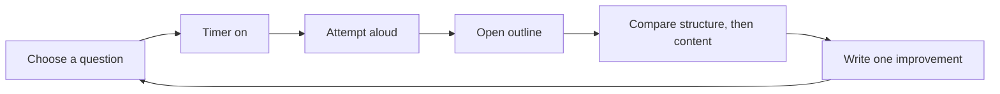

# Question bank 1: testing, rules, states, object design, APIs and data models

> **Before this lesson:** this is a practice page, not a teaching page. Each group names the lessons that teach its method — for example [A repeatable template, and the vending machine in full](#/lesson/thinking/template-vending-machine) for test design and [Object-oriented design questions](#/lesson/thinking/object-design-framework) for class design. Work through those first.

## In plain words

Nobody learns to swim by reading about strokes. At some point you have to get in the water, and then get in again, many times. This page and the two after it are the pool: more than two hundred open-ended questions of the kinds covered in this track, each with a short outline of a good answer.

An **outline answer** is not a script. It is the skeleton — the three to six points that a strong answer would contain — so that after you have tried the question yourself you can check what you covered and what you missed. The skill you are building is producing the structure yourself, aloud, under a little time pressure. Reading outlines without attempting first builds almost nothing, in the same way that watching swimmers does not make you one.

Questions 1–74 are on this page.

## How to use the bank

1. **Pick one question.** Do not read ahead.
2. **Set a timer**: two minutes for a quick outline, eight to ten for a full spoken answer.
3. **Answer aloud or on paper**, using the seven steps: clarify, assume, structure, prioritise, dive, trade-offs, summarise.
4. **Open the outline** and compare *structure first*: did you ask about users? Did you have a map? Did you rank?
5. **Note one thing** to do better next time.
6. **Return to missed questions** a few days later.

| Mode | Time | Do | Good for |
|---|---|---|---|
| Opening drill | 2 min | Questions, assumptions and a map only | Building the habit of structure |
| Outline | 3 min | Five or six bullet points | Covering many questions |
| Full answer | 8–10 min | Spoken, recorded, scored | Realistic rehearsal |
| Twist | +2 min | Change one constraint and re-prioritise | Adaptability |



Abbreviations used in outlines: *NBFA* = the four passes **n**ormal use, **b**oundaries, **f**ailures, **a**buse; *NF sweep* = the non-functional sweep (performance, reliability, security, usability, accessibility, compatibility, localisation, safety, operability).

## A. "How would you test…?" (questions 1–20)

Method: [the test-anything template](#/lesson/thinking/template-vending-machine). Always: users and purpose → assumptions → decompose → model → NBFA per area → NF sweep → ranked table → levels → pilot.

1. How would you test a toaster?
2. How would you test a revolving door?
3. How would you test a traffic light at a four-way junction?
4. How would you test a contactless card reader on a bus?
5. How would you test a smart thermostat?
6. How would you test a washing machine?
7. How would you test a parking ticket machine?
8. How would you test an automatic sliding door at a supermarket?
9. How would you test a coffee-ordering mobile app?
10. How would you test a calculator app?
11. How would you test a password-reset flow?
12. How would you test a file-upload feature?
13. How would you test a shopping basket?
14. How would you test an "undo" feature in a text editor?
15. How would you test a date picker?
16. How would you test a REST endpoint that creates an order?
17. How would you test a video-call application?
18. How would you test a map's route-finding feature?
19. How would you test a spam filter?
20. How would you test a system that sends scheduled reminder emails?

<details><summary>Outline answers 1–20</summary>

1. **Toaster.** Users include children. Areas: heating, timer and browning levels, lever and eject, crumb tray, casing. Boundaries: lowest and highest setting, thickest slice, frozen bread. Failures: lever stuck down, element failure, power cut. Top risk: fire and burns — auto shut-off, casing temperature. Endurance cycles; safety certification.
2. **Revolving door.** Safety first: stops on obstruction, speed limit, emergency collapse and exit during fire or power loss. States: idle, rotating, stopped, emergency. Capacity at rush hour; pushchairs and wheelchairs (alternative door); weather seal; wear.
3. **Traffic light.** Invariant: conflicting directions are never green together. State machine with timed phases; test every transition and power-up state. Failures: lamp out, controller fault → flashing safe mode. Pedestrian button, emergency-vehicle override, sensor faults, timing at night.
4. **Card reader on a bus.** Read speed while boarding; card types and phones; double tap (no double charge); offline operation with later settlement; daily fare cap boundaries; vibration, sunlight, cold; tampering; reconciliation of fares against taps.
5. **Smart thermostat.** Control loop (heat on below target, off above, no rapid switching); schedule boundaries at midnight and clock change; sensor failure → safe default; app and device out of sync; lost Wi-Fi keeps working locally; security of remote control; frost protection.
6. **Washing machine.** State machine: fill, wash, drain, spin; door locked whenever water or motion present (invariant). Boundaries: empty and overloaded drum, unbalanced load. Failures: no water, blocked drain, power cut mid-cycle (resume or safe drain). Leaks; endurance; child lock.
7. **Parking ticket machine.** Tariff decision table and time boundaries (free period, daily cap, overnight); coins, cards, change, exact-change mode; printer out of paper *before* taking money; plate entry validation; outdoor environment; vandalism; reconciliation.
8. **Sliding door.** Detects people of different heights, speeds, wheelchairs, children, pets; never closes on someone (safety sensor, fail-open on power loss or fire alarm); response time; false triggers from passers-by; weather, glare; lock mode at night.
9. **Coffee-ordering app.** Journey: browse, customise, pay, collect. Decision table for customisations and prices; payment atomicity; order sent to the right shop; shop closed or item sold out; network loss mid-order; duplicate tap; notifications; accessibility; peak-hour load.
10. **Calculator app.** Partitions: integers, decimals, negatives, very large and very small numbers. Boundaries: division by zero, overflow, precision (0.1 + 0.2), operator precedence, repeated equals, clear versus clear-entry. Input by paste; locale decimal separator; rotation; accessibility.
11. **Password reset.** Token: random, single-use, expiring. Same response for known and unknown emails. Rate limits. Old password and other sessions invalidated. Link opened twice, after expiry, on another device. Email delivery failure. Notification to the user of the change.
12. **File upload.** Partitions: allowed and forbidden types, zero bytes, maximum and maximum + 1, corrupt, wrong extension. Interrupted upload and resume; duplicate name; hostile filename; virus scan; quota; permissions on download; progress display; concurrent uploads.
13. **Shopping basket.** Add, remove, change quantity; boundaries 0, 1, maximum; price or stock changes while in basket; merge of guest and signed-in baskets; two tabs or devices; discounts decision table; persistence across sessions; totals and rounding.
14. **Undo.** Model as a stack. Undo and redo sequences; redo cleared after a new edit; boundaries: nothing to undo, history limit; grouping of typing into one step; undo across save, across formatting and paste; large documents; collaboration with other editors.
15. **Date picker.** Boundaries: month ends, leap day, year change, minimum and maximum allowed dates. Time zones and daylight-saving shifts. Typed versus clicked input; invalid typed dates; locale formats and first day of week; keyboard and screen-reader use; range selection (end before start).
16. **Create-order endpoint.** Contract: required fields, types, unknown fields. Authorisation. Idempotency key (same key twice, concurrently, different body). Stock race on the last item. Payment or stock service failing or timing out. Status codes and error shape. Load; contract compatibility with old clients.
17. **Video call.** Join, mute, camera, screen share, leave; two and many participants. Network: low bandwidth, packet loss, switch from Wi-Fi to mobile, reconnect. Audio-video sync, echo. Permissions denied. Devices and browsers. Privacy: who can join, recording indicators. CPU and battery.
18. **Route finding.** No single right answer → invariants: route is connected and legal (one-way streets), not longer than a known alternative, same result for same input. Golden set of known routes. Closed roads, ferries, start equals destination, unreachable destination. Freshness of traffic data; latency.
19. **Spam filter.** Statistical: labelled test set, precision and recall, cost of each error (lost real email is worse). Slices by language and sender type. Adversarial changes; drift; a way for users to correct mistakes; never silently delete; latency; fallback if the model is down.
20. **Scheduled reminders.** Clock control in tests. Boundaries around the scheduled minute, time zones, clock changes, month ends. Exactly once: not zero, not twice (job retried, two workers). Catch-up after downtime — send late or skip? Unsubscribed or deleted users. Provider failure and retry. Volume at the top of the hour.

</details>

## B. Decision tables and rule changes (questions 21–30)

Method: [building](#/lesson/thinking/building-decision-tables), [auditing](#/lesson/thinking/collapse-contradictions-gaps) and [updating](#/lesson/thinking/rules-changed) tables.

21. A cinema gives discounts to students and to seniors, and half price on Tuesdays. Build the decision table. What do you ask?
22. A rule says "free delivery for orders over 30 or for members". A new rule adds "except for oversized items". Update the table.
23. A table with four conditions has rules covering 8, 4, 2, 2 and 1 combinations. What can you conclude?
24. Two rules read `Y – N` → approve and `– Y N` → reject. What is wrong and how do you resolve it?
25. A leave-approval policy: auto-approve up to 3 days if balance is sufficient; manager approval above 3 days; never in the blackout period. Model it.
26. A firewall uses first-match rules. Someone inserts "deny all" at the top. What happens, and how would you have caught it?
27. Insurance premium depends on age band (3 bands), smoker (yes/no) and prior claims (yes/no). How many rules, and how do you test them?
28. A policy change says "customers on the watch list must be reviewed manually". The existing table has six rules, two of which already reject. How do you extend it?
29. You are given a table and told "simplify it". What are the steps and the risks?
30. A promotion engine lets discounts stack. Marketing now wants a 40 % cap. What do you check?

<details><summary>Outline answers 21–30</summary>

21. Conditions: student, senior, Tuesday → 8 rows. Ask: do discounts stack or does the best apply? Can someone be both student and senior? Proof required? Does Tuesday apply to already-discounted tickets? Fill sentence by sentence; flag the stacking ambiguity.
22. New condition "oversized": input space doubles. Rules that give free delivery split into oversized Y (not free) and N (free); rules already charging get a dash. Re-audit against 2^n. Diff: only oversized + previously-free inputs change. Ask what oversized items pay.
23. Sum is 17 against 2^4 = 16, so at least one input is covered twice. Overlap exists (redundancy or contradiction); gaps may also exist, hidden by the overlap. Check pairs for overlap, then expand to find any gap.
24. They overlap on `Y Y N` with different actions: a contradiction. Resolve by a business decision — priority (which wins), or narrow one pattern (`Y N N` → approve), or make the table explicitly first-match. Surface it; do not pick silently.
25. Conditions: days ≤ 3, balance sufficient, in blackout. Blackout overrides → refuse. Otherwise insufficient balance → refuse; ≤ 3 → auto; > 3 → manager. Boundaries: exactly 3 days, balance exactly equal, request straddling the blackout edge. Ask about half days.
26. Every packet matches the first rule; all later rules are unreachable; everything is blocked. Catch by diffing behaviour before and after over representative inputs, by a reachability check for shadowed rules, by review, and by staged rollout with a quick rollback.
27. 3 × 2 × 2 = 12 rules. One test per rule plus boundary tests at each age-band edge. Check for impossible combinations and for monotonicity (smoker never cheaper than non-smoker, all else equal) as an invariant.
28. Add condition W. Rules whose outcome is approve or routine review split into W = Y → manual review and W = N → unchanged; the two rejecting rules take a dash. Ask whether rejected watch-listed customers must also be reported. Diff to list changed inputs.
29. Check completeness and consistency first. Merge rules with the same action differing in one position; repeat. Risks: merging across a gap (inventing behaviour), merging "similar" but different actions, hiding a condition that does matter in code. Verify equivalence over all inputs.
30. Order of operations (cap applied last?). Whether the cap is inclusive. Per item or per order. Which current combinations exceed 40 % — list them as the changed inputs. Whether any combination can now never trigger the cap (add a test that does). Rounding.

</details>

## C. State machines and scenario modelling (questions 31–40)

Method: [modelling](#/lesson/thinking/modelling-state-machines) and [deriving tests](#/lesson/thinking/test-paths-invalid-transitions).

31. Draw the states of a pull request from opened to merged.
32. Model a hotel room booking.
33. Model a food-delivery order from the restaurant's point of view.
34. Model a bank card: issued, active, blocked, expired.
35. Model a document with draft, review, approved and published stages.
36. Model a two-factor login.
37. A model has 5 states and 7 events with 12 transitions drawn. What do you do with the rest?
38. How do you choose between all-states, all-transitions and transition-pair coverage?
39. Model a support ticket, including reopening.
40. Model a dishwasher cycle and name its most important invariant.

<details><summary>Outline answers 31–40</summary>

31. States: draft, open, changes requested, approved, merged, closed. Events: push, request review, approve, request changes, merge, close, reopen. Questions: does a new push after approval dismiss it? Merge with failing checks? Reopen after merge (no)? Conflicts with main as a guard.
32. States: held, confirmed, checked in, checked out, cancelled, no-show. Timed events: hold expires, check-in day passes. Questions: modify dates after confirmation, cancel after check-in, overbooking, payment failure on confirm, early checkout.
33. States: received, accepted, preparing, ready, picked up, delivered, rejected, cancelled. Questions: customer cancels during preparation (who pays?), courier never arrives (timeout), item unavailable after acceptance, duplicate "ready" events, order of late events.
34. States: issued (not yet active), active, temporarily blocked, permanently blocked, expired, replaced. Invalid transitions matter: a permanently blocked card must never return to active; expired + payment → refuse. Wrong-PIN counter as a variable with a guard.
35. Draft → in review → approved → published; sent back to draft from review. Questions: edit after approval (returns to review?), publish without approval (forbidden), unpublish, new version of a published document, simultaneous reviewers disagreeing.
36. States: logged out, password accepted (awaiting code), logged in, locked. Events: correct or wrong password, correct or wrong code, code expires, resend. Questions: code attempts limit, code reuse, back button after password step, session if the second step is abandoned.
37. 5 × 7 = 35 pairs; 23 are undrawn. Classify each: ignored, rejected with feedback, impossible, or missing. Raise the missing ones as questions; test the ignored and rejected ones for no state change and no side effect.
38. By risk. All states is the weakest and suits cosmetic behaviour. All valid transitions is the normal minimum. Add every invalid pair for safety, security and money. Transition pairs around critical states where history may matter. State the cost growth.
39. States: new, assigned, waiting on customer, resolved, closed, reopened. Timers: auto-close after silence, escalation after no response. Questions: customer replies after close (new ticket or reopen?), reassign while waiting, merge duplicates, who may close.
40. States: idle, filling, washing, draining, drying, done, fault. Invariant: the door stays locked — or water stops — whenever spraying or hot water is present; heater never on without water. Power loss mid-cycle → safe drain. Door opened mid-cycle → pause.

</details>

## D. Object-oriented and low-level design (questions 41–52)

Method: [the framework](#/lesson/thinking/object-design-framework) and [worked designs](#/lesson/thinking/object-design-worked): clarify → use cases → entities → responsibilities → diagram and walk-through → stress.

41. Design a deck of cards usable for several games.
42. Design a library's fine calculation so that rules can change.
43. Design an in-memory cache with a size limit that evicts the least recently used item.
44. Design a hotel reservation system's classes.
45. Design a chess game's classes.
46. Design a logging library.
47. Design a text editor's undo and redo.
48. Design a notification sender that supports email, SMS and push.
49. Design a file system's classes: files and folders.
50. Design a restaurant table-reservation system.
51. Design a task scheduler that runs jobs at given times.
52. Design a shopping cart with promotions.

<details><summary>Outline answers 41–52</summary>

41. `Card` (suit, rank), `Deck` (shuffle, draw; inject randomness for tests), `Hand`. Game rules outside the deck: a `Game` interface with implementations. Do not subclass a card per rank. Jokers and multiple decks as configuration.
42. `Loan`, `FinePolicy` interface with `fine_for(loan, today)`; implementations for daily rate, cap, grace period, member type. Strategy pattern; pass `today` in. Policy chosen per member type. Tests at due date and cap boundaries.
43. Operations get and put in constant time: a hash map from key to node plus a doubly linked list ordered by recency; move to front on access, evict from the tail. Capacity 0 and 1 edge cases; thread safety with a lock; optional expiry time.
44. `Hotel`, `RoomType`, `Room`, `Reservation` (dates, status), `Guest`, `Payment`, `PricingPolicy`. Reserve a room *type*, assign a room at check-in. Availability is per night; preventing double booking must be atomic. Cancellation policy as a strategy.
45. `Board`, `Square`, `Piece` (interface `legal_moves(board)`) with subclasses — here behaviour really differs, so inheritance fits. `Game` holds turn, history, status. `Move` as an object enables undo and notation. Special rules: castling, en passant, promotion, check detection.
46. `Logger` with levels; `Handler` interface (console, file, network) — several per logger; `Formatter`. Configuration by name hierarchy. Concerns: cost when a level is disabled, thread safety, not blocking the application (asynchronous handler), redaction of secrets.
47. Command pattern: each edit is an object with `do` and `undo`. Two stacks; a new edit clears redo. Group keystrokes into one command. Memory limit on history. Alternative: store snapshots (simpler, more memory) — state the trade-off.
48. `Notification`, `Channel` interface with `send`, one class per channel; `NotificationService` picks channels from `UserPreferences`; `TemplateRenderer`. Retries and provider failover behind the channel. New channel = new class. Idempotency key per notification.
49. Composite pattern: `Node` with `File` and `Folder` (which holds nodes). Operations: path lookup, size (recursive), move, delete. Permissions on nodes. Edge cases: move a folder into itself, name collisions, very deep trees (avoid unbounded recursion).
50. `Table` (capacity), `Reservation` (party size, time slot, status), `Customer`, `ReservationBook`. Finding a table: smallest that fits, combine tables. Overlap check per slot, atomic. Policies: duration, no-show, waitlist. Walk-ins versus reservations.
51. `Job` (callable, schedule), `Schedule` interface (once, interval, cron-like), `Scheduler` with a priority queue ordered by next run time, worker pool. Concerns: missed runs after downtime, overlapping runs of the same job, time zones, injected clock for testing, failure and retry policy.
52. `Cart`, `LineItem`, `Product`, `Promotion` interface (`applies(cart)`, `discount(cart)`), `PromotionEngine` with stacking and exclusion rules. Prices in integer minor units. Order of application and caps are explicit. New promotion = new class. Tests from a decision table.

</details>

## E. API design (questions 53–64)

Method: [the building blocks](#/lesson/thinking/api-design-principles) and [worked designs](#/lesson/thinking/api-design-worked).

53. Design the API for a blog: posts and comments.
54. Design the API for booking a meeting room.
55. Design an API for a to-do app that works offline.
56. Design the API for a ride-hailing app's "request a ride".
57. Design a search endpoint with filters and sorting.
58. Design an API for exporting a large report.
59. Design webhooks for an e-commerce platform.
60. How would you add rate limiting to a public API?
61. How do you change a response field's type without breaking clients?
62. Design an API for a bank transfer.
63. Design a bulk-create endpoint.
64. PUT versus PATCH versus POST: when do you use each?

<details><summary>Outline answers 53–64</summary>

53. Resources `posts`, `comments` nested under posts for listing and creating, addressable directly by id. Standard methods; cursor pagination newest first; author-only edit and delete with per-object checks; drafts versus published as a state; consistent error shape.
54. Resources `rooms`, `bookings`. Availability query by time range. Creating a booking must reject overlaps atomically → `409 Conflict`. Idempotency key on create. Time zones in ISO 8601 with offsets. Recurring bookings as a separate concept. Cancel as a state change.
55. Client-generated ids and idempotency keys so that retries after reconnection do not duplicate. A `version` or `updated_at` per item for conflict detection (`409`) or last-write-wins, stated. A "changes since cursor" sync endpoint. Soft deletes so that removals sync.
56. `POST /rides` with pickup, drop-off and idempotency key → `202` with ride id and status `searching`. Ride is a state machine; client polls or receives pushes. Fare quote as a separate short-lived resource. Cancel endpoint with rules by state. Driver location over a streaming channel.
57. `GET /items?q=…&category=…&min_price=…&sort=-price&limit=…&cursor=…`. Validate filter names; cap page size; stable sort with tie-breaker; total count optional (it is costly). Complex queries may use `POST /search`. Empty result is `200` with an empty list.
58. Long-running operation: `POST /reports` → `202` with a job id; `GET /reports/{id}` shows status; when ready, a short-lived download link. Idempotency key; expiry of results; cancel; limits on size and concurrency; notify by webhook or email.
59. Customers register a URL and event types. Each event has an id, type, timestamp and current object state. Signed payloads. At-least-once delivery with backoff; receivers de-duplicate by event id. Ordering not guaranteed. A delivery log, manual replay and automatic disabling of dead endpoints.
60. Identify the caller (key or account). Choose limits per plan and per endpoint. Token bucket in a shared store. Respond `429` with `Retry-After` and remaining-quota headers. Separate limits for expensive operations. Decide fail-open or fail-closed. Monitor and document.
61. Do not change it in place. Add a new field with the new type alongside the old (expand); announce; migrate clients; remove the old one in a new major version or after measured disuse (contract). Contract tests against recorded client requests.
62. `POST /transfers` with source, destination, integer amount, currency and an idempotency key. Authorise the caller for the source account. Atomic debit and credit; states pending, completed, failed. Limits and fraud checks. `GET /transfers/{id}`. Clear errors: insufficient funds versus invalid account.
63. Accept an array with a maximum size. Decide all-or-nothing versus partial success, and say which; with partial success return a per-item result with index and error. Idempotency per batch and ideally per item. Large batches become an asynchronous job.
64. POST: create under a collection or trigger an action; not idempotent unless a key is used. PUT: replace the whole resource at a known address; idempotent. PATCH: change part of a resource; idempotent only if designed so. GET never changes state.

</details>

## F. Data modelling (questions 65–74)

Method: [the basics](#/lesson/thinking/data-modelling-basics) and [worked models](#/lesson/thinking/data-modelling-worked).

65. Model a university: students, courses, enrolments and grades.
66. Model a hotel's rooms and bookings so that double booking is impossible.
67. Model a messaging app's conversations and messages.
68. Model product variants (size, colour) for a clothing shop.
69. Model a multi-tenant business application where each customer company has its own users and data.
70. Model an audit log.
71. Model tags on blog posts.
72. Model a subscription with plans, billing periods and invoices.
73. Where would you store user sessions, product images, order history and search data? Why?
74. A table stores `customer_name` and `customer_city` on every order row. What are the problems, and when is it acceptable?

<details><summary>Outline answers 65–74</summary>

65. `students`, `courses`, `course_offerings` (a course in a term, with teacher), `enrolments` (student, offering, grade, status) — the join table is an entity. Unique (student, offering). Prerequisites as a self-relation on courses. History kept per term.
66. `rooms`, `bookings` (room, start, end, status). Prevent overlap in the database: an exclusion constraint on (room, date range), or one row per room-night with a unique key. Book room types and assign rooms later if needed. Do the check and insert in one transaction.
67. `conversations`, `members` (conversation, user, last_read_message_id), `messages` keyed by (conversation_id, sequence). Partition by conversation, sorted by sequence. Unread count derived from last-read. Attachments in file storage. Suits a wide-column store at scale.
68. `products` (shared description) and `variants` (SKU, size, colour, price, stock) — stock and price live on the variant. Attributes either as columns (few, fixed) or as an attribute table or JSON column (varied). Unique (product, size, colour).
69. A `tenant_id` on every table and in every query and index; enforced centrally (row-level security or a mandatory query filter). Alternatives: schema per tenant or database per tenant — more isolation, more operations. Watch for noisy neighbours and per-tenant export and deletion.
70. Append-only table: who, what action, on which object, when, from where, before and after values. Never updated or deleted by the application; separate permissions. Index by object and by actor. Retention policy; avoid storing sensitive values in clear text.
71. Many-to-many: `posts`, `tags`, `post_tags` (post_id, tag_id) with a composite key. Index both directions. Normalise tag text (case, spaces). Denormalised tag counts for the tag cloud. Alternative array column is simpler and harder to query by tag.
72. `plans` (price, interval), `subscriptions` (customer, plan, status, current period start and end), `invoices` (subscription, period, amount, status), `payments`. Copy the price onto the invoice. Plan changes create history rows; do not overwrite. Subscription status is a state machine.
73. Sessions: key-value store with expiry. Images: object storage plus CDN, address in the database. Order history: relational (transactions, rules, reporting). Search: a search index fed from the database. Mixing is normal; name the source of truth.
74. Update anomaly (a move must change every row; rows disagree), wasted space, insert and delete anomalies. Fix: `customers` table and a foreign key. Acceptable when the copy is a deliberate snapshot — the name and address as they were when the order was placed.

</details>

## Glossary

| Term | Meaning |
|---|---|
| Question bank | A collection of practice questions grouped by type |
| Outline answer | The key points a strong answer would contain, without full wording |
| Drill | A short, repeated exercise that isolates one skill |
| Twist | A changed constraint added after an answer to test adaptability |
| NBFA | Normal use, boundaries, failures, abuse: the four passes over each area |
| NF sweep | A pass through the non-functional categories |
| Invariant | A statement that must always hold |
| Golden set | A saved set of inputs with known good outputs |
| Idempotency key | A unique label that lets a server recognise a repeated request |
| Join table | A table whose rows pair up rows of two other tables |
| Strategy pattern | Interchangeable algorithms behind one interface |
| Composite pattern | Treating single objects and groups of objects through the same interface |
| Command pattern | Representing an action as an object, which enables undo |

## Check yourself

```quiz
[
  {"q": "What is the most effective way to use an outline answer?",
   "options": ["Read it first, then answer", "Attempt the question under a timer, then compare structure before content", "Memorise it word for word", "Skip it"],
   "answer": 1,
   "explain": "The skill is producing structure yourself; the outline is for checking what you covered and missed."},
  {"q": "For 'how would you test a traffic light?', what should be stated early?",
   "options": ["The colour of the pole", "The invariant that conflicting directions are never green at the same time", "The brand of the bulbs", "The test framework"],
   "answer": 1,
   "explain": "A safety invariant gives the tests their target: try to make it false."},
  {"q": "A four-condition table's rules cover 8 + 4 + 2 + 2 + 1 combinations. What follows?",
   "options": ["It is complete and consistent", "At least one input is covered twice", "There are exactly two gaps", "Nothing"],
   "answer": 1,
   "explain": "The sum is 17 against 16 possible inputs, so some rules overlap."},
  {"q": "In the chess design, why is inheritance reasonable for pieces when it was not for cars and trucks in the parking lot?",
   "options": ["Chess is older", "Each piece type has different behaviour (its own legal moves), not merely different data", "Chess has more classes", "It is not reasonable"],
   "answer": 1,
   "explain": "Subclasses earn their place when behaviour differs; a difference in a single attribute does not need them."},
  {"q": "A booking API must not allow two bookings of the same room at the same time. Which response fits a clash?",
   "options": ["200 OK", "409 Conflict", "301 Moved Permanently", "204 No Content"],
   "answer": 1,
   "explain": "The request is well formed but conflicts with current state."},
  {"q": "Where should stock and price live for a shirt sold in several sizes and colours?",
   "options": ["On the product row only", "On each variant (SKU)", "In the browser", "In the tag table"],
   "answer": 1,
   "explain": "Each size-colour combination is a separately stocked and possibly separately priced item."},
  {"q": "A model has 6 states, 5 events and 14 drawn transitions. How many state-event pairs remain to be classified?",
   "options": ["9", "14", "16", "30"],
   "answer": 2,
   "explain": "6 × 5 = 30 pairs in total; 30 − 14 = 16 are undrawn."}
]
```

> **Source:** Question types reflect publicly listed practice prompts in Donne Martin's System Design Primer (https://github.com/donnemartin/system-design-primer) and Yangshun Tay's Tech Interview Handbook (https://www.techinterviewhandbook.org/); techniques follow the ISTQB Foundation Level syllabus v4.0, ch. 4 (https://www.istqb.org/certifications/certified-tester-foundation-level) and Google API Improvement Proposals (https://google.aip.dev/general). All questions' outlines are original.
