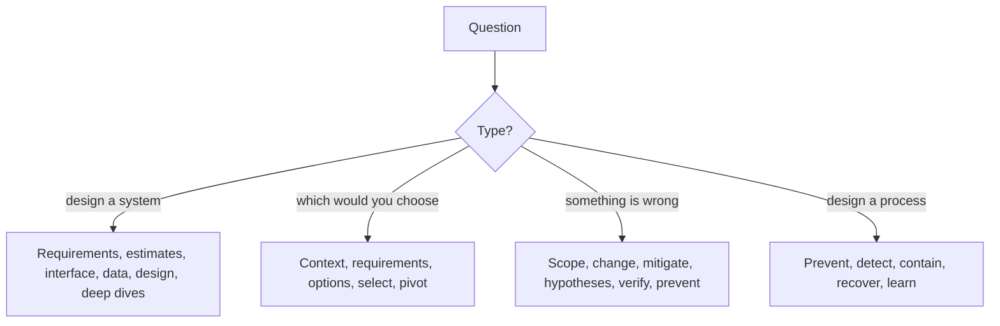

# Question bank 2: system design, trade-offs, delivery process, incidents, concurrency and scale

> **Before this lesson:** this is a practice page. Each group links to the lessons that teach its method — start with [Lightweight system design: a repeatable template](#/lesson/thinking/system-design-template) and [Buggy code on main](#/lesson/thinking/buggy-code-on-main). Read the "how to use" section of [Question bank 1](#/lesson/thinking/question-bank-design) first.

## In plain words

A pilot does not learn to handle an engine failure during a real one. They practise it in a simulator, dozens of times, until the right sequence — fly the aircraft, identify the problem, run the checklist, communicate — comes without thinking. When the real thing happens, they are calm, because it is not new.

This page is a simulator for the "systems and operations" half of open-ended interviews: questions about how software is built to scale, how it is delivered, and what you do when it breaks. Many of these questions are about bad days — an outage, a failed deploy, a database filling up. Practising them aloud beforehand is how you become the calm person in the room, in an interview and later on call.

Questions 75–152 are here. As before: attempt first, under a timer; then open the outline and compare structure before content.

## Four answer shapes to keep in mind

Almost every question on this page fits one of four skeletons. Decide which before you start talking.

| If the question is… | Use this skeleton |
|---|---|
| "Design a system that…" | Requirements → estimates → interface → data model → high-level design → deep dives and trade-offs |
| "X or Y?" | Context → deciding requirements → each option's gains and costs → choose → what would change your mind |
| "Something broke / is slow / went wrong" | Clarify and scope → what changed → mitigate → hypotheses by likelihood and cost → verify → prevent |
| "Design a process for…" | Prevent → detect → contain → recover → learn |



## G. Lightweight system design (questions 75–86)

Method: [the template](#/lesson/thinking/system-design-template) and [feed and chat](#/lesson/thinking/system-design-feed-chat).

75. Design a paste-bin service: store a piece of text and share it by link.
76. Design a rate limiter for an API used by thousands of servers.
77. Design an image-hosting service.
78. Design the "people who viewed this also viewed" feature.
79. Design a system that counts page views for millions of pages.
80. Design a web crawler at a high level.
81. Design a ticket-selling system for popular concerts.
82. Design a leaderboard for a game.
83. Design an autocomplete (type-ahead) service.
84. Design a job queue that runs background tasks reliably.
85. Design a file-sync service across a user's devices.
86. Design a system that sends a daily email digest to ten million users.

<details><summary>Outline answers 75–86</summary>

75. Read-heavy; text up to some size. Random unguessable id; store metadata in a database and bodies in object storage; cache hot pastes; expiry by a background job; rate limits and abuse scanning. Deep dive: id generation and size limits.
76. `allow(key)` must be fast and shared. Token bucket per key in a shared in-memory store with an atomic refill-and-take. Local approximate counters to cut round trips. Decide fail-open or fail-closed. Return `429` with retry time. Hot keys and clock handling.
77. Upload to object storage through pre-signed addresses; a queue triggers workers to make thumbnails and scan; metadata in a database; serve through a CDN. Deep dives: deduplication by content hash, resumable uploads, deletion and abuse.
78. Offline: a batch job counts co-views from logs and stores the top N per item in a key-value store. Online: one lookup. Cold start for new items (fall back to category popularity). Freshness versus cost; filter out-of-stock; measure by click-through.
79. Do not update a row per view. Append events to a log or queue; aggregate in memory or by stream processing into per-minute counts; store rollups. Approximate is acceptable; de-duplicate bots; hot pages. Trade accuracy for throughput and say so.
80. Frontier queue of addresses; fetchers; parser extracting links; a seen-set to avoid repeats; storage. Politeness: per-site rate limits and robots rules. Deep dives: de-duplicating content, traps of infinite pages, prioritising fresh pages, distributing the frontier.
81. Contention is the problem: many buyers, few seats. Waiting room to admit at a controlled rate; seat hold with expiry; atomic reservation; payment asynchronous to the hold; idempotent purchase. Consistency over availability for the final step. Bots and fairness.
82. Top N and "my rank". Sorted structure keyed by score in an in-memory store; periodic persistence. Many score updates → batch or debounce. Ties; time-windowed boards (daily, weekly); cheating checks; sharding by game or region with a merge for global.
83. Prefix lookups in milliseconds. Precompute top completions per prefix from query logs into a trie or key-value store; cache at the edge; update daily or by stream. Typo tolerance, personalisation and offensive-term filtering as extras. Client waits briefly before querying and ignores stale replies.
84. Durable queue; workers acknowledge on success; visibility timeout returns unacknowledged jobs; at-least-once → idempotent jobs; retries with backoff; dead-letter queue; priorities; scheduled jobs; monitoring of queue age. Deep dive: exactly-once illusion.
85. Split files into chunks with hashes; upload only changed chunks; metadata server tracks versions per file; clients are notified of changes and pull. Conflicts: keep both copies. Offline edits; resumable transfers; encryption; deletion and version history.
86. Batch job, not a request path. Partition users; workers build each digest and enqueue sends; spread sending over hours to respect provider limits and time zones; idempotency per user per day; unsubscribes; retries and bounces; monitoring of completion.

</details>

## H. "Which would you choose?" (questions 87–98)

Method: [the decision framework](#/lesson/thinking/tradeoff-framework) and [more worked choices](#/lesson/thinking/tradeoffs-worked).

87. One large shared code repository or one per service?
88. Would you cache this, and where?
89. REST or GraphQL for a mobile app's backend?
90. Server-rendered pages or a single-page application?
91. Rewrite the legacy system or refactor it?
92. Polling, long polling or WebSockets for live updates?
93. Strongly typed or dynamically typed language for a new service?
94. Managed cloud database or run your own?
95. Batch processing or stream processing for analytics?
96. One region or several?
97. Feature flags or long-lived feature branches?
98. Should a small team adopt Kubernetes?

<details><summary>Outline answers 87–98</summary>

87. Monorepo: atomic cross-project changes, one set of versions, easy code sharing; needs strong tooling and access control. Many repos: independence and simple permissions; cross-cutting changes are slow and versions drift. Decide by how intertwined the projects are and tooling maturity.
88. Ask: read-to-write ratio, how costly the computation, how stale may it be. Options: browser, CDN, application memory, shared cache. Costs: invalidation, staleness, cold start, privacy of per-user data. Fix the slow query first.
89. REST: simple, cacheable, widely known. GraphQL: clients fetch exactly what each screen needs in one round trip; costs include complexity, caching difficulty and guarding against expensive queries. Many varied screens and clients favour GraphQL; a small, stable API favours REST.
90. Server-rendered: fast first load, simpler, good for content and search engines. Single-page app: rich interaction after load; more client complexity and slower first paint. Decide by how interactive the product is; hybrids exist.
91. Refactor gradually by default — old code holds hidden knowledge, a rewrite delivers nothing until parity and the old system keeps moving. Rewrite when small and well understood, or technology is truly dead. Strangler approach as the middle path.
92. Polling: simplest, wasteful, delayed. Long polling: near-real-time over ordinary requests. WebSockets: two-way, lowest latency, stateful connections to manage. Decide by how fresh the data must be and how many concurrent clients.
93. Static types catch errors before running and help large teams and refactoring; more upfront ceremony. Dynamic types are quick for small scripts and prototypes. Decide by codebase size, team size, lifespan and existing skills.
94. Managed: backups, patching, failover handled; higher unit price, less control, some lock-in. Self-run: control and possibly lower cost at scale; needs expertise and on-call. Small teams should buy; revisit at large scale or special requirements.
95. Batch: simpler, cheaper, easy to rerun; results hours old. Stream: results within seconds; harder to operate and to get correct. Decide by whether anyone acts on the result within minutes. Often batch first, stream for the few metrics that need it.
96. One region: simple, cheaper, a regional outage takes you down. Several: resilience and lower latency for distant users; data replication, consistency and cost get hard. Decide by availability target, user geography and legal data-location rules.
97. Flags with trunk-based development: small merges, code integrated continuously, release decoupled from deploy; flag clean-up needed. Long-lived branches: isolation, then painful merges and late integration bugs. Prefer flags; branches only short-lived.
98. Benefits: standard deployment, scaling, self-healing for many services. Costs: steep learning curve and operational load. A small team with a few services is usually better served by a simpler managed platform; revisit when the number of services and teams grows.

</details>

## I. CI/CD and delivery process (questions 99–110)

Method: [buggy code on main](#/lesson/thinking/buggy-code-on-main), [bad deploy and hotfix](#/lesson/thinking/bad-deploy-hotfix), [flaky tests and review rules](#/lesson/thinking/flaky-tests-review-rules).

99. Design a CI/CD pipeline for a new web service from scratch.
100. Tests pass locally and fail in CI. How do you investigate?
101. The team deploys once a month and every release is painful. What would you change?
102. How would you introduce feature flags to a team that has never used them?
103. A developer bypassed review to push an urgent fix and it broke production. What process changes?
104. How do you decide which tests run before merge and which after?
105. How would you roll out a configuration change safely?
106. What metrics would you use to judge a team's delivery health?
107. How would you run a blameless post-incident review?
108. Releases keep being rolled back. How do you find out why?
109. How would you manage database migrations in a continuously deployed service?
110. A dependency you rely on publishes a critical security fix. What is your process?

<details><summary>Outline answers 99–110</summary>

99. Stages: build → lint and unit tests → package an immutable artefact → integration tests → deploy to staging → smoke tests → canary in production → progressive rollout → automatic rollback on bad metrics. Fast pre-merge gate; secrets managed; pipeline as code.
100. Differences between environments: versions, operating system, time zone, locale, missing services, test order, parallelism, leftover state, resource limits. Reproduce in the CI container; run in random order; check for dependence on network or clock. Make local and CI environments identical.
101. Large batches are the cause. Automate build, test and deploy; trunk-based development; flags to decouple release; small frequent releases; staged rollout and fast rollback; measure lead time and change-fail rate. Start by releasing the next small change alone.
102. Start with one release toggle on one risky feature. Choose a simple flag service; naming and ownership rules; default off; test both states; removal ticket created with the flag; audit of flag changes; a kill-switch category for operations.
103. Not blame: why was bypass the fastest path? Make the emergency path the normal path without waiting — expedited review, automated checks still required; branch protection for all, with audited break-glass; revert-first rule; review the incident and the pipeline's speed.
104. Before merge: fast and reliable — build, lint, unit tests, a few key integration tests, within about ten minutes. After merge: slower, broader, flakier suites; then canary checks. Select tests by affected code. Post-merge failures need an owner and quick revert.
105. Treat configuration like code: version control, review, validation against a schema, staged rollout (one instance, one region, all), monitoring and automatic rollback. Avoid global instant pushes. Keep the previous configuration ready to restore.
106. The DORA measures: change lead time, deployment frequency, failed-deployment recovery time, change fail rate (and rework rate). Add pipeline duration, time main is red, flake rate. Use for the team's own improvement, never for ranking individuals.
107. Within days, while memory is fresh. Timeline from evidence; impact; what helped and what hindered; contributing causes by asking how the system allowed it; actions with owners and dates; shared widely. No names as causes; thank those who reported.
108. Gather the rollbacks; classify causes (missing tests, configuration, migrations, load, dependencies). Look for the common layer that should have caught them — often no canary or weak staging. Fix the top cause; shrink releases; track change-fail rate.
109. Backward-compatible steps only: expand, migrate, contract over several releases. Migrations versioned and run by the pipeline; online operations for large tables; rehearsed on production-sized data; destructive steps last and alone; code works with both old and new schema.
110. Know what you use (inventory of dependencies); assess exposure and severity; upgrade in a branch, run tests, deploy through the normal fast pipeline with canary; if upgrade is hard, apply a temporary mitigation; verify; record. Automate update alerts.

</details>

## J. Migrations and rollouts (questions 111–118)

Method: [migration and rollout planning](#/lesson/thinking/migrations-rollouts).

111. Split one large table into two without downtime.
112. Move a service from one cloud region to another.
113. Change a primary key from a number to a UUID in a live system.
114. Replace a third-party payment provider with another.
115. Migrate user passwords from an old hashing scheme to a new one.
116. Roll out a breaking change to a mobile app's API when old app versions remain in use.
117. Move from a monolith's module to a separate service.
118. A backfill corrupted some rows. What now?

<details><summary>Outline answers 111–118</summary>

111. Create the new table; dual-write to both; backfill in idempotent batches; reconcile; switch reads behind a flag; stop writing the old columns; drop them later. Each step reversible until the final drop.
112. Stand up the stack in the new region; replicate data continuously; shadow or small-percentage traffic; verify; shift traffic gradually by DNS or load-balancer weights with low time-to-live; keep the old region as fallback; then decommission. Watch latency to dependencies and data-location rules.
113. Add a new UUID column; populate for new rows and backfill old; add it to referencing tables alongside the old key; switch code to use it for lookups and joins; make it the key; remove the old key last. Many small compatible releases.
114. Put an interface over payment calls; implement the new provider behind it; route a small percentage of new payments; compare success rates and costs; keep refunds for old payments on the old provider; migrate stored payment tokens; ramp up; keep the old path until refund windows close.
115. You cannot rehash without the password. Add a scheme marker per user; on each successful login, verify with the old scheme and re-store with the new. Optionally wrap old hashes with the new function immediately. After a period, force a reset for accounts that never logged in.
116. Old apps cannot be forced to update at once. Version the API; keep the old version working; ship the new app using the new version; measure old-version traffic; prompt and then require upgrade below a minimum version; sunset with a clear in-app message.
117. Define the module's interface inside the monolith first; give it its own tables; build the service; route calls through the interface to the service for a small percentage (strangler); compare results; move data ownership; remove the old code. Start with a module that has few dependencies.
118. Stop the job. Scope: which rows, since when (use the job's checkpoints and logs). Restore from the pre-backfill values if kept, from a backup, or by recomputing. Fix and test the transform on a copy; re-run idempotently; verify by sampling. Review: why no dry run or validation?

</details>

## K. Debugging, incidents and root-cause analysis (questions 119–132)

Method: [triage](#/lesson/thinking/hypothesis-triage), [partial outages](#/lesson/thinking/region-login-model-accuracy), [evidence](#/lesson/thinking/rca-from-evidence).

119. Checkout fails for about 5 % of users. Where do you start?
120. Memory use of a service climbs steadily until it restarts. How do you investigate?
121. An API returns intermittent 502 errors.
122. Emails from your system have stopped arriving.
123. A scheduled report shows numbers that are wrong since Monday.
124. The mobile app crashes on start for some users after an update.
125. A page loads quickly for you and slowly for a customer in another country.
126. Disk usage on a server jumped from 40 % to 95 % overnight.
127. After a deploy, CPU doubled while traffic stayed the same.
128. Users report being logged out at random.
129. A queue's backlog keeps growing.
130. You are on call, alone, at 3 a.m., and something you do not understand is failing. What do you do?
131. Given a stack trace ending in a null-reference error, how do you proceed?
132. Two metrics moved at the same time. How do you decide whether one caused the other?

<details><summary>Outline answers 119–132</summary>

119. Partial failure → find what the 5 % share: payment method, browser, country, app version, server, account property. Recent changes. Error messages and one failing trace. Mitigate by disabling the failing path or rolling back. Then cause and a per-slice alert.
120. Likely a leak: something accumulated and never released — caches without limits, listeners, connections. Confirm the pattern (ramp, then sawtooth at restarts); correlate with a deploy; take heap snapshots at two times and compare what grew; fix; add a memory alert.
121. A 502 means an intermediary got a bad reply from the server behind it. Check which instances; restarts or crashes; timeouts between proxy and server; mismatched keep-alive settings; deploys in progress without connection draining; overload. Correlate with time and instance.
122. Scope: all emails or one type, one recipient domain? Check the sending queue (backlog?), the provider's status and error responses, credentials or quota expiry, a recent deploy, sender-reputation or spam blocking, DNS records for mail. Mitigate with a backup provider.
123. Is it the data or the report? Compare with the source. What changed Monday: upstream schema, a job failure, a time-zone or definition change, duplicate rows from a rerun. Check row counts by day. Fix, backfill, tell the consumers, add output checks.
124. Crash reports grouped by device, operating-system version and app version. Often a migration of locally stored data from the previous version, or a missing permission. Reproduce by upgrading from the old version. Halt the staged rollout; ship a fix; test upgrade paths.
125. Server time is the same for both → the difference is network and delivery: distance to the server, no CDN in that region, large assets, DNS, a blocked resource. Measure from that region with browser timings. Fix with CDN, compression, regional hosting.
126. What grew: find the largest directories and files. Usually logs (debug level, an error loop), core dumps, temporary files, or a runaway job. Free space safely to restore service; fix the cause; add log rotation and a disk alert with headroom.
127. Same work is costing more. Diff the release; profile the new version; look for a hot loop, extra queries, a changed library, disabled caching, more logging or serialisation. Roll back if it risks capacity; fix; add a performance check to the pipeline.
128. Sessions not shared between servers (works until the load balancer picks another), session store evicting under memory pressure, cookie settings changed, clock differences shortening expiry, a deploy rotating the signing key. Correlate with server and deploy times.
129. Arrival rate exceeds processing rate. Which changed: more input, slower workers, fewer workers, or a poison message blocking? Check per-job duration, errors and retries. Mitigate by adding workers or shedding low-priority work; fix the slow step; alert on oldest-message age.
130. Stabilise first: roll back the latest change, fail over, or reduce load. Follow the runbook. Escalate early — waking someone is expected. Write down what you see and do, with times. Communicate status. Do not make large untested changes alone.
131. Read the last line and find the deepest frame in your own code. Which value was null and where should it have been set? Trace it upward to the lookup or input that returned nothing. Decide whether nothing is legitimate (handle it) or a bug upstream (fix that). Add a test.
132. Coincidence is not cause. Look for a mechanism; check which moved first; look for a third factor that drives both (a deploy, a traffic change); see whether it holds across slices; if possible, test by reverting or by an experiment.

</details>

## L. Concurrency and failure (questions 133–142)

Method: [concurrency stories](#/lesson/thinking/concurrency-stories) and [distributed failures](#/lesson/thinking/distributed-failures).

133. Two people edit the same document and save. What should happen?
134. A user double-clicks "Submit order". How do you prevent two orders?
135. A coupon may be used 100 times in total. How do you enforce it under load?
136. A payment provider's webhook arrives twice. How do you handle it?
137. A background job crashes halfway through processing 10,000 records. How should it be designed?
138. Service A calls B, which calls C. C is slow. What happens and what do you add?
139. What is the difference between at-most-once, at-least-once and exactly-once delivery?
140. Two servers each run the same scheduled job at midnight. How do you ensure it runs once?
141. A cache and the database disagree. How did that happen and how do you prevent it?
142. How would you test for race conditions?

<details><summary>Outline answers 133–142</summary>

133. Without care, the second save overwrites the first (lost update). Options: optimistic locking with a version and a conflict message; field-level merge; real-time collaborative editing. Choose by how often conflicts occur and how costly a lost edit is.
134. Disable the button (helps, not sufficient). Client-generated idempotency key sent with the request; server stores it with a unique constraint and returns the first result for repeats. Also de-duplicate at the payment step.
135. Atomic conditional update: increase the use count only where it is below 100, and check a row changed; or insert a redemption row guarded by a unique or counting constraint. Never read-check-write in application code. Test with concurrent requests.
136. Expect duplicates. Verify the signature; look up the event id in a processed-events table (unique key); if present, acknowledge and do nothing; otherwise process and record in one transaction. Handle out-of-order events by checking current state.
137. Process in batches with a checkpoint after each; make each record's processing idempotent; resume from the last checkpoint; isolate bad records to a quarantine instead of failing the whole run; report progress; alert on stalls.
138. Latency and failure propagate upward; A's threads fill with waiting calls; retries multiply load. Add timeouts at each hop within an overall deadline, a circuit breaker, bulkheads, limited retries with backoff and jitter at one layer, and a fallback.
139. At most once: sent once, may be lost. At least once: retried until acknowledged, may duplicate. Exactly once: not achievable across a network in general; approximated by at-least-once delivery plus idempotent processing.
140. A distributed lock or leader election so that one instance holds the right to run; or let the database arbitrate with a unique row per job per day. Make the job idempotent anyway, since locks can expire mid-run.
141. A write updated the database and the cache update failed or raced with another; or an old read repopulated the cache after an update. Prefer deleting the cache entry after the database write, short expiry times as a safety net, and versioned values.
142. Reason first: find check-then-act and read-modify-write. Then stress: many simultaneous requests against one item, asserting the invariant afterwards. Inject delays between the read and the write to widen the window. Use tools that explore interleavings where available.

</details>

## M. Scaling, performance and cost (questions 143–152)

Method: [performance scenarios](#/lesson/thinking/performance-scenarios) and [cost and load](#/lesson/thinking/cost-and-load).

143. A report query takes 40 seconds. How do you make it faster?
144. Your API's p99 latency is ten times its median. What does that suggest?
145. The application servers are at 20 % CPU, yet requests are slow. Why?
146. A cache hit rate dropped from 95 % to 40 %. What happened?
147. How would you reduce a cloud bill by 30 % without hurting reliability?
148. One customer generates half of all traffic. What are the risks and options?
149. How do you plan capacity for next year?
150. A table has 2 billion rows and queries are slowing. What are the options?
151. How would you load test a service before launch?
152. Latency rises every day at 14:00 for ten minutes. How do you investigate?

<details><summary>Outline answers 143–152</summary>

143. Look at the query plan: full scans, missing indexes, bad join order. Reduce the data: filter earlier, fewer columns, a date range. Precompute: summary tables or a materialised view refreshed on a schedule. Move to a replica or a warehouse. Make it asynchronous if still slow.
144. A slow tail: a subset of requests is very slow. Causes: particular customers with much data, cache misses, lock waits, garbage-collection pauses, a slow dependency, retries. Find what slow requests share; traces of the slowest.
145. They are waiting, not computing: on the database, another service, a lock, or a full connection or thread pool. Look at where time is spent in a trace, pool saturation, and database load. Adding servers will not help.
146. Keys changed (a deploy altering the key format or adding a varying parameter), expiry shortened, the cache restarted or evicted under memory pressure, or traffic shifted to items not cached. Correlate with the time of change.
147. Measure cost by service and by unit of business. Remove waste first: idle resources, oversized machines, old storage, excessive logs, cross-region transfer. Then commitments for steady load and cheaper storage tiers. Keep redundancy and backups; state any risk accepted.
148. Noisy neighbour: their spikes degrade everyone; revenue concentration; hot partitions. Options: per-customer rate limits and quotas, dedicated capacity or a separate shard, caching their heavy queries, pricing that reflects usage, and working with them on efficient use.
149. Current usage and headroom per resource; growth from history and business plans; convert to resource needs with a unit model; add margin for peaks and failure; note lead times; revisit quarterly; alert when months from a limit.
150. Index and query fixes first. Partition by time; archive old data; summary tables for reports; read replicas; move cold or analytic workloads elsewhere. Sharding last. Check whether all 2 billion rows are needed online.
151. Define expected and peak load and the mix of operations. Production-like environment and data sizes. Ramp up, hold, spike, soak. Watch latency percentiles, errors and each component's saturation. Find the first bottleneck; fix; repeat. Include dependencies' limits.
152. A regular time points to something scheduled: a batch job, a backup, a report, cache expiry, a partner's traffic. List scheduled work across teams; compare database load and lock waits at that time. Move, throttle or optimise the job.

</details>

## Glossary

| Term | Meaning |
|---|---|
| Simulator practice | Rehearsing a hard situation safely so that the real one is familiar |
| Skeleton | The fixed order of points that an answer of a given type follows |
| Canary | A small share of traffic sent to a new version first |
| Runbook | Written steps for handling a known operational situation |
| Break-glass access | Emergency access that bypasses normal controls and is logged |
| Strangler approach | Replacing a system piece by piece behind a stable interface |
| Dual write | Writing to old and new stores during a migration |
| Backfill | Filling in data for existing records |
| Poison message | A message that repeatedly fails and blocks a queue |
| Noisy neighbour | One customer or workload degrading service for others |
| Slow tail | The small share of requests that take far longer than the rest |
| Materialised view | A stored, periodically refreshed result of a query |
| Visibility timeout | The period a queue hides a job being processed before offering it again |
| Leader election | Choosing one instance among several to perform a task |

## Check yourself

```quiz
[
  {"q": "Which skeleton fits the question 'our releases keep being rolled back — what do you do'?",
   "options": ["Requirements, estimates, interface, data model", "Scope, what changed, mitigate, hypotheses, verify, prevent", "Situation, task, action, result", "Goal, users, problems, solutions"],
   "answer": 1,
   "explain": "It is a 'something is wrong' question: gather and classify the failures, find the layer that should have caught them, fix and prevent."},
  {"q": "For a concert-ticket system, which property matters most at the moment of purchase?",
   "options": ["Availability of browsing", "Consistency of the seat reservation", "Speed of the home page", "The colour of the seat map"],
   "answer": 1,
   "explain": "A seat must never be sold twice, so the final reservation step favours consistency."},
  {"q": "Application servers are nearly idle on CPU but requests are slow. What is the likeliest situation?",
   "options": ["The servers need more CPU", "Requests are waiting on something else, such as the database, a dependency, a lock or a full pool", "The network is unplugged", "The code is too short"],
   "answer": 1,
   "explain": "Low CPU with high latency means time is spent waiting, so adding servers will not help."},
  {"q": "How can user passwords be moved to a stronger hashing scheme?",
   "options": ["Decrypt all passwords and re-hash them", "Re-hash each user's password at their next successful login, when the password is available", "Email every password to its owner", "It is impossible"],
   "answer": 1,
   "explain": "Hashes cannot be reversed; the plain password exists only briefly during login, which is the moment to store it under the new scheme."},
  {"q": "A webhook is delivered twice. What makes processing safe?",
   "options": ["Hoping it does not happen", "Recording processed event ids and ignoring repeats", "Replying with an error", "Processing faster"],
   "answer": 1,
   "explain": "At-least-once delivery makes duplicates normal; idempotent handling makes them harmless."},
  {"q": "Latency spikes at the same time every day. What should you look for first?",
   "options": ["A hardware fault", "Scheduled work such as batch jobs, backups or reports", "A full moon", "User error"],
   "answer": 1,
   "explain": "A regular clock-time pattern points to something that runs on a schedule."},
  {"q": "Which set of measures describes delivery health according to DORA?",
   "options": ["Lines of code and hours worked", "Change lead time, deployment frequency, recovery time and change fail rate", "Number of meetings", "Number of repositories"],
   "answer": 1,
   "explain": "They pair throughput with stability and are meant for a team's own improvement."}
]
```

> **Source:** System-design practice prompts as listed in Donne Martin's System Design Primer (https://github.com/donnemartin/system-design-primer); delivery and incident practice from *Software Engineering at Google*, ch. 23–24 (https://abseil.io/resources/swe-book/html/ch23.html, https://abseil.io/resources/swe-book/html/ch24.html), the Google SRE Book (https://sre.google/sre-book/table-of-contents/), Martin Fowler's articles on feature toggles and parallel change (https://martinfowler.com/articles/feature-toggles.html, https://martinfowler.com/bliki/ParallelChange.html), Trunk Based Development (https://trunkbaseddevelopment.com/) and DORA (https://dora.dev/guides/dora-metrics-four-keys/). All outlines are original.
