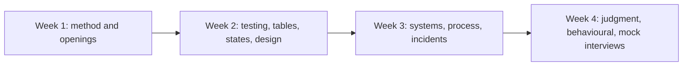

# A four-week practice plan and a self-scoring rubric

> **Before this lesson:** you should have read at least the first two lessons — [How open-ended interviews work and what they score](#/lesson/thinking/how-interviews-work) and [A seven-step answer framework](#/lesson/thinking/answer-framework). The three question-bank pages supply the practice material.

## In plain words

Someone who decides to run a ten-kilometre race does not prepare by reading about running, and does not prepare by running ten kilometres flat out on the first day either. They follow a plan: short runs at first, a little more each week, one hard session, a rest day, and a watch to see whether they are getting faster. The plan turns a vague wish into something you do on Tuesday at seven o'clock, and the watch tells you whether it is working.

This lesson is that plan and that watch for open-ended interview questions. The **plan** spreads about forty spoken answers across four weeks, building from two-minute openings to full mock interviews. The **rubric** — a scoring sheet with a short description of what weak, adequate and strong look like for each skill — is the watch: it replaces "that felt all right" with a number you can compare from week to week.

It matters because the gap between knowing this material and performing it aloud is large, and only spoken practice closes it. Candidates who have read everything and practised nothing sound exactly like candidates who have read nothing.

## The four principles behind the plan

**1. Aloud, not in your head.** Thinking an answer feels fluent; saying it reveals the gaps. Every session involves speaking or writing under a timer.

**2. Attempt first, compare second.** Open a model answer only after your own attempt. The value comes from the difference between the two.

**3. Score every answer.** A score turns a feeling into a fact, and facts show a trend.

**4. Fix one thing at a time.** After each answer choose a single improvement for the next one. Trying to fix everything at once fixes nothing.

A fifth, practical point: **little and often beats long and rare.** Thirty minutes on five days does more than three hours on Sunday, because the skill is partly a habit of speech, and habits form through repetition.

## The self-scoring rubric

Score each dimension 0, 1 or 2 after an answer. The maximum is 20.

| # | Dimension | 0 — missing | 1 — partial | 2 — strong |
|---|---|---|---|---|
| 1 | **Clarifying** | Asked nothing | Asked questions, but ones that would not change the answer | Asked 3–5 questions that shaped the plan |
| 2 | **Assumptions** | Unstated | Some stated, or stated only when challenged | Stated clearly up front and offered for correction |
| 3 | **Structure** | A stream of items | A structure appeared part-way through | Named 4–6 areas first and followed them |
| 4 | **Coverage** | One angle only (usually the happy path) | Several angles, with an obvious one missing | Normal, edge, failure, abuse and non-functional or operational angles all present |
| 5 | **Prioritisation** | Everything equal | Some ranking, no reason | Ranked by likelihood and impact, with reasons; said what would be cut |
| 6 | **Depth** | Stayed abstract | One example, vaguely | Two or three items made concrete enough for someone else to act on |
| 7 | **Trade-offs** | None mentioned | Mentioned without a decision | Named what each choice costs, then chose |
| 8 | **Adaptability** | Ignored or resisted the twist | Acknowledged it without changing the plan | Re-ranked and said what moved and why |
| 9 | **Communication** | Monologue or long silences | Mostly clear, no check-ins | Signposted, checked in, easy to follow and interrupt |
| 10 | **Summary** | Stopped when time ran out | A summary that only repeated the list | Assumptions, top priorities, gaps and next step in under a minute |

How to read your total:

| Score | Meaning | What to do |
|---|---|---|
| 0–7 | The method is not yet a habit | Go back to two-minute openings (rows 1–3) until they are automatic |
| 8–12 | The shape is there; content is thin or flat | Work on coverage, prioritisation and depth (rows 4–6) |
| 13–16 | Solid | Polish trade-offs, twists and summaries (rows 7, 8, 10) |
| 17–20 | Interview-ready | Keep it warm with two or three answers a week; widen the question types |

Three notes on honest scoring.

- **Score from the recording, not from memory.** You will be surprised how often you thought you said something and did not.
- **Row 8 needs a twist.** If nobody gave you one, draw one yourself after the answer (a list follows below) and score your response.
- **A zero is useful.** It tells you exactly what to practise next.

```python-run
log = [
    # week, question,                 scores for the ten rubric rows
    (1, "test a toaster",             [1, 0, 1, 1, 0, 1, 0, 0, 1, 0]),
    (1, "site is slow",               [2, 1, 1, 1, 1, 1, 0, 0, 1, 1]),
    (2, "design a parking lot",       [2, 1, 2, 1, 1, 1, 1, 1, 1, 1]),
    (2, "buggy code on main",         [2, 2, 2, 2, 1, 1, 1, 1, 1, 1]),
    (3, "URL shortener",              [2, 2, 2, 2, 2, 1, 1, 1, 2, 1]),
    (4, "mock interview",             [2, 2, 2, 2, 2, 2, 1, 2, 2, 2]),
]
rows = ["clarify", "assume", "structure", "coverage", "prioritise",
        "depth", "trade-offs", "adapt", "communicate", "summary"]

for week, question, scores in log:
    print(f"week {week}  {sum(scores):2d}/20  {question}")

averages = [sum(entry[2][i] for entry in log) / len(log) for i in range(len(rows))]
weakest = sorted(zip(averages, rows))[:3]
print("\nweakest dimensions:", ", ".join(f"{name} ({avg:.1f})" for avg, name in weakest))
```

The `log` list holds one line per practised answer with its ten scores. The first loop prints each answer's total, so that the trend is visible. The last lines average each rubric row across all answers and print the three lowest — here trade-offs, adaptability and the summary — which is where the next week's effort should go. Keep such a log, on paper or in a spreadsheet; it is the most motivating part of the whole plan, because improvement becomes visible within two weeks.

## The four-week plan

About thirty to forty-five minutes a day, five days a week. Adjust the pace, not the order.



### Week 1 — The method and the opening

**Goal:** the first two minutes of any answer — questions, assumptions, map — become automatic.

| Day | Study | Practise |
|---|---|---|
| 1 | Lessons on how interviews work and the seven-step framework | Three two-minute openings from bank 1, group A |
| 2 | Partitions and boundaries; tables, states and pairwise | Three openings; the *boundary values* and *equivalence classes* problems |
| 3 | Exploratory testing, risk and non-functional categories | Lens drill: three different maps for one question; the *risk priority* problem |
| 4 | The test-anything template and the vending machine | One full 10-minute answer, recorded and scored |
| 5 | Physical and digital worked answers | One full answer plus a twist; review the week's scores |

**Check at the end of the week:** can you produce questions, assumptions and a five-part map for an unseen prompt in two minutes without notes?

### Week 2 — Testing, rules, states and design

**Goal:** fluency with the precise tools — tables, state models, classes, APIs, data models.

| Day | Study | Practise |
|---|---|---|
| 1 | The three decision-table lessons | Two questions from group B on paper; the table *evaluate*, *missing* and *contradictions* problems |
| 2 | The two state-machine lessons | Two from group C, drawing the diagram and the state table; the *vending machine* and *validate sequence* problems |
| 3 | The two object-design lessons | Two from group D with a class diagram and a walk-through; the *parking lot* problem |
| 4 | The two API-design lessons | Two from group E; the *pagination* and *idempotency* problems |
| 5 | The two data-modelling lessons | Two from group F; one full recorded answer; review scores |

**Check:** given a paragraph of business rules, can you build the table, state the row count, and find one gap or contradiction in ten minutes?

### Week 3 — Systems, process and incidents

**Goal:** calm, ordered answers to "design this" and "this broke".

| Day | Study | Practise |
|---|---|---|
| 1 | The two system-design lessons | Two from group G using the six-step template, with estimates |
| 2 | The two trade-off lessons | Four 90-second "which would you choose" answers from group H |
| 3 | Buggy main, bad deploy, flaky tests, migrations | Two from group I and one from J; the *revert set* and *canary decision* problems |
| 4 | The three debugging and root-cause lessons | Three from group K; the *triage order* problem |
| 5 | Concurrency, distributed failure, performance, cost | Two from L and two from M; the *inventory race* and *retry* problems; one full recorded answer |

**Check:** for "the site is slow" and "a deploy went bad", can you give the first three moves, in order, without thinking?

### Week 4 — Judgment, people and full rehearsals

**Goal:** realistic conditions; steady performance across all question types.

| Day | Study | Practise |
|---|---|---|
| 1 | Estimation; metrics and experiments | Three from group N aloud; two from group O; the *capacity* and *A/B significance* problems |
| 2 | Prioritisation, planning, code review, legacy code | Two from P and two from Q |
| 3 | Security and privacy; the two ML lessons | Two from R and three from S |
| 4 | The two behavioural lessons | Write five-line notes for eight stories; tell four aloud, timed to two minutes |
| 5 | — | **Mock interview**: 45 minutes, three unseen questions of different types, with a partner or recorded, with twists; score each |

**Check:** an average of 15 or more on unseen questions, with no dimension averaging below 1.

### If you have less time

| Time available | Do this |
|---|---|
| One week | Lessons 1–2; the vending-machine lesson; buggy code on main; triage; the STAR lesson. Ten openings and five full answers |
| Three days | Lessons 1–2 and the template; six openings a day; one full answer a day; prepare four stories |
| One evening | The seven steps; three two-minute openings aloud; one full answer; two stories |

Even one evening of *spoken* practice is worth more than a week of silent reading.

## Drills, in detail

| Drill | Time | What you do | Trains |
|---|---|---|---|
| **Opening** | 2 min | Clarifying questions, assumptions, a numbered map — then stop | Rows 1–3 |
| **Lens switch** | 3 min | Three different structures for one prompt (journey, components, quality attributes…) | Structure, coverage |
| **Deep dive** | 90 s | One item: setup, input, expected result, how observed | Depth |
| **Rank and cut** | 2 min | Given your list, rank it and say what you would drop with half the time | Prioritisation |
| **Trade-off** | 90 s | "X or Y?" — depends on, here, gains and costs, choice, pivot | Trade-offs |
| **Twist** | 2 min | After an answer, change one constraint and re-plan | Adaptability |
| **Summary** | 45 s | Assumptions, top priorities, gaps, next step | Summary |
| **Story** | 2 min | One STAR story, timed | Behavioural |
| **Full answer** | 10 min | All seven steps, recorded, scored | Everything |
| **Mock** | 45 min | Three unseen questions with a partner | Stamina, nerves |

### A deck of twists

Draw one at random after a full answer.

- You have a tenth of the time.
- The budget has tripled.
- It is already in production with a million users.
- A regulator will audit it.
- The users are children / elderly / visually impaired.
- It must work with no network connection.
- Your main dependency is unreliable.
- The team is two people.
- A competitor launches next week.
- Your first assumption turns out to be wrong.

## Practising with a partner

A partner makes practice much closer to the real thing. They need no expertise. Give them this card:

1. Read the question; answer clarifying questions briefly, or say "you decide".
2. Stay mostly silent. Interrupt only with: **"Why?"**, **"What else?"**, **"How exactly?"**, **"What would you cut?"**
3. Two thirds of the way through, add a twist from the deck.
4. At the end ask: **"Can you summarise?"**
5. Afterwards, score the rubric independently, then compare scores row by row.

The comparison in step 5 is where most learning happens. Where you scored yourself 2 and your partner scored 1, something in your head did not reach your mouth.

If no partner is available: record yourself, wait a day, and score the recording as though it were a stranger's. A day's distance makes you a far fairer judge.

## Common ways practice goes wrong

| Symptom | Cause | Remedy |
|---|---|---|
| "I read all the model answers and still freeze." | Reading is not practising | Switch to timed, spoken attempts before opening any answer |
| Scores do not rise | Trying to improve everything at once | One dimension per week; one fix per answer |
| Answers sound recited | Memorising model answers | Practise with new prompts and twists; learn the method, not the content |
| Good alone, poor with people | No practice under observation | Partner sessions or recordings shared with a friend |
| Running out of time | No time plan | Use the minute budget: 2 clarify and structure, 5 breadth and depth, 2 trade-offs, 1 summary |
| Strong on favourite topics only | Avoiding weak types | Choose questions at random, or deliberately from your lowest-scoring group |
| Behavioural answers ramble | No prepared stories | Five-line notes for eight stories; time each to two minutes |

## The day before and the day itself

**The day before.** One light full answer to stay warm. Reread your story notes. Look at your log and note your two weakest rubric rows; decide one sentence you will say to cover each — for example, "let me state my assumptions" and "to summarise in three points". Sleep.

**During the interview.**

- Repeat the question in your own words before answering.
- Ask your questions; state your assumptions.
- Write your map where the interviewer can see it.
- Check in: "shall I go deeper here or move on?"
- When the twist comes, say "that changes my ranking" and change it.
- If you do not know something, say so and reason from first principles.
- Leave a minute for the summary.

**Afterwards.** Within an hour, write down the questions you were asked and score your own answers from memory. Add them to your bank. Whatever the outcome, that list is the best practice material you will ever have, because it shows what real interviewers ask in your field.

## A one-page reminder

| Question type | Skeleton |
|---|---|
| Any open-ended question | Clarify → assume → structure → prioritise → dive → trade-offs → summarise |
| How would you test X? | Users → assumptions → decompose → model → normal, boundaries, failures, abuse → non-functional sweep → ranked table → pilot |
| Rules changed | Restate → classify → add column with don't-cares → split affected rules → audit against 2^n → diff |
| Draw the states | Events → happy path → unhappy exits → state–event table → invariants |
| Design the classes | Clarify → use cases → entities → responsibilities → diagram and walk-through → stress |
| Design the API | Use cases → resources → endpoints → shapes → errors → idempotency → pagination → auth → evolution |
| Model the data | Entities → relationships → keys → main queries and indexes → history → storage choice → stress |
| Design a system | Requirements → estimates → interface → data model → high-level design → deep dives |
| X or Y? | Context → deciding requirements → options with costs → choose → pivot point |
| Design a process | Prevent → detect → contain → recover → learn |
| Something broke | Clarify and scope → what changed → mitigate → hypotheses by likelihood ÷ cost → verify → prevent |
| How big? | Clarify → factors → assumptions → multiply → sanity check → consequence |
| How do we measure? | Goal → behaviour → primary metric → guardrails → experiment |
| What first? | Goal → list → triage → rank by value ÷ effort → cut → communicate |
| Review this code | Purpose → correctness → safety → robustness → readability → tests |
| Is it secure? | Assets → trust boundaries → what can go wrong (STRIDE) → rank → controls → verify |
| Tell me about a time | Situation → task → action → result → reflection |

## Summary

- Skill comes from spoken, timed, scored repetitions — about forty over four weeks.
- The rubric has ten rows scored 0–2: clarifying, assumptions, structure, coverage, prioritisation, depth, trade-offs, adaptability, communication, summary. Score from recordings and track the trend.
- Week 1 builds the opening; week 2 the precise tools; week 3 systems and incidents; week 4 judgment, stories and mock interviews.
- Use short drills to isolate weak rows; draw a twist after full answers; practise with a partner who asks "why?", "what else?" and "how exactly?".
- Change one thing at a time, practise your weakest type deliberately, and after every real interview add its questions to your bank.

## Glossary

| Term | Meaning |
|---|---|
| Rubric | A scoring sheet describing levels of performance for each skill |
| Dimension | One skill that the rubric scores separately |
| Drill | A short exercise isolating a single skill |
| Mock interview | A realistic rehearsal with unseen questions and an observer |
| Twist | A constraint changed part-way through to test adaptability |
| Signposting | Telling the listener what you are about to cover |
| Check-in | Asking the interviewer whether to go deeper or move on |
| Practice log | A record of questions attempted and scores obtained |
| Spaced practice | Short sessions spread over days rather than one long session |
| Story notes | Five-line summaries of prepared behavioural examples |
| Minute budget | A plan for how to spend the time available for an answer |

## Check yourself

```quiz
[
  {"q": "Why does the plan insist on answering aloud?",
   "options": ["To annoy the neighbours", "Speaking exposes gaps that silent thinking hides, and the interview is spoken", "It takes less time", "Model answers are wrong"],
   "answer": 1,
   "explain": "Fluency in your head is not fluency in speech; only spoken practice closes that gap."},
  {"q": "You scored 9 out of 20, with zeros for prioritisation and trade-offs. What should next week's focus be?",
   "options": ["All ten rows at once", "Those two dimensions, with rank-and-cut and trade-off drills", "Reading more model answers", "Nothing; 9 is enough"],
   "answer": 1,
   "explain": "Improvement comes from targeting the lowest rows one at a time with drills that isolate them."},
  {"q": "What should a practice partner mostly do?",
   "options": ["Explain the right answer immediately", "Stay quiet, ask 'why?', 'what else?' and 'how exactly?', add a twist, then score independently", "Interrupt constantly", "Read the model answer aloud"],
   "answer": 1,
   "explain": "Light probing and an independent score reproduce interview pressure and show where your meaning did not come across."},
  {"q": "Which rubric level describes 'ranked by likelihood and impact, with reasons, and said what would be cut'?",
   "options": ["Prioritisation, score 0", "Prioritisation, score 1", "Prioritisation, score 2", "Coverage, score 2"],
   "answer": 2,
   "explain": "That is the strong level for prioritisation: an order, reasons, and an explicit cut."},
  {"q": "What is the purpose of drawing a twist after a full answer?",
   "options": ["To lengthen the session", "To practise re-prioritising when a constraint changes, as interviewers do", "To avoid scoring", "To change the subject"],
   "answer": 1,
   "explain": "Adaptability is a scored dimension and can only be trained by having the ground shift under a finished plan."},
  {"q": "Which schedule builds the skill best?",
   "options": ["One four-hour session a week", "Thirty to forty-five minutes on five days a week", "Reading for an hour daily without speaking", "Practising only the night before"],
   "answer": 1,
   "explain": "Short, spaced, repeated sessions form the habit of structured speech more reliably than rare long ones."},
  {"q": "What should you do within an hour after a real interview?",
   "options": ["Forget it as quickly as possible", "Write down the questions asked, score your answers and add them to your bank", "Email the interviewer your corrections", "Start a different track"],
   "answer": 1,
   "explain": "Real questions from your own field are the most valuable practice material you will get."}
]
```

> **Source:** Original practice plan and rubric for this guide. The scored dimensions reflect the evidence-based evaluation of behaviour described in Yangshun Tay's Tech Interview Handbook (https://www.techinterviewhandbook.org/behavioral-interview/) and the step-by-step approach in Donne Martin's System Design Primer (https://github.com/donnemartin/system-design-primer); the emphasis on feedback loops and small batches follows DORA's guidance (https://dora.dev/capabilities/working-in-small-batches/).
