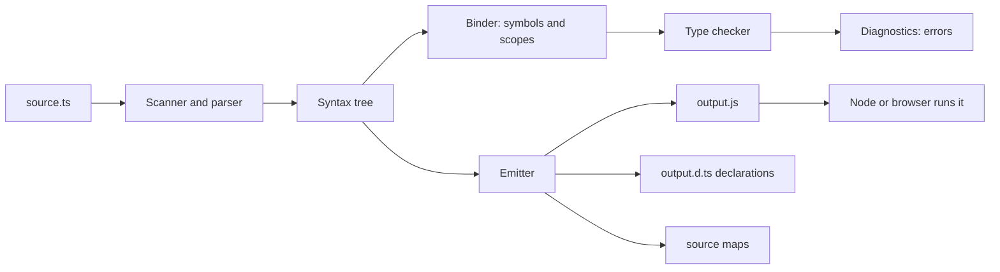

# From JavaScript to TypeScript

> **Before this lesson:** you should be able to read basic JavaScript: variables, functions, objects and arrays (see the JavaScript track). No TypeScript knowledge is assumed. This is the first lesson of the track.

## In plain words

**JavaScript** is the programming language that runs in every web browser and, through a program called Node.js, on servers too. **TypeScript** is JavaScript with one addition: you can write down what *kind* of value each variable, function input and function output is supposed to be (a number, a piece of text, an object with certain fields), and a tool checks, before the program runs, that the rest of your code agrees. The kind of a value is called its **type**.

Think of a spell-checker in a word processor. It does not write the letter for you and it does not change what the letter says. It reads what you typed and underlines mistakes while you are still typing, so they never reach the person you send it to. TypeScript underlines programming mistakes ("this function needs a number and you gave it text") while you are still typing, so they never reach your users. When you are finished, the underlines and notes are stripped away and what remains is ordinary JavaScript.

Why it matters for a job: most professional JavaScript projects are now written in TypeScript. Job adverts for front-end, back-end and full-stack roles list it routinely, and interviewers expect you to explain what it does and, equally important, what it does not do.

## Why this lesson exists

JavaScript was designed in a hurry for small scripts on web pages, and it grew into the language that runs banks, editors, games and servers. The properties that made it pleasant for twenty-line scripts (no declarations of intent, values that silently convert, objects you can reshape at any moment) are the same properties that hurt in a two-hundred-thousand-line code base. TypeScript is the most widely adopted answer to that problem. Before learning any syntax it pays to understand exactly **what TypeScript adds, what it deliberately does not add, and what happens to your code between the editor and the runtime**. Almost every confusing TypeScript moment later ("why did this crash, the types said it was fine?") traces back to a fuzzy picture of this lesson.

By the end you should be able to:

- explain the three costs of plain JavaScript that TypeScript targets;
- name the four pieces that the word "TypeScript" covers;
- describe type erasure and predict what the emitted JavaScript looks like;
- install the compiler, run it, and read an error message;
- state clearly what TypeScript cannot do for you.

## The trade-off JavaScript makes

JavaScript never asks you to promise anything. A function does not say what it accepts, a variable does not say what it holds, and an object does not say which properties it has. The engine only discovers a mistake at the moment the faulty line executes.

```js-run
function labelFor(product) {
  // Nothing here says what "product" must look like.
  return product.name.toUpperCase() + " (" + product.price.toFixed(2) + ")";
}

console.log(labelFor({ name: "kettle", price: 24.5 }));

try {
  // A typo in a property name: "nmae" instead of "name".
  console.log(labelFor({ nmae: "toaster", price: 31 }));
} catch (err) {
  console.log("Runtime crash:", err.message);
}
```

Line by line: `function labelFor(product)` defines a function with one input; the `return` line reads two fields of that input, `name` and `price`, and glues them into a piece of text. The first `console.log` prints the result for a correct object. The `try { ... } catch (err) { ... }` block runs the second call and, if it fails, prints the failure message so the page keeps going.

Run it. The first call works, the second fails with a message about reading a property of `undefined`. (`undefined` is the value JavaScript hands back when you ask an object for a field it does not have.) Three things are worth noticing.

1. **The error appears far from the cause.** The typo is in the call, the crash is inside the function.
2. **The error appears late.** Only when that exact call runs. If it sits in a rarely used branch (an error handler, a February-29th code path), it may ship.
3. **Nothing in the function documents its contract.** A new teammate has to read the body to learn what a "product" is.

Teams compensate with comments, with JSDoc, with unit tests whose only purpose is to check shapes, and with a lot of careful reading. Those all work, but none of them is checked by a machine on every keystroke.

### Weak tooling is a consequence, not an accident

An *editor* is the program you write code in; *tooling* is the collective word for the helpers around it (autocomplete, rename, jump to a definition). Because the language makes no promises, editors can only guess. Ask a plain JavaScript editor to rename the `price` property everywhere and it cannot know which `price` identifiers refer to your product and which belong to an unrelated object. Ask it to list the methods available on `product` inside `labelFor` and it has nothing to go on. Languages with a static type system (Java, C#, Rust, Go) have always had precise rename, jump-to-definition and autocomplete, because the compiler knows what every expression is.

## What TypeScript actually is

People say "TypeScript" and mean four different things. Keeping them apart makes the documentation much easier to read.

| Piece | What it is | Where you meet it |
|---|---|---|
| The language | JavaScript syntax plus syntax for describing types | `.ts` and `.tsx` files |
| The type checker | A program that reads your code, works out the type of every expression and reports contradictions | red squiggles, `tsc` output |
| The compiler | A program that runs the checker and then writes out plain JavaScript | the `tsc` command |
| The language service | A program that answers editor questions: "what is under my cursor?", "what can I type here?", "rename this" | VS Code, WebStorm, Neovim LSP |

The key design decision is in the first row: **TypeScript is a superset of JavaScript**. Every valid JavaScript program is already a syntactically valid TypeScript program. You are not learning a different language with a similar look; you are learning a layer of annotations and checks over the language you already use. That is why migration can be gradual, and why JavaScript knowledge transfers completely.

```typescript
// Plain JavaScript: also perfectly good TypeScript.
const greeting = "ahoy";

// TypeScript-only syntax: a type annotation after a colon.
function shout(text: string): string {
  return text.toUpperCase() + "!";
}

shout(greeting);     // fine
shout(42);
// Error: Argument of type 'number' is not assignable to parameter of type 'string'.
```

Reading the function line piece by piece: `text: string` says the input named `text` must be a string (a piece of text); the `: string` after the closing parenthesis says the function gives back a string. A note like `: string` is called a **type annotation**. A function's input is called a **parameter**, and the value supplied for it in a call is an **argument**.

The annotation `text: string` is a promise about the parameter. The checker then verifies every call against it, without running anything. That is why `shout(42)` is reported: 42 is a number, and the promise was a string.

## The compile pipeline

To **compile** means to translate source code from one form into another. The program that does it is a **compiler**. Browsers and Node.js run JavaScript (recent Node versions can strip simple type syntax by themselves, but they still do no checking). So a TypeScript file goes through a pipeline before anything executes.



Two arrows deserve attention.

- The checker produces **diagnostics**. They are messages for humans and CI systems. They are not exceptions.
- The emitter works from the syntax tree, **not** from the checker's verdict. By default `tsc` writes JavaScript even when it has reported type errors. A type error is the compiler saying "I cannot prove this is safe", not "I refuse to translate this".

> [!WARNING]
> With default settings a file full of type errors still produces a `.js` file. If you want a failed check to stop the build, switch on `noEmitOnError` in `tsconfig.json`, or run `tsc --noEmit` as a separate CI step before bundling.

### Type erasure

What does the emitter do with the annotations? It deletes them. This is called **type erasure**, and it is the single most important fact in this track.

```typescript
interface Parcel {
  id: number;
  fragile: boolean;
}

function describe(parcel: Parcel): string {
  const note = parcel.fragile ? "handle with care" : "standard";
  return `#${parcel.id}: ${note}`;
}
```

Compiled with a modern target, the output is:

```javascript
function describe(parcel) {
  const note = parcel.fragile ? "handle with care" : "standard";
  return `#${parcel.id}: ${note}`;
}
```

The `interface` vanished entirely. The parameter and return annotations vanished. What is left is the JavaScript you would have written by hand. You can verify that the runtime has no memory of `Parcel`:

```js-run
// This is the emitted JavaScript. No trace of the interface remains.
function describe(parcel) {
  const note = parcel.fragile ? "handle with care" : "standard";
  return `#${parcel.id}: ${note}`;
}

console.log(describe({ id: 7, fragile: true }));

// At runtime nothing stops a caller that bypassed the checker:
console.log(describe({ id: "seven" }));   // no error, only odd output
console.log(typeof Parcel);               // "undefined": the type never existed here
```

Consequences of erasure, each of which becomes a later lesson:

- You cannot write `if (value instanceof Parcel)` for an interface, because there is no `Parcel` value. You narrow with `typeof`, `in`, discriminant properties or hand-written type guards.
- Data arriving from outside the program (HTTP responses, `JSON.parse`, `localStorage`, environment variables, form fields) is **not** checked merely because you gave it a type. A type annotation on external data is a claim, not a verification. Runtime validation is its own topic in the "real projects" module.
- Types cost nothing at runtime. No wrappers, no reflection data, no slowdown.

> [!INTERVIEW]
> "Does TypeScript make code faster or slower at runtime?" Neither. Types are removed during compilation, so the emitted JavaScript performs like hand-written JavaScript. The only output differences come from *down-levelling* syntax to an older `target` (for example turning `async` functions into generator-based helpers) and from the few TypeScript constructs that do emit code, such as `enum`.

### Down-levelling

The second job of the emitter is optional: rewriting newer JavaScript syntax for older engines. The `target` compiler option chooses the language version of the output. With `target: "ES5"` a template literal becomes string concatenation and `const` becomes `var`; with `target: "ES2022"` they are left alone. Today many projects let a bundler (esbuild, SWC, Vite, Babel) do the stripping and down-levelling because those tools are faster, and keep `tsc --noEmit` purely as the checker. The pipeline diagram still describes what happens; it is split across two tools.

## Getting a compiler onto your machine

The official playground at `typescriptlang.org/play` is the fastest way to experiment: code on the left, emitted JavaScript and errors on the right. For real work, install the compiler per project so every teammate and the CI server use the same version.

```bash
mkdir parcel-tracker && cd parcel-tracker
npm init -y
npm install --save-dev typescript
npx tsc --init          # writes a tsconfig.json with commented defaults
```

The four commands: make a folder and enter it; `npm init -y` creates `package.json`, the file that lists a project's dependencies (`npm` is the package manager installed with Node.js); the third downloads the TypeScript compiler into the project; the fourth creates a settings file, covered in the [Configuration](#/lesson/typescript/tsconfig) lesson.

Create `src/index.ts`:

```typescript
const weights = [2.5, 0.8, 11];

function heaviest(values: number[]): number {
  return Math.max(...values);
}

console.log(heaviest(weights).toFixed(1));
console.log(heaviest("2.5, 0.8"));
```

Then run the compiler:

```bash
npx tsc
```

```text
src/index.ts:8:22 - error TS2345: Argument of type 'string' is not assignable
to parameter of type 'number[]'.

8 console.log(heaviest("2.5, 0.8"));
                       ~~~~~~~~~~

Found 1 error in src/index.ts:8
```

### Reading a diagnostic

Every message has the same anatomy, and learning to read it saves hours.

| Part | Example | Meaning |
|---|---|---|
| Location | `src/index.ts:8:22` | file, line, column |
| Code | `TS2345` | stable identifier; searchable |
| Message | `Argument of type 'string' is not assignable to parameter of type 'number[]'` | *what you gave* versus *what was expected* |
| Underline | `~~~~~~~~~~` | the exact expression at fault |

The phrase **"is not assignable to"** is the heart of the type system. Nearly every error is some form of "a value of type A is being put where type B is required, and A does not fit into B". Long errors on object types are the same sentence repeated at increasing depth: the outer line names the two big types, each indented line zooms in on the property that failed.

> [!TIP]
> Read long errors from the bottom up. The last indented line usually names the precise property and the two primitive types that disagree; the lines above only explain how the checker got there.

### What the same bug looks like without the checker

```js-run
function heaviest(values) {
  return Math.max(...values);
}

// Spreading a string passes each character as an argument.
console.log(heaviest("2.5, 0.8"));  // NaN, because "." and "," are not numbers
console.log(heaviest([2.5, 0.8, 11]));
```

No exception at all, only a `NaN` flowing silently into whatever comes next. This is the category of bug that type checking removes most reliably: not dramatic crashes, but wrong values that travel.

## Inference: TypeScript without annotations

A frequent worry is that typed code is verbose. In practice most local variables need no annotation, because the checker **infers** types from initial values. To *infer* is to work something out from evidence: `let total = 0` starts as a number, so the checker concludes that `total` is a number without being told.

```typescript
let total = 0;                 // inferred: number
const crew = ["Mina", "Otto"]; // inferred: string[]
const first = crew[0];         // inferred: string

total = "none";
// Error: Type 'string' is not assignable to type 'number'.

first.toFixed(2);
// Error: Property 'toFixed' does not exist on type 'string'.
```

The checker also knows the entire standard library, so method names are verified too:

```typescript
const title = "deck log";
title.toUppercase();
// Error: Property 'toUppercase' does not exist on type 'string'.
// Did you mean 'toUpperCase'?
```

A good working rule: **annotate the boundaries (function parameters, exported functions, data from outside), let inference handle the inside**.

## TypeScript's checks in JavaScript files

You do not even need `.ts` files to benefit. With `allowJs` and `checkJs` in the configuration, or a `// @ts-check` comment at the top of a file, the checker reads **JSDoc comments** as type annotations.

```javascript
// @ts-check

/**
 * @param {string} text
 * @param {number} times
 * @returns {string}
 */
function echo(text, times) {
  return Array(times).fill(text).join(" ");
}

echo("land", "3");
// Error: Argument of type 'string' is not assignable to parameter of type 'number'.
```

This matters for this course in a practical way: the coding problems are written as JavaScript with JSDoc annotations, because the in-browser runner executes JavaScript. Everything you learn about types applies to them unchanged; only the spelling moves into comments.

```js-run
/**
 * @param {string} text
 * @param {number} times
 * @returns {string}
 */
function echo(text, times) {
  return Array(times).fill(text).join(" ");
}

console.log(echo("land", 3));
// At runtime the JSDoc is only a comment, so a bad call is not stopped.
// Array("3") is a one-element array holding "3", so the result is quietly wrong:
console.log(echo("land", "3"));
```

## What TypeScript is not

Clear expectations prevent disappointment.

**It is not a guarantee of correct programs.** The checker proves that types line up. It cannot know that you meant `<=` and wrote `<`, or that the discount should apply before tax. Tests are still needed; they no longer have to cover "what if someone passes a string here".

**It is not sound.** Soundness would mean: if the checker is happy, a type error can never happen at runtime. TypeScript deliberately trades some soundness for convenience. The escape hatches (`any`, type assertions with `as`, the non-null `!` operator, unchecked index access, bivariant method parameters) let wrong claims through. Learning where the holes are is part of becoming fluent.

**It is not a runtime.** There is no "TypeScript engine". There is no runtime type information, no automatic validation of input, no checked casts.

**It does not change how JavaScript behaves.** `==` still coerces, `this` still depends on the call site, floating point is still floating point, `typeof null` is still `"object"`. TypeScript describes JavaScript's behaviour; it does not replace it.

```js-run
// TypeScript changes none of these results.
console.log(0.1 + 0.2);            // 0.30000000000000004
console.log(typeof null);          // "object"
console.log([10, 9, 1].sort());    // [1, 10, 9]: default sort compares as strings
console.log("5" * "4");            // 20
```

**It is not frozen.** A new minor version arrives roughly every three months. New versions add checks, so upgrading can surface new errors in existing code. Pin the version in `package.json` and upgrade on purpose.

**It does not force a style.** Classes or functions, objects or modules, semicolons or none: the compiler has no opinion. Style belongs to formatters and linters.

## A complete small example

To tie the pieces together, here is a short typed module and the mistakes the checker reports before a single line runs.

```typescript
type Reading = { station: string; celsius: number };

function warmest(readings: Reading[]): Reading | undefined {
  let best: Reading | undefined;
  for (const r of readings) {
    if (best === undefined || r.celsius > best.celsius) best = r;
  }
  return best;
}

const log: Reading[] = [
  { station: "North Pier", celsius: 11.2 },
  { station: "Old Lighthouse", celsius: 14.9 },
];

const top = warmest(log);
console.log(top.station);
// Error: 'top' is possibly 'undefined'.

console.log(top?.station ?? "no data");   // accepted

warmest([{ station: "Reef", celsuis: 20 }]);
// Error: Object literal may only specify known properties,
// but 'celsuis' does not exist in type 'Reading'. Did you mean to write 'celsius'?
```

Two real bugs (forgetting the empty-list case, a misspelt property) were caught at edit time. The emitted JavaScript behaves like this:

```js-run
function warmest(readings) {
  let best;
  for (const r of readings) {
    if (best === undefined || r.celsius > best.celsius) best = r;
  }
  return best;
}

const log = [
  { station: "North Pier", celsius: 11.2 },
  { station: "Old Lighthouse", celsius: 14.9 },
];

console.log(warmest(log)?.station ?? "no data");
console.log(warmest([])?.station ?? "no data");
```

## Pitfalls

- **Assuming a type annotation validates data.** `const user = JSON.parse(text) as User` checks nothing. If the text is wrong, the program is wrong, and the checker stays silent.
- **Assuming errors block output.** They do not unless `noEmitOnError` is set. A green deploy does not imply a clean type check unless your pipeline runs the checker.
- **Looking for types at runtime.** `typeof value === "Parcel"` can never be true. Interfaces and type aliases have no runtime form.
- **Fighting inference.** Annotating every local (`const n: number = 5`) adds noise and sometimes *widens* a type you wanted narrow. Annotate boundaries.
- **Installing TypeScript globally.** A global `tsc` drifts away from the version the project expects. Use `npx tsc` or a `package.json` script.
- **Treating `any` as a fix.** `any` is a special type meaning "do not check this" (next lesson). It silences the checker for that value and everything computed from it. It is a debt, not a solution.

## Cheat sheet

| Question | Answer |
|---|---|
| Is every JS file valid TS syntax? | Yes, TypeScript is a syntactic superset |
| Do types exist at runtime? | No, they are erased (enums and a few other constructs emit code) |
| Does a type error stop compilation? | Not by default; use `noEmitOnError` or `tsc --noEmit` in CI |
| Install | `npm i -D typescript` then `npx tsc --init` |
| Check without emitting | `npx tsc --noEmit` |
| Check a JS file | `// @ts-check` plus JSDoc, or `checkJs: true` |
| Output language level | `target` in `tsconfig.json` |
| Core error phrase | "Type A is not assignable to type B" |
| File extensions | `.ts`, `.tsx` (JSX), `.d.ts` (declarations only), `.mts` / `.cts` (ESM / CommonJS) |

## Summary

TypeScript is JavaScript plus a static description of what values look like, checked by a program before the code runs. The word covers a language, a checker, a compiler and an editor service. The compiler parses your file, the checker reports contradictions as diagnostics, and the emitter writes ordinary JavaScript with every type removed. Because of that erasure, types are free at runtime and also absent at runtime: they cannot validate outside data and cannot be inspected by running code. The payoff is early, precise feedback (errors at the call site, at edit time), machine-checked documentation, and reliable tooling. The limits are equally important: no proof of business logic, deliberate unsoundness around escape hatches, and no change at all to JavaScript's own semantics.

## Glossary

- **JavaScript:** the programming language run by browsers and Node.js.
- **TypeScript:** JavaScript plus syntax for describing types, checked before the program runs.
- **Type:** the kind of a value (number, string, an object with certain fields) and what may be done with it.
- **Type annotation:** a note in the code, such as `: string`, stating the type of something.
- **Parameter / argument:** a function's named input, and the actual value passed for it in a call.
- **Type checker:** the program that reads code and reports places where types contradict each other.
- **Compiler (`tsc`):** the program that runs the checker and writes out JavaScript.
- **Compile time / runtime:** the moment code is checked and translated, versus the moment it executes.
- **Emit:** to write output files.
- **Type erasure:** removal of all type syntax from the output, so that no types exist at runtime.
- **Diagnostic:** an error or warning message produced by the checker.
- **Inference:** the checker working out a type from context without an annotation.
- **Superset:** a language that contains another language entirely; every JavaScript program is a TypeScript program.
- **Down-levelling:** rewriting new syntax into older syntax for old engines.
- **Language service:** the part of TypeScript that powers editor features.
- **JSDoc:** documentation comments starting with `/**` that can carry type information in JavaScript files.
- **Sound:** a type system is sound if code that passes the checker can never hit a type error at runtime; TypeScript is deliberately not fully sound.

```quiz
[
  {"q": "A project compiles with `tsc` using default options and the checker reports two type errors. What is written to disk?",
   "options": ["Nothing, compilation aborts", "JavaScript files are still emitted", "Only declaration files are emitted", "JavaScript with runtime checks inserted where the errors were"],
   "answer": 1,
   "explain": "Diagnostics and emit are independent by default. Only `noEmitOnError` (or `--noEmit`) changes that."},
  {"q": "Does this compile? `let count = 3; count = \"three\";`",
   "options": ["Yes, `let` variables can hold anything", "No: Type 'string' is not assignable to type 'number'", "Yes, but with a warning", "No: count must be annotated first"],
   "answer": 1,
   "explain": "The initial value makes the inferred type `number`. Later assignments are checked against that inferred type."},
  {"q": "What does `typeof Parcel` evaluate to at runtime if `Parcel` was declared as an `interface`?",
   "options": ["\"object\"", "\"interface\"", "\"undefined\"", "It throws a TypeError"],
   "answer": 2,
   "explain": "Interfaces are erased. There is no binding called Parcel in the emitted JavaScript, and `typeof` on an undeclared identifier yields \"undefined\" without throwing."},
  {"q": "Which statement about performance is accurate?",
   "options": ["Typed code runs faster because the engine can use the annotations", "Typed code runs slower because types are checked on every call", "Emitted code performs like equivalent hand-written JavaScript because annotations are removed", "Performance depends on how many interfaces are declared"],
   "answer": 2,
   "explain": "Type erasure means the engine never sees an annotation. Only down-levelling and constructs such as enums affect the output."},
  {"q": "What is the inferred type of `first` in `const crew = [\"Mina\", \"Otto\"]; const first = crew[0];` (default options)?",
   "options": ["`any`", "`string`", "`\"Mina\"`", "`string | undefined`"],
   "answer": 1,
   "explain": "`crew` is inferred as `string[]`, and indexing gives `string`. It only becomes `string | undefined` if the `noUncheckedIndexedAccess` option is enabled."},
  {"q": "`const settings = JSON.parse(raw) as Settings;` What has been verified about `settings`?",
   "options": ["That it has every property of Settings", "That it is an object", "Nothing: the assertion is a compile-time claim only", "That raw was valid for the Settings schema"],
   "answer": 2,
   "explain": "`JSON.parse` returns `any`, and `as` performs no runtime work. Shape checking of external data needs explicit validation code."},
  {"q": "Which of these is NOT something TypeScript changes?",
   "options": ["Whether a misspelt method name is reported before running", "How `==` coerces its operands at runtime", "Whether an editor can rename a property safely", "Whether a wrong argument type is reported at the call site"],
   "answer": 1,
   "explain": "Runtime semantics are JavaScript's. TypeScript only describes and checks them."},
  {"q": "How can a plain `.js` file get type checking without being renamed?",
   "options": ["It cannot", "Add `// @ts-check` and describe types with JSDoc comments", "Add `\"use types\"` at the top", "Run it with `node --types`"],
   "answer": 1,
   "explain": "The checker understands JSDoc annotations in JavaScript files when `// @ts-check` or the `checkJs` option is on."}
]
```

> **Source:** Goldberg, *Learning TypeScript*, ch. 1 (From JavaScript to TypeScript). Handbook: https://www.typescriptlang.org/docs/handbook/typescript-from-scratch.html · https://www.typescriptlang.org/docs/handbook/2/basic-types.html · https://www.typescriptlang.org/docs/handbook/intro-to-js-ts.html
