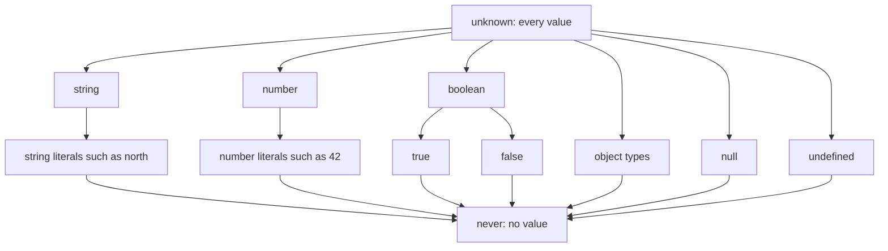

# The type system: types, inference and assignability

> **Before this lesson:** read [From JavaScript to TypeScript](#/lesson/typescript/js-to-ts) first; it explains what the checker is and that types are removed before the program runs.

## In plain words

A **type system** is the set of rules a language uses to decide which values may go where. This lesson explains TypeScript's rules from the ground up: what a type is, how the checker decides the type of something when you have not said, and how it decides whether a value is allowed in a particular place.

Think of the shaped holes in a child's sorting toy. Each hole accepts some blocks and rejects others. A round hole takes any round block, large or small; a star-shaped hole takes only stars. A type is a hole: a description of which values fit. The checker's whole job is to look at every place a value is put (into a variable, into a function, out of a function) and confirm that the block fits the hole.

Why it matters for a job: every TypeScript error message you will ever read is the checker saying "this block does not fit that hole". Once the model in this lesson is clear, those messages stop being noise and become precise directions to the mistake.

## Motivation

"Type" is one of those words everybody uses and few people define. If you treat a type as a vague label ("it's a string thing"), TypeScript's error messages feel arbitrary. If you treat a type as what it really is, **a set of possible values together with the operations that are safe on every member of that set**, the messages become predictable, and you can usually guess what the checker will say before it says it.

This lesson builds that mental model. It covers the primitive types, how the checker decides the type of a variable when you say nothing (inference), what "assignable" means, when to write an annotation and when not to, how object shapes are checked, and how files become modules.

## A type is a set of values

Think of every type as a bag of values.

| Type | Values in the bag | Size |
|---|---|---|
| `boolean` | `true`, `false` | 2 |
| `number` | every IEEE-754 double, including `NaN` and `Infinity` | huge |
| `string` | every possible string | unbounded |
| `null` | `null` | 1 |
| `undefined` | `undefined` | 1 |
| `"north"` (a literal type) | only the string `"north"` | 1 |
| `never` | nothing at all | 0 |
| `unknown` | every value that can exist | everything |

Once types are sets, three ideas fall out for free.

- **Assignability is the subset relation.** A value of type A may be used where B is expected if every value in A is also in B. `"north"` fits into `string`, `string` does not fit into `"north"`.
- **A union `A | B` is set union.** `string | number` is the bag containing all strings and all numbers.
- **An intersection `A & B` is set intersection.** Values that are in both bags at once.



Read an arrow as "contains". `unknown` sits at the top because it contains everything; `never` sits at the bottom because it is contained in everything. Assignment is allowed **upwards** along the arrows (a narrow type into a wider one) and refused downwards.

## The primitives

A **primitive** is a simple value that is not an object and has no parts of its own: a number, a piece of text, true or false. JavaScript has seven primitive kinds of value, and TypeScript has a type name for each, written in lower case.

```typescript
let fathoms: number = 12.5;          // integers and decimals share one type
let vessel: string = "Marigold";
let anchored: boolean = false;
let nothing: null = null;
let unset: undefined = undefined;
let huge: bigint = 9007199254740993n;
let token: symbol = Symbol("berth");
```

> [!WARNING]
> `String`, `Number` and `Boolean` with capitals are the wrapper **object** types, almost never what you want. Write `string`, `number`, `boolean`. A lint rule (`@typescript-eslint/no-wrapper-object-types`) catches the mistake.

Each line declares a variable with `let`, gives it a type after the colon, and assigns a starting value. `bigint` is for whole numbers too large for `number` (written with an `n` at the end); `symbol` is a guaranteed-unique token, rarely needed in everyday code.

The runtime's own `typeof` operator reports these kinds, with one famous irregularity:

```js-run
const samples = [12.5, "Marigold", false, null, undefined, 9007199254740993n, Symbol("berth"), {}, [], () => 1];
for (const s of samples) {
  console.log(String(typeof s).padEnd(10), "<-", typeof s === "symbol" ? s.toString() : String(s));
}
// Note: null reports "object", and arrays report "object" too.
```

## Inference: how the checker names a type for you

When a declaration has an initial value, the checker reads the value and picks a type. Recall that `let` declares a variable that may be given a new value later, and `const` one that may not. The inference rule differs between them, and the difference is worth memorising.

```typescript
let port = "Calder";        // type: string
const home = "Calder";      // type: "Calder"

let depth = 30;             // type: number
const keel = 30;            // type: 30
```

A **literal** is a value written out directly in the code, such as `"Calder"` or `30`. A `let` may be reassigned later, so the checker **widens** the literal to its general primitive. A `const` can never change, so the checker keeps the most precise description available: the literal type. Hover over a variable in your editor (or use the playground) to see what was inferred.

Inference follows expressions all the way through:

```typescript
const price = 19.99;                  // 19.99
const quantity = 3;                   // 3
const total = price * quantity;       // number   (arithmetic yields number)
const label = `Total: ${total}`;      // string
const cheap = total < 50;             // boolean
const pick = cheap ? "bus" : 42;      // "bus" | 42
const lengths = ["a", "bcd"].map((w) => w.length);   // number[]
```

Notice the last line: the callback parameter `w` has no annotation, yet the checker knows it is a `string` because of where the function is used. That is **contextual typing**, inference flowing from the outside in.

## Two kinds of errors

The compiler can complain for two unrelated reasons, and they have different consequences.

**Syntax errors** mean the parser could not understand the text. The checker may still try to emit JavaScript, but the output is probably not what you intended.

```typescript
let cargo = ;
// Error: Expression expected.
```

**Type errors** mean the text is perfectly well formed but the checker found a contradiction between what a value is and how it is used. JavaScript output is still produced.

```typescript
const mast = "spruce";
mast.length();
// Error: This expression is not callable.
//   Type 'Number' has no call signatures.
```

The emitted file for the second example would run and throw `mast.length is not a function`, which is exactly the crash the checker predicted:

```js-run
const mast = "spruce";
try {
  mast.length();
} catch (err) {
  console.log(err.constructor.name + ":", err.message);
}
```

## Assignability

Every time a value moves into a slot (a variable, a parameter, a property, a return position), the checker asks one question: **is the type of the value assignable to the type of the slot?** "Assignable" is the checker's word for "fits".

```typescript
let harbour: string;
harbour = "Vellmar";       // ok: string literal into string
harbour = 404;
// Error: Type 'number' is not assignable to type 'string'.

let onlyNorth: "north" = "north";
let anyDirection: string = onlyNorth;   // ok: narrow into wide
onlyNorth = anyDirection;
// Error: Type 'string' is not assignable to type '"north"'.
```

The last error surprises newcomers: at that moment `anyDirection` really does hold `"north"`. But the checker reasons about **declared types**, not about the value that happens to be present. A `string` slot could hold anything, so it cannot be poured into a `"north"` slot.

### Declared type versus current type

A variable has one declared type for its whole life. Assignments must respect it. What the checker tracks in addition is a *narrowed* view after assignments and checks, which the next lesson explores in depth.

```typescript
let reading: number | string;
reading = 7;
reading.toFixed(1);     // ok: right now the checker knows it is a number
reading = "seven";
reading.toUpperCase();  // ok: now it knows it is a string
reading = true;
// Error: Type 'boolean' is not assignable to type 'string | number'.
```

## Annotations

An annotation is a colon and a type after a name. It tells the checker "do not infer; this is the declared type".

```typescript
let nextPort: string;         // no initial value: annotation supplies the type
nextPort = "Brindle Bay";
```

### What happens with no initial value and no annotation

```typescript
let cargo;            // implicitly: any (an "evolving any")
cargo = "tea";
cargo.toUpperCase();  // ok: checker follows the latest assignment
cargo = 800;
cargo.toFixed();      // ok
cargo.toUpperCase();
// Error: Property 'toUpperCase' does not exist on type 'number'.
```

A bare `let` with no initialiser is the one place where a variable's type is allowed to drift. The checker tracks the most recent assignment, but the variable accepts anything, so the protection is weak. Give such variables an annotation, or better, initialise them where they are declared.

### When an annotation is noise

```typescript
const knots: number = 14;          // redundant: inference already says number
let captain: string = "Idris";     // redundant
```

Redundant annotations are not wrong, but they must be kept in sync by hand, and they can make a `const` *less* precise (`number` instead of `14`). Prefer inference for locals with initial values.

### When an annotation earns its place

| Situation | Why annotate |
|---|---|
| Function parameters | The checker cannot infer them from the body; without an annotation they are `any` (an error under `noImplicitAny`) |
| Variables declared without a value | Otherwise they are an evolving `any` |
| Empty arrays and objects that will be filled later | `[]` alone gives no element type |
| Exported functions' return types | Documents the contract, speeds up checking, stops accidental changes |
| A wider type than the initial value implies | `let status: "idle" \| "busy" = "idle"` |
| Checking an object literal against an intended shape | Errors appear at the literal, not at a distant use |

> [!TIP]
> An annotation moves the error to where the mistake is. Without `: Reading` on an object literal, a typo in a property is reported at the first function call that receives it, possibly files away. With the annotation, the typo is underlined in place.

## The `any` type: opting out

`any` is the type that switches the checker off. Anything is assignable to `any`, and `any` is assignable to anything (except `never`). Every property access, call and operation on it is allowed and produces more `any`.

```typescript
let loose: any = "driftwood";
loose.sink().quickly;      // no error at compile time
const n: number = loose;   // no error either
```

```js-run
let loose = "driftwood";
try {
  loose.sink().quickly;
} catch (err) {
  console.log("The checker was silent, the runtime was not:", err.message);
}
```

`any` is contagious. One `any` returned from a helper spreads into every expression computed from it. Its safer sibling `unknown` (accepts everything, allows nothing until narrowed) is covered in the type modifiers lesson. For now: reach for `any` only as a short-lived migration tool.

## Object shapes

An object is a value made of named parts called **properties**. For objects, the checker records the **shape**: which property names exist and the type of each.

```typescript
const buoy = {
  id: 14,
  colour: "red",
  lit: true,
};
// inferred type: { id: number; colour: string; lit: boolean }

buoy.colour = "green";     // ok
buoy.colour = 3;
// Error: Type 'number' is not assignable to type 'string'.

buoy.position;
// Error: Property 'position' does not exist on type
// '{ id: number; colour: string; lit: boolean; }'.
```

Note that property values widen (`colour` is `string`, not `"red"`) even though `buoy` is a `const`, because `const` only fixes the binding; the properties can still be reassigned.

The runtime, in contrast, shrugs at an unknown property:

```js-run
const buoy = { id: 14, colour: "red", lit: true };
console.log(buoy.position);              // undefined, no complaint
console.log(buoy.position?.latitude);    // still undefined thanks to ?.
try {
  console.log(buoy.position.latitude);   // the delayed crash
} catch (err) {
  console.log("crash:", err.message);
}
```

The checker turns the delayed crash into an immediate, located error.

## Modules and scripts

How does the checker know which names a file can see? It depends on whether the file is a **module** or a **script**.

- A file containing a top-level `import` or `export` is a module. Its declarations are private unless exported.
- A file with neither is a script. Its top-level declarations live in the **global scope**, shared with every other script in the project.

```typescript
// a.ts (a script: no import/export)
const flag = "blue";

// b.ts (also a script)
const flag = "white";
// Error: Cannot redeclare block-scoped variable 'flag'.
```

The fix is to make the files modules. If a file has nothing to export yet, an empty export does the job:

```typescript
// b.ts
const flag = "white";
export {};        // now this file is a module with its own scope
```

With modules, types travel through `import` and `export` exactly like values:

```typescript
// tides.ts
export type Tide = { height: number; rising: boolean };
export function describeTide(t: Tide): string {
  return `${t.height} m and ${t.rising ? "rising" : "falling"}`;
}

// main.ts
import { describeTide, type Tide } from "./tides";

const now: Tide = { height: 2.4, rising: true };
describeTide(now);
describeTide("high");
// Error: Argument of type 'string' is not assignable to parameter of type 'Tide'.
```

The `type` keyword inside the import marks a name that exists only at compile time, so the emitter knows it can delete that import completely. The setting `verbatimModuleSyntax` makes this explicit marking mandatory, which keeps single-file transpilers happy.

> [!INTERVIEW]
> "What is the difference between a type error and a runtime error?" A type error is reported by the checker before execution, based only on reading the code; the program may still be emitted and may or may not fail when run. A runtime error is thrown by the engine while executing. The goal of the type system is to turn as many of the second kind as possible into the first kind.

## Worked example: predicting the checker

Try to predict each verdict before reading the comment.

```typescript
let a = 5;              // number
const b = 5;            // 5
let c = b;              // number  (a let widens even when copied from a const)
const d = a;            // number  (a is number, so d is number)

let e = null;           // an evolving any under strict settings: annotate, e.g. string | null
let f: string = "x";
f = b.toString();       // ok: toString returns string
f = a;
// Error: Type 'number' is not assignable to type 'string'.

const g = [1, "two"];   // (string | number)[]
const h = g[0];         // string | number
h.toFixed();
// Error: Property 'toFixed' does not exist on type 'string | number'.
//   Property 'toFixed' does not exist on type 'string'.
```

The final error introduces the rule that drives the next lesson: on a union you may only use what **every** member supports.

```js-run
const g = [1, "two"];
for (const h of g) {
  // The safe version: check before you use.
  console.log(typeof h === "number" ? h.toFixed(1) : h.toUpperCase());
}
```

## Pitfalls

- **Expecting the checker to track values.** It tracks types. `let s: string = "north"` is a `string`, full stop.
- **Capital-letter primitives.** `String` is not `string`.
- **Leaving a `let` uninitialised and unannotated.** It becomes an evolving `any`.
- **Believing `const` freezes objects.** It freezes the binding only; property types still widen and properties can be reassigned.
- **Forgetting that script files share a global scope.** Add `export {}` or a real export.
- **Using `any` to quieten an error.** The error was information. Prefer fixing the type, or `unknown` plus a check.
- **Over-annotating.** If inference already produces the type you would write, leave it out.

## Cheat sheet

| Concept | Rule of thumb |
|---|---|
| Type | A set of values plus the operations valid on all of them |
| Assignable | Source set is a subset of target set |
| `let x = "a"` | Widened to `string` |
| `const x = "a"` | Literal type `"a"` |
| Property in an object literal | Widened, even on a `const` |
| Uninitialised `let x;` | Evolving `any`: annotate it |
| Parameter without annotation | Implicit `any`: always annotate |
| `any` | Disables checking, spreads silently |
| Syntax error | Text is malformed |
| Type error | Text is fine, usage contradicts the types |
| Module | File with a top-level `import` or `export`; has its own scope |
| Script | File without them; top-level names are global |
| Type-only import | `import { type T } from "./m"` or `import type { T } from "./m"` |

## Summary

A type is a set of values. The checker assigns a type to every expression, either from an annotation you wrote or by inference from initial values and context, and then verifies each place where a value flows into a slot by asking whether the value's type is a subset of the slot's type. `let` declarations widen literals, `const` declarations keep them. Annotations belong on parameters, on uninitialised variables and at exported boundaries; elsewhere inference usually does a better job. `any` removes all checking and spreads. Object types are described by their shape, and files become isolated modules as soon as they import or export something.

## Glossary

- **Type system:** the rules deciding which values are allowed where.
- **Type:** a set of possible values together with the operations valid on all of them.
- **Primitive:** a simple non-object value: string, number, boolean, null, undefined, bigint or symbol.
- **Literal:** a value written directly in code, such as `"north"` or `42`.
- **Literal type:** a type containing exactly one value.
- **Union type:** `A | B`, a type containing the values of both.
- **Intersection type:** `A & B`, a type containing only values that belong to both.
- **Inference:** the checker deducing a type from an initial value or from context.
- **Contextual typing:** inference from where an expression is used, such as a callback's parameter.
- **Widening:** replacing a literal type with its general primitive type for a mutable location.
- **Assignable:** type A is assignable to type B when every value of A is also a value of B.
- **Declared type:** the type fixed for a variable when it is declared.
- **Annotation:** a type written explicitly after a colon.
- **`any`:** a type that switches checking off for a value.
- **Shape:** the property names and property types of an object type.
- **Property:** a named part of an object.
- **Module:** a file with a top-level `import` or `export`; it has its own scope.
- **Script:** a file without them; its top-level names are shared globally.
- **Scope:** the region of code in which a name is visible.

```quiz
[
  {"q": "What is the inferred type of `d`? `let a = 5; const d = a;`",
   "options": ["`5`", "`number`", "`any`", "`number | undefined`"],
   "answer": 1,
   "explain": "`a` was declared with `let`, so its type is the widened `number`. `d` copies the type of the expression `a`, which is `number`; `const` cannot recover a literal that was already widened."},
  {"q": "Does this compile? `let onlyNorth: \"north\" = \"north\"; let dir: string = \"north\"; onlyNorth = dir;`",
   "options": ["Yes, the values are identical", "No: Type 'string' is not assignable to type '\"north\"'", "Yes, because both are strings", "No: dir must be const"],
   "answer": 1,
   "explain": "The checker compares declared types. `string` is a strictly larger set than the literal type `\"north\"`, so the assignment is refused regardless of the current value."},
  {"q": "What is the inferred type of `buoy.colour` in `const buoy = { id: 14, colour: \"red\" };`?",
   "options": ["`\"red\"`", "`string`", "`any`", "`string | undefined`"],
   "answer": 1,
   "explain": "Object literal properties are mutable, so their literal values are widened to the general primitive even when the variable itself is a `const`."},
  {"q": "A variable is declared as `let cargo;` with no value and no annotation. What is its type?",
   "options": ["`undefined` forever", "`unknown`", "an evolving `any` that follows later assignments", "`never`"],
   "answer": 2,
   "explain": "With no information to infer from, the variable is implicitly `any`; the checker tracks the most recent assignment but accepts any value."},
  {"q": "Two files each contain `const flag = ...` at the top level and no imports or exports. What happens?",
   "options": ["Nothing, files are always isolated", "Error: cannot redeclare block-scoped variable", "The second silently overwrites the first", "Only a runtime error"],
   "answer": 1,
   "explain": "Files without import/export are scripts and share one global scope, so the two declarations collide. Adding `export {}` makes a file a module."},
  {"q": "What is the inferred type of `g`? `const g = [1, \"two\"];`",
   "options": ["`[number, string]`", "`(string | number)[]`", "`any[]`", "`[1, \"two\"]`"],
   "answer": 1,
   "explain": "Array literals are inferred as arrays of the union of their element types, not as tuples, unless you add `as const` or annotate a tuple type."},
  {"q": "Which statement about `any` is true?",
   "options": ["Values of type any must be narrowed before use", "any is assignable to every type except never, and everything is assignable to any", "any is the same as unknown", "any only affects the variable it is written on"],
   "answer": 1,
   "explain": "`any` opts out in both directions and spreads to everything derived from it. `unknown` is the safe top type that requires narrowing."},
  {"q": "In the set model of types, what does `A` being assignable to `B` mean?",
   "options": ["A and B have the same name", "Every value of A is also a value of B", "Every value of B is also a value of A", "A and B share at least one value"],
   "answer": 1,
   "explain": "Assignability is the subset relation: the source type must be contained in the target type."}
]
```

> **Source:** Goldberg, *Learning TypeScript*, ch. 2 (The Type System). Handbook: https://www.typescriptlang.org/docs/handbook/2/everyday-types.html · https://www.typescriptlang.org/docs/handbook/2/modules.html · https://www.typescriptlang.org/docs/handbook/type-inference.html
