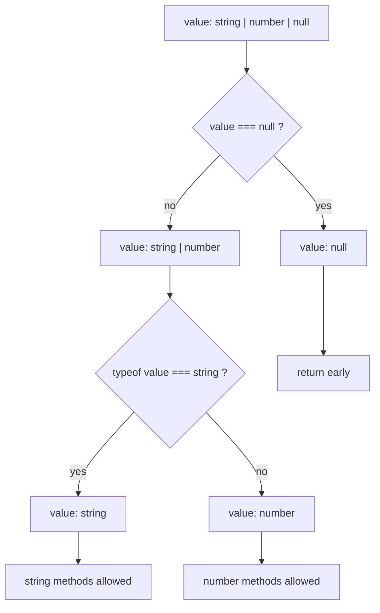

# Unions, literals and narrowing

> **Before this lesson:** you need the set model of types, literal types and assignability from [The type system](#/lesson/typescript/type-system).

## In plain words

Often a value can be one of several kinds. A form field may hold a number or be empty; a search may find a result or nothing. A **union type** is how you tell TypeScript "this is one of these kinds". **Narrowing** is what happens when your code checks which kind it actually has: inside the `if`, the checker knows more than it did before.

Picture a triage desk at a clinic. Everyone arriving is "a patient", which tells the staff very little. The nurse asks a question or two, and after each answer the range of possibilities shrinks: "an adult with a sprain", say. Only then is treatment chosen. A union is the waiting room; each `if` check is a triage question; the narrowed type is what the staff know afterwards. Treating someone before asking is the mistake the checker refuses to let you make.

Why it matters for a job: "cannot read properties of undefined" is the most common crash in JavaScript programs. Unions together with strict null checking turn that crash into an error you see while typing. Narrowing is also the part of TypeScript you will use in nearly every function you write.

## Motivation

Real values are rarely "always a string". A search returns a match **or** nothing. A form field is a number **or** an empty string. An identifier arrives as a numeric id **or** a slug. JavaScript code handles these cases with `if` statements; the question is whether your type system can follow along. TypeScript's answer is a pair of ideas that work together:

- a **union type** says "one of these";
- **narrowing** is the checker reading your `if`, `typeof`, `===` and friends, and shrinking the union inside each branch.

Add **literal types** (a type containing exactly one value) and **strict null checking** (treating `null` and `undefined` as their own types rather than as invisible members of every type), and you have the toolkit behind most day-to-day TypeScript.

## Union types

A union is written with a vertical bar, read aloud as "or". Order does not matter. In the first line below, `berth` is declared to hold a number or a string; the next two assignments are therefore accepted and the third, a boolean (true or false), is rejected.

```typescript
let berth: number | string;
berth = 12;          // ok
berth = "C-12";      // ok
berth = false;
// Error: Type 'boolean' is not assignable to type 'string | number'.
```

Unions also appear by inference whenever an expression can produce more than one kind of value:

```typescript
const signal = Math.random() > 0.5 ? "flare" : undefined;
// inferred: "flare" | undefined

const crew = ["Asha", "Tobin", "Lior"];
const found = crew.find((name) => name.startsWith("T"));
// inferred: string | undefined   (find may come back empty-handed)
```

### What you may do with a union

Only operations that are valid for **every** member are allowed.

```typescript
function show(id: number | string) {
  id.toString();        // ok: both number and string have toString
  id.toUpperCase();
  // Error: Property 'toUpperCase' does not exist on type 'string | number'.
  //   Property 'toUpperCase' does not exist on type 'number'.
}
```

This is the set model at work. The value might be a number, numbers have no `toUpperCase`, therefore the call cannot be proven safe. A union is *wider* than its members and so offers *fewer* guaranteed operations. To do string things, you first have to convince the checker that the value is a string.

## Narrowing

Narrowing is the checker's analysis of control flow. At each point in a function it keeps a "current type" for every variable, starting from the declared type and shrinking it whenever your code rules possibilities out.



A check that causes narrowing is called a **type guard**. There are several built-in kinds.

### Narrowing by assignment

Assigning a value narrows the variable to the type of what was assigned, until the next assignment.

```typescript
let mooring: number | string;
mooring = "east quay";
mooring.toUpperCase();   // ok: currently string
mooring = 4;
mooring.toFixed(0);      // ok: currently number
```

An initial value counts too: `let x: number | string = "a"` starts life narrowed to `string`.

### Narrowing with `typeof`

```typescript
function pad(id: number | string): string {
  if (typeof id === "number") {
    return id.toFixed(0).padStart(6, "0");   // id: number
  }
  return id.trim().toUpperCase();            // id: string
}
```

Step by step: `typeof id === "number"` is an ordinary JavaScript test that is true when `id` is a number. Inside the braces the checker therefore treats `id` as `number`, which is why the number-only method `toFixed` is allowed. After the `if` returns, the checker knows the remaining code only runs when the test was false, so `id` is whatever is left of the union. The same works with `else`, with a ternary, with `!==`, and with `switch (typeof id)`.

```js-run
function pad(id) {
  if (typeof id === "number") {
    return id.toFixed(0).padStart(6, "0");
  }
  return id.trim().toUpperCase();
}
console.log(pad(418));
console.log(pad("  c-12 "));
```

### Narrowing with equality

Comparing against a specific value narrows to the members that could equal it.

```typescript
function tide(level: "low" | "high" | number) {
  if (level === "low") {
    level;      // "low"
  } else {
    level;      // number | "high"
  }
}
```

### Narrowing with truthiness

When a value that is not a boolean is used as a condition, JavaScript converts it: values that convert to false are called **falsy**, all others **truthy**. JavaScript treats `false`, `0`, `-0`, `0n`, `""`, `null`, `undefined` and `NaN` as falsy. Using a value as a condition removes the types that are *always* falsy from the true branch.

```typescript
function greet(name: string | undefined) {
  if (name) {
    name.toUpperCase();    // name: string
  } else {
    name;                  // string | undefined   (could be "" !)
  }
}
```

Look carefully at the `else` branch: it is **not** only `undefined`, because the empty string is falsy too. That detail is the source of a classic bug:

```js-run
function describeCount(count) {
  // Intent: "if a count was supplied". Bug: 0 is falsy.
  if (count) return "count is " + count;
  return "no count given";
}
console.log(describeCount(3));
console.log(describeCount(0));          // wrong branch!
console.log(describeCount(undefined));

function describeCountSafely(count) {
  if (count !== undefined) return "count is " + count;
  return "no count given";
}
console.log(describeCountSafely(0));    // correct
```

> [!WARNING]
> Truthiness narrowing is only safe for types that have no meaningful falsy value, typically objects, arrays and functions. For `number | undefined` or `string | null`, compare explicitly with `!== undefined` / `!== null`, or use `value != null` to rule out both at once.

### Other built-in guards

| Guard | Narrows to | Example |
|---|---|---|
| `typeof x === "string"` | the primitive named | also `"number"`, `"boolean"`, `"bigint"`, `"symbol"`, `"undefined"`, `"function"`, `"object"` |
| `x === value`, `x !== value` | members compatible with `value` | `status === "done"` |
| `x == null` | `null \| undefined` together | handy double check |
| truthiness | drops `null`, `undefined` and other always-falsy members | `if (x)` |
| `Array.isArray(x)` | array members | `string \| string[]` |
| `x instanceof C` | instances of class `C` | `err instanceof RangeError` |
| `"key" in x` | members that have the property | `"radius" in shape` |
| discriminant property | the member whose tag matches | `shape.kind === "circle"` |
| user-defined predicate | whatever the function promises | `isUser(x)` |

`typeof x === "object"` deserves a footnote: it is true for `null` as well, so narrowing `string | object | null` with it leaves `object | null`.

```js-run
function summarise(input) {
  if (input == null) return "nothing";              // null or undefined
  if (Array.isArray(input)) return "list of " + input.length;
  if (input instanceof Date) return "date in " + input.getFullYear();
  if (typeof input === "object") return "record with keys " + Object.keys(input).join(",");
  return typeof input + " " + String(input);
}
console.log(summarise(null));
console.log(summarise([4, 5]));
console.log(summarise(new Date(2031, 0, 1)));
console.log(summarise({ a: 1, b: 2 }));
console.log(summarise("shell"));
```

Order matters in that function: arrays and dates are objects too, so the more specific checks come first.

## Literal types

A literal type has exactly one inhabitant. You have already met them: a `const` initialised with a primitive gets one.

```typescript
const flagship = "Heron";      // type: "Heron"
let escort = "Heron";          // type: string
```

Their real use is inside unions, as a precise list of allowed values:

```typescript
let heading: "north" | "east" | "south" | "west";

heading = "east";     // ok
heading = "up";
// Error: Type '"up"' is not assignable to type '"north" | "east" | "south" | "west"'.

let dice: 1 | 2 | 3 | 4 | 5 | 6;
let toggle: true | "auto";       // literals of different primitives may be mixed
```

In fact `boolean` itself is nothing more than the union `true | false`.

### Literal assignability

A literal is assignable to its own primitive, never the other way round, and never to a different literal.

```typescript
let exact: "ok" = "ok";
let general: string = exact;    // ok
exact = general;
// Error: Type 'string' is not assignable to type '"ok"'.

let other: "fail" = exact;
// Error: Type '"ok"' is not assignable to type '"fail"'.
```

### The widening trap

```typescript
function steer(direction: "port" | "starboard") { /* ... */ }

let choice = "port";        // widened to string
steer(choice);
// Error: Argument of type 'string' is not assignable to
// parameter of type '"port" | "starboard"'.

const fixed = "port";       // "port"
steer(fixed);               // ok

let annotated: "port" | "starboard" = "port";
steer(annotated);           // ok
```

The same trap appears with object properties (`{ side: "port" }` has `side: string`). The cures are a `const`, an annotation, or `as const` on the literal, which the type modifiers lesson covers.

## Strict null checking

`null` and `undefined` are JavaScript's two values meaning "nothing here". Tony Hoare called the null reference his "billion-dollar mistake": in many languages every reference type secretly includes "or nothing", and the compiler does not make you check. TypeScript can behave that way too, but only if you turn `strictNullChecks` off. With it on (it is part of `strict`, and every new project should enable it), `null` and `undefined` are ordinary types that must be mentioned explicitly.

```typescript
// strictNullChecks: true
let pilot: string = null;
// Error: Type 'null' is not assignable to type 'string'.

let maybePilot: string | null = null;      // say what you mean
maybePilot.length;
// Error: 'maybePilot' is possibly 'null'.

if (maybePilot !== null) {
  maybePilot.length;                       // ok
}
```

With the option off, the first line compiles and the crash moves to production:

```js-run
let pilot = null;       // what "string" silently allowed without strictNullChecks
try {
  console.log(pilot.length);
} catch (err) {
  console.log("TypeError at runtime:", err.message);
}
```

### Tools for nullable values

| Tool | Meaning | Example |
|---|---|---|
| `x?.prop`, `x?.[i]`, `x?.()` | stop and yield `undefined` if `x` is null or undefined | `user?.address?.city` |
| `a ?? b` | `b` only when `a` is null or undefined | `port ?? 8080` |
| `a ??= b` | assign only when currently null or undefined | `cache ??= new Map()` |
| `x!` | assert "not null", unchecked | `input!.value` (avoid) |

`??` differs from `||` in exactly the cases truthiness got wrong earlier:

```js-run
const settings = { volume: 0, title: "", retries: null };

console.log(settings.volume || 50);    // 50  (0 was a deliberate choice, lost)
console.log(settings.volume ?? 50);    // 0
console.log(settings.title || "untitled");   // "untitled"
console.log(settings.title ?? "untitled");   // ""
console.log(settings.retries ?? 3);    // 3
console.log(settings.missing?.deep?.value ?? "fallback");
```

### Variables used before assignment

The checker also tracks whether a variable has definitely been given a value.

```typescript
let skipper: string;
skipper.length;
// Error: Variable 'skipper' is used before being assigned.

let mate: string | undefined;
mate?.length;     // ok: undefined is part of the declared type
```

## Type aliases

Unions get long. A **type alias** gives a type a name, introduced with the keyword `type`. By convention the name is written in PascalCase: each word capitalised, no separators.

```typescript
type Heading = "north" | "east" | "south" | "west";
type BerthId = number | string;
type MaybeBerth = BerthId | undefined;      // aliases can build on aliases

function turn(from: Heading, clockwise: boolean): Heading {
  const order: Heading[] = ["north", "east", "south", "west"];
  const step = clockwise ? 1 : 3;
  return order[(order.indexOf(from) + step) % 4];
}
```

Aliases are purely a compile-time convenience. They are erased, so they cannot be referenced as values:

```typescript
type Heading = "north" | "east" | "south" | "west";
console.log(Heading);
// Error: 'Heading' only refers to a type, but is being used as a value here.
```

When you need the list at runtime as well (to validate input, to build a menu), define the array first and derive the type from it, so there is one source of truth:

```typescript
const HEADINGS = ["north", "east", "south", "west"] as const;
type Heading = (typeof HEADINGS)[number];    // "north" | "east" | "south" | "west"

function isHeading(text: string): text is Heading {
  return (HEADINGS as readonly string[]).includes(text);
}
```

```js-run
const HEADINGS = ["north", "east", "south", "west"];
const isHeading = (text) => HEADINGS.includes(text);

function turn(from, clockwise) {
  const step = clockwise ? 1 : 3;
  return HEADINGS[(HEADINGS.indexOf(from) + step) % 4];
}

console.log(isHeading("east"), isHeading("up"));
console.log(turn("north", true), turn("north", false), turn("west", true));
```

## Worked example: a function that accepts messy input

```typescript
type RawAmount = number | string | null | undefined;

function toCents(raw: RawAmount): number | "invalid" {
  if (raw == null) return 0;                    // raw: null | undefined
  if (typeof raw === "number") {                // raw: number
    return Number.isFinite(raw) ? Math.round(raw * 100) : "invalid";
  }
  const cleaned = raw.replace(/[$,\s]/g, "");   // raw: string
  if (cleaned === "") return 0;
  const parsed = Number(cleaned);
  return Number.isNaN(parsed) ? "invalid" : Math.round(parsed * 100);
}

const result = toCents("$1,204.50");
result.toFixed();
// Error: Property 'toFixed' does not exist on type 'number | "invalid"'.

if (result !== "invalid") {
  result.toFixed();       // ok: narrowed to number
}
```

The return type forces every caller to deal with the failure case. That is the pattern: **put the awkward possibility in the type, and the checker makes sure nobody forgets it.**

```js-run
function toCents(raw) {
  if (raw == null) return 0;
  if (typeof raw === "number") {
    return Number.isFinite(raw) ? Math.round(raw * 100) : "invalid";
  }
  const cleaned = raw.replace(/[$,\s]/g, "");
  if (cleaned === "") return 0;
  const parsed = Number(cleaned);
  return Number.isNaN(parsed) ? "invalid" : Math.round(parsed * 100);
}
for (const input of ["$1,204.50", 3.999, null, "", "twelve", Infinity]) {
  console.log(JSON.stringify(input), "->", toCents(input));
}
```

## Pitfalls

- **Truthiness on numbers and strings.** `0` and `""` are falsy. Use explicit comparisons.
- **`typeof null === "object"`.** Check for `null` before or alongside the object check.
- **Narrowing does not survive callbacks.** Inside a function created later, a `let` variable may have been reassigned, so the checker resets it to the declared type. Copy into a `const` first.
- **Narrowing does not survive function calls on properties of mutable objects** in every case; if you check `obj.value` and then call something that could change `obj`, keep a local copy.
- **Widening on `let`.** A string literal stored in a `let` is a `string` and no longer fits a literal union.
- **The `!` operator.** `value!` removes `null | undefined` with no check. It is an assertion you must be able to justify.
- **Aliases are not values.** Derive the type from a runtime array when you need both.
- **Switching `strictNullChecks` off** to "reduce errors" removes the most valuable check the compiler has.

## Cheat sheet

| Want | Write |
|---|---|
| One of several types | `A \| B` |
| A fixed set of strings | `"a" \| "b" \| "c"` |
| Possibly missing | `T \| undefined` (or an optional property / parameter) |
| Possibly null | `T \| null` |
| Rule out both null and undefined | `if (x != null)` |
| Default for null/undefined only | `x ?? fallback` |
| Safe property access | `x?.prop` |
| Name a type | `type Name = ...` |
| Runtime list plus type | `const LIST = [...] as const; type T = (typeof LIST)[number]` |
| See the narrowed type | hover in the editor at that line |

## Summary

A union type lists alternatives and permits only the operations common to all of them. Narrowing is the checker following your control flow: assignments, `typeof`, equality, truthiness, `Array.isArray`, `instanceof` and `in` each remove members from the union within the branch where the check holds. Literal types pin a value down to a single constant and, combined into unions, model finite sets of options. With `strictNullChecks`, absence must be declared (`| null`, `| undefined`) and handled before use, which converts the commonest runtime crash in JavaScript into a compile-time message. Type aliases name any of these types for reuse and vanish at runtime.

## Glossary

- **Union type:** `A | B`; a value that is one of several types.
- **Member (of a union):** one of the alternatives in a union.
- **Narrowing:** the checker reducing a union to fewer members after a runtime check.
- **Type guard:** an expression that causes narrowing, such as `typeof x === "string"`.
- **Control flow analysis:** the checker following `if`, `return`, `switch` and assignments to track current types.
- **Literal type:** a type with exactly one value, such as `"north"`.
- **Widening:** a literal type being replaced by its general primitive in a mutable location.
- **Truthy / falsy:** how a non-boolean value behaves when used as a condition.
- **`null` / `undefined`:** the two JavaScript values representing absence.
- **Strict null checking:** the compiler option that makes `null` and `undefined` separate types that must be handled.
- **Optional chaining (`?.`):** property access that yields `undefined` when the object is null or undefined.
- **Nullish coalescing (`??`):** an operator that supplies a fallback only for `null` and `undefined`.
- **Non-null assertion (`!`):** an unchecked claim that a value is not null or undefined.
- **Type alias:** a name given to a type with the `type` keyword.

```quiz
[
  {"q": "What is the inferred type of `found`? `const found = [\"Asha\", \"Tobin\"].find((n) => n.length > 4);`",
   "options": ["`string`", "`string | undefined`", "`string | null`", "`\"Tobin\"`"],
   "answer": 1,
   "explain": "`Array.prototype.find` is declared to return the element type or `undefined`, because there may be no match."},
  {"q": "Inside `function f(name: string | undefined) { if (name) { A } else { B } }`, what is the type of `name` at B?",
   "options": ["`undefined`", "`string | undefined`", "`never`", "`\"\"`"],
   "answer": 1,
   "explain": "The falsy branch still includes strings, because the empty string is falsy. Only the truthy branch narrows cleanly to `string`."},
  {"q": "Does this compile under `strictNullChecks`? `let pilot: string = null;`",
   "options": ["Yes", "No: Type 'null' is not assignable to type 'string'", "Yes, but pilot becomes any", "Only with let, not const"],
   "answer": 1,
   "explain": "With strict null checking, null is its own type and is not a member of `string`. Declare `string | null` instead."},
  {"q": "Does this compile? `function steer(d: \"port\" | \"starboard\") {} let choice = \"port\"; steer(choice);`",
   "options": ["Yes", "No: argument of type 'string' is not assignable", "Yes, because the value is correct", "No: choice must be annotated as any"],
   "answer": 1,
   "explain": "`let` widens the literal to `string`, and `string` is not assignable to the union of literals. Use `const`, an annotation, or `as const`."},
  {"q": "Which expression returns `0` when `volume` is `0`?",
   "options": ["`volume || 50`", "`volume ?? 50`", "`volume && 50`", "`!volume ? 50 : 0`"],
   "answer": 1,
   "explain": "`??` falls back only for `null` and `undefined`. `||` falls back for every falsy value, including 0."},
  {"q": "After `if (typeof x === \"object\") { ... }` where `x: string | Date | null`, what is `x` inside the block?",
   "options": ["`Date`", "`Date | null`", "`object`", "`string | Date`"],
   "answer": 1,
   "explain": "`typeof null` is \"object\", so the check cannot remove null. Add `x !== null` to finish the job."},
  {"q": "What does `console.log(Heading)` produce if `Heading` is declared only with `type Heading = \"north\" | \"south\"`?",
   "options": ["It logs the union members", "A compile error: Heading only refers to a type", "It logs undefined with no compile error", "It logs the string Heading"],
   "answer": 1,
   "explain": "Type aliases are erased and have no value-space binding, so using one as a value is a type error."},
  {"q": "What may you call on a value of type `number | string` without narrowing?",
   "options": ["`toFixed`", "`toUpperCase`", "`toString`", "Nothing at all"],
   "answer": 2,
   "explain": "Only members present on every constituent of the union are available. Both number and string have `toString`."}
]
```

> **Source:** Goldberg, *Learning TypeScript*, ch. 3 (Unions and Literals). Handbook: https://www.typescriptlang.org/docs/handbook/2/narrowing.html · https://www.typescriptlang.org/docs/handbook/2/everyday-types.html#union-types · https://www.typescriptlang.org/tsconfig#strictNullChecks
