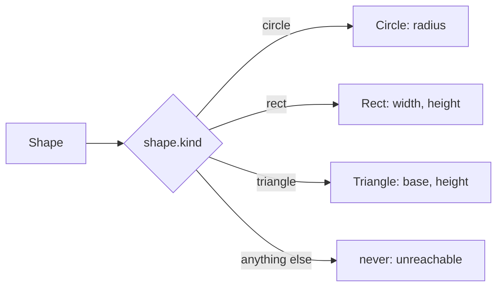

# Objects and structural typing

> **Before this lesson:** you need unions, literal types and narrowing from [Unions, literals and narrowing](#/lesson/typescript/unions-narrowing), and assignability from [The type system](#/lesson/typescript/type-system).

## In plain words

An **object** is a value that bundles several named pieces of data, such as a record with a name, an age and an address. This lesson is about describing objects with types, and about the one rule TypeScript uses to decide whether an object is acceptable somewhere: it looks at **what the object contains**, not at what the object is called. That rule is named **structural typing**.

Think of a wall socket. The socket does not care which company made the plug or what the appliance is called. If the plug has the right pins in the right places, it fits and works. A plug with the right pins plus an extra earth pin that the socket ignores also fits. A plug missing a pin does not. An object type is the socket: it lists the "pins" (properties) that must be present; anything supplying them is accepted.

Why it matters for a job: nearly all the data in an application (users, orders, settings, messages from a server) is objects. Modelling them well, especially data that comes in several variants, is the most frequent design task in TypeScript, and "explain structural typing" and "what is a discriminated union?" are standard interview questions.

## Motivation

Most of a JavaScript program is objects being passed around: configuration records, rows from a database, messages on a queue, props for a component. Describing those objects precisely is where TypeScript earns most of its keep. It is also where it differs most sharply from Java or C#: TypeScript decides whether two object types are compatible by comparing their **structure**, not their **names**. Two types declared in different files by different people are interchangeable if they have the right members. That single rule explains a long list of behaviours that otherwise look like quirks, from "why was my extra property accepted here but rejected there?" to "why can I pass a `Dog` where a `Robot` is expected?".

## Object types

An object type lists property names and their types between braces. It looks like an object literal (an object written out directly in code) with types in place of values. Below, the first line declares that `lantern` must be an object with a numeric `watts` and a string `colour`; the second assignment supplies exactly that; the third offers a string and is rejected.

```typescript
let lantern: { watts: number; colour: string };

lantern = { watts: 40, colour: "amber" };     // ok
lantern = "bright";
// Error: Type 'string' is not assignable to type '{ watts: number; colour: string; }'.
```

Writing the braces every time is tedious, so object types are nearly always given a name with a type alias (or an interface, covered in the features module):

```typescript
type Lantern = {
  watts: number;
  colour: string;
};

function dim(l: Lantern): Lantern {
  return { watts: l.watts / 2, colour: l.colour };
}
```

## Structural typing

Here is the rule in one sentence: **a value is assignable to an object type if it has at least the required properties, each with an assignable type.** Nothing else matters: not the name of the type, not where it was declared, not which class constructed the value.

```typescript
type Named = { name: string };
type Aged = { age: number };

const keeper = { name: "Oriel", age: 61, shift: "night" };

const a: Named = keeper;    // ok: keeper has a string name
const b: Aged = keeper;     // ok: keeper has a number age

type Pet = { name: string };
const c: Pet = a;           // ok: Named and Pet are the same shape, so the same type
```

In the example, `keeper` has three properties. It is accepted as a `Named` because it has a string `name`, and as an `Aged` because it has a numeric `age`; the extra properties do no harm.

Other languages use **nominal** typing (from the Latin for "name"), where `Named` and `Pet` would be unrelated because they have different names. JavaScript programmers know the dynamic version of structural typing as *duck typing* ("if it quacks, treat it as a duck"), checked at runtime by trying the property. TypeScript's structural typing is the same idea verified statically.

```js-run
// Duck typing at runtime: no declared relationship needed, only the right members.
function introduce(thing) {
  return "This is " + thing.name;
}
const keeper = { name: "Oriel", age: 61, shift: "night" };
const boat = { name: "Sandpiper", lengthMetres: 9 };
console.log(introduce(keeper));
console.log(introduce(boat));
console.log(introduce({}));   // "This is undefined": what the static check prevents
```

### Usage checking

When a value is checked against an object type, three things can go wrong.

```typescript
type Beacon = { id: number; label: string };

const missing: Beacon = { id: 3 };
// Error: Property 'label' is missing in type '{ id: number; }'
// but required in type 'Beacon'.

const wrongKind: Beacon = { id: "3", label: "Skerry" };
// Error: Type 'string' is not assignable to type 'number'.

const extra: Beacon = { id: 3, label: "Skerry", height: 12 };
// Error: Object literal may only specify known properties,
// and 'height' does not exist in type 'Beacon'.
```

The third error seems to contradict the rule "at least the required properties". It is a separate, deliberately stricter check.

### Excess property checking

An object **literal** written directly in a position that has a known target type must not contain properties the target does not mention. The reasoning: if you write a literal for a `Beacon` and include `height`, nobody can ever read `height` through that variable, so it is almost certainly a typo or a misunderstanding.

The check applies only to fresh literals. Pass through a variable and plain structural typing takes over:

```typescript
const measured = { id: 3, label: "Skerry", height: 12 };
const fine: Beacon = measured;     // ok: no excess check on a non-literal
```

This is the most common "inconsistency" people report. It is not a soundness hole; an object with extra properties really is a valid `Beacon`. The literal check is a lint-like courtesy.

> [!INTERVIEW]
> "Why does TypeScript reject an extra property in one place and allow it in another?" Because of *excess property checking*: fresh object literals assigned directly to a typed target are checked for unknown properties, mainly to catch typos in optional property names. Any other expression is checked structurally, where extra members are harmless.

Excess checking is at its most valuable with optional properties, where a typo would otherwise pass silently:

```typescript
type Options = { timeoutMs?: number; retries?: number };

const opts: Options = { timeoutMS: 500 };
// Error: Object literal may only specify known properties, but 'timeoutMS'
// does not exist in type 'Options'. Did you mean to write 'timeoutMs'?
```

## Nested object types

Types nest exactly as values do. Give inner shapes their own names: errors become readable and the pieces become reusable.

```typescript
type Coordinates = { lat: number; lon: number };

type Lighthouse = {
  name: string;
  position: Coordinates;
  keeper: { name: string; since: number };
};

const eddy: Lighthouse = {
  name: "Eddy Rock",
  position: { lat: 50.18, lon: -4.26 },
  keeper: { name: "Oriel", since: "2019" },
};
// Error: Type 'string' is not assignable to type 'number'.
//   (reported at keeper.since)
```

## Optional properties

A question mark after the name makes a property **optional**: it may be absent. Properties without the question mark are **required**.

```typescript
type Voyage = {
  from: string;
  to: string;
  via?: string;
};

const direct: Voyage = { from: "Calder", to: "Brindle Bay" };            // ok
const scenic: Voyage = { from: "Calder", to: "Brindle Bay", via: "Skerry" };

function route(v: Voyage): string {
  return v.via.toUpperCase();
  // Error: 'v.via' is possibly 'undefined'.
}
```

Reading an optional property gives `T | undefined`, so the usual narrowing tools apply (`if (v.via)`, `v.via?.toUpperCase()`, `v.via ?? "direct"`).

### Optional is not the same as "required but may be undefined"

```typescript
type A = { via?: string };              // key may be missing
type B = { via: string | undefined };   // key must be present

const a: A = {};                 // ok
const b: B = {};
// Error: Property 'via' is missing in type '{}' but required in type 'B'.
const b2: B = { via: undefined };   // ok
```

At runtime the difference is observable through `in`, `Object.keys` and spreading:

```js-run
const missing = {};
const explicit = { via: undefined };

console.log("via" in missing, "via" in explicit);          // false true
console.log(Object.keys(missing), Object.keys(explicit));  // [] ["via"]

const base = { via: "Skerry" };
console.log({ ...base, ...missing });    // via survives
console.log({ ...base, ...explicit });   // via overwritten with undefined
```

The compiler option `exactOptionalPropertyTypes` makes the type system as strict as the runtime here, forbidding an explicit `undefined` for a `?` property unless the type says so.

## Unions of object types

### Inferred unions

When a variable may hold one of several object shapes, the checker infers a union and, helpfully, records the properties missing from one side as optional `undefined`:

```typescript
const entry = Math.random() > 0.5
  ? { title: "Fog bank", visibility: 200 }
  : { title: "Clear", windKnots: 12 };
// type:
//   | { title: string; visibility: number; windKnots?: undefined }
//   | { title: string; windKnots: number; visibility?: undefined }

entry.title;        // string
entry.visibility;   // number | undefined
```

### Explicit unions

If you declare the union yourself, the checker is stricter: only properties present on **all** members can be read without narrowing.

```typescript
type Fog = { title: string; visibility: number };
type Wind = { title: string; windKnots: number };
type Weather = Fog | Wind;

function report(w: Weather) {
  w.title;          // ok: on both
  w.visibility;
  // Error: Property 'visibility' does not exist on type 'Weather'.
  //   Property 'visibility' does not exist on type 'Wind'.
}
```

### Narrowing with `in`

```typescript
function report(w: Weather): string {
  if ("visibility" in w) {
    return `fog, ${w.visibility} m`;       // w: Fog
  }
  return `wind, ${w.windKnots} kn`;        // w: Wind
}
```

Note that you cannot narrow with `if (w.visibility)`: merely reading a property that might not exist on the type is already an error.

## Discriminated unions

`in` works, but it becomes awkward as the number of variants grows. The idiomatic pattern is to give every member of the union a common property whose type is a distinct **literal**. That property is called the *discriminant* (or tag), and the union a **discriminated union** (also *tagged union*).

```typescript
type Circle = { kind: "circle"; radius: number };
type Rect = { kind: "rect"; width: number; height: number };
type Triangle = { kind: "triangle"; base: number; height: number };
type Shape = Circle | Rect | Triangle;

function area(shape: Shape): number {
  switch (shape.kind) {
    case "circle":
      return Math.PI * shape.radius ** 2;          // shape: Circle
    case "rect":
      return shape.width * shape.height;           // shape: Rect
    case "triangle":
      return (shape.base * shape.height) / 2;      // shape: Triangle
  }
}
```

Reading the function: `switch (shape.kind)` looks at the tag; each `case` line handles one possible tag. Comparing the tag narrows the whole object, so each branch sees exactly the properties of one member: `radius` is available only in the circle branch. This pattern models state machines, Redux-style actions, API results (`{ ok: true, data } | { ok: false, error }`), parsed tokens, and much more.



### Exhaustiveness with `never`

What if someone adds `{ kind: "ellipse"; ... }` to `Shape` next month and forgets `area`? Make the compiler complain. After every case has been handled, the variable's type has been narrowed to `never`, the empty type. Assigning it to a `never` variable is fine; if a case is missing, the leftover member is not assignable to `never` and you get an error naming it.

```typescript
function assertNever(value: never): never {
  throw new Error("Unhandled variant: " + JSON.stringify(value));
}

function describe(shape: Shape): string {
  switch (shape.kind) {
    case "circle":
      return "round";
    case "rect":
      return "boxy";
    default:
      return assertNever(shape);
      // Error: Argument of type 'Triangle' is not assignable to parameter of type 'never'.
  }
}
```

The helper also protects at runtime, when data that never passed through the checker (old cached JSON, a newer server) carries an unknown tag:

```js-run
function assertNever(value) {
  throw new Error("Unhandled variant: " + JSON.stringify(value));
}

function area(shape) {
  switch (shape.kind) {
    case "circle": return Math.PI * shape.radius ** 2;
    case "rect": return shape.width * shape.height;
    case "triangle": return (shape.base * shape.height) / 2;
    default: return assertNever(shape);
  }
}

console.log(area({ kind: "circle", radius: 1 }).toFixed(3));
console.log(area({ kind: "rect", width: 3, height: 4 }));
try {
  area({ kind: "ellipse", rx: 2, ry: 1 });
} catch (err) {
  console.log(err.message);
}
```

> [!TIP]
> Pick one tag name for the whole code base (`kind`, `type` or `tag`) and always use string literals. Booleans work for two-member unions (`ok: true` / `ok: false`), but strings leave room to grow.

## Intersection types

Where `|` means "either", `&` means "both at once". A type built with `&` is called an **intersection type**. For object types the result has all the properties of every part.

```typescript
type Timestamped = { createdAt: number };
type Authored = { author: string };

type LogEntry = { text: string } & Timestamped & Authored;

const entry: LogEntry = {
  text: "Passed the outer marker",
  createdAt: 1767225600000,
  author: "Oriel",
};
```

The names can feel backwards at first. Remember the set model: `A & B` is the *intersection of the value sets* (only objects satisfying both descriptions), which means the *union of the property lists*. And `A | B` is the union of the value sets, on which only the *shared* properties are safely readable.

Intersections combine neatly with unions to add common fields to every member of a discriminated union:

```typescript
type Tracked = { id: string };
type TrackedShape = Shape & Tracked;
// (Circle & Tracked) | (Rect & Tracked) | (Triangle & Tracked)
```

### When intersections go wrong

If two parts disagree about a property, the property's type is the intersection of the two property types, and for unrelated primitives that is `never`:

```typescript
type HasNumericId = { id: number };
type HasTextId = { id: string };
type Broken = HasNumericId & HasTextId;      // id: never

const impossible: Broken = { id: 5 };
// Error: Type 'number' is not assignable to type 'never'.

type Nothing = string & number;               // never
```

No value can be both a string and a number, so the type is uninhabited. When a long intersection produces a baffling "not assignable to type 'never'" message, look for a property declared with conflicting types.

## Structural typing surprises

Structural rules are simple but have consequences worth seeing once.

```typescript
type Metres = { value: number };
type Seconds = { value: number };

function wait(duration: Seconds) { /* ... */ }

const length: Metres = { value: 120 };
wait(length);     // ok! same shape, so the names offer no protection
```

```typescript
type Empty = {};
const x: Empty = 42;         // ok
const y: Empty = "text";     // ok
const z: Empty = null;
// Error: Type 'null' is not assignable to type '{}'.
```

`{}` does not mean "an empty object". It means "anything that has at least zero properties", which is every value except `null` and `undefined`. For "an object with no known keys" use `Record<string, never>`; for "any non-primitive" use `object`.

Because names do not matter, an object built for one purpose satisfies any type it happens to fit:

```js-run
// Shapes that coincide are interchangeable at runtime too.
function wait(duration) {
  return "waiting " + duration.value + " seconds";
}
const length = { value: 120, unit: "m" };
console.log(wait(length));   // accepted: nothing distinguishes metres from seconds
```

If you need the distinction, add a discriminant (`{ unit: "m"; value: number }`) or use the *branding* technique shown in the interview module.

## Pitfalls

- **Expecting excess property errors on variables.** Only fresh literals get that check.
- **Confusing `prop?: T` with `prop: T | undefined`.** The first may be absent, the second must be written.
- **Reading a non-shared property to narrow an explicit union.** Use `in` or a discriminant.
- **Non-literal discriminants.** A tag typed as `string` narrows nothing. It must be a literal type, so beware of widening when building the object in a `let`.
- **Forgetting the exhaustiveness check.** Without `assertNever` (or a declared return type under `strict`), a new variant slips through.
- **Conflicting intersections** silently produce `never` properties.
- **Using `{}` or `Object` as a type.** They accept almost everything.
- **Relying on names for safety.** `Metres` and `Seconds` with the same shape are one type.

## Cheat sheet

| Need | Syntax |
|---|---|
| Object type | `{ a: number; b: string }` |
| Named object type | `type T = { ... }` |
| Optional property | `a?: number` |
| Either shape | `A \| B` |
| Both shapes merged | `A & B` |
| Narrow by key presence | `if ("key" in value)` |
| Discriminated union | every member has `kind: "literal"` |
| Exhaustive switch | `default: return assertNever(x)` |
| Any non-nullish value | `{}` (rarely what you want) |
| Any non-primitive | `object` |
| Truly empty object | `Record<string, never>` |

## Summary

Object types describe shapes, and compatibility is structural: a value fits a type when it supplies every required property with a compatible type, regardless of names. Fresh object literals receive an additional excess-property check that catches typos. Optional properties may be missing and read as `T | undefined`. Unions of object types expose only their shared members until narrowed with `in` or, preferably, with a literal discriminant property; a `never`-typed default branch turns forgotten cases into compile errors. Intersections merge property lists and collapse to `never` when their parts contradict each other.

## Glossary

- **Object type:** a type listing property names and the type of each.
- **Property:** a named part of an object.
- **Object literal:** an object written directly in code with braces.
- **Structural typing:** deciding compatibility by comparing members, not names.
- **Nominal typing:** deciding compatibility by declared names (used by Java and C#, not by TypeScript).
- **Duck typing:** the runtime habit of using a value according to the members it has.
- **Excess property checking:** the extra check that rejects unknown properties in a directly written object literal.
- **Fresh object literal:** an object literal at the point where it is written, before being stored in a variable.
- **Optional property:** a property marked `?` that may be absent.
- **Discriminated union:** a union of object types sharing a property with a distinct literal type in each member.
- **Discriminant / tag:** that shared literal property, such as `kind`.
- **Exhaustiveness check:** making the compiler confirm that every member of a union is handled.
- **`never`:** the type with no values; what is left when every possibility has been ruled out.
- **Intersection type:** `A & B`; a value that satisfies both types at once.

```quiz
[
  {"q": "Does this compile? `type Beacon = { id: number }; const m = { id: 3, height: 12 }; const b: Beacon = m;`",
   "options": ["No: height is an unknown property", "Yes: excess property checks apply only to fresh object literals", "No: m must be annotated", "Yes, but height is deleted"],
   "answer": 1,
   "explain": "`m` is a variable, not a literal in the assignment position, so only structural compatibility is checked, and `m` has the required `id: number`."},
  {"q": "Does this compile? `type B = { via: string | undefined }; const b: B = {};`",
   "options": ["Yes, undefined is allowed", "No: property 'via' is missing", "Yes, with a warning", "No: via must be a string"],
   "answer": 1,
   "explain": "`via` is required (no `?`), even though its value type includes undefined. The key must be present."},
  {"q": "Given `type W = { title: string; visibility: number } | { title: string; windKnots: number }`, which access compiles on a value `w: W` without narrowing?",
   "options": ["`w.visibility`", "`w.windKnots`", "`w.title`", "None"],
   "answer": 2,
   "explain": "Only properties that exist on every member of an explicitly declared union are accessible before narrowing."},
  {"q": "What is the type of `id` in `{ id: number } & { id: string }`?",
   "options": ["`number | string`", "`never`", "`any`", "`unknown`"],
   "answer": 1,
   "explain": "Property types are intersected: `number & string` has no values, so it is `never`."},
  {"q": "In a `switch (shape.kind)` that handles every member of the union, what is the type of `shape` in the `default` branch?",
   "options": ["`Shape`", "`unknown`", "`never`", "`undefined`"],
   "answer": 2,
   "explain": "Each case removes one member. When all are removed nothing is left, which is the `never` type; that is what makes the exhaustiveness helper work."},
  {"q": "Which values are assignable to the type `{}`?",
   "options": ["Only empty object literals", "Any object but no primitives", "Every value except null and undefined", "Nothing"],
   "answer": 2,
   "explain": "`{}` requires zero properties, which numbers, strings, booleans, arrays and objects all satisfy. Under strictNullChecks, null and undefined are excluded."},
  {"q": "`type Metres = { value: number }; type Seconds = { value: number };` Can a `Metres` be passed to a function expecting `Seconds`?",
   "options": ["No, the names differ", "Yes, the structures are identical", "Only with a type assertion", "Only if both are interfaces"],
   "answer": 1,
   "explain": "TypeScript is structural: identical shapes are the same type no matter what they are called."},
  {"q": "Which runtime expression distinguishes `{}` from `{ via: undefined }`?",
   "options": ["`obj.via === undefined`", "`\"via\" in obj`", "`typeof obj.via`", "`obj.via ?? 1`"],
   "answer": 1,
   "explain": "Both objects yield undefined when the property is read; only `in` (or `Object.keys` / `hasOwn`) reveals whether the key exists."}
]
```

> **Source:** Goldberg, *Learning TypeScript*, ch. 4 (Objects). Handbook: https://www.typescriptlang.org/docs/handbook/2/objects.html · https://www.typescriptlang.org/docs/handbook/type-compatibility.html · https://www.typescriptlang.org/docs/handbook/2/narrowing.html#discriminated-unions
