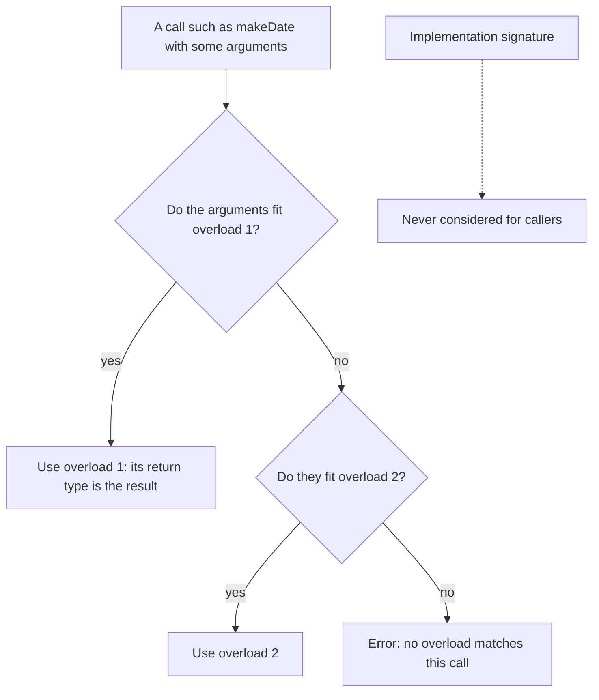

# Functions, arrays and tuples

> **Before this lesson:** you need annotations and inference from [The type system](#/lesson/typescript/type-system), unions from [Unions, literals and narrowing](#/lesson/typescript/unions-narrowing) and object types from [Objects and structural typing](#/lesson/typescript/objects).

## In plain words

A **function** is a named piece of code that takes inputs and gives back a result. An **array** is an ordered list of values. This lesson shows how to describe both to TypeScript: what a function expects and returns, and what a list contains. It also introduces the **tuple**, a list with a fixed number of positions where each position has its own meaning.

Think of a vending machine. It has a slot that accepts coins (not buttons, not paper clips) and a tray that delivers a drink. The labels on the machine are its contract: put in this, get out that. A function's types are those labels. For lists, compare a carton of eggs with a set meal on a tray. The carton holds any number of items that are all the same kind: an array. The tray has exactly three places, starter, main and dessert, each for a different kind of thing: a tuple.

Why it matters for a job: every program is functions calling functions and passing lists around. If the inputs and outputs of your functions are typed, the checker can verify almost everything in between without further help. Typing a callback (a function handed to another function) is among the first things a new TypeScript developer has to get right.

## Motivation

Functions are the joints of a program: data enters through parameters and leaves through return values. If those joints are typed, almost everything in between can be inferred. Arrays and tuples are the containers that most often travel through those joints. This lesson covers how to describe what a function accepts and returns, how to describe functions *as values* (callbacks), the special return types `void` and `never`, overloads, and then the two list-like types: arrays (any length, one element type) and tuples (fixed length, a type per position).

## Function parameters

A **parameter** is a named input of a function; the value supplied for it in a particular call is an **argument**. Parameters are the one place where the checker cannot infer a type from your code, because a function body does not constrain its callers. Without an annotation, a parameter is implicitly `any`, which `strict` mode reports as an error.

```typescript
function announce(vessel) {
  // Error (noImplicitAny): Parameter 'vessel' implicitly has an 'any' type.
  console.log(`${vessel} is entering the harbour`);
}

function announceTyped(vessel: string) {
  console.log(`${vessel} is entering the harbour`);
}
```

### Required parameters

JavaScript lets you call any function with any number of arguments. TypeScript does not: every declared parameter is required unless you say otherwise, and extra arguments are rejected.

```typescript
function berthFee(lengthMetres: number, nights: number): number {
  return lengthMetres * 3.2 * nights;
}

berthFee(9, 2);        // ok
berthFee(9);
// Error: Expected 2 arguments, but got 1.
berthFee(9, 2, true);
// Error: Expected 2 arguments, but got 3.
```

```js-run
function berthFee(lengthMetres, nights) {
  return lengthMetres * 3.2 * nights;
}
console.log(berthFee(9, 2));
console.log(berthFee(9));            // NaN: the missing argument is undefined
console.log(berthFee(9, 2, true));   // extra argument silently ignored
```

### Optional parameters

A `?` after the name makes a parameter optional. Inside the function its type includes `undefined`. Optional parameters must come after all required ones.

```typescript
function hail(vessel: string, channel?: number): string {
  // channel: number | undefined
  return channel === undefined ? `Calling ${vessel}` : `Calling ${vessel} on ${channel}`;
}

hail("Heron");            // ok
hail("Heron", 16);        // ok
hail("Heron", undefined); // ok

function bad(channel?: number, vessel: string) {}
// Error: A required parameter cannot follow an optional parameter.
```

Optional is different from `channel: number | undefined`, which still requires the caller to pass something explicitly, even if that something is `undefined`.

### Default parameters

A default value makes the parameter optional for callers and removes `undefined` inside the body. The type is inferred from the default.

```typescript
function knotsToKmh(knots: number, digits = 1): string {
  // digits: number
  return (knots * 1.852).toFixed(digits);
}

knotsToKmh(12);          // "22.2"
knotsToKmh(12, 3);       // "22.224"
knotsToKmh(12, "3");
// Error: Argument of type 'string' is not assignable to parameter of type 'number'.
```

### Rest parameters

`...name` gathers all remaining arguments into an array, so its annotation must be an array (or tuple) type.

```typescript
function manifest(captain: string, ...crew: string[]): string {
  return `${captain} with ${crew.length} crew: ${crew.join(", ")}`;
}

manifest("Idris");
manifest("Idris", "Asha", "Tobin");
manifest("Idris", "Asha", 7);
// Error: Argument of type 'number' is not assignable to parameter of type 'string'.
```

```js-run
function manifest(captain, ...crew) {
  return `${captain} with ${crew.length} crew: ${crew.join(", ")}`;
}
console.log(manifest("Idris"));
console.log(manifest("Idris", "Asha", "Tobin"));
```

## Return types

The **return type** is the type of the value a function gives back. The checker infers it by collecting every `return` statement.

```typescript
function classify(depth: number) {
  if (depth < 5) return "shallow";
  if (depth < 50) return depth;
  return undefined;
}
// inferred return type: number | "shallow" | undefined
```

You may also declare it. The declaration goes after the parameter list:

```typescript
function midpoint(a: number, b: number): number {
  return (a + b) / 2;
}

const midpointArrow = (a: number, b: number): number => (a + b) / 2;

function broken(a: number): string {
  return a * 2;
  // Error: Type 'number' is not assignable to type 'string'.
}
```

Reasons to declare a return type even though inference works: the error appears *inside* the function when you break the contract rather than at some caller; recursive functions need it; exported APIs stay stable; and large projects type-check faster.

## Function types

In JavaScript, functions are values: they can be stored in variables and handed to other functions. A function passed to another function to be called later is a **callback**. Since functions are values, they need types too. A function type looks like an arrow function with a type where the body would be: `(input: string) => number` reads "takes a string, gives back a number".

```typescript
let transform: (input: string) => number;

transform = (text) => text.length;      // ok; `text` is inferred as string
transform = (text) => text.toUpperCase();
// Error: Type 'string' is not assignable to type 'number'.
```

The parameter **names** in a function type are documentation only; they need not match the implementation. What matters is position and type.

A callback parameter is typed the same way:

```typescript
function eachReading(readings: number[], visit: (value: number, index: number) => void) {
  readings.forEach((r, i) => visit(r, i));
}

eachReading([3, 5], (value) => console.log(value));   // ok: ignoring `index` is fine
eachReading([3, 5], (value, index, extra) => {});
// Error: Target signature provides too few arguments. Expected 3 or more, but got 2.
```

### Parameter count compatibility

That example shows a rule that surprises people: **a function with fewer parameters is assignable to a type with more**. It is safe because JavaScript ignores surplus arguments, and it is what makes `array.map((x) => ...)` legal even though `map` passes three arguments. A function that *requires more* than the type will supply is rejected.

### Parentheses and unions

```typescript
let a: () => string | undefined;        // function returning string | undefined
let b: (() => string) | undefined;      // either a function or undefined
```

Without the parentheses the `|` belongs to the return type.

### Function type aliases

```typescript
type Comparator<T> = (left: T, right: T) => number;
type Listener = (event: { type: string; at: number }) => void;

const byLength: Comparator<string> = (l, r) => l.length - r.length;
["schooner", "yawl", "ketch"].sort(byLength);
```

## `void` and `never`

### `void`

A function that returns nothing useful has return type `void`.

```typescript
function logArrival(name: string): void {
  console.log(`${name} arrived`);
  return;            // ok
  // return name;    // Error: Type 'string' is not assignable to type 'void'.
}
```

`void` is not the same as `undefined`. `undefined` is a value; `void` is a statement about intent: *do not use the result*. That distinction explains a rule that looks odd at first: a function *type* that returns `void` accepts a function that returns something.

```typescript
const lengths: number[] = [];
["sloop", "brig"].forEach((name) => lengths.push(name.length));
// forEach expects (value) => void, and push returns a number: allowed.
```

If it were not allowed, the everyday one-liner above would be an error. The returned number is ignored.

```js-run
const lengths = [];
const result = ["sloop", "brig"].forEach((name) => lengths.push(name.length));
console.log(lengths, result);   // forEach itself discards the callback's results
```

### `never`

`never` as a return type means the function does not return at all: it always throws, or loops forever.

```typescript
function fail(message: string): never {
  throw new Error(message);
}

function parsePort(text: string): number {
  const n = Number(text);
  if (!Number.isInteger(n)) fail(`Not a port: ${text}`);
  return n;      // the checker knows execution only reaches here when n is an integer
}
```

Because `never` is assignable to everything, a call to a `never`-returning function can sit anywhere an expression is needed, such as the right side of `??`:

```typescript
const home = process.env.HOME ?? fail("HOME is not set");   // home: string
```

| Return type | Meaning | Can the caller use the result? |
|---|---|---|
| `undefined` | returns the value `undefined` | yes, it is `undefined` |
| `void` | returns, result is not meant to be used | no |
| `never` | never returns normally | there is no result |

## Overloads

Some functions accept several different argument lists. JavaScript handles this by inspecting arguments at runtime; TypeScript describes it with **overload signatures**: several declarations without bodies, followed by one implementation whose signature is compatible with all of them.

```typescript
function makeDate(timestamp: number): Date;
function makeDate(year: number, month: number, day: number): Date;
function makeDate(a: number, month?: number, day?: number): Date {
  if (month !== undefined && day !== undefined) {
    return new Date(a, month - 1, day);
  }
  return new Date(a);
}

makeDate(1767225600000);     // ok: first overload
makeDate(2031, 5, 17);       // ok: second overload
makeDate(2031, 5);
// Error: No overload expects 2 arguments, but overloads do exist
// that expect either 1 or 3 arguments.
```

How the checker picks a signature for a call:



Overloads are tried from top to bottom and the first that fits wins, so list the most specific signature first.

Callers see only the overload signatures. The implementation signature is hidden, which is why the two-argument call fails even though the implementation's parameter list would accept it.

```js-run
// After compilation only the implementation remains.
function makeDate(a, month, day) {
  if (month !== undefined && day !== undefined) {
    return new Date(Date.UTC(a, month - 1, day));
  }
  return new Date(a);
}
console.log(makeDate(1767225600000).toISOString());
console.log(makeDate(2031, 5, 17).toISOString());
```

> [!TIP]
> Overloads are the last resort. If the variants differ only in one parameter's type, a union (`id: number | string`) is simpler. If the return type depends on the argument type, a generic often expresses it better. Use overloads when the *number* of arguments changes the meaning, or when you must tie specific argument types to specific return types.

## Arrays

An array type is the element type followed by `[]`, or the equivalent spelling `Array<T>` with the element type in angle brackets. An **element** is one item of the array. In the example, `depths` may only ever hold numbers, so pushing a string is refused.

```typescript
const depths: number[] = [4, 18, 7];
const names: Array<string> = ["Asha", "Lior"];

depths.push(22);         // ok
depths.push("deep");
// Error: Argument of type 'string' is not assignable to parameter of type 'number'.
```

Arrays of unions and unions of arrays are different things, and parentheses decide which you get:

```typescript
let mixed: (string | number)[];     // each element is a string or a number
let either: string[] | number[];    // all strings, or all numbers

mixed = ["a", 1, "b"];              // ok
either = ["a", 1];
// Error: Type '(string | number)[]' is not assignable to type 'string[] | number[]'.
```

Likewise `() => string[]` is a function returning an array, and `(() => string)[]` is an array of functions.

### Empty arrays

An empty literal gives the checker nothing to infer from. A `let`/`const` initialised with `[]` and no annotation becomes an *evolving* `any[]` that takes on the types of whatever you push, which works but is fragile. Annotate instead:

```typescript
const queue: string[] = [];
queue.push("first");
queue.push(2);
// Error: Argument of type 'number' is not assignable to parameter of type 'string'.
```

### Element access is optimistic

```typescript
const ports = ["Calder", "Vellmar"];
const third = ports[2];       // type: string  (but the value is undefined!)
third.toUpperCase();          // compiles, crashes
```

By default the checker assumes any index is in range. This is one of the deliberate soundness holes. The option `noUncheckedIndexedAccess` closes it by typing `ports[2]` as `string | undefined`, at the cost of more checks in loops. Methods that are honest by declaration, such as `find`, `at`, `pop` and `shift`, already include `undefined`.

```js-run
const ports = ["Calder", "Vellmar"];
const third = ports[2];
console.log(third);
try {
  third.toUpperCase();
} catch (err) {
  console.log("crash:", err.message);
}
console.log(ports.at(-1), ports.at(5));
```

### Spreads and multidimensional arrays

```typescript
const morning = [4.1, 4.4];
const labels = ["low", "high"];
const joined = [...morning, ...labels];     // (string | number)[]

const grid: number[][] = [
  [1, 2, 3],
  [4, 5, 6],
];
const cell = grid[1][2];                    // number
```

## Tuples

An array says "many of the same". A **tuple** says "exactly these, in this order". The type is written as a bracketed list of types: `[number, number]` is "a list of exactly two numbers".

```typescript
let fix: [number, number];          // [latitude, longitude]
fix = [50.18, -4.26];               // ok
fix = [50.18];
// Error: Type '[number]' is not assignable to type '[number, number]'.
//   Source has 1 element(s) but target requires 2.
fix = [50.18, "west"];
// Error: Type 'string' is not assignable to type 'number'.

const lat = fix[0];                 // number
const oops = fix[2];
// Error: Tuple type '[number, number]' of length '2' has no element at index '2'.
```

Unlike arrays, the checker knows a tuple's length and the type at each index, so out-of-range access is an error and destructuring is precisely typed. That makes tuples ideal for returning two or three related values:

```typescript
function minMax(values: number[]): [min: number, max: number] {
  return [Math.min(...values), Math.max(...values)];
}

const [lowest, highest] = minMax([7, 2, 9]);    // both number
```

The labels (`min:`, `max:`) are documentation that shows up in editor hints. React's `useState` returns a tuple for exactly this reason: `[value, setValue]`.

```js-run
function minMax(values) {
  return [Math.min(...values), Math.max(...values)];
}
const [lowest, highest] = minMax([7, 2, 9]);
console.log(lowest, highest);
// At runtime a tuple is an ordinary array:
console.log(Array.isArray(minMax([1])), minMax([1]).length);
```

### Inference prefers arrays

Here is the main tuple pitfall. A bracketed literal is inferred as an **array**, not a tuple.

```typescript
const pair = ["Heron", 12];        // (string | number)[]   not [string, number]

function register(name: string, length: number) {}
register(...pair);
// Error: A spread argument must either have a tuple type
// or be passed to a rest parameter.
```

Three ways to get a tuple:

```typescript
const annotated: [string, number] = ["Heron", 12];

function entry(): [string, number] { return ["Heron", 12]; }

const frozen = ["Heron", 12] as const;      // readonly ["Heron", 12]
register(...frozen);                        // ok
```

`as const` produces a read-only tuple of literal types: the most specific type possible.

### Optional and rest elements

```typescript
type Waypoint = [lat: number, lon: number, name?: string];
const w1: Waypoint = [50.1, -4.2];
const w2: Waypoint = [50.1, -4.2, "Skerry"];

type Row = [id: number, ...cells: string[]];
const row: Row = [7, "a", "b", "c"];
```

A rest parameter may itself be typed as a tuple, which is how libraries describe "these exact arguments, forwarded":

```typescript
function logCall(label: string, ...args: [code: number, detail?: string]) {}
logCall("ping", 200);
logCall("ping", 404, "missing");
```

### Tuples are still mutable arrays

```typescript
const point: [number, number] = [1, 2];
point.push(3);        // compiles! push is an array method the type still has
```

This is a known gap. Mark tuples `readonly` (`readonly [number, number]`) when they should not change, which removes `push` and friends from the type.

## Worked example: a small typed pipeline

```typescript
type Reading = [station: string, celsius: number];
type Predicate<T> = (item: T) => boolean;

function partition<T>(items: T[], keep: Predicate<T>): [kept: T[], dropped: T[]] {
  const kept: T[] = [];
  const dropped: T[] = [];
  for (const item of items) (keep(item) ? kept : dropped).push(item);
  return [kept, dropped];
}

const readings: Reading[] = [["Pier", 11.2], ["Reef", 19.5], ["Light", 14.9]];
const [warm, cold] = partition(readings, ([, c]) => c >= 14);
// warm: Reading[]   cold: Reading[]
```

```js-run
function partition(items, keep) {
  const kept = [];
  const dropped = [];
  for (const item of items) (keep(item) ? kept : dropped).push(item);
  return [kept, dropped];
}
const readings = [["Pier", 11.2], ["Reef", 19.5], ["Light", 14.9]];
const [warm, cold] = partition(readings, ([, c]) => c >= 14);
console.log("warm:", warm.map(([s]) => s));
console.log("cold:", cold.map(([s]) => s));
```

## Pitfalls

- **Unannotated parameters** are `any`. Always annotate.
- **`string | undefined` parameter versus optional parameter.** Only `?` (or a default) lets callers omit the argument.
- **Missing parentheses** in `() => A | B` and `(A | B)[]`.
- **Expecting overload implementations to be callable.** Only the overload signatures are visible.
- **Trusting `arr[i]`.** It may be `undefined`; enable `noUncheckedIndexedAccess` or check.
- **Expecting a tuple from a literal.** Annotate or use `as const`.
- **`void` callbacks returning values** are fine; do not "fix" them.
- **Declaring `: void` on a function whose result you actually need** hides the value from callers.
- **Mutating tuples through `push`** bypasses the length check.

## Cheat sheet

| Need | Syntax |
|---|---|
| Optional parameter | `(name?: string)` |
| Default parameter | `(digits = 2)` |
| Rest parameter | `(...items: number[])` |
| Return type | `function f(): string` |
| Function type | `(a: number) => string` |
| No useful result | `: void` |
| Never returns | `: never` |
| Overloads | signatures without bodies, then one implementation |
| Array | `T[]` or `Array<T>` |
| Array of unions | `(A \| B)[]` |
| Tuple | `[A, B]`, `[a: A, b?: B]`, `[A, ...B[]]` |
| Literal tuple | `[...] as const` |
| Read-only list | `readonly T[]`, `readonly [A, B]` |

## Summary

Annotate parameters; let return types be inferred or declare them at boundaries. Parameters are required by default and can be made optional with `?`, a default value or a rest parameter. Function types describe callbacks, and a function taking fewer parameters fits a type that supplies more. `void` means "ignore the result"; `never` means "does not return". Overloads tie specific argument lists to specific results but expose only their declared signatures. Arrays hold any number of one element type and are optimistic about indexing; tuples fix length and per-position types, are inferred only when you ask for them, and remain ordinary arrays at runtime.

## Glossary

- **Function:** a reusable piece of code with inputs and a result.
- **Parameter / argument:** a function's named input, and the value passed for it in a call.
- **Optional parameter:** a parameter marked `?` that callers may omit.
- **Default parameter:** a parameter with a fallback value used when the argument is omitted.
- **Rest parameter:** `...name`, collecting all remaining arguments into an array.
- **Return type:** the type of the value a function gives back.
- **Function type:** a type describing a function's parameters and return type, such as `(a: number) => string`.
- **Callback:** a function passed to another function to be called later.
- **`void`:** a return type meaning the result is not meant to be used.
- **`never`:** a return type meaning the function does not return normally.
- **Overload:** one of several call signatures declared for the same function.
- **Signature:** the parameter list and return type of a function, without its body.
- **Array:** an ordered list of any length whose elements share one type.
- **Element:** one item of an array or tuple.
- **Tuple:** a list of fixed length with a type for each position.
- **Spread (`...`):** syntax that expands an array into individual items.
- **Destructuring:** unpacking items of an array or properties of an object into variables.

```quiz
[
  {"q": "What is the inferred return type? `function f(d: number) { if (d < 5) return \"shallow\"; return d; }`",
   "options": ["`string | number`", "`number | \"shallow\"`", "`any`", "`string`"],
   "answer": 1,
   "explain": "Return types are the union of all returned expressions; a returned string literal keeps its literal type in the union."},
  {"q": "Does this compile? `const out: number[] = []; [1, 2].forEach((n) => out.push(n));` given that forEach's callback type returns `void` and `push` returns a number.",
   "options": ["No: the callback returns a number", "Yes: a function returning a value is assignable to a function type returning void", "Only if the callback is annotated", "No: forEach requires undefined"],
   "answer": 1,
   "explain": "A `void` return in a function type means the result will be ignored, so callbacks that return something are accepted."},
  {"q": "What is the inferred type of `pair`? `const pair = [\"Heron\", 12];`",
   "options": ["`[string, number]`", "`(string | number)[]`", "`readonly [\"Heron\", 12]`", "`any[]`"],
   "answer": 1,
   "explain": "Array literals are inferred as arrays of a union. A tuple needs an annotation, a return type, or `as const`."},
  {"q": "Does this compile? `function bad(channel?: number, vessel: string) {}`",
   "options": ["Yes", "No: a required parameter cannot follow an optional parameter", "Yes, vessel becomes optional too", "No: optional parameters need defaults"],
   "answer": 1,
   "explain": "Optional parameters must be last, otherwise callers could not omit them positionally."},
  {"q": "Which type describes an array whose elements are functions returning string?",
   "options": ["`() => string[]`", "`(() => string)[]`", "`Array<string>()`", "`[() => string]`"],
   "answer": 1,
   "explain": "Without parentheses, `[]` binds to the return type. The last option is a one-element tuple, not an array of any length."},
  {"q": "With default compiler options, what is the type of `ports[5]` where `ports: string[]` has two elements?",
   "options": ["`undefined`", "`string | undefined`", "`string`", "A compile error"],
   "answer": 2,
   "explain": "Index access on arrays is assumed to be in range unless `noUncheckedIndexedAccess` is enabled."},
  {"q": "A function has overloads `(a: number): Date` and `(a: number, b: number, c: number): Date`, and the implementation `(a: number, b?: number, c?: number)`. Does a call with two arguments compile?",
   "options": ["Yes, the implementation accepts it", "No: only the overload signatures are visible to callers", "Yes, with a warning", "Only in JavaScript files"],
   "answer": 1,
   "explain": "The implementation signature is not part of the public call signatures."},
  {"q": "What does a return type of `never` say about a function?",
   "options": ["It returns undefined", "It returns nothing useful", "It never finishes normally: it throws or loops forever", "It must not be called"],
   "answer": 2,
   "explain": "`never` is the empty type; a function can only have it as a result if control never reaches the end or a return."}
]
```

> **Source:** Goldberg, *Learning TypeScript*, ch. 5 (Functions) and ch. 6 (Arrays). Handbook: https://www.typescriptlang.org/docs/handbook/2/functions.html · https://www.typescriptlang.org/docs/handbook/2/objects.html#tuple-types · https://www.typescriptlang.org/tsconfig#noUncheckedIndexedAccess
