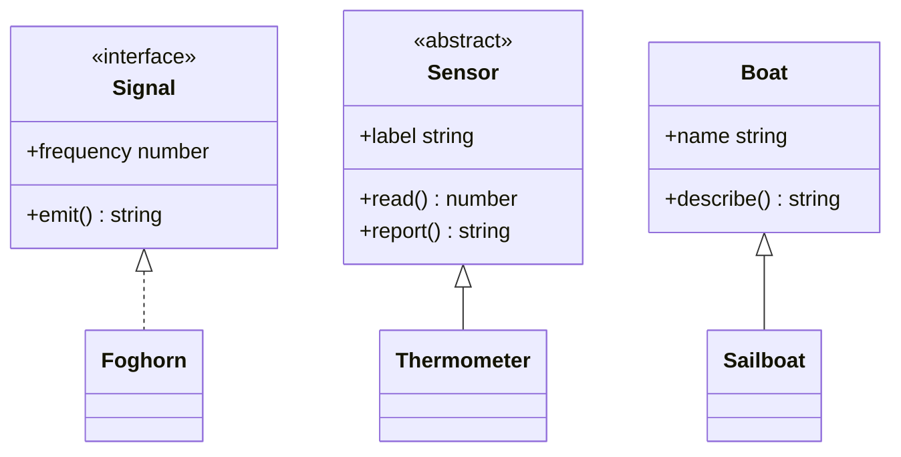

# Interfaces and classes

> **Before this lesson:** you need object types and structural typing from [Objects and structural typing](#/lesson/typescript/objects) and function types from [Functions, arrays and tuples](#/lesson/typescript/functions-arrays-tuples). Basic familiarity with JavaScript classes helps; the essentials are restated here.

## In plain words

An **interface** is a named description of what an object must contain: which properties and which functions. It holds no data and does no work; it is a contract. A **class** is a template for creating objects that share the same data layout and behaviour; unlike an interface, a class is real code that runs.

Think of a job description and an employee. The job description (interface) lists what the role requires: "can drive a forklift, holds a safety certificate". It is a piece of paper; it lifts no pallets. Any person who meets every requirement can fill the role, whatever their background. A class is closer to a training programme that turns out people with a known set of skills: each graduate (called an *instance*) is a real person doing real work. Asking "does this graduate meet that job description?" is what the keyword `implements` checks.

Why it matters for a job: interfaces are how teams agree on the shape of data passed between parts of a system, and how libraries tell you what they expect. Classes are the backbone of frameworks such as Angular and NestJS. "What is the difference between `type` and `interface`?" is possibly the single most asked TypeScript interview question.

## Motivation

Type aliases can describe any object shape, so why does TypeScript have a second way to do it? **Interfaces** exist because describing object contracts is so central that it deserved a purpose-built construct: one that can be extended, implemented by classes, re-opened to add members, and that produces shorter, more readable error messages. **Classes**, meanwhile, are plain JavaScript, but TypeScript layers type checking on top: declared properties, initialisation checks, visibility modifiers and abstract members. This lesson covers both, and how they meet through `implements`.

## Interfaces

An interface declares an object shape with a name, using the keyword `interface`. Below, `Ferry` requires a string `name` and a numeric `capacity`. The object `morning` supplies both and is accepted; `broken` leaves one out and is rejected.

```typescript
interface Ferry {
  name: string;
  capacity: number;
}

const morning: Ferry = { name: "Kittiwake", capacity: 140 };

const broken: Ferry = { name: "Gannet" };
// Error: Property 'capacity' is missing in type '{ name: string; }'
// but required in type 'Ferry'.
```

Everything from the objects lesson (structural compatibility, excess property checks, optional members, narrowing) applies unchanged. For plain shapes, an interface and an object type alias are interchangeable.

### Interface or type alias?

| Capability | `interface` | `type` alias |
|---|---|---|
| Describe an object shape | yes | yes |
| Describe a union, tuple, primitive, mapped or conditional type | no | yes |
| Extend another object type | `extends` (checked for conflicts) | `&` intersection (conflicts become `never`) |
| Be implemented by a class | yes | yes, if it is an object type |
| Declaration merging (re-open and add members) | yes | no: duplicate identifier error |
| Appears by name in error messages | always | usually, sometimes expanded |

A workable convention: **use `interface` for object shapes that other code will extend or implement, and `type` for everything else (unions, function types, computed types)**. Either choice is fine as long as the code base is consistent.

> [!INTERVIEW]
> "What is the difference between `type` and `interface`?" Both can name an object shape. Only `type` can alias unions, primitives, tuples and computed types. Only `interface` supports declaration merging, and `extends` on an interface reports incompatible property overrides as an error, whereas intersecting aliases silently yields `never` for the conflicting property. Neither exists at runtime.

## Kinds of members

### Optional and read-only properties

```typescript
interface Timetable {
  readonly route: string;
  departures: string[];
  notes?: string;
}

const t: Timetable = { route: "Calder to Skerry", departures: ["07:10"] };
t.departures.push("09:40");     // ok: the array itself is mutable
t.route = "Other";
// Error: Cannot assign to 'route' because it is a read-only property.
```

`readonly` is a compile-time promise only, and it is **shallow**: it stops reassignment of the property, not mutation of what the property refers to. Nothing is frozen at runtime.

```js-run
const t = { route: "Calder to Skerry", departures: ["07:10"] };
t.route = "Other";             // the emitted JavaScript has no readonly
console.log(t.route);

const frozen = Object.freeze({ route: "Calder to Skerry", departures: ["07:10"] });
frozen.route = "Other";        // silently ignored (throws in strict mode)
frozen.departures.push("x");   // freeze is shallow too
console.log(frozen.route, frozen.departures);
```

Also note that `readonly` does not affect assignability: a mutable object can be passed where a read-only one is expected and, more surprisingly, the reverse is also allowed.

### Methods and function properties

A **member** is anything declared inside an interface or class: a property or a function. A function that belongs to an object is called a **method**. There are two spellings for a member that is a function.

```typescript
interface Horn {
  sound(times: number): string;            // method syntax
  silence: () => void;                     // property syntax
}
```

Both describe callable members. The differences: a property can be `readonly`, and under `strictFunctionTypes` parameters of property-style functions are checked more strictly (contravariantly) while method-style parameters stay loosely checked (bivariantly). Prefer property syntax for callbacks you store, method syntax for behaviour that belongs to the object and uses `this`.

### Call signatures

An interface can describe a value that is itself callable and also has properties.

```typescript
interface Counter {
  (step?: number): number;      // call signature
  total: number;                // plus a property
}

function makeCounter(): Counter {
  const counter = ((step = 1) => (counter.total += step)) as Counter;
  counter.total = 0;
  return counter;
}
```

```js-run
function makeCounter() {
  const counter = (step = 1) => (counter.total += step);
  counter.total = 0;
  return counter;
}
const c = makeCounter();
c(); c(5);
console.log(c.total, typeof c);   // functions are objects and can carry properties
```

### Index signatures

When the keys are not known in advance (a dictionary, a cache keyed by id), an index signature gives the type for *any* key of a kind.

```typescript
interface Tally {
  [word: string]: number;
}

const counts: Tally = {};
counts["gull"] = 3;
counts.tern = 1;
counts.heron = "many";
// Error: Type 'string' is not assignable to type 'number'.

const n = counts["albatross"];    // type: number  (value: undefined!)
```

Index signatures share the optimism of array indexing: a lookup of a missing key is typed as if it were present. Remedies: `noUncheckedIndexedAccess`, declaring the value as `number | undefined`, or using a `Map<string, number>`, whose `get` honestly returns `number | undefined`.

Named properties may be mixed in, provided their types fit the signature:

```typescript
interface Catalogue {
  [isbn: string]: number;
  total: number;            // ok: number fits
  label: string;
  // Error: Property 'label' of type 'string' is not assignable
  // to 'string' index type 'number'.
}
```

For a dictionary with a *known* set of keys, `Record<"a" | "b", number>` is clearer and catches missing keys.

## Extending interfaces

`extends` copies the members of a base interface and adds more.

```typescript
interface Vessel {
  name: string;
  lengthMetres: number;
}

interface Trawler extends Vessel {
  holdTonnes: number;
}

const t: Trawler = { name: "Petrel", lengthMetres: 24, holdTonnes: 60 };
const v: Vessel = t;        // ok: a Trawler has everything a Vessel needs
```

An interface may extend several bases, and may **narrow** an inherited property, but not change it incompatibly:

```typescript
interface Powered { engine: string | null }
interface Registered { registry: string }

interface Tug extends Powered, Registered {
  engine: string;             // ok: string is assignable to string | null
}

interface Raft extends Powered {
  engine: number;
  // Error: Interface 'Raft' incorrectly extends interface 'Powered'.
  //   Types of property 'engine' are incompatible.
}
```

## Declaration merging

Two interface declarations with the same name in the same scope combine into one.

```typescript
interface Harbour { name: string }
interface Harbour { berths: number }

const h: Harbour = { name: "Calder", berths: 80 };   // needs both
```

You will rarely do this on purpose in application code. Its real job is **augmenting types you do not own**: adding a field to Express's `Request`, declaring a global on `Window`, extending a library's theme type. Declaration files and real-project lessons return to this.

## Classes

A class is declared with the keyword `class`. Its **constructor** is the special function that runs when a new object is created with `new`; inside it, `this` refers to the object being created. An object made from a class is an **instance** of it. TypeScript checks all of this and additionally requires that instance properties be **declared** in the class body.

```typescript
class Lighthouse {
  name: string;
  heightMetres: number;
  lit = false;                         // type inferred from the initialiser

  constructor(name: string, heightMetres: number) {
    this.name = name;
    this.heightMetres = heightMetres;
  }

  toggle(): boolean {
    this.lit = !this.lit;
    return this.lit;
  }
}

const eddy = new Lighthouse("Eddy Rock", 41);
eddy.toggle();
eddy.range;
// Error: Property 'range' does not exist on type 'Lighthouse'.
new Lighthouse("Eddy Rock");
// Error: Expected 2 arguments, but got 1.
```

### Strict property initialisation

With `strictPropertyInitialization` (part of `strict`), every declared property must be assigned in its declaration or in the constructor, unless its type includes `undefined`.

```typescript
class Buoy {
  id: number;
  // Error: Property 'id' has no initializer and is not definitely
  // assigned in the constructor.
  note?: string;                 // ok: optional
  colour: string | undefined;    // ok: may be undefined
}
```

Without that check you get the classic crash:

```js-run
class Buoy {
  id;            // declared but never assigned
  describe() {
    return "Buoy " + this.id.toFixed(0);
  }
}
try {
  console.log(new Buoy().describe());
} catch (err) {
  console.log("crash:", err.message);
}
```

When a property really is assigned later by something the checker cannot see (a framework lifecycle hook, a dependency injector), the *definite assignment assertion* `!` silences the check: `id!: number`. Like every assertion, it shifts responsibility to you.

### Methods versus function properties

```typescript
class Bell {
  ring() { return "ding"; }             // one function on the prototype
  chime = () => "dong";                 // a new function per instance
}
```

The arrow property captures `this` from the constructor, so it can be passed around as a callback safely; the price is one function object per instance.

```js-run
class Bell {
  label = "ship's bell";
  ring() { return this.label + ": ding"; }
  chime = () => this.label + ": dong";
}
const bell = new Bell();
const { ring, chime } = bell;
console.log(chime());                    // works: arrow kept `this`
try { console.log(ring()); } catch (err) { console.log("ring lost its this:", err.message); }
console.log(Object.hasOwn(bell, "chime"), Object.hasOwn(bell, "ring"));
```

### Classes are types and values

A class declaration creates two things with one name: a runtime value (the constructor) and a type (the shape of instances). And because typing is structural, anything with the right shape is accepted as that "class":

```typescript
class Gauge {
  level = 0;
  read() { return this.level; }
}

const fake: Gauge = { level: 3, read: () => 3 };    // ok: same shape
fake instanceof Gauge;                              // false at runtime!
```

Structural compatibility stops at `private` and `protected` members: a class with a private member is only compatible with itself and its subclasses, which is occasionally used on purpose to make a class nominal.

## Classes and interfaces

`implements` asks the checker to verify that a class satisfies an interface. It is a check, nothing more: it does not add members or change inferred types.

```typescript
interface Signal {
  frequency: number;
  emit(): string;
}

class Foghorn implements Signal {
  frequency = 120;
  emit() { return "BWAAAH"; }
}

class Whistle implements Signal {
  emit() { return "tweet"; }
}
// Error: Class 'Whistle' incorrectly implements interface 'Signal'.
//   Property 'frequency' is missing in type 'Whistle' but required in type 'Signal'.
```

A class may implement several interfaces (`implements A, B`). Because of structural typing, `Foghorn` would be usable as a `Signal` even without the clause; writing it moves the error from the point of use to the class definition.

## Inheritance

```typescript
class Boat {
  constructor(public name: string) {}
  describe(): string { return `${this.name}`; }
}

class Sailboat extends Boat {
  constructor(name: string, public sails: number) {
    super(name);                          // required before using `this`
  }
  override describe(): string {
    return `${super.describe()} under ${this.sails} sails`;
  }
}

const fleet: Boat[] = [new Boat("Dory"), new Sailboat("Wren", 2)];
```

In the example, `class Sailboat extends Boat` makes `Sailboat` a **subclass**: it starts with everything `Boat` has and adds to it. `super(name)` calls the constructor of `Boat`, the **base class**, and `super.describe()` calls the base class's version of a method.

The relationships used in this lesson, drawn as a diagram (a dashed arrow means "implements", a solid arrow "extends"):



Rules the checker enforces:

- A subclass constructor must call `super(...)` before touching `this`.
- An overriding method must be assignable to the base method (same or compatible parameters, same or narrower return type), so that a `Sailboat` can stand in wherever a `Boat` is expected.
- An overridden property may narrow its type, not widen it.
- With `noImplicitOverride`, the `override` keyword is mandatory, so renaming a base method cannot silently orphan the subclass version.

```js-run
class Boat {
  constructor(name) { this.name = name; }
  describe() { return this.name; }
}
class Sailboat extends Boat {
  constructor(name, sails) { super(name); this.sails = sails; }
  describe() { return `${super.describe()} under ${this.sails} sails`; }
}
for (const b of [new Boat("Dory"), new Sailboat("Wren", 2)]) {
  console.log(b.describe(), "| is Sailboat:", b instanceof Sailboat);
}
```

### Abstract classes

An `abstract` class is a deliberately unfinished class. It cannot be instantiated, and its `abstract` members have no body: concrete subclasses must supply them.

```typescript
abstract class Sensor {
  constructor(readonly label: string) {}
  abstract read(): number;                          // no body

  report(): string {                                // shared behaviour
    return `${this.label}: ${this.read().toFixed(1)}`;
  }
}

class Thermometer extends Sensor {
  read() { return 14.92; }
}

new Sensor("generic");
// Error: Cannot create an instance of an abstract class.
new Thermometer("air").report();     // "air: 14.9"
```

Choose an interface when you only need a contract, an abstract class when you also want to share code.

## Member visibility

| Modifier | Accessible from | Enforced at runtime? |
|---|---|---|
| `public` (default) | anywhere | n/a |
| `protected` | the class and its subclasses | no |
| `private` | the class only | no: erased |
| `#name` (JavaScript private field) | the class only | **yes** |
| `readonly` | readable anywhere, assignable only in the constructor | no |
| `static` | on the class itself, not on instances | n/a |

```typescript
class Vault {
  private combination = "4-8-15";
  #seal = "wax";
  protected owner = "harbourmaster";
  static count = 0;

  check(guess: string) { return guess === this.combination; }
}

const v = new Vault();
v.combination;
// Error: Property 'combination' is private and only accessible within class 'Vault'.
```

TypeScript's `private` keyword is erased like every other type-level feature. The JavaScript `#` syntax is real privacy:

```js-run
class Vault {
  combination = "4-8-15";    // what TS `private combination` compiles to
  #seal = "wax";
  hasSeal() { return this.#seal === "wax"; }
}
const v = new Vault();
console.log(v.combination);              // readable: `private` left no trace
console.log(Object.keys(v));             // #seal is not even listed
console.log(v.hasSeal(), JSON.stringify(v));
```

> [!WARNING]
> Never rely on TypeScript `private` to hide secrets. Any JavaScript caller, a debugger, or `JSON.stringify` can read the field. Use `#private` fields when hiding matters at runtime.

## Pitfalls

- **`readonly` is shallow and compile-time only.**
- **Index signatures hide missing keys.** `dict[key]` is typed as present.
- **`implements` does not infer.** A parameter left unannotated in the class method is still `any`, even if the interface declares its type.
- **Classes are compared structurally**, so `instanceof` and the type system can disagree.
- **Method `this` is lost when detached.** Use arrow properties or `bind` for callbacks.
- **`private` is not privacy.** Use `#fields`.
- **Using `!` on properties** to silence initialisation errors hides real bugs.
- **Deep inheritance trees.** Prefer small interfaces and composition; structural typing makes that cheap.

## Cheat sheet

| Need | Syntax |
|---|---|
| Object contract | `interface Name { ... }` |
| Extend | `interface B extends A, C { ... }` |
| Read-only member | `readonly id: string` |
| Dictionary | `{ [key: string]: T }` or `Record<string, T>` |
| Callable object | `interface F { (x: number): string; extra: boolean }` |
| Class satisfies contract | `class C implements I` |
| Subclass | `class D extends C { constructor() { super(); } }` |
| Must be overridden | `abstract class`, `abstract method(): T` |
| Mark an override | `override method()` |
| Assigned elsewhere | `prop!: T` |
| Real privacy | `#field` |
| Augment an existing interface | declare it again (merging) |

## Summary

Interfaces name object shapes and add extension, class implementation and declaration merging on top of what type aliases offer; aliases remain necessary for unions and computed types. Members can be optional, read-only, methods, call signatures or index signatures. Classes are JavaScript classes with declared, initialisation-checked properties; each class is both a runtime constructor and a structural type. `implements` verifies a class against an interface, `extends` builds subclasses whose overrides must stay compatible, and `abstract` leaves holes for subclasses to fill. Visibility keywords are erased at compile time, so only `#private` fields are private when the code runs.

## Glossary

- **Interface:** a named description of an object's members, erased at runtime.
- **Member:** a property or method declared in an interface or class.
- **Method:** a function that belongs to an object or class.
- **Call signature:** a member describing how a value can be called as a function.
- **Index signature:** `[key: string]: T`, giving the type for any key of that kind.
- **`readonly`:** a modifier forbidding reassignment of a property (compile time only).
- **Extending:** building a new interface or class from an existing one with `extends`.
- **Declaration merging:** same-named interfaces combining into one.
- **Class:** a template for creating objects with shared structure and behaviour.
- **Instance:** an object created from a class with `new`.
- **Constructor:** the function that runs when an instance is created.
- **`this`:** inside a method or constructor, the object being worked on.
- **Subclass / base class:** a class that extends another, and the class being extended.
- **`implements`:** a clause asking the checker to verify that a class satisfies an interface.
- **Abstract class:** a class that cannot be instantiated and may leave members for subclasses to define.
- **Override:** a subclass supplying its own version of a base-class member.
- **Visibility modifier:** `public`, `protected` or `private`, limiting where a member may be used.
- **Private field (`#name`):** JavaScript's own privacy feature, enforced at runtime.
- **Static member:** a member that belongs to the class itself, not to instances.

```quiz
[
  {"q": "Two declarations `interface Harbour { name: string }` and `interface Harbour { berths: number }` appear in one file. Result?",
   "options": ["Duplicate identifier error", "They merge into one interface requiring both properties", "The second replaces the first", "Only the first is used"],
   "answer": 1,
   "explain": "Interfaces with the same name in the same scope merge. The same pair written with `type` would be a duplicate identifier error."},
  {"q": "Does this compile? `interface T { readonly stops: string[] } declare const t: T; t.stops.push(\"x\");`",
   "options": ["No: stops is read-only", "Yes: readonly prevents reassigning the property, not mutating the array", "No: push is removed from read-only arrays", "Only without strict"],
   "answer": 1,
   "explain": "`readonly` on a property is shallow. To forbid mutation of the array use `readonly string[]` as its type."},
  {"q": "What is the type of `counts[\"albatross\"]` given `interface Tally { [word: string]: number }` and default options?",
   "options": ["`number | undefined`", "`number`", "`undefined`", "`unknown`"],
   "answer": 1,
   "explain": "Index signatures assume every key exists unless `noUncheckedIndexedAccess` is on."},
  {"q": "Does this compile under `strict`? `class Buoy { id: number; }`",
   "options": ["Yes", "No: property 'id' has no initializer and is not definitely assigned in the constructor", "Yes, id defaults to 0", "No: classes need constructors"],
   "answer": 1,
   "explain": "`strictPropertyInitialization` requires an initializer, a constructor assignment, an optional marker, or a type including undefined."},
  {"q": "After compilation, can other JavaScript code read a field declared `private secret = 1`?",
   "options": ["No, it throws", "Yes: TypeScript's private is erased; only #fields are private at runtime", "Only through reflection", "Only in strict mode"],
   "answer": 1,
   "explain": "Visibility modifiers are compile-time checks. The emitted class has an ordinary public property."},
  {"q": "Does this compile? `class Gauge { level = 0; read() { return this.level; } } const g: Gauge = { level: 3, read: () => 3 };`",
   "options": ["No: it was not created with new", "Yes: classes are compared structurally", "No: read is not a method", "Only if Gauge is abstract"],
   "answer": 1,
   "explain": "A class type is the shape of its instances, and any value with that shape is assignable (as long as no private or protected members are involved)."},
  {"q": "What does `implements Signal` do for a class?",
   "options": ["Copies Signal's members into the class", "Checks that the class is assignable to Signal and reports an error at the class if not", "Makes the class a subclass of Signal at runtime", "Infers parameter types from the interface"],
   "answer": 1,
   "explain": "`implements` is purely a check; it neither adds members nor provides contextual types for the class body."},
  {"q": "`interface Raft extends Powered { engine: number }` where `Powered` has `engine: string | null`. Result?",
   "options": ["engine becomes never", "Error: Raft incorrectly extends Powered", "engine becomes number | string | null", "It compiles and engine is number"],
   "answer": 1,
   "explain": "An extending interface may only narrow inherited properties. With an intersection of aliases the same conflict would silently produce `never`."}
]
```

> **Source:** Goldberg, *Learning TypeScript*, ch. 7 (Interfaces) and ch. 8 (Classes). Handbook: https://www.typescriptlang.org/docs/handbook/2/objects.html · https://www.typescriptlang.org/docs/handbook/2/classes.html · https://www.typescriptlang.org/docs/handbook/declaration-merging.html
