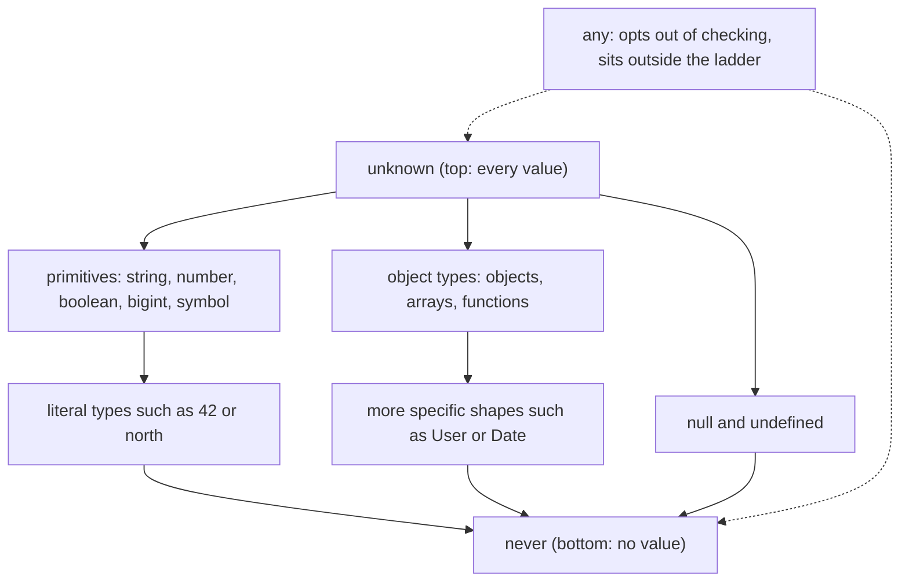

# Type modifiers: unknown, type predicates, keyof, typeof, assertions and const

> **Before this lesson:** you should be comfortable with union types and narrowing ([Unions, literals and narrowing](#/lesson/typescript/unions-narrowing)) and with object types ([Objects and structural typing](#/lesson/typescript/objects)). Function syntax from [Functions, arrays and tuples](#/lesson/typescript/functions-arrays-tuples) is used throughout.

## In plain words

So far, every type in this track described a value directly: "this is a string", "this is an object with a name". This lesson is about small tools that **adjust** types: they take a type or a value you already have and produce a more useful description of it. The official name for the group is *type modifiers*.

An everyday picture: imagine a parcel-sorting office.

- A parcel with no label at all can hold anything. A careful clerk will not open it and start using the contents; they scan it first. That unlabelled parcel is the type `unknown`, and the scan is *narrowing*.
- A scanner that you built yourself, and that prints a trustworthy label, is a **type predicate**.
- A list of the pigeon-holes on the wall is `keyof`: the set of names of the slots.
- Copying a label from an existing parcel so you do not have to write it out again is the type-level `typeof`.
- Slapping your own sticker on a parcel without scanning it ("trust me, it's books") is a **type assertion**. Fast, sometimes necessary, and the usual way that wrong parcels end up on the wrong lorry.
- Sealing a parcel so nothing inside can be swapped is a **const assertion**.

Why this matters for a job: these tools are what you reach for at the edges of a program, where data arrives from a network request, a file, or a library with loose types. Using them well is the difference between code that the checker can vouch for and code that merely *claims* to be typed. Interviewers ask about `any` versus `unknown` and about `as` for exactly that reason.

## The two top types

A **top type** is a type that every value belongs to. In the set picture from [The type system](#/lesson/typescript/type-system), it is the bag that contains all other bags. TypeScript has two of them, and the difference between them is the most important idea in this lesson.



Read each solid arrow as "contains". A value may always be moved **up** the ladder (a `string` can be stored in an `unknown` slot). Moving **down** requires proof. `any` is drawn off to the side because it ignores the ladder entirely.

### `any`: the checker switched off

You met `any` earlier. Start with the smallest possible example.

```typescript
function shoutAny(value: any) {
  return value.toUpperCase();
}
```

Line by line:

- `value: any` tells the checker "do not check anything about this parameter".
- `value.toUpperCase()` is therefore accepted without question, whether or not the value has such a method.

The checker says nothing, and the mistake waits until the program runs:

```js-run
function shoutAny(value) {
  return value.toUpperCase();
}
console.log(shoutAny("ahoy"));     // AHOY
try {
  console.log(shoutAny(42));       // numbers have no toUpperCase
} catch (err) {
  console.log("crash:", err.message);
}
```

The first call prints `AHOY`. The second throws, because the number `42` has no method called `toUpperCase`. Nothing warned us.

### `unknown`: accept everything, allow nothing

Now change one word.

```typescript
function shoutUnknown(value: unknown) {
  return value.toUpperCase();
  // Error: 'value' is of type 'unknown'.
}
```

`unknown` accepts every value, exactly like `any`. The difference is on the inside: the checker refuses to let you *do* anything with an `unknown` value (read a property, call it, add to it) until you have narrowed it. Narrowing, as a reminder, means running a check such as `typeof value === "string"` so the checker can rule possibilities out.

```typescript
function shoutUnknown(value: unknown): string {
  if (typeof value === "string") {
    return value.toUpperCase();     // value: string in this block
  }
  return "(not text)";
}
```

- The `if` line asks the runtime question "is this a string?".
- Inside the block the checker has updated its view: `value` is now `string`, so `toUpperCase` is allowed.
- After the block, `value` is still `unknown`, so we return a fixed piece of text.

```js-run
function shoutUnknown(value) {
  if (typeof value === "string") {
    return value.toUpperCase();
  }
  return "(not text)";
}
console.log(shoutUnknown("ahoy"));
console.log(shoutUnknown(42));       // no crash this time
```

| | `any` | `unknown` |
|---|---|---|
| Can receive any value | yes | yes |
| Can be assigned to a `string` variable | yes, unchecked | no, must narrow first |
| Property access, calls, arithmetic | all allowed | all errors until narrowed |
| Spreads to results | yes: results are `any` | no |
| Use it for | temporary migration escapes | data whose shape you have not checked yet |

> [!INTERVIEW]
> "What is the difference between `any` and `unknown`?" Both accept every value. `any` also lets you do anything with the value and is assignable to every other type, so it turns checking off and spreads. `unknown` permits no operations and is assignable only to `unknown` and `any`, so you are forced to narrow before use. Prefer `unknown` for values from outside the program, such as the result of `JSON.parse` or a caught error.

## Type predicates: narrowing functions you write yourself

The built-in checks (`typeof`, `instanceof`, `in`) narrow inside the `if` where they appear. A confusing thing happens when you move such a check into a helper function.

```typescript
function isText(value: unknown) {
  return typeof value === "string";       // inferred return type: boolean
}

function shout(value: unknown) {
  if (isText(value)) {
    value.toUpperCase();
    // Error: 'value' is of type 'unknown'.   (in TypeScript before 5.5)
  }
}
```

A newcomer reasonably asks: "the function returned `true`, so why does the checker not know it is a string?" Because the declared result is `boolean`, and a boolean carries no information about *which* value was tested or *what* was learned. (Since TypeScript 5.5 the checker works this out by itself for very small functions like this one; for anything longer you must say it yourself.)

The way to say it is a **type predicate**: a special return type of the form `parameterName is SomeType`. A *predicate* is a function that answers yes or no.

```typescript
function isText(value: unknown): value is string {
  return typeof value === "string";
}
```

- `value is string` replaces `boolean` as the return type.
- It means: "this returns a boolean, and when it is `true`, the argument passed as `value` is a `string`".

Now the caller narrows:

```typescript
function shout(value: unknown) {
  if (isText(value)) {
    return value.toUpperCase();      // value: string
  }
  return "(not text)";
}
```

### A realistic predicate: checking a shape

Predicates become valuable for object shapes, where the check is several lines long.

```typescript
interface Member {
  id: number;
  name: string;
}

function isMember(value: unknown): value is Member {
  return (
    typeof value === "object" &&          // 1. it is an object or null
    value !== null &&                     // 2. rule out null
    "id" in value &&                      // 3. the key exists
    typeof value.id === "number" &&       // 4. with the right type
    "name" in value &&
    typeof value.name === "string"
  );
}
```

Each numbered line removes one way the data could be wrong. Step 2 exists because `typeof null` is `"object"` in JavaScript, a historical quirk.

```js-run
function isMember(value) {
  return (
    typeof value === "object" &&
    value !== null &&
    typeof value.id === "number" &&
    typeof value.name === "string"
  );
}
const inputs = [{ id: 1, name: "Asha" }, { id: "1", name: "Asha" }, null, "Asha", { id: 2 }];
for (const input of inputs) {
  console.log(JSON.stringify(input), "->", isMember(input));
}
```

Only the first input passes. The second fails because its `id` is the text `"1"` rather than a number.

Predicates also teach `filter` what is left after filtering:

```typescript
const mixed = ["gull", null, "tern", undefined];
const names = mixed.filter((x): x is string => typeof x === "string");
// names: string[]
```

> [!WARNING]
> The checker **believes** a type predicate; it does not verify that the body really proves the claim. `function isMember(v: unknown): v is Member { return true; }` compiles, and every caller is now misled. A predicate is only as good as the checks inside it, so test predicates like any other code.

## Type operators: `keyof` and `typeof`

A **type operator** is a keyword that takes a type and computes another type from it.

### `keyof`: the names of the properties

Start with a type:

```typescript
interface Tariff {
  day: number;
  night: number;
  weekend: number;
}

type TariffName = keyof Tariff;     // "day" | "night" | "weekend"
```

`keyof Tariff` produces a union of string literal types, one per property name. Why is that useful? Consider a function that looks up a rate by name.

```typescript
function rate(tariff: Tariff, name: string): number {
  return tariff[name];
  // Error: Element implicitly has an 'any' type because expression of
  // type 'string' can't be used to index type 'Tariff'.
}
```

The checker objects because `name` could be any text at all, such as `"midnight"`, and `Tariff` has no such property. Restricting the parameter to the real property names fixes it, and callers are checked too:

```typescript
function rate(tariff: Tariff, name: keyof Tariff): number {
  return tariff[name];          // ok
}

const prices: Tariff = { day: 0.31, night: 0.12, weekend: 0.2 };
rate(prices, "night");          // ok
rate(prices, "midnight");
// Error: Argument of type '"midnight"' is not assignable to
// parameter of type 'keyof Tariff'.
```

If a property is added to `Tariff` later, `keyof Tariff` grows automatically. Nothing has to be kept in sync by hand.

```js-run
const prices = { day: 0.31, night: 0.12, weekend: 0.2 };
const rate = (tariff, name) => tariff[name];
console.log(rate(prices, "night"));
console.log(rate(prices, "midnight"));          // undefined: what keyof prevents
console.log(Object.keys(prices));               // the runtime cousin of keyof
```

### `typeof` in a type position

JavaScript already has a `typeof` operator that works on values while the program runs and gives back a string like `"number"`. TypeScript adds a second, separate use of the same word: written **where a type is expected**, `typeof someVariable` means "the type the checker inferred for this variable".

```typescript
const defaults = {
  theme: "dark",
  fontSize: 14,
  wrap: true,
};

type Settings = typeof defaults;
// { theme: string; fontSize: number; wrap: boolean }

function apply(overrides: Settings) { /* ... */ }
```

- The first statement creates an ordinary object.
- `type Settings = typeof defaults` asks the checker for the type it worked out, and gives that type a name.

This saves writing the shape twice (once as a value, once as a type) and guarantees they cannot drift apart.

### `keyof typeof`: the keys of a value

The two combine into an everyday idiom. `keyof` needs a type, but you have a value; `typeof` bridges the gap.

```typescript
const statusText = {
  200: "OK",
  404: "Not Found",
  503: "Unavailable",
};

type KnownStatus = keyof typeof statusText;     // 200 | 404 | 503

function describe(code: KnownStatus): string {
  return statusText[code];
}
```

Read it right to left: take the value `statusText`, get its type, then get that type's keys.

## Type assertions

Sometimes you know more than the checker can work out. A **type assertion** is the syntax for saying so: `value as SomeType`. (Older code writes `<SomeType>value`; it means the same but clashes with JSX syntax, so prefer `as`.)

The simplest case: a function whose return type is too vague to be useful.

```typescript
const raw = '["anchor", "chain"]';
const parsed = JSON.parse(raw);              // type: any
const items = JSON.parse(raw) as string[];   // type: string[]
```

- `JSON.parse` turns text into a value. The checker cannot read the text, so the declared result is `any`.
- `as string[]` tells the checker to treat the result as an array of strings from here on.

It is vital to understand what did **not** happen. No check ran. No conversion happened. The assertion is erased from the output like every other type. If the text held something else, the program carries on with a wrong label:

```js-run
const raw = '{"anchor": true}';
const items = JSON.parse(raw);      // what `as string[]` compiles to: nothing at all
try {
  console.log(items.map((s) => s.toUpperCase()));
} catch (err) {
  console.log("The assertion was wrong:", err.message);
}
```

The assertion promised an array; the data was an object; objects have no `map` method; crash.

### Assertions on caught errors

In JavaScript you can `throw` any value, not only `Error` objects. So inside `catch`, the caught variable is `unknown` (when `useUnknownInCatchVariables` is on, which `strict` includes).

```typescript
try {
  riskyOperation();
} catch (err) {
  console.log(err.message);
  // Error: 'err' is of type 'unknown'.

  console.log((err as Error).message);          // compiles, but is a guess

  if (err instanceof Error) {
    console.log(err.message);                   // proven: the safer choice
  } else {
    console.log(String(err));
  }
}
```

```js-run
function report(action) {
  try {
    action();
  } catch (err) {
    return err instanceof Error ? "Error: " + err.message : "Thrown value: " + String(err);
  }
  return "fine";
}
console.log(report(() => { throw new RangeError("too far"); }));
console.log(report(() => { throw "a bare string"; }));   // legal JavaScript
console.log(report(() => {}));
```

### Non-null assertions

A very common special case is removing `null` and `undefined`. A trailing exclamation mark does it: `value!` means "this is not null or undefined, trust me".

```typescript
const byId = new Map<string, number>();
byId.set("gull", 3);

const count = byId.get("gull");        // number | undefined
const sure = byId.get("gull")!;        // number
```

`Map.get` returns `undefined` for a missing key, hence the union. The `!` deletes `undefined` from the type without checking. If the key is absent, `sure` holds `undefined` while its type says `number`.

Prefer a real check, which costs one line and cannot lie:

```typescript
const count = byId.get("gull");
if (count === undefined) throw new Error("gull missing");
count.toFixed();       // number, proven
```

### Limits on assertions

The checker does apply one sanity rule: an assertion is allowed only when one of the two types is assignable to the other, in other words when they could plausibly overlap.

```typescript
const depth = "twelve" as number;
// Error: Conversion of type 'string' to type 'number' may be a mistake because
// neither type sufficiently overlaps with the other.
```

The rule can be bypassed by asserting twice, going up to `unknown` and back down:

```typescript
const depth = "twelve" as unknown as number;    // compiles; depth is a string at runtime
```

Treat a double assertion as an alarm bell in code review. It nearly always means the types upstream are wrong and should be fixed there.

### Assertion versus annotation

These two lines look alike and behave very differently.

```typescript
interface Crate { id: number; weightKg: number }

const a: Crate = { id: 1 };
// Error: Property 'weightKg' is missing.

const b = { id: 1 } as Crate;      // no error! b.weightKg is undefined at runtime
```

An **annotation** (`: Crate`) asks the checker to verify the value. An **assertion** (`as Crate`) asks it to stop verifying. Whenever both would compile, use the annotation.

## Const assertions

Recall from [The type system](#/lesson/typescript/type-system) that the checker *widens* values stored in mutable places: a `"dark"` inside an object becomes `string`, because the property could be reassigned. A **const assertion**, written `as const` after a literal, says "this will not change, so keep the most precise type". It does three things at once:

1. literals keep their literal types (`"dark"` rather than `string`);
2. object properties become `readonly`;
3. arrays become `readonly` tuples.

```typescript
const loose = { theme: "dark", sizes: [12, 14] };
// { theme: string; sizes: number[] }

const exact = { theme: "dark", sizes: [12, 14] } as const;
// { readonly theme: "dark"; readonly sizes: readonly [12, 14] }

exact.theme = "light";
// Error: Cannot assign to 'theme' because it is a read-only property.
exact.sizes.push(16);
// Error: Property 'push' does not exist on type 'readonly [12, 14]'.
```

The most common use is a list of allowed values that is needed both as data and as a type:

```typescript
const SIZES = ["small", "medium", "large"] as const;
type Size = (typeof SIZES)[number];        // "small" | "medium" | "large"
```

`(typeof SIZES)[number]` reads as "the type of any element of `SIZES`". Without `as const` the result would be plain `string`.

Unlike `as SomeType`, a const assertion is safe: it never claims anything untrue. But it is still compile-time only. To stop changes while the program runs you need `Object.freeze`:

```js-run
const exact = { theme: "dark", sizes: [12, 14] };   // `as const` leaves no trace here
exact.theme = "light";
exact.sizes.push(16);
console.log(exact);                                 // changed: nothing stopped it

const frozen = Object.freeze({ theme: "dark", sizes: Object.freeze([12, 14]) });
frozen.theme = "light";                             // ignored without strict mode
try { frozen.sizes.push(16); } catch (err) { console.log("blocked:", err.message); }
console.log(frozen);
```

## `satisfies`: check without changing the type

One more operator completes the set. An annotation checks a value but *replaces* its inferred type with the annotated one, which can lose detail. `satisfies` checks the value against a type and keeps the precise inferred type.

```typescript
type Palette = Record<string, string | number[]>;

const annotated: Palette = { sea: "#046", sand: [237, 201, 175] };
annotated.sea.toUpperCase();
// Error: Property 'toUpperCase' does not exist on type 'string | number[]'.

const checked = { sea: "#046", sand: [237, 201, 175] } satisfies Palette;
checked.sea.toUpperCase();      // ok: still known to be a string
checked.sky;
// Error: Property 'sky' does not exist.
```

`Record<string, X>` means "an object whose keys are strings and whose values are X". With the annotation, every value became the union. With `satisfies`, mistakes are still caught and each property keeps its own type.

## Pitfalls

- **Reaching for `any` when `unknown` would do.** `unknown` costs one narrowing step and keeps everything after it checked.
- **Predicates that do not prove their claim.** The checker does not audit the body.
- **Thinking `as` converts.** `"5" as unknown as number` is still the text `"5"`. Use `Number("5")` to convert.
- **Sprinkling `!`.** Each one is a place where `undefined` can sneak through. Search a code base for `!.` and `!;` to find them.
- **`as` on object literals.** It disables the missing-property check; annotate or use `satisfies`.
- **Assuming `as const` freezes at runtime.** It changes types only.
- **Mixing up the two `typeof`s.** In an expression it yields a string at runtime; in a type position it yields a type at compile time.
- **`keyof` on a type with an index signature** gives `string | number`, not specific names.

## Cheat sheet

| Tool | Syntax | What it does | Runtime effect |
|---|---|---|---|
| Safe top type | `unknown` | accepts all, requires narrowing | none |
| Unsafe top type | `any` | accepts all, checks nothing | none |
| Type predicate | `(x: unknown): x is T` | custom narrowing function | the function runs |
| Key union | `keyof T` | union of property names | none |
| Type of a value | `typeof value` (type position) | reuses an inferred type | none |
| Keys of a value | `keyof typeof value` | names of an object's properties | none |
| Assertion | `value as T` | overrides the checker | none |
| Non-null assertion | `value!` | removes null and undefined | none |
| Const assertion | `as const` | literal types, readonly | none |
| Conformance check | `value satisfies T` | verifies, keeps inferred type | none |

## Summary

`unknown` is the type for values you have not examined yet: it accepts everything and permits nothing until narrowed, which makes it the safe replacement for `any`. Type predicates package a narrowing check into a reusable function with the return type `x is T`. `keyof` turns a type into the union of its property names, the type-position `typeof` turns a value into its type, and together they derive types from data so that the two cannot disagree. Assertions (`as T`, `!`) override the checker without any runtime effect and should be rare and justified; annotations and `satisfies` check instead of overriding. `as const` keeps literal types and marks data read-only for the checker.

## Glossary

- **Top type:** a type that contains every possible value. TypeScript has `unknown` and `any`.
- **Bottom type:** the type with no values, `never`.
- **Narrowing:** the checker reducing a wide type to a more specific one after a runtime check.
- **Type guard:** any expression that causes narrowing, such as `typeof x === "string"`.
- **Type predicate:** a return type written `x is T`, turning a function into a custom type guard.
- **Type operator:** a keyword that computes a type from another type (`keyof`, type-position `typeof`).
- **Type assertion:** `value as T`; an unchecked instruction to treat a value as a given type.
- **Non-null assertion:** the `!` suffix, removing `null` and `undefined` from a type without checking.
- **Const assertion:** `as const`; keeps literal types and adds `readonly`.
- **Widening:** the checker replacing a literal type with its general primitive, for example `"dark"` with `string`.
- **Erasure:** removal of all type syntax when TypeScript is compiled to JavaScript.

```quiz
[
  {"q": "Does this compile? `function f(v: unknown) { return v.length; }`",
   "options": ["Yes, unknown allows any property access", "No: 'v' is of type 'unknown'", "Yes, but the result is any", "No: unknown cannot be a parameter type"],
   "answer": 1,
   "explain": "No operation is permitted on an `unknown` value until it has been narrowed with a check."},
  {"q": "What is the type `keyof { day: number; night: number }`?",
   "options": ["`string`", "`\"day\" | \"night\"`", "`number`", "`[\"day\", \"night\"]`"],
   "answer": 1,
   "explain": "`keyof` produces a union of the property names as literal types."},
  {"q": "What does `const items = JSON.parse(text) as string[]` do when the program runs?",
   "options": ["Throws if the data is not an array of strings", "Converts the data to strings", "Nothing extra: the assertion is erased", "Logs a warning"],
   "answer": 2,
   "explain": "Assertions exist only at compile time. The emitted code is `JSON.parse(text)` and nothing else."},
  {"q": "What is the inferred type of `SIZES`? `const SIZES = [\"small\", \"large\"] as const;`",
   "options": ["`string[]`", "`readonly [\"small\", \"large\"]`", "`[string, string]`", "`(\"small\" | \"large\")[]`"],
   "answer": 1,
   "explain": "A const assertion keeps literal element types and produces a read-only tuple."},
  {"q": "Does this compile? `interface Crate { id: number; weightKg: number } const b = { id: 1 } as Crate;`",
   "options": ["No: weightKg is missing", "Yes: an assertion skips the missing-property check", "No: assertions cannot be used on literals", "Yes, and weightKg is set to 0"],
   "answer": 1,
   "explain": "The literal's type is assignable *from* Crate's point of view (they overlap), so the assertion is accepted and the missing property goes unreported. An annotation would have caught it."},
  {"q": "A function is declared `function isMember(v: unknown): v is Member { return true; }`. What does the checker do?",
   "options": ["Reports that the body does not prove the claim", "Accepts it, and callers narrow to Member whenever it returns true", "Treats the return type as boolean", "Refuses unknown as the parameter type"],
   "answer": 1,
   "explain": "Type predicates are trusted, not verified. A wrong predicate silently misleads every caller."},
  {"q": "In `type Settings = typeof defaults;`, what does `typeof` produce?",
   "options": ["The string \"object\"", "The type the checker inferred for the variable defaults", "A copy of the object", "A runtime check"],
   "answer": 1,
   "explain": "In a type position, `typeof` is a compile-time operator that yields the type of a value. In an expression it is the JavaScript operator returning a string."},
  {"q": "Which statement about `value!` is true?",
   "options": ["It throws if value is null", "It converts null to a default", "It removes null and undefined from the type with no runtime check", "It is the same as `!value`"],
   "answer": 2,
   "explain": "The non-null assertion only changes the static type. If the value really is null or undefined, the program continues with it."}
]
```

> **Source:** Goldberg, *Learning TypeScript*, ch. 9 (Type Modifiers). Handbook: https://www.typescriptlang.org/docs/handbook/2/narrowing.html#using-type-predicates · https://www.typescriptlang.org/docs/handbook/2/keyof-types.html · https://www.typescriptlang.org/docs/handbook/2/typeof-types.html · https://www.typescriptlang.org/docs/handbook/2/everyday-types.html#type-assertions
