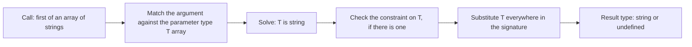

# Generics: type parameters, constraints, defaults and promises

> **Before this lesson:** you need function types and arrays from [Functions, arrays and tuples](#/lesson/typescript/functions-arrays-tuples), interfaces and classes from [Interfaces and classes](#/lesson/typescript/interfaces-classes), and `keyof` from [Type modifiers](#/lesson/typescript/type-modifiers).

## In plain words

A **generic** is a piece of code (a function, an interface, a class or a type alias) that has a blank in its types, to be filled in each time it is used. The blank is called a **type parameter**.

Think of a labelled storage box from a removal company. The company makes one design of box. On the side there is an empty label: "Contents: ______". When you pack books you write "books" and from then on everybody knows that what goes in is books and what comes out is books. The box design did not change; only the label was filled in. Without the label you would have two bad choices: build a separate box design for every kind of item (lots of duplicate work), or use unlabelled boxes and hope (no safety).

In code those bad choices are: writing `firstString`, `firstNumber`, `firstUser` as separate functions, or writing one function that takes `any` and returns `any`. Generics are the third option: write the code once and keep full type information.

Why this matters for a job: every library you will use is generic. `Array<T>`, `Promise<T>`, `Map<K, V>`, React's `useState<T>`, database clients, HTTP clients. You must be able to read generic signatures to use them, and to write small generic helpers of your own. "Write a generic function that..." is one of the most common TypeScript interview tasks.

## The problem, in the smallest example

Here is a function that returns its argument unchanged. It is a toy, but it shows the difficulty clearly.

```typescript
function echoNumber(value: number): number {
  return value;
}
```

It works only for numbers. To accept anything we could try `any`:

```typescript
function echoAny(value: any): any {
  return value;
}

const out = echoAny("harbour");     // out: any
out.toFixed(2);                     // no compile error, crashes when run
```

The function accepted a string, but the result is `any`: the checker has forgotten that a string went in. The connection between input and output is lost.

## A type parameter keeps the connection

```typescript
function echo<T>(value: T): T {
  return value;
}
```

Line by line:

- `<T>` after the function name declares a type parameter called `T`. It is a placeholder for a type, in the same way that `value` is a placeholder for a value. The name is arbitrary; `T` (for "type") is a convention.
- `value: T` says the argument has that placeholder type.
- `: T` after the parentheses says the result has the *same* type.

When the function is called, the checker looks at the argument and fills in the blank. This is called **type argument inference**.

```typescript
const a = echo("harbour");     // T is inferred as string; a: string
const b = echo(42);            // T is inferred as number; b: number

a.toUpperCase();               // ok
a.toFixed(2);
// Error: Property 'toFixed' does not exist on type 'string'.
```

The mistake that `any` let through is now caught. Like all types, `T` is erased from the output; the runtime function is unchanged:

```js-run
function echo(value) {
  return value;
}
console.log(echo("harbour").toUpperCase());
console.log(echo(42).toFixed(2));
```

Both lines run because each result really is what the checker said it was.

What the checker does at a generic call, step by step:



### Supplying the type yourself

You can fill in the blank explicitly by writing the type in angle brackets at the call. This is needed when there is nothing to infer from.

```typescript
const empty = [];                    // an array with no information about its elements
const names = new Array<string>();   // explicit: an array of strings
const lookup = new Map<string, number>();   // explicit: keys are strings, values numbers

echo<string>("harbour");             // allowed, but unnecessary: inference handles it
echo<string>(42);
// Error: Argument of type 'number' is not assignable to parameter of type 'string'.
```

A sensible habit: let inference work, and write explicit type arguments only when the inferred result is wrong or missing.

## A realistic first generic

`echo` is useless in practice. Here is the next step up: return the first element of any array.

```typescript
function first<T>(items: T[]): T | undefined {
  return items[0];
}

const port = first(["Calder", "Vellmar"]);   // string | undefined
const depth = first([4, 18]);                // number | undefined
const nothing = first([]);                   // undefined
```

- `items: T[]` means "an array whose elements are of some type `T`".
- `T | undefined` is the return type: an element, or `undefined` when the array is empty.
- At each call the checker matches the argument against `T[]` and solves for `T`.

```js-run
function first(items) {
  return items[0];
}
console.log(first(["Calder", "Vellmar"]), first([4, 18]), first([]));
```

### More than one type parameter

Separate several parameters with commas. Each is an independent blank.

```typescript
function pair<A, B>(left: A, right: B): [A, B] {
  return [left, right];
}

const p = pair("gull", 3);       // [string, number]
```

The classic example is `map`, which turns a list of one type into a list of another:

```typescript
function mapList<In, Out>(items: In[], convert: (item: In) => Out): Out[] {
  const result: Out[] = [];
  for (const item of items) result.push(convert(item));
  return result;
}

const lengths = mapList(["sloop", "brig"], (name) => name.length);
// In = string, Out = number, so lengths: number[]
```

Notice that the callback parameter `name` needed no annotation. The checker first learns `In = string` from the array, then uses that to type the callback's parameter, then learns `Out = number` from what the callback returns.

```js-run
function mapList(items, convert) {
  const result = [];
  for (const item of items) result.push(convert(item));
  return result;
}
console.log(mapList(["sloop", "brig"], (name) => name.length));
```

## Generic interfaces and type aliases

Interfaces and aliases can have blanks too. The type parameter is written after the name, and filled in wherever the type is used.

```typescript
interface Crate<Contents> {
  label: string;
  contents: Contents;
}

const tea: Crate<string> = { label: "A1", contents: "oolong" };
const nails: Crate<number[]> = { label: "B7", contents: [40, 50] };

const wrong: Crate<number> = { label: "C2", contents: "screws" };
// Error: Type 'string' is not assignable to type 'number'.
```

You have used generic interfaces since the second lesson without the name: `string[]` is shorthand for `Array<string>`, where `Array<T>` is an interface built into TypeScript.

A generic interface used as a *parameter* type lets the checker infer the blank from the argument:

```typescript
function unpack<T>(crate: Crate<T>): T {
  return crate.contents;
}

const leaves = unpack(tea);      // string
```

Unlike function calls, a generic *type* always needs its type arguments written when used in an annotation (unless a default exists, see below):

```typescript
const mystery: Crate = { label: "Z", contents: 1 };
// Error: Generic type 'Crate<Contents>' requires 1 type argument(s).
```

### A generic discriminated union: `Result`

Combining generics with the tagged unions from [Objects and structural typing](#/lesson/typescript/objects) gives one of the most useful types in everyday TypeScript: a value that is either a success carrying data or a failure carrying an error.

```typescript
type Result<Value, Problem = string> =
  | { ok: true; value: Value }
  | { ok: false; error: Problem };

function parsePort(text: string): Result<number> {
  const n = Number(text);
  if (!Number.isInteger(n) || n < 1 || n > 65535) {
    return { ok: false, error: `"${text}" is not a valid port` };
  }
  return { ok: true, value: n };
}

const r = parsePort("8080");
if (r.ok) {
  r.value.toFixed();       // r: { ok: true; value: number }
} else {
  r.error.toUpperCase();   // r: { ok: false; error: string }
}
```

The caller cannot reach `value` without first checking `ok`, so forgetting to handle failure is a compile error instead of a production incident.

```js-run
function parsePort(text) {
  const n = Number(text);
  if (!Number.isInteger(n) || n < 1 || n > 65535) {
    return { ok: false, error: `"${text}" is not a valid port` };
  }
  return { ok: true, value: n };
}
for (const input of ["8080", "http", "70000"]) {
  const r = parsePort(input);
  console.log(r.ok ? "port " + r.value : "problem: " + r.error);
}
```

## Defaults

In `Result<Value, Problem = string>` above, the `= string` is a **type parameter default**: the type used when the caller writes nothing for that blank. It works like a default value for a function parameter.

```typescript
const a: Result<number> = { ok: false, error: "nope" };            // Problem = string
const b: Result<number, Error> = { ok: false, error: new Error("nope") };
```

Parameters with defaults must come after those without, for the same reason optional function parameters come last.

## Constraints

Inside a generic function the checker knows nothing about `T`. It could be a number, an object, `null`. So any operation on a `T` value is refused:

```typescript
function longest<T>(a: T, b: T): T {
  return a.length >= b.length ? a : b;
  // Error: Property 'length' does not exist on type 'T'.
}
```

A beginner often thinks "but I only ever call it with strings and arrays". The checker cannot rely on that; it checks the function body for *every* `T` a caller might choose.

A **constraint** limits which types may fill the blank. It is written with the keyword `extends` after the parameter name, and here means "must be assignable to".

```typescript
function longest<T extends { length: number }>(a: T, b: T): T {
  return a.length >= b.length ? a : b;      // ok: every allowed T has length
}

longest("brig", "schooner");          // ok: strings have length
longest([1, 2, 3], [4]);              // ok: arrays have length
longest(10, 200);
// Error: Argument of type 'number' is not assignable to
// parameter of type '{ length: number; }'.
```

- `T extends { length: number }` reads "T can be any type that has a numeric `length` property".
- Inside the body, `a.length` is now allowed, because it exists on every permitted `T`.
- The return type is still `T`, so passing strings gives back a `string`, not the vaguer `{ length: number }`. That is the advantage over declaring the parameters as `{ length: number }` directly.

```js-run
function longest(a, b) {
  return a.length >= b.length ? a : b;
}
console.log(longest("brig", "schooner"));
console.log(longest([1, 2, 3], [4]));
console.log(longest(10, 200));   // undefined >= undefined is false, so 200: a silent wrong answer
```

### `keyof` constraints: typed property access

The constraint used most often ties one type parameter to the keys of another.

```typescript
function pluck<Obj, Key extends keyof Obj>(source: Obj, key: Key): Obj[Key] {
  return source[key];
}

const ferry = { name: "Kittiwake", capacity: 140, electric: true };

const n = pluck(ferry, "name");          // string
const c = pluck(ferry, "capacity");      // number
pluck(ferry, "colour");
// Error: Argument of type '"colour"' is not assignable to
// parameter of type '"name" | "capacity" | "electric"'.
```

Reading the signature:

- `Obj` is the type of the object passed in.
- `Key extends keyof Obj` means `Key` must be one of that object's property names.
- `Obj[Key]` is an **indexed access type**: "the type of property `Key` on `Obj`". For `"capacity"` it is `number`.

Without the second type parameter (using `key: keyof Obj` directly) the return type would be the union of *all* property types, `string | number | boolean`. The extra parameter lets the checker remember exactly which key was passed.

```js-run
const pluck = (source, key) => source[key];
const ferry = { name: "Kittiwake", capacity: 140, electric: true };
console.log(pluck(ferry, "name"), pluck(ferry, "capacity"), pluck(ferry, "colour"));
```

## Generic classes

A class can declare type parameters after its name. They are available to all instance members.

```typescript
class Stack<Item> {
  #items: Item[] = [];

  push(item: Item): void {
    this.#items.push(item);
  }

  pop(): Item | undefined {
    return this.#items.pop();
  }

  get size(): number {
    return this.#items.length;
  }
}

const plates = new Stack<string>();
plates.push("blue");
plates.push(7);
// Error: Argument of type 'number' is not assignable to parameter of type 'string'.
const top = plates.pop();      // string | undefined
```

If the constructor takes an argument of the parameter's type, the checker infers it and `<string>` can be omitted. A class may extend or implement a generic type, either fixing the blank (`class Names extends Stack<string>`) or passing its own parameter through (`class Logged<T> extends Stack<T>`). Methods may add their own type parameters, and `static` members cannot use the class's parameters because they belong to the class itself rather than to any particular instance.

```js-run
class Stack {
  #items = [];
  push(item) { this.#items.push(item); }
  pop() { return this.#items.pop(); }
  get size() { return this.#items.length; }
}
const plates = new Stack();
plates.push("blue"); plates.push("white");
console.log(plates.pop(), plates.size, new Stack().pop());
```

## Promises and async functions

A **promise** is JavaScript's object for a result that is not ready yet, for example the reply to a network request. It will later either *resolve* with a value or *reject* with an error. TypeScript models it with the generic interface `Promise<T>`, where `T` is the type of the value it will eventually resolve with.

```typescript
const soon: Promise<string> = new Promise((resolve) => {
  setTimeout(() => resolve("tide table loaded"), 100);
});

soon.then((text) => text.toUpperCase());     // text: string
```

When you construct a promise by hand and nothing reveals the type, say it explicitly, otherwise you get `Promise<unknown>`:

```typescript
const count = new Promise<number>((resolve) => resolve(3));
```

An `async` function always returns a promise. Whatever you `return` inside becomes the resolved value, so the declared return type must be `Promise<Something>`.

```typescript
interface Tide { height: number; at: string }

async function fetchTide(station: string): Promise<Tide> {
  const response = await fetch(`/api/tides/${station}`);
  return (await response.json()) as Tide;
}

async function show() {
  const tide = await fetchTide("calder");    // Tide   (await unwraps the promise)
  const pending = fetchTide("calder");       // Promise<Tide>
  pending.height;
  // Error: Property 'height' does not exist on type 'Promise<Tide>'.
  // Did you forget to use 'await'?
}

async function wrong(): number { return 1; }
// Error: The return type of an async function or method must be
// the global Promise<T> type. Did you mean to write 'Promise<number>'?
```

Step by step in `fetchTide`: `fetch` returns `Promise<Response>`; `await` pauses until it resolves and hands back the `Response`; `response.json()` returns `Promise<any>` because the checker cannot know what the server sent; the assertion labels it as `Tide`. That last step is a claim, not a check, a point the real-projects module returns to.

```js-run
function fakeFetchTide(station) {
  return new Promise((resolve) => setTimeout(() => resolve({ station, height: 2.4 }), 50));
}

async function show() {
  const pending = fakeFetchTide("calder");
  console.log("without await:", String(pending), pending.height);
  const tide = await pending;
  console.log("with await:", tide.height);
}
show();
```

The first log prints `[object Promise] undefined`: a promise object has no `height`. That is the bug the "Did you forget to use 'await'?" message prevents.

## Using generics well

> [!TIP]
> **The golden rule:** a type parameter should appear at least twice in a signature. Its whole purpose is to *relate* two things (two parameters, or a parameter and the return type). A parameter that appears once relates nothing and can be replaced by a plain type.

```typescript
// Pointless: T appears once. Equivalent to (value: unknown) => void.
function logValue<T>(value: T): void { console.log(value); }

// Misleading: T appears only in the return type, so the caller can "choose" any type.
function load<T>(key: string): T { return JSON.parse(localStorage.getItem(key)!); }
const n = load<number>("user");     // an assertion in disguise
```

The second pattern is common in real code bases and is worth recognising: nothing in the arguments determines `T`, so it is no safer than `as`.

Naming: single letters (`T`, `K`, `V`) are traditional and fine for small helpers. In signatures with two or more parameters, descriptive names (`Item`, `Key`, `Value`) are easier to read. Many teams prefix them (`TItem`).

> [!INTERVIEW]
> "Why use a generic instead of `any`?" With `any` the relationship between inputs and outputs is lost: `first(items: any[]): any` forgets the element type. With a generic, `first<T>(items: T[]): T | undefined` preserves it, so the caller gets a precisely typed result and mistakes are caught. "When would you add a constraint?" When the body needs to use a capability of `T` (a property, a method, being a valid key), expressed as `T extends Capability`.

## Pitfalls

- **Type parameters used once.** They add noise without adding safety.
- **Return-only type parameters.** `function get<T>(): T` lets callers pick a type nobody verified.
- **Forgetting constraints.** "Property does not exist on type 'T'" means the body assumes something the signature has not required.
- **Over-constraining.** `T extends string` is rarely better than plain `string` unless you need the literal type preserved.
- **Explicit type arguments everywhere.** They go stale; rely on inference.
- **Forgetting `await`.** A `Promise<Tide>` is not a `Tide`. The `no-floating-promises` lint rule catches promises that are never awaited.
- **`Promise<any>` from `response.json()`.** It poisons everything downstream unless validated or narrowed.
- **Arrow functions in `.tsx` files.** `<T>(x: T) => x` looks like a JSX tag to the parser; write `<T,>(x: T) => x`.

## Cheat sheet

| Need | Syntax |
|---|---|
| Generic function | `function f<T>(x: T): T` |
| Generic arrow function | `const f = <T>(x: T): T => x` |
| Several parameters | `<A, B>` |
| Explicit type argument | `f<string>("x")`, `new Map<string, number>()` |
| Generic interface / alias | `interface Box<T> { value: T }`, `type Pair<A, B> = [A, B]` |
| Generic class | `class Stack<T> { ... }` |
| Default | `<T = string>` |
| Constraint | `<T extends { length: number }>` |
| Key constraint | `<O, K extends keyof O>(o: O, k: K): O[K]` |
| Eventual value | `Promise<T>` |
| Async function | `async function f(): Promise<T>` |
| Unwrap a promise type | `Awaited<Promise<T>>` gives `T` |

## Summary

Generics put a named blank into the types of a function, interface, class or alias, and the blank is filled in at each use, usually by inference from the arguments. This keeps inputs and outputs connected in a way `any` cannot. Constraints (`T extends ...`) restrict the allowed types so the body may rely on certain members, and `K extends keyof T` with `T[K]` gives precisely typed property access. Defaults supply a type when none is given. `Promise<T>` is the generic that models asynchronous results; `async` functions always return one and `await` unwraps it. Use a type parameter only when it relates at least two positions in a signature.

## Glossary

- **Generic:** a function, class, interface or alias with one or more type parameters.
- **Type parameter:** the placeholder name declared in angle brackets, such as `T` in `function f<T>`.
- **Type argument:** the actual type that fills a type parameter at a particular use, such as `string` in `Stack<string>`.
- **Type argument inference:** the checker working out type arguments from the values passed to a call.
- **Constraint:** a restriction on a type parameter, written `T extends Something`.
- **Default (type parameter):** the type used when no type argument is given, written `T = Something`.
- **Indexed access type:** `Obj[Key]`, the type of a named property of another type.
- **Promise:** an object representing a value that will be available later, or an error.
- **Resolve / reject:** a promise finishing successfully with a value, or failing with an error.
- **`async` function:** a function declared with the `async` keyword; it always returns a promise and may use `await`.
- **`await`:** an operator that pauses an `async` function until a promise settles and yields its value.

```quiz
[
  {"q": "What is the inferred type of `x`? `function first<T>(items: T[]): T | undefined { return items[0]; } const x = first([4, 18]);`",
   "options": ["`number`", "`number | undefined`", "`any`", "`T | undefined`"],
   "answer": 1,
   "explain": "T is inferred as number from the argument, and the declared return type is `T | undefined`."},
  {"q": "Does this compile? `function longest<T>(a: T, b: T): T { return a.length >= b.length ? a : b; }`",
   "options": ["Yes", "No: Property 'length' does not exist on type 'T'", "Yes, T is inferred to have length", "No: T must be declared with var"],
   "answer": 1,
   "explain": "An unconstrained T could be anything, so no members are available. Add `T extends { length: number }`."},
  {"q": "Given `function pluck<O, K extends keyof O>(o: O, k: K): O[K]` and `const f = { name: \"K\", capacity: 140 }`, what is the type of `pluck(f, \"capacity\")`?",
   "options": ["`string | number`", "`number`", "`any`", "`\"capacity\"`"],
   "answer": 1,
   "explain": "K is inferred as the literal `\"capacity\"`, and the indexed access `O[\"capacity\"]` is number."},
  {"q": "Does this compile? `async function count(): number { return 1; }`",
   "options": ["Yes", "No: an async function's return type must be Promise<T>", "Yes, the number is returned directly", "No: async functions cannot return numbers"],
   "answer": 1,
   "explain": "Async functions always return a promise, so the annotation must be `Promise<number>`."},
  {"q": "What is the inferred type of `p`? `const p = new Promise((resolve) => resolve(3));`",
   "options": ["`Promise<number>`", "`Promise<unknown>`", "`Promise<any>`", "`number`"],
   "answer": 1,
   "explain": "Nothing in the constructor call fixes the type parameter, so it falls back to unknown. Write `new Promise<number>(...)`."},
  {"q": "Which signature breaks the rule that a type parameter should relate at least two positions?",
   "options": ["`function first<T>(items: T[]): T | undefined`", "`function pair<A, B>(a: A, b: B): [A, B]`", "`function logValue<T>(value: T): void`", "`function pluck<O, K extends keyof O>(o: O, k: K): O[K]`"],
   "answer": 2,
   "explain": "T appears once, so it connects nothing; `value: unknown` would be equivalent."},
  {"q": "Does this compile? `interface Crate<C> { contents: C } const m: Crate = { contents: 1 };`",
   "options": ["Yes, C is inferred as number", "No: generic type 'Crate<C>' requires 1 type argument", "Yes, C becomes any", "No: interfaces cannot be generic"],
   "answer": 1,
   "explain": "Generic types in annotations need their type arguments unless the parameter has a default. Inference applies to function calls, not to annotations."},
  {"q": "With `type Result<V, P = string> = { ok: true; value: V } | { ok: false; error: P }`, what is the type of `error` in `Result<number>`?",
   "options": ["`number`", "`string`", "`unknown`", "`never`"],
   "answer": 1,
   "explain": "The second type parameter was omitted, so its default `string` is used."}
]
```

> **Source:** Goldberg, *Learning TypeScript*, ch. 10 (Generics). Handbook: https://www.typescriptlang.org/docs/handbook/2/generics.html · https://www.typescriptlang.org/docs/handbook/2/indexed-access-types.html · https://www.typescriptlang.org/docs/handbook/2/functions.html#generic-functions
