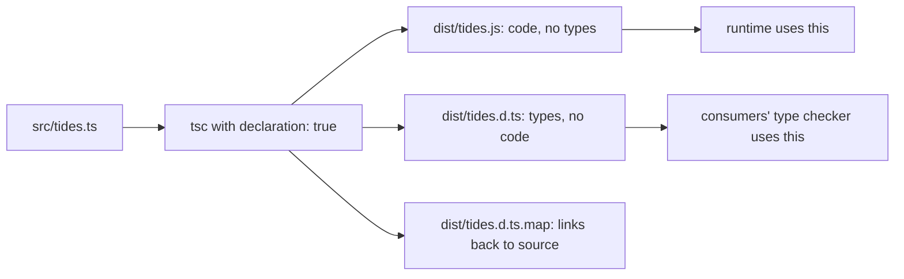

# Declaration files: describing code you did not write in TypeScript

> **Before this lesson:** you should know what type erasure is ([From JavaScript to TypeScript](#/lesson/typescript/js-to-ts)), how modules import and export ([The type system](#/lesson/typescript/type-system)) and how interfaces merge ([Interfaces and classes](#/lesson/typescript/interfaces-classes)).

## In plain words

Most of the code a program runs was not written by you, and much of it was not written in TypeScript: the browser's built-in functions, Node.js, and thousands of packages published as plain JavaScript. The type checker can only check what it has a description of. A **declaration file** is that description: a file ending in `.d.ts` that contains **only types, with no runnable code**.

An everyday comparison: a restaurant menu. The menu lists every dish, what is in it and what it costs, but the menu is not food. You cannot eat it. The kitchen (the real JavaScript) does the cooking. The menu lets you order correctly without walking into the kitchen to see what is there. A declaration file is the menu for a piece of JavaScript: it lists the functions, their parameters and their results, so the checker and your editor know what you may ask for.

Why it matters for a job: on the first day in any real code base you will meet messages such as "Could not find a declaration file for module 'some-library'" or "Cannot find name 'process'". They are not bugs in your code. They mean a menu is missing, and this lesson shows how to find one or write one. If you ever publish a library, producing good declaration files is how other people get autocomplete for your work.

## The smallest declaration file

Suppose a web page loads an old script through a `<script>` tag, and that script creates a global variable called `APP_VERSION`. Your TypeScript file wants to read it.

```typescript
// main.ts
console.log(APP_VERSION);
// Error: Cannot find name 'APP_VERSION'.
```

The variable will exist when the page runs, but the checker has never been told about it. Create a file next to it:

```typescript
// globals.d.ts
declare const APP_VERSION: string;
```

Piece by piece:

- The file name ends in `.d.ts`. That ending tells the compiler "this file describes things; it will never produce JavaScript".
- `declare` is the keyword meaning "this exists somewhere else; I am only telling you its type". Nothing is created.
- `const APP_VERSION: string` is the description: a constant holding a string.

Now `main.ts` compiles, and `APP_VERSION.toUpperCase()` gets autocomplete. The word for a description with no implementation is an **ambient declaration**: it describes what is in the surrounding environment.

A declaration is a promise about the environment, and the checker cannot verify it. If the script tag is missing, the code compiles and then fails:

```js-run
// Compiled main.js. The declaration file produced no output, so nothing defines the variable.
try {
  console.log(APP_VERSION);
} catch (err) {
  console.log(err.name + ":", err.message);
}

// With the legacy script present, the same line works:
globalThis.APP_VERSION = "4.2.0";
console.log(APP_VERSION.toUpperCase());
```

The first attempt throws a `ReferenceError` because no such variable exists yet. After something defines it, the same expression succeeds.

### What may and may not appear in a `.d.ts` file

Declaration files may contain types and `declare` statements, and nothing with a body or a value.

```typescript
// shapes.d.ts
interface Point { x: number; y: number }                    // ok: a type
declare function distance(a: Point, b: Point): number;      // ok: signature, no body
declare let debugMode: boolean;                             // ok: no initial value
declare class Timer {                                       // ok: members without bodies
  constructor(label: string);
  stop(): number;
}

declare function broken(): number { return 1; }
// Error: An implementation cannot be declared in ambient contexts.
declare let count = 0;
// Error: Initializers are not allowed in ambient contexts.
```

`declare` can also be used inside an ordinary `.ts` file when you want to describe one global without creating a separate file.

## Describing globals

### Adding to existing global interfaces

Browsers expose a global object called `window`, whose type is the built-in interface `Window`. Suppose an analytics script adds `window.trackEvent`. Because interfaces with the same name merge (see [Interfaces and classes](#/lesson/typescript/interfaces-classes)), you extend `Window` by declaring it again:

```typescript
// globals.d.ts
interface Window {
  trackEvent(name: string, data?: Record<string, unknown>): void;
}
```

```typescript
// main.ts
window.trackEvent("signup", { plan: "crew" });     // ok
window.trackEvent(42);
// Error: Argument of type 'number' is not assignable to parameter of type 'string'.
```

### Global augmentation from inside a module

There is a catch a newcomer hits quickly. The trick above works only when `globals.d.ts` is a *script* (a file without any top-level `import` or `export`). As soon as the file imports a type from somewhere, it becomes a *module*, and everything in it is private to that module. To reach the global scope from inside a module, wrap the declarations in `declare global`:

```typescript
// globals.d.ts
import type { Analytics } from "./analytics";

declare global {
  interface Window {
    analytics: Analytics;
  }
  var buildNumber: number;
}

export {};
```

- `declare global { ... }` means "the declarations in these braces belong to the global scope".
- `var buildNumber` is written with `var` on purpose: only `var` declarations become properties of `globalThis`, so `globalThis.buildNumber` type-checks.
- `export {}` exports nothing; its only job is to make sure the file is treated as a module when it has no other imports or exports.

## Built-in declarations

Where do `Array.prototype.map`, `Math.max`, `document.querySelector` and `console.log` get their types? From declaration files that ship inside the `typescript` package itself. Open `node_modules/typescript/lib` and you will find files such as `lib.es5.d.ts`, `lib.es2022.array.d.ts` and `lib.dom.d.ts`.

Two compiler options choose which of them are loaded.

| Option | Meaning | Example |
|---|---|---|
| `target` | The JavaScript version of the *output*. It also selects the matching library declarations by default. | `"ES2022"` |
| `lib` | An explicit list of library declarations, overriding the default derived from `target`. | `["ES2023", "DOM", "DOM.Iterable"]` |

This explains two errors that look mysterious at first.

```typescript
// tsconfig: "target": "ES2015"
["a", "b"].at(-1);
// Error: Property 'at' does not exist on type 'string[]'. Do you need to change
// your target library? Try changing the 'lib' compiler option to 'es2022' or later.
```

`Array.prototype.at` was added to JavaScript in 2022. With an older library selected, the checker does not know about it.

```typescript
// tsconfig: "lib": ["ES2022"]   (no "DOM")
document.title = "Harbour";
// Error: Cannot find name 'document'. Do you need to change your target library?
// Try changing the 'lib' compiler option to include 'dom'.
```

That second one is correct behaviour for a Node.js project, where no `document` exists.

> [!WARNING]
> `lib` describes what the checker *believes* is available. It adds nothing at runtime. If you list `ES2023` and run on an older engine, the call compiles and then throws. Match `lib` to the oldest environment you support, or ship a polyfill (code that supplies a missing built-in feature).

```js-run
// What "the method is declared but not really there" looks like:
const list = ["a", "b"];
const realAt = Array.prototype.at;
delete Array.prototype.at;                 // simulate an older engine
try {
  list.at(-1);
} catch (err) {
  console.log(err.message);
}
Array.prototype.at = realAt;               // put it back
console.log(list.at(-1));
```

## Declarations for modules

### Packages that include their own types

Many packages are written in TypeScript, or include hand-written declarations. Their `package.json` tells the compiler where the menu is:

```json
{
  "name": "tide-math",
  "version": "2.1.0",
  "main": "./dist/index.js",
  "types": "./dist/index.d.ts",
  "exports": {
    ".": {
      "types": "./dist/index.d.ts",
      "import": "./dist/index.js"
    }
  }
}
```

- `main` is the JavaScript file Node loads.
- `types` points at the declaration file for that entry.
- `exports` is the modern, more precise map of entry points; put `types` first within each entry.

Nothing extra is needed from you: `import { springRange } from "tide-math"` is typed immediately.

### DefinitelyTyped and `@types`

Thousands of older or JavaScript-only packages include no types. For those, the community maintains declarations in a huge shared repository called **DefinitelyTyped**. Each set is published to npm under the `@types` scope, named after the package it describes.

```bash
npm install express
npm install --save-dev @types/express
```

The compiler automatically looks in `node_modules/@types`, so installing is all that is required. Common ones you will install early: `@types/node` (Node's built-in modules and globals such as `process` and `Buffer`), `@types/react`, `@types/jest`.

Things to know:

- `@types` packages are development dependencies for applications, because they vanish at runtime.
- Their version numbers follow the described package's major and minor version (`@types/express@4.17.x` describes `express@4.17`). Keep them aligned.
- They are written by volunteers and can be incomplete or slightly wrong.

### When no types exist at all

```typescript
import { tint } from "old-colour-lib";
// Error: Could not find a declaration file for module 'old-colour-lib'.
// '.../node_modules/old-colour-lib/index.js' implicitly has an 'any' type.
// Try `npm i --save-dev @types/old-colour-lib` if it exists
// or add a new declaration (.d.ts) file containing `declare module 'old-colour-lib';`
```

The message lists the remedies. If no `@types` package exists, write the menu yourself with an **ambient module declaration**:

```typescript
// types/old-colour-lib.d.ts

// Quickest: everything imported from the module is `any`.
declare module "old-colour-lib";
```

That removes the error but gives no checking. A better version describes the parts you actually use:

```typescript
// types/old-colour-lib.d.ts
declare module "old-colour-lib" {
  export interface Rgb { r: number; g: number; b: number }
  export function tint(colour: Rgb, amount: number): Rgb;
  export const VERSION: string;
}
```

Reading it: `declare module "name" { ... }` says "when someone imports from this name, here is what they get". Inside the braces, each `export` lists one thing the module provides.

### Wildcard module declarations for assets

Bundlers (tools such as Vite or webpack that combine source files for the browser) let you import things that are not JavaScript: images, stylesheets, text. The checker has no idea what `./logo.svg` exports. A wildcard pattern describes every matching import at once:

```typescript
// assets.d.ts
declare module "*.svg" {
  const url: string;
  export default url;
}

declare module "*.module.css" {
  const classes: Record<string, string>;
  export default classes;
}
```

```typescript
import logo from "./logo.svg";        // logo: string
import styles from "./nav.module.css";
styles.header;                        // string
```

The `*` matches any text, so any path ending in `.svg` uses the first declaration. Project templates usually ship such a file for you (for example `vite/client` types).

### Module augmentation

Sometimes a library's types are fine but you need to add something to them. The standard example is attaching the signed-in user to an Express request in a middleware. Declaring the module again *merges* with the original:

```typescript
// types/express.d.ts
import "express";

declare module "express-serve-static-core" {
  interface Request {
    userId?: string;
  }
}
```

The `import "express"` line makes this file a module, which switches `declare module` from "define this module from scratch" to "add to the existing module". Leaving it out would replace the library's types with yours, a mistake that produces hundreds of unrelated errors.

## Generating declarations for your own code

You almost never write `.d.ts` files for your own TypeScript. The compiler produces them when `declaration` is on.

```json
{
  "compilerOptions": {
    "declaration": true,
    "declarationMap": true,
    "outDir": "dist"
  }
}
```

Given this source:

```typescript
// src/tides.ts
export interface Tide { height: number; rising: boolean }

const METRES_PER_FOOT = 0.3048;

export function toFeet(tide: Tide): number {
  return tide.height / METRES_PER_FOOT;
}
```

the compiler writes two files:

```javascript
// dist/tides.js
const METRES_PER_FOOT = 0.3048;
export function toFeet(tide) {
  return tide.height / METRES_PER_FOOT;
}
```

```typescript
// dist/tides.d.ts
export interface Tide { height: number; rising: boolean }
export declare function toFeet(tide: Tide): number;
```



The JavaScript file keeps the logic and loses the types. The declaration file keeps the types and loses the logic. Notice that `METRES_PER_FOOT` is absent from the declaration: it was not exported, so consumers cannot see it. `declarationMap` adds a small map file so "go to definition" in an editor jumps to the original `.ts` source rather than the generated `.d.ts`.

```js-run
// dist/tides.js at work: all a consumer's runtime ever sees.
const METRES_PER_FOOT = 0.3048;
function toFeet(tide) {
  return tide.height / METRES_PER_FOOT;
}
console.log(toFeet({ height: 2.4, rising: true }).toFixed(2), "ft");
console.log(toFeet({ height: "2.4" }).toFixed(2), "ft");   // accepted here; a consumer's checker would refuse it
```

## How the compiler finds types for an import

When the checker meets `import x from "something"`, it searches in roughly this order:

1. a `paths` mapping in `tsconfig.json`, if one matches;
2. for relative paths (`./file`), a neighbouring `file.ts`, `file.tsx` or `file.d.ts`;
3. `node_modules/something/package.json`: the `exports` and `types` fields;
4. `node_modules/@types/something`;
5. an ambient `declare module "something"` in any file included in the project;
6. otherwise the error "Could not find a declaration file", or implicit `any` when `noImplicitAny` is off.

> [!TIP]
> Put your hand-written declarations in a folder such as `types/` or `src/types/`, and check that the folder is matched by `include` in `tsconfig.json`. A declaration file the compiler never loads is the most common reason for "I declared it but the error is still there".

### `skipLibCheck`

Declaration files in `node_modules` are type-checked like everything else. Two libraries with conflicting assumptions can therefore produce errors in files you cannot edit. The option `skipLibCheck: true` tells the compiler not to check the *insides* of `.d.ts` files, while still using them to check your code. Most projects enable it: builds are faster and third-party conflicts stop blocking you. The cost is that mistakes in your own hand-written `.d.ts` files are also skipped.

> [!INTERVIEW]
> "What is a `.d.ts` file and when would you write one?" It is a file containing only type declarations, with no runtime output; it tells the checker the shape of code that exists elsewhere. The compiler generates them for your own code with `declaration: true`. You write one by hand to describe an untyped JavaScript package (`declare module "name"`), non-code imports such as images (`declare module "*.svg"`), or globals added by scripts or by your own code (`declare global`). "What is `@types/...`?" Community-maintained declaration packages from the DefinitelyTyped repository for libraries that do not ship types.

## Pitfalls

- **Believing a declaration creates something.** It only describes. If the real code is absent, the program fails when run.
- **An `import` at the top of a global `.d.ts`** silently turns it into a module, and your globals disappear. Use `declare global`.
- **Forgetting the side-effect import in an augmentation**, which replaces the library's types instead of extending them.
- **`@types` version drift.** Types for version 5 with a version 4 runtime describe functions that do not exist.
- **Installing `@types/x` when `x` already ships types.** The two can conflict; prefer the bundled ones.
- **Shorthand `declare module "x";` left in forever.** It makes the whole library `any`.
- **Declaration files outside `include`.** They are ignored.
- **`lib` newer than the runtime.** Compiles, then throws.

## Cheat sheet

| Need | Write |
|---|---|
| Describe a global variable | `declare const NAME: string;` |
| Describe a global function | `declare function f(x: number): string;` |
| Add a member to `window` | `interface Window { thing: T }` in a script `.d.ts` |
| Globals from inside a module file | `declare global { ... }` plus `export {}` |
| Silence a missing untyped package | `declare module "pkg";` |
| Type an untyped package | `declare module "pkg" { export function f(): void }` |
| Type asset imports | `declare module "*.svg" { const url: string; export default url }` |
| Extend a library's types | `import "pkg"; declare module "pkg" { interface X { extra: T } }` |
| Community types | `npm i -D @types/pkg` |
| Emit declarations | `"declaration": true` |
| Choose built-in types | `"target"` and `"lib"` |
| Skip checking of `.d.ts` internals | `"skipLibCheck": true` |

## Summary

A declaration file holds types without code and tells the checker about things that exist outside your TypeScript: globals from scripts, the JavaScript and browser standard libraries (selected by `target` and `lib`), and JavaScript packages. Packages either ship their own declarations through the `types` and `exports` fields of `package.json`, or get them from `@types` packages maintained in DefinitelyTyped, or need a `declare module` written by you. Existing types can be extended through interface merging, `declare global` and module augmentation. For your own code the compiler generates declaration files next to the JavaScript when `declaration` is enabled. In every case a declaration is a promise about what will be there when the program runs, not a guarantee.

## Glossary

- **Declaration file:** a file ending in `.d.ts` containing only type information.
- **Ambient declaration:** a statement beginning with `declare` that describes something defined elsewhere.
- **Global scope:** the set of names visible in every file without importing.
- **Script (file):** a file with no top-level `import` or `export`; its declarations are global.
- **Module (file):** a file with a top-level `import` or `export`; its declarations are private unless exported.
- **Global augmentation:** adding declarations to the global scope from inside a module with `declare global`.
- **Module augmentation:** adding declarations to an existing module by declaring it again after importing it.
- **DefinitelyTyped:** the community repository of declaration files, published as `@types/...` packages.
- **Bundler:** a build tool that combines many source files (and assets) into files a browser can load.
- **Polyfill:** code that supplies a built-in feature on engines that lack it.
- **`lib`:** the compiler option listing which built-in declaration files are loaded.

```quiz
[
  {"q": "What JavaScript does the compiler emit for a file named `globals.d.ts` containing `declare const APP_VERSION: string;`?",
   "options": ["`const APP_VERSION = \"\";`", "`var APP_VERSION;`", "Nothing at all", "A runtime check that the variable exists"],
   "answer": 2,
   "explain": "Declaration files and `declare` statements describe existing things and produce no output."},
  {"q": "Does this compile inside a `.d.ts` file? `declare function area(r: number): number { return 3.14 * r * r; }`",
   "options": ["Yes", "No: an implementation cannot be declared in ambient contexts", "Yes, but the body is ignored", "Only with skipLibCheck"],
   "answer": 1,
   "explain": "Ambient declarations may contain signatures only; bodies and initializers are errors."},
  {"q": "A `.d.ts` file starts with `import type { A } from \"./a\";` and then contains `interface Window { a: A }`. Why does `window.a` not type-check elsewhere?",
   "options": ["Window cannot be extended", "The import made the file a module, so the interface is local; `declare global` is needed", "Interfaces cannot use imported types", "The file must be named window.d.ts"],
   "answer": 1,
   "explain": "Any top-level import or export makes the file a module, and declarations inside it no longer merge with the globals unless wrapped in `declare global`."},
  {"q": "With `\"lib\": [\"ES2022\"]` and no DOM entry, does `document.title = \"x\"` compile?",
   "options": ["Yes", "No: Cannot find name 'document'", "Yes, document is any", "Only in .tsx files"],
   "answer": 1,
   "explain": "The DOM declarations are loaded only when `lib` includes them (or when `lib` is left to its default for the target)."},
  {"q": "What is the type of `logo` after `import logo from \"./logo.svg\";` given `declare module \"*.svg\" { const url: string; export default url; }`?",
   "options": ["`any`", "`string`", "`SVGElement`", "It does not compile"],
   "answer": 1,
   "explain": "The wildcard ambient module matches the import path and declares its default export as a string."},
  {"q": "You run `npm install lodash` and get \"Could not find a declaration file for module 'lodash'\". What is the usual first fix?",
   "options": ["Rename the import to lodash.d.ts", "`npm install --save-dev @types/lodash`", "Set strict to false", "Add `declare const lodash: any` to every file"],
   "answer": 1,
   "explain": "Types for packages that do not ship their own usually live in the matching `@types` package from DefinitelyTyped."},
  {"q": "With `declaration: true`, an unexported `const SECRET = 1` in a module appears where?",
   "options": ["In both the .js and the .d.ts", "In the .js output only", "In the .d.ts output only", "In neither"],
   "answer": 1,
   "explain": "The code still needs it, so it is in the JavaScript. Declaration files list only what is exported."},
  {"q": "What does `skipLibCheck: true` do?",
   "options": ["Ignores all types from node_modules", "Stops type-checking the contents of declaration files while still using them to check your code", "Disables the lib option", "Skips emitting .d.ts files"],
   "answer": 1,
   "explain": "Declarations are still loaded and applied to your code; only errors inside the `.d.ts` files themselves are not reported."}
]
```

> **Source:** Goldberg, *Learning TypeScript*, ch. 11 (Declaration Files). Handbook: https://www.typescriptlang.org/docs/handbook/declaration-files/introduction.html · https://www.typescriptlang.org/docs/handbook/declaration-merging.html#module-augmentation · https://www.typescriptlang.org/tsconfig#lib · https://www.typescriptlang.org/docs/handbook/declaration-files/consumption.html
