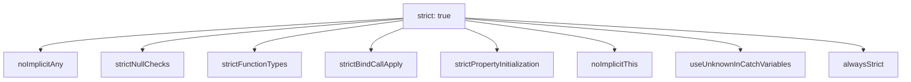

# Configuration: tsconfig.json and the strictness flags

> **Before this lesson:** you should know the compile pipeline from [From JavaScript to TypeScript](#/lesson/typescript/js-to-ts), `null` handling from [Unions, literals and narrowing](#/lesson/typescript/unions-narrowing), class property rules from [Interfaces and classes](#/lesson/typescript/interfaces-classes), and what a declaration file is ([Declaration files](#/lesson/typescript/declaration-files)).

## In plain words

The TypeScript compiler is one program with well over a hundred switches. The switches decide which files it reads, how picky the checker is, what kind of JavaScript comes out, and where the output goes. Rather than typing the switches on every run, a project stores them in one file named **`tsconfig.json`** at its root. (JSON, JavaScript Object Notation, is a plain-text format for structured data: names in quotes, a colon, a value.)

Compare it to the settings panel of a washing machine. The machine is the same in every home, but one household chooses 30 degrees and a gentle spin, another chooses 60 degrees and a long cycle. Saving a programme means nobody has to remember the combination, and everyone who uses the machine gets the same result. `tsconfig.json` is the saved programme for a code base: every teammate, every editor and the build server read the same file and so agree on what counts as an error.

Why it matters for a job: when you join a team, the configuration explains most surprises ("why is this an error here but not in my side project?"). When you start a project, a handful of choices in this file, above all `strict`, decide how many bugs the checker will find for you. Interviewers like to ask what `strict` turns on.

## The smallest configuration

Create an empty folder with one source file and one configuration file.

```json
{
  "compilerOptions": {
    "strict": true
  }
}
```

- The outer braces hold the whole configuration object.
- `"compilerOptions"` is the section for switches that affect checking and output.
- `"strict": true` turns on the family of strictness checks described later.

Run `npx tsc` in that folder. (`npx` runs a program installed in the project's `node_modules` folder.) With no file names on the command line, the compiler looks for `tsconfig.json`, reads it, and compiles every `.ts` file it finds below that folder.

> [!WARNING]
> If you name a file on the command line, as in `npx tsc src/index.ts`, the compiler **ignores `tsconfig.json` completely** and uses default settings. This catches many beginners: an error visible in the editor "disappears" on the command line, or the reverse. Run plain `npx tsc`, or `npx tsc -p path/to/tsconfig.json` to choose a specific configuration.

`npx tsc --init` writes a starter file with the commonly used options and explanatory comments. (Comments are permitted in `tsconfig.json` even though ordinary JSON forbids them.)

Three commands to remember:

| Command | Effect |
|---|---|
| `npx tsc` | check and emit using `tsconfig.json` |
| `npx tsc --noEmit` | check only; write nothing |
| `npx tsc --watch` | stay running and re-check whenever a file is saved |

## Which files are compiled

Three top-level settings, written beside `compilerOptions` rather than inside it, choose the input files.

```json
{
  "compilerOptions": { "strict": true },
  "include": ["src", "types"],
  "exclude": ["src/**/*.test.ts"],
  "files": ["scripts/seed.ts"]
}
```

- `include` lists folders or patterns to search. In a pattern, `*` matches any characters within one folder name and `**` matches any depth of folders. The default is everything under the configuration file's folder.
- `exclude` removes matches from `include`. By default it already skips `node_modules` and the output folder.
- `files` names individual files that must be included.

A point that confuses people: `exclude` only stops files from being picked up *as starting points*. If an included file imports an excluded one, the excluded file is compiled anyway, because the program needs it.

## Output options

These control what the emitter writes. (The *emitter* is the part of the compiler that writes output files.)

```json
{
  "compilerOptions": {
    "target": "ES2022",
    "outDir": "dist",
    "rootDir": "src",
    "sourceMap": true,
    "declaration": true,
    "noEmitOnError": true
  }
}
```

| Option | What it does |
|---|---|
| `target` | The JavaScript version of the output. Newer syntax is rewritten for older targets. |
| `outDir` | Folder for the output, mirroring the source folder layout. |
| `rootDir` | The folder treated as the top of the source tree, so `src/a/b.ts` becomes `dist/a/b.js`. |
| `sourceMap` | Also write `.js.map` files so debuggers and error traces show the original TypeScript lines. |
| `declaration` | Also write `.d.ts` files. |
| `noEmit` | Write nothing. Used when a bundler produces the JavaScript and `tsc` only checks. |
| `noEmitOnError` | Write nothing if any error was reported. |
| `removeComments` | Drop comments from the output. |

To see what `target` means in practice, here is one line of TypeScript and its output for two targets:

```typescript
const label = (name?: string) => `Berth: ${name ?? "unassigned"}`;
```

```javascript
// target: ES2022: only the type annotation is removed
const label = (name) => `Berth: ${name ?? "unassigned"}`;

// target: ES5: arrow function, template literal and ?? are all rewritten
var label = function (name) {
  return "Berth: ".concat(name !== null && name !== void 0 ? name : "unassigned");
};
```

Both behave identically; the second uses only syntax that very old engines understand.

```js-run
const modern = (name) => `Berth: ${name ?? "unassigned"}`;
var legacy = function (name) {
  return "Berth: ".concat(name !== null && name !== void 0 ? name : "unassigned");
};
for (const input of ["C-12", undefined, null, ""]) {
  console.log(JSON.stringify(input), "|", modern(input), "|", legacy(input));
}
```

Every row prints the same text twice. The empty string is kept (not replaced by "unassigned") because `??` only reacts to `null` and `undefined`.

## The strict family

`"strict": true` is shorthand for a group of individual checks. Each one can be switched off again separately, for example `"strict": true, "strictPropertyInitialization": false`. New versions of TypeScript occasionally add a member to the family, which is one reason an upgrade can reveal new errors.



Below, each flag gets the smallest code that it changes.

### `noImplicitAny`

When the checker cannot work out a type and you gave none, the fallback is `any`, which disables checking. This flag reports the fallback as an error so that it never happens silently.

```typescript
function total(prices) {
  // Error: Parameter 'prices' implicitly has an 'any' type.
  return prices.reduce((sum, p) => sum + p, 0);
}
```

The fix is an annotation: `prices: number[]`. Writing `: any` explicitly is still permitted, which keeps deliberate escapes visible and searchable.

### `strictNullChecks`

Without this flag, `null` and `undefined` are silently allowed in every type. With it, they must be named in the type and handled before use.

```typescript
function initial(name: string | undefined): string {
  return name[0];
  // Error: 'name' is possibly 'undefined'.
}
```

```js-run
function initial(name) {
  return name[0];
}
console.log(initial("Asha"));
try {
  console.log(initial(undefined));
} catch (err) {
  console.log("what the flag prevents:", err.message);
}
```

The second call throws, because `undefined` has no elements to read. This single flag removes the commonest JavaScript crash, and several other checks depend on it.

### `strictPropertyInitialization`

Every class property must receive a value in its declaration or in the constructor (requires `strictNullChecks`).

```typescript
class Berth {
  code: string;
  // Error: Property 'code' has no initializer and is not
  // definitely assigned in the constructor.
}
```

### `strictFunctionTypes`

Checks callback parameter types in the safe direction. Stated plainly: a function that can only handle *something specific* must not be used where a function that must handle *anything in a broader group* is expected.

```typescript
type Handler = (value: string | number) => void;

const textOnly = (value: string) => console.log(value.toUpperCase());

const h: Handler = textOnly;
// Error: Type '(value: string) => void' is not assignable to type 'Handler'.
//   Types of parameters 'value' and 'value' are incompatible.
//     Type 'string | number' is not assignable to type 'string'.
```

Why it is an error: whoever holds a `Handler` is entitled to call it with a number, and `textOnly` would then call `toUpperCase` on a number.

```js-run
const textOnly = (value) => console.log(value.toUpperCase());
const h = textOnly;        // what the unchecked assignment allows
h("ok");
try { h(42); } catch (err) { console.log("crash:", err.message); }
```

The interview module covers this idea, called *variance*, in more depth.

### `strictBindCallApply`

`call`, `apply` and `bind` are built-in methods for invoking a function with an explicitly chosen `this` value and arguments. This flag checks those arguments against the function's parameters.

```typescript
function berthFee(length: number, nights: number) { return length * 3.2 * nights; }

berthFee.call(undefined, 9, "two");
// Error: Argument of type 'string' is not assignable to parameter of type 'number'.
```

### `noImplicitThis`

Reports uses of `this` whose type would be `any`, usually a plain function that has lost its object.

```typescript
const gauge = {
  level: 3,
  later() {
    return function () {
      return this.level;
      // Error: 'this' implicitly has type 'any' because it does not have a type annotation.
    };
  },
};
```

An arrow function, which keeps the surrounding `this`, is the usual fix.

### `useUnknownInCatchVariables`

Makes the variable in `catch (err)` have type `unknown` instead of `any`, so you must check what was thrown before using it.

### `alwaysStrict`

Treats every file as JavaScript "strict mode" code and writes `"use strict"` at the top of emitted script files. Strict mode is a JavaScript feature (unrelated to TypeScript's own checks) that turns several silent mistakes into thrown errors.

### Summary of the family

| Flag | Without it | With it |
|---|---|---|
| `noImplicitAny` | untyped parameters are silently `any` | you must annotate |
| `strictNullChecks` | `null` fits every type | `null` and `undefined` must be declared and handled |
| `strictPropertyInitialization` | class fields may stay unset | must be assigned |
| `strictFunctionTypes` | callbacks accepted too loosely | parameter types checked safely |
| `strictBindCallApply` | `call`/`apply`/`bind` arguments unchecked | checked |
| `noImplicitThis` | `this` may silently be `any` | error |
| `useUnknownInCatchVariables` | `catch (e)` gives `any` | gives `unknown` |
| `alwaysStrict` | sloppy mode possible | strict mode enforced |

> [!INTERVIEW]
> "What does `strict: true` do?" It enables a family of checks at once: `noImplicitAny`, `strictNullChecks`, `strictFunctionTypes`, `strictBindCallApply`, `strictPropertyInitialization`, `noImplicitThis`, `useUnknownInCatchVariables` and `alwaysStrict`. The two with the largest effect are `strictNullChecks` (absent values must be handled) and `noImplicitAny` (nothing silently escapes checking). New projects should always start with it on; turning it on later means fixing every accumulated error.

## Useful checks outside `strict`

These are not part of the family, and are worth switching on in new projects.

| Option | Catches |
|---|---|
| `noUncheckedIndexedAccess` | `arr[i]` and `dict[key]` become `T \| undefined` |
| `exactOptionalPropertyTypes` | assigning `undefined` explicitly to a `?` property |
| `noImplicitOverride` | overriding a base-class method without the `override` keyword |
| `noImplicitReturns` | a function where some paths return a value and others fall off the end |
| `noFallthroughCasesInSwitch` | a `case` that runs into the next one without `break` |
| `noUnusedLocals`, `noUnusedParameters` | declared but never used (many teams leave this to a linter) |
| `noPropertyAccessFromIndexSignature` | `dict.someKey` on an index signature; forces `dict["someKey"]` |

```typescript
// noUncheckedIndexedAccess: true
const ports = ["Calder", "Vellmar"];
const third = ports[2];          // string | undefined
third.toUpperCase();
// Error: 'third' is possibly 'undefined'.

// noImplicitReturns: true
function grade(score: number): string {
  // Error: Not all code paths return a value.
  if (score > 50) return "pass";
}
```

## Module options

A *module system* is the convention JavaScript files use to share code with each other. There are two in wide use, and the next lesson compares them properly. For now, the options:

| Option | Meaning |
|---|---|
| `module` | The module syntax of the output: `"CommonJS"`, `"ESNext"`, `"NodeNext"`, `"Preserve"` |
| `moduleResolution` | The rules for finding the file behind an import: `"NodeNext"` for code run by Node, `"Bundler"` for code processed by a bundler |
| `esModuleInterop` | Smooths over differences so `import express from "express"` works with CommonJS packages |
| `resolveJsonModule` | Allows `import data from "./data.json"` with types inferred from the file |
| `isolatedModules` | Reports code that cannot be compiled one file at a time, as required by Babel, esbuild and SWC |
| `verbatimModuleSyntax` | Imports and exports are emitted exactly as written; type-only ones must be marked with `type` |
| `baseUrl`, `paths` | Shorter import aliases such as `@/utils` (the bundler or runtime needs matching configuration) |

Two typical starting points:

```json
{
  "compilerOptions": {
    "target": "ES2022",
    "module": "NodeNext",
    "moduleResolution": "NodeNext",
    "outDir": "dist",
    "strict": true,
    "skipLibCheck": true
  },
  "include": ["src"]
}
```

That one suits a Node.js service compiled by `tsc`. For a browser application built by a bundler:

```json
{
  "compilerOptions": {
    "target": "ES2022",
    "lib": ["ES2022", "DOM", "DOM.Iterable"],
    "module": "ESNext",
    "moduleResolution": "Bundler",
    "jsx": "react-jsx",
    "noEmit": true,
    "isolatedModules": true,
    "strict": true,
    "skipLibCheck": true
  },
  "include": ["src"]
}
```

The `jsx` option tells the compiler how to treat JSX, the HTML-like syntax used by React, in `.tsx` files.

## JavaScript files in a TypeScript project

| Option | Meaning |
|---|---|
| `allowJs` | `.js` files may be part of the project and imported from `.ts` files |
| `checkJs` | Type-check those `.js` files too, reading JSDoc comments as annotations |
| `// @ts-check` | Enable checking for one JavaScript file |
| `// @ts-nocheck` | Disable checking for one file |
| `// @ts-expect-error` | The next line is expected to have an error; reports if it does not |
| `// @ts-ignore` | Suppress any error on the next line (prefer `@ts-expect-error`) |

These are the tools for migrating an existing code base gradually, covered in the real-projects module.

## Sharing configuration with `extends`

A configuration file can inherit from another one, so that several packages share a base.

```json
// tsconfig.base.json
{
  "compilerOptions": {
    "target": "ES2022",
    "strict": true,
    "skipLibCheck": true
  }
}
```

```json
// packages/api/tsconfig.json
{
  "extends": "../../tsconfig.base.json",
  "compilerOptions": {
    "outDir": "dist",
    "strict": false
  },
  "include": ["src"]
}
```

The rules of inheritance, which the problem *Resolve a tsconfig extends chain* asks you to implement:

- `compilerOptions` are merged **key by key**. The child's value wins where both set the same key. In the example the result has `target: "ES2022"`, `skipLibCheck: true`, `outDir: "dist"` and `strict: false`.
- `include`, `exclude` and `files` are **replaced as a whole** by the child if the child sets them; the lists are never joined.
- Relative paths are resolved from the file in which they are written.
- `references` (next lesson) are not inherited.

```js-run
function resolveConfig(base, child) {
  return {
    ...base,
    ...child,
    compilerOptions: { ...base.compilerOptions, ...child.compilerOptions },
  };
}
const base = { compilerOptions: { target: "ES2022", strict: true, skipLibCheck: true }, include: ["src", "types"] };
const child = { compilerOptions: { outDir: "dist", strict: false }, include: ["src"] };
console.log(JSON.stringify(resolveConfig(base, child), null, 2));
```

In the printed result, `compilerOptions` contains keys from both files, while `include` is the child's list alone.

Ready-made bases are published by the community under `@tsconfig/` (for example `@tsconfig/node20`, `@tsconfig/strictest`): `"extends": "@tsconfig/node20/tsconfig.json"`.

> [!TIP]
> To see the final configuration after all inheritance, run `npx tsc --showConfig`. To see which files are part of the compilation and why, run `npx tsc --listFiles` or `npx tsc --explainFiles`.

## Pitfalls

- **`tsc file.ts` ignores `tsconfig.json`.**
- **Leaving `strict` off "for now".** The number of errors to fix later grows with every file written.
- **Believing `target` supplies missing features.** It rewrites *syntax* (arrow functions, `??`) but does not add missing *library functions* such as `Array.prototype.at`. Those need polyfills.
- **`exclude` as a security fence.** Imported files are compiled regardless.
- **`paths` without matching bundler or runtime configuration.** The types resolve, the running program does not find the file.
- **Different settings in the editor and in the build.** Both must read the same `tsconfig.json`; check which one the editor picked up when several exist.
- **Using `@ts-ignore` freely.** It hides the present error and every future one on that line.
- **Expecting `extends` to join `include` lists.** The child's list replaces the parent's.

## Cheat sheet

| Goal | Setting |
|---|---|
| Maximum safety | `"strict": true` plus `"noUncheckedIndexedAccess": true` |
| Check without output | `"noEmit": true` or `tsc --noEmit` |
| Output folder | `"outDir": "dist"` |
| Output language level | `"target": "ES2022"` |
| Built-in types | `"lib": ["ES2022", "DOM"]` |
| Node.js modules | `"module": "NodeNext"` |
| Bundled application | `"module": "ESNext"`, `"moduleResolution": "Bundler"` |
| React | `"jsx": "react-jsx"` |
| Generate `.d.ts` | `"declaration": true` |
| Debuggable output | `"sourceMap": true` |
| Mixed JavaScript | `"allowJs": true`, `"checkJs": true` |
| Shared base | `"extends": "./tsconfig.base.json"` |
| Show final settings | `tsc --showConfig` |

## Summary

`tsconfig.json` records a project's compiler settings so that every tool agrees. `include`, `exclude` and `files` select the input; `compilerOptions` holds everything else. Output options (`target`, `outDir`, `declaration`, `sourceMap`, `noEmit`) control what is written. `strict` enables eight checks, of which `strictNullChecks` and `noImplicitAny` matter most, and a few further options such as `noUncheckedIndexedAccess` close remaining gaps. Module options describe how files import each other, JavaScript options allow gradual migration, and `extends` lets configurations inherit, merging `compilerOptions` by key and replacing file lists outright.

## Glossary

- **`tsconfig.json`:** the configuration file at the root of a TypeScript project.
- **JSON:** JavaScript Object Notation, a plain-text data format of names and values.
- **Compiler option:** one named switch inside `compilerOptions`.
- **Emit:** the act of writing output files (`.js`, `.d.ts`, `.map`).
- **Target:** the JavaScript language version the output is written in.
- **Source map:** a file linking positions in emitted JavaScript back to the original TypeScript.
- **Strict family:** the group of checks enabled together by `strict: true`.
- **Implicit `any`:** an `any` type the checker falls back to because nothing better could be inferred.
- **Strict mode (JavaScript):** a stricter variant of JavaScript enabled by `"use strict"` or by using modules.
- **Module system:** the convention by which JavaScript files import and export from one another.
- **Glob pattern:** a path pattern with wildcards such as `*` and `**`.
- **Polyfill:** code that adds a built-in feature to an engine that lacks it.

```quiz
[
  {"q": "A project has a tsconfig.json with `strict: true`. You run `npx tsc src/app.ts`. Which settings are used?",
   "options": ["The tsconfig.json settings", "Compiler defaults: naming a file makes tsc ignore tsconfig.json", "A merge of both", "It refuses to run"],
   "answer": 1,
   "explain": "When input files are given on the command line, the configuration file is not read."},
  {"q": "Which of these is NOT enabled by `strict: true`?",
   "options": ["strictNullChecks", "noImplicitAny", "noUncheckedIndexedAccess", "useUnknownInCatchVariables"],
   "answer": 2,
   "explain": "`noUncheckedIndexedAccess` is a separate opt-in option; the other three belong to the strict family."},
  {"q": "Does this compile under `strict`? `function total(prices) { return prices.length; }`",
   "options": ["Yes", "No: parameter 'prices' implicitly has an 'any' type", "Yes, prices is inferred from usage", "No: functions need return types"],
   "answer": 1,
   "explain": "`noImplicitAny` reports parameters whose type would silently fall back to any."},
  {"q": "A base config has `include: [\"src\", \"types\"]` and the child that extends it has `include: [\"src\"]`. What is the effective include?",
   "options": ["[\"src\", \"types\"]", "[\"src\"]", "[\"src\", \"types\", \"src\"]", "An error"],
   "answer": 1,
   "explain": "`include`, `exclude` and `files` in the child replace the parent's lists entirely; only compilerOptions merge key by key."},
  {"q": "With `noUncheckedIndexedAccess: true`, what is the type of `ports[0]` for `const ports: string[]`?",
   "options": ["`string`", "`string | undefined`", "`unknown`", "`never`"],
   "answer": 1,
   "explain": "The option adds undefined to every index access because the checker cannot prove the index is in range."},
  {"q": "The config sets `target: \"ES5\"` and the code calls `[1, 2].at(-1)`. What does `target` do about `at`?",
   "options": ["Rewrites it to index arithmetic", "Nothing: target rewrites syntax, not missing library methods", "Adds a polyfill automatically", "Removes the call"],
   "answer": 1,
   "explain": "Down-levelling handles syntax only. With a matching lib the call is in fact a type error; if lib is set newer than the runtime it compiles and fails at runtime."},
  {"q": "Does this compile under `strictFunctionTypes`? `type H = (v: string | number) => void; const t = (v: string) => {}; const h: H = t;`",
   "options": ["Yes", "No: the parameter types are incompatible", "Yes, parameters are never checked", "Only if t is declared with function"],
   "answer": 1,
   "explain": "A handler that only accepts strings cannot stand in for one that may be called with numbers."},
  {"q": "Which comment is the safer way to suppress one known error?",
   "options": ["`// @ts-ignore`", "`// @ts-expect-error`", "`// @ts-nocheck`", "`// eslint-disable`"],
   "answer": 1,
   "explain": "`@ts-expect-error` reports an error of its own when the line stops being an error, so stale suppressions get noticed."}
]
```

> **Source:** Goldberg, *Learning TypeScript*, ch. 13 (Configuration Options). Handbook: https://www.typescriptlang.org/tsconfig · https://www.typescriptlang.org/docs/handbook/tsconfig-json.html · https://www.typescriptlang.org/tsconfig#strict · https://www.typescriptlang.org/docs/handbook/compiler-options.html
