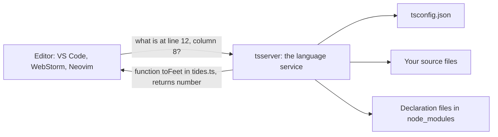
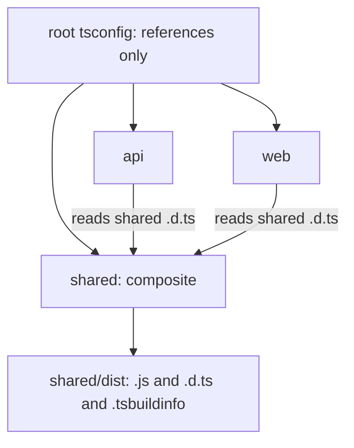

# Editor features, module systems and project references

> **Before this lesson:** you should know what the language service is ([From JavaScript to TypeScript](#/lesson/typescript/js-to-ts)), how to read `tsconfig.json` ([Configuration](#/lesson/typescript/tsconfig)) and what declaration files are for ([Declaration files](#/lesson/typescript/declaration-files)).

## In plain words

This lesson covers three practical subjects that decide how pleasant daily work with TypeScript is.

1. **Editor features.** The same engine that reports type errors also answers questions for your editor: "where is this function defined?", "who calls it?", "rename it everywhere". An IDE (integrated development environment) is an editor with such tools built in; VS Code is the most common one for TypeScript.
2. **Module systems.** A *module* is a file that shares some of its contents with other files. JavaScript has two different conventions for doing that, an older one and a newer one, and much real-world confusion comes from mixing them.
3. **Project references.** A way to split one large code base into several smaller TypeScript projects that are checked and built separately.

A comparison for the first: a paper street atlas versus a navigation app. Both contain the same streets. The app knows where you are, searches by name, reroutes when you change your mind and warns about a closed road before you reach it. Plain text editing is the atlas. An editor backed by the TypeScript language service is the navigation app, and it can only do those things because the types tell it what every name refers to.

Why it matters for a job: on a real team you spend far more time reading and changing existing code than writing new code. Navigating quickly and renaming safely are core skills. And "it works in my editor but fails when built" problems nearly always trace back to modules or project structure.

## How the editor knows

When you open a TypeScript file, the editor starts a background program called the **TypeScript server** (`tsserver`). It loads the nearest `tsconfig.json`, builds the same internal picture of the code that the compiler builds, and keeps it up to date as you type. The editor sends it questions over a simple protocol and displays the answers.



Two consequences:

- The squiggles in the editor and the errors from `npx tsc` come from the same checker, so they should agree. If they do not, they are using different TypeScript versions or different configuration files. VS Code has a command "TypeScript: Select TypeScript Version" to use the project's own copy.
- These features work in plain JavaScript files as well, with less precision, because the same service infers what it can.

## Navigating code

Take this small pair of files as the running example.

```typescript
// tides.ts
export interface Tide {
  height: number;
  rising: boolean;
}

export function describeTide(tide: Tide): string {
  return `${tide.height} m, ${tide.rising ? "rising" : "falling"}`;
}
```

```typescript
// report.ts
import { describeTide, type Tide } from "./tides";

const now: Tide = { height: 2.4, rising: true };
console.log(describeTide(now));
```

| Action (VS Code shortcut) | What it answers | In the example |
|---|---|---|
| Hover | "What is this, and what is its type?" | hovering `now` shows `const now: Tide` |
| Go to Definition (F12, or Ctrl/Cmd + click) | "Where was this created?" | on `describeTide` in `report.ts`, jumps into `tides.ts` |
| Go to Type Definition | "Where is the *type* of this value declared?" | on `now`, jumps to `interface Tide` |
| Find All References (Shift + F12) | "Where is this used?" | on `Tide`, lists the declaration, the parameter and the annotation |
| Go to Implementations | "Which classes implement this interface or abstract method?" | lists every `class X implements Tide` |
| Go to Symbol in Workspace (Ctrl/Cmd + T) | "Find a function, class or type by name" | type `descT` to find `describeTide` |
| Peek Definition (Alt + F12) | Shows the definition inline without leaving the file | |

A beginner's question: how is "Find All References" different from searching the text for the word? Text search finds the letters `Tide` in comments, in strings and in unrelated variables that happen to share the name. Find All References uses the checker's knowledge of which *declaration* each occurrence refers to, so it returns exactly the real uses.

## Writing code

**Autocomplete.** After a dot the editor lists the members that exist on that type, and only those. Inside a call's parentheses it shows the parameter names and types. Inside quotes where a union of string literals is expected, it lists the allowed strings.

**Automatic imports.** Start typing an exported name from another file and accept the suggestion: the `import` line is written for you. This works for your own files and for installed packages.

**Rename Symbol (F2).** Changes a name at its declaration and at every reference, across all files, while leaving unrelated identifiers with the same spelling untouched.

**Quick fixes and refactors (Ctrl/Cmd + .).** A light-bulb menu offers changes relevant to the cursor position:

| Code action | What it does |
|---|---|
| Add missing import | writes the import for an undeclared name |
| Implement interface | adds placeholder members required by `implements` |
| Add missing properties | fills in required properties of an object literal |
| Infer parameter types from usage | proposes annotations for untyped parameters |
| Extract to function / constant | moves the selected code into a new named function or constant |
| Move to a new file | moves a declaration and updates every import |
| Convert to optional chain | rewrites `a && a.b && a.b.c` as `a?.b?.c` |
| Organise imports | sorts imports and removes unused ones |
| Remove unused code | deletes declarations nothing refers to |

**Why this depends on types.** Compare what a rename has to decide in this file:

```typescript
interface Buoy { id: number }
interface Crate { id: number }

function tag(b: Buoy) { return b.id; }      // this `id` belongs to Buoy
function weigh(c: Crate) { return c.id; }   // this `id` belongs to Crate
```

Renaming `id` in `Buoy` to `buoyId` must change the first function and leave the second alone. A text replacement cannot tell them apart; the language service can, because it knows the type of `b` and of `c`.

```js-run
// What a careless find-and-replace of "id" with "buoyId" would do to unrelated code:
const source = "function weigh(c) { return c.id; } const width = 3; const valid = true;";
console.log(source.replaceAll("id", "buoyId"));
// "width" and "valid" were damaged as well: text has no idea what a name refers to.
```

The output shows `wbuoyIdth` and `valbuoyId`, nonsense produced by treating code as plain text.

## Reading errors in the editor

- A red squiggle marks an error. Hovering shows the same message `tsc` would print.
- The **Problems** panel (Ctrl/Cmd + Shift + M) lists errors, but by default only for files that are currently open.
- To see errors for the *whole project* continuously, run `npx tsc --noEmit --watch` in a terminal beside the editor.

> [!TIP]
> When a hover shows a huge, unreadable type, assign the expression to a temporary constant with an annotation you believe is right, such as `const check: Tide = someExpression;`. The error message then tells you exactly which property differs from your expectation.

## Module systems

A **module system** is the set of rules by which one file makes things available and another file obtains them. JavaScript did not have one for its first twenty years, so two arose.

### CommonJS

Node.js introduced **CommonJS** (often shortened to CJS). A file adds what it wants to share to an object called `module.exports`, and other files obtain that object by calling the function `require`.

```javascript
// tides.cjs
function toFeet(metres) {
  return metres / 0.3048;
}
module.exports = { toFeet };

// report.cjs
const { toFeet } = require("./tides.cjs");
console.log(toFeet(2.4));
```

Important properties: `require` is an ordinary function call that runs while the program executes, so it can appear inside an `if` and the path can be computed.

### ECMAScript modules

Later the JavaScript standard (named ECMAScript, hence **ES modules** or ESM) added dedicated syntax: the keywords `import` and `export`.

```javascript
// tides.mjs
export function toFeet(metres) {
  return metres / 0.3048;
}

// report.mjs
import { toFeet } from "./tides.mjs";
console.log(toFeet(2.4));
```

Important properties: `import` and `export` statements are fixed parts of the file that tools can read without running anything. That makes it possible to work out which exports are never used and leave them out of a build, a technique called *tree shaking*. Browsers understand ES modules directly.

The two can be imitated in a few lines to make the mechanism visible:

```js-run
// A tiny imitation of CommonJS: each "file" is a function that fills module.exports.
const files = {
  "./tides": (module) => {
    module.exports = { toFeet: (metres) => metres / 0.3048 };
  },
  "./report": (module, require) => {
    const { toFeet } = require("./tides");
    module.exports = { text: "High water " + toFeet(2.4).toFixed(1) + " ft" };
  },
};
const cache = {};
function require(name) {
  if (!cache[name]) {
    const module = { exports: {} };
    cache[name] = module;
    files[name](module, require);      // run the file once
  }
  return cache[name].exports;          // later calls reuse the cached exports
}
console.log(require("./report").text);
console.log(require("./tides") === require("./tides"));   // true: loaded once, then cached
```

Each "file" runs once, the first time it is required, and its exports are cached: the second line prints `true` because both calls return the very same object.

### Comparing the two

| | CommonJS | ES modules |
|---|---|---|
| Export | `module.exports = ...`, `exports.x = ...` | `export`, `export default` |
| Import | `const x = require("x")` | `import x from "x"` |
| When resolved | while running | before running |
| Conditional loading | yes, `require` anywhere | only through `await import("x")` |
| Works in browsers unaided | no | yes |
| File marker in Node | `.cjs`, or `.js` without `"type": "module"` | `.mjs`, or `.js` with `"type": "module"` in `package.json` |
| TypeScript source extension | `.cts` | `.mts` |

### What TypeScript does with modules

You write `import`/`export` syntax in TypeScript either way. The `module` compiler option decides what is emitted:

```typescript
// source
import { toFeet } from "./tides";
export const highWater = toFeet(2.4);
```

```javascript
// "module": "CommonJS"
"use strict";
Object.defineProperty(exports, "__esModule", { value: true });
exports.highWater = void 0;
const tides_1 = require("./tides");
exports.highWater = (0, tides_1.toFeet)(2.4);

// "module": "ESNext"
import { toFeet } from "./tides";
export const highWater = toFeet(2.4);
```

The companion option `moduleResolution` decides how an import path is turned into a file:

| Setting | Use when | Notable rule |
|---|---|---|
| `"NodeNext"` | Node.js runs the compiled output directly | relative imports in ES modules must include the extension: `"./tides.js"` |
| `"Bundler"` | a bundler (Vite, webpack, esbuild) processes the code | extensions may be omitted; `exports` in `package.json` is honoured |
| `"Node10"` (formerly `"node"`) | legacy projects only | ignores the `exports` field |

> [!WARNING]
> Under `NodeNext`, you write `import { toFeet } from "./tides.js"` even though the file on disk is `tides.ts`. TypeScript never rewrites import paths, so you write the path that will be correct *after* compilation. It looks wrong to every newcomer and is nevertheless right.

### Type-only imports and exports

Because types are erased, an import that brings in only types must disappear from the output. Tools that compile one file at a time cannot always tell whether a name is a type, so you can mark it:

```typescript
import type { Tide } from "./tides";              // whole statement is type-only
import { describeTide, type Tide as T } from "./tides";   // one name is type-only
export type { Tide };
```

With `verbatimModuleSyntax` on, the marking is mandatory and the rule becomes easy to state: what is marked `type` is removed, everything else is emitted exactly as written.

### Default exports and interop

A CommonJS package such as Express exports a single object with `module.exports = express`. The ES-style `import express from "express"` asks for something called a *default export*, which a CommonJS module does not literally have. `esModuleInterop` makes the compiler (and its emitted helper code) bridge the two, so the import you would naturally write works. It is on in almost every project.

> [!INTERVIEW]
> "What is the difference between CommonJS and ES modules?" CommonJS uses `require()` and `module.exports`; loading happens synchronously at runtime, so it can be conditional. ES modules use `import`/`export` statements that are analysed before the code runs, which enables tree shaking and works natively in browsers; dynamic loading uses `await import()`. In TypeScript you write ES syntax, and the `module` option decides which form is emitted, while `moduleResolution` decides how import paths are located.

## Project references

### The problem

Picture a repository with three parts: a `shared` library of types and helpers, an `api` server, and a `web` front end. With one `tsconfig.json` for everything:

- every check recompiles all three, even after a one-line change in `web`;
- nothing stops `shared` from importing a file out of `api`, which should depend on it rather than the other way round;
- the server code is checked with browser types loaded, and the reverse.

**Project references** solve this by making each part its own TypeScript project that declares which other projects it depends on.

### The smallest setup

```text
repo/
  tsconfig.json            <- lists the projects, compiles nothing itself
  shared/
    tsconfig.json
    src/units.ts
  api/
    tsconfig.json
    src/server.ts
```

```json
// shared/tsconfig.json
{
  "compilerOptions": {
    "composite": true,
    "declaration": true,
    "outDir": "dist",
    "rootDir": "src",
    "strict": true
  },
  "include": ["src"]
}
```

```json
// api/tsconfig.json
{
  "compilerOptions": {
    "composite": true,
    "outDir": "dist",
    "rootDir": "src",
    "strict": true
  },
  "include": ["src"],
  "references": [{ "path": "../shared" }]
}
```

```json
// tsconfig.json at the root
{
  "files": [],
  "references": [{ "path": "./shared" }, { "path": "./api" }]
}
```

What each new piece means:

- `"composite": true` marks a project as one that others may reference. It requires `declaration` to be on and requires every source file to be matched by `include` or `files`, so the project's boundary is exact.
- `"references"` lists the projects this one depends on.
- In the root file, `"files": []` says "this project has no source files of its own"; it exists only to tie the others together.

When `api` imports from `shared`, the checker reads `shared`'s generated **`.d.ts` files**, not its source. That is the whole trick: a declaration file is a compact summary, so `api` can be checked without re-analysing the insides of `shared`.

### Build mode

A referenced project must be built before the projects that depend on it. The `--build` flag (short form `-b`) does this in the right order and skips whatever is already up to date:

```bash
npx tsc --build            # build everything listed in the root tsconfig
npx tsc -b --watch         # rebuild on change
npx tsc -b --clean         # delete the outputs
```

Each composite project writes a `.tsbuildinfo` file recording what it last built. On the next run the compiler compares, and rebuilds only projects whose inputs (or whose dependencies' declaration output) changed.



Working out the order is a classic graph task: build a project only after everything it references. Here is the idea in runnable form.

```js-run
// Which order must projects be built in? Dependencies first.
const references = { shared: [], api: ["shared"], web: ["shared"], e2e: ["api", "web"] };

function buildOrder(graph) {
  const done = [];
  const visit = (name, trail = []) => {
    if (done.includes(name)) return;
    if (trail.includes(name)) throw new Error("circular reference: " + [...trail, name].join(" -> "));
    for (const dep of graph[name]) visit(dep, [...trail, name]);
    done.push(name);
  };
  Object.keys(graph).forEach((name) => visit(name));
  return done;
}

console.log(buildOrder(references));
try {
  buildOrder({ a: ["b"], b: ["a"] });
} catch (err) {
  console.log(err.message);
}
```

The first result lists `shared` before `api` and `web`, and those before `e2e`. The second call shows why circular references are forbidden: no valid order exists.

When are project references worth the setup? For monorepos (one repository holding several packages), for code bases where a full check takes longer than you are willing to wait, and for separating code that runs in different environments. For a single small application they add ceremony without benefit.

## Pitfalls

- **Editor and command line disagree.** Check the TypeScript version each uses and which `tsconfig.json` each loaded.
- **Trusting the Problems panel as "all errors".** It covers open files only, unless a watch task feeds it.
- **Rename through text replacement.** Use Rename Symbol.
- **Mixing `require` and `import` in one package** without understanding which module system the file is in.
- **Missing `.js` extensions under `NodeNext`.**
- **Forgetting `type` on type-only imports** with `isolatedModules` or `verbatimModuleSyntax`.
- **Running plain `tsc` in a referenced setup.** Dependencies are not built; use `tsc --build`.
- **Circular project references.** Not allowed; extract the shared part into its own project.
- **Committing `.tsbuildinfo`.** It is a cache; ignore it in version control.

## Cheat sheet

| Need | How |
|---|---|
| See a type | hover |
| Jump to declaration | F12 |
| Find usages | Shift + F12 |
| Safe rename | F2 |
| Fixes and refactors | Ctrl/Cmd + . |
| Whole-project errors | `npx tsc --noEmit --watch` |
| Node module output | `"module": "NodeNext"` (write `.js` extensions in ES imports) |
| Bundled app | `"module": "ESNext"`, `"moduleResolution": "Bundler"` |
| Type-only import | `import type { T } from "./x"` |
| CommonJS default imports | `"esModuleInterop": true` |
| Referenceable project | `"composite": true` |
| Depend on a project | `"references": [{ "path": "../shared" }]` |
| Build in dependency order | `npx tsc --build` |

## Summary

The TypeScript language service powers editor features (hover, go to definition, find references, rename, automatic imports and refactors) using the same analysis as the compiler, which is why they are precise where text tools are not. JavaScript has two module systems: CommonJS, with `require` and `module.exports` evaluated while running, and ES modules, with `import` and `export` statements analysed beforehand. TypeScript source uses ES syntax; `module` selects the emitted form and `moduleResolution` the lookup rules. Project references divide a large repository into composite projects that consume one another through declaration files and are built in dependency order, incrementally, with `tsc --build`.

## Glossary

- **IDE:** integrated development environment; an editor with built-in tools for navigating and changing code.
- **Language service / tsserver:** the background program that answers the editor's questions about TypeScript code.
- **Symbol:** a named thing in code, such as a variable, function, class or type.
- **Refactor:** a change to the structure of code that does not alter its behaviour.
- **Code action / quick fix:** an automatic edit the editor offers at the cursor.
- **Module:** a file that imports or exports.
- **CommonJS:** Node's original module system, using `require` and `module.exports`.
- **ES modules:** the standard module system, using `import` and `export`.
- **Tree shaking:** removing exports that nothing imports from a final bundle.
- **Module resolution:** the process of turning an import path into a file.
- **Default export:** the single unnamed main export of an ES module.
- **Monorepo:** one repository containing several packages or applications.
- **Project reference:** a declared dependency of one TypeScript project on another.
- **Composite project:** a project configured so that others may reference it.
- **Incremental build:** a build that redoes only what changed since last time.

```quiz
[
  {"q": "Why can Rename Symbol safely rename `id` in one interface without touching an `id` property of a different interface?",
   "options": ["It asks you about each occurrence", "The language service knows which declaration each occurrence refers to", "It only renames within the current file", "It cannot; both are renamed"],
   "answer": 1,
   "explain": "Rename is driven by the checker's symbol information, not by matching text."},
  {"q": "In VS Code, the Problems panel shows no errors. Does that prove the project has none?",
   "options": ["Yes", "No: by default it reports only on open files; run `tsc --noEmit` for the whole project", "Yes, if the file is saved", "Only for JavaScript files"],
   "answer": 1,
   "explain": "The language service checks open files on demand. A full check needs the compiler or a watch task."},
  {"q": "Which statement about CommonJS `require` is true?",
   "options": ["It must be at the top of the file", "It is a function call evaluated at runtime, so it can be conditional", "It works in browsers without tools", "It can only load JSON"],
   "answer": 1,
   "explain": "`require` is an ordinary function; ES `import` statements, in contrast, are static."},
  {"q": "With `module: \"NodeNext\"` in an ES module package, how do you import the sibling source file `tides.ts`?",
   "options": ["`from \"./tides\"`", "`from \"./tides.ts\"`", "`from \"./tides.js\"`", "`from \"tides\"`"],
   "answer": 2,
   "explain": "Node requires full extensions for relative ES imports, and TypeScript does not rewrite paths, so you write the name the compiled file will have."},
  {"q": "What does `import type { Tide } from \"./tides\"` compile to?",
   "options": ["`const { Tide } = require(\"./tides\")`", "Nothing: type-only imports are removed", "`import { Tide } from \"./tides\"`", "A runtime type check"],
   "answer": 1,
   "explain": "Types do not exist at runtime, so a type-only import leaves no trace in the output."},
  {"q": "Project `api` references composite project `shared`. What does the checker read when `api` imports from `shared`?",
   "options": ["shared's TypeScript source", "shared's emitted declaration files", "shared's JavaScript output", "Nothing; references are documentation"],
   "answer": 1,
   "explain": "Referenced projects are consumed through their `.d.ts` output, which is what makes checks faster."},
  {"q": "Which command builds referenced projects in dependency order and skips those already up to date?",
   "options": ["`tsc --noEmit`", "`tsc --build`", "`tsc --watch`", "`tsc --init`"],
   "answer": 1,
   "explain": "Build mode understands `references` and uses `.tsbuildinfo` files to rebuild only what changed."},
  {"q": "What does `composite: true` require of a project?",
   "options": ["That it has no dependencies", "That declaration output is enabled and all source files are matched by include or files", "That it uses CommonJS", "That it has no tests"],
   "answer": 1,
   "explain": "A composite project needs a precise file list and must emit declarations for dependants to read."}
]
```

> **Source:** Goldberg, *Learning TypeScript*, ch. 12 (Using IDE Features) and ch. 13 (Configuration Options: modules, project references). Handbook: https://www.typescriptlang.org/docs/handbook/modules/introduction.html · https://www.typescriptlang.org/docs/handbook/modules/theory.html · https://www.typescriptlang.org/docs/handbook/project-references.html · https://www.typescriptlang.org/tsconfig#moduleResolution
