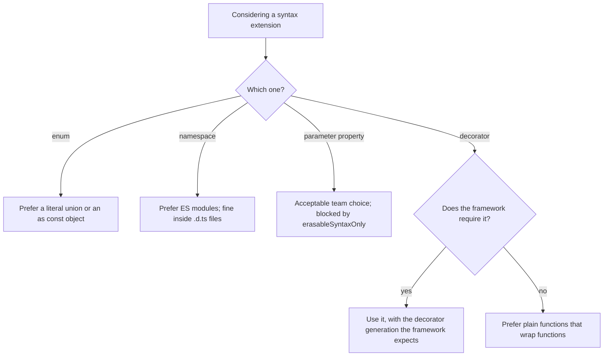

# Syntax extensions: enums, namespaces, decorators and parameter properties

> **Before this lesson:** you need type erasure from [From JavaScript to TypeScript](#/lesson/typescript/js-to-ts), literal unions from [Unions, literals and narrowing](#/lesson/typescript/unions-narrowing), classes from [Interfaces and classes](#/lesson/typescript/interfaces-classes) and `as const` from [Type modifiers](#/lesson/typescript/type-modifiers).

## In plain words

Everything you have learned so far follows one rule: TypeScript **adds types to JavaScript and then removes them again**. Delete the annotations and you have the JavaScript that will run. Nothing new exists at runtime.

Four features break that rule. They are pieces of TypeScript syntax that produce **real JavaScript code** which you did not write yourself: **enums**, **namespaces**, **parameter properties** and **decorators**. They were added in TypeScript's early years, before JavaScript itself had classes and modules, to fill gaps in the language. This group is called the *syntax extensions*, or sometimes "runtime features".

A comparison: think of subtitles on a film. Ordinary type annotations are subtitles; they help you follow along and can be switched off without changing the film. A syntax extension is more like a scene that was added to the film for one particular country's release. Switching off the subtitles does not remove it, and viewers elsewhere have never seen it. That is why tools that "only strip the types" struggle with these features.

Why it matters for a job: you will read enums and decorators in existing code bases constantly (Angular and NestJS are built on decorators), so you must understand what they do when the program runs. You will also be asked in interviews why many teams now avoid enums, and what to use instead. The modern compiler option `erasableSyntaxOnly` forbids most of this lesson's features outright, and Node.js's built-in type stripping cannot run them, so knowing the alternatives is practical knowledge.

## Parameter properties

### The repetition they remove

A class that stores its constructor arguments has to mention each name several times.

```typescript
class Berth {
  readonly code: string;       // 1. declare the property
  private depth: number;

  constructor(code: string, depth: number) {   // 2. declare the parameter
    this.code = code;          // 3. copy it across
    this.depth = depth;
  }
}
```

Three mentions of `code`, three of `depth`. A **parameter property** folds them into one: put a visibility modifier (`public`, `private`, `protected`) or `readonly` in front of a constructor parameter, and TypeScript declares a property with that name and assigns the argument to it.

```typescript
class Berth {
  constructor(
    readonly code: string,
    private depth: number,
  ) {}
}
```

- `readonly code: string` creates a read-only public property `code` and fills it from the first argument.
- `private depth: number` creates a private property `depth` from the second.
- The constructor body is empty because the assignments are generated.

This is what the compiler emits:

```js-run
// Emitted JavaScript for the short version. The assignments were generated for you.
class Berth {
  constructor(code, depth) {
    this.code = code;
    this.depth = depth;
  }
}
const b = new Berth("C-12", 4.5);
console.log(b.code, b.depth, Object.keys(b));
```

The output shows both properties on the object. Note that `depth` is readable here: as you saw in the classes lesson, the `private` keyword is checked at compile time only.

So what is the objection? The emitted code contains statements (`this.code = code`) that do not appear in the source. A tool that merely deletes type syntax would delete `readonly` and `private` and produce a constructor that stores nothing. Parameter properties are popular and fairly harmless, but they are not "types only".

## Enums

### The idea

An **enum** (short for *enumeration*) is a named set of constants. Many languages have them; JavaScript does not.

```typescript
enum Tide {
  Low,
  Rising,
  High,
  Falling,
}

let now: Tide = Tide.Rising;
now = Tide.High;       // ok
```

- `enum Tide { ... }` declares both a type called `Tide` and a real object called `Tide`.
- The members are numbered automatically from zero: `Low` is 0, `Rising` is 1, and so on.
- `Tide.Rising` reads the member, here the number `1`.

### What an enum becomes

This is the part to study carefully, because it is unlike anything else in TypeScript. The declaration above compiles to:

```js-run
var Tide;
(function (Tide) {
  Tide[Tide["Low"] = 0] = "Low";
  Tide[Tide["Rising"] = 1] = "Rising";
  Tide[Tide["High"] = 2] = "High";
  Tide[Tide["Falling"] = 3] = "Falling";
})(Tide || (Tide = {}));

console.log(Tide);
console.log(Tide.Rising, Tide[1], Tide[Tide.High]);
console.log(Object.keys(Tide).length);
```

Take one line apart: `Tide[Tide["Low"] = 0] = "Low";`

1. The inner part, `Tide["Low"] = 0`, stores the number 0 under the key `"Low"`. In JavaScript an assignment is also an expression whose value is what was assigned, so the inner part evaluates to `0`.
2. The outer part therefore reads `Tide[0] = "Low"`, storing the name under the number.

The object ends up with **eight** entries for four members: name to number, and number back to name. The second direction is called a **reverse mapping**. It lets you turn a stored number back into a readable name (`Tide[1]` gives `"Rising"`), and it also means that looping over the object's keys yields both names and numbers, a regular source of bugs.

### Custom and computed values

Members can be given explicit numbers; the following members continue counting from there.

```typescript
enum HttpStatus {
  Ok = 200,
  Created,          // 201
  NotFound = 404,
  Teapot = 418,
}
```

### String enums

Members may be strings, in which case every member needs an explicit value and **no reverse mapping is generated**.

```typescript
enum Colour {
  Port = "red",
  Starboard = "green",
}
```

```js-run
var Colour;
(function (Colour) {
  Colour["Port"] = "red";
  Colour["Starboard"] = "green";
})(Colour || (Colour = {}));

console.log(Colour);                 // two entries only
console.log(Colour.Port, Colour["red"]);   // "red" undefined: no way back from value to name
```

String enums are easier to debug, because a logged value reads `"red"` rather than `0`.

### Where enums surprise people

**Numeric enums accept any number in older compilers, and reverse lookups return `undefined` silently.**

```typescript
enum Tide { Low, Rising, High, Falling }

const fromServer: number = 7;
const t: Tide = fromServer;     // allowed: any number variable is assignable to a numeric enum
Tide[t];                        // undefined at runtime
```

**String enums are nominal.** Everywhere else TypeScript compares types by structure. String enums are the exception: the plain string with the same content is rejected.

```typescript
enum Colour { Port = "red", Starboard = "green" }

function paint(side: Colour) {}

paint(Colour.Port);    // ok
paint("red");
// Error: Argument of type '"red"' is not assignable to parameter of type 'Colour'.
```

That is frustrating when the string comes from JSON, where it is certainly `"red"` and yet is not a `Colour`.

**Enums are not erasable.** A tool that only removes types cannot handle them; the object has to be generated.

### `const enum`

Adding `const` asks the compiler to generate no object at all and to paste the values in at each use.

```typescript
const enum Dir { Up, Down }
const d = Dir.Down;
// emitted:  const d = 1 /* Dir.Down */;
```

It sounds ideal, but inlining requires the compiler to see the enum's declaration while compiling the file that uses it. Tools that compile one file at a time cannot, so `const enum` conflicts with `isolatedModules` and with published libraries. Treat it as a feature to recognise rather than to adopt.

### The alternative most teams prefer

An object marked `as const` plus a derived union type gives the same convenience using only erasable syntax.

```typescript
const Tide = {
  Low: "low",
  Rising: "rising",
  High: "high",
  Falling: "falling",
} as const;

type Tide = (typeof Tide)[keyof typeof Tide];
// "low" | "rising" | "high" | "falling"

function describe(t: Tide) {}

describe(Tide.Rising);    // ok: named constant
describe("rising");       // ok: the plain string also works
describe("sideways");
// Error: Argument of type '"sideways"' is not assignable to parameter of type 'Tide'.
```

Reading the type line: `typeof Tide` is the object's type; `keyof typeof Tide` is the union of its keys; indexing the first by the second gives the union of all its *values*. A type and a value may share one name because they live in separate "spaces"; the checker picks whichever fits the position.

```js-run
const Tide = { Low: "low", Rising: "rising", High: "high", Falling: "falling" };

console.log(Object.values(Tide));                 // a clean list for menus and validation
const isTide = (text) => Object.values(Tide).includes(text);
console.log(isTide("rising"), isTide("sideways"));
```

For the simplest cases a bare union, `type Tide = "low" | "rising" | "high" | "falling"`, is enough.

| | numeric `enum` | string `enum` | `as const` object | literal union |
|---|---|---|---|---|
| Runtime object | yes, with reverse mapping | yes | yes (you wrote it) | none |
| Plain literal accepted | any number | no | yes | yes |
| Iterate over the values | awkward (names and numbers mixed) | `Object.values` | `Object.values` | not possible |
| Erasable syntax | no | no | yes | yes |
| Readable in logs | no (numbers) | yes | yes | yes |

> [!INTERVIEW]
> "What does an enum compile to, and why do some teams avoid them?" A numeric enum compiles to an object populated inside a function, with entries in both directions: name to number and number to name (the reverse mapping). String enums get only the forward entries. Reasons to avoid them: they generate runtime code from what looks like a type declaration, numeric enums are loosely checked, string enums behave nominally and reject equal plain strings, and they are incompatible with type-stripping tools. A `const` object with `as const` plus a derived union type is the usual replacement.

## Namespaces

### What they were for

Before JavaScript had modules, every script shared one global scope, and two scripts that both declared `helpers` would collide. TypeScript's **namespace** (originally called "internal module") wraps related code in a single global object to reduce collisions.

```typescript
namespace Geometry {
  const PI = 3.14159;                    // private: not exported

  export function circleArea(radius: number): number {
    return PI * radius * radius;
  }

  export namespace Units {               // namespaces can nest
    export const metresPerFoot = 0.3048;
  }
}

Geometry.circleArea(2);                  // ok
Geometry.Units.metresPerFoot;            // ok
Geometry.PI;
// Error: Property 'PI' does not exist on type 'typeof Geometry'.
```

- Only members marked `export` are visible outside the braces.
- Members are reached with a dot, like object properties.

The emitted code uses the same pattern as enums: a function that fills in an object.

```js-run
var Geometry;
(function (Geometry) {
  const PI = 3.14159;
  function circleArea(radius) {
    return PI * radius * radius;
  }
  Geometry.circleArea = circleArea;
  let Units;
  (function (Units) {
    Units.metresPerFoot = 0.3048;
  })(Units = Geometry.Units || (Geometry.Units = {}));
})(Geometry || (Geometry = {}));

console.log(Geometry.circleArea(2).toFixed(2), Geometry.Units.metresPerFoot);
console.log(Object.keys(Geometry), Geometry.PI);
```

`PI` stays hidden inside the function (the last line prints `undefined` for it); the exported members are attached to the object. The odd-looking `Geometry || (Geometry = {})` means "use the existing object if there is one, otherwise create it", which is how several namespace blocks with the same name merge into one.

### Where namespaces still appear

In new application code, **use ES modules instead**. Each file is already its own scope, bundlers can remove unused exports from modules but not from namespace objects, and namespaces are not erasable syntax.

You will still meet them in declaration files, where they produce no code and merely describe the shape of an existing global or group related types:

```typescript
// A library that exposes one global object when loaded by a script tag.
declare namespace Chartly {
  interface Options { width: number; height: number }
  function render(target: string, options: Options): void;
}

// Types can be reached through the namespace:
const opts: Chartly.Options = { width: 400, height: 300 };
```

`React.ReactNode`, `NodeJS.Timeout` and `Express.Request` are all types reached through a declared namespace.

## Decorators

### The idea

A **decorator** is a function that receives a class, or a member of a class, and can observe, wrap or replace it. It is applied by writing `@name` in front of the thing it decorates. The purpose is to attach reusable behaviour (logging, caching, validation, registration with a framework) without editing each method body.

There are two generations, and you must know which one a project uses:

| | Legacy ("experimental") decorators | Standard decorators |
|---|---|---|
| Enabled by | `"experimentalDecorators": true` | default since TypeScript 5.0 |
| Based on | an early draft of the proposal | the finished JavaScript proposal (stage 3) |
| Used by | Angular, NestJS, TypeORM, older MobX | newer libraries |
| Parameter decorators | supported | not part of the standard |

Their function signatures differ, so the two are not interchangeable.

### A standard method decorator, step by step

A method decorator in the standard style is a function with two parameters: the original method, and a *context* object describing what is being decorated. Whatever it returns replaces the method.

```typescript
function logged<This, Args extends unknown[], Return>(
  original: (this: This, ...args: Args) => Return,
  context: ClassMethodDecoratorContext,
) {
  const name = String(context.name);
  return function (this: This, ...args: Args): Return {
    console.log(`-> ${name}(${args.join(", ")})`);
    const result = original.call(this, ...args);
    console.log(`<- ${name} returned ${result}`);
    return result;
  };
}

class Winch {
  @logged
  haul(metres: number): string {
    return `hauled ${metres} m`;
  }
}

new Winch().haul(12);
```

Line by line:

- `original` is the `haul` function as written in the class.
- `context.name` is the method's name, `"haul"`.
- The returned function prints a line, calls the original with the same `this` and arguments (`original.call(this, ...args)`), prints the result, and passes it back.
- `@logged` above `haul` applies the decorator once, when the class is defined, not on each call.

Stripped of syntax, a decorator is "replace this method with a wrapped version". The same effect written by hand:

```js-run
function logged(original, context) {
  const name = String(context.name);
  return function (...args) {
    console.log(`-> ${name}(${args.join(", ")})`);
    const result = original.call(this, ...args);
    console.log(`<- ${name} returned ${result}`);
    return result;
  };
}

class Winch {
  haul(metres) {
    return `hauled ${metres} m`;
  }
}
// What `@logged` on haul amounts to:
Winch.prototype.haul = logged(Winch.prototype.haul, { kind: "method", name: "haul" });

new Winch().haul(12);
```

Running it prints the arrow lines around the call. The class's own code knows nothing about logging.

### Decorator factories

Often a decorator needs settings. A **decorator factory** is a function that takes the settings and returns the decorator, so it is written with parentheses: `@retry(3)`.

```js-run
function retry(times) {
  return function (original, context) {
    return function (...args) {
      let lastError;
      for (let attempt = 1; attempt <= times; attempt++) {
        try {
          return original.call(this, ...args);
        } catch (err) {
          lastError = err;
          console.log(`${String(context.name)} failed, attempt ${attempt}`);
        }
      }
      throw lastError;
    };
  };
}

let calls = 0;
class Radio {
  send(text) {
    if (++calls < 3) throw new Error("static");
    return "sent: " + text;
  }
}
// Equivalent of writing @retry(3) above send:
Radio.prototype.send = retry(3)(Radio.prototype.send, { kind: "method", name: "send" });

console.log(new Radio().send("mayday"));
```

The first two attempts fail and are reported; the third succeeds.

### Legacy decorators in frameworks

In Angular or NestJS you will read code like this:

```typescript
@Controller("berths")
export class BerthController {
  constructor(private readonly service: BerthService) {}

  @Get(":id")
  findOne(@Param("id") id: string) {
    return this.service.find(id);
  }
}
```

Here the decorators mostly *record information* (this class handles the `/berths` path, this method answers GET requests, this parameter comes from the address) which the framework reads when it starts. With the additional option `emitDecoratorMetadata` the compiler also writes out constructor parameter types as runtime data, which is how such frameworks know to supply a `BerthService`. This is a rare case of type information surviving into the running program, and it works only with the legacy implementation.

> [!WARNING]
> Check `tsconfig.json` for `experimentalDecorators` before writing or copying a decorator. A legacy decorator receives `(target, propertyKey, descriptor)`; a standard one receives `(value, context)`. Code written for one fails in confusing ways under the other.

## Should you use these features?



The direction of the ecosystem is toward TypeScript that can be turned into JavaScript by deleting text. The option `erasableSyntaxOnly` (TypeScript 5.8 and later) reports enums, namespaces with runtime code and parameter properties as errors, and Node.js can run `.ts` files directly only if they avoid these constructs. In an existing code base that uses them, follow the house style; in a new one, the alternatives cost little.

## Pitfalls

- **Iterating a numeric enum** with `Object.keys` or `Object.values` returns names and numbers mixed together.
- **Zero-valued enum members are falsy.** `if (tide)` skips `Tide.Low`, which is 0.
- **Comparing a string from JSON with a string enum type** needs a lookup or an assertion; the plain string is not assignable.
- **Changing the order of numeric enum members** changes their numbers, corrupting stored data that used the old numbers. Give explicit values to anything saved or sent over a network.
- **`const enum` in libraries or with single-file transpilers** breaks.
- **Namespaces for organisation in modern code.** Use files and folders.
- **Mixing decorator generations.** Signatures are incompatible.
- **Assuming parameter properties are erased.** They generate assignments.

## Cheat sheet

| Feature | Syntax | Emits | Modern alternative |
|---|---|---|---|
| Parameter property | `constructor(private x: number) {}` | `this.x = x` | declare and assign explicitly |
| Numeric enum | `enum E { A, B }` | object with forward and reverse entries | literal union |
| String enum | `enum E { A = "a" }` | object with forward entries | `as const` object and derived union |
| Const enum | `const enum E { A }` | inlined values, no object | literal union |
| Namespace | `namespace N { export ... }` | function filling an object | ES modules |
| Ambient namespace | `declare namespace N { ... }` | nothing | (fine in `.d.ts`) |
| Standard decorator | `@dec` with `(value, context)` | calls to the decorator | higher-order functions |
| Legacy decorator | `@dec` with `experimentalDecorators` | calls plus optional metadata | only when a framework requires it |

## Summary

Parameter properties, enums, namespaces and decorators are TypeScript syntax that generates JavaScript rather than disappearing. Parameter properties create and assign class fields from constructor parameters. Enums create a runtime object, with reverse mappings for numeric members, and behave differently from the rest of the type system in several ways; unions of literals or `as const` objects replace them cleanly. Namespaces wrap code in a global object and have been superseded by ES modules, surviving mainly in declaration files. Decorators wrap or annotate classes and members and exist in two incompatible generations, the legacy one still required by major frameworks. New code is moving toward erasable-only TypeScript, so use these features where a framework or code base expects them and know the alternatives elsewhere.

## Glossary

- **Syntax extension:** TypeScript syntax that produces runtime JavaScript instead of being erased.
- **Erasable syntax:** syntax that can be removed without changing what the program does.
- **Parameter property:** a constructor parameter with a modifier, which also declares and assigns a class property.
- **Enum:** a named set of constants that is both a type and a runtime object.
- **Reverse mapping:** the number-to-name entries generated for numeric enum members.
- **Nominal typing:** comparing types by their declared name rather than their structure.
- **`const enum`:** an enum whose values are pasted in at each use, with no object generated.
- **Namespace:** a TypeScript block that groups declarations under one object name.
- **Decorator:** a function applied with `@` to a class or class member in order to observe or replace it.
- **Decorator factory:** a function that returns a decorator, allowing settings such as `@retry(3)`.
- **Higher-order function:** a function that takes or returns another function.
- **Metadata:** data about code (such as parameter types) made available while the program runs.

```quiz
[
  {"q": "After `enum Tide { Low, Rising, High }` is compiled and run, what is `Tide[1]`?",
   "options": ["`1`", "`\"Rising\"`", "`undefined`", "`\"Low\"`"],
   "answer": 1,
   "explain": "Numeric enums get a reverse mapping from each number back to its member name."},
  {"q": "How many own keys does the runtime object for `enum Tide { Low, Rising, High }` have?",
   "options": ["3", "6", "0", "4"],
   "answer": 1,
   "explain": "Each numeric member creates two entries: name to number and number to name."},
  {"q": "Does this compile? `enum Colour { Port = \"red\" } function paint(c: Colour) {} paint(\"red\");`",
   "options": ["Yes, the strings are equal", "No: '\"red\"' is not assignable to parameter of type 'Colour'", "Yes, with esModuleInterop", "No: enums cannot have string values"],
   "answer": 1,
   "explain": "String enum members are treated nominally: only `Colour.Port` is accepted, not an equal string literal."},
  {"q": "What is the type `Size`? `const S = { A: \"a\", B: \"b\" } as const; type Size = (typeof S)[keyof typeof S];`",
   "options": ["`string`", "`\"a\" | \"b\"`", "`\"A\" | \"B\"`", "`{ A: string; B: string }`"],
   "answer": 1,
   "explain": "Indexing the object's type by the union of its keys yields the union of its value types, which are literals because of `as const`."},
  {"q": "What JavaScript does `class B { constructor(private depth: number) {} }` emit inside the constructor?",
   "options": ["Nothing", "`this.depth = depth;`", "A private field `#depth`", "A getter for depth"],
   "answer": 1,
   "explain": "A parameter property declares the field and generates the assignment; `private` itself is erased."},
  {"q": "Which statement about namespaces is accurate?",
   "options": ["They are erased like interfaces", "A namespace with exported values compiles to a function that fills in an object", "They are required for ES modules", "They only work in .tsx files"],
   "answer": 1,
   "explain": "Non-ambient namespaces generate runtime code. Only `declare namespace` in declaration files emits nothing."},
  {"q": "When is the decorator function for `@logged` on a method invoked?",
   "options": ["Every time the method is called", "Once, when the class is defined", "When the first instance is created", "Never; it is a comment"],
   "answer": 1,
   "explain": "The decorator runs at class definition time and returns the replacement method; that replacement is what runs on each call."},
  {"q": "A project sets `\"experimentalDecorators\": true`. What does that tell you?",
   "options": ["It uses the standard stage-3 decorators", "It uses the legacy decorator implementation with different function signatures", "Decorators are disabled", "It targets ES5"],
   "answer": 1,
   "explain": "The flag selects the older implementation used by frameworks such as Angular and NestJS; standard decorators need no flag."}
]
```

> **Source:** Goldberg, *Learning TypeScript*, ch. 14 (Syntax Extensions). Handbook: https://www.typescriptlang.org/docs/handbook/enums.html · https://www.typescriptlang.org/docs/handbook/namespaces.html · https://www.typescriptlang.org/docs/handbook/decorators.html · https://www.typescriptlang.org/docs/handbook/2/classes.html#parameter-properties · https://www.typescriptlang.org/tsconfig#erasableSyntaxOnly
