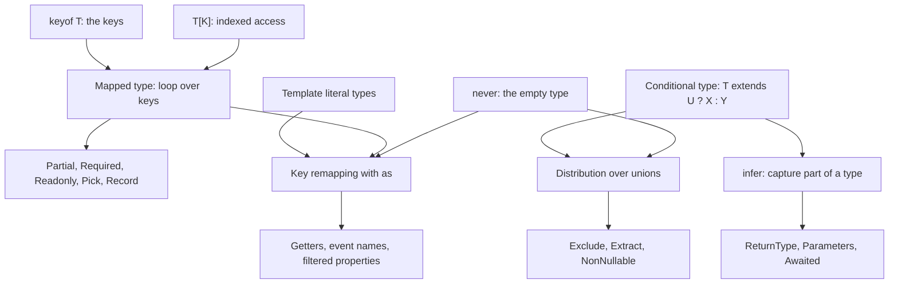

# Type operations: mapped types, conditional types, infer, never and template literal types

> **Before this lesson:** you need `keyof`, type-position `typeof` and indexed access from [Type modifiers](#/lesson/typescript/type-modifiers); generics and constraints from [Generics](#/lesson/typescript/generics); and unions and `never` from [Unions, literals and narrowing](#/lesson/typescript/unions-narrowing) and [Objects and structural typing](#/lesson/typescript/objects).

## In plain words

Up to now you wrote each type out by hand. This lesson teaches you to **compute** types from other types. TypeScript's type language contains a small set of operations, a loop over property names, an if/else, pattern matching and string building, and with them you can derive one type from another so that the two always stay in step.

Think of a spreadsheet. You could type every number into every cell. Or you could type the source numbers once and write formulas: "this column is that column with tax added". When a source number changes, every formula cell updates. Type operations are formulas for types. You define `User` once; "User with every field optional", "User without the password", "the names of User's fields that hold strings" are all formulas that follow `User` automatically when it changes.

Why it matters for a job: you will use the ready-made formulas every day. `Partial<T>`, `Pick<T, K>`, `Omit<T, K>`, `Record<K, V>` and `ReturnType<F>` appear in nearly every TypeScript code base. To read library types, and to answer the popular interview request "implement `Pick` yourself", you need to know the handful of building blocks behind them. This is the most abstract lesson in the track, so it moves in small steps. Because types vanish at runtime, each runnable example shows the **value-level** counterpart: a function doing to an object what the type does to the object's type.

## Building block 1: mapped types

### A loop over keys

A **mapped type** creates an object type by going through a list of keys and producing one property for each. The syntax borrows from index signatures and adds the word `in`.

```typescript
type Light = "red" | "amber" | "green";

type LightDurations = {
  [Colour in Light]: number;
};
// { red: number; amber: number; green: number }
```

Reading the middle line piece by piece:

- `Colour` is a name you invent, like the loop variable in `for (const colour of lights)`.
- `in Light` says which keys to loop over: each member of the union `Light`.
- `: number` is the type each produced property gets.

The checker runs the "loop" three times and assembles the result.

### Looping over the keys of an existing type

The loop becomes useful when the keys come from another type through `keyof`, and the property type is looked up with an indexed access.

```typescript
interface Berth {
  code: string;
  depth: number;
  occupied: boolean;
}

type Copy = {
  [Key in keyof Berth]: Berth[Key];
};
// { code: string; depth: number; occupied: boolean }   (identical to Berth)
```

- `keyof Berth` is `"code" | "depth" | "occupied"`.
- `Berth[Key]` reads "the type of that property in `Berth`".

A copy is not interesting in itself, but every useful mapped type is this copy with one change. For example, replace each property type with `boolean` to describe "which fields has the user edited?":

```typescript
type Flags = {
  [Key in keyof Berth]: boolean;
};
// { code: boolean; depth: boolean; occupied: boolean }
```

The value-level counterpart is a loop over an object's entries:

```js-run
const berth = { code: "C-12", depth: 4.5, occupied: true };

// Value-level version of { [Key in keyof Berth]: boolean }
const flags = Object.fromEntries(Object.keys(berth).map((key) => [key, false]));
console.log(flags);
```

Same keys, every value replaced: exactly what the mapped type did to the types.

### Adding and removing modifiers

Inside a mapped type you can add or remove the two property modifiers, `?` (optional) and `readonly`. A plain modifier adds it; a leading minus removes it.

```typescript
type AllOptional = { [Key in keyof Berth]?: Berth[Key] };
// { code?: string; depth?: number; occupied?: boolean }

type AllReadonly = { readonly [Key in keyof Berth]: Berth[Key] };

interface Draft { title?: string; readonly id: number }

type Finished = { -readonly [Key in keyof Draft]-?: Draft[Key] };
// { title: string; id: number }     (optional removed, readonly removed)
```

`-?` reads "remove optional", and `-readonly` reads "remove readonly".

### Making it generic

Replace the concrete type with a type parameter and the formula works for any type. You have now written three of TypeScript's built-in utility types:

```typescript
type MyPartial<T> = { [Key in keyof T]?: T[Key] };
type MyRequired<T> = { [Key in keyof T]-?: T[Key] };
type MyReadonly<T> = { readonly [Key in keyof T]: T[Key] };

type BerthPatch = MyPartial<Berth>;
const patch: BerthPatch = { depth: 5 };      // ok: any subset of fields
```

And `Pick`, which keeps only some keys. The loop runs over the chosen keys rather than all of them:

```typescript
type MyPick<T, Keys extends keyof T> = { [Key in Keys]: T[Key] };

type BerthSummary = MyPick<Berth, "code" | "occupied">;
// { code: string; occupied: boolean }

type Bad = MyPick<Berth, "colour">;
// Error: Type '"colour"' does not satisfy the constraint 'keyof Berth'.
```

The constraint `Keys extends keyof T` is what makes a misspelt key an error.

```js-run
// Runtime versions of Pick and Partial-style patching.
function pick(source, keys) {
  const result = {};
  for (const key of keys) if (key in source) result[key] = source[key];
  return result;
}
const berth = { code: "C-12", depth: 4.5, occupied: true };
console.log(pick(berth, ["code", "occupied"]));
console.log({ ...berth, ...{ depth: 5 } });     // applying a Partial<Berth> patch
```

## Building block 2: conditional types

### An if/else for types

A **conditional type** chooses between two types depending on a test. It reuses the question-mark-and-colon form of JavaScript's conditional operator.

```typescript
type IsText<T> = T extends string ? "yes" : "no";

type A = IsText<"harbour">;   // "yes"
type B = IsText<42>;          // "no"
```

Read `T extends string ? X : Y` as: "if `T` is assignable to `string`, the result is `X`, otherwise `Y`". The word `extends` here is a question, not a constraint.

A slightly more useful one, which unwraps an array:

```typescript
type ElementOf<T> = T extends unknown[] ? T[number] : T;

type C = ElementOf<string[]>;   // string
type D = ElementOf<number>;     // number   (not an array, returned unchanged)
```

`T[number]` means "the type you get by indexing `T` with any number", in other words the element type.

### Distribution over unions

Here is the behaviour that most confuses newcomers. When the type being tested is a bare type parameter and you pass it a **union**, the condition is applied to **each member separately** and the results are joined into a union again. This is called *distribution*.

```typescript
type IsText<T> = T extends string ? "yes" : "no";

type E = IsText<"a" | 7>;
// evaluated as  IsText<"a"> | IsText<7>   which is   "yes" | "no"
```

Distribution is what makes it possible to filter a union. The trick relies on `never`, the empty type: adding "nothing" to a union leaves it unchanged, so returning `never` for a member removes that member.

```typescript
type OnlyText<T> = T extends string ? T : never;

type F = OnlyText<"north" | 42 | "south" | true>;
// "north" | never | "south" | never    which simplifies to    "north" | "south"
```

Two built-in utility types are exactly this pattern:

```typescript
type MyExclude<T, Remove> = T extends Remove ? never : T;
type MyExtract<T, Keep> = T extends Keep ? T : never;

type Weekend = MyExtract<"sat" | "sun" | "mon", "sat" | "sun">;   // "sat" | "sun"
type Weekday = MyExclude<"sat" | "sun" | "mon", "sat" | "sun">;   // "mon"
```

```js-run
// Value-level picture of distribution: test each member, drop the "never" ones.
const members = ["north", 42, "south", true];
const onlyText = members.filter((m) => typeof m === "string");
console.log(onlyText);

const exclude = (all, remove) => all.filter((m) => !remove.includes(m));
console.log(exclude(["sat", "sun", "mon"], ["sat", "sun"]));
```

To switch distribution off, wrap both sides in square brackets, which makes the tested type no longer a bare parameter: `[T] extends [string] ? ... : ...`.

## Building block 3: `infer`

Inside the test of a conditional type you may write `infer Name` in a position where some type would appear. It means: "if the shape matches, capture whatever type is found *here* and call it `Name`". This is **pattern matching** on types.

Start with the smallest case, getting the element type of an array a second way:

```typescript
type ElementOf<T> = T extends (infer Item)[] ? Item : never;

type G = ElementOf<string[]>;     // string
type H = ElementOf<boolean>;      // never   (not an array, so no match)
```

- `(infer Item)[]` is the pattern: "an array of something; call the something `Item`".
- If `T` fits the pattern, the true branch can use `Item`.

The same idea extracts the result type of a function, which is the built-in `ReturnType`:

```typescript
type MyReturnType<Fn> = Fn extends (...args: any[]) => infer Result ? Result : never;

function loadCrew() {
  return [{ name: "Asha", watch: 1 }];
}

type Crew = MyReturnType<typeof loadCrew>;
// { name: string; watch: number }[]
```

The pattern `(...args: any[]) => infer Result` reads "any function, whatever its parameters; call its return type `Result`". Other built-ins use the same technique:

```typescript
type MyParameters<Fn> = Fn extends (...args: infer Args) => any ? Args : never;
type MyAwaited<T> = T extends Promise<infer Value> ? MyAwaited<Value> : T;

type P = MyParameters<(id: number, name: string) => void>;   // [id: number, name: string]
type V = MyAwaited<Promise<Promise<number>>>;                // number
```

`MyAwaited` refers to itself: a **recursive** type. It keeps unwrapping until what remains is not a promise.

## Building block 4: `never` as "nothing"

You met `never` as the type of unreachable code. In type operations it plays the role that zero plays in addition.

| Situation | Result | Why |
|---|---|---|
| `string \| never` | `string` | adding no values to a set changes nothing |
| `string & never` | `never` | nothing can be in both sets |
| a conditional branch returning `never` under distribution | that member disappears | see `Exclude` |
| a mapped type key remapped to `never` | that property disappears | see below |
| `keyof {}` | `never` | no keys |

The second row explains a common mystery: an intersection of incompatible types collapses to `never`, and then "nothing is assignable to it".

## Building block 5: template literal types

### Building string types

JavaScript template literals build strings from pieces: `` `berth-${n}` ``. **Template literal types** use the same backtick syntax in a type position to build string *types* from pieces.

```typescript
type Quay = "north" | "south";
type Slot = 1 | 2 | 3;

type BerthId = `${Quay}-${Slot}`;
// "north-1" | "north-2" | "north-3" | "south-1" | "south-2" | "south-3"
```

When a placeholder holds a union, every combination is produced: two quays times three slots gives six strings.

A placeholder may also be a wide type, giving a pattern rather than a finite list:

```typescript
type CssPixels = `${number}px`;

const ok: CssPixels = "12px";
const bad: CssPixels = "12em";
// Error: Type '"12em"' is not assignable to type '`${number}px`'.
```

Four built-in helpers change the case of string literal types: `Uppercase<S>`, `Lowercase<S>`, `Capitalize<S>` and `Uncapitalize<S>`.

```typescript
type Getter = `get${Capitalize<"depth">}`;     // "getDepth"
```

### Key remapping

A mapped type can **rename** its keys with an `as` clause, and template literal types supply the new names.

```typescript
interface Berth { code: string; depth: number }

type Getters<T> = {
  [Key in keyof T as `get${Capitalize<Key & string>}`]: () => T[Key];
};

type BerthGetters = Getters<Berth>;
// { getCode: () => string; getDepth: () => number }
```

- `as` followed by a type gives the new key.
- `Key & string` narrows the key to its string part; keys could in principle be numbers or symbols, which cannot be capitalised.

Remapping a key to `never` drops the property, which is how to filter properties by their *value* type:

```typescript
type TextFieldsOnly<T> = {
  [Key in keyof T as T[Key] extends string ? Key : never]: T[Key];
};

type BerthText = TextFieldsOnly<Berth>;     // { code: string }
```

```js-run
const berth = { code: "C-12", depth: 4.5 };
const capitalise = (s) => s[0].toUpperCase() + s.slice(1);

// Value-level Getters<T>
const getters = Object.fromEntries(
  Object.entries(berth).map(([key, value]) => ["get" + capitalise(key), () => value]),
);
console.log(Object.keys(getters), getters.getDepth());

// Value-level TextFieldsOnly<T>
console.log(Object.fromEntries(Object.entries(berth).filter(([, v]) => typeof v === "string")));
```

### Pattern matching on strings

`infer` works inside template literal types, so strings can be taken apart. This example extracts the parameter names from a route pattern such as those used by web frameworks.

```typescript
type RouteParams<Path extends string> =
  Path extends `${string}:${infer Param}/${infer Rest}`
    ? Param | RouteParams<`/${Rest}`>
    : Path extends `${string}:${infer Param}`
      ? Param
      : never;

type Params = RouteParams<"/quays/:quayId/berths/:berthId">;
// "quayId" | "berthId"
```

Read it as two attempts. First: "does the path contain a colon, then a name, then a slash, then more?" If so, keep the name and repeat on the remainder. Otherwise: "does it end with a colon and a name?" If so, keep that name. Otherwise there are no parameters. The problem *Extract route parameters* asks you to write the same logic for real strings.

```js-run
function routeParams(path) {
  return path.split("/").filter((part) => part.startsWith(":")).map((part) => part.slice(1));
}
console.log(routeParams("/quays/:quayId/berths/:berthId"));
console.log(routeParams("/health"));
```

## The built-in utility types

All of the following ship with TypeScript and are defined with the building blocks above.

| Utility | Result | Built from |
|---|---|---|
| `Partial<T>` | every property optional | mapped type with `?` |
| `Required<T>` | every property required | mapped type with `-?` |
| `Readonly<T>` | every property read-only | mapped type with `readonly` |
| `Pick<T, K>` | only the properties named in `K` | mapped type over `K` |
| `Omit<T, K>` | everything except `K` | `Pick<T, Exclude<keyof T, K>>` |
| `Record<K, V>` | object with keys `K` and values `V` | `{ [P in K]: V }` |
| `Exclude<U, X>` | union members not assignable to `X` | distributive conditional |
| `Extract<U, X>` | union members assignable to `X` | distributive conditional |
| `NonNullable<T>` | `T` without `null` and `undefined` | `T & {}` |
| `ReturnType<F>` | a function's return type | `infer` |
| `Parameters<F>` | a function's parameters as a tuple | `infer` |
| `Awaited<T>` | the resolved type of a promise, recursively | `infer` and recursion |
| `Uppercase<S>` and relatives | case-changed string literal | built into the compiler |

A realistic use, deriving three related types from one source of truth:

```typescript
interface Member {
  id: string;
  name: string;
  email: string;
  passwordHash: string;
  joinedAt: Date;
}

type NewMember = Omit<Member, "id" | "joinedAt">;        // what a sign-up form sends
type PublicMember = Omit<Member, "passwordHash">;        // what the API may return
type MemberUpdate = Partial<Pick<Member, "name" | "email">>;   // what an edit may change
type MembersById = Record<string, PublicMember>;
```

If a field is later added to `Member`, all four follow without further edits.

> [!WARNING]
> `Partial`, `Readonly` and `Required` are **shallow**: they affect the first level of properties only. `Readonly<{ tags: string[] }>` still allows `value.tags.push("x")`. Deep versions need recursion; `DeepPartial` is written out in the interview module.

```js-run
// Shallow versus deep, at runtime with Object.freeze:
const shallow = Object.freeze({ name: "Asha", tags: ["deck"] });
shallow.tags.push("night");          // allowed: only the outer object is frozen
console.log(shallow.tags);

function deepFreeze(value) {
  if (value !== null && typeof value === "object" && !Object.isFrozen(value)) {
    Object.freeze(value);
    Object.values(value).forEach(deepFreeze);
  }
  return value;
}
const deep = deepFreeze({ name: "Asha", tags: ["deck"] });
try { deep.tags.push("night"); } catch (err) { console.log("blocked:", err.message); }
```

## How the pieces fit together



> [!INTERVIEW]
> "Implement `Pick` and `Omit`." `type Pick<T, K extends keyof T> = { [P in K]: T[P] }` and `type Omit<T, K extends keyof any> = Pick<T, Exclude<keyof T, K>>`. "What is a distributive conditional type?" A conditional type whose checked type is a bare type parameter; when given a union it is evaluated for each member and the results are unioned, which is how `Exclude<T, U> = T extends U ? never : T` filters a union. "What does `infer` do?" It introduces a type variable inside the `extends` clause of a conditional type, capturing the part of the type at that position.

## When not to compute types

Type-level programming is powerful enough to become unreadable. Some guidance:

> [!TIP]
> Reach for the built-in utility types first. Write a custom mapped or conditional type when it removes real duplication. If a type needs a paragraph of comments to explain, or produces error messages nobody can read, a few plainly written interfaces are usually the better engineering choice. Very deep recursion also slows the checker and can hit the error "Type instantiation is excessively deep and possibly infinite".

## Pitfalls

- **Forgetting distribution.** `IsText<string | number>` is `"yes" | "no"`, not `"no"`. Wrap in `[T]` to test the union as a whole.
- **`T extends never`** under distribution yields `never` without evaluating either branch, because a union with zero members is distributed over zero times.
- **Shallow utilities.** `Partial` and `Readonly` do not reach nested objects.
- **`Omit` does not check its keys.** `Omit<Member, "emial">` compiles and removes nothing.
- **`Omit` and `Pick` on a union** merge the members instead of applying to each; a distributive wrapper is needed for discriminated unions.
- **Template literal explosions.** Unions multiply: three placeholders of twenty members each produce eight thousand strings.
- **Expecting runtime effects.** `Readonly<T>` freezes nothing; `Pick<T, K>` removes nothing from the object.

## Cheat sheet

| Goal | Formula |
|---|---|
| Loop over keys | `{ [K in keyof T]: ... }` |
| Property type | `T[K]` |
| Add / remove optional | `?` / `-?` |
| Add / remove readonly | `readonly` / `-readonly` |
| Rename keys | `[K in keyof T as NewName]` |
| Drop a key | remap it to `never` |
| Type-level if | `T extends U ? X : Y` |
| Filter a union | `T extends U ? T : never` |
| Stop distribution | `[T] extends [U] ? X : Y` |
| Capture part of a type | `T extends Pattern<infer P> ? P : never` |
| Element type | `T[number]` |
| Value union of an object | `T[keyof T]` |
| Build string types | `` `${A}-${B}` `` |
| Change case | `Capitalize<S>`, `Uppercase<S>` |

## Summary

Types can be computed. Mapped types loop over keys to build object types, optionally changing the `?` and `readonly` modifiers or renaming keys with `as`. Conditional types choose between two types with `extends`, distribute over unions when testing a bare type parameter, and can capture parts of a matched type with `infer`. `never` behaves as the empty union, which makes filtering possible. Template literal types construct and take apart string literal types. The built-in utility types (`Partial`, `Pick`, `Omit`, `Record`, `Exclude`, `ReturnType`, `Awaited` and the rest) are short combinations of these pieces and should be your first choice; write your own when they remove duplication without costing readability.

## Glossary

- **Type operation:** a construct that computes a type from other types.
- **Mapped type:** an object type produced by iterating over a union of keys, written `{ [K in Keys]: ... }`.
- **Modifier:** `?` (optional) or `readonly` on a property; mapped types can add or remove them.
- **Indexed access type:** `T[K]`, the type of property `K` of `T`.
- **Conditional type:** `T extends U ? X : Y`, a type chosen by an assignability test.
- **Distribution:** applying a conditional type to each member of a union separately and joining the results.
- **`infer`:** a keyword that captures part of a matched type into a new type variable.
- **Recursive type:** a type alias that refers to itself.
- **Template literal type:** a string type built with backtick syntax and placeholders.
- **Key remapping:** renaming or dropping keys in a mapped type with an `as` clause.
- **Utility type:** a generic helper type; TypeScript ships many, such as `Partial` and `Pick`.
- **Shallow:** affecting only the first level of an object, not nested objects.

```quiz
[
  {"q": "What is the resulting type? `type F = { [K in \"a\" | \"b\"]: number };`",
   "options": ["`{ a: number } | { b: number }`", "`{ a: number; b: number }`", "`Record<string, number>`", "`[number, number]`"],
   "answer": 1,
   "explain": "A mapped type produces one object type with a property for each member of the key union."},
  {"q": "What is `IsText<\"a\" | 7>` given `type IsText<T> = T extends string ? \"yes\" : \"no\"`?",
   "options": ["`\"no\"`", "`\"yes\"`", "`\"yes\" | \"no\"`", "`never`"],
   "answer": 2,
   "explain": "The conditional distributes over the union: `IsText<\"a\"> | IsText<7>`."},
  {"q": "What is `Exclude<\"sat\" | \"sun\" | \"mon\", \"sat\" | \"sun\">`?",
   "options": ["`\"sat\" | \"sun\"`", "`\"mon\"`", "`never`", "`string`"],
   "answer": 1,
   "explain": "Each member assignable to the second argument becomes never and disappears, leaving only \"mon\"."},
  {"q": "What is the type `R`? `type R = ReturnType<() => Promise<number>>;`",
   "options": ["`number`", "`Promise<number>`", "`() => Promise<number>`", "`unknown`"],
   "answer": 1,
   "explain": "ReturnType captures exactly what the function returns. Use `Awaited<ReturnType<...>>` to unwrap the promise."},
  {"q": "What is the type `` `${\"north\" | \"south\"}-${1 | 2}` ``?",
   "options": ["`string`", "A union of 4 string literals", "A union of 2 string literals", "`\"north-south-1-2\"`"],
   "answer": 1,
   "explain": "Unions in placeholders multiply: north-1, north-2, south-1, south-2."},
  {"q": "Does this compile? `type P = Readonly<{ tags: string[] }>; declare const p: P; p.tags.push(\"x\");`",
   "options": ["No: tags is read-only", "Yes: Readonly is shallow, so the array itself is still mutable", "No: push does not exist", "Only without strict"],
   "answer": 1,
   "explain": "Readonly prevents reassigning `p.tags` but does not change the type of the array it holds."},
  {"q": "In `type E<T> = T extends (infer I)[] ? I : never`, what is `E<boolean>`?",
   "options": ["`boolean`", "`never`", "`unknown`", "`boolean[]`"],
   "answer": 1,
   "explain": "boolean does not match the array pattern, so the false branch is taken."},
  {"q": "What does remapping a key to `never` in `[K in keyof T as ...]` do?",
   "options": ["Makes the property type never", "Removes that property from the result", "Causes a compile error", "Makes the property optional"],
   "answer": 1,
   "explain": "A key of never is no key at all, so the property is omitted; this is how properties are filtered."}
]
```

> **Source:** Goldberg, *Learning TypeScript*, ch. 15 (Type Operations). Handbook: https://www.typescriptlang.org/docs/handbook/2/mapped-types.html · https://www.typescriptlang.org/docs/handbook/2/conditional-types.html · https://www.typescriptlang.org/docs/handbook/2/template-literal-types.html · https://www.typescriptlang.org/docs/handbook/utility-types.html
