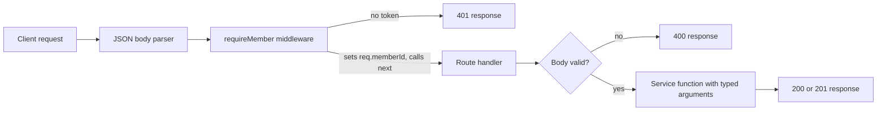

# TypeScript in real projects: typing React components and Express handlers

> **Before this lesson:** you need object types and discriminated unions ([Objects and structural typing](#/lesson/typescript/objects)), function types ([Functions, arrays and tuples](#/lesson/typescript/functions-arrays-tuples)), generics ([Generics](#/lesson/typescript/generics)) and declaration files with module augmentation ([Declaration files](#/lesson/typescript/declaration-files)). You do not need to know React or Express already; each is introduced from zero below.

## In plain words

The earlier modules taught the language. This one shows what it looks like in the two places most TypeScript jobs involve: a **front end** (the part of an application that runs in the browser and draws the screen) and a **back end** (the part that runs on a server and answers requests).

- **React** is the most widely used library for building front ends. You describe pieces of the screen as functions called *components*.
- **Express** is a long-established library for building back ends on Node.js. You describe what to do for each incoming web request as functions called *handlers*.

In both, your code is a set of functions that a framework calls **for you**. That is the key point for typing. When you call your own function, you can see what you pass. When a framework calls it, the arguments arrive from somewhere you cannot see, so the types are your only description of what will arrive.

An everyday picture: a form at a post office counter. The form has labelled boxes: "recipient name (required)", "phone (optional)", "service: standard or express". Anyone filling it in knows what to supply, and the clerk can reject an incomplete form before the parcel goes anywhere. The types of a component's inputs, or of a request's contents, are that form.

Why it matters for a job: "type this component's props" and "type this request handler" are everyday tasks from the first week, and common practical interview exercises.

## Part 1: React

### What a component is

A React **component** is a function that receives one object, called **props** (short for *properties*), and returns a description of what to show. The description is written in **JSX**, a syntax that looks like HTML inside JavaScript. Files containing JSX use the extension `.tsx`.

The smallest possible component:

```tsx
function Welcome() {
  return <p>Welcome aboard</p>;
}
```

It takes no props and always shows the same paragraph. JSX is not understood by browsers; the compiler turns each tag into an ordinary function call. This runnable imitation shows the idea without React:

```js-run
// A stand-in for what JSX compiles to: a function building a plain description object.
const h = (tag, props, ...children) => ({ tag, props: props ?? {}, children });

function Welcome() {
  return h("p", null, "Welcome aboard");      // what <p>Welcome aboard</p> becomes
}
console.log(JSON.stringify(Welcome()));
```

The output is a small object naming the tag and its contents. React later turns such objects into what you see on screen.

### Typing props

Now a component that takes input. Describe the props with an interface and annotate the parameter.

```tsx
interface BerthCardProps {
  code: string;
  depthMetres: number;
  occupied?: boolean;
}

function BerthCard(props: BerthCardProps) {
  return (
    <div>
      <h3>{props.code}</h3>
      <p>{props.depthMetres.toFixed(1)} m</p>
      {props.occupied ? <span>Occupied</span> : null}
    </div>
  );
}
```

Line by line:

- `BerthCardProps` is the "form": two required boxes and one optional.
- `props: BerthCardProps` tells the checker what the function receives.
- Curly braces inside JSX hold a JavaScript expression whose value is shown.
- `props.occupied ? ... : null` shows the label only when the flag is true; `null` means "show nothing".

Most code destructures the props in the parameter list, which also allows default values:

```tsx
function BerthCard({ code, depthMetres, occupied = false }: BerthCardProps) {
  /* ... */
}
```

The payoff comes where the component is *used*. Every use is checked against the interface:

```tsx
<BerthCard code="C-12" depthMetres={4.5} />                 // ok
<BerthCard code="C-12" />
// Error: Property 'depthMetres' is missing in type '{ code: string; }'
// but required in type 'BerthCardProps'.
<BerthCard code="C-12" depthMetres="deep" />
// Error: Type 'string' is not assignable to type 'number'.
<BerthCard code="C-12" depthMetres={4.5} colour="red" />
// Error: Property 'colour' does not exist on type 'IntrinsicAttributes & BerthCardProps'.
```

```js-run
// Without types, a missing prop reaches the function as undefined and fails inside it.
function BerthCard(props) {
  return props.code + ": " + props.depthMetres.toFixed(1) + " m";
}
console.log(BerthCard({ code: "C-12", depthMetres: 4.5 }));
try {
  console.log(BerthCard({ code: "C-12" }));
} catch (err) {
  console.log("crash while drawing:", err.message);
}
```

The crash message points inside the component, far from the place that forgot the prop. The type error, in contrast, points at the faulty use.

### Children and callbacks

Two prop kinds appear constantly.

**Children** are whatever is written between a component's opening and closing tags. Their type is `React.ReactNode`, meaning "anything React can show": elements, text, numbers, lists of those, or nothing.

**Callback props** are functions the component calls to tell its parent that something happened. Type them as function types.

```tsx
import type { ReactNode } from "react";

interface PanelProps {
  title: string;
  children: ReactNode;
  onClose: () => void;
  onRename?: (newTitle: string) => void;
}

function Panel({ title, children, onClose, onRename }: PanelProps) {
  return (
    <section>
      <h2 onDoubleClick={() => onRename?.(title + " (copy)")}>{title}</h2>
      <button onClick={onClose}>Close</button>
      {children}
    </section>
  );
}
```

- `onClose: () => void` is "a function taking nothing, whose result is ignored".
- `onRename?.(...)` calls the function only if one was supplied; `?.` is the optional-call form of optional chaining.

### Props that depend on each other: discriminated unions

Suppose a button either links somewhere (needs an address) or runs an action (needs a function), never both. A single interface with two optional props cannot express "exactly one". A discriminated union can.

```tsx
type ActionButtonProps =
  | { kind: "link"; label: string; href: string }
  | { kind: "action"; label: string; onPress: () => void };

function ActionButton(props: ActionButtonProps) {
  if (props.kind === "link") {
    return <a href={props.href}>{props.label}</a>;        // props: the link member
  }
  return <button onClick={props.onPress}>{props.label}</button>;
}

<ActionButton kind="link" label="Docs" href="/docs" />     // ok
<ActionButton kind="link" label="Docs" onPress={() => {}} />
// Error: Property 'href' is missing in type '{ kind: "link"; label: string; onPress: ... }'.
```

Invalid combinations cannot be written. This is one of the highest-value typing techniques in component code.

### Events

When the user clicks or types, React calls your function with an **event** object describing what happened. React provides generic event types; the type argument names the kind of HTML element involved.

```tsx
import type { ChangeEvent, FormEvent } from "react";

function SearchBox({ onSearch }: { onSearch: (text: string) => void }) {
  function handleChange(event: ChangeEvent<HTMLInputElement>) {
    onSearch(event.target.value);        // target is known to be an <input>, so .value exists
  }
  function handleSubmit(event: FormEvent<HTMLFormElement>) {
    event.preventDefault();              // stop the browser reloading the page
  }
  return (
    <form onSubmit={handleSubmit}>
      <input onChange={handleChange} />
    </form>
  );
}
```

> [!TIP]
> If you write the function inline, as in `<input onChange={(event) => ...} />`, the event type is inferred from the `onChange` prop and no annotation is needed. To find the right type for a separately declared handler, hover over the prop name (`onChange`) in the editor: the tooltip shows the expected function type.

### Hooks

A **hook** is a function, whose name starts with `use`, that gives a component a capability such as remembering a value between redraws. The common hooks are generic.

**`useState`** remembers one value. It returns a tuple: the current value, and a function to replace it.

```tsx
import { useState } from "react";

const [count, setCount] = useState(0);                // inferred: number
const [name, setName] = useState("");                 // inferred: string

const [selected, setSelected] = useState(null);       // inferred: null   (a trap!)
setSelected("C-12");
// Error: Argument of type '"C-12"' is not assignable to parameter of type 'SetStateAction<null>'.

const [chosen, setChosen] = useState<string | null>(null);   // say what it may become
setChosen("C-12");                                            // ok
```

The rule: inference from the initial value is enough when that value shows the full type. When the state starts as `null`, `undefined` or an empty array, write the type argument, because the starting value does not reveal what will be stored later.

The tuple that `useState` returns can be imitated with a closure to see what the types describe:

```js-run
// A toy useState: returns [currentValue, setter] exactly like the real tuple.
function createState(initial) {
  let value = initial;
  const get = () => value;
  const set = (next) => { value = typeof next === "function" ? next(value) : next; };
  return [get, set];
}
const [getCount, setCount] = createState(0);
setCount(5);
setCount((previous) => previous + 1);      // the "updater function" form
console.log(getCount());
```

The setter accepts either a new value or a function from the old value to the new one, which is what the type `SetStateAction<T>` in the error message above means.

**`useRef`** holds a reference to an on-screen element. The element does not exist until after the first draw, so the reference starts as `null`:

```tsx
const inputRef = useRef<HTMLInputElement>(null);

function focusInput() {
  inputRef.current?.focus();      // current: HTMLInputElement | null
}
```

**`useReducer`** manages state through *actions*: small objects describing what happened. It is the natural home of discriminated unions.

```tsx
interface CounterState { count: number; step: number }

type CounterAction =
  | { type: "increment" }
  | { type: "decrement" }
  | { type: "setStep"; step: number }
  | { type: "reset" };

function reducer(state: CounterState, action: CounterAction): CounterState {
  switch (action.type) {
    case "increment":
      return { ...state, count: state.count + state.step };
    case "decrement":
      return { ...state, count: state.count - state.step };
    case "setStep":
      return { ...state, step: action.step };     // action narrowed: step is available
    case "reset":
      return { count: 0, step: 1 };
  }
}

const [state, dispatch] = useReducer(reducer, { count: 0, step: 1 });
dispatch({ type: "setStep", step: 5 });        // ok
dispatch({ type: "setStep" });
// Error: Property 'step' is missing in type '{ type: "setStep"; }'.
dispatch({ type: "multiply" });
// Error: Type '"multiply"' is not assignable to type '"increment" | "decrement" | "setStep" | "reset"'.
```

A reducer is a plain function, so it runs anywhere:

```js-run
function reducer(state, action) {
  switch (action.type) {
    case "increment": return { ...state, count: state.count + state.step };
    case "decrement": return { ...state, count: state.count - state.step };
    case "setStep": return { ...state, step: action.step };
    case "reset": return { count: 0, step: 1 };
    default: throw new Error("Unknown action: " + action.type);
  }
}
const actions = [{ type: "increment" }, { type: "setStep", step: 5 }, { type: "increment" }, { type: "decrement" }];
console.log(actions.reduce(reducer, { count: 0, step: 1 }));
try { reducer({ count: 0, step: 1 }, { type: "multiply" }); } catch (err) { console.log(err.message); }
```

Starting from zero: add 1, change the step to 5, add 5, subtract 5, giving a count of 1.

**Custom hooks** are ordinary functions, so they may be generic like any other:

```tsx
function useStored<Value>(key: string, initial: Value): [Value, (next: Value) => void] {
  const [value, setValue] = useState<Value>(() => {
    const saved = localStorage.getItem(key);
    return saved === null ? initial : (JSON.parse(saved) as Value);
  });
  const update = (next: Value) => {
    setValue(next);
    localStorage.setItem(key, JSON.stringify(next));
  };
  return [value, update];
}
```

The explicit tuple return type matters: without it the array literal would be inferred as an array of a union, and destructuring would lose precision, as explained in [Functions, arrays and tuples](#/lesson/typescript/functions-arrays-tuples).

### Generic components

A component may have a type parameter, which ties several props together. Here a list knows that `renderItem` receives the same element type that `items` contains.

```tsx
interface ListProps<Item> {
  items: Item[];
  getKey: (item: Item) => string;
  renderItem: (item: Item) => ReactNode;
}

function List<Item>({ items, getKey, renderItem }: ListProps<Item>) {
  return <ul>{items.map((item) => <li key={getKey(item)}>{renderItem(item)}</li>)}</ul>;
}

<List
  items={[{ id: "a", name: "Asha" }]}
  getKey={(member) => member.id}            // member: { id: string; name: string }
  renderItem={(member) => member.name}
/>
```

### React typing reference

| Need | Type |
|---|---|
| Anything showable | `ReactNode` |
| A component's props, from outside | `ComponentProps<typeof Button>` |
| All props of an HTML tag | `ComponentProps<"button">` |
| Inline style object | `CSSProperties` |
| Click handler | `(event: MouseEvent<HTMLButtonElement>) => void` |
| Input change handler | `(event: ChangeEvent<HTMLInputElement>) => void` |
| Form submit handler | `(event: FormEvent<HTMLFormElement>) => void` |
| State that may be empty | `useState<T \| null>(null)` |
| Element reference | `useRef<HTMLDivElement>(null)` |

> [!INTERVIEW]
> "How do you type a component whose props depend on each other?" With a discriminated union of prop types, so that each variant lists exactly the props that belong together, and invalid combinations are compile errors. "When does `useState` need an explicit type argument?" When the initial value does not show the full type: `null`, `undefined`, an empty array or an empty object.

## Part 2: Express and Node

### What a handler is

A web server waits for **requests** (a browser or app asking for something) and sends back **responses**. Each request has a *method* (`GET` to read, `POST` to create, and others) and a *path* such as `/berths/C-12`. In Express you register a **handler**: a function to run for a given method and path. It receives two objects: the request (`req`) and the response (`res`).

The smallest server:

```typescript
import express from "express";

const app = express();

app.get("/health", (req, res) => {
  res.json({ status: "ok" });
});

app.listen(3000);
```

- `express()` creates the application.
- `app.get("/health", handler)` registers the handler for `GET /health`.
- `res.json(...)` sends a value as JSON text.
- `app.listen(3000)` starts waiting for requests on port 3000 (a port is a numbered door on the machine).
- `req` and `res` need no annotations here: their types are inferred from `app.get`, thanks to `@types/express`.

### Where the data in a request lives

| Part | Example | Property | What is known at compile time |
|---|---|---|---|
| Route parameters | `/berths/:code` with `/berths/C-12` | `req.params.code` | names, from the path pattern; values are strings |
| Query string | `/berths?free=true&limit=5` | `req.query.free` | nothing; each value may be a string, an array or missing |
| Body | JSON sent with POST | `req.body` | nothing: typed `any` |
| Headers | `Authorization: Bearer ...` | `req.headers.authorization` | `string \| undefined` |

### Typing the parts with generics

The handler types in Express are generic. `Request` takes type arguments in this order: route parameters, response body, request body, query.

```typescript
import type { Request, Response } from "express";

interface Berth { code: string; depthMetres: number; occupied: boolean }
interface CreateBerthBody { code: string; depthMetres: number }
interface ApiError { error: string }

const berths = new Map<string, Berth>();

app.get(
  "/berths/:code",
  (req: Request<{ code: string }>, res: Response<Berth | ApiError>) => {
    const berth = berths.get(req.params.code);      // Berth | undefined
    if (!berth) {
      res.status(404).json({ error: "No such berth" });
      return;
    }
    res.json(berth);
  },
);

app.post(
  "/berths",
  (req: Request<{}, Berth | ApiError, CreateBerthBody>, res: Response<Berth | ApiError>) => {
    const { code, depthMetres } = req.body;          // typed as CreateBerthBody
    const berth: Berth = { code, depthMetres, occupied: false };
    berths.set(code, berth);
    res.status(201).json(berth);
  },
);
```

- `Response<Berth | ApiError>` makes `res.json` reject anything that is neither a berth nor an error object, so a misspelt field in a response is caught.
- `berths.get(...)` honestly returns `Berth | undefined`, which forces the 404 branch.
- The numbers 404 and 201 are *status codes*: 404 means "not found", 201 means "created".

> [!WARNING]
> `Request<{}, any, CreateBerthBody>` does **not** check the body. The type argument is a label you stuck on data sent by a stranger. If a client sends `{ "code": 7 }` the handler runs anyway with a number where the type says string. Data that crosses a network boundary must be validated while the program runs; the next lesson is about exactly that.

The following simulation runs a handler against a well-formed and a malformed request, with no checking:

```js-run
const berths = new Map();

function createBerth(req, res) {
  const { code, depthMetres } = req.body;                  // "typed" as CreateBerthBody
  const berth = { code: code.toUpperCase(), depthMetres, occupied: false };
  berths.set(berth.code, berth);
  res.status(201).json(berth);
}

function fakeResponse() {
  return {
    code: 200,
    status(c) { this.code = c; return this; },
    json(body) { console.log(this.code, JSON.stringify(body)); },
  };
}

createBerth({ body: { code: "c-12", depthMetres: 4.5 } }, fakeResponse());
try {
  createBerth({ body: { code: 7 } }, fakeResponse());       // a client sent the wrong shape
} catch (err) {
  console.log("server error:", err.message);
}
```

The first request succeeds with status 201. The second throws inside the handler, because the number 7 has no `toUpperCase` method: the label on `req.body` promised a string that never arrived.

### Middleware and extending the request

A **middleware** is a function that runs before the handlers, typically to check or prepare something, and then calls `next()` to pass control on. A common one reads who the caller is and attaches that to the request. The built-in `Request` type has no such property, so you add one by module augmentation, as covered in [Declaration files](#/lesson/typescript/declaration-files):

```typescript
// types/express.d.ts
import "express";

declare module "express-serve-static-core" {
  interface Request {
    memberId?: string;
  }
}
```

```typescript
import type { NextFunction, Request, Response } from "express";

function requireMember(req: Request, res: Response, next: NextFunction) {
  const token = req.headers.authorization?.replace("Bearer ", "");
  if (!token) {
    res.status(401).json({ error: "Sign in first" });
    return;
  }
  req.memberId = lookUpMember(token);
  next();
}
```

The property is declared optional (`memberId?`) on purpose. It is absent on any route that does not use the middleware, and an honest type makes handlers check.



### Async handlers and errors

Handlers usually talk to a database, so they are `async`. Inside `catch`, the error is `unknown` under `strict`, and must be narrowed before use:

```typescript
app.get("/berths", async (req, res) => {
  try {
    const all = await loadBerths();
    res.json(all);
  } catch (err) {
    const message = err instanceof Error ? err.message : "Unknown failure";
    res.status(500).json({ error: message });
  }
});
```

Error-handling middleware is recognised by having **four** parameters, so all four must be declared even when unused:

```typescript
import type { ErrorRequestHandler } from "express";

const onError: ErrorRequestHandler = (err, req, res, next) => {
  res.status(500).json({ error: err instanceof Error ? err.message : "Unknown failure" });
};
app.use(onError);
```

Annotating the variable with `ErrorRequestHandler` gives all four parameters their types by contextual typing.

### Node.js itself

- Install `@types/node` to get types for built-in modules (`node:fs`, `node:path`) and globals (`process`, `Buffer`).
- `process.env.SOMETHING` has type `string | undefined`. An environment variable is a named setting supplied from outside the program, and it may always be missing. Read each one once at start-up, check it, and export a typed object:

```typescript
function requireEnv(name: string): string {
  const value = process.env[name];
  if (value === undefined || value === "") throw new Error(`Missing environment variable ${name}`);
  return value;
}

export const config = {
  port: Number(process.env.PORT ?? 3000),
  databaseUrl: requireEnv("DATABASE_URL"),
};
```

```js-run
function requireEnv(env, name) {
  const value = env[name];
  if (value === undefined || value === "") throw new Error("Missing environment variable " + name);
  return value;
}
const env = { PORT: "8080" };
console.log(Number(env.PORT ?? 3000));
try { requireEnv(env, "DATABASE_URL"); } catch (err) { console.log(err.message); }
```

Failing at start-up with a clear message is far better than failing later, on the first request that needs the missing setting.

## Pitfalls

- **`useState(null)` or `useState([])` without a type argument.** The state type becomes `null` or `never[]`.
- **`React.FC` out of habit.** Annotating the props parameter directly is simpler and works with generic components.
- **`any` for events.** Hover over the prop to find the event type, or write the handler inline.
- **Optional props for "one or the other".** Use a discriminated union.
- **Believing `Request<..., Body>` validates.** It only labels.
- **`req.query.limit` treated as a number.** Query values are strings (or arrays, or missing). Convert and check.
- **Making augmented request properties required.** They are missing wherever the middleware did not run.
- **Reading `process.env` everywhere.** Centralise and check it once.
- **Forgetting `return` after sending a response**, so the handler continues and tries to send a second one.

## Cheat sheet

| Task | Pattern |
|---|---|
| Component props | `function C({ a, b }: Props)` |
| Children | `children: ReactNode` |
| Callback prop | `onSave: (value: T) => void` |
| Either-or props | discriminated union |
| Nullable state | `useState<T \| null>(null)` |
| Reducer actions | union with a `type` tag |
| Generic component | `function List<T>(props: ListProps<T>)` |
| Route parameters | `Request<{ id: string }>` |
| Request body label | `Request<{}, unknown, Body>` plus runtime validation |
| Response body | `Response<Data \| ApiError>` |
| Middleware | `(req: Request, res: Response, next: NextFunction) => void` |
| Extra request property | module augmentation of `express-serve-static-core` |
| Error middleware | `const h: ErrorRequestHandler = (err, req, res, next) => {}` |
| Environment settings | checked once into a typed `config` object |

## Summary

In framework code, your functions are called by the framework, so parameter types are the contract. React components take a props object typed by an interface; children are `ReactNode`, callbacks are function types, mutually exclusive props are discriminated unions, and hooks are generics whose type argument you supply when the initial value does not reveal it. Express handlers receive generic `Request` and `Response` objects whose type arguments describe route parameters, bodies and query strings; request properties added by middleware are declared through module augmentation. In both worlds the types describe what you expect, and data coming from users or the network still has to be checked while the program runs.

## Glossary

- **Front end / back end:** the part of an application running in the browser, and the part running on a server.
- **Component:** a function that takes props and returns a description of part of the screen.
- **Props:** the single object of inputs passed to a component.
- **JSX / TSX:** HTML-like syntax inside JavaScript or TypeScript; `.tsx` files contain it.
- **Children:** the content placed between a component's opening and closing tags.
- **Event:** an object describing a user action such as a click or a key press.
- **Hook:** a function starting with `use` that gives a component state or other capabilities.
- **State:** a value a component remembers between redraws.
- **Reducer:** a function that takes the current state and an action and returns the next state.
- **Request / response:** a message asking a server for something, and the server's reply.
- **Handler:** the function a server runs for a particular method and path.
- **Route parameter:** a named, variable part of a path, such as `:code`.
- **Query string:** the part of an address after `?`, holding name and value pairs.
- **Status code:** a three-digit number in a response saying how the request went (200 ok, 404 not found).
- **Middleware:** a function that runs before handlers and may pass control on with `next()`.
- **Environment variable:** a named setting supplied to a program from outside.

```quiz
[
  {"q": "What is the inferred type of `selected`? `const [selected, setSelected] = useState(null);`",
   "options": ["`any`", "`null`", "`unknown`", "`string | null`"],
   "answer": 1,
   "explain": "The type parameter is inferred from the initial value alone, giving `null`. Write `useState<string | null>(null)` to say what it may become."},
  {"q": "Does this compile? `interface P { code: string; depth: number }` then `<BerthCard code=\"C-12\" />`",
   "options": ["Yes, depth is undefined", "No: property 'depth' is missing", "Yes, props are never checked", "Only in .jsx files"],
   "answer": 1,
   "explain": "JSX attributes are checked against the props type like an object literal against an interface."},
  {"q": "A button needs either `href` or `onPress`, never both and never neither. Which props type expresses that?",
   "options": ["`{ href?: string; onPress?: () => void }`", "A discriminated union with a `kind` tag and one member per variant", "`{ href: string } & { onPress: () => void }`", "`any`"],
   "answer": 1,
   "explain": "Two optional props allow both and neither. An intersection requires both. A tagged union allows exactly the valid combinations."},
  {"q": "A handler is typed `Request<{}, unknown, { code: string }>` and a client sends the body `{\"code\": 7}`. What happens?",
   "options": ["Express rejects the request automatically", "TypeScript throws at runtime", "The handler runs with `req.body.code` equal to the number 7", "The body is converted to a string"],
   "answer": 2,
   "explain": "Type arguments are erased; nothing validates the incoming data unless you write or call validation code."},
  {"q": "What is the type of `process.env.DATABASE_URL` with `@types/node` installed?",
   "options": ["`string`", "`string | undefined`", "`any`", "`unknown`"],
   "answer": 1,
   "explain": "Any environment variable may be missing, and the declared type reflects that."},
  {"q": "With `type A = { type: \"inc\" } | { type: \"setStep\"; step: number }`, does `dispatch({ type: \"setStep\" })` compile?",
   "options": ["Yes", "No: property 'step' is missing", "Yes, step defaults to 0", "No: dispatch takes a string"],
   "answer": 1,
   "explain": "The object matches the tag of the second member, which requires `step`."},
  {"q": "Why should a request property added by middleware (for example `memberId`) be declared optional in the augmentation?",
   "options": ["Augmentations cannot declare required properties", "It is absent on routes where the middleware did not run, and the type should say so", "Optional properties are faster", "Express deletes it after each request"],
   "answer": 1,
   "explain": "The augmented interface applies to every request in the application, including those that never passed through the middleware."},
  {"q": "What is the type of `inputRef.current` after `const inputRef = useRef<HTMLInputElement>(null);`?",
   "options": ["`HTMLInputElement`", "`HTMLInputElement | null`", "`null`", "`any`"],
   "answer": 1,
   "explain": "The element is attached after the first render, so the reference may still be null and must be checked or accessed with `?.`."}
]
```

> **Source:** beyond the book (applied material); builds on Goldberg, *Learning TypeScript*, ch. 4, 5, 10 and 11. References: https://www.typescriptlang.org/docs/handbook/jsx.html · https://react.dev/learn/typescript · https://expressjs.com/en/guide/routing.html · https://www.typescriptlang.org/docs/handbook/declaration-merging.html#module-augmentation
