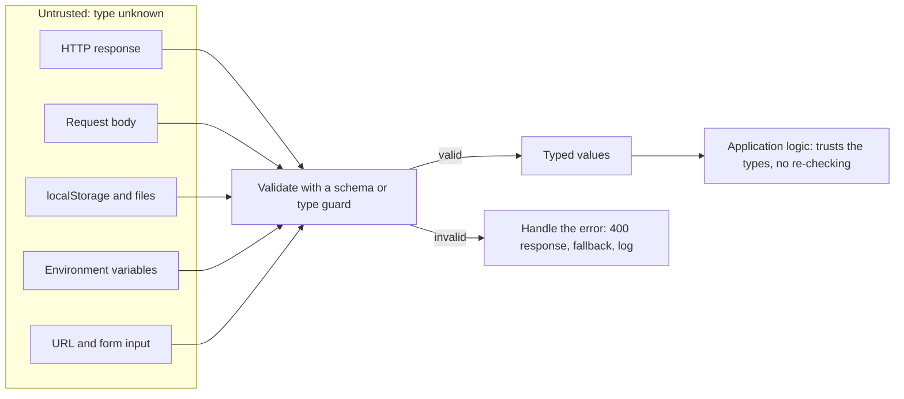

# Runtime validation and API response typing

> **Before this lesson:** you need type erasure ([From JavaScript to TypeScript](#/lesson/typescript/js-to-ts)), `unknown`, type predicates and assertions ([Type modifiers](#/lesson/typescript/type-modifiers)), discriminated unions ([Objects and structural typing](#/lesson/typescript/objects)), and generics with promises ([Generics](#/lesson/typescript/generics)). The previous lesson, [Typing React and Express](#/lesson/typescript/react-express), showed where unchecked data enters a program.

## In plain words

TypeScript checks the code you wrote. It cannot check **data that arrives while the program is running**: the reply from a server, the body of a request, a saved file, what a user typed. By the time that data exists, the types are gone (they were erased during compilation). So there are two different kinds of checking, and a real application needs both.

- **Compile-time types** check that the parts of *your code* fit together. They run on your machine, before the program starts, and cost nothing afterwards.
- **Runtime validation** checks that *incoming data* really has the shape you expect. It is ordinary code that runs every time data arrives.

Picture airport security. Your ticket says your bag contains clothes and a laptop. That statement is the type annotation: a claim. The X-ray scanner is runtime validation: it looks inside the actual bag. Past the scanner, staff can trust the label and need not scan again at every gate. An application works the same way: scan data once, at the point where it enters, and from then on trust the types.

Why it matters for a job: the most common production failure in typed code bases reads "cannot read properties of undefined" on a value whose type said it could not be undefined. In almost every case, data from outside was *labelled* with a type and never *checked*. Knowing where the boundary is, and how to guard it, is what separates code that is typed from code that is safe. Interviewers probe this with questions like "does `as User` validate anything?" and "how would you type a `fetch` call?".

## The gap, in the smallest example

```typescript
interface Member {
  id: number;
  name: string;
}

const text = '{"id": "7", "nam": "Asha"}';      // imagine this came from a server
const member = JSON.parse(text) as Member;

console.log(member.name.toUpperCase());         // compiles without complaint
```

Line by line:

- `JSON.parse` converts text to a value. Its declared return type is `any`, because the checker cannot know what the text holds.
- `as Member` is a type assertion: an instruction to treat the value as a `Member`. It checks nothing.
- The last line is fine as far as the checker can tell, since a `Member` has a `name` string.

But look at the text: the key is misspelt `nam`, and `id` is a string. Now run the compiled code:

```js-run
const text = '{"id": "7", "nam": "Asha"}';
const member = JSON.parse(text);
try {
  console.log(member.name.toUpperCase());
} catch (err) {
  console.log("crash:", err.message);
}
console.log(member.id + 1);     // "71": string concatenation instead of addition
```

Two failures: a crash on the missing property, and a silent wrong answer (`"71"` where 8 was intended) from the string `id`. The second kind is worse, because nothing announces it.

## Step 1: stop lying, use `unknown`

The first improvement costs nothing: admit that you do not know what arrived.

```typescript
const data: unknown = JSON.parse(text);
data.name;
// Error: 'data' is of type 'unknown'.
```

Now the checker refuses to let unverified data flow onward. You are forced to narrow, which leads to the second step.

## Step 2: a hand-written type guard

A type predicate (from [Type modifiers](#/lesson/typescript/type-modifiers)) performs the check and tells the checker the result.

```typescript
function isMember(value: unknown): value is Member {
  return (
    typeof value === "object" &&
    value !== null &&
    "id" in value &&
    typeof value.id === "number" &&
    "name" in value &&
    typeof value.name === "string"
  );
}

const data: unknown = JSON.parse(text);
if (isMember(data)) {
  data.name.toUpperCase();        // data: Member, and it has really been checked
} else {
  console.error("Server sent something that is not a member");
}
```

This works, and for one or two small shapes it is the right tool. It has three weaknesses as an application grows:

1. The shape is written twice: once as the interface, once as the checks. Add a field to one, forget the other, and nothing warns you.
2. Failure gives only `false`. It does not say *which* field was wrong.
3. Nested objects and arrays make the guard long and easy to get subtly wrong.

## Step 3: schemas, one description doing both jobs

A **schema** is a description of a data shape written as a *value* (ordinary JavaScript objects and functions) rather than as a type. Because it is a value, it still exists while the program runs and can be used to check data. And because TypeScript can work out the type of any value, the static type can be **derived from the schema**. One description, two uses.

The best-known schema library is **Zod**; Valibot, ArkType and Yup follow the same idea. With Zod:

```typescript
import { z } from "zod";

const MemberSchema = z.object({
  id: z.number().int().positive(),
  name: z.string().min(1),
  email: z.string().email().optional(),
  roles: z.array(z.enum(["crew", "skipper", "admin"])),
});

type Member = z.infer<typeof MemberSchema>;
// {
//   id: number;
//   name: string;
//   email?: string | undefined;
//   roles: ("crew" | "skipper" | "admin")[];
// }
```

- `z.object({...})` builds a schema for an object with the listed fields.
- `z.number().int().positive()` is a schema for a number, with the extra rules "whole" and "greater than zero". Note that such rules go *beyond* what types can say: the type is merely `number`.
- `.optional()` allows the field to be missing.
- `z.infer<typeof MemberSchema>` asks TypeScript for the type that the schema describes. `typeof` here is the type-position operator: "the type of this value".

Checking data:

```typescript
const result = MemberSchema.safeParse(JSON.parse(text));

if (result.success) {
  result.data.name.toUpperCase();          // result.data: Member
} else {
  console.error(result.error.issues);
  // [ { path: ["id"], message: "Expected number, received string" },
  //   { path: ["name"], message: "Required" }, ... ]
}
```

`safeParse` returns a discriminated union, `{ success: true, data } | { success: false, error }`, so the checker makes you look at `success` before touching `data`. (The sibling method `parse` returns the data directly and throws on failure.)

### How such a library works inside

Nothing magical is involved. A schema is an object with a method that inspects a value and reports problems. Here is a working miniature in about forty lines. Read it slowly; it is the clearest way to see what "runtime validation" means.

```js-run
// Each schema is { check(value, path) -> list of problems }. An empty list means valid.
const problem = (path, message) => [{ path: path.join(".") || "(root)", message }];

const str = () => ({
  check: (value, path) => (typeof value === "string" ? [] : problem(path, "expected string")),
});

const num = () => ({
  check: (value, path) =>
    typeof value === "number" && !Number.isNaN(value) ? [] : problem(path, "expected number"),
});

const optional = (inner) => ({
  check: (value, path) => (value === undefined ? [] : inner.check(value, path)),
});

const array = (element) => ({
  check: (value, path) =>
    Array.isArray(value)
      ? value.flatMap((item, index) => element.check(item, [...path, index]))
      : problem(path, "expected array"),
});

const object = (shape) => ({
  check: (value, path) =>
    typeof value === "object" && value !== null && !Array.isArray(value)
      ? Object.entries(shape).flatMap(([key, schema]) => schema.check(value[key], [...path, key]))
      : problem(path, "expected object"),
});

function safeParse(schema, value) {
  const errors = schema.check(value, []);
  return errors.length === 0 ? { success: true, data: value } : { success: false, errors };
}

const MemberSchema = object({ id: num(), name: str(), email: optional(str()), roles: array(str()) });

console.log(safeParse(MemberSchema, { id: 7, name: "Asha", roles: ["crew"] }));
console.log(safeParse(MemberSchema, { id: "7", nam: "Asha", roles: ["crew", 5] }));
```

What to notice:

- `str()` and `num()` each return a small object whose `check` compares `typeof` and returns either no problems or one.
- `object(shape)` checks each expected key by handing the corresponding property to the corresponding schema, and adds the key to the **path** so that problems say where they are.
- `array(element)` does the same with indexes.
- `flatMap` runs a function on each item and joins the resulting lists into one.

The second call reports three precise problems: `id` is not a number, `name` is missing, and `roles.1` is not a string. That is what a guard returning `false` could not tell you. The problem *Build a schema validator* asks you to write a fuller version of this.

In TypeScript, the same library derives a static type from each schema with a conditional type and `infer`, the tools from [Type operations](#/lesson/typescript/type-operations):

```typescript
interface Schema<Output> {
  check(value: unknown, path: (string | number)[]): Issue[];
}
type Infer<S> = S extends Schema<infer Output> ? Output : never;
```

### Where to validate

Validate at the **edges** of the program, once, and pass typed values inward.



Inside the application, between functions you wrote, do not validate again: the compiler already guarantees those connections. Checking everywhere is wasted effort; checking nowhere is the bug this lesson began with.

| | Compile-time types | Runtime validation |
|---|---|---|
| Runs | once, before the program | every time data arrives |
| Checks | your code against itself | actual data against a schema |
| Cost while running | none | some time and bundle size |
| Can express | shapes | shapes plus rules: minimum length, valid email, ranges |
| Protects against | your own mistakes | other people's data |
| Exists while running | no | yes |

> [!INTERVIEW]
> "If my API response is typed as `User`, why do I still need validation?" Because the annotation is a claim about data the compiler never sees. Types are erased; at runtime the server may send a different shape (an older version, an error body, a field that is null in production data). Validation at the boundary turns the claim into a checked fact, and schema libraries let the static type be derived from the same schema so the two cannot drift apart.

## Typing API responses

An **API** (application programming interface) here means a server that your code asks for data over HTTP, the protocol of the web. In the browser and in modern Node.js, the built-in function for making such a request is `fetch`.

### The naive version and its three holes

```typescript
async function getMember(id: number): Promise<Member> {
  const response = await fetch(`/api/members/${id}`);
  return response.json();
}
```

It compiles and looks typed. The holes:

1. `response.json()` returns `Promise<any>`, and `any` is assignable to `Member`. The return type is an unchecked claim.
2. `fetch` does **not** reject on a "404 Not Found" or "500 Server Error" reply. It only rejects when no reply arrives at all. The error body would be returned as if it were a member.
3. Callers get no hint in the type that the call might fail.

### Make failure part of the type

Use a generic result type, the discriminated union from [Generics](#/lesson/typescript/generics), so the caller must deal with both outcomes.

```typescript
type ApiResult<Data> =
  | { ok: true; data: Data }
  | { ok: false; status: number; message: string };
```

### A typed, validated request helper

```typescript
import { z } from "zod";

async function request<Data>(url: string, schema: z.ZodType<Data>): Promise<ApiResult<Data>> {
  let response: Response;
  try {
    response = await fetch(url);
  } catch {
    return { ok: false, status: 0, message: "Network unreachable" };
  }

  if (!response.ok) {
    return { ok: false, status: response.status, message: response.statusText };
  }

  const body: unknown = await response.json();
  const parsed = schema.safeParse(body);
  if (!parsed.success) {
    return { ok: false, status: response.status, message: "Unexpected response shape" };
  }
  return { ok: true, data: parsed.data };
}
```

Step by step:

- The type parameter `Data` appears in the `schema` parameter and in the return type. Passing a schema *determines* `Data`; the caller cannot pick a type the data was not checked against. Compare this with the unsafe `function get<T>(url: string): Promise<T>`, where `T` is chosen freely.
- The `try`/`catch` covers the case where no reply arrives.
- `response.ok` is `true` for status codes 200 to 299. Anything else becomes a failure result.
- `const body: unknown` deliberately discards the `any` from `json()`.
- Only data that passed the schema is returned as `Data`.

Using it:

```typescript
const result = await request("/api/members/7", MemberSchema);

if (!result.ok) {
  showError(`${result.status}: ${result.message}`);
  return;
}
result.data.name;     // Member, checked
```

The same flow, runnable, with a pretend server:

```js-run
// A pretend fetch: returns different replies for different addresses.
async function fakeFetch(url) {
  const replies = {
    "/api/members/7": { status: 200, body: { id: 7, name: "Asha" } },
    "/api/members/8": { status: 200, body: { id: "8", fullName: "Tobin" } },   // server changed shape
    "/api/members/9": { status: 404, body: { error: "not found" } },
  };
  const reply = replies[url];
  if (!reply) throw new Error("network down");
  return { ok: reply.status >= 200 && reply.status < 300, status: reply.status, json: async () => reply.body };
}

const isMember = (v) => typeof v === "object" && v !== null && typeof v.id === "number" && typeof v.name === "string";

async function request(url, validate) {
  let response;
  try { response = await fakeFetch(url); }
  catch { return { ok: false, status: 0, message: "Network unreachable" }; }
  if (!response.ok) return { ok: false, status: response.status, message: "Request failed" };
  const body = await response.json();
  if (!validate(body)) return { ok: false, status: response.status, message: "Unexpected response shape" };
  return { ok: true, data: body };
}

(async () => {
  for (const url of ["/api/members/7", "/api/members/8", "/api/members/9", "/api/unknown"]) {
    console.log(url, "->", JSON.stringify(await request(url, isMember)));
  }
})();
```

Four different situations (success, a changed shape, a 404 and no network) each produce a well-formed result that the caller can handle, and none of them crashes.

### Common response shapes

**Envelopes.** Many APIs wrap every reply in the same outer object. A generic type describes it once:

```typescript
interface Page<Item> {
  items: Item[];
  page: number;
  totalPages: number;
}

type MemberPage = Page<Member>;
```

**Error bodies as a discriminated union.** When the server itself reports different outcomes in the body:

```typescript
type SignupResponse =
  | { status: "created"; member: Member }
  | { status: "invalid"; fieldErrors: Record<string, string> }
  | { status: "conflict"; existingId: number };
```

**Request state in the user interface.** A screen that loads data is in exactly one of four states. Modelling them as a union removes impossible combinations such as "loading and has an error":

```typescript
type Remote<Data> =
  | { state: "idle" }
  | { state: "loading" }
  | { state: "success"; data: Data }
  | { state: "failure"; message: string };
```

Compare the alternative, `{ loading: boolean; data?: Data; error?: string }`, which permits eight combinations of which four make sense.

### Dates, and types that JSON cannot carry

JSON has no date type. A `Date` sent by a server arrives as text such as `"2031-05-17T08:30:00.000Z"`. A type that says `joinedAt: Date` for a parsed reply is therefore wrong.

```js-run
const sent = { name: "Asha", joinedAt: new Date(Date.UTC(2031, 4, 17, 8, 30)) };
const received = JSON.parse(JSON.stringify(sent));     // what crossing the network does

console.log(typeof sent.joinedAt, sent.joinedAt instanceof Date);
console.log(typeof received.joinedAt, received.joinedAt);
try {
  received.joinedAt.getFullYear();
} catch (err) {
  console.log("crash:", err.message);
}
console.log(new Date(received.joinedAt).getFullYear());   // convert explicitly
```

After the round trip, `joinedAt` is a string and has no `getFullYear` method. Keep two types, one for the data **as sent** (often called a DTO, data transfer object) and one for the data **as used**, with a conversion function between them. Schema libraries can do the conversion while validating (in Zod, `z.coerce.date()` or `.transform(...)`).

```typescript
interface MemberDto { name: string; joinedAt: string }
interface MemberModel { name: string; joinedAt: Date }

const toModel = (dto: MemberDto): MemberModel => ({ ...dto, joinedAt: new Date(dto.joinedAt) });
```

### Sharing types between server and client

Ways to keep both sides in agreement, from least to most automated:

| Approach | How it works |
|---|---|
| Shared package of schemas | Server and client import the same schema file; each validates with it and derives types from it |
| Generated from OpenAPI | The API is described in an OpenAPI document (a standard format for describing HTTP APIs), and a tool such as `openapi-typescript` generates the types |
| GraphQL code generation | Types are generated from the GraphQL schema and from each query |
| End-to-end typed frameworks | tRPC and similar tools let the client import the *type* of the server's router directly |

Whatever the approach, the principle holds: a single source of truth, and a runtime check wherever data crosses a boundary you do not fully control.

> [!WARNING]
> `fetch` resolves normally for 404 and 500 replies. Always test `response.ok` (or `response.status`) before reading the body as success data. Forgetting this is the most frequent `fetch` bug, with or without TypeScript.

## Pitfalls

- **`as Type` on parsed data.** It is a label, not a check.
- **`Promise<T>` return types fed from `response.json()`.** The `any` slips through silently.
- **Free type parameters such as `get<T>(url)`.** The caller's choice of `T` is unverified; tie `T` to a schema argument.
- **Validating deep inside the application** instead of at the boundary, or validating the same data repeatedly.
- **Duplicating the shape** as an interface and as checks. Derive the type from the schema.
- **Typing dates as `Date` in parsed JSON.**
- **Ignoring `response.ok`.**
- **Boolean-flag state** (`loading`, `error`, `data` side by side) instead of a tagged union.
- **Trusting your own server blindly.** Deployments overlap; old clients meet new servers and the reverse.

## Cheat sheet

| Situation | Do this |
|---|---|
| Parsed JSON | type it `unknown`, then validate |
| One small shape | hand-written type predicate |
| Many or nested shapes | schema library; `type T = z.infer<typeof Schema>` |
| Validation result | discriminated union with `success` / `ok` |
| Request helper | `request<D>(url, schema: Schema<D>): Promise<ApiResult<D>>` |
| HTTP failure | check `response.ok` |
| Paged lists | `Page<Item>` generic envelope |
| Loading state | `idle \| loading \| success \| failure` union |
| Dates | DTO with `string`, convert to `Date` |
| Server and client agreement | shared schemas or generated types |

## Summary

Types are erased, so they cannot check data that arrives while the program runs. Treat such data as `unknown` and validate it at the boundary, with a type predicate for small cases or a schema for larger ones. A schema is a runtime value from which the static type is derived, so one definition both checks data and types the code, and it can report precisely where data is wrong. For HTTP calls, wrap `fetch` in a helper that handles network failure, tests `response.ok`, validates the body and returns a discriminated union, which obliges callers to handle failure. Model envelopes with generics, outcomes and loading states with tagged unions, and keep the as-sent and as-used shapes separate when JSON cannot carry a type such as `Date`.

## Glossary

- **Runtime:** the period while a program is executing, as opposed to compile time.
- **Validation:** checking that data has the expected shape and obeys the expected rules.
- **Boundary:** a point where data enters the program from outside (network, storage, user input).
- **Schema:** a description of a data shape written as a runtime value that can check data.
- **Parse (a schema):** to check data against a schema and return typed data or errors.
- **Issue / error path:** a reported validation problem and the location of the offending field, such as `roles.1`.
- **API:** application programming interface; here, a server reached over HTTP.
- **HTTP:** the protocol by which browsers and servers exchange requests and responses.
- **`fetch`:** the built-in function for making HTTP requests.
- **Status code:** the number in a response describing the outcome (2xx success, 4xx client error, 5xx server error).
- **Envelope:** a common outer object wrapping every API reply.
- **DTO:** data transfer object; the shape of data as it travels over the network.
- **OpenAPI:** a standard document format for describing HTTP APIs, from which types can be generated.
- **Single source of truth:** one definition from which all other representations are derived.

```quiz
[
  {"q": "What does `const m = JSON.parse(text) as Member` verify when the program runs?",
   "options": ["That m has all Member properties", "That text is valid JSON only, because parse throws otherwise; the shape is not checked", "That property types match", "Nothing, not even the JSON syntax"],
   "answer": 1,
   "explain": "`JSON.parse` throws on malformed text, but the assertion adds no check of the resulting value's shape."},
  {"q": "What is the declared return type of `response.json()`?",
   "options": ["`Promise<unknown>`", "`Promise<any>`", "`Promise<object>`", "`Promise<string>`"],
   "answer": 1,
   "explain": "It is `Promise<any>`, which is why it is silently assignable to any declared return type. Assign it to an `unknown` variable to regain checking."},
  {"q": "A server replies with status 404. What does `await fetch(url)` do?",
   "options": ["Throws an error", "Resolves with a response whose `ok` is false", "Returns null", "Retries automatically"],
   "answer": 1,
   "explain": "`fetch` only rejects on network failure. HTTP error statuses arrive as ordinary responses, so `response.ok` must be checked."},
  {"q": "Given `const S = z.object({ id: z.number(), tag: z.string().optional() }); type T = z.infer<typeof S>;` what is `T`?",
   "options": ["`{ id: number; tag: string }`", "`{ id: number; tag?: string | undefined }`", "`any`", "`{ id: unknown; tag: unknown }`"],
   "answer": 1,
   "explain": "The static type is derived from the schema; `.optional()` makes the property optional."},
  {"q": "Why is `function get<T>(url: string): Promise<T>` considered unsafe?",
   "options": ["Generics cannot be used with promises", "T appears only in the return type, so the caller picks a type nothing has verified", "It is too slow", "T must have a default"],
   "answer": 1,
   "explain": "It is an assertion in disguise. Tying T to a schema parameter makes the type follow from an actual check."},
  {"q": "A `Date` is serialised with JSON.stringify and parsed back. What is `typeof` the field afterwards?",
   "options": ["\"object\"", "\"string\"", "\"number\"", "\"date\""],
   "answer": 1,
   "explain": "JSON has no date type; dates become ISO-format strings and stay strings unless converted."},
  {"q": "Which type best models a screen that loads data?",
   "options": ["`{ loading: boolean; data?: D; error?: string }`", "A union: idle | loading | success with data | failure with message", "`D | null`", "`any`"],
   "answer": 1,
   "explain": "The tagged union allows exactly the four meaningful states and gives access to `data` only in the success state."},
  {"q": "Where should runtime validation be performed?",
   "options": ["In every function, to be safe", "At the boundaries where outside data enters, once", "Only in tests", "Nowhere if strict mode is on"],
   "answer": 1,
   "explain": "Inside the program the compiler already guarantees consistency; only external data needs checking, and once is enough."}
]
```

> **Source:** beyond the book (applied material); builds on Goldberg, *Learning TypeScript*, ch. 9, 10 and 15. References: https://www.typescriptlang.org/docs/handbook/2/narrowing.html#using-type-predicates · https://zod.dev · https://developer.mozilla.org/en-US/docs/Web/API/Fetch_API/Using_Fetch · https://www.typescriptlang.org/docs/handbook/2/everyday-types.html#type-assertions
