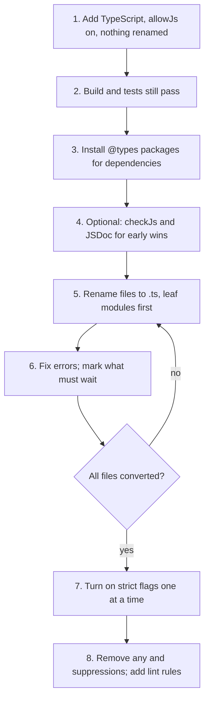

# Migrating from JavaScript, and linting TypeScript

> **Before this lesson:** you need the compiler options from [Configuration](#/lesson/typescript/tsconfig) (especially `allowJs`, `checkJs` and `strict`), declaration files for untyped packages ([Declaration files](#/lesson/typescript/declaration-files)), and `any` versus `unknown` from [Type modifiers](#/lesson/typescript/type-modifiers).

## In plain words

Two practical subjects close this module.

**Migration** means converting an existing JavaScript code base to TypeScript. Almost nobody starts a career on a brand-new project; far more often there are thousands of working JavaScript files and a wish for type safety. The task is to get there **without stopping all other work and without breaking what already runs**.

**Linting** means running a second tool, a *linter*, that reads your code and flags patterns that are legal but risky or inconsistent. The word comes from lint, the fluff a clothes dryer collects: small unwanted bits that are worth removing. The type checker asks "do the types fit together?"; the linter asks "is this a good idea?".

A picture for migration: renovating a house while the family still lives in it. You cannot knock everything down and rebuild. You go room by room, keep the water and electricity working throughout, and start with the rooms that other rooms depend on least. A picture for linting: the spelling and grammar checker in a word processor. A sentence can be grammatical (it "compiles") and still deserve a wavy underline.

Why it matters for a job: "we are moving this service to TypeScript" is one of the most common tasks handed to a developer who knows the language, and every professional code base has a linter whose messages you will meet on your first commit. Interviewers ask "how would you migrate a large JavaScript project?" to see whether you would do it gradually.

## Part 1: Migration

### The principle: gradual, always working

TypeScript was designed for step-by-step adoption. Three facts make that possible:

1. Every JavaScript file is already valid TypeScript syntax.
2. A project may mix `.js` and `.ts` files, importing freely between them.
3. Strictness is adjustable, file by file and flag by flag.

So the code base can be in a half-converted state for months and keep shipping the whole time. The opposite approach, converting everything in one enormous change, produces a change nobody can review and conflicts with everyone else's work.



### Step 1: add the compiler without changing any code

```bash
npm install --save-dev typescript
```

```json
{
  "compilerOptions": {
    "allowJs": true,
    "checkJs": false,
    "strict": false,
    "noEmit": true,
    "target": "ES2022",
    "module": "ESNext",
    "moduleResolution": "Bundler",
    "skipLibCheck": true
  },
  "include": ["src"]
}
```

- `allowJs: true` lets JavaScript files be part of the project.
- `checkJs: false` means they are not yet type-checked.
- `strict: false` starts with the lenient settings.
- `noEmit: true` means the compiler only checks; the existing build keeps producing the output.

Run `npx tsc`. It should report little or nothing. That is the point of this step: the tool is in place, and nothing has been disturbed.

### Step 2: get types for the things you import

Install `@types/...` packages for dependencies that lack their own types. For internal or obscure packages with none, add a one-line placeholder and move on:

```typescript
// types/untyped.d.ts
declare module "legacy-charts";
```

### Step 3 (optional): type checking in JavaScript files with JSDoc

Before renaming anything, JavaScript files can already be checked. **JSDoc** is a long-standing convention for documentation comments that start with `/**`. TypeScript reads the type information in them.

Start with one file by adding a comment on its first line:

```javascript
// @ts-check

/**
 * Works out the mooring fee.
 * @param {number} lengthMetres
 * @param {number} nights
 * @param {{ member?: boolean }} [options]
 * @returns {number}
 */
function mooringFee(lengthMetres, nights, options = {}) {
  const base = lengthMetres * 3.2 * nights;
  return options.member ? base * 0.9 : base;
}

mooringFee("9", 2);
// Error: Argument of type 'string' is not assignable to parameter of type 'number'.
```

Reading the comment:

- `@param {number} lengthMetres` gives the parameter's type in braces, then its name.
- `[options]` in square brackets marks an optional parameter.
- `{{ member?: boolean }}` is an object type written inside the JSDoc braces.
- `@returns {number}` gives the return type.

Other useful tags:

| Tag | Purpose | Example |
|---|---|---|
| `@type` | type of a variable | `/** @type {string[]} */ const names = [];` |
| `@typedef` | name an object type | `/** @typedef {{ id: number, name: string }} Member */` |
| `@template` | a generic type parameter | `/** @template T @param {T[]} items @returns {T \| undefined} */` |
| `@import` | import a type from another file | `/** @import { Member } from "./types" */` |

The file remains ordinary JavaScript and runs unchanged, with no build step:

```js-run
/**
 * @param {number} lengthMetres
 * @param {number} nights
 * @param {{ member?: boolean }} [options]
 * @returns {number}
 */
function mooringFee(lengthMetres, nights, options = {}) {
  const base = lengthMetres * 3.2 * nights;
  return options.member ? base * 0.9 : base;
}
console.log(mooringFee(9, 2));
console.log(mooringFee(9, 2, { member: true }).toFixed(2));
console.log(mooringFee("9", 2));    // 57.6 by accident: "9" * 3.2 coerces. The checker would have flagged it.
```

The last call "works" only because JavaScript silently converts the text `"9"` to a number when multiplying. With addition it would have produced nonsense. This is the sort of latent bug that checking uncovers.

Some teams stay with JSDoc permanently, particularly for libraries that want no build step. Most use it as a bridge.

### Step 4: rename files, in the right order

Now convert files by changing the extension from `.js` to `.ts` (or `.jsx` to `.tsx`). Order matters.

**Convert leaf modules first.** A *leaf* is a file that imports nothing else from your project: utility functions, constants, data-shape definitions. Files that import them benefit at once from their types. Converting from the top down gives the opposite: a typed file whose every import is `any`.

Finding that order is a dependency-graph question, the same one as the build order of project references:

```js-run
// Which files to convert first? Those whose own imports are already converted.
const imports = {
  "app.js": ["routes.js", "config.js"],
  "routes.js": ["members.js", "format.js"],
  "members.js": ["format.js", "config.js"],
  "format.js": [],
  "config.js": [],
};

function migrationOrder(graph) {
  const order = [];
  const remaining = new Set(Object.keys(graph));
  while (remaining.size > 0) {
    const ready = [...remaining].filter((file) => graph[file].every((dep) => !remaining.has(dep)));
    if (ready.length === 0) throw new Error("circular imports among: " + [...remaining].join(", "));
    ready.sort().forEach((file) => { order.push(file); remaining.delete(file); });
  }
  return order;
}
console.log(migrationOrder(imports));
```

The files with no imports come out first, and `app.js`, which depends on everything, comes last.

**What happens when a file is renamed.** New errors appear, because `.ts` files are always checked. Typical ones and their fixes:

| Error after renaming | Usual fix |
|---|---|
| Parameter implicitly has an `any` type | annotate the parameter |
| Property does not exist on type `{}` | declare the object's type, or build it in one literal |
| Cannot find module or its declarations | install `@types/...` or add a `declare module` |
| Object is possibly `undefined` | add a check, a default, or `?.` |
| Property does not exist on type (class field) | declare the field in the class body |

A classic example is an object built up in steps:

```typescript
const settings = {};
settings.theme = "dark";
// Error: Property 'theme' does not exist on type '{}'.

interface Settings { theme: string; fontSize: number }
const fixed: Settings = { theme: "dark", fontSize: 14 };     // describe, then build in one go
```

### Step 5: park what you cannot fix today

Some errors need a larger redesign. Record them and continue, in ways that can be found again later.

```typescript
// @ts-expect-error  TODO(migration): legacy callback has no types yet
legacyChart.render(target, options);

// TODO(migration): replace with a real type
type LegacyOrder = any;
```

- `// @ts-expect-error` suppresses the error on the next line **and reports an error itself if that line stops being wrong**. It therefore cleans up after itself. Its relative `// @ts-ignore` stays silent for ever, hiding new mistakes on the same line.
- A named alias such as `LegacyOrder = any` is searchable. Fifty uses of one name are easier to replace than fifty scattered `any` keywords.

Count them, so progress is visible:

```js-run
// A crude progress report: count the escape hatches left in the source.
const source = `
  // @ts-expect-error TODO(migration)
  legacyChart.render(target, options);
  function total(items: any[]): number { return items.length; }
  const cfg = load() as any;
  // @ts-ignore
  window.thing = 1;
`;
const count = (pattern) => (source.match(pattern) ?? []).length;
console.log({
  explicitAny: count(/:\s*any\b|\bas any\b/g),
  expectError: count(/@ts-expect-error/g),
  ignore: count(/@ts-ignore/g),
});
```

A team might put those three numbers on a dashboard and agree that they may only go down.

### Step 6: tighten the settings one flag at a time

When every file is `.ts`, raise strictness in stages. Each flag produces its own wave of errors; fix one wave before starting the next.

| Order | Flag | Why at this point |
|---|---|---|
| 1 | `noImplicitAny` | makes every untyped spot visible; the foundation for the rest |
| 2 | `strictNullChecks` | the most errors and the most real bugs found |
| 3 | `strictFunctionTypes`, `strictBindCallApply`, `noImplicitThis` | usually few errors |
| 4 | `strictPropertyInitialization` | needs `strictNullChecks` first |
| 5 | `useUnknownInCatchVariables` | small mechanical changes |
| 6 | replace the individual flags with `"strict": true` | future members of the family are included automatically |
| 7 | `noUncheckedIndexedAccess` and other extras | optional final step |

For very large code bases, enabling a flag for the whole project at once can produce thousands of errors. Two tactics: a second, stricter `tsconfig` that includes only the already-clean folders and grows over time; or a tool that records the existing errors as a baseline and fails the build only on *new* ones.

> [!INTERVIEW]
> "How would you migrate a large JavaScript code base to TypeScript?" Incrementally. Add TypeScript with `allowJs` and lenient settings so nothing breaks; install type packages for dependencies; optionally use `checkJs` with JSDoc; rename files from the leaves of the dependency graph upward; fix what is cheap and mark the rest with `@ts-expect-error` or a named `any` alias; then enable strict flags one at a time, beginning with `noImplicitAny` and `strictNullChecks`. Keep the build and tests passing at every step and track the number of escapes so it only decreases.

### What not to do

- **Do not change behaviour during the migration.** If typing reveals a bug, note it and fix it in a separate change. Mixing "added types" with "changed logic" makes both impossible to review.
- **Do not paper over everything with `any` or `as`.** You end with TypeScript's costs and none of its benefits.
- **Do not model every legacy quirk precisely.** A slightly loose type that is correct beats an intricate one nobody understands.

## Part 2: Linting

### What a linter adds

The compiler reports code that is *inconsistent*. A linter reports code that is *consistent but suspicious*. Each of these lines passes the type checker:

```typescript
const data: any = load();                      // deliberately switches checking off
saveReport(report);                            // returns a promise nobody waits for
if (member.roles.length = 0) { /* ... */ }     // assignment where a comparison was meant
const name = member!.name!;                    // two unchecked "trust me" operators
```

The standard linter for JavaScript and TypeScript is **ESLint**. On its own it understands JavaScript only; the **typescript-eslint** project supplies a parser for TypeScript syntax and a large set of TypeScript-specific rules.

### A minimal setup

```bash
npm install --save-dev eslint @eslint/js typescript-eslint
```

```javascript
// eslint.config.mjs
import eslint from "@eslint/js";
import tseslint from "typescript-eslint";

export default tseslint.config(
  eslint.configs.recommended,
  tseslint.configs.recommended,
);
```

- The file exports a list of configuration pieces, applied in order.
- `eslint.configs.recommended` is ESLint's own set of core rules.
- `tseslint.configs.recommended` adds the TypeScript rules and switches off core rules that the compiler already covers.

Run it with `npx eslint .` (the dot means "this folder"). Many problems can be corrected automatically with `npx eslint . --fix`. Editors show lint messages as squiggles next to type errors.

### How a rule works

Tools do not look at code as text. They first parse it into a tree of nodes called an **AST** (abstract syntax tree): a "call" node with a "function name" child and "argument" children, and so on. A lint rule is a function that visits nodes of certain kinds and reports those matching a pattern. A toy version makes this concrete:

```js-run
// A toy "no-explicit-any" rule over a miniature syntax tree.
const tree = {
  kind: "Function", name: "total",
  params: [{ kind: "Param", name: "items", type: "any[]" }, { kind: "Param", name: "tax", type: "number" }],
  body: [{ kind: "Variable", name: "raw", type: "any" }, { kind: "Return" }],
};

function lint(node, report) {
  if ((node.kind === "Param" || node.kind === "Variable") && /\bany\b/.test(node.type ?? "")) {
    report(`Unexpected any on ${node.kind.toLowerCase()} "${node.name}"`);
  }
  for (const child of [...(node.params ?? []), ...(node.body ?? [])]) lint(child, report);
}

const messages = [];
lint(tree, (message) => messages.push(message));
console.log(messages);
```

The rule visits every node, looks only at parameters and variables, and reports two of them. Real rules follow the same pattern over the real tree.

### Rules that need type information

Some of the most valuable rules must know the *types* of expressions, not only their syntax. For instance, to detect a forgotten `await`, a rule has to know that a call returns a promise. This is **typed linting**: the linter asks the TypeScript checker.

```javascript
// eslint.config.mjs
export default tseslint.config(
  eslint.configs.recommended,
  tseslint.configs.recommendedTypeChecked,
  {
    languageOptions: {
      parserOptions: { projectService: true, tsconfigRootDir: import.meta.dirname },
    },
  },
);
```

`projectService: true` tells the linter to locate each file's `tsconfig.json` and obtain type information. Typed linting is slower, because it performs a type check, and catches far more.

| Rule | What it catches | Needs types? |
|---|---|---|
| `no-explicit-any` | writing `any` | no |
| `no-non-null-assertion` | the `!` operator | no |
| `ban-ts-comment` | `@ts-ignore`, and `@ts-expect-error` without an explanation | no |
| `consistent-type-imports` | type-only imports not marked `import type` | no |
| `no-unused-vars` | declared and never used | no |
| `no-floating-promises` | a promise neither awaited nor handled | yes |
| `no-misused-promises` | a promise where a boolean or a `void` callback is expected | yes |
| `await-thenable` | `await` on something that is not a promise | yes |
| `no-unsafe-assignment`, `no-unsafe-call`, `no-unsafe-member-access` | `any` flowing silently into typed code | yes |
| `no-unnecessary-condition` | a check the types say can never differ | yes |
| `switch-exhaustiveness-check` | a `switch` over a union missing a case | yes |
| `restrict-template-expressions` | objects interpolated into strings as `[object Object]` | yes |

### The bug `no-floating-promises` exists for

```typescript
async function saveReport(report: Report): Promise<void> { /* may fail */ }

function onSubmit(report: Report) {
  saveReport(report);                 // no await, no .catch: lint error
  showMessage("Saved!");
}
```

Both lines type-check. Yet the message appears before the save finishes, and if the save fails, nothing in this function notices.

```js-run
async function saveReport(report) {
  await new Promise((resolve) => setTimeout(resolve, 20));
  if (!report.title) throw new Error("title is required");
  return "stored";
}

async function careless(report) {
  saveReport(report).catch(() => {});      // imagine no catch at all: the failure would vanish unseen
  return "Saved!";                         // claims success immediately
}

async function careful(report) {
  try {
    await saveReport(report);
    return "Saved!";
  } catch (err) {
    return "Could not save: " + err.message;
  }
}

(async () => {
  console.log("careless:", await careless({}));
  console.log("careful: ", await careful({}));
})();
```

The careless version reports success for a report that could not be saved. The careful version waits and tells the truth. (The `.catch(() => {})` in the demonstration only stops the runner printing an unhandled-rejection warning.)

### Linter, formatter, compiler: who does what

| Tool | Question it answers | Example |
|---|---|---|
| TypeScript compiler | Do the types fit together? | passing a string where a number is required |
| Linter (ESLint) | Is this pattern risky or against our conventions? | unawaited promise, explicit `any` |
| Formatter (Prettier, Biome) | Is the layout uniform? | indentation, quotes, line length |

Let the formatter own all questions of layout and switch off stylistic lint rules, so the two tools never disagree. Run all three automatically:

```json
{
  "scripts": {
    "typecheck": "tsc --noEmit",
    "lint": "eslint .",
    "format:check": "prettier --check .",
    "verify": "npm run typecheck && npm run lint && npm run format:check"
  }
}
```

A CI system (continuous integration: a server that runs checks on every proposed change) runs `verify`, so nothing that fails can be merged.

### Suppressing a rule, responsibly

```typescript
// eslint-disable-next-line @typescript-eslint/no-explicit-any -- third-party callback is untyped
function onLegacyEvent(payload: any) { /* ... */ }
```

Disable for one line, name the specific rule, and give the reason after `--`. A file-wide disable with no explanation is a warning sign in review.

> [!TIP]
> Introduce a linter to an existing project the way you introduce strict flags: start with the recommended set, auto-fix what can be fixed, set the noisiest remaining rules to "warn", and promote them to "error" one by one as the count reaches zero.

## Pitfalls

- **Big-bang migration.** One giant change cannot be reviewed and collides with all other work.
- **Starting with `strict: true` on a large legacy code base.** Thousands of errors, no momentum.
- **Top-down conversion.** Typed files importing untyped ones gain little.
- **`@ts-ignore` instead of `@ts-expect-error`.**
- **Fixing bugs inside migration changes.** Separate them.
- **Scattered anonymous `any`.** Use a named, searchable alias.
- **Lint rules fighting the formatter.** Let the formatter decide layout.
- **Skipping typed linting.** The most valuable rules need it.
- **Lint warnings that nobody reads.** Either fix them or turn the rule off; a wall of warnings trains people to ignore the tool.

## Cheat sheet

| Goal | Tool or setting |
|---|---|
| Mix JavaScript and TypeScript | `"allowJs": true` |
| Check a JavaScript file | `// @ts-check` with JSDoc |
| Check all JavaScript | `"checkJs": true` |
| Placeholder for an untyped package | `declare module "name";` |
| Temporarily suppress one error | `// @ts-expect-error reason` |
| Conversion order | leaf modules first |
| First strict flags | `noImplicitAny`, then `strictNullChecks` |
| Lint setup | `eslint` with `typescript-eslint`, flat config |
| Rules using types | `recommendedTypeChecked` with `projectService: true` |
| Forgotten `await` | `no-floating-promises` |
| Missing `switch` case | `switch-exhaustiveness-check` |
| Auto-fix | `eslint . --fix` |
| Enforce | `tsc --noEmit && eslint .` in CI |

## Summary

Migration works best as a sequence of small safe steps: add the compiler in its most lenient mode alongside the existing JavaScript, supply types for dependencies, optionally check JavaScript through JSDoc, rename files starting from the leaves of the import graph, park hard cases with self-cleaning suppressions, and finally raise strictness one flag at a time until `strict` is on. A linter complements the type checker by flagging code that is type-correct yet risky; with typescript-eslint, rules that consult the type checker catch unhandled promises, `any` leaking into typed code and incomplete switches. Compiler, linter and formatter each have a distinct job, and all three belong in the automated checks that run on every change.

## Glossary

- **Migration:** converting an existing code base from one technology to another, here JavaScript to TypeScript.
- **Incremental / gradual adoption:** converting a little at a time while the project keeps working.
- **JSDoc:** documentation comments beginning with `/**`, whose type tags TypeScript can read.
- **Leaf module:** a file that imports no other file from the same project.
- **Dependency graph:** the picture of which files import which.
- **Escape hatch:** a way to bypass the checker, such as `any`, `as`, `!` or a suppression comment.
- **Suppression comment:** `// @ts-expect-error` or `// @ts-ignore`, silencing an error on the next line.
- **Baseline:** a recorded list of existing errors, so that only new ones fail the build.
- **Linter:** a tool that flags legal but risky or inconsistent code.
- **ESLint / typescript-eslint:** the standard JavaScript linter, and the project that teaches it TypeScript.
- **Rule:** one specific check a linter performs.
- **AST:** abstract syntax tree; the tree structure tools build from source code.
- **Typed linting:** lint rules that use information from the type checker.
- **Floating promise:** a promise whose completion or failure nothing waits for or handles.
- **Formatter:** a tool that rewrites code layout into one uniform style.
- **CI:** continuous integration; automated checks run on every proposed change.

```quiz
[
  {"q": "Which first step is safest when adding TypeScript to a large working JavaScript project?",
   "options": ["Rename every file to .ts and enable strict", "Add tsconfig with allowJs on and strict off, changing no source files", "Rewrite the entry point first", "Delete the tests so they do not fail"],
   "answer": 1,
   "explain": "The compiler is introduced without disturbing anything, and strictness is raised later in stages."},
  {"q": "Which files should be renamed to .ts first?",
   "options": ["The entry point", "Leaf modules that import nothing else from the project", "The largest files", "Test files"],
   "answer": 1,
   "explain": "Converting leaves first means every file converted later imports already-typed code."},
  {"q": "What is the difference between `// @ts-expect-error` and `// @ts-ignore`?",
   "options": ["None", "expect-error reports a problem if the next line has no error; ignore stays silent for ever", "ignore works only in JavaScript files", "expect-error disables the whole file"],
   "answer": 1,
   "explain": "Because it complains when no longer needed, `@ts-expect-error` cannot outlive the problem it was written for."},
  {"q": "Does this compile in a file with `// @ts-check`? `/** @param {number} n */ function half(n) { return n / 2; } half(\"8\");`",
   "options": ["Yes, JSDoc is only a comment", "No: argument of type 'string' is not assignable to parameter of type 'number'", "Yes, with a warning", "It crashes at runtime"],
   "answer": 1,
   "explain": "With checking enabled, JSDoc type tags are treated as annotations and call sites are verified against them."},
  {"q": "`saveReport(report);` where saveReport returns a Promise, with no await. Who reports this?",
   "options": ["The compiler, as a type error", "The typed lint rule no-floating-promises", "Prettier", "Nobody can detect it"],
   "answer": 1,
   "explain": "The code is type-correct, so the compiler is silent. The lint rule needs type information to know the call returns a promise."},
  {"q": "Why do some lint rules require `recommendedTypeChecked` and a link to tsconfig?",
   "options": ["They are experimental", "They need the type of expressions, which only the TypeScript checker can supply", "They rewrite the tsconfig", "They only run in CI"],
   "answer": 1,
   "explain": "Syntax alone cannot say whether a call returns a promise or whether a value is any; the checker can."},
  {"q": "Which tool should decide indentation and quote style?",
   "options": ["The TypeScript compiler", "The formatter", "Lint rules, enforced as errors", "Each developer"],
   "answer": 1,
   "explain": "Formatters own layout. Leaving it to them avoids conflicts between tools and debates between people."},
  {"q": "In which order should these flags be enabled during a migration?",
   "options": ["strictPropertyInitialization, then strictNullChecks", "noImplicitAny, then strictNullChecks, then the smaller flags, then strict", "strict first, then turn flags off", "Order is irrelevant"],
   "answer": 1,
   "explain": "noImplicitAny exposes untyped spots; strictNullChecks finds the most bugs and is a prerequisite for strictPropertyInitialization."}
]
```

> **Source:** beyond the book (applied material); builds on Goldberg, *Learning TypeScript*, ch. 13 (JavaScript options) and ch. 11. References: https://www.typescriptlang.org/docs/handbook/migrating-from-javascript.html · https://www.typescriptlang.org/docs/handbook/jsdoc-supported-types.html · https://typescript-eslint.io/getting-started · https://typescript-eslint.io/getting-started/typed-linting
