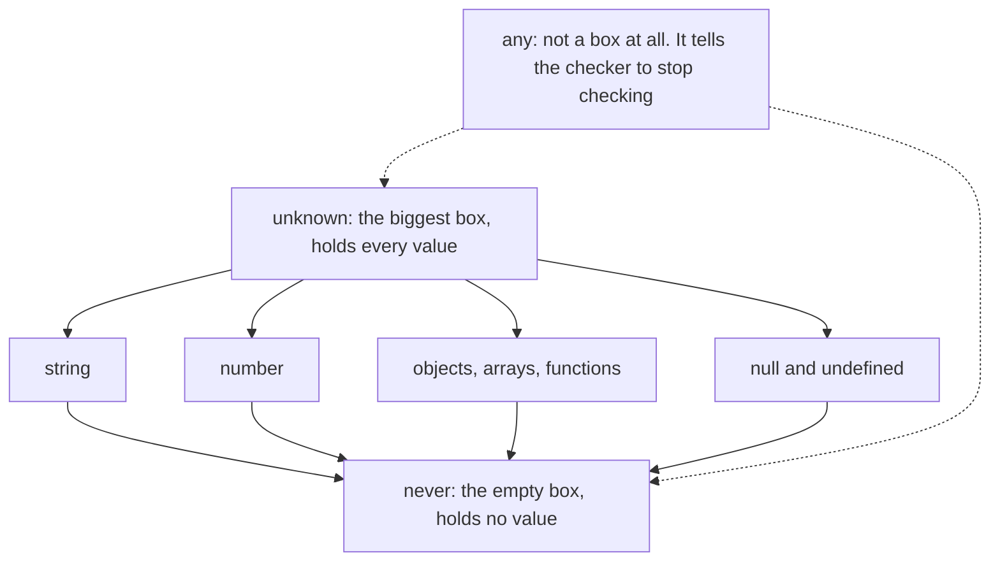

# Interview essentials I: type vs interface, any vs unknown vs never, structural surprises and variance

> **Before this lesson:** this is a consolidation lesson. It assumes [The type system](#/lesson/typescript/type-system), [Objects and structural typing](#/lesson/typescript/objects), [Interfaces and classes](#/lesson/typescript/interfaces-classes), [Type modifiers](#/lesson/typescript/type-modifiers) and [Generics](#/lesson/typescript/generics). Each topic is nevertheless rebuilt from its simplest example, so it also works as revision.

## In plain words

A TypeScript interview rarely asks you to recite syntax. It asks questions that reveal whether you hold the right **mental model**: "what is the difference between these two similar things?", "why does this compile when it looks wrong?", "why does this *not* compile when it looks right?". Four topics come up again and again:

1. `type` versus `interface`;
2. the three special types `any`, `unknown` and `never`;
3. surprising results of structural typing;
4. **variance**: when a container or function of one type may be used in place of a container or function of a related type.

The mental model behind all four is the one this track has used since the second lesson: **a type is a set of values, and "A is assignable to B" means every value in A is also in B.** Think of nested boxes. A small box fits inside a larger one; a large box does not fit inside a small one. Most interview puzzles are solved by asking "which box is bigger?".

Why it matters for a job: beyond passing the interview, these are the ideas that let you predict the checker. A developer who can predict it writes types once; a developer who cannot adds `as` until the red lines go away.

## 1. `type` versus `interface`

### What both can do

Each can name the shape of an object, and for that purpose they are interchangeable.

```typescript
interface BerthI { code: string; depth: number }
type BerthT = { code: string; depth: number };

const a: BerthI = { code: "C-12", depth: 4.5 };
const b: BerthT = a;        // ok: same structure, so the same type
```

Both can be generic, both can be implemented by a class, both are erased at runtime.

### What only a type alias can do

An alias can name **any** type, not only object shapes.

```typescript
type Id = string | number;                                  // a union
type Fix = [lat: number, lon: number];                      // a tuple
type Handler = (event: string) => void;                     // a function type
type Keys = keyof BerthT;                                   // a computed type
type Maybe<T> = T | null;                                   // a generic union
type Flags<T> = { [K in keyof T]: boolean };                // a mapped type
```

None of those can be written as an interface.

### What only an interface can do

**Declaration merging.** Declaring the same interface twice combines the two.

```typescript
interface Harbour { name: string }
interface Harbour { berths: number }
const h: Harbour = { name: "Calder", berths: 80 };    // both required

type Quay = { name: string };
type Quay = { berths: number };
// Error: Duplicate identifier 'Quay'.
```

Merging is how you add a field to a library's type, such as Express's `Request`.

### Extending: `extends` versus `&`

Both build a larger shape from a smaller one. They differ when a property is declared twice with incompatible types.

```typescript
interface Base { id: number }

interface BadChild extends Base { id: string }
// Error: Interface 'BadChild' incorrectly extends interface 'Base'.
//   Types of property 'id' are incompatible.

type Mixed = Base & { id: string };       // no error here...
// ...but id has type number & string, which is never. No value can satisfy it.
```

The interface reports the conflict where you made it. The intersection silently creates an impossible type, and the error appears later, somewhere else, when you try to build a value.

### The answer to give

| | `interface` | `type` |
|---|---|---|
| Object shapes | yes | yes |
| Unions, tuples, primitives, function aliases, mapped and conditional types | no | yes |
| Declaration merging | yes | no |
| Conflict when extending | error at the declaration | silent `never` |
| Shown by name in error messages | always | usually |

A defensible rule: *interfaces for object shapes that are public or will be extended; type aliases for everything else; consistency above all.* An interviewer wants to hear that you know the differences, not that one is "better".

## 2. `any`, `unknown` and `never`

These three are special because of where they sit among the nested boxes.



### One table

| Question | `any` | `unknown` | `never` |
|---|---|---|---|
| Which values belong to it? | all (unchecked) | all | none |
| Can any value be assigned **to** it? | yes | yes | no (only `never`) |
| Can it be assigned **to** other types? | yes, to everything | no, only to `unknown` and `any` | yes, to everything |
| Can you use its properties or call it? | yes, unchecked | no, narrow first | there is nothing to use |
| Typical use | temporary escape during migration | data not yet checked | impossible cases |

### The smallest demonstration of each

```typescript
let a: any = "text";
a.whatever.you.like();        // compiles; crashes when run
const n1: number = a;         // compiles; n1 holds a string

let u: unknown = "text";
u.length;
// Error: 'u' is of type 'unknown'.
const n2: number = u;
// Error: Type 'unknown' is not assignable to type 'number'.
if (typeof u === "string") u.length;      // ok after narrowing

let nv: never;
nv = "text";
// Error: Type 'string' is not assignable to type 'never'.
```

```js-run
let a = "text";
try {
  a.whatever.you.like();
} catch (err) {
  console.log("any let this through:", err.message);
}

let u = "text";
if (typeof u === "string") console.log("unknown, after narrowing:", u.length);
```

### Where `never` appears in practice

**1. Functions that never return**, because they always throw or loop for ever.

```typescript
function fail(message: string): never {
  throw new Error(message);
}
```

**2. What remains after every possibility has been ruled out.** This gives the exhaustiveness check from [Objects and structural typing](#/lesson/typescript/objects):

```typescript
type Signal = { kind: "flag"; colour: string } | { kind: "horn"; blasts: number };

function describe(s: Signal): string {
  switch (s.kind) {
    case "flag": return `flag ${s.colour}`;
    case "horn": return `${s.blasts} blasts`;
    default: {
      const impossible: never = s;       // compiles only when every case is handled
      throw new Error(`Unhandled: ${JSON.stringify(impossible)}`);
    }
  }
}
```

**3. Impossible intersections.** `string & number` is `never`.

**4. As the "nothing" in type computations.** `Exclude<"a" | "b", "a">` works by turning `"a"` into `never`, which vanishes from the union.

A neat fact that follows from the box picture: `never` is assignable to every type (the empty box fits inside any box) and no type is assignable to it.

> [!INTERVIEW]
> "Explain `any`, `unknown` and `never`." `unknown` is the top type: every value is assignable to it, but nothing can be done with it until it is narrowed. `never` is the bottom type: it has no values, is assignable to everything, and appears for unreachable code, exhausted unions and impossible intersections. `any` is neither: it disables checking in both directions and spreads to whatever is computed from it. Use `unknown` for unchecked input, `never` for exhaustiveness, and `any` only as a short-lived escape.

## 3. Structural typing surprises

TypeScript compares object types by their members. The rule is short; some of its consequences are not obvious. Each of the following is a popular "does this compile?" question.

### Surprise 1: extra properties are rejected in one spot and accepted in another

```typescript
interface Berth { code: string }

const direct: Berth = { code: "C-12", depth: 4.5 };
// Error: Object literal may only specify known properties,
// and 'depth' does not exist in type 'Berth'.

const measured = { code: "C-12", depth: 4.5 };
const viaVariable: Berth = measured;          // ok
```

The explanation: **excess property checking** applies only to object literals written directly where a type is expected. It is an extra check to catch typos. In every other case the structural rule ("has at least the required members") applies, and an object with more members passes.

### Surprise 2: `{}` accepts almost everything

```typescript
const x: {} = 42;            // ok
const y: {} = "text";        // ok
const z: {} = [];            // ok
const w: {} = null;
// Error: Type 'null' is not assignable to type '{}'.
```

`{}` means "has at least zero known properties". Every value except `null` and `undefined` satisfies that. For "an object, not a primitive" write `object`; for "an object with no properties" write `Record<string, never>`.

### Surprise 3: types with the same shape are the same type

```typescript
interface Euros { amount: number }
interface Dollars { amount: number }

function payInEuros(price: Euros) {}

const usd: Dollars = { amount: 10 };
payInEuros(usd);        // ok: the names are irrelevant
```

The standard workaround is **branding**: intersect with a property that exists only in the type system, so the shapes differ.

```typescript
type Euros = number & { readonly __brand: "EUR" };
type Dollars = number & { readonly __brand: "USD" };

const euros = (n: number) => n as Euros;      // the only place an assertion is needed
const dollars = (n: number) => n as Dollars;

function payInEuros(price: Euros) {}

payInEuros(euros(10));       // ok
payInEuros(dollars(10));
// Error: Type '"USD"' is not assignable to type '"EUR"'.
payInEuros(10);
// Error: Argument of type 'number' is not assignable to parameter of type 'Euros'.
```

`__brand` never exists while the program runs; a branded value is a plain number.

```js-run
const euros = (n) => n;        // what the branding helpers compile to
const dollars = (n) => n;
console.log(typeof euros(10), euros(10) === dollars(10));   // the brand left no trace
```

### Surprise 4: `Object.keys` returns `string[]`

```typescript
const berth = { code: "C-12", depth: 4.5 };

for (const key of Object.keys(berth)) {
  berth[key];
  // Error: Element implicitly has an 'any' type because expression of type
  // 'string' can't be used to index type '{ code: string; depth: number; }'.
}
```

People expect `("code" | "depth")[]`. The declared result is `string[]` on purpose, and Surprise 1 is the reason: a variable of type `{ code: string; depth: number }` may refer to an object with *more* properties, so its real keys may include others.

```js-run
function listKeys(berth) {           // imagine the parameter typed { code: string; depth: number }
  return Object.keys(berth);
}
const measured = { code: "C-12", depth: 4.5, inspector: "Oriel" };
console.log(listKeys(measured));     // includes "inspector": the type does not list all keys
```

When you know the object has exactly those keys, assert it: `Object.keys(berth) as (keyof typeof berth)[]`.

### Surprise 5: a class is a shape too

```typescript
class Gull { name = "gull"; cry() { return "kee"; } }
class Robot { name = "unit"; cry() { return "beep"; } }

const bird: Gull = new Robot();      // ok: identical members
```

```js-run
class Gull { name = "gull"; cry() { return "kee"; } }
class Robot { name = "unit"; cry() { return "beep"; } }
const bird = new Robot();            // accepted as a Gull by the checker
console.log(bird.cry(), bird instanceof Gull);   // instanceof disagrees with the type
```

The types say `Gull`, while `instanceof Gull` says `false`. Adding a `private` or `#private` member makes a class compatible only with itself and its subclasses.

### Surprise 6: optional-only types still catch total mismatches

```typescript
interface Options { timeout?: number; retries?: number }

const settings = { timeOut: 500 };
const o: Options = settings;
// Error: Type '{ timeOut: number; }' has no properties in common with type 'Options'.
```

A type whose properties are all optional is called a *weak type*. Structurally anything fits it, so the checker adds a special rule: the value must share at least one property name. This catches the misspelling even though `settings` is a variable.

### Surprise 7: arrays are treated as covariant, which is unsound

```typescript
const gulls: Gull[] = [new Gull()];
const things: (Gull | number)[] = gulls;     // allowed
things.push(42);                             // allowed: 42 fits Gull | number
gulls[1].cry();                              // compiles; crashes
```

```js-run
const gulls = [{ cry: () => "kee" }];
const things = gulls;           // the same array under a wider type
things.push(42);
try {
  gulls[1].cry();
} catch (err) {
  console.log("unsound:", err.message);
}
```

Both names refer to one array. Writing through the wider type put a number where the narrower type promises a gull. TypeScript permits this because forbidding it would make ordinary code painful. Declaring the parameter as `readonly (Gull | number)[]` closes the hole, since nothing can be pushed through a read-only reference. That leads directly to variance.

## 4. Variance, practically

### The question variance answers

Suppose `Gull` is assignable to `Bird` (every gull is a bird). Is a *box of gulls* usable as a *box of birds*? Is a *function that accepts gulls* usable as a *function that accepts birds*? **Variance** is the name for how assignability of the parts carries over to the whole.

```typescript
interface Bird { name: string }
interface Gull extends Bird { wingspan: number }
```

`Gull` is the smaller box (more requirements, fewer values); `Bird` is the larger.

### Output positions: same direction (covariance)

A function that **produces** a `Gull` can be used wherever a function producing a `Bird` is expected. Whoever calls it wanted a bird and received a gull, which is a bird.

```typescript
type Producer<T> = () => T;

const makeGull: Producer<Gull> = () => ({ name: "gull", wingspan: 1.4 });
const makeBird: Producer<Bird> = makeGull;       // ok
```

The relationship points the same way as the parts: `Gull` to `Bird`, so `Producer<Gull>` to `Producer<Bird>`. That is **covariance** ("varying together").

### Input positions: opposite direction (contravariance)

A function that **consumes** a value works the other way round.

```typescript
type Consumer<T> = (value: T) => void;

const measureGull: Consumer<Gull> = (g) => console.log(g.wingspan.toFixed(1));
const describeBird: Consumer<Bird> = (b) => console.log(b.name);

const forGulls: Consumer<Gull> = describeBird;    // ok
const forBirds: Consumer<Bird> = measureGull;
// Error: Type 'Consumer<Gull>' is not assignable to type 'Consumer<Bird>'.
//   Property 'wingspan' is missing in type 'Bird' but required in type 'Gull'.
```

Reason it through with the second assignment. Someone holding a `Consumer<Bird>` may pass it *any* bird, for instance a penguin with no `wingspan`. `measureGull` would then read `wingspan` of something that lacks one.

```js-run
const measureGull = (g) => console.log(g.wingspan.toFixed(1));
const describeBird = (b) => console.log(b.name);

const forGulls = describeBird;                    // safe: it needs less than it will be given
forGulls({ name: "gull", wingspan: 1.4 });

const forBirds = measureGull;                     // unsafe: it needs more than it may be given
try {
  forBirds({ name: "penguin" });
} catch (err) {
  console.log("crash:", err.message);
}
```

The first assignment is safe: `describeBird` only needs a `name`, and gulls have one. The relationship points the opposite way to the parts: `Gull` to `Bird`, but `Consumer<Bird>` to `Consumer<Gull>`. That is **contravariance**.

A rule you can memorise: **a function may be replaced by one that accepts more and returns less.** "Accepts more" means a wider parameter type; "returns less" means a narrower return type.

### Both positions: invariance

A type that both reads and writes `T` is safe only when the types match exactly. A mutable box is the standard example: reading wants covariance, writing wants contravariance, and both hold only for equal types. That is **invariance**. As Surprise 7 showed, TypeScript deliberately treats mutable arrays as covariant anyway, which is unsound.

### Summary of variance

| Where `T` is used | Name | `Gull` to `Bird` gives | Example |
|---|---|---|---|
| Returned (output) only | covariant | `F<Gull>` assignable to `F<Bird>` | `() => T`, `Promise<T>`, `readonly T[]` |
| Accepted (input) only | contravariant | `F<Bird>` assignable to `F<Gull>` | `(value: T) => void` |
| Both | invariant | neither direction | `{ get(): T; set(v: T): void }` |
| Either direction allowed | bivariant (unsound) | both | parameters of methods written in method syntax |

### The method-syntax exception

Under `strictFunctionTypes`, parameters of function *properties* are checked contravariantly, the safe way. Parameters of members written with **method syntax** are still checked bivariantly: either direction passes.

```typescript
interface WithProperty { handle: (b: Bird) => void }     // property syntax: strict
interface WithMethod { handle(b: Bird): void }           // method syntax: lenient

const measureGull = (g: Gull) => console.log(g.wingspan);

const p: WithProperty = { handle: measureGull };
// Error: Type '(g: Gull) => void' is not assignable to type '(b: Bird) => void'.

const m: WithMethod = { handle: measureGull };           // no error
```

The exception exists so that built-in types such as `Array<T>`, whose methods take `T`, stay usable. The practical advice: **write callback members in property syntax** to get the stricter check.

> [!INTERVIEW]
> "What is variance?" It describes how the subtype relationship between two types carries over to types built from them. Return types are covariant: a function returning a subtype may replace one returning the supertype. Parameter types are contravariant under `strictFunctionTypes`: a function accepting a supertype may replace one accepting the subtype, not the reverse. A type used for both input and output is invariant. TypeScript makes two pragmatic exceptions that are unsound: mutable arrays are covariant, and method-syntax parameters are bivariant.

### Explicit annotations

TypeScript (4.7 and later) lets you state variance on type parameters with `out` (covariant), `in` (contravariant) or both. They mostly serve as documentation and as a speed-up for the checker on complicated types.

```typescript
interface Producer<out T> { make(): T }
interface Consumer<in T> { take(value: T): void }
interface Box<in out T> { get(): T; set(value: T): void }
```

## Quick-fire questions

| Question | Short answer |
|---|---|
| Do types exist at runtime? | No, they are erased; enums and classes do leave code |
| `interface` or `type` for a union? | Only `type` can |
| Safe replacement for `any`? | `unknown`, then narrow |
| What is a discriminated union? | A union whose members share a literal "tag" property used to narrow |
| What does `as const` do? | Keeps literal types and adds `readonly` |
| What does `keyof T` produce? | A union of `T`'s property names |
| What is a type guard? | A check that narrows; a custom one returns `x is T` |
| `?.` versus `!`? | `?.` checks at runtime; `!` only silences the checker |
| `??` versus `\|\|`? | `??` falls back only for `null` and `undefined` |
| Is `Readonly<T>` deep? | No, first level only |
| Why does `Object.keys` return `string[]`? | Objects may have more keys than their type lists |
| `void` versus `never`? | `void` returns but the result is ignored; `never` does not return |

## Pitfalls

- **Answering "interface is better" or "type is better".** State the differences and a consistent convention.
- **Describing `unknown` as "like `any`".** They accept the same values and are opposite in what they permit.
- **Believing a compiled program cannot have type errors when run.** Arrays, index access, assertions and `any` are deliberate holes.
- **Confusing excess property checking with structural typing.** One is an extra check for literals; the other is the general rule.
- **Using `{}` to mean "object".**
- **Getting contravariance backwards.** Test with a concrete call: "what could the holder pass in?".
- **Writing callbacks in method syntax** and losing the strict parameter check.

## Cheat sheet

| Idea | One line |
|---|---|
| Assignability | subset of values |
| Top type | `unknown` |
| Bottom type | `never` |
| Checker off | `any` |
| Merging | interfaces only |
| Unions and computed types | type aliases only |
| Excess property check | fresh object literals only |
| Nominal-like behaviour | branding, private members, string enums |
| Outputs | covariant |
| Inputs | contravariant (under `strictFunctionTypes`, property syntax) |
| Read and write | invariant |
| Known unsound spots | mutable array covariance, method bivariance, index access, assertions |

## Summary

Type aliases and interfaces both name object shapes; aliases additionally name unions and computed types, while interfaces merge and report conflicting extensions. `unknown` contains every value and permits nothing without narrowing, `never` contains none and marks impossible situations, and `any` switches checking off. Structural typing compares members, which explains why extra properties are accepted outside fresh literals, why `{}` accepts nearly anything, why identically shaped types and classes are interchangeable, and why `Object.keys` returns `string[]`. Variance describes how assignability carries over to built types: outputs covariantly, inputs contravariantly, read-write positions invariantly, with mutable arrays and method parameters as TypeScript's pragmatic unsound exceptions.

## Glossary

- **Mental model:** the simplified picture in your head that lets you predict how a system behaves.
- **Subtype / supertype:** if every value of A is a value of B, A is a subtype of B and B a supertype of A.
- **Top type:** a type every value belongs to (`unknown`).
- **Bottom type:** a type no value belongs to (`never`).
- **Declaration merging:** two interface declarations with one name combining into one.
- **Excess property checking:** the extra check that rejects unknown properties in a directly written object literal.
- **Weak type:** an object type whose properties are all optional.
- **Branding:** adding a type-only marker property so that otherwise identical types become distinct.
- **Sound / unsound:** a sound type system never accepts a program that has a type error when run; TypeScript is unsound in a few deliberate places.
- **Variance:** how assignability between types carries over to types built from them.
- **Covariant:** same direction as the parts (outputs).
- **Contravariant:** opposite direction to the parts (inputs).
- **Invariant:** neither direction; the types must match.
- **Bivariant:** both directions accepted; convenient and unsound.

```quiz
[
  {"q": "Does this compile? `type Q = { name: string }; type Q = { berths: number };`",
   "options": ["Yes, they merge", "No: Duplicate identifier 'Q'", "Yes, the second wins", "Only in .d.ts files"],
   "answer": 1,
   "explain": "Only interfaces merge. Two type aliases with the same name are a duplicate declaration."},
  {"q": "What is the type of `id` in `type M = { id: number } & { id: string }`?",
   "options": ["`string | number`", "`never`", "`any`", "It is a compile error at the alias"],
   "answer": 1,
   "explain": "Intersecting property types gives `number & string`, which is never. The alias itself compiles; building a value fails."},
  {"q": "Does this compile? `const u: unknown = 5; const n: number = u;`",
   "options": ["Yes", "No: Type 'unknown' is not assignable to type 'number'", "Yes, with a warning", "Only if u is const"],
   "answer": 1,
   "explain": "unknown is assignable only to unknown and any; it must be narrowed first."},
  {"q": "Does this compile? `interface B { code: string } const m = { code: \"C\", depth: 4 }; const b: B = m;`",
   "options": ["No: depth is not in B", "Yes: excess property checks apply only to fresh object literals", "No: m needs a type annotation", "Yes, and depth is removed at runtime"],
   "answer": 1,
   "explain": "`m` is a variable, so the structural rule applies: it has the required `code`, and extra members are allowed."},
  {"q": "With `strictFunctionTypes`, `type C<T> = (v: T) => void` and `Gull extends Bird`: which assignment compiles?",
   "options": ["`const a: C<Bird> = (g: Gull) => {}`", "`const b: C<Gull> = (x: Bird) => {}`", "Both", "Neither"],
   "answer": 1,
   "explain": "Parameters are contravariant: a function accepting any Bird can safely stand in where only Gulls will be passed, not the other way round."},
  {"q": "What is the declared return type of `Object.keys(obj)` for `const obj = { a: 1, b: 2 }`?",
   "options": ["`(\"a\" | \"b\")[]`", "`string[]`", "`(keyof typeof obj)[]`", "`unknown[]`"],
   "answer": 1,
   "explain": "Because a value may have more properties than its static type lists, the keys are typed as plain strings."},
  {"q": "Which values are NOT assignable to the type `{}` under strictNullChecks?",
   "options": ["Numbers", "Strings", "null and undefined", "Arrays"],
   "answer": 2,
   "explain": "`{}` requires no properties, which every non-nullish value satisfies."},
  {"q": "`const gulls: Gull[] = [...]; const xs: (Gull | number)[] = gulls; xs.push(1);` What does the checker say?",
   "options": ["Error on the assignment", "Error on the push", "No error: mutable arrays are treated covariantly, which is unsound", "Error only with strict"],
   "answer": 2,
   "explain": "TypeScript allows the widening assignment for convenience, so a number can end up in the array typed Gull[]."}
]
```

> **Source:** beyond the book (interview preparation); consolidates Goldberg, *Learning TypeScript*, ch. 2, 4, 5, 7 and 9. Handbook: https://www.typescriptlang.org/docs/handbook/type-compatibility.html · https://www.typescriptlang.org/docs/handbook/2/everyday-types.html#differences-between-type-aliases-and-interfaces · https://www.typescriptlang.org/docs/handbook/2/generics.html#variance-annotations · https://www.typescriptlang.org/tsconfig#strictFunctionTypes
