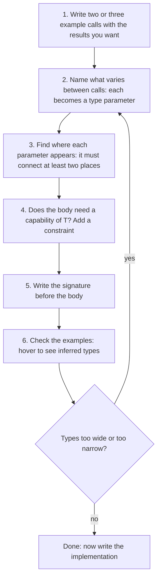

# Interview essentials II: generics exercises, discriminated unions and utility types by hand

> **Before this lesson:** you need [Generics](#/lesson/typescript/generics), [Type operations](#/lesson/typescript/type-operations) and the discriminated unions of [Objects and structural typing](#/lesson/typescript/objects). The previous lesson, [Interview essentials I](#/lesson/typescript/interview-fundamentals), covered the conceptual questions; this one is the practical half.

## In plain words

The second kind of TypeScript interview question hands you a keyboard: "type this function", "model this data", "write `Pick` without using `Pick`". These are exercises, and like scales on a piano they come from a small repertoire. Someone who has worked through the repertoire once recognises nearly every question as a variation.

This lesson is that repertoire, as worked exercises. Each has the same four parts:

1. **the task**, as an interviewer would phrase it;
2. **how to think about it**, in plain language before any syntax;
3. **the solution**, explained line by line;
4. **a runnable counterpart**, because types cannot be executed and a function doing the same job on real values makes the idea concrete.

A comparison: learning to cook from recipes. Nobody improvises well before following a few recipes exactly. Afterwards you start to see that most dishes combine the same handful of techniques. For type-level TypeScript the techniques are four: loop over keys (mapped types), choose with a condition (conditional types), capture a part (`infer`), and repeat on what is inside (recursion).

Why it matters for a job: apart from interviews, these exact helpers show up in everyday work. Typed `groupBy`, a `Result` type, `DeepPartial` for test fixtures and configuration overrides, an exhaustive `switch` over an action union: you will write or read each of them within your first months.

## A method for any typing exercise

Before the exercises, a routine that works on all of them.



Saying these steps aloud in an interview is worth as much as the answer.

## Part 1: generics exercises

### Exercise 1: last element

**Task.** "Write a function `last` that returns the last element of an array, typed properly."

**Thinking.** Example calls: `last([1, 2, 3])` should be a number; `last(["a"])` a string; `last([])` has no element. What varies is the element type, so it becomes a type parameter. It appears in the parameter (an array of it) and in the result, two places. An empty array is possible, so the result must include `undefined`.

```typescript
function last<Item>(items: readonly Item[]): Item | undefined {
  return items[items.length - 1];
}

const n = last([1, 2, 3]);     // number | undefined
const s = last(["a"]);         // string | undefined
```

- `<Item>` declares the blank.
- `readonly Item[]` accepts both ordinary and read-only arrays, and promises not to modify the argument. Accepting `readonly` is the more generous choice for callers.
- `Item | undefined` is honest about the empty case.

```js-run
function last(items) {
  return items[items.length - 1];
}
console.log(last([1, 2, 3]), last(["a"]), last([]));
```

### Exercise 2: typed property access

**Task.** "Write `getProp(obj, key)` so that the key must exist and the return type matches that property."

**Thinking.** Two things vary: the object's type and *which* key. If the key were typed `keyof Obj`, the result could only be the union of all property types. To remember the specific key, it needs its own type parameter, constrained to the object's keys.

```typescript
function getProp<Obj, Key extends keyof Obj>(obj: Obj, key: Key): Obj[Key] {
  return obj[key];
}

const ferry = { name: "Kittiwake", seats: 140 };
const seats = getProp(ferry, "seats");      // number
getProp(ferry, "sails");
// Error: Argument of type '"sails"' is not assignable to parameter of type '"name" | "seats"'.
```

- `Key extends keyof Obj`: the key must be one of the object's property names.
- `Obj[Key]`: the type of that particular property.

### Exercise 3: group by

**Task.** "Type a `groupBy` function that groups array items by a key computed from each item."

**Thinking.** Examples: grouping crew by watch number gives an object from watch to list of crew. Two things vary: the item type, and the type of the key the callback returns. Object keys must be strings, numbers or symbols, so the key type needs that constraint; the built-in name for it is `PropertyKey`.

```typescript
function groupBy<Item, Key extends PropertyKey>(
  items: readonly Item[],
  keyOf: (item: Item) => Key,
): Partial<Record<Key, Item[]>> {
  const groups: Partial<Record<Key, Item[]>> = {};
  for (const item of items) {
    const key = keyOf(item);
    (groups[key] ??= []).push(item);
  }
  return groups;
}

const crew = [
  { name: "Asha", watch: "day" as const },
  { name: "Tobin", watch: "night" as const },
  { name: "Lior", watch: "day" as const },
];
const byWatch = groupBy(crew, (member) => member.watch);
// Partial<Record<"day" | "night", { name: string; watch: "day" | "night" }[]>>
byWatch.day?.length;       // must use ?. because a group may be absent
```

- `Record<Key, Item[]>` is "an object with those keys, each holding an array of items".
- `Partial<...>` makes each group optional, which is truthful: no item may have produced a given key. Leaving it out is the usual mistake in this exercise.
- `groups[key] ??= []` creates the array the first time a key is seen, then `push` adds to it.

```js-run
function groupBy(items, keyOf) {
  const groups = {};
  for (const item of items) {
    const key = keyOf(item);
    (groups[key] ??= []).push(item);
  }
  return groups;
}
const crew = [{ name: "Asha", watch: "day" }, { name: "Tobin", watch: "night" }, { name: "Lior", watch: "day" }];
const byWatch = groupBy(crew, (m) => m.watch);
console.log(JSON.stringify(byWatch));
console.log(byWatch.dusk?.length ?? "no dusk watch");
```

### Exercise 4: a `Result` type with `map`

**Task.** "Model an operation that can fail without throwing, and write `map` for it."

**Thinking.** Success carries a value, failure carries an error: a discriminated union with two type parameters. `map` applies a function to the value when there is one and passes a failure along untouched. The function changes the value's type, so `map` needs a new type parameter for the output.

```typescript
type Result<Value, Fault = string> =
  | { ok: true; value: Value }
  | { ok: false; error: Fault };

const ok = <Value>(value: Value): Result<Value, never> => ({ ok: true, value });
const err = <Fault>(error: Fault): Result<never, Fault> => ({ ok: false, error });

function map<In, Out, Fault>(
  result: Result<In, Fault>,
  convert: (value: In) => Out,
): Result<Out, Fault> {
  return result.ok ? ok(convert(result.value)) : result;
}

function flatMap<In, Out, Fault>(
  result: Result<In, Fault>,
  next: (value: In) => Result<Out, Fault>,
): Result<Out, Fault> {
  return result.ok ? next(result.value) : result;
}
```

- `Result<Value, never>` for `ok` says "no error is possible here". Because `never` is assignable to everything, such a result fits any `Result<Value, Fault>`.
- In `map`, the false branch returns `result` itself. The checker has narrowed it to the failure member, which contains no `In`, so it is a valid `Result<Out, Fault>`.
- `flatMap` differs in one respect: the callback itself returns a `Result`, so a second step that may fail does not produce a result inside a result.

```js-run
const ok = (value) => ({ ok: true, value });
const err = (error) => ({ ok: false, error });
const map = (result, convert) => (result.ok ? ok(convert(result.value)) : result);
const flatMap = (result, next) => (result.ok ? next(result.value) : result);

const parse = (text) => (Number.isNaN(Number(text)) ? err(`"${text}" is not a number`) : ok(Number(text)));
const reciprocal = (n) => (n === 0 ? err("cannot divide by zero") : ok(1 / n));

for (const input of ["4", "0", "four"]) {
  const result = map(flatMap(parse(input), reciprocal), (x) => x.toFixed(2));
  console.log(input, "->", JSON.stringify(result));
}
```

Three inputs, three paths: success all the way, failure at the second step, failure at the first. No `try`/`catch`, and the first failure is carried through unchanged.

### Exercise 5: preserving literal types

**Task.** "Write `makeRoute(method, path)` so that the result's `method` is exactly `"GET"` and not `string`."

**Thinking.** A parameter typed `string` forgets the specific string. A type parameter *constrained* to `string` keeps it: the checker infers the narrowest type that satisfies the constraint.

```typescript
function makeRoute<Method extends "GET" | "POST", Path extends string>(method: Method, path: Path) {
  return { method, path };
}

const route = makeRoute("GET", "/berths");
// { method: "GET"; path: "/berths" }
```

Since TypeScript 5.0, writing `const` before a type parameter asks for the same precise inference on arrays and objects: `function tuple<const T extends readonly unknown[]>(items: T): T`.

## Part 2: discriminated unions

### Exercise 6: model a request's state

**Task.** "A screen loads a list. Model its state so that impossible combinations cannot be written."

**Thinking.** List the real situations first: not started; loading; loaded with data; failed with a message. Four situations become four members, with a shared tag.

```typescript
type Remote<Data> =
  | { status: "idle" }
  | { status: "loading" }
  | { status: "success"; data: Data }
  | { status: "failure"; message: string };

function render(state: Remote<string[]>): string {
  switch (state.status) {
    case "idle": return "Press load";
    case "loading": return "Loading...";
    case "success": return state.data.join(", ");
    case "failure": return `Error: ${state.message}`;
  }
}
```

In each `case`, the checker has narrowed `state` to one member, so `state.data` exists only in the success branch. With `strict`, omitting a case makes the function able to fall off the end and return `undefined`, which the declared `string` return type rejects: a free exhaustiveness check.

### Exercise 7: a state machine with allowed transitions

**Task.** "Write a `transition(state, event)` function for that loader. Events that make no sense in the current state leave it unchanged."

**Thinking.** Events are a second discriminated union. The function looks at both tags.

```typescript
type LoadEvent =
  | { type: "fetch" }
  | { type: "resolve"; data: string[] }
  | { type: "reject"; message: string }
  | { type: "reset" };

function transition(state: Remote<string[]>, event: LoadEvent): Remote<string[]> {
  switch (event.type) {
    case "fetch":
      return state.status === "loading" ? state : { status: "loading" };
    case "resolve":
      return state.status === "loading" ? { status: "success", data: event.data } : state;
    case "reject":
      return state.status === "loading" ? { status: "failure", message: event.message } : state;
    case "reset":
      return { status: "idle" };
    default:
      return assertNever(event);
  }
}

function assertNever(value: never): never {
  throw new Error(`Unhandled: ${JSON.stringify(value)}`);
}
```

```js-run
function transition(state, event) {
  switch (event.type) {
    case "fetch": return state.status === "loading" ? state : { status: "loading" };
    case "resolve": return state.status === "loading" ? { status: "success", data: event.data } : state;
    case "reject": return state.status === "loading" ? { status: "failure", message: event.message } : state;
    case "reset": return { status: "idle" };
    default: throw new Error("Unhandled: " + JSON.stringify(event));
  }
}
const events = [
  { type: "resolve", data: ["early"] },      // ignored: nothing is loading yet
  { type: "fetch" },
  { type: "resolve", data: ["Asha", "Tobin"] },
  { type: "reject", message: "late" },       // ignored: already finished
];
let state = { status: "idle" };
for (const event of events) {
  state = transition(state, event);
  console.log(event.type.padEnd(8), "->", JSON.stringify(state));
}
```

The first and last events are ignored because the machine was not loading when they arrived. The problem *Run a tagged state machine* extends this.

### Exercise 8: get one member of a union by its tag

**Task.** "Given the `LoadEvent` union, produce the type of the `resolve` event."

**Thinking.** Filtering a union is the job of `Extract`, which keeps the members assignable to a pattern.

```typescript
type ResolveEvent = Extract<LoadEvent, { type: "resolve" }>;
// { type: "resolve"; data: string[] }

type EventOf<Tag extends LoadEvent["type"]> = Extract<LoadEvent, { type: Tag }>;
type Payloads = { [Tag in LoadEvent["type"]]: Omit<EventOf<Tag>, "type"> };
// { fetch: {}; resolve: { data: string[] }; reject: { message: string }; reset: {} }
```

`LoadEvent["type"]` is an indexed access on a union: it gives the union of all the tags.

## Part 3: utility types by hand

The built-in helpers are short. Writing them from memory is the most common type-level interview task. The first column of this table is worth knowing by heart.

| Utility | Definition |
|---|---|
| `Partial<T>` | `{ [K in keyof T]?: T[K] }` |
| `Required<T>` | `{ [K in keyof T]-?: T[K] }` |
| `Readonly<T>` | `{ readonly [K in keyof T]: T[K] }` |
| `Pick<T, K extends keyof T>` | `{ [P in K]: T[P] }` |
| `Record<K extends PropertyKey, V>` | `{ [P in K]: V }` |
| `Exclude<T, U>` | `T extends U ? never : T` |
| `Extract<T, U>` | `T extends U ? T : never` |
| `Omit<T, K>` | `Pick<T, Exclude<keyof T, K>>` |
| `NonNullable<T>` | `T extends null \| undefined ? never : T` |
| `ReturnType<F>` | `F extends (...args: any[]) => infer R ? R : never` |
| `Parameters<F>` | `F extends (...args: infer P) => any ? P : never` |
| `Awaited<T>` | `T extends Promise<infer V> ? Awaited<V> : T` |

### Exercise 9: `Pick`

**Task.** "Implement `MyPick<T, K>`."

**Thinking.** The result is an object type with only the chosen keys. "For each chosen key, the same property type" is a mapped type looping over `K` rather than over all keys. `K` must be limited to real keys of `T`.

```typescript
type MyPick<T, K extends keyof T> = {
  [P in K]: T[P];
};

interface Member { id: number; name: string; email: string }
type Contact = MyPick<Member, "name" | "email">;     // { name: string; email: string }
```

- `K extends keyof T` is the constraint that rejects misspelt keys.
- `[P in K]` loops over the chosen keys.
- `T[P]` copies each property's type.

### Exercise 10: `Omit`

**Task.** "Now implement `MyOmit<T, K>`."

**Thinking.** Omitting is picking everything else. "Everything else" is the key union with `K` removed, which is `Exclude`.

```typescript
type MyExclude<T, U> = T extends U ? never : T;
type MyOmit<T, K extends PropertyKey> = MyPick<T, MyExclude<keyof T, K>>;

type WithoutEmail = MyOmit<Member, "email">;         // { id: number; name: string }
```

An alternative uses key remapping in a single mapped type: `{ [P in keyof T as P extends K ? never : P]: T[P] }`. An interviewer may ask why the built-in `Omit` does not constrain `K` to `keyof T`: it was a deliberate choice to keep it usable with unions and index signatures, with the downside that misspelt keys are not reported.

```js-run
// Runtime pick and omit, the value-level twins of the two types.
const pick = (obj, keys) => Object.fromEntries(keys.filter((k) => k in obj).map((k) => [k, obj[k]]));
const omit = (obj, keys) => Object.fromEntries(Object.entries(obj).filter(([k]) => !keys.includes(k)));

const member = { id: 7, name: "Asha", email: "asha@example.org" };
console.log(pick(member, ["name", "email"]));
console.log(omit(member, ["email"]));
```

### Exercise 11: `DeepPartial`

**Task.** "`Partial` only affects the first level. Write `DeepPartial<T>` that makes nested properties optional too."

**Thinking.** Start from `Partial`'s definition. The one change: the property type should itself be made deeply partial, **if it is an object**. "If" means a conditional type; "itself" means recursion. Two special cases need care. Functions are objects as far as `extends object` is concerned, and their "properties" should not be touched. Arrays need their *elements* made partial, not their methods.

```typescript
type DeepPartial<T> =
  T extends (...args: any[]) => unknown ? T                // 1. functions: leave alone
  : T extends readonly (infer Item)[] ? DeepPartial<Item>[]   // 2. arrays: recurse into elements
  : T extends object ? { [K in keyof T]?: DeepPartial<T[K]> }  // 3. objects: optional and recurse
  : T;                                                     // 4. primitives: unchanged

interface Settings {
  theme: { colour: string; fontSize: number };
  shortcuts: { key: string; action: string }[];
  onSave: () => void;
}

const patch: DeepPartial<Settings> = {
  theme: { fontSize: 16 },          // colour may be left out: nested optional
};
```

Read it as four questions asked in order, the first match winning. The order matters: the function test must come before the general object test.

A deep partial type is normally paired with a **deep merge** function that applies such a patch:

```js-run
const isPlainObject = (v) => typeof v === "object" && v !== null && !Array.isArray(v);

function deepMerge(base, patch) {
  if (!isPlainObject(base) || !isPlainObject(patch)) return patch === undefined ? base : patch;
  const result = { ...base };
  for (const [key, value] of Object.entries(patch)) {
    result[key] = deepMerge(base[key], value);
  }
  return result;
}

const defaults = { theme: { colour: "navy", fontSize: 14 }, shortcuts: [{ key: "s", action: "save" }] };
const merged = deepMerge(defaults, { theme: { fontSize: 16 } });
console.log(JSON.stringify(merged));
console.log(defaults.theme.fontSize);    // 14: the original was not changed
```

The merged result keeps `colour` from the defaults and takes `fontSize` from the patch. The problem *Deep partial merge* asks for a complete version.

### Exercise 12: `DeepReadonly` and `Mutable`

**Task.** "Write `DeepReadonly<T>`, and a `Mutable<T>` that removes `readonly`."

**Thinking.** The same recursion as `DeepPartial` with a different modifier; and for `Mutable`, the minus sign removes a modifier.

```typescript
type DeepReadonly<T> =
  T extends (...args: any[]) => unknown ? T
  : T extends object ? { readonly [K in keyof T]: DeepReadonly<T[K]> }
  : T;

type Mutable<T> = { -readonly [K in keyof T]: T[K] };
```

Mapped types applied to array and tuple types map over the elements and keep the array nature, so `DeepReadonly<string[]>` becomes `readonly string[]` without a separate array case.

### Exercise 13: the element type of an array, and the value union of an object

**Task.** "Given `const SIZES = ["s", "m", "l"] as const`, derive the union. Given an object, derive the union of its values."

```typescript
const SIZES = ["s", "m", "l"] as const;
type Size = (typeof SIZES)[number];                 // "s" | "m" | "l"

const STATUS = { ok: 200, missing: 404 } as const;
type StatusCode = (typeof STATUS)[keyof typeof STATUS];   // 200 | 404

type ValueOf<T> = T[keyof T];
```

Indexing a type with a union of keys gives the union of the corresponding property types. For an array, the keys are numbers, hence `[number]`.

### Exercise 14: keys whose values have a given type

**Task.** "Write `KeysMatching<T, V>`: the names of `T`'s properties whose type is assignable to `V`."

**Thinking.** Build an object mapping each key either to itself (when the value matches) or to `never`, then take the union of that object's values. The `never` entries vanish.

```typescript
type KeysMatching<T, V> = {
  [K in keyof T]-?: T[K] extends V ? K : never;
}[keyof T];

interface Berth { code: string; quay: string; depth: number; occupied: boolean }
type TextKeys = KeysMatching<Berth, string>;          // "code" | "quay"

function sortByText<T>(items: T[], key: KeysMatching<T, string>): T[] { /* ... */ return items; }
```

This "map, then index with `[keyof T]`" pattern is a workhorse of type-level code.

### Exercise 15: first and rest of a tuple

**Task.** "Write `Head<T>` and `Tail<T>` for tuple types."

**Thinking.** Pattern matching with `infer` on a tuple written with a rest element.

```typescript
type Head<T extends readonly unknown[]> = T extends readonly [infer First, ...unknown[]] ? First : never;
type Tail<T extends readonly unknown[]> = T extends readonly [unknown, ...infer Rest] ? Rest : [];

type H = Head<[string, number, boolean]>;     // string
type R = Tail<[string, number, boolean]>;     // [number, boolean]
```

```js-run
const head = (list) => (list.length > 0 ? list[0] : null);
const tail = (list) => list.slice(1);
console.log(head(["a", 1, true]), tail(["a", 1, true]), head([]), tail([]));
```

> [!INTERVIEW]
> When asked to write a utility type, narrate the building block before the syntax: "this is a loop over keys, so a mapped type"; "this filters a union, so a distributive conditional returning never"; "this extracts part of a type, so `infer`"; "this must reach nested levels, so it calls itself". Then mention one limitation without being asked, for example "this `DeepPartial` treats `Date` and `Map` as plain objects; I would add cases for them in production". Naming the limits of your own answer reads as experience.

> [!TIP]
> To test a type in an interview or the playground, write small assertions: `type Check = MyPick<Member, "name">` and hover it, or assign a value that should fail and put `// @ts-expect-error` above it. If the line unexpectedly compiles, the comment itself becomes an error.

## Pitfalls

- **Forgetting `undefined` in results that can be empty** (`last`, `find`, a group lookup).
- **Using one type parameter where two are needed**, so a specific key or literal is lost.
- **Type parameters that appear once.** They connect nothing.
- **`Record<Key, Item[]>` for grouped data** without `Partial`, claiming every group exists.
- **Leaving out the `default: assertNever(x)` branch**, so new variants slip through silently.
- **Recursive types that treat functions, arrays, `Date` or `Map` as plain objects.**
- **Assuming distribution does not happen.** `Omit` on a discriminated union collapses the members; a distributive version (`T extends unknown ? Omit<T, K> : never`) is needed.
- **Writing clever types where an interface would do.** In an interview, say so.

## Cheat sheet

| Task | Pattern |
|---|---|
| Relate input and output | `<T>(x: T): T` |
| Typed key access | `<O, K extends keyof O>(o: O, k: K): O[K]` |
| Keep a literal | `<S extends string>(s: S)` or `<const T>` |
| May be absent | `T \| undefined`, `Partial<Record<K, V>>` |
| Success or failure | `{ ok: true; value: V } \| { ok: false; error: E }` |
| Exclusive states | union with a literal tag |
| Exhaustive handling | `default: return assertNever(x)` |
| One member by tag | `Extract<U, { type: "x" }>` |
| All tags | `U["type"]` |
| Loop over keys | `{ [K in keyof T]: ... }` |
| Filter a union | `T extends U ? T : never` |
| Capture a part | `infer X` |
| Nested levels | recursion, with function and array cases first |
| Union of values | `T[keyof T]` |
| Keys by value type | `{ [K in keyof T]: T[K] extends V ? K : never }[keyof T]` |

## Summary

Typing exercises reduce to a routine: write example calls, turn what varies into type parameters that each connect at least two positions, constrain them when the body needs a capability, and be honest about absence with `undefined` or `Partial`. Data with distinct situations is modelled as a discriminated union and handled with an exhaustive `switch`; `Extract` and indexed access pull members and tags back out. The built-in utility types are one-line combinations of mapped types, distributive conditional types and `infer`, and the deep variants add recursion with explicit cases for functions and arrays. Practise writing them from a blank page, and practise explaining which building block you are using and where your answer stops being correct.

## Glossary

- **Signature:** the part of a function declaration that lists its type parameters, parameters and return type.
- **Constraint:** `T extends X`, limiting which types may replace `T`.
- **`PropertyKey`:** the built-in type `string | number | symbol`, the types usable as object keys.
- **`Record<K, V>`:** an object type with keys `K` and values `V`.
- **Result type:** a union representing either success with a value or failure with an error.
- **State machine:** a model with a fixed set of states and rules for moving between them in response to events.
- **Transition:** one move of a state machine from a state to the next.
- **Exhaustive:** handling every member of a union.
- **Utility type:** a reusable generic type that transforms another type.
- **Deep (type):** applying to every nested level, not only the first.
- **Recursion:** a definition that refers to itself.
- **Distributive:** applied to each member of a union separately.
- **Patch:** a partial object describing changes to apply to a complete one.
- **Deep merge:** combining two objects level by level instead of replacing whole nested objects.

```quiz
[
  {"q": "What is the inferred type of `x`? `function last<T>(items: readonly T[]): T | undefined { return items[items.length - 1]; } const x = last([\"a\", \"b\"]);`",
   "options": ["`string`", "`string | undefined`", "`\"b\"`", "`any`"],
   "answer": 1,
   "explain": "T is inferred as string and the declared return type adds undefined for the empty-array case."},
  {"q": "Which definition is `Pick`?",
   "options": ["`{ [P in keyof T]?: T[P] }`", "`{ [P in K]: T[P] }` with `K extends keyof T`", "`T extends K ? T : never`", "`{ [P in K]: V }`"],
   "answer": 1,
   "explain": "Pick maps over the chosen keys only, copying each property type. The first option is Partial, the third Extract, the fourth Record."},
  {"q": "What is `Exclude<keyof { id: number; name: string; email: string }, \"email\">`?",
   "options": ["`\"email\"`", "`\"id\" | \"name\"`", "`never`", "`string`"],
   "answer": 1,
   "explain": "The key union is distributed over; the member assignable to \"email\" becomes never and disappears. This is the heart of Omit."},
  {"q": "Does this compile? `type DP<T> = { [K in keyof T]?: T[K] }; const p: DP<{ theme: { colour: string; size: number } }> = { theme: { size: 16 } };`",
   "options": ["Yes", "No: property 'colour' is missing in the nested object", "Yes, nested objects are always optional", "No: theme is required"],
   "answer": 1,
   "explain": "This DP is the shallow Partial: only the first level is optional, so the nested object must still be complete. A recursive DeepPartial is needed."},
  {"q": "Given `type E = { type: \"fetch\" } | { type: \"resolve\"; data: string[] }`, what is `E[\"type\"]`?",
   "options": ["`string`", "`\"fetch\" | \"resolve\"`", "`never`", "An error: type is not on every member"],
   "answer": 1,
   "explain": "Indexed access on a union of objects yields the union of that property's types across the members."},
  {"q": "Why should `groupBy` return `Partial<Record<Key, Item[]>>` and not `Record<Key, Item[]>`?",
   "options": ["Partial is faster", "Not every key necessarily has a group, so each lookup may be undefined", "Record cannot hold arrays", "It makes no difference"],
   "answer": 1,
   "explain": "Without Partial the type claims a group exists for every possible key, and `groups.someKey.length` would compile and may crash."},
  {"q": "What is `Head<[]>` given `type Head<T extends readonly unknown[]> = T extends readonly [infer F, ...unknown[]] ? F : never`?",
   "options": ["`undefined`", "`never`", "`unknown`", "`[]`"],
   "answer": 1,
   "explain": "An empty tuple does not match a pattern requiring at least one element, so the false branch gives never."},
  {"q": "In a recursive `DeepPartial`, why must the function case be tested before `T extends object`?",
   "options": ["Functions are not allowed in mapped types", "Functions are assignable to object, so they would otherwise be mapped over as if they were property bags", "It is only a style preference", "Functions cannot be optional"],
   "answer": 1,
   "explain": "A function type satisfies `extends object`; the earlier branch returns it unchanged before the object branch can transform it."}
]
```

> **Source:** beyond the book (interview preparation); consolidates Goldberg, *Learning TypeScript*, ch. 4, 10 and 15. Handbook: https://www.typescriptlang.org/docs/handbook/utility-types.html · https://www.typescriptlang.org/docs/handbook/2/mapped-types.html · https://www.typescriptlang.org/docs/handbook/2/conditional-types.html · https://www.typescriptlang.org/docs/handbook/2/narrowing.html#exhaustiveness-checking
