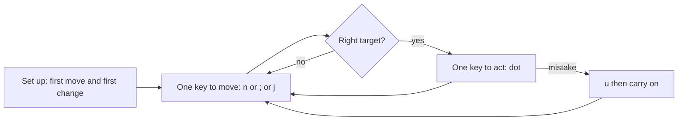

# The dot formula: one key to move, one key to act

> **Before this lesson:** read [the dot command](#/lesson/vim/vim-dot-command). You should know what Normal mode and Insert mode are, and that `.` repeats the last change.

## In plain words

Imagine stamping a pile of forms. With one hand you slide the next form into place; with the other you bring down the stamp. Slide, stamp, slide, stamp. Each hand has one small movement, and the work flows.

The **dot formula** is that rhythm for editing: **one key to move to the next place, one key to repeat the change**. The stamp is the dot command from the previous lesson. The "slide" is a movement key that can itself be repeated with a single press.

Why it matters for a job: many edits are needed in several places that are not next to each other, for example every use of a variable name. A blind "replace all" can change things you did not intend. The dot formula lets you *look* at each place before you change it, at a cost of two key presses per place.

A few terms used below, each defined when it first matters: a **search** asks the editor to find the next place where some text appears; **undo** reverses your last change; a **count** is a number typed before a command to repeat it.

The previous lesson showed that `.` replays a change. On its own that only helps when the next target happens to be under the cursor. The real pay-off comes when the *movement* to the next target is also a single repeatable key. Then a repetitive job becomes a steady two-beat rhythm: move, act, move, act, with a chance to look at each target before you commit.

This lesson assembles that rhythm, which this track calls the **dot formula**, and deals with three neighbouring questions that decide whether your changes are pleasant to repeat and to undo: how Vim groups edits into undo steps, when to use a count and when to repeat instead, and how small arithmetic can be done with a count.

`[x]` marks the cursor in every table. `<Esc>`, `<CR>` and `<C-a>` are single keys.

## Every repeatable action has a repeat key and a reverse key

Vim is unusually consistent here. For each kind of action there is one key that does it again and one that takes it back or goes the other way.

| What you did | How you did it | Do it again | Go back |
|---|---|---|---|
| Changed text | any edit | `.` | `u` |
| Looked along the line for a character | `f{c}` or `t{c}` | `;` | `,` |
| Looked backwards along the line | `F{c}` or `T{c}` | `;` | `,` |
| Searched forward in the file | `/pattern<CR>` | `n` | `N` |
| Searched backward in the file | `?pattern<CR>` | `n` | `N` |
| Substituted on a line | `:s/old/new/` | `&` | `u` |
| Ran a macro | `@q` | `@@` | `u` |
| Ran any Ex command | `:command<CR>` | `@:` | `u` |

Read the middle two columns as pairs of *motion repeat* and *change repeat*:

- `;` + `.` handles several targets on one line;
- `n` + `.` handles targets scattered through a file;
- `j` + `.` handles the same edit on consecutive lines.



The loop has a decision point. That is its advantage over a blind "replace all": you see each match before changing it, and skipping one costs a single extra `n`.

## Worked example: rename by hand with `*`, `cw` and `n.`

A function uses the name `cnt` in several places and you want `total`, but one occurrence is inside a string that must not change.

```text
cnt = 0
for row in rows:
    cnt += row.size
log("cnt reset")
return cnt
```

| Step | Cursor before | Keys | Effect |
|---|---|---|---|
| 1 | on `[c]nt` in line 1 | `*` | searches for the whole word `cnt` and jumps to the next match, line 3 |
| 2 | `    [c]nt += row.size` | `cwtotal<Esc>` | `    tota[l] += row.size` |
| 3 | | `n` | jumps to `cnt` inside the string on line 4 |
| 4 | `log("[c]nt reset")` | `n` | not wanted, so skip: jumps to line 5 |
| 5 | `return [c]nt` | `.` | `return tota[l]` |
| 6 | | `n` | wraps to line 1 |
| 7 | `[c]nt = 0` | `.` | `tota[l] = 0` |

`*` is the key that makes this cheap: it takes the word under the cursor, wraps it in whole-word boundaries, and searches for it, all in one keystroke. From then on `n` is the "move" key and `.` is the "act" key.

Why `cw` rather than `ciw` here? Because `n` always lands on the **first letter** of a match, `cw` (change to end of word) covers exactly the word. When the positioning motion guarantees where you land, the simpler change is fine.

### The modern variant: `cgn`

Vim 7.4 added a text object named `gn`: "the next match of the last search pattern" (or the match under the cursor, if the cursor is on one). Used with an operator it folds the move into the change.

| Step | Keys | Effect |
|---|---|---|
| 1 | `*` | set the search pattern to the whole word under the cursor |
| 2 | `cgntotal<Esc>` | change the next match to `total` |
| 3 | `.` | jump to the following match **and** change it |
| 4 | `.` | and the next |

Now the whole loop is one key. The price is that you no longer preview each match before changing it; to skip one, press `n` to step past it and then `.`. Use `n.` when you need to inspect, `cgn` + `.` when you are confident.

## Worked example: several targets on one line with `;.`

A path was written with dots where slashes are wanted in the directory part.

| Before | Keys | After |
|---|---|---|
| `[s]rc.app.models.user.py` | `f.` | `src[.]app.models.user.py` |
| `src[.]app.models.user.py` | `r/` | `src[/]app.models.user.py` |
| | `;.` | `src/app[/]models.user.py` |
| | `;.` | `src/app/models[/]user.py` |

Stop there: the last dot belongs to the file extension. A substitute command would have needed a carefully written pattern to protect it; the formula stops one repeat early.

`r/` (replace the character under the cursor) is a change, so `.` replays it. `;` replays the `f.` search.

## Worked example: consecutive lines with `j.`

Turning plain lines into a Markdown list:

| Before | Keys | After |
|---|---|---|
| `[i]nstall dependencies`<br>`run migrations`<br>`start the worker` | `I-␣<Esc>` | `-[ ]install dependencies`<br>`run migrations`<br>`start the worker` |
| | `j.` | line 2 becomes `- run migrations` |
| | `j.` | line 3 becomes `- start the worker` |

`I` inserts at the first non-blank character, so the stored change positions itself. For three lines this is ideal. For three hundred, a macro, Visual-block insert or `:normal` is the better tool; they appear later in the track.

## The ideal: when one key is enough

Sometimes the change leaves the cursor exactly where the next change should happen, and the move key disappears altogether.

| Change | Why no move is needed |
|---|---|
| `x` | the next character slides under the cursor |
| `dd` | the next line rises to the cursor |
| `dw` / `daw` | the next word slides under the cursor |
| `J` | the cursor stays on the line being extended |
| `cgn…<Esc>` | the change finds its own next target |

When you spot this, repetition is a matter of holding your nerve and counting presses.

## Undo granularity: you decide how big one step is

`u` reverses one *undo step*. In Normal mode each command is its own step. In Insert mode, **everything typed between entering and leaving is a single step**. That gives you direct control over how much one `u` takes back.

| Habit | Result |
|---|---|
| Type three paragraphs without leaving Insert mode | one `u` deletes all three |
| Press `<Esc>` at the end of each sentence, then `A` to continue | each `u` removes one sentence |
| Press `<Esc>o` to start a new line instead of `<CR>` | each line is its own undo step (and its own dot-repeatable change) |

A good default is to leave Insert mode whenever you pause to think. It costs one key and makes both `u` and `.` operate on meaningful units. If you would rather stay in Insert mode, `<C-g>u` breaks the undo sequence at that point without leaving.

One trap: moving with the arrow keys, `<Home>` or `<End>` while in Insert mode silently starts a new undo step (it behaves as if you had left Insert mode, moved, and re-entered). The dot command then repeats only the last fragment.

## Make the change a single unit

There are usually several ways to remove the same text. Count not only keystrokes but **how many changes** each route makes, because `.` replays one change and `u` reverses one change.

The cursor is on the last letter of `quickly`, and the word should go:

`Deploy the service quickl[y] today`

| Approach | Keys | Changes made | What `.` would repeat |
|---|---|---|---|
| Backspace thinking | `dbx` | two (`db`, then `x`) | only `x` |
| Go to the start first | `bdw` | one (`dw`), after an unrecorded `b` | `dw` from wherever you are |
| Text object | `daw` | one | "delete a word", from anywhere in a word |

All three cost three keystrokes. Only the last is worth repeating, and only the last cleans up the spare space correctly whether the word is in the middle or at the end of the line. When two solutions tie on keys, pick the one that is a single, position-independent change.

## Counts for arithmetic: `<C-a>` and `<C-x>`

In Normal mode `<C-a>` adds one to the number at or after the cursor on the current line, and `<C-x>` subtracts one. With a count they add or subtract that amount. The cursor does not need to be on the number; Vim looks to the right for the next one.

| Before | Keys | After |
|---|---|---|
| `[r]etries = 3` | `<C-a>` | `retries = [4]` |
| `[w]idth: 480px;` | `160<C-a>` | `width: 64[0]px;` |
| `timeout=[9]0` | `30<C-x>` | `timeout=6[0]` |
| `offset = [5]` | `8<C-x>` | `offset = -[3]` |
| `[c]olor: 0x0f;` | `<C-a>` | `color: 0x1[0];` |

These are changes, so `.` repeats them. A neat idiom for building a sequence is duplicate-then-increment: `yyp` copies the line below itself and `<C-a>` bumps the number, giving `item1`, `item2`, `item3` … with `yyp<C-a>` repeated.

Two details worth knowing:

- **A leading minus sign counts.** In `page-2`, `<C-a>` sees the number −2 and produces `page-1`. If that is not what you want, do the arithmetic yourself with `r` or `cw`.
- **Number formats are controlled by the `nrformats` option.** Hexadecimal (`0x…`) and binary (`0b…`) literals are recognised by default in current Vim. Older configurations also treated a leading zero as octal, so `007` followed by `<C-a>` became `010`. If you ever see that, `:set nrformats-=octal` restores decimal behaviour.

## Count or repeat?

Many commands accept a count, and most edits can also be repeated with `.`. They are not interchangeable.

Deleting three words from `please do not [r]un this script twice`:

| Approach | Keys | Undo behaviour | If you miscounted |
|---|---|---|---|
| Count on the motion | `d3w` | one `u` restores all three words | `u` and start again |
| Count on the operator | `3dw` | same as above | same |
| Repeat | `dw..` | each `u` restores one word | press `.` once more, or `u` once |

**Prefer repeating when you are deleting or stepping**, because it lets you adjust as you go without counting anything in advance: keep pressing `.` until it looks right, and back off with `u` if you overshoot.

**Prefer a count when the result must be a single change.** Changing three words into two new ones is the typical case:

| Before | Keys | After |
|---|---|---|
| `wait [a] couple of seconds` | `c3wsome<Esc>` | `wait som[e] seconds` |

Here `c3w` deletes the three words `a couple of` and the replacement text arrives in the same change. One `u` reverses it, and `.` can replay it on another line that has the same shape. Doing `dw..` followed by `isome␣<Esc>` would leave the history in four pieces.

Counts are also the right tool when the number is already in front of you: `5j` to a line whose relative number is shown in the margin, `3>>` to indent three lines, `4p` to paste four copies.

## Why the formula works

Vim separates **where** from **what**. Motions answer *where* and are remembered by one mechanism (`;` for character searches, `n` for pattern searches). Changes answer *what* and are remembered by another (`.`). Because the two memories are independent, you can alternate them indefinitely: moving never erases the change, and changing never erases the search.

The formula is therefore not a trick to memorise but a consequence of the design. Whenever you face a repetitive edit, ask two questions:

1. Which single key will carry me to the next target? (`j`, `;`, `n`, `+`, `}`, `w` …)
2. Which form of the edit is one self-contained change? (`A…`, `ciw…`, `daw`, `r…`, `cgn…`)

If both have answers, you have a two-keystroke loop. If the first has no answer, think about a search pattern. If the second has none, think about a macro.

> [!TIP]
> Before a batch of repeats, do the first one slowly and then press `u` followed by `.`. If the redo via `.` produces exactly what you made by hand, the change is self-contained and safe to repeat elsewhere.

> [!INTERVIEW]
> "How would you rename a variable in a file?" has three good answers at different scales, and saying all three shows judgement: `*` then `cgn` and `.` when there are a handful and you want to eyeball each; `:%s/\<old\>/new/gc` when there are many; the language server's rename when the name crosses files. Knowing where each one stops being the right tool matters more than the keystrokes.

## Pitfalls

- **Searching between repeats is fine; editing is not.** Fixing a typo with `x` in the middle of an `n.` run replaces the stored change. Finish the batch first, or fix the typo with a substitute command, which does not disturb `.`.
- **`;` repeats the last character search, whatever it was.** If you use `f` or `t` as part of *finding* a target and then again inside the edit, the second one wins.
- **`n` continues in the direction of the original search.** After `?pattern`, `n` goes upward. `N` always goes against the original direction.
- **`*` matches whole words only.** On `cnt` it will not find `cnt2` or `recnt`. Use `g*` for a substring match.
- **`cw` after landing mid-word changes only the tail.** With `n` this never happens, but with `j` it often does.
- **`cgn` operates on the pattern, not on a word.** If the pattern is loose, the change is loose. Check with `n` once before you trust it.
- **`<C-a>` on a line with no number does nothing; with several numbers it picks the first at or after the cursor.** Put the cursor on or before the number you mean.

## Cheat sheet

| Situation | Move | Act |
|---|---|---|
| Same edit on following lines | `j` or `+` | `.` |
| Several places on one line | `f{c}` then `;` | `.` |
| Word under cursor, throughout the file | `*` then `n` | `.` |
| Any pattern throughout the file | `/pat<CR>` then `n` | `.` |
| Pattern matches, no preview needed | (none) | `cgn…<Esc>` then `.` |
| Went one too far | | `u` |
| Skipped one by mistake | `N` or `,` | `.` |
| Add / subtract from a number | | `{n}<C-a>` / `{n}<C-x>` |
| Break the undo step while typing | | `<C-g>u` |
| Repeat last substitution on this line | | `&` |
| Repeat last Ex command | | `@:` |

## Summary

- Each kind of action in Vim has a repeat key and a reverse key: `.`/`u`, `;`/`,`, `n`/`N`, `&`, `@@`, `@:`.
- The dot formula pairs a one-key motion with `.`: `j.`, `;.`, `n.`. It gives you a preview and a veto at every step.
- `*` sets up a whole-word search in one key; `cgn` builds a change that finds its own next target.
- An Insert-mode session is one undo step. Leave Insert mode at natural pauses to keep undo steps and repeatable changes small and meaningful.
- Choose the version of an edit that is a single change (`daw`, not `dbx`).
- `<C-a>` and `<C-x>` do arithmetic on the next number on the line and accept counts.
- Repeat when you want to adjust as you go; count when the whole edit must be one unit.

## Glossary

| Term | Meaning |
|---|---|
| dot formula | the habit of pairing one key that moves to the next target with `.` to repeat the change |
| search | asking the editor to jump to the next place some text appears: `/text` and Enter |
| match | a place in the text that fits what you searched for |
| character search | `f` or `t` followed by a character: look along the current line for it |
| undo step | the amount of editing that one press of `u` reverses |
| count | a number typed before a command to repeat or extend it |
| text object | a name for a whole structure such as a word (`iw`, `aw`); taught in a later lesson |
| `gn` | a text object meaning the next match of the last search |
| substitute command | `:s`, Vim's find-and-replace command; taught in a later lesson |
| macro | a recorded sequence of key presses; taught in a later lesson |

## Check yourself

```quiz
[
  {"q": "You ran /TODO<CR> and then changed the match with cwDONE<Esc>. Which keys change the next match?",
   "options": ["; then .", "n then .", "j then .", ". alone"],
   "answer": 1,
   "explain": "n repeats the search and lands on the first letter of the next match; dot replays the cw change."},
  {"q": "Line: 'a.b.c.txt' with the cursor on a. Which keystrokes give 'a/b/c.txt'?",
   "options": ["f.r/;.", "f.r/..", "t.r/;.", "f.r/n."],
   "answer": 0,
   "explain": "f. finds the first dot, r/ replaces it, ; repeats the character search and dot repeats the replacement. Stopping there leaves the extension's dot alone. n would repeat a pattern search, not the f search."},
  {"q": "What does the reverse key , do after t)?",
   "options": ["Undoes the last change", "Repeats the t) search to the left, as T)", "Searches for the previous pattern match", "Jumps to the matching parenthesis"],
   "answer": 1,
   "explain": "; repeats a character search in the same direction and , repeats it in the opposite direction."},
  {"q": "The cursor is on the first character of 'margin: 12px'. Which keys produce 'margin: 20px'?",
   "options": ["8<C-x>", "20<C-a>", "8<C-a>", "<C-a>8"],
   "answer": 2,
   "explain": "Ctrl-A adds the count to the next number on the line. 12 + 8 = 20. The cursor does not need to be on the number."},
  {"q": "You typed two full sentences in one Insert-mode session and press u once in Normal mode. What is undone?",
   "options": ["The last word", "The last sentence", "Both sentences", "The last character"],
   "answer": 2,
   "explain": "Everything typed between entering and leaving Insert mode is a single undo step, unless the sequence was broken with Ctrl-G u or a cursor key."},
  {"q": "Which approach is best when you must replace three consecutive words by one new word and want a single undo step that can also be replayed with dot?",
   "options": ["dw.. then i{text}<Esc>", "c3w{text}<Esc>", "3x then i{text}<Esc>", "dd then O{text}<Esc>"],
   "answer": 1,
   "explain": "c3w deletes three words and takes the replacement text in the same change, so it is one undo step and one repeatable change."},
  {"q": "After * on a word, you type cgnvalue<Esc>. What does a following dot do?",
   "options": ["Inserts 'value' at the cursor", "Finds the next match of the search pattern and changes it to 'value'", "Repeats the * search only", "Nothing until you press n"],
   "answer": 1,
   "explain": "gn means 'the next match of the last search pattern', so the stored change includes finding its own target."},
  {"q": "With the cursor on the last letter of a word, why is daw preferred over dbx?",
   "options": ["dbx does not work at the end of a word", "daw is one change, so one u undoes it and dot repeats the whole deletion; dbx is two changes", "daw is fewer keystrokes", "dbx leaves Insert mode on"],
   "answer": 1,
   "explain": "Both are three keys, but dbx records two separate changes: dot would only repeat the x."}
]
```

> **Source:** Neil, Practical Vim 2e, tips 4–6 and 8–11 (ch. 1 "The Vim Way" and ch. 2 "Normal Mode"). Examples and wording are original.
