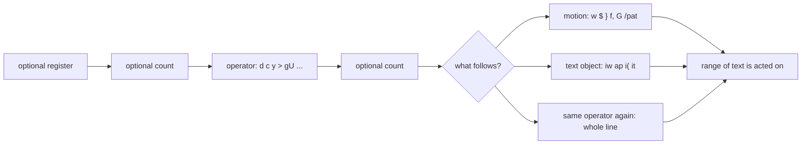
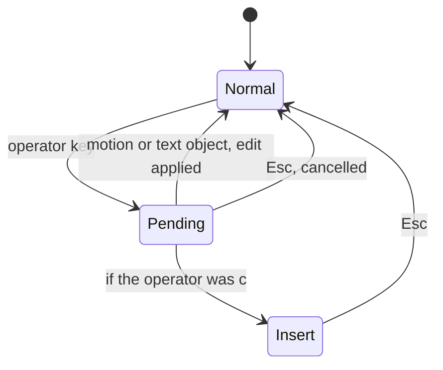

# Normal mode and the operator + motion grammar

> **Before this lesson:** read [the dot command](#/lesson/vim/vim-dot-command) and [the dot formula](#/lesson/vim/vim-dot-formula). You should be able to switch between Normal mode and Insert mode.

## In plain words

Vim's Normal-mode commands are not a long list to memorise. They form a tiny **language** with a grammar, and once you see the grammar you can build commands nobody showed you.

Think of ordering in a café: "two large coffees". A number, a size, a thing. You were never taught that exact sentence; you assembled it from parts. Vim commands are assembled the same way: `d2w` is "delete two words", `ci"` is "change inside the quotes", `yap` is "copy a paragraph".

The parts have names:

- an **operator** is the verb, the action: `d` (delete), `c` (change), `y` (copy; Vim says *yank*);
- a **motion** is a movement of the cursor that also marks out a stretch of text: `w` (to the next word), `$` (to the end of the line);
- a **text object** names a whole thing: `iw` (a word), `i"` (the inside of a quoted string);
- a **count** is a number that repeats.

Why it matters for a job: a grammar scales. Ten verbs and thirty objects give three hundred commands for the price of learning forty small pieces, and the same pieces work in the Vim modes of other editors.

A newcomer's first impression of Vim is that it starts in the "wrong" mode: you open a file, type, and instead of text appearing the editor beeps or deletes something. The design makes sense once you look at how programmers actually spend their time. Writing brand-new text is the minority activity. Most of the time is spent reading, moving around, and making small modifications to text that already exists. Vim gives that majority activity the whole keyboard, with no modifier keys, and calls it **Normal mode**. Typing fresh text is a brief excursion from which you return as soon as the thought is finished.

A useful picture is a painter. The brush is not pressed to the canvas all the time; most of the time the painter is looking, stepping back, mixing colour, deciding. Normal mode is that resting position. Insert mode is the stroke.

This lesson explains the small language spoken in Normal mode. It has perhaps a dozen verbs and a few dozen nouns, and because any verb combines with any noun you get hundreds of commands for the price of learning a short vocabulary.

`[x]` marks the cursor in every table.

## The sentence structure

Almost every editing command in Normal mode has this shape:

```text
[register] [count] operator [count] motion-or-text-object
```

- The **operator** is the verb: what to do.
- The **motion** or **text object** is the noun: which text to do it to.
- An optional **count** multiplies the motion.
- An optional **register** (written `"a`, `"b`, …) says where deleted or copied text should go, or where pasted text comes from.



### The verbs

| Operator | Meaning | Whole-line form |
|---|---|---|
| `d` | delete (into a register) | `dd` |
| `c` | change: delete, then enter Insert mode | `cc` |
| `y` | yank (copy) into a register | `yy` |
| `>` | shift right by one `shiftwidth` | `>>` |
| `<` | shift left | `<<` |
| `=` | re-indent according to the file type's rules | `==` |
| `g~` | toggle case | `g~~` |
| `gu` | make lower case | `guu` |
| `gU` | make upper case | `gUU` |
| `gq` | re-wrap text to `textwidth` | `gqq` |
| `!` | filter through an external program | `!!` |

### A first handful of nouns

| Motion | Covers | Text object | Covers |
|---|---|---|---|
| `w` | to the start of the next word | `iw` | the word under the cursor |
| `e` | to the end of the word | `aw` | the word plus a neighbouring space |
| `b` | back to the start of the word | `i"` | inside the quotes |
| `$` | to the end of the line | `i(` | inside the parentheses |
| `0` / `^` | to the start of the line / first non-blank | `a(` | the parentheses and their contents |
| `}` | to the next blank line | `ip` | the paragraph |
| `G` | to the last line | `it` | inside the XML/HTML tag pair |
| `f{c}` / `t{c}` | onto / up to the next `c` | `as` | the sentence |

Later lessons treat motions and text objects in depth. For now the point is the multiplication: eleven verbs times sixteen nouns is already 176 commands, and you have learnt 27 things.

## Worked examples: one verb, many nouns

Start from the same line each time, cursor on the `r` of `retry`:

`if (state.[r]etry_count > limit) { warn("too many"); }`

| Keys | Reads as | After |
|---|---|---|
| `dw` | delete to next word | `if (state.[>] limit) { warn("too many"); }` |
| `de` | delete to end of word | `if (state.[ ]> limit) { warn("too many"); }` |
| `diw` | delete inner word | `if (state.[ ]> limit) { warn("too many"); }` |
| `dt)` | delete till `)` | `if (state.[)] { warn("too many"); }` |
| `di(` | delete inside parentheses | `if ([)] { warn("too many"); }` |
| `da(` | delete around parentheses | `if [ ]{ warn("too many"); }` |
| `d$` or `D` | delete to end of line | `if (state[.]` |
| `d0` | delete back to column 0 | `[r]etry_count > limit) { warn("too many"); }` |
| `dd` | delete the line | (line removed) |

Look at the first two rows. `dw` removed the word **and** the space after it, because `w` travels to the start of the next word. `de` stopped at the last letter of the word and left the space. That difference between motions is the subject of a later section.

## Worked examples: one noun, many verbs

Now hold the noun fixed at `iw` (inner word) with the cursor on `[s]tatus` in `let status = fetch();`.

| Keys | Reads as | After |
|---|---|---|
| `diw` | delete inner word | `let [ ]= fetch();` |
| `ciwresult<Esc>` | change inner word | `let resul[t] = fetch();` |
| `yiw` | yank inner word | unchanged; `status` is in the register |
| `gUiw` | upper-case inner word | `let [S]TATUS = fetch();` |
| `g~iw` | toggle case of inner word | `let [S]TATUS = fetch();` |

And with a paragraph as the noun (`ap`, "a paragraph", the block of lines up to the next blank line):

| Keys | Effect |
|---|---|
| `dap` | delete the paragraph and the blank line after it |
| `yap` | copy it |
| `>ap` | indent it |
| `=ap` | re-indent it properly |
| `gqap` | re-wrap it to the text width |
| `!apsort<CR>` | replace it with the output of `sort` run on its lines |
| `gUap` | shout it |

No new learning was required for any of these rows. That is the benefit of a grammar: when you learn a new operator it immediately works with every motion and text object you already know, and vice versa.

## Doubling the operator means "this line"

When an operator is typed twice it acts on the current line as a whole: `dd`, `cc`, `yy`, `>>`, `==`. For the two-character operators only the last character is repeated, or the whole operator again: `gUU` and `gUgU` are the same command, as are `g~~` and `g~g~`.

A count works as you would guess: `3dd` deletes three lines starting here, `4>>` indents four.

| Before | Keys | After |
|---|---|---|
| `[s]elect id`<br>`from users`<br>`where active` | `gUU` | `[S]ELECT ID`<br>`from users`<br>`where active` |
| `[s]elect id`<br>`from users`<br>`where active` | `3gUU` | all three lines upper-cased |
| `    [x] = 1`<br>`        y = 2` | `2==` | both lines re-indented to match the surrounding code |

## Operator-pending mode

After you press an operator, Vim waits for the noun. That short waiting state is a real mode, called **Operator-pending mode**. It only accepts things that describe a region: motions and text objects. This is why `iw` and `ap` work after `d` but do nothing useful on their own in Normal mode. They are not motions; they are objects that exist only to complete an operator (or to define a Visual selection).

Pressing `<Esc>` in Operator-pending mode cancels the operator and returns to Normal mode with nothing changed. It is always safe to back out.



Some commands have a prefix key that is *not* an operator. `g`, `z`, `Z`, `[`, `]` and `Ctrl-W` are **namespaces**: they open up a second layer of commands (`gg`, `zz`, `ZZ`, `]]`, `<C-w>v`). Vim waits for the second key in the same way, but there is no "noun" involved. You can tell the difference by asking whether doubling the key means "this line": `gUU` does (operator), `gg` does not (namespace).

## Counts: on the operator, on the motion, or both

A count can go before the operator, before the motion, or in both places, in which case they multiply.

| Keys | Meaning |
|---|---|
| `d3w` | delete three words |
| `3dw` | do "delete a word" three times: the same result |
| `2d3w` | delete six words |
| `3dd` | delete three lines |
| `d2j` | delete this line and the two below it |
| `c2tx` | change up to the second `x` on the line |
| `y3}` | yank three paragraphs forward |

Text objects take counts too, but the meaning depends on the object: `d2aw` deletes two words, while `d2i(` deletes the contents of the *second-level* enclosing parentheses.

## Character-wise and line-wise

Every motion is one of two kinds, and that decides what an operator affects.

- A **character-wise** motion covers a stretch of characters, possibly spanning lines: `w`, `e`, `$`, `f,`, `/pattern`.
- A **line-wise** motion covers whole lines no matter where on the line the cursor started or ended. These are the motions that are *about lines*: `j`, `k`, `G`, `gg`, `'a` (jump to a mark's line), and the doubled operators. Note that `}` is not among them: paragraph motions are character-wise.

| Before | Keys | Kind | After |
|---|---|---|---|
| `one`<br>`tw[o]`<br>`three`<br>`four` | `dj` | line-wise | `one`<br>`[f]our` |
| `one`<br>`tw[o]`<br>`three`<br>`four` | `d/re<CR>` | character-wise | `one`<br>`tw[r]ee`<br>`four` |

In the second row the search motion lands on the `r` of `three`; the deletion runs from the cursor up to, but not including, that character, and the remains of the two lines are joined.

The distinction also decides how the text behaves when pasted later: line-wise text goes above or below the current line, character-wise text goes into the line at the cursor. The *Registers* lessons return to this.

You can force the other kind by typing `v` (character-wise), `V` (line-wise) or `<C-v>` (block-wise) between the operator and the motion: `dvj` deletes character-wise from the cursor to the same column one line down. It is rarely needed, but it shows that the kind is a property of the motion, not of the operator.

## Inclusive and exclusive

Character-wise motions come in two flavours that differ in whether the character you land on is part of the region.

| Motion | Flavour | `d` + motion from `x = [c]ompute(a, b)` |
|---|---|---|
| `w` | exclusive | `x = [(]a, b)` |
| `e` | inclusive | `x = [(]a, b)` |
| `t(` | (stops before) | `x = [(]a, b)` |
| `f(` | inclusive | `x = [a], b)` |
| `t,` | (stops before) | `x = [,] b)` |
| `f,` | inclusive | `x = [ ]b)` |
| `$` | inclusive | `x =[ ]` |
| `0` | exclusive | `[c]ompute(a, b)` |
| `h` | exclusive | `x =[c]ompute(a, b)` |
| `l` | exclusive | `x = [o]mpute(a, b)` |

Rule of thumb: motions that go **to the start of something** (`w`, `b`, `0`, `^`, `h`, a search with `/`) are exclusive: the destination character survives. Motions that go **to the end of something or onto a named character** (`e`, `$`, `f`, `%`) are inclusive.

There is one famous irregularity. With the change operator, `cw` on a word behaves like `ce`: it stops at the end of the word and keeps the following space, because that is nearly always what you want when retyping a word. `dw` does take the space.

| Before | Keys | After |
|---|---|---|
| `set [m]ode fast` | `dw` | `set [f]ast` |
| `set [m]ode fast` | `cwspeed<Esc>` | `set spee[d] fast` |

## A parser for the grammar

The grammar is regular enough to parse in a few lines. The model below recognises the register, both counts, the operator and whatever follows, and prints an English reading. It understands only a small vocabulary, which you can extend.

```python-run
import re

OPS = {"d": "delete", "c": "change", "y": "yank", ">": "indent", "<": "dedent",
       "=": "re-indent", "gU": "upper-case", "gu": "lower-case", "g~": "toggle case of"}
NOUNS = {"w": "word(s) forward", "e": "to end of word", "b": "word(s) back", "$": "to end of line",
         "0": "to start of line", "j": "line(s) down", "k": "line(s) up", "G": "to the last line",
         "}": "paragraph(s) forward", "iw": "inner word", "aw": "a word", "ip": "inner paragraph",
         "ap": "a paragraph", 'i"': "inside double quotes", "i(": "inside parentheses", "a(": "around parentheses",
         "it": "inside tag"}
PATTERN = re.compile(r'^(?:"(\w))?([1-9]\d*)?(g[Uu~]|[dcy<>=])([1-9]\d*)?(.+)$')

def read(cmd):
    m = PATTERN.match(cmd)
    if not m:
        return "not an operator command"
    reg, c1, op, c2, rest = m.groups()
    n = int(c1 or 1) * int(c2 or 1)
    if rest == op or rest == op[-1]:
        noun = f"{n} line(s)"
    elif rest[0] in "ft" and len(rest) == 2:
        noun = ("onto" if rest[0] == "f" else "up to") + f" occurrence {n} of '{rest[1]}'"
    elif rest in NOUNS:
        noun = (f"{n} x " if n > 1 else "") + NOUNS[rest]
    else:
        return "unknown motion " + rest
    return f"{OPS[op]} {noun}" + (f" into register {reg}" if reg else "")

for cmd in ["dw", "d3w", "2d3w", "3dd", "ciw", "yap", '"ayy', "gUiw", "g~~", ">ap", "dt,", "c2f)", "=G", "dx"]:
    print(f"{cmd:6} -> {read(cmd)}")
```

## Why the grammar matters

**It makes commands guessable.** If you know `gu` lower-cases and `i"` is "inside quotes", you already know `gui"` although nobody taught it to you.

**It makes the dot command powerful.** Operator plus noun is one change. `ci(` typed once can be replayed inside any other pair of parentheses, and it will find them by itself.

**It makes extensions fit in.** Plugins can define new operators (a "comment out" operator, a "surround with" operator) and new text objects (an indentation block, a function argument, an entire file). Each new operator works with all existing nouns, and each new noun with all existing verbs. The well-known commentary plugin defines `gc`, and from the moment it is installed `gcap` comments a paragraph, `gcG` comments to the end of the file and `gcc` comments a line. Neovim now ships that operator built in.

> [!TIP]
> When you learn a new motion, immediately try it after `d`, `c`, `y` and `v`. When you learn a new operator, try it with `iw`, `ap` and `G`. Ten seconds of that fixes the word in the grammar instead of leaving it as an isolated shortcut.

> [!INTERVIEW]
> If you are asked to explain what makes modal editing different, the grammar is the answer worth giving: commands are composed as *verb + object*, so the command set grows multiplicatively while the amount to memorise grows additively. Shortcuts in a conventional editor are a flat list; each new feature needs a new chord.

## Pitfalls

- **`dw` at the end of a line stops at the end of the line.** It does not join the next line, even though `w` on its own would move there.
- **`cw` is not `dw` followed by `i`.** It keeps the trailing space. On a run of blanks, though, `cw` changes the blanks up to the next word.
- **`d}` leaves a partial line when the cursor is mid-line.** `}` is character-wise. Use `dap` to remove whole lines of a paragraph.
- **`yy` and `Y` are line-wise; `y$` is not.** Pasting them behaves differently. (Neovim maps `Y` to `y$` by default; classic Vim keeps `Y` as `yy`.)
- **A count after the operator binds to the motion**: `d2j` is three lines (this one and two more), not two.
- **`>` and `<` always act on whole lines**, whatever the motion: `>w` indents the current line.
- **Operator-pending mode has a timeout only for mappings, not for built-in keys.** If the screen seems frozen after an accidental `d` or `g`, press `<Esc>`.

## Cheat sheet

| Pattern | Example | Meaning |
|---|---|---|
| operator + motion | `d$` | delete to end of line |
| operator + text object | `ci"` | change inside quotes |
| operator doubled | `yy`, `gUU` | act on the current line |
| count + operator + motion | `3dw` | repeat the whole command 3 times |
| operator + count + motion | `d3w` | motion covers 3 words |
| register + operator + motion | `"ayiw` | yank the word into register `a` |
| operator + `v`/`V` + motion | `dVw` | force character-wise / line-wise |
| `<Esc>` after an operator | | cancel |

| Shorthand | Equals |
|---|---|
| `x` / `X` | `dl` / `dh` |
| `D` / `C` | `d$` / `c$` |
| `s` / `S` | `cl` / `cc` |
| `Y` | `yy` (Vim) or `y$` (Neovim) |
| `~` | `g~l` and step right |

## Summary

- Normal mode is the resting state because reading, moving and adjusting dominate real editing.
- Commands are sentences: optional register and count, an operator, then a motion or text object.
- Doubling an operator applies it to the current line.
- After an operator Vim is in Operator-pending mode, which accepts only region descriptions; `<Esc>` cancels.
- Motions are character-wise or line-wise, and character-wise motions are inclusive or exclusive. These properties decide exactly what an operator touches.
- `cw` deliberately behaves like `ce`.
- Because verbs and nouns combine freely, new operators and new text objects (including those from plugins) multiply the whole command set.

## Glossary

| Term | Meaning |
|---|---|
| Normal mode | the mode in which keys are commands |
| operator | a command that acts on text: `d`, `c`, `y`, `>`, `gU` and others |
| motion | a command that moves the cursor; after an operator it defines the text acted on |
| text object | a name for a whole structure, used after an operator: `iw`, `ap`, `i(` |
| count | a number that multiplies a command or a motion |
| register | a named storage slot for text; an optional first part of a command |
| Operator-pending mode | the short state after an operator is typed, while Vim waits for the motion or text object |
| character-wise | covering a run of characters, possibly within one line |
| line-wise | covering whole lines |
| inclusive / exclusive | whether the character a motion lands on is part of the affected text or not |
| yank | Vim's word for copy |
| namespace key | a prefix such as `g` or `z` that opens a second layer of commands |

## Check yourself

```quiz
[
  {"q": "Line: 'send(user, mes[s]age, retries)' with the cursor in the middle of the word. Which keystrokes produce 'send(user, , retries)'?",
   "options": ["dw", "diw", "dt)", "d$"],
   "answer": 1,
   "explain": "diw removes exactly the word under the cursor from any position inside it. dw would delete only from the cursor to the comma and leave 'mes' behind."},
  {"q": "What does gUap do?",
   "options": ["Goes up a paragraph", "Upper-cases the current paragraph", "Pastes above the paragraph", "Undoes the last paragraph change"],
   "answer": 1,
   "explain": "gU is the upper-case operator and ap is the text object 'a paragraph'."},
  {"q": "How many lines does d2j delete?",
   "options": ["1", "2", "3", "It depends on the column"],
   "answer": 2,
   "explain": "j is a line-wise motion. The region runs from the current line to the line two below, inclusive: three lines."},
  {"q": "Line: 'copy [f]rom here'. Which statement is true?",
   "options": ["dw and cw both remove the space after 'from'", "dw removes 'from ' including the space; cw replaces only 'from' and keeps the space", "cw removes the space; dw keeps it", "Neither touches the space"],
   "answer": 1,
   "explain": "cw is a special case that acts like ce on a word, so the space before the next word is preserved."},
  {"q": "Line: 'total = [s]um(xs) + 1'. Which keystrokes produce 'total = xs) + 1'?",
   "options": ["dt(", "df(", "dw", "di("],
   "answer": 1,
   "explain": "f( is inclusive: the parenthesis itself is deleted along with 'sum'. dt( would stop before it and leave '(xs) + 1'."},
  {"q": "Which of these is NOT an operator?",
   "options": ["g~", "=", "gg", ">"],
   "answer": 2,
   "explain": "gg is a motion in the g namespace (go to the first line). The others wait for a motion or text object."},
  {"q": "You press d and then realise you did not mean to. What is the safe way out?",
   "options": ["Press u", "Press <Esc>", "Press d again", "Type :q"],
   "answer": 1,
   "explain": "Esc cancels Operator-pending mode without changing anything. Pressing d again would delete the line."},
  {"q": "What does 2d3w delete?",
   "options": ["Two words", "Three words", "Five words", "Six words"],
   "answer": 3,
   "explain": "A count before the operator and a count before the motion multiply."}
]
```

> **Source:** Neil, Practical Vim 2e, tips 7 and 12 (ch. 2, "Normal Mode"). Examples and wording are original.
