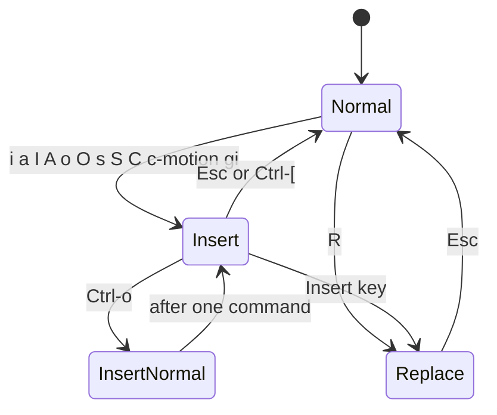

# Insert mode: short visits, well equipped

> **Before this lesson:** read [the dot command](#/lesson/vim/vim-dot-command) and [Normal mode and its grammar](#/lesson/vim/vim-normal-grammar). You should know that `<Esc>` returns to Normal mode.

## In plain words

**Insert mode** is the mode in which the keys type text. You enter it from Normal mode with a key such as `i`, type, and leave with the Escape key.

Compare writing with a pen that has a correction tool, a ruler and a stamp pad built in. You can keep hold of the pen and still fix a slip, rule a line or stamp a date. Insert mode has such built-in helpers: keys that delete the word you mistyped, paste something you copied, work out a sum, or type a character that is not on your keyboard, all without leaving the mode.

Why it matters for a job: you type text all day. Fixing a typo without breaking your flow, and pasting a copied name into the middle of a line you are writing, are small things that happen hundreds of times a week.

Notation used below: `<C-w>` means "hold the Ctrl key and press `w`". Such a combination is called a **chord**.

Normal mode gets most of the attention in Vim tutorials, which leaves the impression that Insert mode is only "the part where it behaves like Notepad". It is richer than that. While typing you can correct mistakes without reaching for Backspace, paste from any register, evaluate arithmetic, enter characters that are not on your keyboard, run a single Normal-mode command and carry on, and adjust indentation, all without leaving the mode.

The guiding idea is still the one from the previous lessons: an Insert-mode session is **one change**, replayable with `.` and reversible with one `u`. So the goal is not to stay in Insert mode as long as possible. It is to make each visit a clean, self-contained unit, and to know the handful of in-mode keys that stop a small slip from breaking that unit.

In this lesson the insertion point is drawn as `‸` (text you type appears at that mark), and `[x]` still marks the Normal-mode cursor. `<C-w>` means Ctrl-W.

## Ways in

Which key you use to enter Insert mode decides where the text goes and what gets recorded as the change.

| Key | Where typing starts | Notes |
|---|---|---|
| `i` | before the cursor character | |
| `a` | after the cursor character | |
| `I` | before the first non-blank of the line | `gI` inserts at column 1 instead |
| `A` | after the last character of the line | |
| `o` | on a new line below | |
| `O` | on a new line above | |
| `s` | in place of the cursor character | deletes it first |
| `S` or `cc` | in place of the line's text | keeps the indent when `autoindent` is on |
| `C` | in place of everything from the cursor to end of line | |
| `c{motion}` | in place of the text the motion covers | |
| `gi` | wherever Insert mode was last left in this buffer | "carry on typing where I was" |

| Before | Keys | After |
|---|---|---|
| `print[(]x)` | `ilog.<Esc>` | `printlog[.](x)` |
| `print[(]x)` | `a"<Esc>` | `print(["]x)` |
| `    retur[n] x` | `I# <Esc>` | `    #[ ]return x` |
| `    retur[n] x` | `A + 1<Esc>` | `    return x + [1]` |
| `if ok[:]` | `opass<Esc>` | `if ok:`<br>`pas[s]` (indented if the file type's indent rules say so) |

In the second row `a` appended one character after the parenthesis, and after `<Esc>` the cursor rests on that new quote.

A count before the entry key repeats the typed text when you leave:

| Before | Keys | After |
|---|---|---|
| `[]` (empty line) | `40i-<Esc>` | a rule of forty dashes |
| `x =[ ]` | `3aab<Esc>` | `x = ababa[b]` |
| `[e]nd` | `2Onote<Esc>` | two new lines reading `note` above |

## Ways out

| Key | Effect |
|---|---|
| `<Esc>` | back to Normal mode; the cursor steps one column left |
| `<C-[>` | exactly the same as `<Esc>`, and on the home row with Ctrl |
| `<C-c>` | leaves too, but skips abbreviations and the `InsertLeave` event; avoid it as a habit because plugins and Visual-block inserts rely on a real `<Esc>` |
| `<C-o>` | **Insert-Normal mode**: run one Normal-mode command, then return to Insert mode automatically |

Insert-Normal mode is for the moment when you are mid-sentence and need exactly one command.

| Situation | Keys while still in Insert mode |
|---|---|
| The line you are typing has reached the bottom of the window | `<C-o>zz` re-centres the screen |
| You want to jump to the end of the line | `<C-o>$` (or `<C-o>A`, which also works) |
| You want to delete the rest of the line | `<C-o>D` |
| You want to save | `<C-o>:w<CR>` |

Many people remap Caps Lock to act as Escape or Control at the operating-system level. Either makes leaving Insert mode cheap, and cheap exits are what keep undo steps and repeatable changes small.



## Fixing mistakes without leaving

Three chords delete backwards while you type. They are the same ones a Unix shell uses, so learning them pays twice.

| Chord | Deletes |
|---|---|
| `<C-h>` | one character back (Backspace) |
| `<C-w>` | back to the start of the word |
| `<C-u>` | back to the start of the line (or to where this insert began) |

| Text so far | Keys | Text after |
|---|---|---|
| `const totl‸` | `<C-h>al` | `const total‸` |
| `const subtotla‸` | `<C-w>subtotal` | `const subtotal‸` |
| `return cache.get(key) or‸` | `<C-u>` | `‸` (the indent is kept if you were inserting after it) |

When you mistype a word it is usually quicker and more accurate to wipe the word with `<C-w>` and type it again than to cursor back to the wrong letter. It also keeps the whole thing one change.

How far back these chords may reach is controlled by the `backspace` option. With the widely used setting `backspace=indent,eol,start` they can cross the indent, join onto the previous line, and delete text that existed before you entered Insert mode.

A small model of the three chords:

```python-run
def type_keys(keys):
    """Simulate typing into an empty line. <C-h>, <C-w>, <C-u> as in Vim's Insert mode."""
    buf = ""
    i = 0
    while i < len(keys):
        if keys.startswith("<C-h>", i):
            buf = buf[:-1]; i += 5
        elif keys.startswith("<C-w>", i):
            j = len(buf)
            while j > 0 and buf[j-1] == " ":      # skip blanks before the cursor
                j -= 1
            kind = (lambda c: c.isalnum() or c == "_")
            if j > 0:
                k = kind(buf[j-1])
                while j > 0 and buf[j-1] != " " and kind(buf[j-1]) == k:
                    j -= 1                         # then one run of word or punctuation characters
            buf = buf[:j]; i += 5
        elif keys.startswith("<C-u>", i):
            buf = ""; i += 5
        else:
            buf += keys[i]; i += 1
    return buf

for k in ["helo<C-h>lo", "git comit<C-w>commit", "x = foo.bar<C-w>", "x = foo.bar<C-w><C-w>", "oops all wrong<C-u>fine"]:
    print(f"{k:28} -> {type_keys(k)!r}")
```

Notice that `<C-w>` uses the same idea of a "word" as the `w` and `b` motions: `foo.bar` is three words, so one press removes only `bar`.

## Pasting while typing: `<C-r>`

`<C-r>` followed by a register name inserts that register's contents at the insertion point, as if you had typed them.

| Keys in Insert mode | Inserts |
|---|---|
| `<C-r>0` | the text of your last yank |
| `<C-r>"` | the unnamed register (last yank **or** delete) |
| `<C-r>a` | named register `a` |
| `<C-r>+` | the system clipboard |
| `<C-r>/` | the last search pattern |
| `<C-r>:` | the last Ex command |
| `<C-r>.` | the text typed in the previous insert |
| `<C-r>%` | the current file name |
| `<C-r><C-w>` | (on the command line) the word under the cursor |

A typical use: yank a name, then use it in the middle of something you are typing.

| Step | Keys | Buffer |
|---|---|---|
| start, cursor on `handler` in line 1 | | `def [h]andler(evt):`<br>`    pass` |
| yank the word | `yiw` | (unchanged) |
| open a line at the bottom and type | `Goregister(<C-r>0)<Esc>` | `def handler(evt):`<br>`    pass`<br>`register(handler[)]` |

Because the pasted text is "typed", it goes through auto-indent and text-wrapping, which can mangle multi-line code. `<C-r><C-p>{register}` inserts the text literally and fixes up the indentation; for large blocks it is simpler to leave Insert mode and use `p`.

`<C-a>` in Insert mode inserts whatever you typed in the previous insert session, which is occasionally handy when you intended to repeat an insertion as part of a longer one.

## A calculator in the gutter: the expression register

The register named `=` does not store text. Asking for it opens a prompt, evaluates the Vim script expression you type, and inserts the result.

| Text so far | Keys | Text after |
|---|---|---|
| `seconds_per_day = ‸` | `<C-r>=60*60*24<CR>` | `seconds_per_day = 86400‸` |
| `chunks = ‸` | `<C-r>=1024/8<CR>` | `chunks = 128‸` |
| `ratio = ‸` | `<C-r>=7/2.0<CR>` | `ratio = 3.5‸` |
| `# generated ‸` | `<C-r>=strftime("%Y-%m-%d")<CR>` | `# generated 2026-11-20‸` |
| `path = ‸` | `<C-r>=expand("%:p")<CR>` | the full path of the current file |

Integer division truncates (`7/2` is `3`); write one operand as a float to get a fractional result. Any Vim function is available, so the expression register is also the bridge to things like `system("date")`, `line(".")` and `toupper(@a)`.

## Characters that are not on the keyboard

### By code

`<C-v>` inserts the next thing literally, and has number forms:

| Keys | Meaning | Example |
|---|---|---|
| `<C-v>{three digits}` | decimal code | `<C-v>065` → `A` |
| `<C-v>x{two hex digits}` | hex byte | `<C-v>x41` → `A` |
| `<C-v>u{four hex digits}` | Unicode code point | `<C-v>u00e9` → `é`, `<C-v>u2192` → `→` |
| `<C-v>U{eight hex digits}` | Unicode beyond the basic plane | `<C-v>U0001f600` → an emoji |
| `<C-v>{any other key}` | that key, literally | `<C-v><Tab>` inserts a real tab even when `expandtab` is on |

On Windows terminals where `<C-v>` pastes, `<C-q>` does the same job.

In the other direction, `ga` in Normal mode reports the decimal, hex and octal code of the character under the cursor, and `g8` shows its UTF-8 bytes. Useful when a file contains a suspicious "space" that turns out to be U+00A0.

### By digraph

Codes are hard to remember. A **digraph** is a two-key mnemonic, typed after `<C-k>`.

| Keys | Result | Mnemonic |
|---|---|---|
| `<C-k>e'` | é | letter + acute |
| `<C-k>e:` | ë | letter + diaeresis |
| `<C-k>n?` | ñ | letter + tilde (written `?`) |
| `<C-k>ss` | ß | |
| `<C-k>12` | ½ | one over two |
| `<C-k>->` | → | arrow |
| `<C-k>!=` | ≠ | not equal |
| `<C-k>=<` | ≤ | |
| `<C-k>Eu` | € | |
| `<C-k>Co` | © | |
| `<C-k>DG` | ° | degree |
| `<C-k>OK` | ✓ | |
| `<C-k>p*` | π | Greek letters are letter + `*` |
| `<C-k><<` | « | |

`:digraphs` lists them all, and `:help digraph-table` gives the same table with descriptions.

## Indentation and neighbours

| Chord | Effect in Insert mode |
|---|---|
| `<C-t>` | indent the current line one `shiftwidth` more (think *tab*) |
| `<C-d>` | indent it one less (think *de-dent*) |
| `<C-e>` | insert the character that is directly **below** the insertion point |
| `<C-y>` | insert the character that is directly **above** it |
| `<C-n>` / `<C-p>` | keyword completion (covered in the *Tools* module) |

`<C-t>` and `<C-d>` work wherever the insertion point is on the line; you do not have to go back to the start. `<C-y>` is a quick way to duplicate part of the line above when two lines differ only at the end: hold it until the texts diverge, then type the difference.

## Overwriting: Replace mode

`R` enters Replace mode, where each typed character replaces the one under the cursor instead of pushing it right. `<Esc>` leaves, and Backspace restores the original character.

| Before | Keys | After |
|---|---|---|
| `status: [P]ENDING` | `RACTIVE␣<Esc>` | `status: ACTIVE[ ]` |
| `v1.[2].9` | `r3` | `v1.[3].9` |
| `ver=[1].0` | `R2.5<Esc>` | `ver=2.[5]` |

`r{char}` is the one-shot version: replace a single character and stay in Normal mode. It is a change, so `.` repeats it, which makes `r` + `;.` a fast way to substitute one punctuation mark for another along a line.

Tabs complicate overwriting because one tab character occupies several screen columns. **Virtual Replace mode**, entered with `gR` (and `gr{char}` for a single character), overwrites *screen columns* rather than characters, so tables aligned with tabs keep their shape. If your file contains hard tabs, prefer `gR`.

## Why Insert mode fits the grammar

From the grammar's point of view an insert is an operator's argument. `cw` is "change word **to …**" and what you type fills in the dots. `A` is "append at end of line **…**". The entire sentence, entry key plus typed text, is stored as the last change. Everything in this lesson that edits *while staying in Insert mode* (`<C-w>`, `<C-r>0`, `<C-r>=`, `<C-k>`, `<C-t>`) happens inside that one sentence, so the change stays whole.

Anything that moves the insertion point elsewhere, such as arrow keys, the mouse, `<Home>` and `<End>`, ends the sentence and starts a new one. That is the precise reason they are discouraged: not purism, but because they cut your undo step and your repeatable change in two.

When `.` replays an insert that used `<C-r>`, it replays the **text that was inserted**, not the request to read a register. If register `a` has since changed, the repeat still inserts the old text. The exception is the expression register in some versions; do not rely on it being re-evaluated.

> [!TIP]
> Practise three chords until they are reflexes, in this order: `<C-w>` (retype the word), `<C-r>0` (paste what I yanked), `<C-o>zz` (re-centre). They work in this site's editor with Vim mode on, on the Vim command line, and the first one in every Unix shell.

> [!INTERVIEW]
> You will sometimes be dropped into plain `vi` or a minimal Vim on a server during an on-call or a live exercise. The Insert-mode chords above are part of core Vim and need no configuration, whereas your favourite plugin will not be there. Being fluent with what is built in is a practical skill, not trivia.

## Pitfalls

- **Pasting from the system clipboard with the terminal's paste shortcut** feeds text to Vim as if typed. With auto-indent on, each line can get indented further than the last. Modern Vim and Neovim detect *bracketed paste* in most terminals and avoid this; where they do not, use `"+p` in Normal mode or `:set paste` before and `:set nopaste` after.
- **`<C-w>` in a browser closes the tab.** In this site's editor and other web-based Vim emulations, some chords are intercepted by the browser. Use Backspace there, or leave Insert mode and use `db`.
- **`<C-c>` is not a harmless synonym for `<Esc>`.** A Visual-block insert finished with `<C-c>` applies to the first line only.
- **`<C-v>065` needs all three digits.** Typing `<C-v>65` and then another digit gives a different character.
- **`<C-u>` can feel destructive.** It is still a single change: `<Esc>u` brings everything back.
- **Replace mode with a count** (`3Rab<Esc>`) repeats the replacement text, which is seldom what you intended.
- **Digraph names are case sensitive.** `<C-k>Eu` is the euro sign; `<C-k>eu` is not.

## Cheat sheet

| Task | Keys |
|---|---|
| Insert before / after cursor | `i` / `a` |
| Insert at first non-blank / end of line | `I` / `A` |
| New line below / above | `o` / `O` |
| Resume inserting where you last stopped | `gi` |
| Leave Insert mode | `<Esc>` or `<C-[>` |
| One Normal command, then continue | `<C-o>{cmd}` |
| Delete char / word / line backwards | `<C-h>` / `<C-w>` / `<C-u>` |
| Paste register `x` | `<C-r>x` |
| Paste last yank | `<C-r>0` |
| Insert result of a calculation | `<C-r>=expr<CR>` |
| Literal next key / by code | `<C-v>{key}` / `<C-v>u{hex}` |
| Digraph | `<C-k>{c1}{c2}` |
| Indent / dedent current line | `<C-t>` / `<C-d>` |
| Copy char from line above / below | `<C-y>` / `<C-e>` |
| Overwrite | `R` (or `gR` with tabs) |
| Replace one character | `r{c}` |
| What is this character? | `ga` |

## Summary

- Choose the entry key that carries its own positioning (`A`, `I`, `o`, `C`, `ciw`) so the insert is a complete, repeatable change.
- `<C-h>`, `<C-w>` and `<C-u>` fix typing slips without breaking the change.
- `<C-o>` borrows one Normal-mode command; `<Esc>` or `<C-[>` leaves for good.
- `<C-r>{register}` pastes while typing; `<C-r>=` evaluates an expression and inserts the result.
- `<C-v>` enters characters by code, `<C-k>` by two-letter digraph, and `ga` tells you what a character is.
- `R` overwrites; `gR` overwrites by screen column and is the right choice in tab-aligned text.
- Cursor keys inside Insert mode split the undo step and the stored change.

## Glossary

| Term | Meaning |
|---|---|
| Insert mode | the mode in which keys type text |
| insertion point | the place where the next typed character will appear |
| chord | a key pressed together with a modifier such as Ctrl, written like `<C-w>` |
| Insert-Normal mode | after `<C-o>`: one Normal-mode command, then back to Insert mode automatically |
| register | a named storage slot for text; `<C-r>` followed by its name inserts it |
| expression register | the register `=`, which evaluates a calculation and inserts the result |
| character code | the number that identifies a character in a standard table such as Unicode |
| Unicode | the international standard that assigns a number to every character of every script |
| digraph | a two-key mnemonic for a special character, typed after `<C-k>` |
| Replace mode | a mode in which typed characters overwrite existing ones |
| auto-indent | the editor adding indentation at the start of a new line for you |
| bracketed paste | a terminal feature that tells the editor that incoming text is a paste, not typing |

## Check yourself

```quiz
[
  {"q": "While typing you have 'usr_count' and want 'user_count'. Which Insert-mode keystrokes fix it without leaving the mode?",
   "options": ["<C-u>user_count", "<C-w>user_count", "<C-h>user_count", "<C-o>user_count"],
   "answer": 1,
   "explain": "Ctrl-W deletes back to the start of the word (the underscore is a word character, so the whole identifier goes). Ctrl-U would also work if nothing else was typed, but it deletes the whole inserted line; Ctrl-H removes only one character."},
  {"q": "You yanked a word with yiw. Later, in Insert mode, which keys paste it even if you have deleted other text since?",
   "options": ["<C-r>\"", "<C-r>0", "<C-v>0", "<C-o>0"],
   "answer": 1,
   "explain": "Register 0 always holds the most recent yank. The unnamed register would hold the most recent delete instead."},
  {"q": "Text so far: 'bytes = ' in Insert mode. Which keys leave 'bytes = 4096'?",
   "options": ["<C-r>=64*64<CR>", "<C-v>64*64<CR>", "<C-o>=64*64<CR>", "<C-k>64*64"],
   "answer": 0,
   "explain": "Ctrl-R = opens the expression register prompt; the result of the expression is inserted."},
  {"q": "What does <C-o>zz do in Insert mode?",
   "options": ["Saves and quits", "Runs zz once (centres the cursor line on screen) and returns to Insert mode", "Leaves Insert mode permanently", "Inserts the letters zz"],
   "answer": 1,
   "explain": "Ctrl-O enters Insert-Normal mode for exactly one Normal-mode command."},
  {"q": "Line: 'level=[D]EBUG' with the cursor on D. Which keystrokes produce 'level=ERROR'?",
   "options": ["rERROR", "RERROR<Esc>", "iERROR<Esc>", "aERROR<Esc>"],
   "answer": 1,
   "explain": "R enters Replace mode, so the five typed letters overwrite the five existing ones. r replaces a single character only: rE would give EEBUG and the rest would run as Normal commands."},
  {"q": "Which keys insert the character é?",
   "options": ["<C-k>e'", "<C-v>e'", "<C-r>e'", "<C-o>e'"],
   "answer": 0,
   "explain": "Ctrl-K starts a digraph; e followed by an apostrophe is e with an acute accent. By code it would be Ctrl-V u00e9."},
  {"q": "On an empty line, what does 30i=<Esc> produce?",
   "options": ["The text 30=", "Thirty equals signs", "An error", "One equals sign on line 30"],
   "answer": 1,
   "explain": "A count before an insert command repeats the typed text when Insert mode is left."},
  {"q": "Why is pressing an arrow key in Insert mode discouraged?",
   "options": ["It does not work in Vim", "It starts a new undo step, so dot repeats only the text typed after it", "It leaves Insert mode", "It deletes the character under the cursor"],
   "answer": 1,
   "explain": "Cursor movement inside Insert mode ends the current change. Both u and dot then operate on fragments."}
]
```

> **Source:** Neil, Practical Vim 2e, tips 13–19 (ch. 3, "Insert Mode"). Examples and wording are original.
