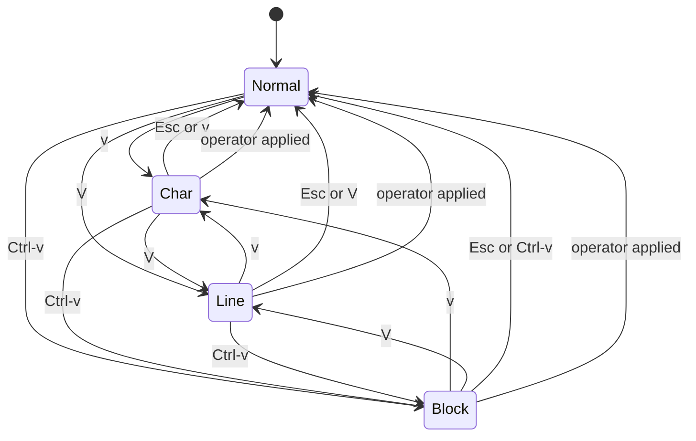

# Visual mode: select first, then act

> **Before this lesson:** read [Normal mode and its grammar](#/lesson/vim/vim-normal-grammar), and know the dot command from [the first lesson](#/lesson/vim/vim-dot-command).

## In plain words

**Visual mode** is Vim's way of selecting text: you mark a stretch, see it highlighted, and then say what to do with it. It is the mode closest to dragging with a mouse in an ordinary editor.

Think of a highlighter pen. You run it over the words first and decide afterwards whether to copy them, cross them out or rewrite them. Vim has three highlighters: one for runs of characters, one for whole lines, and one for a **rectangle**, a block of columns across several lines, which is the unusual and most valuable one. Picture a table of data in which you want to change the third column on every row.

Why it matters for a job: adding the same prefix to twenty lines, removing a column from pasted data, or commenting out a block are everyday tasks, and the rectangular selection does each of them in a handful of keys.

`<C-v>` below means "hold Ctrl and press `v`".

Normal mode asks you to name the verb first and the text second: `d` then `iw`. Visual mode turns the sentence round. You mark a region, watch it light up, adjust it until it is right, and only then say what to do with it. This is the model every mouse-driven editor uses, which makes Visual mode feel like home on day one.

It is also the mode people over-use. A highlighted region gives reassuring feedback, but a change made through a selection is recorded differently from one made with an operator and a motion, and it repeats less well. So this lesson has two aims: to make you fluent with the three kinds of selection, especially the column-shaped one that no ordinary editor has, and to make clear when *not* to select at all.

`[x]` marks the cursor. In tables, selected text is described in words because it cannot be highlighted in a code cell.

## Three kinds of selection

| Key | Mode | Selects |
|---|---|---|
| `v` | character-wise Visual | a run of characters from where you started to the cursor, across lines if needed |
| `V` | line-wise Visual | whole lines, whatever the column |
| `<C-v>` | block-wise Visual | a rectangle of columns and rows |

(`<C-q>` is the fallback for `<C-v>` where the terminal uses Ctrl-V to paste.)

After entering one of them, **every motion and text object you know extends the selection**: `w`, `e`, `$`, `}`, `f,`, `/pattern`, `iw`, `i(`, `ap`, `it`. That is the main reason Visual mode costs so little to learn.



Pressing the key of the mode you are already in leaves Visual mode; pressing one of the other two converts the selection in place. So if you started with `v` and realise you want whole lines, press `V` rather than starting again.

### Housekeeping keys

| Key | Effect |
|---|---|
| `o` | jump to the **other end** of the selection, so you can adjust the start |
| `O` | in block mode: jump to the other corner on the same row |
| `gv` | (from Normal mode) reselect the last selection |
| `<Esc>` | abandon the selection |
| `:` | open the command line pre-filled with `:'<,'>`, the range of the selected lines |

`o` is the one that saves the most retyping. If you overshoot the beginning, there is no need to cancel: press `o`, fix that end, press `o` again.

## Selecting with text objects

Text objects are often the quickest way to get a precise selection, and repeating one **grows** the selection outward.

Take this line, with the cursor somewhere on `items`:

`render(layout(header, panel([i]tems)), theme)`

| Cursor on | Keys | Selected text |
|---|---|---|
| `items` | `vi(` | `items` |
| `items` | `vi(i(` | `header, panel(items)` |
| `items` | `vi(i(i(` | `layout(header, panel(items)), theme` |
| `items` | `va(` | `(items)` |

## Operators in Visual mode

Once text is selected, a single key acts on it.

| Key | Action on the selection |
|---|---|
| `d` or `x` | delete |
| `c` or `s` | change (delete and enter Insert mode) |
| `y` | yank |
| `>` / `<` | indent / dedent the lines |
| `=` | re-indent |
| `U` / `u` / `~` | upper / lower / toggle case |
| `J` | join the lines |
| `r{c}` | replace every selected character with `c` |
| `p` | replace the selection with the register contents |
| `gq` | re-wrap |
| `:` | run an Ex command on the lines |

Note that `u` and `U` mean something different here from in Normal mode (case, not undo). If you press `u` intending to undo while a selection is active, you will lower-case it instead; `<Esc>u` puts it back.

### Character-wise examples

| Before | Keys | After |
|---|---|---|
| `msg = [f]ormat(name)` | `vt(U` | `msg = [F]ORMAT(name)` |
| `url = "http://[o]ld.example"` | `vi"y` | unchanged; `http://old.example` is in the register |
| `total = a + [b] * c` | `v2ed` | `total = a +[ ]` |
| `x = (alpha + [b]eta)` | `va(c0<Esc>` | `x = [0]` |

### Line-wise examples

| Before | Keys | After |
|---|---|---|
| `[s]etup()`<br>`run()`<br>`teardown()`<br>`report()` | `Vjd` | `[t]eardown()`<br>`report()` |
| `for x in xs:`<br>`[p]rint(x)`<br>`total += x` | `Vj>` | `for x in xs:`<br>`    [p]rint(x)`<br>`    total += x` |
| `[a] = 1`<br>`b = 2`<br>`c = 3` | `VjjJ` | `a = 1 b = 2[ ]c = 3` |

Indenting a selection drops you back in Normal mode, which is awkward if you want to indent twice. Either press `.` to repeat (it works well for line-wise selections, see below) or `gv` to get the selection back.

## Visual-block mode: editing columns

Block mode selects a rectangle. Operators then apply to each row's slice of that rectangle. Three commands, `I`, `A` and `c`, enter Insert mode on the first row and, when you press `<Esc>`, replay what you typed on every other row. While you type, only the top row changes; the rest update on `<Esc>`. That delay is normal.

### Insert a prefix on several lines

| Before | Keys | After |
|---|---|---|
| `[h]ost = "db"`<br>`port = 5432`<br>`pool = 8` | `<C-v>jjI# <Esc>` | `[#] host = "db"`<br>`# port = 5432`<br>`# pool = 8` |

### Append to lines of different lengths

Ordinary block append works on the rectangle's right edge. To make the right edge follow each line's end, extend the block with `$`.

| Before | Keys | After |
|---|---|---|
| `[l]et a = 1`<br>`let total = 250`<br>`let ok = true` | `<C-v>jj$A;<Esc>` | `let a = 1;`<br>`let total = 250;`<br>`let ok = true;` |

### Change a column

| Before | Keys | After |
|---|---|---|
| `[v]ar a = 1`<br>`var b = 2`<br>`var c = 3` | `<C-v>jjecconst<Esc>` | `const a = 1`<br>`const b = 2`<br>`const c = 3` |

`e` widened the block to the end of the word `var` (three columns), and `c` replaced that column block on all three rows.

### Delete or overwrite a column

| Before | Keys | After |
|---|---|---|
| `[0]1  alice`<br>`02  bob`<br>`03  carol` | `<C-v>jjld` | `[ ] alice`<br>`  bob`<br>`  carol` |
| `id[ ]  name`<br>`7    ana`<br>`12   bo` | `<C-v>jjr.` | `id[.]  name`<br>`7 .  ana`<br>`12.  bo` |

### Short lines

Rows that are too short to reach the block behave differently for the two insert commands:

| Command | A row shorter than the block's column |
|---|---|
| `I` | is skipped |
| `A` | is padded with spaces so the text lines up |
| `$A` | gets the text at its own end, no padding |

### Numbered lists with `g<C-a>`

Select a column of identical numbers and press `g<C-a>`: each row is incremented by one more than the previous.

| Before | Keys | After |
|---|---|---|
| `[0]. plan`<br>`0. build`<br>`0. ship` | `Vjjg<C-a>` | `1. plan`<br>`2. build`<br>`3. ship` |

A plain `<C-a>` on a selection adds the same amount to every row instead.

## A model of the three selection shapes

Given where the selection started (the anchor) and where the cursor is now, the three modes pick out different text. This model makes the difference concrete.

```python-run
def selection(lines, anchor, cursor, mode):
    """anchor and cursor are (row, col). Returns the list of selected pieces, one per row."""
    (r1, c1), (r2, c2) = sorted([anchor, cursor])
    if mode == "V":                                   # whole lines
        return lines[r1:r2 + 1]
    if mode == "block":                               # rectangle: columns sorted independently of rows
        left, right = sorted([anchor[1], cursor[1]])
        return [line[left:right + 1] for line in lines[r1:r2 + 1]]
    if r1 == r2:                                      # character-wise, single line
        return [lines[r1][c1:c2 + 1]]
    middle = lines[r1 + 1:r2]
    return [lines[r1][c1:]] + middle + [lines[r2][:c2 + 1]]

buf = ["alpha = 1", "beta  = 22", "gamma = 333"]
for mode in ("v", "V", "block"):
    print(mode, selection(buf, (0, 6), (2, 8), mode))
# Try an anchor to the RIGHT of the cursor, e.g. (0, 8) and (2, 6): only block mode is unchanged.
```

Note how block mode sorts rows and columns separately: a rectangle is the same rectangle whichever corner you started from, whereas a character-wise selection from `(0, 8)` to `(2, 6)` is a different stretch of text from `(0, 6)` to `(2, 8)`.

## Repeating Visual-mode commands, and why operators are better

The dot command does work after a Visual-mode operation, but what it stores is **"the same operator over the same amount of text, starting at the cursor"**. The amount is measured in lines for a line-wise selection and in characters for a character-wise one on a single line.

For line-wise work this is exactly right:

| Before | Keys | After |
|---|---|---|
| lines 1–2 selected and indented with `Vj>` | `.` | the current line and the next are indented once more |

For character-wise work it goes wrong as soon as the next target has a different length. Two links need their text upper-cased:

```text
<a href="/">home</a>
<a href="/docs">reference</a>
```

| Approach | First line | Second line: `j.` |
|---|---|---|
| Visual: `vitU` | `HOME` | upper-cases **four characters from the cursor**: wherever the cursor lands, only four letters change |
| Operator: `gUit` | `HOME` | `REFERENCE`, because `it` is evaluated afresh |

The operator version stores a description (*upper-case inside the tag*). The Visual version stores a size (*upper-case four characters*). Descriptions adapt; sizes do not.

**Rule:** if you can express the region as a motion or text object, use the operator form. Use Visual mode when

- the region is irregular and easier to *see* than to describe ("from here to… about there"),
- you want to check a text object's extent before committing (then cancel and use the operator),
- you need a rectangle,
- you want to hand a range of lines to an Ex command (`:'<,'>sort`, `:'<,'>normal .`).

> [!TIP]
> A good way to learn a new text object is `v` + the object, look, `<Esc>`. Once you trust it, drop the `v` and use it with operators.

## Select mode, briefly

Vim has one more selection mode that behaves like other editors: in **Select mode** typing a printable character replaces the selection and enters Insert mode. `<C-g>` toggles between Visual and Select mode, and `gh` enters it from Normal mode. You will rarely use it on purpose, but snippet plugins rely on it for placeholders, so it is worth recognising when the status line says `-- SELECT --`.

## Why it works

Visual mode is not a separate editing system. A selection is another way to supply the "noun" to an operator: instead of `d` waiting for a motion, the selection *is* the region. The `'<` and `'>` marks record its first and last positions, which is what `gv` and the automatic `:'<,'>` range read.

The price of supplying the noun by pointing rather than by naming is that Vim has nothing to re-evaluate later. It can only remember how big the region was. That single fact explains both the weakness (character-wise repeats) and the cases where it does not matter (line-wise repeats, one-off edits).

> [!INTERVIEW]
> Block-wise selection is the feature people from other editors most often ask about. The crisp explanation: `<C-v>` selects a rectangle; `I`, `A` and `c` type on the first row and replay on the rest when you press Escape. Multiple-cursor features in other editors solve the same problem differently; in Vim the equivalents are Visual-block, `:normal` over a range, and macros.

## Pitfalls

- **Finishing a block insert with `<C-c>`** applies it to the first row only. Use `<Esc>`.
- **`I` and `A` in character-wise or line-wise Visual mode** are not the multi-line insert. Only a `<C-v>` selection gives that behaviour, so convert the selection with `<C-v>` first.
- **`v$` reaches past the last character and takes the line break with it.** `v$d` therefore joins the next line onto this one. To select up to the last character without the line break use `vg_`, or skip Visual mode and type `D`.
- **`u` in Visual mode lower-cases.** Undo requires leaving Visual mode first.
- **`vitU` and friends look repeatable but are not.** Prefer `gUit`.
- **`$` in block mode means "to the end of each line"**, not "to the column where the first line ends". Without it, `A` appends at a fixed column.
- **Hard tabs make rectangles uneven.** A tab is one character occupying several columns; block operations can split it into spaces. Setting `virtualedit=block` lets the block extend past line ends, which helps with ragged data.
- **`p` over a selection overwrites the unnamed register** with the text that was replaced, so a second paste gives the old text. Use `"0p`, or `P` in recent versions, which leaves the register alone.

## Cheat sheet

| Task | Keys |
|---|---|
| Select characters / lines / block | `v` / `V` / `<C-v>` |
| Switch selection type | press another of the three |
| Adjust the other end | `o` |
| Reselect last selection | `gv` |
| Select word / inside quotes / paragraph | `viw` / `vi"` / `vip` |
| Grow outward | repeat the text object: `i(i(` |
| Delete / change / yank selection | `d` / `c` / `y` |
| Indent / dedent | `>` / `<`, then `.` to repeat |
| Upper / lower / toggle case | `U` / `u` / `~` |
| Prefix several lines | `<C-v>` + move + `I…<Esc>` |
| Suffix several ragged lines | `<C-v>` + move + `$A…<Esc>` |
| Replace a column | `<C-v>` + move + `c…<Esc>` |
| Fill a rectangle | `<C-v>` + move + `r{c}` |
| Number a list | select zeros, `g<C-a>` |
| Run Ex command on selection | `:` then the command |

## Summary

- `v`, `V` and `<C-v>` select by character, line and rectangle; all motions and text objects extend a selection.
- `o` moves to the other end, `gv` reselects, and pressing another mode key converts the selection.
- Visual-block `I`, `A`, `c` and `r` edit columns across many lines; `$` makes the right edge ragged.
- The dot command repeats a Visual command over the *same amount* of text, which suits line-wise selections and misleads for character-wise ones.
- When a region can be named by a motion or text object, use the operator form; keep Visual mode for irregular regions, rectangles, previews and Ex ranges.

## Glossary

| Term | Meaning |
|---|---|
| Visual mode | the mode in which you select text before acting on it |
| selection | the highlighted text that the next command will act on |
| character-wise Visual mode | selecting a run of characters; started with `v` |
| line-wise Visual mode | selecting whole lines; started with `V` |
| block-wise Visual mode | selecting a rectangle of columns and rows; started with `<C-v>` |
| operator | a command that acts on text, here applied to the selection |
| text object | a name for a whole structure (`iw`, `i(`), which extends a selection |
| ragged right edge | lines of different lengths; `$` makes a block follow each line's end |
| Select mode | a variant of Visual mode in which typing replaces the selection |
| `gv` | the command that reselects the previous selection |

## Check yourself

```quiz
[
  {"q": "Three lines start with the word 'old' and should start with 'new'. The cursor is on the first character of the first line. Which keystrokes do it?",
   "options": ["<C-v>jjecnew<Esc>", "vjjecnew<Esc>", "Vjjcnew<Esc>", "<C-v>jjInew<Esc>"],
   "answer": 0,
   "explain": "Ctrl-V with jj and e selects a three-column block over 'old' on each line; c replaces the block on every row. The v version would replace one continuous stretch of text, V would replace the three whole lines, and I would insert without removing 'old'."},
  {"q": "Lines of different lengths need a comma at the end of each. Cursor on line 1. Which works?",
   "options": ["<C-v>jjA,<Esc>", "<C-v>jj$A,<Esc>", "VjjA,<Esc>", "vjj$a,<Esc>"],
   "answer": 1,
   "explain": "The \\$ extends the block to the end of every line, so A appends at each line's own end. Without \\$ the comma would be placed at one fixed column, with shorter lines padded."},
  {"q": "You selected with v, moved, and notice the selection should have started two words earlier. What is the quickest fix?",
   "options": ["<Esc> and start again", "o then bb then o", "gv", "V"],
   "answer": 1,
   "explain": "o moves the cursor to the other end of the selection so that end can be adjusted; o again returns."},
  {"q": "After Vj> in Normal mode you press dot with the cursor three lines further down. What happens?",
   "options": ["Nothing", "The original two lines are indented again", "The current line and the one below are indented", "The whole file is indented"],
   "answer": 2,
   "explain": "Dot repeats a line-wise Visual command on the same number of lines, starting from the cursor line."},
  {"q": "Why is gUit a better repeatable change than vitU?",
   "options": ["It is fewer keystrokes", "The operator form stores the text object, which is re-evaluated at each new location; the Visual form stores only the size of the original selection", "vitU cannot be undone", "gUit works on several lines"],
   "answer": 1,
   "explain": "Both are four keys. The difference is what dot replays: a description of the region versus a fixed number of characters."},
  {"q": "A selection is active and you press u. What happens?",
   "options": ["The last change is undone", "The selected text becomes lower case", "The selection is cancelled", "The selection is upper-cased"],
   "answer": 1,
   "explain": "In Visual mode u and U change case. To undo, leave Visual mode first."},
  {"q": "In block mode you use I to insert text on rows 1 to 5, but row 3 is an empty line. What happens to row 3?",
   "options": ["It gets the text at column 0", "It is padded with spaces and then gets the text", "It is skipped", "Vim reports an error and inserts nothing"],
   "answer": 2,
   "explain": "Block insert with I skips rows that do not reach the block's column. Block append with A would pad them instead."},
  {"q": "Which keys reselect the region you most recently selected?",
   "options": ["vv", "gv", "<C-v>", "'<"],
   "answer": 1,
   "explain": "gv restores the previous Visual selection, including its type."}
]
```

> **Source:** Neil, Practical Vim 2e, tips 20–26 (ch. 4, "Visual Mode"). Examples and wording are original.
