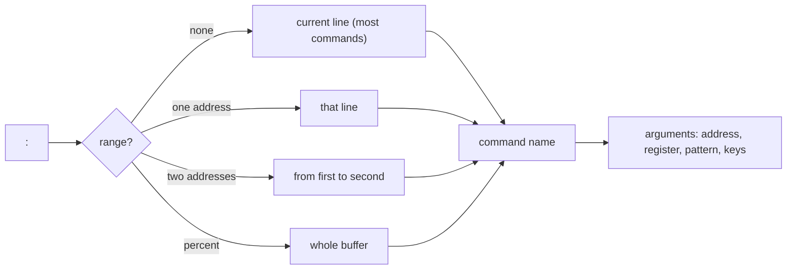

# Command-line mode and Ex commands

> **Before this lesson:** read [Normal mode and its grammar](#/lesson/vim/vim-normal-grammar) and [Visual mode](#/lesson/vim/vim-visual-mode). No knowledge of the command line or the shell is assumed; both are explained here.

## In plain words

Pressing the colon key `:` in Normal mode opens a one-line prompt at the bottom of the screen. What you type there and confirm with Enter is called an **Ex command** (the name comes from an old editor called `ex`). The state of typing at that prompt is **Command-line mode**.

Normal-mode commands are like doing a job with your own hands at the spot where you stand. Ex commands are like writing a note to an assistant: "take lines 12 to 15 and put a copy at the end", "put a semicolon at the end of every line". You do not have to walk to the lines in question; you name them. The part of the note that says *which lines* is called a **range**.

Why it matters for a job: instructions that reach many lines at once are how repetitive edits get done in seconds. The same prompt also connects the editor to the **shell**, the program that runs commands in a terminal, so that tools such as a sorter or a formatter can be applied to your text.

`<CR>` below means the Enter key.

Normal-mode commands are precise but local: they act at the cursor. Sometimes you want the opposite, an edit that reaches across the file without your moving at all. "Copy lines 12 to 15 to the end." "Put a semicolon on every line in this selection." "Sort this block." "Insert the output of a shell command here." Those jobs belong to **Ex commands**, typed on the line that appears at the bottom of the screen when you press `:`.

Ex commands come from `ex`, the line editor that `vi` was built on top of. They trade interactivity for reach: an Ex command can touch many lines at once, and lines far from the cursor, in one stroke. Knowing a dozen of them, plus how to describe *which lines*, covers a large class of edits that would otherwise need a macro.

`[x]` marks the cursor; buffers are shown with line numbers where the numbers matter.

## The command line

Three keys open the command line, each with its own prompt:

| Key | Prompt | Purpose |
|---|---|---|
| `:` | `:` | run an Ex command |
| `/` or `?` | `/` or `?` | search forward or backward |
| `<C-r>=` (from Insert mode) | `=` | evaluate an expression |

`<CR>` executes what you typed and returns to Normal mode; `<Esc>` abandons it. While typing, some of the Insert-mode chords still work:

| Chord | On the command line |
|---|---|
| `<C-w>` | delete the word before the cursor |
| `<C-u>` | delete back to the start of the line |
| `<C-b>` / `<C-e>` | jump to the beginning / end of the command line |
| `<C-r>{register}` | insert a register's contents |
| `<C-r><C-w>` | insert the word under the buffer's cursor |
| `<C-v>` / `<C-k>` | literal character / digraph |

## A dozen Ex commands that edit text

| Command | Short form | What it does |
|---|---|---|
| `:[range]delete [x]` | `:d` | delete lines (into register `x`) |
| `:[range]yank [x]` | `:y` | yank lines |
| `:[line]put [x]` | `:pu` | put register `x` after the line |
| `:[range]copy {address}` | `:t` or `:co` | copy lines to below `{address}` |
| `:[range]move {address}` | `:m` | move lines to below `{address}` |
| `:[range]join` | `:j` | join lines |
| `:[range]normal {keys}` | `:norm` | run Normal-mode keys on each line |
| `:[range]substitute/{pat}/{str}/[flags]` | `:s` | replace text |
| `:[range]global/{pat}/{cmd}` | `:g` | run an Ex command on matching lines |
| `:[range]>` and `:[range]<` | | shift lines right / left |
| `:[range]sort` | `:sor` | sort lines |
| `:[range]!{program}` | | filter lines through an external program |

Almost every command can be shortened to its shortest unambiguous prefix, and all take a range in front.

## Ranges: saying which lines

A range is one **address** or two addresses separated by a comma. With no range, most commands act on the current line.

| Address | Means |
|---|---|
| `7` | line 7 |
| `.` | the current line |
| `$` | the last line |
| `0` | a virtual line above line 1 (valid as a *destination*: `:t0`, `:m0`, `:0put`) |
| `'m` | the line containing mark `m` |
| `'<` and `'>` | first and last line of the last Visual selection |
| `/pattern/` | the next line matching the pattern |
| `?pattern?` | the previous line matching the pattern |
| `{address}+n`, `{address}-n` | offset from another address; a bare `+` or `-` means 1; a missing base means `.` |
| `%` | every line: shorthand for `1,$` |

| Range | Lines covered |
|---|---|
| `:3` | line 3 only (and typed alone, `:3<CR>` jumps there) |
| `:3,7` | lines 3 to 7 |
| `:.,$` | from here to the end |
| `:.,+4` | this line and the next four |
| `:-2,+2` | two above to two below |
| `:%` | the whole file |
| `:'<,'>` | the selected lines; Vim types this for you when you press `:` in Visual mode |
| `:/<main>/,/<\/main>/` | from the next line containing `<main>` to the following line containing `</main>` |
| `:/<main>/+1,/<\/main>/-1` | the same block without its first and last line |
| `:'a,'b` | between two marks |

Both sides of a comma are measured **from the cursor line**. If you want the second address to be relative to the first, separate them with a semicolon instead: `:/begin/;+3` means "the next `begin` line and the three after it".



## Copying and moving lines without moving yourself

`:t` (think "copy **t**o") and `:m` take a range of source lines and a destination address. Their strength is that the cursor does not have to visit the source.

Buffer, cursor on line 5:

```text
1  import os
2  import sys
3
4  def main():
5      [p]ass
```

| Command | Effect |
|---|---|
| `:1t.` | copy line 1 to below the current line |
| `:t.` | duplicate the current line (like `yyp`, but the register is untouched) |
| `:t$` | copy the current line to the end of the file |
| `:1,2t$` | copy lines 1–2 to the end |
| `:'<,'>t0` | copy the selection to the top |
| `:m0` | move the current line to the top |
| `:m$` | move it to the bottom |
| `:m+1` | swap the current line with the one below |
| `:m-2` | swap it with the one above |
| `:2m4` | move line 2 to below line 4 |

Worked example, `:1t.` from the buffer above:

| Before | Command | After |
|---|---|---|
| `1  import os`<br>`2  import sys`<br>`3`<br>`4  def main():`<br>`5      [p]ass` | `:1t.` | `1  import os`<br>`2  import sys`<br>`3`<br>`4  def main():`<br>`5      pass`<br>`6  [i]mport os` |

Compare the Normal-mode route: `1G` `yy` `` `` `` (back) `p`. The Ex command is shorter, does not disturb the jump list much, and does not overwrite your default register. For nearby lines `yyp` or `ddp` is still the natural choice; Ex wins as the distance grows.

A small model of the two commands, to pin down what "below the address" means:

```python-run
def ex_copy(lines, a, b, dest):
    """:a,b t dest  (1-based inclusive a..b; dest in 0..len, lines land AFTER line dest)"""
    return lines[:dest] + lines[a-1:b] + lines[dest:]

def ex_move(lines, a, b, dest):
    """:a,b m dest"""
    block = lines[a-1:b]
    if dest >= b:                       # moving down
        return lines[:a-1] + lines[b:dest] + block + lines[dest:]
    if dest < a - 1:                    # moving up
        return lines[:dest] + block + lines[dest:a-1] + lines[b:]
    return lines                        # destination inside the block: nothing to do

buf = ["one", "two", "three", "four", "five"]
print(":2t$     ", ex_copy(buf, 2, 2, 5))
print(":4,5t0   ", ex_copy(buf, 4, 5, 0))
print(":1m$     ", ex_move(buf, 1, 1, 5))
print(":4,5m0   ", ex_move(buf, 4, 5, 0))
print(":2m3 (swap down)", ex_move(buf, 2, 2, 3))
print(":3m1 (swap up)  ", ex_move(buf, 3, 3, 1))
```

## `:normal`: Normal-mode commands over a range

`:[range]normal {keys}` places the cursor at the start of each line in the range in turn and types `{keys}` as if you had. It is the bridge between the two worlds: the reach of Ex with the vocabulary of Normal mode.

| Before | Command | After |
|---|---|---|
| `[a] = 1`<br>`b = 22`<br>`c = 333` | `:%normal A;` | `a = 1;`<br>`b = 22;`<br>`c = 333;` |
| `[a]lpha`<br>`beta`<br>`gamma` | `:%normal I- ` | `- alpha`<br>`- beta`<br>`- gamma` |
| `x = 1`<br>`[y] = 2`<br>`z = 3` | `:2,3normal 0i# ` | `x = 1`<br>`# y = 2`<br>`# z = 3` |

Because the cursor starts at column 1 on each line and Vim returns to Normal mode automatically after each line, there is no need for a closing `<Esc>`.

Two especially useful forms:

- `:'<,'>normal .` repeats the last change on every selected line. Make the change once by hand, select the other lines, and let `.` do the rest.
- `:'<,'>normal @q` runs a macro on every selected line (the *Macros* lesson builds on this).

Use `:normal!` (with the bang) when the keys must mean what they mean in stock Vim regardless of your mappings; scripts and shared snippets should always use it.

## Repeating an Ex command

The dot command does not repeat Ex commands. Their repeat key is `@:`, which re-runs the most recent command line; after that, `@@` repeats again.

| Step | Keys | Effect |
|---|---|---|
| 1 | `:m+1<CR>` | push the current line down one |
| 2 | `@:` | push it down again |
| 3 | `@@` | and again |
| 4 | `u` | one step back up |

This turns stepping commands such as `:bnext`, `:cnext` or `:m+1` into the same act/repeat/reverse loop as everything else.

## Typing less: completion, the cursor word and history

**Completion.** `<Tab>` completes command names, option names, file names, buffer names, help tags and more, depending on where you are in the command. `<C-d>` lists all candidates. Two settings make this far more pleasant:

```vim
set wildmenu                 " show candidates in a menu
set wildmode=longest:full,full
```

**The word under the cursor.** `<C-r><C-w>` copies the word under the buffer cursor onto the command line; `<C-r><C-a>` copies the whole whitespace-delimited WORD. With the cursor on `timeout`, typing `:%s//<C-r><C-w>_ms/g` builds a substitution without retyping the name (the empty pattern reuses the last search, typically set with `*`). It is also the fast way to look something up: `:help <C-r><C-w><CR>`.

**History.** Vim remembers command lines and searches across sessions.

| Key | Effect |
|---|---|
| `<Up>` / `<Down>` | previous / next history entry **that starts with what you have typed** |
| `<C-p>` / `<C-n>` | previous / next entry, no filtering |
| `q:` | open the **command-line window**: the history as an editable buffer |
| `q/` | the same for search history |
| `<C-f>` | switch from the command line you are typing into the command-line window |

The filtering behaviour of `<Up>` is worth exploiting: type `:s` and press `<Up>` to step through earlier substitutions only.

In the command-line window every Normal-mode command works. You can yank an old command, edit it with `ciw`, combine two entries, and press `<CR>` on the line you want to run. When a long substitution is almost right, `<C-f>` is quicker than arrow-keying along the command line.

## Talking to the shell

| Command | Effect |
|---|---|
| `:!{cmd}` | run a shell command and show its output |
| `:!!` | re-run the last shell command |
| `:shell` (or `<C-z>` then `fg`) | drop to a shell and come back |
| `:terminal` | open a terminal in a window (Vim 8+, Neovim) |
| `:read !{cmd}` | insert the command's output below the cursor line |
| `:[range]write !{cmd}` | send the lines to the command's standard input |
| `:[range]!{cmd}` | **filter**: replace the lines with the command's output |

Inside a shell command `%` expands to the current file name, so `:!python %` runs the file you are editing and `:!wc -l %` counts its lines.

Filtering is the powerful one. Any program that reads standard input and writes standard output becomes an editing command:

| Before | Command | After |
|---|---|---|
| `[p]ear`<br>`apple`<br>`fig` | `:%!sort` | `[a]pple`<br>`fig`<br>`pear` |
| a line containing compact JSON | `:.!python -m json.tool` | the JSON pretty-printed over several lines |
| a column of numbers | `:'<,'>!awk '{s+=$1} END {print s}'` | their sum |

The Normal-mode operator `!{motion}` is a shortcut that fills in the range for you: `!ap` leaves you at `:.,.+N!` ready to type the program name.

Note the difference a space-like detail makes: `:write !sh` sends the buffer to `sh` as input (runs the buffer as a script), whereas `:write! sh` overwrites a file named `sh`.

## Batches: several commands at once

A bar joins Ex commands on one line: `:%s/\s\+$//e | update` strips trailing whitespace and then saves. (A few commands, notably `:normal`, `:global` and `:!`, take the rest of the line as their argument, bar included.)

For anything longer, put the commands in a file, one per line and without the leading colons, and run it with `:source`:

```vim
" cleanup.vim: run with  :source cleanup.vim
%s/\s\+$//e
%s/\t/    /ge
g/^\s*console\.log/d
update
```

Because it is a plain file you can keep it in version control, review it, and apply it to many files with `:argdo source cleanup.vim`. That is the point at which Ex commands shade into Vim script.

## Why it works

Ex commands fit the same act/repeat/reverse scheme as the rest of Vim, only at a different scale. A Normal-mode command is *operator + motion* at the cursor. An Ex command is *range + command*, where the range plays the part of the motion. `:normal` plugs the first grammar into the second, and `:global` (a later lesson) adds a filter in front.

Each Ex command is one undo step, however many lines it touched. A `:%normal A;` on a thousand lines is undone by a single `u`.

> [!TIP]
> When an edit starts with "on each of these lines…", try this order: (1) do it once and see whether `j.` is enough; (2) select the lines and run `:'<,'>normal .`; (3) reach for `:s` or `:g` if the lines are scattered; (4) record a macro only if the edit needs several distinct steps.

> [!INTERVIEW]
> `:w !sudo tee % > /dev/null` is a classic "how do I save a file I opened without root" answer, and understanding it shows you understand three things at once: `:w !cmd` pipes the buffer to a command, `%` is the current file name, and `tee` writes its input to that file with elevated rights.

## Pitfalls

- **`:5` jumps; `:5d` deletes.** A bare range is a "go to" command. Read the command line before pressing `<CR>`.
- **Line numbers shift as you edit.** After `:3d`, the old line 4 is line 3. Use marks or patterns as addresses when running several commands in a row.
- **`:normal` uses your mappings.** If `A` or `.` is remapped in your configuration, `:normal!` avoids surprises.
- **`:normal` aborts a line on failure, not the whole range.** If the keys fail on a line (for example `f,` finds no comma), that line is left alone and the next is processed.
- **`%` means two things.** As a range it is the whole file; inside `:!` and as a file name argument it is the current file's name.
- **A backwards range** (`:7,3d`) makes Vim ask whether to swap the ends; in scripts prefix the command with `:silent!` or write the range correctly.
- **`:!` runs in the directory shown by `:pwd`,** not necessarily the directory of the file.
- **`@:` after a substitution** repeats the whole command line, range included. To repeat only the substitution on the current line use `&`.

## Cheat sheet

| Task | Command |
|---|---|
| Delete lines 3–7 | `:3,7d` |
| Duplicate current line | `:t.` |
| Copy line 10 here | `:10t.` |
| Move selection to the end | `:'<,'>m$` |
| Move current line up / down | `:m-2` / `:m+1` |
| Append `;` to every line | `:%normal A;` |
| Repeat last change on selection | `:'<,'>normal .` |
| Repeat last Ex command | `@:` then `@@` |
| Sort a paragraph | `!apsort<CR>` or `:'<,'>sort` |
| Insert shell output | `:read !date` |
| Run current file | `:!python %` |
| Word under cursor onto command line | `<C-r><C-w>` |
| Browse command history as a buffer | `q:` |
| List completions | `<C-d>` |
| Chain commands | `:cmd1 <bar> cmd2` typed with a real bar character |
| Run a script of Ex commands | `:source file.vim` |

## Summary

- Ex commands act on ranges of lines and can reach far from the cursor in one step.
- A range is one or two addresses: numbers, `.`, `$`, marks, patterns, with offsets; `%` is the whole file and `'<,'>` the last selection.
- `:t` and `:m` copy and move lines to a destination address without a trip there and back.
- `:normal` runs Normal-mode keys on each line of a range; `:'<,'>normal .` is the range version of the dot command.
- `@:` repeats the last Ex command.
- `<Tab>`, `<C-d>`, `<C-r><C-w>`, history filtering with `<Up>` and the `q:` window cut the typing.
- `:!`, `:read !`, `:write !` and `:[range]!` connect the buffer to the shell; filtering turns any Unix tool into an editing command.

## Glossary

| Term | Meaning |
|---|---|
| Ex command | a command typed at the `:` prompt and run with Enter |
| Command-line mode | the state of typing at the prompt opened by `:`, `/` or `?` |
| range | the part in front of an Ex command naming the lines it applies to |
| address | one end of a range: a line number, `.`, `$`, a mark or a pattern |
| `%` | as a range, every line of the file |
| `:normal` | the Ex command that types Normal-mode keys on each line of a range |
| history | the list of earlier command lines and searches that Vim remembers |
| command-line window | the history shown as an editable buffer, opened with `q:` |
| shell | the program that interprets commands typed in a terminal |
| filter | passing lines through an external program and replacing them with its output |
| standard input / standard output | the text a program reads / the text it prints |
| pattern | a description of text to look for |

## Check yourself

```quiz
[
  {"q": "Which command copies line 3 to directly below the current line without moving the cursor away first?",
   "options": [":3m.", ":3t.", ":t3", ":.t3"],
   "answer": 1,
   "explain": ":t (copy) takes a source range in front and a destination address after. :3t. copies line 3 to below the current line. :t3 would copy the current line to below line 3."},
  {"q": "The cursor is on line 10 of a 50-line file. Which lines does :.,+3d delete?",
   "options": ["10 to 12", "10 to 13", "11 to 13", "3 to 10"],
   "answer": 1,
   "explain": ". is the current line and +3 is three lines below it, so the range is 10 through 13 inclusive."},
  {"q": "Buffer lines: 'x = 1', 'y = 2', 'z = 3'. Which command produces 'x = 1;', 'y = 2;', 'z = 3;'?",
   "options": [":%normal A;", ":%s/^/;/", ":normal A;", ":%normal a;"],
   "answer": 0,
   "explain": ":%normal A; types A; on every line. Without the range only the current line changes; a; would append after the first character because the cursor starts at column 1; the substitution would put the semicolon at the start."},
  {"q": "A moment ago you ran :m+1 to move a line down and want to move it down once more. Which key sequence is intended for that?",
   "options": [".", "@:", "&", ";"],
   "answer": 1,
   "explain": "@: repeats the last Ex command. Dot repeats Normal-mode changes only."},
  {"q": "What does :%!sort do?",
   "options": ["Runs sort and shows the result without changing the buffer", "Replaces the whole buffer with the output of the external sort program run on it", "Writes the buffer to a file called sort", "Sorts only the current line"],
   "answer": 1,
   "explain": "A range followed by ! filters those lines through the external command and replaces them with its output."},
  {"q": "On the command line, which keys insert the word under the buffer's cursor?",
   "options": ["<C-r><C-w>", "<C-w>", "<C-r>w", "<Tab>"],
   "answer": 0,
   "explain": "Ctrl-R Ctrl-W pulls the word under the cursor into the command line. Ctrl-W alone deletes a word; Ctrl-R w would insert register w."},
  {"q": "You typed :s and press the Up arrow. What do you get?",
   "options": ["The previous command of any kind", "The most recent history entry that begins with s", "The search history", "Nothing; Up needs an empty command line"],
   "answer": 1,
   "explain": "Up and Down filter history by the text already typed. Ctrl-P and Ctrl-N step through history without filtering."},
  {"q": "Which command moves the lines of the last Visual selection to the very top of the file?",
   "options": [":'<,'>m1", ":'<,'>m0", ":'<,'>t0", ":m'<"],
   "answer": 1,
   "explain": "Lines are placed below the destination address, so address 0 means above line 1. m1 would put them after the first line, and t copies instead of moving."}
]
```

> **Source:** Neil, Practical Vim 2e, tips 27–36 (ch. 5, "Command-Line Mode"). Examples and wording are original.
