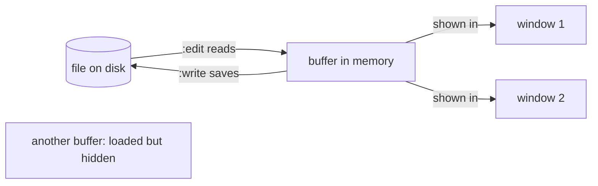
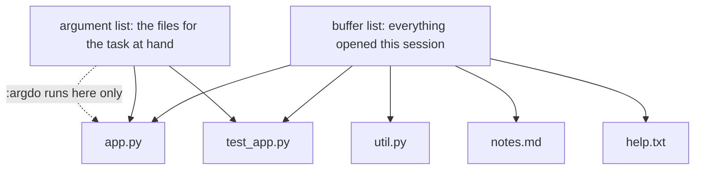

# Buffers and the argument list: working on many files

> **Before this lesson:** read [command-line mode and Ex commands](#/lesson/vim/vim-command-line), because the commands here are typed after a colon. You should also know the dot command and basic movement.

## In plain words

When you open a file, Vim reads it from the disk and keeps a working copy in memory. That working copy is called a **buffer**. You edit the buffer; the file on disk changes only when you save.

Think of taking a folder of papers out of a filing cabinet and working on photocopies at your desk. The cabinet (the disk) is untouched until you file the corrected pages back. You can have many photocopies on the desk at once, most of them in a pile and one or two in front of you. Vim's **buffer list** is that pile. A second, smaller pile, the **argument list**, holds only the documents for the job in hand.

Why it matters for a job: real work spans many files. Knowing how to hop between them by name, flip back to the previous one with one key, and apply a command to a chosen group of files is the difference between working in a project and working in one file at a time.

`<C-^>` below means "hold Ctrl and press `^`" (on many keyboards, Ctrl with the 6 key).

Real work is never one file. A bug fix touches a module, its tests and a config file; a refactoring touches thirty. Graphical editors show open files as a row of tabs and expect you to click. Vim's model is different and, once understood, faster: files live in an invisible list of **buffers**, you jump between them by name, by number or by "the one I was in a moment ago", and you can run a command over all of them or over a hand-picked group.

Newcomers trip over this model in two specific places: the difference between a *file* and a *buffer*, and the error message that appears when you try to leave a buffer with unsaved changes. This lesson clears up both, then shows the argument list, which is Vim's way of saying "these particular files are the ones I am working on right now".

## Files and buffers are different things

A **file** is bytes on disk. A **buffer** is Vim's in-memory copy of a file's text. When you run `:edit notes.md`, Vim reads the file into a buffer and shows you the buffer. Everything you type changes the buffer only. The file is untouched until you write the buffer back with `:write`.



Three consequences follow.

- A buffer can exist with no file (a new, unnamed buffer), and can outlive its file.
- A buffer can be **loaded but not displayed**: it is then called *hidden*.
- One buffer can be shown in several windows at once; edits appear in all of them because there is only one copy.

## The buffer list

Start Vim with a few files, for example `vim app.py util.py test_app.py`, and ask what is loaded:

```text
:ls
  1 %a   "app.py"                       line 1
  2      "util.py"                      line 0
  3      "test_app.py"                  line 0
```

Each row is a buffer number, some flags, the name and the last cursor line. The flags you will meet:

| Flag | Meaning |
|---|---|
| `%` | the buffer in the current window |
| `#` | the **alternate** buffer: the one you were in immediately before |
| `a` | active: loaded and visible in a window |
| `h` | hidden: loaded but not visible |
| `+` | modified since it was last written |
| `=` | read-only |
| `-` | not modifiable (help pages, for example) |
| `u` | unlisted (shown only by `:ls!`) |

Buffer numbers are assigned in the order buffers are created and are never reused during a session, so a number is a stable handle.

### Moving around the list

| Command | Effect |
|---|---|
| `:bnext` / `:bprevious` (`:bn` / `:bp`) | next / previous buffer, wrapping at the ends |
| `:bfirst` / `:blast` | first / last buffer |
| `:buffer 3` (`:b3`) | buffer number 3 |
| `:buffer test<Tab>` | the buffer whose name contains `test`; `<Tab>` completes, and any unique fragment is enough |
| `<C-^>` or `:b#` | the alternate buffer |
| `3<C-^>` | buffer number 3 |

Worked sequence, starting from the listing above:

| Current | Alternate | Command | Current after | Alternate after |
|---|---|---|---|---|
| `app.py` | (none) | `:bnext` | `util.py` | `app.py` |
| `util.py` | `app.py` | `:bnext` | `test_app.py` | `util.py` |
| `test_app.py` | `util.py` | `<C-^>` | `util.py` | `test_app.py` |
| `util.py` | `test_app.py` | `<C-^>` | `test_app.py` | `util.py` |
| `test_app.py` | `util.py` | `:b app` | `app.py` | `test_app.py` |
| `app.py` | `test_app.py` | `:bnext` | `util.py` | `app.py` |

`<C-^>` deserves special mention. A great deal of editing is a back-and-forth between exactly two files: implementation and test, header and source, template and stylesheet. One chord toggles between them, and it works however many other buffers are open.

For the four stepping commands many people add short mappings so that they sit on adjacent keys:

```vim
nnoremap <silent> [b :bprevious<CR>
nnoremap <silent> ]b :bnext<CR>
nnoremap <silent> [B :bfirst<CR>
nnoremap <silent> ]B :blast<CR>
```

(These are the mappings popularised by the *unimpaired* plugin, which defines the same bracket pattern for several other lists.)

### Removing buffers

| Command | Effect |
|---|---|
| `:bdelete` (`:bd`) | remove the current buffer from the list |
| `:bdelete 4 7` | remove buffers 4 and 7 |
| `:3,6bdelete` | remove buffers 3 to 6 |
| `:%bdelete` | remove all of them |
| `:bwipeout` | remove a buffer and forget everything about it (marks, options) |

Deleting a buffer does not delete the file. It only tells Vim to forget its copy. Because buffer numbers are awkward to track by eye, most people do not prune the buffer list much; they let it grow and navigate by name fragments. Fuzzy-finder plugins make this the default workflow: a key opens a filter over buffer names.

A small model of the list, the current and alternate buffers and the flags:

```python-run
class Buffers:
    def __init__(self, names):
        self.items = [dict(nr=i + 1, name=n, modified=False) for i, n in enumerate(names)]
        self.cur, self.alt = (self.items[0] if names else None), None

    def _go(self, target):
        if target is not None and target is not self.cur:
            self.alt, self.cur = self.cur, target

    def bnext(self, step=1):
        i = self.items.index(self.cur)
        self._go(self.items[(i + step) % len(self.items)])

    def b(self, fragment):
        hits = [b for b in self.items if fragment in b["name"]]
        if len(hits) == 1:
            self._go(hits[0])
        else:
            print(f"   E93/E94: {len(hits)} matches for {fragment!r}")

    def alternate(self):
        self._go(self.alt)

    def ls(self):
        for b in self.items:
            flag = "%" if b is self.cur else "#" if b is self.alt else " "
            print(f"  {b['nr']:>2} {flag}{'+' if b['modified'] else ' '} {b['name']}")
        print()

bufs = Buffers(["app.py", "util.py", "test_app.py"])
bufs.bnext(); bufs.bnext(); bufs.ls()
bufs.alternate(); bufs.cur["modified"] = True; bufs.ls()
bufs.b("app")          # ambiguous: matches app.py and test_app.py
bufs.b("test"); bufs.ls()
```

## Hidden buffers and the "no write" error

Edit a buffer, do not save, and try to switch away:

```text
:bnext
E37: No write since last change (add ! to override)
```

By default Vim refuses to let a modified buffer drop out of sight. It is protecting you from forgetting about unsaved work. You have four honest answers:

| You want to | Command |
|---|---|
| save the changes, then leave | `:write` then the switch, or `:wnext` for the argument list |
| throw the changes away | `:edit!` (re-read the file from disk) |
| leave anyway and keep the changes in memory | add `!` to the switch: `:bnext!` |
| stop being asked | `:set hidden` |

With `!`, or with the `hidden` option on, the buffer becomes **hidden**: still loaded, still modified, only not shown. `:ls` marks it `h` and `+`:

```text
:ls
  1  h+  "app.py"                       line 12
  2 %a   "util.py"                      line 1
```

Nothing is lost. When you try to quit, Vim reminds you about any modified hidden buffer and takes you to it.

| Command | Effect on quitting with several buffers |
|---|---|
| `:wall` (`:wa`) | write every modified buffer |
| `:qall` (`:qa`) | quit if nothing is modified; otherwise complain |
| `:wqall` or `:xall` | write everything and quit |
| `:qall!` | quit and discard all unsaved changes |
| `:confirm qall` | ask about each modified buffer in turn |

`set hidden` is in nearly everyone's configuration, and Neovim turns it on by default. It is what makes buffer-hopping fluid, and it is required for commands that sweep through many buffers, because those commands must be able to leave each buffer without stopping to save.

## The argument list: a named group of files

The buffer list answers "what has been opened?". After an hour that is a long, untidy list including help pages and files you only glanced at. The **argument list** answers a different question: "which files am I working on?" It starts as the files named on the command line (hence the name) and you can redefine it at any time.

```text
:args
[app.py] util.py test_app.py
```

The square brackets mark the current entry.

### Defining the list

| Command | The list becomes |
|---|---|
| `:args README.md src/main.py` | exactly those two files |
| `:args *.py` | every Python file in the working directory |
| `:args **/*.py` | every Python file in this directory **and all sub-directories** |
| `:args src/**/*.ts tests/**/*.ts` | several patterns together |
| ``:args `git ls-files '*.md'` `` | whatever the shell command in backticks prints |
| ``:args `cat todo.txt` `` | the file names stored one per line in `todo.txt` |
| `:argadd extra.py` | the same list plus one file |

`*` matches within one directory level; `**` recurses. The backtick form is the general escape hatch: any tool that can print file names, `git`, `find`, `grep -l`, `rg -l`, can populate the list.

### Walking the list

| Command | Effect |
|---|---|
| `:next` / `:prev` | next / previous file in the list |
| `:first` / `:last` | first / last |
| `:wnext` | write, then go to the next (handy when reviewing files one by one) |
| `:argdo {cmd}` | run an Ex command in every file of the list |

Unlike `:bnext`, the stepping commands do **not** wrap: `:next` on the last file is an error, which is a useful "you have seen them all" signal.

### Doing something to all of them

`:argdo` is where the argument list earns its keep.

| Goal | Commands |
|---|---|
| Rename a function across the Python files | `:args **/*.py` then `:argdo %s/\<load_cfg\>/load_config/ge` then `:wall` |
| Strip trailing whitespace from the Markdown files | `:args **/*.md` then `:argdo %s/\s\+$//e` then `:argdo update` |
| Apply a script of Ex commands | `:argdo source cleanup.vim` |
| Run a recorded macro at the top of each file | `:argdo normal @q` |

Two details make these work. The `e` flag on `:s` suppresses the "pattern not found" error in files that have no match, which would otherwise stop `:argdo` halfway. And `update` writes a buffer only if it changed, which avoids touching the timestamps of files that were not modified. If `hidden` is off you must chain the write onto the same command line with a bar (`… | update`), otherwise `:argdo` halts at the first modified buffer.

`:bufdo` is the same idea over the entire buffer list. It is blunter, because the buffer list tends to contain things you did not mean to include, so prefer `:argdo` with a list you have freshly defined and can see.



## Putting it together: a small refactoring session

Task: a helper called `fmt_ts` should be renamed `format_timestamp` in a project of forty files.

| Step | Command | Why |
|---|---|---|
| 1 | ``:args `git grep -l fmt_ts` `` | the argument list is now exactly the files that mention the name |
| 2 | `:args` | look at the list before acting on it |
| 3 | `:argdo %s/\<fmt_ts\>/format_timestamp/ge` | substitute in each; `e` keeps going past files where the whole-word pattern has no match |
| 4 | `:first` then `:next` a few times | spot-check the result |
| 5 | `:wall` | write everything |

If step 4 reveals a mistake, `:argdo undo` (or `:argdo edit!` to re-read each file from disk, since nothing was written yet) puts everything back. Keeping the write as a separate, final step is what makes a sweeping change safe.

## Why it works

Vim separates three concerns that other editors glue together:

- **content** (buffers): what text is in memory;
- **view** (windows, next lesson): which buffers are on screen;
- **scope** (argument list): which files a batch operation applies to.

Because they are separate, you can have fifty buffers loaded, two on screen, and seven in the argument list, and a command addressed to any one of those sets does not disturb the others. The `E37` error is the one place where content and view interact: by default a modified buffer must be visible; `hidden` lifts that rule.

> [!TIP]
> Put `set hidden` in your configuration, then learn two movements before any others: `<C-^>` for "the file I was in a moment ago" and `:b {fragment}<Tab>` for "that file whose name contains…". Together they replace most clicking on tabs.

> [!INTERVIEW]
> A realistic practical question: "apply this change to every file matching a pattern". The Vim answer has three parts worth stating in order: populate a list (`:args` with a glob or backticks), run the change (`:argdo` with `e` on the substitution), verify and write (`:wall`). The same shape appears again later with the quickfix list and `:cfdo`.

## Pitfalls

- **`:q` closes a window, not a buffer.** After `:q` the buffer is usually still in the list (and Vim exits only if that was the last window).
- **`:bdelete` on a modified buffer fails** unless you add `!`, which discards the changes.
- **`:edit!` discards without asking.** It is the right tool when you mean it.
- **`:argdo` and `:bufdo` change the current buffer.** You end up in the last file processed; `<C-^>` or `:first` takes you back.
- **`:argdo` stops at the first error.** Use the `e` flag with `:s` and `silent!` in front of commands that may legitimately fail.
- **`:args *.py` uses Vim's working directory** (`:pwd`), not the directory of the current file.
- **`:b app` fails when the fragment is ambiguous.** Type a few more characters or press `<Tab>` to cycle.
- **Recursive globs can be slow and can include build output.** Prefer ``:args `git ls-files …` `` in a repository so ignored files are skipped.

## Cheat sheet

| Task | Command |
|---|---|
| List buffers | `:ls` |
| Next / previous buffer | `:bn` / `:bp` |
| Go to buffer by number / name | `:b 4` / `:b frag<Tab>` |
| Toggle to the previous buffer | `<C-^>` |
| Forget a buffer | `:bd` |
| Allow leaving modified buffers | `:set hidden` |
| Discard changes in this buffer | `:e!` |
| Write all / quit all | `:wa` / `:qa` |
| Show argument list | `:args` |
| Set argument list (recursive) | `:args **/*.py` |
| Set it from a shell command | ``:args `git ls-files` `` |
| Next / previous argument | `:next` / `:prev` |
| Run a command in every argument | `:argdo {cmd}` |
| Run a command in every buffer | `:bufdo {cmd}` |

## Summary

- A buffer is Vim's in-memory copy of a file; nothing reaches the disk until you `:write`.
- `:ls` shows the buffer list with flags; `%` is current, `#` is alternate, `h` hidden, `+` modified.
- `:bnext`, `:b {fragment}` and especially `<C-^>` move between buffers.
- A modified buffer cannot be left unless you write it, discard it, force with `!`, or set `hidden`.
- The argument list is a deliberate subset of files, defined with `:args` using globs or a backticked shell command.
- `:argdo` runs an Ex command across that subset; keep `:wall` as a separate last step.

## Glossary

| Term | Meaning |
|---|---|
| file | data stored on disk under a name |
| buffer | Vim's in-memory working copy of a file |
| buffer list | the list of all buffers in the current session |
| alternate buffer | the buffer you were in before the current one; `<C-^>` switches to it |
| hidden buffer | a buffer that is loaded but not shown in any window |
| modified | having changes that are not yet saved |
| `hidden` option | the setting that lets you leave a modified buffer without saving it first |
| argument list | a chosen list of files, originally those named when Vim was started |
| glob | a file-name pattern with wildcards, such as `*.py` or `**/*.py` |
| working directory | the directory against which relative file names are resolved |
| `:argdo` / `:bufdo` | run an Ex command in every file of the argument list / every buffer |
| write | Vim's word for saving a buffer to its file |

## Check yourself

```quiz
[
  {"q": "You edit a buffer, do not save, and run :bnext. With default settings, what happens?",
   "options": ["Vim saves the file automatically and switches", "Vim switches and discards your changes", "Vim refuses with E37 until you write, discard, force with !, or enable hidden", "Vim opens the next buffer in a split"],
   "answer": 2,
   "explain": "Without the hidden option a modified buffer may not be abandoned. :bnext! or set hidden would let it become a hidden buffer with its changes intact."},
  {"q": "Buffers: 1 a.c (current), 2 b.c, 3 c.c. You run :b3 and then press <C-^>. Where are you?",
   "options": ["a.c", "b.c", "c.c", "A new empty buffer"],
   "answer": 0,
   "explain": "After :b3 the alternate buffer is a.c, the one you came from. Ctrl-^ switches to the alternate buffer."},
  {"q": "In :ls output, what does the flag combination h+ mean?",
   "options": ["Help buffer, read-only", "Hidden and modified", "Highlighted and active", "Has a swap file"],
   "answer": 1,
   "explain": "h marks a loaded buffer that is not shown in any window; + marks unsaved changes."},
  {"q": "Which command sets the argument list to every .js file under the current directory at any depth?",
   "options": [":args *.js", ":args **/*.js", ":bufdo *.js", ":args -r *.js"],
   "answer": 1,
   "explain": "A single star matches within one directory. Two stars recurse into sub-directories."},
  {"q": "Why include the e flag in :argdo %s/old/new/ge ?",
   "options": ["It makes the substitution case-insensitive", "It writes each file after substituting", "It suppresses the 'pattern not found' error so the sweep does not stop at a file without a match", "It limits the substitution to the argument list"],
   "answer": 2,
   "explain": ":argdo aborts on the first error. Without e, a file with no match raises E486 and stops the run."},
  {"q": "What does :bdelete do to the file on disk?",
   "options": ["Deletes it", "Truncates it", "Nothing; it only removes Vim's buffer from the list", "Renames it with a tilde"],
   "answer": 2,
   "explain": "Buffers are in-memory copies. Deleting a buffer never touches the file."},
  {"q": "You are on the last file of the argument list and run :next. What happens?",
   "options": ["It wraps to the first file", "An error: there is no next file", "Vim quits", "It opens the alternate buffer"],
   "answer": 1,
   "explain": "Unlike :bnext, the argument-list stepping commands do not wrap."},
  {"q": "Which sequence writes every modified buffer and then exits Vim?",
   "options": [":qa!", ":wa then :qa (or :wqa)", ":bd then :q", ":e! then :q"],
   "answer": 1,
   "explain": ":wall writes all modified buffers and :qall quits; :wqall does both. :qa! would discard the changes."}
]
```

> **Source:** Neil, Practical Vim 2e, tips 37–39 (ch. 6, "Manage Multiple Files"). Examples and wording are original.
