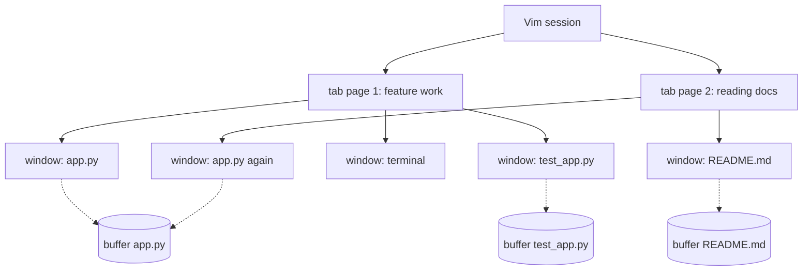

# Split windows and tab pages: arranging your workspace

> **Before this lesson:** read [buffers and the argument list](#/lesson/vim/vim-buffers). You should know that a buffer is Vim's working copy of a file.

## In plain words

A **window** in Vim is a rectangle of the screen that shows a buffer. You can divide the screen into several windows to see more than one thing at once. A **tab page** is a whole arrangement of windows; you can keep several arrangements and switch between them.

Think of a desk. The papers are the buffers. The space on the desk where a paper lies open is a window: you can lay two papers side by side, or open the same long document at two different pages. A tab page is a second desk in the same room, set up for a different job, which you can walk over to without clearing the first.

Why it matters for a job: programmers constantly need two things in view together, the code and its test, the error message and the line that caused it. Arranging the screen in two key presses, and clearing it again in one, keeps attention on the work.

`<C-w>` below means "hold Ctrl and press `w`"; every window command starts with it.

Buffers hold text; they say nothing about what is on screen. The previous lesson showed how to keep many files loaded and hop between them one at a time. Often, though, you want two things visible together: the function and its test, the error log and the code that produced it, two distant parts of the same long file. That is the job of **windows**. And when one task's arrangement of windows should be set aside while you deal with something else, **tab pages** let you keep several arrangements and switch between them.

The names are the main obstacle. A Vim *window* is what many editors call a pane or split. A Vim *tab page* is not a file tab; it is a whole layout of windows. Hold on to this hierarchy and everything else follows:



A window is a viewport onto a buffer. Two windows may show the same buffer (the dotted arrows from two windows to `app.py`), each with its own cursor and scroll position. Closing a window never loses text, because the text belongs to the buffer.

## Creating windows

Every window command lives behind the prefix `<C-w>` (Ctrl-W), with an Ex command of the same meaning.

| Keys | Ex command | Result |
|---|---|---|
| `<C-w>s` | `:split` | split horizontally: a new window above, showing the same buffer |
| `<C-w>v` | `:vsplit` | split vertically: a new window to the left, same buffer |
| | `:split {file}` | split and open `{file}` in the new window |
| | `:vsplit {file}` | the vertical equivalent |
| `<C-w>n` | `:new` | split with a new empty buffer |
| | `:vnew` | vertical split with a new empty buffer |
| `<C-w>^` | | split and show the alternate buffer |
| | `:sbuffer {n}` | split and show buffer `{n}` |

A freshly split window shows the same buffer as the one you were in, which is precisely what you want for looking at two parts of one file. To show a different file, give the name to `:split`, or split first and then use `:edit` or `:buffer` in the new window.

Where new windows appear is controlled by two options that most people set, because the results feel more natural to readers of left-to-right languages:

```vim
set splitbelow    " :split puts the new window below
set splitright    " :vsplit puts the new window to the right
```

Layouts after each step, starting from one window showing `app.py`:

```text
start            <C-w>v                  then :split test_app.py  (cursor was in the left window)
+-----------+    +---------+---------+   +-------------+---------+
|           |    |         |         |   | test_app.py |         |
|  app.py   |    | app.py  | app.py  |   +-------------+ app.py  |
|           |    |         |         |   | app.py      |         |
+-----------+    +---------+---------+   +-------------+---------+
```

You can also open Vim directly into a layout: `vim -o a b` gives horizontal splits, `vim -O a b` vertical ones, and `vim -p a b` one tab page per file.

## Moving the focus

| Keys | Moves focus to |
|---|---|
| `<C-w>h` `<C-w>j` `<C-w>k` `<C-w>l` | the window to the left / below / above / right |
| `<C-w>w` | the next window, cycling |
| `<C-w>p` | the previously focused window |
| `<C-w>t` / `<C-w>b` | the top-left / bottom-right window |

The direction keys reuse `hjkl`, so they need no new memory. On most setups `<C-w><C-h>` works as well as `<C-w>h`, which means you can keep Ctrl held while pressing both keys. Many people shorten the directional moves to a single chord:

```vim
nnoremap <C-h> <C-w>h
nnoremap <C-j> <C-w>j
nnoremap <C-k> <C-w>k
nnoremap <C-l> <C-w>l
```

## Closing windows

| Keys | Ex command | Effect |
|---|---|---|
| `<C-w>c` | `:close` | close this window (refuses to close the last one) |
| `<C-w>o` | `:only` | close every window **except** this one |
| `<C-w>q` | `:q` | close this window; quits Vim if it is the last |

Closing a window leaves its buffer in the buffer list. If the buffer has unsaved changes and is not shown elsewhere, the same `hidden` rule from the previous lesson decides whether Vim allows it.

`<C-w>o` is the "clear my desk" key: after an exploration that left six splits open, one chord returns you to a single window with nothing lost.

## Resizing and rearranging

| Keys | Effect |
|---|---|
| `<C-w>=` | make all windows equal in size |
| `<C-w>_` | maximise the height of this window |
| `<C-w><Bar>` | maximise its width (`<Bar>` is the vertical-bar key) |
| `{n}<C-w>_` | set the height to `n` lines |
| `{n}<C-w><Bar>` | set the width to `n` columns |
| `<C-w>+` / `<C-w>-` | taller / shorter by one line (accepts a count) |
| `<C-w>>` / `<C-w><` | wider / narrower by one column (accepts a count) |
| `<C-w>r` | rotate the windows in this row or column |
| `<C-w>x` | exchange this window with its neighbour |
| `<C-w>H` `<C-w>J` `<C-w>K` `<C-w>L` | move this window to the far left / bottom / top / far right, at full height or width |
| `<C-w>T` | move this window into a tab page of its own |

The capital `HJKL` forms are the quick way to turn a horizontal split into a vertical one: with two windows stacked, `<C-w>L` in either sends it to the right and the layout becomes side by side.

| Layout before | Keys (focus in the top window) | Layout after |
|---|---|---|
| `test.py` above `app.py` | `<C-w>L` | `app.py` on the left, `test.py` on the right |
| `app.py` left, `test.py` right | `<C-w>x` | `test.py` left, `app.py` right |
| three uneven windows | `<C-w>=` | three equal windows |
| a small window you want to read | `<C-w>_` then later `<C-w>=` | zoom in, then restore |

Resizing with the mouse also works when `set mouse=a` is on, and for a one-off adjustment that is perfectly reasonable.

## One buffer, two windows

Because both windows show the same buffer, an edit in one appears in the other immediately. This gives a simple answer to "I need to see the top of the file while editing the bottom":

| Step | Keys | Effect |
|---|---|---|
| 1 | `<C-w>s` | two views of the same file |
| 2 | `gg` | the new window shows the imports at the top |
| 3 | `<C-w>p` | back to where you were, with the imports still in view |
| 4 | edit | changes show in both |
| 5 | `<C-w>o` | finished: back to one window |

Each window keeps its own cursor, scroll position, folds and local options (for instance `:setlocal wrap` in one and not the other).

## Tab pages: layouts, not files

A tab page holds a complete arrangement of windows. Opening a new one gives you a clean screen without destroying the arrangement you had.

| Keys or command | Effect |
|---|---|
| `:tabedit {file}` (`:tabe`) | open `{file}` in a new tab page |
| `:tabnew` | a new tab page with an empty buffer |
| `<C-w>T` | move the current window into a new tab page |
| `gt` / `gT` | next / previous tab page |
| `{n}gt` | go to tab page number `n` |
| `:tabclose` (`:tabc`) | close this tab page and all its windows |
| `:tabonly` (`:tabo`) | close all other tab pages |
| `:tabmove {n}` | move this tab page to position `n` (`0` makes it first; no argument makes it last) |
| `:tabs` | list tab pages and their windows |

The trap for people arriving from other editors is to open one tab per file. Resist it. The buffer list is not divided by tabs: `:ls` shows the same buffers whichever tab you are in, and `:bnext` in a tab will happily display a file you "put" in another tab. Tabs are for **contexts**:

| Tab | What it holds |
|---|---|
| 1 | the feature you are building: source and test side by side, a terminal underneath |
| 2 | a code review of a colleague's branch, with a diff view |
| 3 | notes or documentation |

A further refinement makes this very practical. Vim's working directory can be set per window with `:lcd {dir}`, and per tab page with `:tcd {dir}`. With `:tcd`, each tab can belong to a different project: file-name completion, `:find`, `:grep` and `:!` commands in that tab all operate relative to its own directory.

```vim
:tabnew
:tcd ~/work/billing-service
:edit README.md
```

## A model of the hierarchy

The toy model below captures the three levels and the two facts that surprise newcomers: closing a window keeps the buffer, and the buffer list is shared by all tabs.

```python-run
class Session:
    def __init__(self):
        self.buffers = []                 # shared by every tab
        self.tabs = [[]]                  # each tab is a list of windows; a window is a buffer name
        self.tab = 0

    def edit(self, name):                 # :edit in the current (last) window, or the first window
        if name not in self.buffers:
            self.buffers.append(name)
        wins = self.tabs[self.tab]
        if wins: wins[-1] = name
        else:    wins.append(name)

    def split(self, name=None):           # :split [file]
        wins = self.tabs[self.tab]
        name = name or wins[-1]
        if name not in self.buffers:
            self.buffers.append(name)
        wins.append(name)

    def close(self):                      # <C-w>c
        if len(self.tabs[self.tab]) > 1:
            self.tabs[self.tab].pop()

    def tabedit(self, name):              # :tabedit file
        self.tabs.append([]); self.tab = len(self.tabs) - 1
        self.edit(name)

    def show(self, label):
        print(f"{label:<22} buffers={self.buffers}")
        for i, wins in enumerate(self.tabs):
            print(f"{'':<22} tab {i + 1}{'*' if i == self.tab else ' '} windows={wins}")

s = Session()
s.edit("app.py");            s.show(":edit app.py")
s.split("test_app.py");      s.show(":split test_app.py")
s.split();                   s.show("<C-w>s")
s.close(); s.close();        s.show("<C-w>c twice")
s.tabedit("README.md");      s.show(":tabedit README.md")
```

After the two closes there is one window again, but `test_app.py` is still in the buffer list. After `:tabedit`, the list has three buffers and both tabs can reach all of them.

## Why it works

The three layers are independent by design:

- **buffers** own text and undo history;
- **windows** own a viewpoint: cursor, scroll, local options, jump list;
- **tab pages** own an arrangement of windows and optionally a working directory.

Independence is what makes the commands compose. "Show the alternate buffer in a vertical split" is the modifier `:vertical` applied to `:sbuffer #`. "Open the help for splits in a new tab" is `:tab help split`: the modifier `:tab` in front of the ordinary `:help` command. The modifiers `:vertical`, `:tab`, `:leftabove`, `:botright` and friends can be put in front of *any* command that opens a window, in the same way that an operator can be put in front of any motion.

> [!TIP]
> A layout that covers most programming sessions: `<C-w>v` for code and test side by side, `:botright terminal` (or `:botright split | terminal` in Neovim) for a shell strip along the bottom, and `<C-w>o` when you want to concentrate on one file. Add `<C-w>=` after resizing the terminal emulator.

> [!INTERVIEW]
> If you screen-share while coding, a side-by-side split of implementation and tests reads far better to an interviewer than flicking between files, and `<C-w>o` followed by `<C-w>v` re-creates it in two chords. Being able to explain "tabs are layouts, buffers are files" also heads off the common assumption that Vim cannot handle multiple files gracefully.

## Pitfalls

- **Treating tabs as files.** `:bnext`, `:b name` and `<C-^>` ignore tab boundaries. Use buffers to hold files and tabs to hold layouts.
- **`:q` in the last window of the last tab exits Vim.** Use `:close` (`<C-w>c`) when you only mean "close this pane"; it refuses to close the last window.
- **`<C-w>o` with unsaved buffers.** Without `hidden`, Vim refuses to close windows whose modified buffer would vanish from view.
- **`<C-w>` in a browser or terminal multiplexer.** Web-based editors (including this site's) cannot receive Ctrl-W because the browser closes the tab; `tmux` users must check that their prefix does not collide.
- **`<C-w>s` versus `<C-w>S`.** They are the same. But `<C-w>x`, `<C-w>r` and `<C-w>T` each do different rearrangements; a wrong one is undone with another rearrangement, not with `u`.
- **Per-window options surprise you after a split.** The new window copies local options such as `wrap` and `number` from the old one at the moment of splitting; later changes with `:setlocal` affect one window only.
- **`:tabclose` closes every window in that tab,** but, again, not their buffers.

## Cheat sheet

| Task | Keys |
|---|---|
| Split horizontally / vertically | `<C-w>s` / `<C-w>v` |
| Split and open a file | `:sp file` / `:vsp file` |
| Focus left / down / up / right | `<C-w>h` / `j` / `k` / `l` |
| Cycle / previous window | `<C-w>w` / `<C-w>p` |
| Close this window | `<C-w>c` |
| Keep only this window | `<C-w>o` |
| Equalise sizes | `<C-w>=` |
| Maximise height / width | `<C-w>_` / `<C-w><Bar>` |
| Move window to an edge | `<C-w>H` / `J` / `K` / `L` |
| Swap with neighbour | `<C-w>x` |
| Window into its own tab | `<C-w>T` |
| New tab with a file | `:tabe file` |
| Next / previous tab | `gt` / `gT` |
| Close tab / all other tabs | `:tabc` / `:tabo` |
| Per-tab working directory | `:tcd dir` |
| Prefix any window-opening command | `:vertical`, `:tab`, `:botright` |

## Summary

- A window is a viewport onto a buffer; a tab page is a collection of windows. Buffers are shared by all of them.
- `<C-w>s` and `<C-w>v` split; `<C-w>` plus `hjkl` moves focus; `<C-w>c` closes; `<C-w>o` keeps only the current window.
- `<C-w>=`, `<C-w>_` and `<C-w><Bar>` resize; the capital `HJKL` forms and `<C-w>x` rearrange.
- Splitting a window on the same buffer gives two live views of one file.
- Use tab pages for separate contexts, optionally each with its own working directory via `:tcd`, not as one-tab-per-file.
- Closing windows and tabs never discards text; only buffers hold text.

## Glossary

| Term | Meaning |
|---|---|
| window | a region of the screen that displays a buffer |
| split | dividing a window into two, horizontally or vertically |
| focus | which window the cursor is in and commands apply to |
| tab page | a complete arrangement of windows; several can exist side by side |
| buffer | Vim's in-memory working copy of a file; shared by all windows and tab pages |
| viewport | the part of a buffer that a window currently shows |
| working directory | the directory against which relative file names are resolved |
| `:lcd` / `:tcd` | set the working directory for one window / one tab page |
| layout | the way windows are arranged on the screen |
| modifier command | a word such as `:vertical` or `:tab` placed before a command to change where its window opens |

## Check yourself

```quiz
[
  {"q": "Two windows are stacked, test.py above app.py. Which keys change the layout to side by side?",
   "options": ["<C-w>v", "<C-w>L", "<C-w>=", "<C-w>o"],
   "answer": 1,
   "explain": "Ctrl-W L moves the current window to the far right at full height, turning a horizontal split into a vertical one. Ctrl-W v would create a third window."},
  {"q": "You have five splits open and want to keep only the one you are in. Which keys?",
   "options": ["<C-w>c", "<C-w>o", ":qa", "<C-w>="],
   "answer": 1,
   "explain": "Ctrl-W o (:only) closes all other windows in the tab page. Ctrl-W c would close the current one instead."},
  {"q": "You close a window with <C-w>c. What happens to the buffer it showed?",
   "options": ["It is deleted from the buffer list", "It stays in the buffer list", "It is written to disk", "Its undo history is cleared"],
   "answer": 1,
   "explain": "Windows are only viewports. The buffer remains loaded (subject to the hidden rule if it is modified) and can be shown again with :b."},
  {"q": "What is the best description of a Vim tab page?",
   "options": ["One open file", "A collection of windows, i.e. a layout", "A saved session on disk", "A terminal emulator"],
   "answer": 1,
   "explain": "Tab pages hold arrangements of windows. All tab pages share the same buffer list."},
  {"q": "With one window showing a long file, which sequence lets you view the top of the file while continuing to edit where you are?",
   "options": ["<C-w>s then gg then <C-w>p", ":tabnew then gg", "gg then <C-o>", "<C-w>o then gg"],
   "answer": 0,
   "explain": "Split to get a second view of the same buffer, scroll that view to the top, then return to the previous window with Ctrl-W p."},
  {"q": "Which command opens notes.md in a new tab page?",
   "options": [":split notes.md", ":tabedit notes.md", ":edit notes.md", "gt notes.md"],
   "answer": 1,
   "explain": ":tabedit creates a new tab page showing the file. gt only switches between existing tab pages."},
  {"q": "After resizing your terminal the splits are uneven. Which keys make all windows the same size?",
   "options": ["<C-w>_", "<C-w>=", "<C-w>x", "<C-w>r"],
   "answer": 1,
   "explain": "Ctrl-W = equalises window sizes. Ctrl-W _ maximises the current window's height."},
  {"q": "You are in tab 2 and run :bnext. Which buffers can it cycle through?",
   "options": ["Only buffers opened in tab 2", "All listed buffers, regardless of the tab they were opened in", "Only buffers currently visible in a window", "Only the argument list"],
   "answer": 1,
   "explain": "The buffer list is global to the session. Tab pages do not own buffers."}
]
```

> **Source:** Neil, Practical Vim 2e, tips 40–41 (ch. 6, "Manage Multiple Files"). Examples and wording are original.
