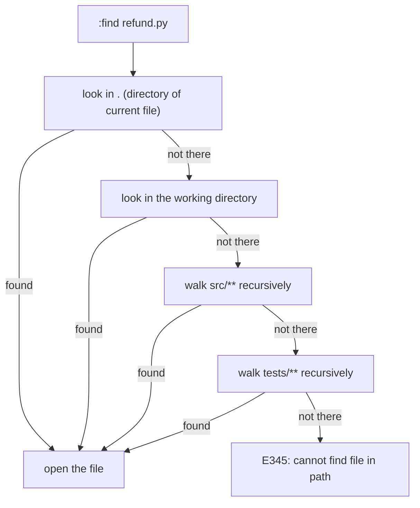

# Opening files and saving them

> **Before this lesson:** read [command-line mode](#/lesson/vim/vim-command-line) and [buffers](#/lesson/vim/vim-buffers). Paths and directories are explained from the start.

## In plain words

Files live in **directories** (also called folders), and directories live inside other directories. The route to a file through that tree is its **path**, for example `src/billing/invoice.py`: inside `src`, inside `billing`, the file `invoice.py`.

Finding a file is like finding a book in a library. Sometimes you know the exact shelf (the path). Sometimes you know only the title and ask the catalogue to locate it (the name). Sometimes you wander along a shelf and look (browsing). Vim has a command for each: `:edit`, `:find`, and the built-in file explorer.

Saving has its own snags, and this lesson covers the two most common: the directory you want to save into does not exist yet, and the file belongs to the system administrator, so you are not allowed to change it.

Why it matters for a job: in a real project a file can be six directories deep. Opening the neighbour of the file you are in, or a file whose name you remember but whose location you do not, should take seconds.

`<Tab>` below is the Tab key, which completes names for you; `<CR>` is Enter.

Getting a file onto the screen sounds too basic to need a lesson. Yet in a real project it is where a lot of time leaks away: typing `src/services/billing/handlers/` for the tenth time, hunting through a tree for a file whose name you know perfectly well, or discovering at save time that the directory does not exist or that you lack permission.

Vim offers three ways to open a file, each suited to a different amount of knowledge about where it is:

| You know… | Use | Idea |
|---|---|---|
| the path | `:edit` | type it, with completion and shortcuts for "next to the current file" |
| only the name | `:find` | let Vim search a configured set of directories |
| roughly where it is | the file explorer | browse a directory listing |

The second half of the lesson covers the saving side: the family of write commands, and two awkward moments, saving into a directory that does not exist yet and saving a file you do not have permission to write.

## `:edit` and the working directory

`:edit {path}` (short form `:e`) loads a file into a buffer. A relative path is resolved against Vim's **working directory**, which is the directory you started Vim from unless you change it.

| Command | Meaning |
|---|---|
| `:pwd` | print the working directory |
| `:cd {dir}` | change it for the whole session |
| `:lcd {dir}` | change it for the current window only |
| `:tcd {dir}` | change it for the current tab page only |
| `:cd -` | go back to the previous one |

`<Tab>` completes path components and `<C-d>` lists the candidates, so typing is usually a few letters per level: `:e s<Tab>se<Tab>b<Tab>`.

A sensible habit is to start Vim in the project root and leave the working directory there. Then every path you type, every `:grep`, and every shell command you run with `:!` is relative to the root, and paths in error messages and search results can be opened directly.

### Opening a neighbour: `%:h`

Deep in a tree, the file you want next is very often in the same directory as the one you are editing. Typing the whole path again from the root is wasteful, and changing the working directory breaks everything else. The answer is in Vim's file-name shorthand.

On the command line `%` stands for the path of the current buffer, and **modifiers** after a colon reshape it:

| Expression | Meaning | If the buffer is `src/billing/handlers/invoice.py` |
|---|---|---|
| `%` | the path as Vim knows it | `src/billing/handlers/invoice.py` |
| `%:h` | **h**ead: the directory part | `src/billing/handlers` |
| `%:t` | **t**ail: the file name | `invoice.py` |
| `%:r` | **r**oot: without the last extension | `src/billing/handlers/invoice` |
| `%:e` | **e**xtension | `py` |
| `%:p` | full absolute **p**ath | `/home/you/proj/src/billing/handlers/invoice.py` |
| `%:p:h` | absolute directory | `/home/you/proj/src/billing/handlers` |
| `%:t:r` | file name without extension | `invoice` |
| `#` | the alternate buffer's path | whatever you were in before |

So to open `refund.py` beside `invoice.py`:

| Keys typed | Command line shows |
|---|---|
| `:e %:h` | `:e %:h` |
| `<Tab>` | `:e src/billing/handlers/` |
| `refund.py<CR>` | `:e src/billing/handlers/refund.py` |

Pressing `<Tab>` right after `%:h` expands it in place, and from there completion continues as usual.

This is common enough to deserve a mapping. The following makes `%%` on the command line expand to the directory of the current file, slash included:

```vim
cnoremap <expr> %% getcmdtype() == ':' ? expand('%:h') . '/' : '%%'
```

Now `:e %%refund.py` is all it takes, and the same trick works with `:split`, `:vsplit`, `:tabedit`, `:read` and `:write`.

The modifiers are plain string operations, as this model shows:

```python-run
import posixpath

def expand(path, modifiers, cwd="/home/you/proj"):
    """Apply Vim-style file-name modifiers such as ':h', ':t:r', ':p:h' to a path."""
    for m in modifiers.split(":")[1:]:
        if m == "p":
            path = posixpath.normpath(posixpath.join(cwd, path))
        elif m == "h":
            path = posixpath.dirname(path) or "."
        elif m == "t":
            path = posixpath.basename(path)
        elif m == "r":
            head, tail = posixpath.split(path)
            path = posixpath.join(head, tail.rsplit(".", 1)[0]) if "." in tail[1:] else path
        elif m == "e":
            tail = posixpath.basename(path)
            path = tail.rsplit(".", 1)[1] if "." in tail[1:] else ""
    return path

cur = "src/billing/handlers/invoice.test.py"
for mods in ["", ":h", ":t", ":r", ":e", ":p", ":p:h", ":t:r", ":h:h", ":r:r"]:
    print(f"%{mods:<5} -> {expand(cur, mods)}")
```

Try a file with no directory part (`:h` gives `.`) and one with no extension.

## `:find`: open by name

When you know a file's name but not its location, `:find {name}` searches the directories listed in the `path` option and opens the first match. `<Tab>` completes against everything findable.

The default value of `path` is of little use in a project, so you set it:

```vim
set path=.,,src/**,tests/**,config/**
```

Each comma-separated entry is a place to look:

| Entry | Meaning |
|---|---|
| `.` | the directory of the current file |
| (empty, written as two commas `,,`) | the working directory |
| `src/**` | `src` and everything beneath it, to any depth |
| `/usr/include` | an absolute directory |

With that in place:

| Command | Effect |
|---|---|
| `:find invoice.py` | opens `src/billing/handlers/invoice.py` wherever it is under the listed trees |
| `:find inv<Tab>` | completes to matching names |
| `:sfind settings.toml` | the same, in a horizontal split |
| `:tabfind README.md` | the same, in a new tab page |
| `:find **/*refund*<Tab>` | glob patterns are allowed too |



Two cautions. If two files share a name, `:find` opens the first one it meets in `path` order; press `<Tab>` to see the alternatives before committing. And putting a bare `**` in `path` at the root of a large project makes every search walk dependency and build directories too. Keep the entries specific and tell Vim what to skip:

```vim
set wildignore+=*/node_modules/*,*/.git/*,*/dist/*,*.pyc
```

`path` is also what the `gf` command ("go to file under the cursor") uses, which a later lesson covers. Fuzzy-finder plugins have become the popular way to open files by name; `:find` with a good `path` is the built-in version that works everywhere, including on a server with no plugins.

## Browsing: the built-in file explorer

Sometimes you do not know the name either and need to look around. Opening a **directory** instead of a file gives you a listing you can navigate. The plugin that provides it ships with Vim and is called *netrw*; it needs `filetype plugin on`, which every reasonable configuration includes.

| Command | Opens a listing of |
|---|---|
| `vim .` (from the shell) | the working directory |
| `:edit .` or `:e.` | the working directory |
| `:Explore` or `:E` | the directory of the current file |
| `:Sexplore` / `:Vexplore` | the same in a horizontal / vertical split |
| `:Lexplore` | a persistent listing in a narrow window on the left |
| `:Rexplore` | return to the explorer you last used |

Inside the listing the cursor moves like in any buffer, and searching with `/` is the fastest way to reach a name.

| Key | Action |
|---|---|
| `<CR>` | open the file or enter the directory under the cursor |
| `-` | go up to the parent directory |
| `o` / `v` / `t` | open in a horizontal split / vertical split / new tab |
| `%` | create a new file here (prompts for the name) |
| `d` | create a directory |
| `R` | rename |
| `D` | delete |
| `i` | cycle through listing styles (thin, long, wide, tree) |
| `gh` | toggle display of dot-files |
| `<C-^>` | back to the buffer you came from |

The important conceptual point: the explorer is **a buffer shown in the current window**, not a permanent sidebar. You call it up, pick something, and it is replaced by the file. That plays well with splits: each window can browse independently. If you prefer the project-drawer style, `:Lexplore` or a tree plugin provides it, but try the in-place style for a week first; `:E`, a search, `<CR>` is very quick.

netrw also reads and writes over the network. `:e scp://deploy@web01//etc/nginx/nginx.conf` fetches the file with `scp`, lets you edit it locally and uploads it again on `:write`. The *everyday engineering* module returns to remote editing.

## The write commands

| Command | Effect |
|---|---|
| `:write` (`:w`) | write the buffer to its file |
| `:update` (`:up`) | write only if the buffer has been modified |
| `:write {name}` | write a **copy** to `{name}`; you keep editing the original buffer |
| `:saveas {name}` (`:sav`) | write to `{name}` and switch to editing that file |
| `:{range}write {name}` | write only those lines to `{name}` |
| `:{range}write >> {name}` | append those lines to `{name}` |
| `:file {name}` | rename the buffer without writing anything |
| `:wq` | write and close the window |
| `:x` or `ZZ` | like `:wq`, but writes only if modified |
| `:q!` or `ZQ` | close and discard changes |
| `:edit!` | reload from disk, discarding changes |
| `:wall` | write every modified buffer |

The difference between `:write {name}` and `:saveas {name}` catches people regularly:

| Buffer before | Command | Buffer after | Files written |
|---|---|---|---|
| `draft.md` | `:write final.md` | still `draft.md` | `final.md` |
| `draft.md` | `:saveas final.md` | `final.md` (with `draft.md` as the alternate) | `final.md` |

`:update` is the right command for mappings and for `:argdo`, because it leaves the timestamps of unmodified files alone, which matters to build tools that watch for changes.

## Saving into a directory that does not exist

`:edit` accepts a path whose directories have not been created. The buffer opens and you can type, but the write fails:

```text
:edit docs/adr/0007-queue-choice.md
"docs/adr/0007-queue-choice.md" [New DIRECTORY]
...
:write
E212: Can't open file for writing
```

Create the directory from inside Vim, using the `%:h` shorthand from earlier, and write again:

| Step | Command | Effect |
|---|---|---|
| 1 | `:!mkdir -p %:h` | runs `mkdir -p docs/adr` |
| 2 | `:write` | succeeds |

`-p` makes `mkdir` create all missing parents and stay quiet if they already exist. Recent versions have this built in: `:write ++p` creates the parent directories as part of the write (Vim 9 and Neovim 0.8 onwards).

## Saving a file you are not allowed to write

You opened a system configuration file as an ordinary user, made your edits, and `:write` reports that the file is read-only or permission is denied. Quitting and starting again under `sudo` would lose the changes. Instead:

```vim
:write !sudo tee % > /dev/null
```

Taken apart:

| Piece | Role |
|---|---|
| `:write !{cmd}` | send the buffer's text to the standard input of a shell command (it does **not** write a file) |
| `sudo tee %` | `tee` copies its input to the named file; `%` is the current file's path; `sudo` runs it with elevated rights |
| `> /dev/null` | discard `tee`'s second copy of the text, which would otherwise be echoed back |

After the password prompt Vim notices that the file changed on disk behind its back and asks whether to **L**oad it. Choose load: the file and buffer now agree and the "modified" flag clears.

This relies on `sudo` being able to prompt for a password through Vim's shell escape. It works in terminal Vim. In Neovim and in some GUI builds the prompt cannot reach you; there, use a small plugin written for the purpose, or open system files with `sudoedit {file}` (also spelled `sudo -e`) in the first place, which edits a temporary copy with your own configuration and installs it on exit.

## Why it works

The three opening methods map onto how much the editor has to work out for you. `:edit` trusts you completely. `:find` searches a list you configured once. The explorer shows you what is there. None of them is "the right one"; fluent users switch between them without thinking, and add a fuzzy finder as a fourth.

On the saving side, the central idea from the buffers lesson explains every command: the buffer is the thing you edit, and a file is only where it happens to be written. `:write {name}` writes the text somewhere else without changing which buffer you are in; `:saveas` re-points the buffer; `:write !cmd` does not involve a file at all, it pours the text into a pipe. The `sudo tee` idiom is nothing more than that last form with a program on the other end that is allowed to write where you are not.

> [!TIP]
> Add the `%%` mapping and a project-specific `path` to your configuration this week. Together they remove most of the typing from opening files, with no plugin involved.

> [!INTERVIEW]
> "You are on a production box, you have edited `/etc/hosts` in Vim and the write fails with a permissions error. What do you do?" is a favourite operations question. `:w !sudo tee % > /dev/null` is the expected answer; explaining each piece, and mentioning `sudoedit` as the cleaner approach next time, is what distinguishes understanding from recall.

## Pitfalls

- **`:e` with a relative path uses the working directory, not the current file's directory.** Use `%:h` (or the `%%` mapping) for neighbours.
- **`set autochdir` "solves" that by changing directory on every buffer switch,** and breaks plugins, `:grep`, and any path printed by a tool run from the project root. Prefer `%:h`.
- **`:find` opens the first match silently.** With duplicate names, tab-complete first.
- **A bare `**` in `path` is slow in big trees.** Name the source directories.
- **`:write {name}` does not switch buffers.** If you keep typing, you are still editing the original.
- **`:w !sudo tee %` with a space in the wrong place**: `:w! sudo` would try to write a file called `sudo`. The space comes *before* the `!`.
- **netrw deletes immediately.** `D` asks for confirmation but there is no trash.
- **`:x` and `:wq` differ subtly.** `:wq` always writes (changing the modification time); `:x` and `ZZ` write only if the buffer changed.

## Cheat sheet

| Task | Command |
|---|---|
| Open by path | `:e path/to/file` |
| Open a file beside the current one | `:e %:h<Tab>` or `:e %%name` |
| Show / change working directory | `:pwd` / `:cd dir` |
| Open by name | `:find name<Tab>` |
| Configure where `:find` looks | `:set path+=src/**` |
| Ignore build and vendor directories | `:set wildignore+=*/node_modules/*` |
| Browse the current file's directory | `:E` |
| Browse the working directory | `:e.` |
| Up one level in the explorer | `-` |
| Save / save if changed | `:w` / `:up` |
| Save a copy / save as | `:w other` / `:sav other` |
| Create missing directories, then save | `:!mkdir -p %:h` then `:w` (or `:w ++p`) |
| Save with root permissions | `:w !sudo tee % > /dev/null` |
| Reload from disk | `:e!` |
| Save and close / close without saving | `ZZ` / `ZQ` |

## Summary

- `:edit` opens by path, relative to the working directory; `%:h` expands to the current file's directory, so neighbours are a few keystrokes away.
- File-name modifiers (`:h`, `:t`, `:r`, `:e`, `:p`) can be chained and work anywhere a file name is expected, including in shell commands.
- `:find` opens by name using the `path` option; give `path` specific recursive entries and use `wildignore` to exclude noise.
- Opening a directory shows the built-in explorer: `<CR>` opens, `-` goes up, and the listing is one more buffer in the current window.
- `:write {name}` saves a copy; `:saveas` switches to the new name; `:update` writes only when needed.
- Missing parent directories: `:!mkdir -p %:h` or `:write ++p`. Missing permission: `:w !sudo tee % > /dev/null`, or `sudoedit` from the start.

## Glossary

| Term | Meaning |
|---|---|
| directory (folder) | a container for files and other directories |
| path | the route to a file through the directory tree |
| relative path | a path that starts from the working directory |
| absolute path | a path that starts from the top of the file system |
| working directory | the directory Vim treats as 'here'; shown by `:pwd` |
| file-name modifier | a suffix such as `:h` or `:t` that reshapes a file name: `%:h` is the current file's directory |
| `path` option | the list of directories that `:find` and `gf` search |
| recursive | including all directories beneath a directory, to any depth |
| file explorer (netrw) | Vim's built-in directory browser |
| write | Vim's word for saving a buffer to a file |
| permission | the operating system's rule about who may read or change a file |
| `sudo` | a program that runs a command with administrator rights |
| pipe | a connection that feeds one program's output into another program |

## Check yourself

```quiz
[
  {"q": "The current buffer is lib/net/http.rb and the working directory is the project root. Which command line opens lib/net/tcp.rb with the least typing?",
   "options": [":e tcp.rb", ":e %:h<Tab>tcp.rb", ":e %:t/tcp.rb", ":find %/tcp.rb"],
   "answer": 1,
   "explain": "%:h is the directory of the current file; pressing Tab expands it to lib/net/ and the file name follows. :e tcp.rb would look in the project root."},
  {"q": "If % is src/api/user.test.ts, what is %:t:r ?",
   "options": ["src/api/user.test", "user.test", "user", "ts"],
   "answer": 1,
   "explain": ":t takes the file name user.test.ts and :r removes only the last extension, leaving user.test."},
  {"q": "Which setting makes :find search src and all of its sub-directories?",
   "options": ["set path+=src", "set path+=src/**", "set wildignore+=src/**", "set find=src"],
   "answer": 1,
   "explain": "Two stars after a directory in the path option mean 'and everything beneath it'."},
  {"q": "In the built-in file explorer, which key moves up to the parent directory?",
   "options": ["u", "-", "h", "<BS>"],
   "answer": 1,
   "explain": "The minus key goes up one level; Enter opens the entry under the cursor."},
  {"q": "You are editing draft.txt and run :write final.txt. Which buffer are you editing afterwards?",
   "options": ["final.txt", "draft.txt", "Both, in a split", "A new unnamed buffer"],
   "answer": 1,
   "explain": ":write with a name saves a copy and leaves you in the original buffer. :saveas would switch to the new name."},
  {"q": ":write fails with E212 because the parent directory does not exist. Which command fixes that from inside Vim?",
   "options": [":!mkdir -p %:h", ":!mkdir %", ":cd %:h", ":e!"],
   "answer": 0,
   "explain": "%:h expands to the directory part of the current file's path, and mkdir -p creates every missing level. Then :write succeeds."},
  {"q": "In :w !sudo tee % > /dev/null, what does the part ':w !' do?",
   "options": ["Forces the write, overriding read-only", "Pipes the buffer contents to the standard input of the shell command that follows", "Writes a file named sudo", "Runs the command and inserts its output into the buffer"],
   "answer": 1,
   "explain": "With a space before the bang, :write sends the buffer to a command instead of to a file. tee then writes it to the file with root rights."},
  {"q": "What is the practical difference between :x and :wq ?",
   "options": ["None at all", ":x writes only if the buffer was modified; :wq always writes", ":x discards changes", ":wq works on all buffers"],
   "answer": 1,
   "explain": "Both save and close, but :x (and ZZ) skip the write when nothing changed, leaving the file's modification time alone."}
]
```

> **Source:** Neil, Practical Vim 2e, tips 42–46 (ch. 7, "Open Files and Save Them to Disk"). Examples and wording are original.
