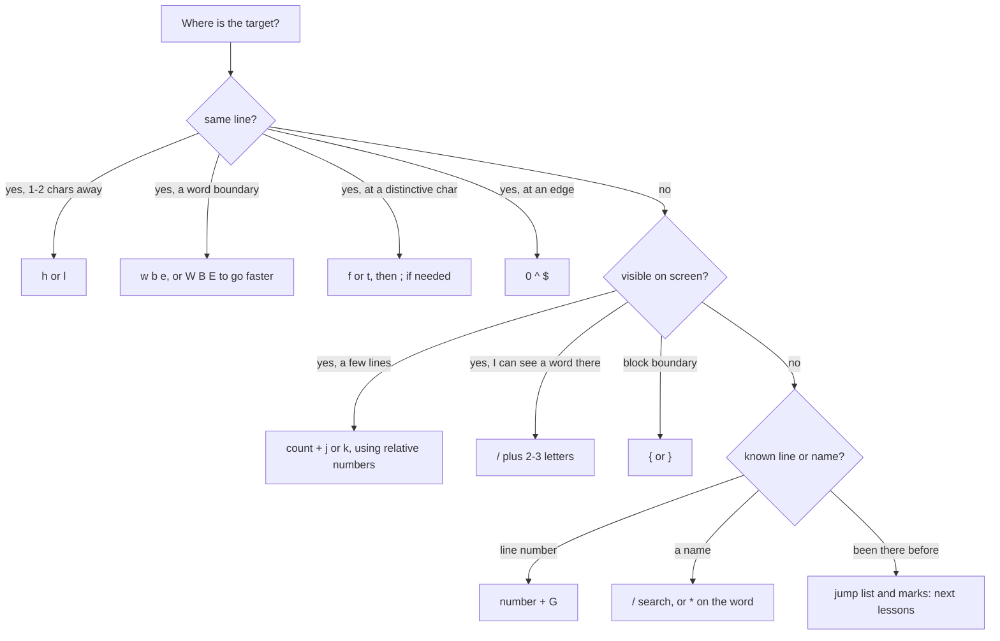

# Motions: getting to the right place in few keys

> **Before this lesson:** read [Normal mode and its grammar](#/lesson/vim/vim-normal-grammar), where operators and motions are introduced.

## In plain words

A **motion** is a command that moves the cursor. `l` moves one character to the right; `w` moves to the start of the next word; `G` moves to the last line of the file.

Think of giving directions. "Take forty steps forward" works, but "walk to the post box" is quicker to say and impossible to miscount. Arrow keys are the forty steps. Vim's motions are the landmarks: the next word, the comma, the closing bracket, line 120, the next line that contains a certain word.

Why it matters for a job: before you can change anything you have to get the cursor there, and in ordinary editing far more keys go on moving than on changing. Motions also do double duty: typed after an operator they say *what* to change. `w` moves over a word, so `dw` deletes a word.

Column and line positions in this lesson are counted from 0 for columns (the first character of a line is column 0) and from 1 for lines.

Editing is mostly travelling. Before any change can happen the cursor has to be on the right character, and in an untrained session the bulk of the keystrokes are `j j j j l l l l l`. Vim's answer is a large vocabulary of **motions**: each one names a destination ("the next word", "the comma", "the closing bracket", "line 120", "the next line containing `def`") so that the editor does the counting.

Motions matter twice. On their own they move the cursor. After an operator they define what the operator acts on: `w` moves a word, `dw` deletes one. Every motion in this lesson is therefore also a way of selecting text to change, and choosing the right motion is the same skill as choosing the right edit.

`[x]` marks the cursor. Column numbers start at 0.

## Stop pressing the arrow keys

`h`, `j`, `k` and `l` move left, down, up and right. They sit under the right hand's resting position, which is their whole point: you can move without your hand leaving the place where every other command lives.

But do not replace "hold the down arrow" with "hold `j`". The character and line steps are for the last one or two positions. For anything further, a motion that names the destination is both quicker and, crucially, **repeatable as part of a change**. If you notice yourself pressing `l` more than twice, a word motion or a character search would have been better; more than two `j`s, a search, a line number or a paragraph jump.

A blunt but effective training aid is to disable the arrow keys in Normal mode for a few weeks:

```vim
noremap <Up> <Nop>
noremap <Down> <Nop>
noremap <Left> <Nop>
noremap <Right> <Nop>
```

## Along a line

| Key | Goes to |
|---|---|
| `0` | column 0 |
| `^` | the first non-blank character |
| `$` | the last character |
| `g_` | the last non-blank character |
| `{n}` followed by the bar key | screen column `n` |
| `+` / `-` | first non-blank of the next / previous line |

`^` is what you nearly always want in indented code; `0` is for when the indent itself is the target.

### Real lines and display lines

When a long line wraps on screen it is still one line in the file. `j` and `k` move by **real** lines, so on a wrapped paragraph one press can jump several screen rows. Prefix a motion with `g` to make it work on **display** lines instead.

| Real line | Display line | Meaning |
|---|---|---|
| `j` / `k` | `gj` / `gk` | down / up one line |
| `0` | `g0` | first column |
| `^` | `g^` | first non-blank |
| `$` | `g$` | last column |

When editing prose with wrapping on, many people swap the pairs with mappings so that `j` and `k` follow what the eye sees. For code, where long lines are rare, the defaults are fine.

## Word by word

Vim has two definitions of a word.

- A **word** is a run of letters, digits and underscores, *or* a run of other non-blank characters. Punctuation separates words and forms words of its own.
- A **WORD** is any run of non-blank characters. Only white space separates WORDs.

| Lower case (word) | Upper case (WORD) | Goes to |
|---|---|---|
| `w` | `W` | start of the next one |
| `b` | `B` | start of the current or previous one |
| `e` | `E` | end of the current or next one |
| `ge` | `gE` | end of the previous one |

Take this line of 33 characters (columns 0 to 32). For orientation: `retry_max` starts at column 4, `=` is at 14, `env` starts at 16, `RETRY` at 21, `or` at 29 and the `3` is at 32.

```text
cfg.retry_max = env["RETRY"] or 3
```

Starting from column 0, here is where each motion stops on successive presses:

| Motion | Stops at columns | Characters under the cursor |
|---|---|---|
| `w` | 3, 4, 14, 16, 19, 21, 26, 29, 32 | `.` `r` `=` `e` `[` `R` `"` `o` `3` |
| `W` | 14, 16, 29, 32 | `=` `e` `o` `3` |
| `e` | 2, 3, 12, 14, 18, 20, 25, 27, 30, 32 | `g` `.` `x` `=` `v` `"` `Y` `]` `r` `3` |
| `E` | 12, 14, 27, 30, 32 | `x` `=` `]` `r` `3` |

And backwards from column 32:

| Motion | Stops at columns |
|---|---|
| `b` | 29, 26, 21, 19, 16, 14, 4, 3, 0 |
| `B` | 29, 16, 14, 0 |
| `ge` | 30, 27, 25, 20, 18, 14, 12, 3, 2 |

Nine presses of `w` against four of `W`: in code full of dots, brackets and quotes, the WORD motions cover ground much faster, while the word motions give precision. Use `W` to travel and `w`, `e`, `b` to land.

You can check any of these with the model below. It classifies characters exactly as described and lists every stop.

```python-run
def cls(ch, big):
    if ch in " \t":
        return 0
    if big:
        return 1
    return 1 if (ch.isalnum() or ch == "_") else 2

def stops(line, motion, start):
    big, m, n = motion.isupper(), motion.lower(), len(line)
    out, col = [], start
    while True:
        i = col
        if m == "w":
            t = cls(line[i], big)
            while i < n and t and cls(line[i], big) == t: i += 1
            while i < n and cls(line[i], big) == 0: i += 1
            if i >= n: break
        elif m == "e":
            i += 1
            while i < n and cls(line[i], big) == 0: i += 1
            if i >= n: break
            t = cls(line[i], big)
            while i + 1 < n and cls(line[i + 1], big) == t: i += 1
        else:  # b
            i -= 1
            while i >= 0 and cls(line[i], big) == 0: i -= 1
            if i < 0: break
            t = cls(line[i], big)
            while i - 1 >= 0 and cls(line[i - 1], big) == t: i -= 1
        col = i
        out.append(col)
    return out

line = 'cfg.retry_max = env["RETRY"] or 3'
for motion, start in [("w", 0), ("W", 0), ("e", 0), ("E", 0), ("b", 32), ("B", 32)]:
    print(f"{motion} from {start:>2}: {stops(line, motion, start)}")
```

### Two idioms built from word motions

| Goal | Keys | Why |
|---|---|---|
| Append to the end of the current word | `ea` | `e` goes to the last letter, `a` appends after it |
| Append to the end of the previous word | `gea` | the same with `ge` |

| Before | Keys | After |
|---|---|---|
| `fetch the [u]ser record` | `eas<Esc>` | `fetch the user[s] record` |
| `fetch the user [r]ecord` | `geas<Esc>` | `fetch the user[s] record` |

## Find a character on the line

The character searches are the most precise way to move within a line.

| Key | Goes |
|---|---|
| `f{c}` | forward **onto** the next `c` |
| `t{c}` | forward **till** right before the next `c` |
| `F{c}` | backward onto the previous `c` |
| `T{c}` | backward till right after the previous `c` |
| `;` | repeat the last of these in the same direction |
| `,` | repeat it in the opposite direction |

Line used below. For reference: the first `=` is at column 5, `(` at 17, `url` starts at 18, the commas are at 21 and 32, the other `=` signs at 30 and 41, and `)` is the last character, column 43.

```text
resp = client.get(url, timeout=5, retries=2)
```

| Cursor before | Keys | Cursor after | On |
|---|---|---|---|
| 0 | `f(` | 17 | `(` |
| 0 | `f,` | 21 | first `,` |
| 21 | `;` | 32 | second `,` |
| 32 | `,` | 21 | back to the first |
| 0 | `t)` | 42 | the `2` before `)` |
| 43 | `F=` | 41 | last `=` |
| 41 | `;` | 30 | `=` after `timeout` |
| 30 | `;` | 5 | first `=` |
| 18 | `tx` | 18 | no `x` to the right: the cursor does not move |

Pick targets that are **rare on the line**. Searching for `e` in English text or for a space in code means several presses of `;`. Punctuation, capitals and uncommon letters (`q`, `x`, `z`, `j`, `k`) usually hit first time.

Combined with operators, `f` and `t` describe "up to that thing" exactly:

| Before | Keys | After |
|---|---|---|
| `resp = client.get([u]rl, timeout=5, retries=2)` | `dt,` | `resp = client.get([,] timeout=5, retries=2)` |
| `resp = client.get([u]rl, timeout=5, retries=2)` | `df,` | `resp = client.get([ ]timeout=5, retries=2)` |
| `resp = client.get([u]rl, timeout=5, retries=2)` | `ct)req<Esc>` | `resp = client.get(re[q])` |
| `[r]esp = client.get(url, timeout=5, retries=2)` | `f(dT=` | `resp =[(]url, timeout=5, retries=2)` |

`t` is the natural partner for `d` and `c` (you usually want to keep the delimiter), `f` for plain movement.

## Search as a motion

`/pattern<CR>` moves to the next match anywhere in the file, and it works after an operator and in Visual mode like any other motion. It is the long-range equivalent of `f`: two or three characters are normally enough to identify the destination uniquely.

| Before | Keys | After |
|---|---|---|
| `resp = client.get([u]rl, timeout=5, retries=2)` | `d/tim<CR>` | `resp = client.get([t]imeout=5, retries=2)` |
| cursor on line 3, the word `Returns` appears on line 9 | `d/Returns<CR>` | everything from the cursor up to, but not including, `Returns` is deleted |
| (any) | `v/end<CR>` | selection grows to the `e` of the next `end` |

A search motion is exclusive: the match itself survives. That makes "delete from here up to that word" a single, repeatable command: after `d/tim<CR>`, pressing `.` elsewhere deletes up to the next `tim` again.

## Up and down the file

| Key | Goes to |
|---|---|
| `gg` / `G` | first / last line |
| `{n}G` or `:{n}<CR>` | line `n` |
| `{n}%` | `n` percent of the way through the file |
| `{` / `}` | previous / next blank line (paragraph boundary) |
| `(` / `)` | previous / next sentence |
| `[[` / `]]` | previous / next section, in code usually a top-level `{` in column 0 |
| `[m` / `]m` | previous / next start of a method (in languages with brace-delimited methods) |
| `H` / `M` / `L` | top / middle / bottom line **of the window** |
| `<C-d>` / `<C-u>` | scroll down / up half a screen |
| `<C-f>` / `<C-b>` | scroll forward / back a full screen |
| `%` | the bracket matching the one under (or after) the cursor |

In code, blank lines separate logical blocks, so `}` and `{` hop from block to block and make excellent operator targets: `d}` deletes to the end of the block, `y}` copies it, `>}` indents it.

With `set relativenumber` the margin shows each line's distance from the cursor, which turns vertical movement into reading a number: the line you want says `7`, so `7j`; to delete down to it, `d7j`.

### Moving the view, not the cursor

These do not move the cursor in the text; they reposition the window around it.

| Key | Effect |
|---|---|
| `zz` | put the cursor line in the middle of the window |
| `zt` | put it at the top |
| `zb` | put it at the bottom |
| `<C-e>` / `<C-y>` | scroll the text one line up / down |

`zt` after jumping to a function definition shows as much of the body as possible; `zz` after a search gives context on both sides.

## Choosing a motion



The discipline is to pause for a fraction of a second and name the destination before pressing anything. That pause feels slow at first and is what eventually makes movement feel instantaneous.

## Why it works in terms of the grammar

A motion is a function from a cursor position to another position, tagged with two properties: whether it is character-wise or line-wise, and whether it is inclusive or exclusive. An operator takes the old and the new position and acts on what lies between, respecting those tags. Nothing else is needed, which is why every motion on this page combines with every operator without special cases (bar the famous `cw`).

The tags for this lesson's motions:

| Motions | Kind |
|---|---|
| `h` `l` `w` `b` `W` `B` `0` `^` `{` `}` `/pat` | character-wise, exclusive |
| `e` `E` `ge` `$` `f{c}` `t{c}` `%` | character-wise, inclusive (for `t`, inclusive of the character it stops on, which is the one before the target) |
| `j` `k` `gg` `G` `{n}G` `+` `-` `H` `M` `L` | line-wise |

So `d}` removes text up to the blank line but leaves the blank line; `dG` removes whole lines to the end of the file; `d%` on an opening bracket removes the whole bracketed group including both brackets.

> [!TIP]
> Drill one family per day in this site's editor with Vim mode on: a day of only `w`/`b`/`e`, a day of `f`/`t` with `;`, a day of `/` as a motion. Deliberately using a slightly awkward motion for a day is how it becomes the natural one.

> [!INTERVIEW]
> In a live coding session nobody is timing your cursor, but hesitant navigation is visible and eats thinking time. Three motions give the most return for interview-style code: `f`/`t` with a bracket or comma, `%` between matching brackets, and `/` plus two letters. They work identically in Vim, Neovim, and the Vim modes of VS Code and JetBrains IDEs.

## Pitfalls

- **`w` stops at punctuation.** In `user.profile.name`, three presses are needed to cross what looks like one name. Use `W` or `f` followed by a later character.
- **`;` repeats the last `f`/`t`/`F`/`T` of any kind,** including one you used inside an operator such as `dt,`.
- **A repeated `t` needs care in old Vim.** In current versions `;` after `t,` jumps to before the *next* comma; in strict vi-compatible mode it would stay put because the cursor is already "before a comma".
- **`f` and `t` never leave the line.** For a target on another line use `/`.
- **`$` with a count moves down**: `2$` is the end of the *next* line.
- **`G` with no count goes to the last line; `gg` to the first.** `1G` is also the first line. Both are jumps, recorded in the jump list, so `<C-o>` takes you back.
- **`}` stops at lines that are truly empty.** A line containing only spaces does not count as a paragraph boundary.
- **`H`, `M`, `L` are relative to the window,** so their destination changes when you scroll; they make poor components of a repeatable change.

## Cheat sheet

| Scope | Motions |
|---|---|
| Character | `h` `l` |
| Word | `w` `b` `e` `ge` |
| WORD | `W` `B` `E` `gE` |
| Line edges | `0` `^` `$` `g_` |
| Display lines | `gj` `gk` `g0` `g$` |
| Character search | `f{c}` `t{c}` `F{c}` `T{c}` `;` `,` |
| Pattern search | `/pat<CR>` `?pat<CR>` `n` `N` `*` `#` |
| Lines | `j` `k` `+` `-` `{n}G` `gg` `G` |
| Blocks | `{` `}` `(` `)` `[[` `]]` `%` |
| Screen | `H` `M` `L` `<C-d>` `<C-u>` `<C-f>` `<C-b>` |
| View only | `zz` `zt` `zb` `<C-e>` `<C-y>` |

## Summary

- Motions name destinations; they move the cursor and, after an operator, define the text acted on.
- Keep `hjkl` for the last step or two. Use word motions, character searches and pattern searches for everything else.
- words stop at punctuation; WORDs stop only at white space. Use the capital forms to travel quickly through code.
- `f`/`t` with `;` and `,` are the precision tools within a line; `t` pairs naturally with `d` and `c`.
- `/pattern` is a motion like any other and combines with operators.
- `g`-prefixed line motions work on display lines; `zz`, `zt` and `zb` move the view without moving the cursor.
- Each motion is character-wise or line-wise and inclusive or exclusive, and that alone determines what an operator does with it.

## Glossary

| Term | Meaning |
|---|---|
| motion | a command that moves the cursor |
| word | a run of letters, digits and underscores, or a run of other non-blank characters |
| WORD | any run of non-blank characters, delimited only by white space |
| white space (blank) | space and tab characters |
| real line / display line | a line of the file / one row of a line that wraps on screen |
| character search | `f`, `t`, `F`, `T` followed by a character: find it on the current line |
| pattern search | `/text` and Enter: find the next occurrence anywhere in the file |
| inclusive / exclusive | whether the character a motion lands on is included in an operator's range |
| line-wise motion | a motion that makes an operator act on whole lines, such as `j` or `G` |
| jump | a long-distance motion whose starting point Vim remembers |
| scrolling | moving the view of the text without, or together with, the cursor |
| relative line numbers | a display option showing each line's distance from the cursor |

## Check yourself

```quiz
[
  {"q": "Line: 'user.address.city = input()' with the cursor on the first character. How many presses of w are needed to reach the '=' sign?",
   "options": ["1", "3", "5", "6"],
   "answer": 2,
   "explain": "w stops at: the first dot, 'address', the second dot, 'city', and then '='. That is five presses. A single W would do it."},
  {"q": "Line: 'call(alpha, beta, gamma)' with the cursor on c. Which keys put the cursor on the second comma?",
   "options": ["f,,", "f,;", "2t,", "t,;"],
   "answer": 1,
   "explain": "f, lands on the first comma and ; repeats the search to the second. The , key would search backwards, and the t forms stop one column before a comma."},
  {"q": "Line: 'print(first, second)' with the cursor on the f of first. Which keystrokes produce 'print(, second)'?",
   "options": ["df,", "dt,", "dw,", "d$"],
   "answer": 1,
   "explain": "t, stops right before the comma, so the comma survives. df, would delete it too."},
  {"q": "A paragraph in a text file is wrapped across four screen rows but is a single line in the file. Which key moves the cursor down one screen row?",
   "options": ["j", "gj", "+", "<C-e>"],
   "answer": 1,
   "explain": "j moves by real lines and would leave the paragraph. gj moves by display lines."},
  {"q": "The cursor is on 'x' in 'x = compute(a, b)  # note'. Which keystrokes delete everything from the cursor up to, but not including, the '#'?",
   "options": ["d/#<CR>", "df#", "d$", "dW"],
   "answer": 0,
   "explain": "A search used as a motion is exclusive: the match itself is kept. dt# would work as well. df# would delete the # too."},
  {"q": "What does zt do?",
   "options": ["Jumps to the top of the file", "Scrolls so that the cursor line is at the top of the window, without moving the cursor in the text", "Moves the cursor to the top line of the window", "Toggles a fold"],
   "answer": 1,
   "explain": "The z-commands zt, zz and zb reposition the view around the cursor line. H is the motion that moves the cursor to the top of the window."},
  {"q": "With the cursor on an opening parenthesis, what does d% delete?",
   "options": ["Only the parenthesis", "Everything from that parenthesis through its matching closing parenthesis", "The rest of the line", "Nothing; % is not a motion"],
   "answer": 1,
   "explain": "% is an inclusive character-wise motion to the matching bracket, so both brackets and everything between them are removed."},
  {"q": "Which motion is line-wise, so that an operator used with it always affects whole lines?",
   "options": ["}", "$", "j", "w"],
   "answer": 2,
   "explain": "j, k, G and gg are line-wise. The paragraph motion } is character-wise, which is why d} can leave part of a line behind."}
]
```

> **Source:** Neil, Practical Vim 2e, tips 47–51 (ch. 8, "Navigate Inside Files with Motions"). Examples and wording are original.
