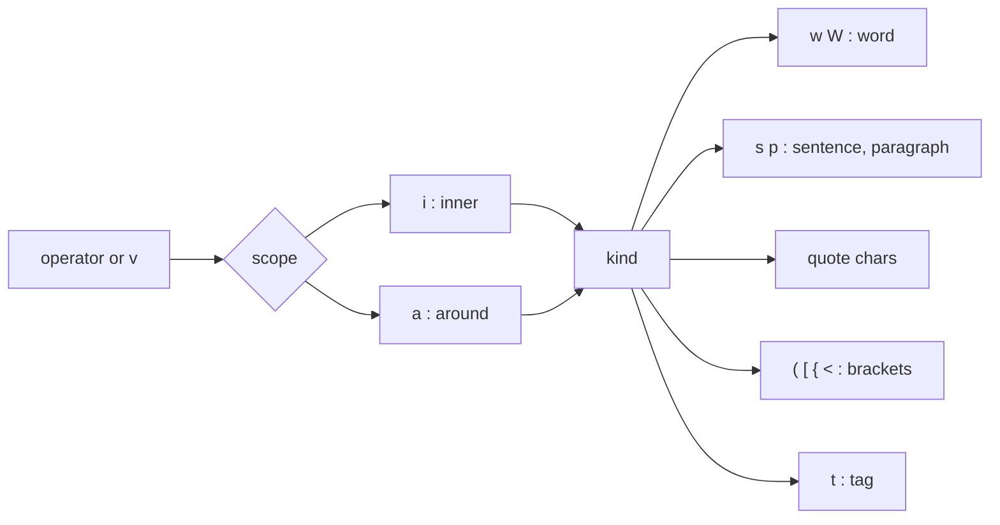

# Text objects, matching pairs and marks

> **Before this lesson:** read [motions](#/lesson/vim/vim-motions) and [Normal mode and its grammar](#/lesson/vim/vim-normal-grammar).

## In plain words

A **text object** is a name for a whole piece of text with a recognisable shape: a word, a sentence, the contents of a pair of quotation marks or brackets, a paragraph. You use it after an operator to say "do this to that whole thing", and it works wherever the cursor is inside the thing.

Compare two ways of asking a colleague to edit a printed page. "Cross out from the fourth letter to the eleventh" requires counting. "Cross out this word" does not; you point anywhere at the word. Text objects are the second way.

The lesson also covers two helpers for precise movement. The `%` key jumps between a bracket and its partner. A **mark** is a bookmark: you name a position with a letter and can return to it later.

Why it matters for a job: code is full of structures inside structures, arguments inside parentheses, text inside quotes, blocks inside braces. "Change what is inside these quotes" is one of the most frequent edits there is, and `ci"` does it in three keys from any position in the string.

A motion describes a stretch of text by its far end: "from here to the comma". That works when the cursor is at one edge of what you want. Very often it is not: you are somewhere in the middle of a string, an argument list or a paragraph, and you want *the whole thing*. Moving to its start first costs keys, and worse, it splits the edit into a movement plus a change, so the dot command can no longer replay it elsewhere.

**Text objects** fix this. A text object names a structure, such as a word, a quoted string, a bracketed group, an HTML element or a paragraph, and selects all of it from **wherever the cursor is inside it**. `ci"` means "change what is inside the quotes" and works from any character of the string. This single idea is the reason many people keep Vim key bindings turned on in every editor they use.

The second half of the lesson covers two smaller tools for precise movement: `%`, which jumps between matching brackets, and marks, which let you name a position and return to it.

`[x]` marks the cursor.

## The shape of a text object

A text object is two keys: `i` or `a`, then a letter or symbol saying which structure.

- `i` = **inner**: the contents only.
- `a` = **a / around**: the contents plus the delimiters, or plus adjoining white space.

They are valid only after an operator or in Visual mode. In plain Normal mode `i` and `a` would enter Insert mode.

### Delimited objects

| Inner | Around | Structure | Alias |
|---|---|---|---|
| `i(` or `i)` | `a(` or `a)` | parentheses | `ib` / `ab` |
| `i{` or `i}` | `a{` or `a}` | braces | `iB` / `aB` |
| `i[` or `i]` | `a[` or `a]` | square brackets | |
| `i<` or `i>` | `a<` or `a>` | angle brackets | |
| `i"` | `a"` | double-quoted string | |
| `i'` | `a'` | single-quoted string | |
| `` i` `` | `` a` `` | backtick string | |
| `it` | `at` | XML/HTML element (between or including its tags) | |

### Bounded objects

| Inner | Around | Structure |
|---|---|---|
| `iw` | `aw` | word (plus one side's white space for `aw`) |
| `iW` | `aW` | WORD |
| `is` | `as` | sentence |
| `ip` | `ap` | paragraph (plus the following blank line for `ap`) |



## Worked examples on one line

The same starting line each time, cursor on the `w` of `world`:

`const msg = greet("Hello, [w]orld") + suffix;`

| Keys | Reads as | After |
|---|---|---|
| `diw` | delete inner word | `const msg = greet("Hello, ["]) + suffix;` |
| `daw` | delete a word | `const msg = greet("Hello,["]) + suffix;` |
| `di"` | delete inside quotes | `const msg = greet("["]) + suffix;` |
| `da"` | delete around quotes | `const msg = greet([)] + suffix;` |
| `ci"Bye<Esc>` | change inside quotes | `const msg = greet("By[e]") + suffix;` |
| `di(` | delete inside parentheses | `const msg = greet([)] + suffix;` |
| `da(` | delete around parentheses | `const msg = greet[ ]+ suffix;` |
| `yi(` | yank inside parentheses | unchanged; register holds `"Hello, world"` |
| `gUi"` | upper-case inside quotes | `const msg = greet("[H]ELLO, WORLD") + suffix;` |
| `vi"` | select inside quotes | `Hello, world` highlighted |

Look at `daw` in the second row. There is no space after `world` (a quote follows), so `aw` takes the space **before** it instead and the result is tidy: `"Hello,"`. With a space after the word it would take that one. `aw` exists so that deleting a word never leaves a double space or a dangling one.

## Nested structures

Bracket objects pick the innermost pair that encloses the cursor, and a count climbs outward.

`total = sum(map(parse, rows[1:]))`

| Cursor on | Keys | After |
|---|---|---|
| the `:` inside `[1:]` | `di[` | `total = sum(map(parse, rows[]))` |
| the `:` | `di(` | `total = sum(map())` |
| the `:` | `d2i(` | `total = sum()` |
| the `:` | `da(` | `total = sum(map)` |
| the `p` of `parse` | `ci(x<Esc>` | `total = sum(map(x))` |

When the cursor sits **on** a bracket, it counts as inside that pair. So with the cursor on the `(` after `map`, `di(` empties `map(...)`, not `sum(...)`.

## Tags

For markup, `it` and `at` treat an element as a unit. Cursor on the `l` of `milk`:

`<li class="todo">Buy <b>mi[l]k</b> today</li>`

| Keys | After |
|---|---|
| `dit` | `<li class="todo">Buy <b></b> today</li>` |
| `dat` | `<li class="todo">Buy  today</li>` |
| `citbread<Esc>` | `<li class="todo">Buy <b>bread</b> today</li>` |
| `d2it` | `<li class="todo"></li>` |
| `yat` | unchanged; register holds `<b>milk</b>` |

`cit` is the everyday one: put the cursor anywhere in an element's text and replace it.

## Paragraphs and sentences

In code a "paragraph" is a block of lines bounded by blank lines, which is very often one logical unit: a function, a group of imports, a test case.

| Keys | Effect |
|---|---|
| `dap` | delete the block and the blank line after it |
| `yap` | copy it, ready to paste as a new block |
| `vip` | select it (without the blank line), e.g. before `:sort` |
| `>ip` | indent it |
| `=ip` | re-indent it |
| `gqip` | re-wrap it to the text width (prose and comments) |
| `cis` | rewrite the current sentence |
| `das` | delete the sentence with its trailing space |

## The rule of thumb: delete around, change inside

| Operator | Usually wants | Because |
|---|---|---|
| `d` | the `a` form: `daw`, `da"`, `dap`, `dat` | removing something should also remove its delimiters or its spacing |
| `c` | the `i` form: `ciw`, `ci"`, `ci(`, `cit` | you are about to type a replacement and want the delimiters and spacing to stay |
| `y` | either: `yiw` for a name, `yap` for a block | depends on where it will be pasted |
| `v` | whichever, then adjust | |

## A resolver you can experiment with

This model finds bracket and quote objects on a single line using the same rules as Vim: innermost enclosing pair for brackets; for quotes, the pair around the cursor, or the first pair to the right if the cursor is before any quote.

```python-run
def bracket(line, col, op, cl):
    o = col if line[col] == op else -1
    depth, i = 0, col - 1
    while o < 0 and i >= 0:
        if line[i] == cl: depth += 1
        elif line[i] == op:
            if depth == 0: o = i
            else: depth -= 1
        i -= 1
    if o < 0: return None
    depth = 0
    for j in range(o + 1, len(line)):
        if line[j] == op: depth += 1
        elif line[j] == cl:
            if depth == 0: return o, j
            depth -= 1

def quote(line, col, q):
    if line[col] == q:
        opening = line.count(q, 0, col + 1) % 2 == 1
        o, c = (col, line.find(q, col + 1)) if opening else (line.rfind(q, 0, col), col)
    else:
        o = line.rfind(q, 0, col)
        if o >= 0: c = line.find(q, col + 1)
        else:
            o = line.find(q, col + 1); c = line.find(q, o + 1) if o >= 0 else -1
    return (o, c) if o >= 0 and c >= 0 else None

def show(line, col, obj):
    kind, ch = obj
    pair = quote(line, col, ch) if ch in "\"'" else bracket(line, col, *{"(": "()", "[": "[]", "{": "{}"}[ch])
    if not pair:
        return print(f"{obj} at {col:>2}: no such object here")
    o, c = pair
    s, e = (o + 1, c) if kind == "i" else (o, c + 1)
    print(f"{obj} at {col:>2}: {line[:s]}«{line[s:e]}»{line[e:]}")

line = 'log.warn(fmt("retry %d", n), tags=["net", "io"])'
for col, obj in [(15, 'i"'), (15, 'a"'), (15, "i("), (25, "i("), (0, 'i"'), (0, "i("), (36, "i["), (36, "a[")]:
    show(line, col, obj)
```

Notice the two rows that start at column 0. `i"` succeeds because quote objects look ahead along the line; `i(` fails because bracket objects in stock Vim require the cursor to be inside (or on) the pair.

## `%`: jump between partners

`%` moves from a bracket to its partner. If the cursor is not on a bracket, it first moves right to the next one on the line.

| Before | Keys | After |
|---|---|---|
| `if [(]a and (b or c)):` | `%` | `if (a and (b or c)[)]:` |
| `if (a and [(]b or c)):` | `%` | `if (a and (b or c[)]):` |
| `[r]un(x[0], y)` | `%` | `run(x[0], y[)]` |

It is an inclusive motion, so it combines with operators: `d%` on an opening bracket removes the whole group, `y%` copies it, `v%` selects it.

A classic small task is swapping one kind of bracket for another. Because `%` is a jump, the position you left is remembered and two backticks return to it:

| Before | Keys | After |
|---|---|---|
| `items = [(]1, 2, 3)` | `%` | `items = (1, 2, 3[)]` |
| | `r]` | `items = (1, 2, 3[]]` |
| | ` `` ` (two backticks) | `items = [(]1, 2, 3]` |
| | `r[` | `items = [[]1, 2, 3]` |

The bundled *matchit* plugin extends `%` to language keywords and tags, so it can jump between `if`/`else`/`end`, or between `<div>` and `</div>`. Enable it with one line in your configuration: `packadd! matchit` (Neovim loads it by default).

For changing or removing delimiters as a routine operation, the widely used *surround* plugin adds dedicated commands in the same grammatical style: `cs)]` changes surrounding parentheses to square brackets, `ds"` deletes surrounding quotes, `ysiw"` wraps a word in quotes. It is one of the few plugins that feel like part of the core language.

## Marks: named positions

A mark is a bookmark on a position in a buffer.

| Keys | Effect |
|---|---|
| `m{a-z}` | set a mark local to this buffer |
| `m{A-Z}` | set a global mark (it remembers the file too; next lesson) |
| `` `{mark} `` | jump to the exact line and column |
| `'{mark}` | jump to the first non-blank of the mark's line |
| `:marks` | list marks |
| `:delmarks a b` | delete marks |

The backtick form is nearly always what you want as a plain jump. The apostrophe form is line-wise, which matters with operators: `` d`a `` deletes character-wise up to the mark, `d'a` deletes whole lines.

The pattern is "mark, wander, snap back":

| Step | Keys | What happens |
|---|---|---|
| 1 | `mm` | remember this spot as mark `m` |
| 2 | `gg` then some reading and searching | you are now far away |
| 3 | `` `m `` | back to the exact character |

### Marks that Vim sets for you

You rarely need to set marks by hand, because Vim maintains several automatically:

| Mark | Position |
|---|---|
| ` `` ` | where the cursor was before the latest jump in this buffer |
| `` `. `` | where the last change was made |
| `` `^ `` | where Insert mode was last exited (`gi` uses this) |
| `` `[ `` and `` `] `` | start and end of the last changed or yanked text |
| `` `< `` and `` `> `` | start and end of the last Visual selection |
| `` `" `` | where the cursor was when this buffer was last closed |

Useful combinations:

| Keys | Effect |
|---|---|
| ` `` ` | toggle between two places (it is itself a jump, so pressing it again goes back) |
| `` `. `` | "where was I editing?" after scrolling around to read |
| `` `[v`] `` | select the text you pasted a moment ago |
| `` y`a `` | yank from the cursor to mark `a` |
| `:'a,'b d` | marks as an Ex range |

## Why it works in terms of the grammar

Motions and text objects fill the same slot after an operator, but they define the region differently. A motion gives one endpoint and the cursor supplies the other. A text object supplies **both** endpoints and ignores where exactly the cursor is, as long as it is inside. That is why an operator with a text object is the ideal unit for the dot command: `ci"…<Esc>` recorded once will rewrite any other string on any other line from any position within it.

It also explains why text objects cannot be used as plain movements: an object is a region, not a destination, so there is nowhere in particular for the cursor to go.

Marks, by contrast, *are* destinations, so `` `a `` and `'a` are motions like any other, one character-wise and one line-wise, and both work after operators.

> [!TIP]
> Four objects cover most code editing: `iw`, `i"`, `i(` and `ip`. Drill them with `c`, `d`, `y` and `v` until `ciw` and `ci"` need no thought, then add `it`, `i{` and `aw`.

> [!INTERVIEW]
> When someone asks for a concrete example of Vim's "composability", `ci"` is the one to show. Three keys, works from anywhere in the string, replays with `.`, and generalises instantly to `ci(`, `ci{`, `cit`, `yi"`, `da"`. The Vim emulations in VS Code and JetBrains IDEs support all of them.

## Pitfalls

- **Quote objects work on one line only,** and they decide which quotes pair up by counting from the start of the line. A stray apostrophe earlier on the line (as in `don't`) can throw `i'` off.
- **Bracket objects do not look ahead in stock Vim.** With the cursor before the parenthesis, `ci(` fails; `ci"` in the same situation works. Plugins such as *targets.vim* or *mini.ai* add seeking for brackets.
- **`i(` on multi-line blocks** selects everything between the brackets, across lines. For brace blocks, `i{` used on text that starts on a new line after `{` acts on whole lines, which is what you want for function bodies.
- **`it` needs well-formed markup** on the stretch involved; an unclosed tag leads to surprising selections.
- **`aw` is not symmetrical.** It takes trailing white space, or leading if there is none trailing; never both.
- **`'a` versus `` `a ``.** After an operator the first is line-wise. `d'a` can delete far more than you expected.
- **Lower-case marks are per buffer;** `` `a `` in another file refers to that file's own mark `a`.
- **Marks move with the text when lines are inserted or deleted above them, but a mark on a deleted line is gone.**

## Cheat sheet

| Goal | Keys |
|---|---|
| Change word under cursor | `ciw` |
| Delete word and tidy spacing | `daw` |
| Change string contents | `ci"` or `ci'` |
| Delete string with quotes | `da"` |
| Change function arguments | `ci(` |
| Delete a call's parentheses and arguments | `da(` |
| Change a block body | `ci{` |
| Change element text | `cit` |
| Delete an element | `dat` |
| Copy / delete a paragraph | `yap` / `dap` |
| Select and grow | `vi(` then `a(`, `i(` … |
| Jump to matching bracket | `%` |
| Set / jump to a mark | `ma` / `` `a `` |
| Back to where I was | ` `` ` |
| To the last change | `` `. `` |
| Select last pasted text | `` `[v`] `` |

## Summary

- A text object is `i` or `a` plus a kind, and selects a whole structure from anywhere inside it.
- Delimited objects cover brackets, quotes and tags; bounded objects cover words, sentences and paragraphs.
- Use `a` forms with `d` and `i` forms with `c` as a default.
- Bracket objects choose the innermost enclosing pair; a count goes outward. Quote objects look ahead on the line; bracket objects do not.
- `%` jumps between matching brackets and is an inclusive motion; *matchit* extends it to keywords and tags.
- `m{letter}` sets a mark; the backtick jumps to its exact position, the apostrophe to its line. Vim maintains automatic marks for the previous position, the last change, the last insert, and the last changed and selected regions.

## Glossary

| Term | Meaning |
|---|---|
| text object | a name for a whole structure, typed after an operator: `i` or `a` plus a kind |
| inner (`i`) | the contents of the structure only |
| around (`a`) | the contents plus the delimiters, or plus neighbouring white space |
| delimiter | a character that marks the start or end of something, such as a quote or a bracket |
| nested | one structure inside another of the same kind |
| tag | in HTML or XML, a marker such as `<b>` or `</b>`; an element is everything from an opening tag to its closing tag |
| paragraph | a block of lines bounded by blank lines |
| matching pair | an opening bracket and the closing bracket that belongs to it |
| mark | a named bookmark on a position in a buffer |
| automatic mark | a mark Vim maintains itself, such as the position of the last change |
| plugin | an add-on that gives Vim extra features |

## Check yourself

```quiz
[
  {"q": "Line: 'raise ValueError(\"bad [i]nput: \" + name)' with the cursor inside the string. Which keystrokes replace the string's contents with 'oops' and leave the quotes in place?",
   "options": ["ci\"oops<Esc>", "ca\"oops<Esc>", "cwoops<Esc>", "ci(oops<Esc>"],
   "answer": 0,
   "explain": "i\" is the inside of the quoted string. a\" would remove the quotes as well, cw would change only to the end of the word, and i( would replace the whole argument list."},
  {"q": "Line: 'send(to, build(a, [b]))' with the cursor on b. What does d2i( leave?",
   "options": ["send(to, build())", "send()", "send(to, )", "send"],
   "answer": 1,
   "explain": "Without a count, i( is the innermost pair (build's arguments). A count of 2 moves out one level to send's argument list."},
  {"q": "Cursor on 'k' in '<a href=\"#\">clic[k]</a> here'. Which keys produce ' here' (the whole link removed)?",
   "options": ["dit", "dat", "daw", "di<"],
   "answer": 1,
   "explain": "at is the element including its opening and closing tags. dit would leave an empty <a href=\"#\"></a>."},
  {"q": "Line: 'the quick brown [f]ox' (cursor on the last word, no trailing space). What does daw leave?",
   "options": ["'the quick brown '", "'the quick brown'", "'the quick'", "'the quick brownfox'"],
   "answer": 1,
   "explain": "aw normally takes the white space after the word; when there is none it takes the white space before it, so no trailing space is left behind."},
  {"q": "With the cursor at the start of the line 'x = compute(alpha, beta)', which command works in stock Vim?",
   "options": ["ci( because bracket objects look ahead", "ci\" because quote objects look ahead", "Neither: there is no string and the cursor is not inside the parentheses", "Both"],
   "answer": 2,
   "explain": "Quote objects do look ahead, but this line has no quotes. Bracket objects need the cursor inside or on the pair. Use f( first, or a plugin that adds seeking."},
  {"q": "You set a mark with ma on line 40, column 12, and later type d'a from line 55. What is deleted?",
   "options": ["From line 40 column 12 to the cursor, character-wise", "Lines 40 through 55, whole lines", "Only line 40", "Nothing; marks cannot be used with operators"],
   "answer": 1,
   "explain": "The apostrophe form is a line-wise motion. The backtick form d`a would delete character-wise between the two exact positions."},
  {"q": "Cursor on the opening parenthesis in 'f(x, y)'. Which sequence turns the parentheses into square brackets?",
   "options": ["%r]``r[", "r[%r]", "ci([", "d%i[]<Esc>"],
   "answer": 0,
   "explain": "Jump to the partner with %, replace it, return with two backticks, replace the opener. Replacing the opener first breaks the pair, so % can no longer find the closing parenthesis. The last two options destroy the contents."},
  {"q": "Which automatic mark takes you to the place where you last changed text?",
   "options": ["`.", "`^", "``", "`<"],
   "answer": 0,
   "explain": "Backtick-dot is the position of the last change. Backtick-caret is where Insert mode was last left, two backticks the position before the last jump, and backtick-< the start of the last Visual selection."}
]
```

> **Source:** Neil, Practical Vim 2e, tips 52–55 (ch. 8, "Navigate Inside Files with Motions"). Examples and wording are original.
