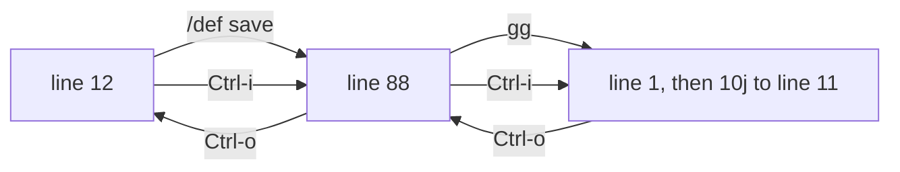

# Jumps: retracing your steps within and between files

> **Before this lesson:** read [motions](#/lesson/vim/vim-motions) and [text objects and marks](#/lesson/vim/vim-text-objects), and know what a [buffer](#/lesson/vim/vim-buffers) is.

## In plain words

When you explore, you need a way back. A web browser has Back and Forward buttons for the pages you visited. Vim keeps a similar history of the places your cursor has been, and a second history of the places where you changed text.

Think of leaving a trail of breadcrumbs on a walk. Each time you take a big leap, to another part of the file or to another file, Vim drops a crumb at the place you left. Two keys walk back and forward along the trail. These big leaps are called **jumps**, and the trail is the **jump list**.

Why it matters for a job: reading code means following references, from a call to the function it calls and on to the next, and then returning to where you started. If returning costs one key press, you explore freely; if it means searching for your place again, you avoid exploring. This lesson also shows how to open the file whose name is under the cursor, and how to bookmark places across files.

`<C-o>` below means "hold Ctrl and press `o`".

Reading code is not linear. You follow a call into another function, glance at a constant at the top of the file, search for a usage, open the module where something is defined, and then you want to be **back where you were**, with the same line under the cursor. Editors with a mouse give you "back" and "forward" buttons. Vim has the same thing on two chords, plus a second history that records where you *edited* rather than where you *looked*, a way to open the file whose name is under the cursor, and bookmarks that work across files.

Together these make it safe to wander. If going somewhere costs nothing to undo, you explore more freely, and that is most of what navigating a codebase is.

## What counts as a jump

Vim distinguishes small steps from **jumps**. A jump is a movement that is likely to take you far: Vim remembers where you were before each one.

| Jumps (recorded) | Not jumps (not recorded) |
|---|---|
| `G`, `gg`, `{n}G`, `:{n}` | `h` `j` `k` `l`, even with a count such as `40j` |
| `/pattern`, `?pattern`, `n`, `N`, `*`, `#` | `w` `b` `e` and the WORD forms |
| `%` | `f` `t` `;` `,` |
| `(` `)` `{` `}` `[[` `]]` | `0` `^` `$` |
| `H` `M` `L` | `<C-d>` `<C-u>` `<C-f>` `<C-b>` (scrolling) |
| `` `{mark} `` and `'{mark}` | |
| `gf`, `<C-]>` (tag jump), `gd` | |
| opening another file with `:edit`, `:buffer`, `:next` … | |

The rule of thumb: motions that step by a character, word or line are not jumps; motions that go to a named or searched-for place are.

## The jump list: `<C-o>` and `<C-i>`

Each window keeps a list of the positions you jumped **from**, up to a hundred of them.

| Key | Effect |
|---|---|
| `<C-o>` | go back to the previous (**o**lder) position in the list |
| `<C-i>` or `<Tab>` | go forward again |
| `:jumps` | show the list |
| `{n}<C-o>` | go back `n` entries at once |
| `:clearjumps` | empty the list for this window |

Entries are full positions: file, line and column. So `<C-o>` crosses files. If you followed a definition into another module, `<C-o>` reloads the buffer you came from and puts the cursor back on the exact character.

A session in one file, cursor starting on line 12:

| Step | Keys | Cursor line after | Jump list (oldest first) | Note |
|---|---|---|---|---|
| 1 | `/def save<CR>` | 88 | 12 | left line 12 |
| 2 | `gg` | 1 | 12, 88 | left line 88 |
| 3 | `10j` | 11 | 12, 88 | not a jump: nothing recorded |
| 4 | `<C-o>` | 88 | 12, 88, 11 | the current place is added so you can come forward to it |
| 5 | `<C-o>` | 12 | 12, 88, 11 | |
| 6 | `<C-i>` | 88 | 12, 88, 11 | |
| 7 | `<C-i>` | 11 | 12, 88, 11 | |
| 8 | `<C-i>` | 11 | 12, 88, 11 | already at the newest entry |

Two properties are worth knowing because they differ from a web browser's history:

- **No truncation.** If you go back three entries and then make a new jump, the "forward" entries are not thrown away. The place you left is appended to the end of the list.
- **No duplicates per line.** When a position is recorded for a line that is already in the list, the old entry is removed. The list is a set of distinct places ordered by how recently you left them.

(Neovim offers a `jumpoptions=stack` setting that gives browser-style behaviour for those who prefer it.)



### Two-place toggling

For the very common case of bouncing between only two spots, the backtick mark from the previous lesson is quicker than the list: ` `` ` returns to the position before the latest jump, and pressing it again returns to where you were. Think of ` `` ` as "swap" and `<C-o>`/`<C-i>` as "history".

## The change list: `g;` and `g,`

The jump list tracks where you have *been*. Each buffer also tracks where you have **changed** text.

| Key | Effect |
|---|---|
| `g;` | go to the position of the previous (older) change |
| `g,` | go to the newer one |
| `:changes` | show the list |
| `` `. `` | the mark for the most recent change |
| `gi` | go to where Insert mode was last stopped **and** start inserting |

A common rhythm: you are writing a function, need to check how something else is spelled, search for it, read, scroll, read some more. Now where were you? `g;` takes you to your last edit. `gi` goes one better and puts you straight back in Insert mode at the point where you stopped typing.

| Step | Action | Change list | Cursor |
|---|---|---|---|
| 1 | edit on line 40 | 40 | 40 |
| 2 | edit on line 7 | 40, 7 | 7 |
| 3 | edit on line 7 again | 40, 7 | 7 (changes on the same line are merged) |
| 4 | `G`, read the end of the file | 40, 7 | last line |
| 5 | `g;` | | 7 |
| 6 | `g;` | | 40 |
| 7 | `g;` | | 40, with an error: at the start of the change list |
| 8 | `g,` | | 7 |

The change list survives between editing sessions for files Vim remembers, so on reopening a file `g;` often takes you to the spot you were working on yesterday.

## `gf`: go to the file under the cursor

Source files are full of references to other files: imports, includes, paths in configuration, file names in logs. `gf` opens the one under the cursor.

| Text under cursor | Keys | Result |
|---|---|---|
| `config/logging.yaml` | `gf` | opens that file (relative to the working directory or the current file) |
| `/etc/hosts` | `gf` | opens the absolute path |
| `src/app.py:42` | `gF` | opens the file **and goes to line 42** |
| any of the above | `<C-w>f` | opens it in a split |
| any of the above | `<C-w>gf` | opens it in a new tab page |

`gf` is a jump, so `<C-o>` brings you back.

Two options make `gf` succeed more often:

- **`path`**, the same list of directories that `:find` searches. If `path` includes `src/**`, then `gf` on `handlers/invoice.py` finds it wherever it lives under `src`.
- **`suffixesadd`**, a list of extensions to try when the text under the cursor has none. Languages commonly import modules without an extension: `import utils` in Python, `require 'parser'` in Ruby, `from './store'` in JavaScript.

```vim
set suffixesadd+=.py,.rb,.js,.ts
```

File-type plugins shipped with Vim set these for many languages, and also set `includeexpr` to translate module notation into paths (for example dots to slashes), which is why `gf` on `os.path` in a Python buffer can work out of the box.

The lookup is simple enough to model. Given the text under the cursor, try it as written and with each suffix, in each directory of the path:

```python-run
import fnmatch, posixpath

FILES = ["README.md", "src/app.py", "src/utils.py", "src/billing/invoice.py",
         "src/billing/refund.py", "tests/test_app.py", "config/logging.yaml"]

def gf(name, current_file, path, suffixesadd):
    """Return the first file that `gf` would open, or None."""
    for entry in path:
        if entry == ".":
            roots = [posixpath.dirname(current_file)]
        elif entry == "":
            roots = [""]
        elif entry.endswith("/**"):
            base = entry[:-3]
            roots = sorted({posixpath.dirname(f) for f in FILES if f.startswith(base + "/")})
        else:
            roots = [entry]
        for root in roots:
            for suffix in [""] + suffixesadd:
                candidate = posixpath.normpath(posixpath.join(root, name + suffix))
                if candidate in FILES:
                    return candidate
    return None

path = [".", "", "src/**"]
for name, here in [("utils", "src/app.py"), ("invoice", "src/app.py"),
                   ("config/logging.yaml", "src/app.py"), ("refund.py", "tests/test_app.py"),
                   ("missing", "src/app.py")]:
    print(f"gf on {name!r:24} in {here:18} -> {gf(name, here, path, ['.py'])}")
print("without suffixesadd:", gf("utils", "src/app.py", path, []))
```

The last line shows why `suffixesadd` matters: without it, `gf` on a bare module name finds nothing.

## Global marks: bookmarks across files

Lower-case marks belong to one buffer. **Upper-case marks, `A` to `Z`, are global**: each remembers a file as well as a position, and jumping to one opens that file if necessary.

| Keys | Effect |
|---|---|
| `mM` | set global mark `M` at the cursor |
| `` `M `` | jump to it from any buffer |
| `'M` | jump to the first non-blank of its line |
| `:marks` | list all marks, with file names for the global ones |

They persist between sessions (through the *viminfo* file in Vim and the *shada* file in Neovim), so a global mark set today still works next week.

The most valuable habit is to **set a global mark before starting anything that is going to move you through many files**:

| About to run | Why you will get lost | Insurance |
|---|---|---|
| `:vimgrep` or `:grep` across the project | the quickfix list will walk you through dozens of files | `mM` first, `` `M `` afterwards |
| `:args **/*.py` followed by `:argdo …` | you end in the last file processed | `mM` |
| a long chain of `gf` and tag jumps | the jump list works, but ten `<C-o>` presses is a lot | `mM` |

Some people also keep a few permanent ones by convention: `mV` in their Vim configuration, `mN` in a notes file, `mT` in the project's to-do list. Then `` `V `` is "open my config" from anywhere.

Vim also sets numbered marks automatically: `` `0 `` is where the cursor was when you last quit Vim, `` `1 `` the time before, and so on. Starting Vim and typing `` `0 `` resumes exactly where you left off.

## Which tool for which trip

| Situation | Reach for |
|---|---|
| "Back to where I was a moment ago" | ` `` ` |
| "Back several steps, possibly across files" | `<C-o>` (and `<C-i>` to return) |
| "Where was I editing?" | `g;` or `` `. `` |
| "Carry on typing where I stopped" | `gi` |
| "Open the file this line mentions" | `gf` / `gF` |
| "A place I will need again and again" | a global mark, `mA` … `` `A `` |
| "A spot in this file for the next few minutes" | a local mark, `ma` … `` `a `` |

## Why it works

All of these are bookkeeping that Vim does on your behalf, each scoped to the level where it makes sense:

| History | Scope | Records |
|---|---|---|
| jump list | per window | where you were before each jump (file, line, column) |
| change list | per buffer | where each change was made |
| lower-case marks | per buffer | positions you named |
| upper-case marks | whole session, persistent | positions with their file |

Because the jump list is per window, two splits on the same buffer keep separate trails: wander in one, and the other still remembers its own route. Because the change list is per buffer, it follows the file, not the view.

In grammatical terms, `<C-o>`, `` `M `` and `g;` are motions, so they can follow an operator, though it is rarely useful. Their real value is that they make **exploration reversible**, in the same way that `u` makes editing reversible.

> [!TIP]
> Practise the pair `<C-o>` / `<C-i>` by reading an unfamiliar file: `*` on a name, `n` a few times, `gd` to a definition, then walk all the way back with `<C-o>`. After ten minutes the chord becomes automatic.

> [!INTERVIEW]
> During a code-reading exercise you will be asked to trace behaviour through several functions. Jumping to a definition and returning with `<C-o>` keeps your place and keeps the interviewer oriented; scrolling around to find where you were does neither. IDE Vim modes map `<C-o>` and `<C-i>` to the IDE's own back and forward navigation, so the habit transfers.

## Pitfalls

- **`<C-i>` is the same key code as `<Tab>` in most terminals.** If you map `<Tab>` in Normal mode you lose "jump forward". Modern terminals and Neovim can distinguish them, but do not count on it.
- **Line-steps with counts are not jumps.** `50j` leaves no trail. Use `50G`-style absolute jumps, or set a mark, if you intend to come back.
- **The jump list is per window.** After `<C-w>s`, the new window starts with a copy of the list and then diverges.
- **`gf` opens the first match.** With duplicate file names on the `path`, check with `:find {name}<Tab>` if it took you somewhere unexpected.
- **`gf` refuses to leave a modified buffer** unless `hidden` is set; `<C-w>f` avoids the issue by using a split.
- **Global marks point at a file by name.** If the file is moved or deleted, the mark dangles.
- **Upper-case and lower-case marks are easy to mix up.** `ma` in one file and `` `a `` in another refer to different marks; only capitals cross files.
- **`g;` on a freshly opened file may jump to an old session's change,** which is a feature, but can be surprising.

## Cheat sheet

| Task | Keys |
|---|---|
| Back / forward in jump history | `<C-o>` / `<C-i>` |
| Toggle between two places | ` `` ` |
| Show jump history | `:jumps` |
| Older / newer change position | `g;` / `g,` |
| Last change | `` `. `` |
| Resume inserting | `gi` |
| Open file under cursor | `gf` |
| Open file at a line number | `gF` |
| Same, in a split / tab | `<C-w>f` / `<C-w>gf` |
| Extensions for `gf` to try | `:set suffixesadd+=.py` |
| Set / use a global mark | `mA` / `` `A `` |
| Where I was when I last quit Vim | `` `0 `` |

## Summary

- Motions that go to a named or searched-for place are jumps; character, word and line steps are not.
- `<C-o>` and `<C-i>` walk the per-window jump list backward and forward, across files. The list keeps distinct positions and does not discard "forward" entries when you make a new jump.
- `g;` and `g,` walk the per-buffer change list; `` `. `` is the latest change and `gi` resumes inserting.
- `gf` opens the file named under the cursor, helped by the `path` and `suffixesadd` options; `gF` also honours a line number.
- Upper-case marks are global and persistent. Set one before any operation that will carry you through many files.

## Glossary

| Term | Meaning |
|---|---|
| jump | a long-distance movement whose starting position Vim records |
| jump list | the per-window history of positions you jumped from |
| change list | the per-buffer history of positions where text was changed |
| position | a file together with a line and a column |
| mark | a named bookmark on a position |
| local mark | a mark with a lower-case letter, valid within one buffer |
| global mark | a mark with an upper-case letter, which also remembers the file |
| `gf` | the command that opens the file whose name is under the cursor |
| `path` option | the list of directories searched by `gf` and `:find` |
| `suffixesadd` option | file extensions to try when the name under the cursor has none |
| viminfo / shada | the file in which Vim / Neovim stores marks, registers and histories between sessions |

## Check yourself

```quiz
[
  {"q": "Which of these movements is recorded in the jump list?",
   "options": ["30j", "wwww", "/TODO<CR>", "f)"],
   "answer": 2,
   "explain": "Searches are jumps. Line steps (even with a large count), word motions and character searches are not."},
  {"q": "You are on line 5. You type 80G, then gg, then press <C-o> twice. Which line are you on?",
   "options": ["1", "5", "80", "It depends on the file length"],
   "answer": 1,
   "explain": "80G records line 5; gg records line 80. The first Ctrl-O returns to 80, the second to 5."},
  {"q": "After reading around a file you want to continue typing exactly where you last left Insert mode. Which keys?",
   "options": ["g;", "gi", "``", "<C-o>"],
   "answer": 1,
   "explain": "gi moves to the position where Insert mode was last stopped and enters Insert mode. g; moves to the last change but stays in Normal mode."},
  {"q": "A Python file contains 'import helpers' and helpers.py is in the same directory, but gf on the word reports that it cannot find the file. Which setting fixes it?",
   "options": ["set hidden", "set suffixesadd+=.py", "set path-=.", "set autochdir"],
   "answer": 1,
   "explain": "The text under the cursor has no extension. suffixesadd lists extensions for gf (and :find) to try."},
  {"q": "A log line reads 'worker.rb:118: undefined method'. With the cursor on the file name, which keys open worker.rb at line 118?",
   "options": ["gf", "gF", "118gf", "<C-]>"],
   "answer": 1,
   "explain": "gF is like gf but also reads a line number following the file name and positions the cursor there."},
  {"q": "What distinguishes the mark set by mB from the one set by mb?",
   "options": ["mB is line-wise, mb is character-wise", "mB is global: it records the file and can be jumped to from any buffer; mb is local to the buffer", "mB cannot be deleted", "There is no difference"],
   "answer": 1,
   "explain": "Upper-case marks include the file and persist between sessions. Lower-case marks belong to a single buffer."},
  {"q": "You go back three positions with <C-o> and then make a new jump with a search. What happens to the three 'forward' entries?",
   "options": ["They are discarded, as in a web browser", "They stay in the list; the position you left is appended at the end", "The whole list is cleared", "They are moved to the change list"],
   "answer": 1,
   "explain": "Vim's default jump list does not truncate. This differs from browser history (Neovim can emulate the browser style with jumpoptions=stack)."},
  {"q": "Before running a project-wide :vimgrep that will take you through many files, what is the cheapest way to guarantee a quick return to the current spot?",
   "options": ["Write down the line number", "Set a global mark such as mM and later jump with `M", "Open a new tab for every match", "Use :clearjumps"],
   "answer": 1,
   "explain": "A global mark is one keystroke pair to set and one to return to, regardless of how many files you visit in between."}
]
```

> **Source:** Neil, Practical Vim 2e, tips 56–59 (ch. 9, "Navigate Between Files with Jumps"). Examples and wording are original.
