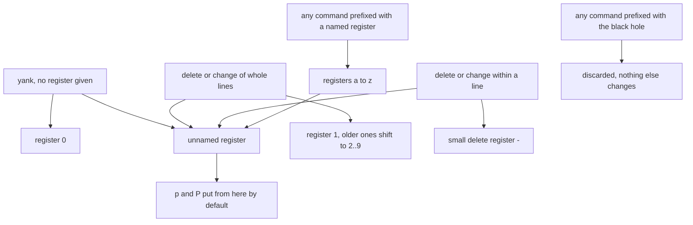

# Registers: copy and paste, the Vim way

> **Before this lesson:** read [Normal mode and its grammar](#/lesson/vim/vim-normal-grammar) for operators such as `d` and `y`, and [Insert mode](#/lesson/vim/vim-insert-mode) for the `<C-r>` chord.

## In plain words

Copying and pasting in most programs uses one hidden storage place, the clipboard. Vim has many such storage places and calls them **registers**. Each is a named slot that holds a piece of text.

Think of a row of labelled jars on a kitchen shelf. One jar is "whatever I picked up last". Another always holds "the last thing I deliberately copied". Twenty-six are labelled `a` to `z` for you to fill as you please. One has no bottom: what you drop in is gone. And one is the jar you share with the rest of the house, the system clipboard used by your browser and other programs.

Vim's words differ from the usual ones: to **yank** is to copy, to **delete** is to cut (the text is kept in a register), and to **put** is to paste.

Why it matters for a job: moving and duplicating text is constant. The most common frustration of new Vim users, "I pasted and got the wrong text", disappears once you know which jar things go into.

Every editor has a clipboard. Vim has several dozen, called **registers**, and at first that looks like needless complication: you only wanted to copy a word and paste it somewhere. Then you hit the classic annoyance. You copy a name, move to the place where it should replace another name, delete the old one, paste, and get the old one back. The clipboard was overwritten by the delete.

That behaviour is not a bug. In Vim, *delete is cut*: everything you remove goes somewhere, so that `xp` can swap two characters and `ddp` two lines. Once you know where things go, the surprise turns into a set of precise tools: one register that always holds your last copy, a history of your last nine deletions, twenty-six registers you fill by name, a "nowhere" register for deletions you do not want kept, and a bridge to the system clipboard.

Vim's vocabulary differs from the usual one:

| Elsewhere | In Vim | Keys |
|---|---|---|
| cut | **delete** | `d`, `x`, `c`, `s` |
| copy | **yank** | `y` |
| paste | **put** | `p`, `P` |

`[x]` marks the cursor.

## The unnamed register and three idioms

When you delete, change or yank without saying where the text should go, it lands in the **unnamed register**, written `""`. `p` puts from the same place. That is enough for three very common moves.

| Idiom | Before | Keys | After |
|---|---|---|---|
| swap two characters | `rec[i]eve` | `xp` | `rece[i]ve` |
| swap two lines | `[s]econd`<br>`first` | `ddp` | `first`<br>`[s]econd` |
| duplicate a line | `[i]tem: 1` | `yyp` | `item: 1`<br>`[i]tem: 1` |

In each case the text takes a short ride through the unnamed register.

## Put: `p` and `P`, character-wise and line-wise

A register remembers not only text but **how it was captured**, and `p` behaves accordingly.

| Register holds | `p` | `P` |
|---|---|---|
| character-wise text (from `yiw`, `x`, `dw`, `y$` …) | inserts **after the cursor character** | inserts **before the cursor character** |
| line-wise text (from `yy`, `dd`, `yap`, `dj` …) | inserts as new line(s) **below** the current line | inserts as new line(s) **above** it |

| Before | Register | Keys | After |
|---|---|---|---|
| `call[(])` | `arg`, character-wise | `p` | `call(ar[g])` |
| `call([)]` | `arg`, character-wise | `P` | `call(ar[g])` |
| `[b]eta`<br>`gamma` | `alpha`, line-wise | `P` | `[a]lpha`<br>`beta`<br>`gamma` |
| `[b]eta`<br>`gamma` | `alpha`, line-wise | `p` | `beta`<br>`[a]lpha`<br>`gamma` |

Variants worth knowing:

| Keys | Effect |
|---|---|
| `gp` / `gP` | like `p` / `P`, but leave the cursor **after** the put text, ready to put again or keep typing |
| `]p` | put line-wise text and re-indent it to match the current line |
| `{n}p` | put `n` copies |
| `:put a` | put register `a` line-wise below the current line, whatever its original kind |
| `<C-r>{reg}` | in Insert or Command-line mode: insert the register's text |

## The problem: a delete overwrites your yank

Goal: make line 2 pass `user_id` instead of `tmp`.

```text
user_id = lookup(email)
audit(tmp)
```

The cursor starts on `user_id` in line 1. The table tracks line 2 and two registers after each step:

| Step | Keys | Line 2 afterwards | Unnamed `""` | Yank `"0` |
|---|---|---|---|---|
| 1 | `yiw` (on `user_id`) | `audit(tmp)` | `user_id` | `user_id` |
| 2 | `j` then `fm` (into `tmp`) | `audit(t[m]p)` | `user_id` | `user_id` |
| 3 | `diw` | `audit([)]` | **`tmp`** | `user_id` |
| 4 | `P` | `audit(tm[p])` | `tmp` | `user_id` |

Step 3 replaced the unnamed register with the deleted word, so step 4 put `tmp` straight back. There are four good ways out, and each teaches a different register.

### Fix 1: put from the yank register

Register `"0` receives every **yank** and is never touched by a delete. Put from it explicitly:

| Step | Keys | Line 2 |
|---|---|---|
| 3 | `diw` | `audit([)]` |
| 4 | `"0P` | `audit(user_i[d])` |

### Fix 2: delete into the black hole

Register `"_` discards whatever is sent to it and leaves every other register alone:

| Step | Keys | Line 2 |
|---|---|---|
| 3 | `"_diw` | `audit([)]` |
| 4 | `P` | `audit(user_i[d])` |

### Fix 3: change, and paste from Insert mode

| Step | Keys | Line 2 |
|---|---|---|
| 3–4 | `ciw<C-r>0<Esc>` | `audit(user_i[d])` |

This has a bonus: it is a single change, so `.` repeats the whole replacement on the next occurrence.

### Fix 4: put over a Visual selection

In Visual mode `p` replaces the selection with the register's contents:

| Step | Keys | Line 2 |
|---|---|---|
| 3–4 | `viwp` | `audit(user_i[d])` |

One caveat: the text that was replaced goes into the unnamed register, so a second `viwp` elsewhere would put `tmp`. To repeat, use `viw"0p`, or `viwP`, which in recent Vim and Neovim leaves the registers untouched.

That swap behaviour of Visual `p` is useful in its own right. To exchange two words:

| Before | Keys | After | Comment |
|---|---|---|---|
| `[t]imeout = retries` | `de` | `[ ]= retries` | `timeout` is in the unnamed register |
| | `ww` | ` = [r]etries` | move to the other word |
| | `vep` | ` = timeou[t]` | selection replaced; `retries` is now in the unnamed register |
| | `0P` | `retrie[s] = timeout` | put it where the first word was |

## The register family

A register is named by a double quote and one character, typed **before** the command that should use it: `"ayiw` yanks into `a`, `"ap` puts from `a`.

| Register | Name | Filled by | Notes |
|---|---|---|---|
| `""` | unnamed | every delete, change and yank | what `p` uses by default |
| `"0` | yank | yanks only | survives deletes |
| `"1` … `"9` | numbered | deletes and changes of a line or more | a shifting history: each new one pushes the others down |
| `"-` | small delete | deletes and changes of less than a line | |
| `"a` … `"z` | named | you, explicitly | `"A` … `"Z` **append** to the same register |
| `"_` | black hole | nothing is kept | for deletes you do not want remembered |
| `"+` | system clipboard | you, explicitly | shared with other applications |
| `"*` | primary selection | you, explicitly | on X11 the middle-click selection; the same as `"+` on Windows and macOS |
| `"=` | expression | evaluates what you type | `"=5*8<CR>p` puts `40` |
| `"%` | current file name | Vim | read-only |
| `"#` | alternate file name | Vim | read-only |
| `".` | last inserted text | Vim | read-only |
| `":` | last Ex command | Vim | read-only; `@:` executes it |
| `"/` | last search pattern | Vim | can be set with `:let @/ = "…"` |

`:registers` (or `:reg`) shows them all; `:reg a 0 "` shows only those named.



A trace makes the routing concrete:

| Command | `""` | `"0` | `"1` | `"2` | `"-` | `"a` |
|---|---|---|---|---|---|---|
| `yiw` on `alpha` | `alpha` | `alpha` | | | | |
| `dd` on a line `one` | `one⏎` | `alpha` | `one⏎` | | | |
| `dd` on a line `two` | `two⏎` | `alpha` | `two⏎` | `one⏎` | | |
| `x` on the letter `q` | `q` | `alpha` | `two⏎` | `one⏎` | `q` | |
| `"ayy` on a line `keep` | `keep⏎` | `alpha` | `two⏎` | `one⏎` | `q` | `keep⏎` |
| `"_dd` on any line | `keep⏎` | `alpha` | `two⏎` | `one⏎` | `q` | `keep⏎` |

After all that, `"0p` still puts `alpha`, `"1p` puts the most recently deleted line and `"2p` the one before.

Here is a small model of the routing for commands without a register prefix. Extending it with named, append and black-hole registers is one of this module's practice problems.

```python-run
class Registers:
    def __init__(self):
        self.r = {}

    def yank(self, text):
        self.r["0"] = self.r['"'] = text

    def delete(self, text):
        if "\n" in text:                       # a line or more: goes through the numbered queue
            for n in range(9, 1, -1):
                if str(n - 1) in self.r:
                    self.r[str(n)] = self.r[str(n - 1)]
            self.r["1"] = text
        else:                                  # less than a line: small delete register
            self.r["-"] = text
        self.r['"'] = text

    def show(self, label):
        cells = "  ".join(f'{k}={v!r}' for k, v in sorted(self.r.items()))
        print(f"{label:<14} {cells}")

reg = Registers()
reg.yank("alpha");        reg.show("yiw")
reg.delete("one\n");      reg.show("dd")
reg.delete("two\n");      reg.show("dd")
reg.delete("q");          reg.show("x")
reg.yank("beta");         reg.show("yiw")
```

## Named registers in practice

Named registers are for text you want to keep while you do other things.

| Task | Keys |
|---|---|
| Keep a snippet safe | `"ayap` now, `"ap` whenever needed |
| Hold two different snippets | `"ayiw` on one, `"byiw` on the other |
| Collect lines from around a file into one register | `"ayy` on the first, then `"Ayy` on each of the others, then `"ap` |
| Delete a line into a register | `"add` |
| The Ex equivalents | `:yank a`, `:delete a`, `:put a` |

Appending with the upper-case name is the special one. To gather every line that mentions `FIXME`:

| Step | Keys | Register `a` |
|---|---|---|
| 1 | `qaq` | emptied (records an empty macro into `a`; a quick way to clear it) |
| 2 | `/FIXME<CR>` then `"Ayy` | first matching line |
| 3 | `n` then `"Ayy`, repeated | all of them, in order |
| 4 | `"ap` | puts the collected lines |

(The *global command* lesson does the same in one line: `:g/FIXME/yank A`.)

## The system clipboard

Vim's registers are internal. To exchange text with a browser or a chat window, use the clipboard registers.

| Keys | Effect |
|---|---|
| `"+yy` | copy the line to the system clipboard |
| `"+yiw` | copy the word |
| `gg"+yG` | copy the whole buffer (or `:%y +`) |
| `"+p` | put from the system clipboard |
| `<C-r>+` | insert the clipboard in Insert or Command-line mode |

If you would rather have plain `y` and `p` use the system clipboard, one setting does it:

```vim
set clipboard=unnamedplus     " use "+ for all unnamed operations (Linux; on macOS and Windows 'unnamed' is equivalent)
```

The trade-off is that every `dd` and `x` now overwrites your system clipboard too. Many people prefer to keep the two worlds separate and type `"+` when they mean it.

Requirements differ by build:

| Environment | What is needed |
|---|---|
| Vim | a build with clipboard support: `vim --version` must list `+clipboard` (the minimal package on many Linux distributions lacks it; install the GUI-enabled package) |
| Neovim | an external helper on the path: `xclip`, `xsel` or `wl-copy`/`wl-paste` on Linux, built-in on macOS and Windows; `:checkhealth` reports the status |
| Over SSH | the remote machine has no access to your local clipboard; terminals that support the OSC 52 escape sequence can bridge the gap, and recent Neovim uses it automatically |

### Pasting with the terminal's own shortcut

When you paste with the terminal's shortcut instead of `"+p`, the text arrives as simulated typing. With auto-indent on, each pasted line may be indented further than the one before. Current Vim and Neovim recognise *bracketed paste* in most terminals and handle this properly. Where they do not, either use `"+p`, or switch on `:set paste` before pasting in Insert mode and `:set nopaste` afterwards.

## Why it works in terms of the grammar

The register is the optional first word of a Normal-mode sentence:

```text
"{register}  [count]  operator  motion
```

Leave it out and the unnamed register is implied. This is why register names combine with everything: `"ayi(`, `"Ay}`, `"_dap`, `"+yit`, `"0P`. No command needs a special "copy to clipboard" variant; it takes a different destination.

Delete being cut follows from the same economy. If `d` threw text away, moving text would need a third operator. Because `d` keeps what it removes, *move* is delete followed by put, and the black hole register exists for the cases where you want deletion without the keeping.

> [!TIP]
> Learn three in this order: `"0p` (put what I yanked, whatever I have deleted since), `"_d` (delete without disturbing anything), `"+y` and `"+p` (the outside world). They resolve nearly every clipboard frustration people have in their first month.

> [!INTERVIEW]
> "Why did my paste give me the wrong text?" is a question you will get from colleagues the moment they learn you use Vim. The short, correct answer: deletes and yanks share the unnamed register; the last yank is always still in register 0, so `"0p`.

## Pitfalls

- **`c` and `s` also write to registers,** not only `d` and `x`. Changing a word overwrites the unnamed register with the old word.
- **Small deletes do not enter the numbered registers.** `dw` goes to `"-`; `dd` goes to `"1`. (Deletes made with a few motions such as `%`, `}` and searches go to `"1` regardless of size.)
- **`"ay` overwrites; `"Ay` appends.** Mixing character-wise and line-wise appends produces odd layouts; keep a collection register to one kind.
- **Registers `a`–`z` are also where macros live.** Recording a macro into `a` replaces text you stored there, and yanking into `a` replaces a macro.
- **Visual-mode `p` changes the unnamed register** to the replaced text. Use `P` (recent versions) or `"0p` when repeating.
- **`"+` silently does nothing useful without clipboard support.** Check `:echo has('clipboard')` in Vim or `:checkhealth` in Neovim.
- **Line-wise text put with `p` goes below the line, not at the cursor.** If you wanted it inline, yank character-wise (`y$` or `^y$` instead of `yy`).
- **Registers persist between sessions** via viminfo/shada. A register you filled last week may still hold that text.

## Cheat sheet

| Task | Keys |
|---|---|
| Yank word / line / paragraph | `yiw` / `yy` / `yap` |
| Put after / before | `p` / `P` |
| Put and move past it | `gp` |
| Swap characters / lines | `xp` / `ddp` |
| Duplicate line | `yyp` |
| Put the last yank | `"0p` |
| Delete without saving | `"_d{motion}` |
| Replace word with yanked text, repeatably | `ciw<C-r>0<Esc>` |
| Replace selection with register | `p` in Visual mode |
| Yank into / put from register `a` | `"ay{motion}` / `"ap` |
| Append to register `a` | `"Ay{motion}` |
| Copy to / paste from system clipboard | `"+y{motion}` / `"+p` |
| Insert a register while typing | `<C-r>{reg}` |
| Inspect registers | `:reg` |
| Put the result of a calculation | `"=6*7<CR>p` |

## Summary

- Deletes, changes and yanks all fill the unnamed register; `p` and `P` put from it. That makes `xp`, `ddp` and `yyp` work, and is also why a delete can clobber a yank.
- Register `"0` always holds the last yank. The black hole `"_` swallows text without affecting any register.
- Registers remember whether their text is character-wise or line-wise, and put behaves accordingly.
- `"1`–`"9` keep a history of line-sized deletions; `"-` holds the last small one.
- `"a`–`"z` are yours; the upper-case name appends.
- `"+` is the system clipboard; `set clipboard=unnamedplus` makes it the default at the cost of mixing the two worlds.
- A register name is the optional first part of any Normal-mode command.

## Glossary

| Term | Meaning |
|---|---|
| register | a named storage slot for text |
| yank | copy text into a register |
| put | insert a register's text into the buffer (paste) |
| unnamed register | the default register, filled by every yank, delete and change |
| yank register (`"0`) | the register that always holds the most recent yank |
| numbered registers (`"1` to `"9`) | a history of recent line-sized deletions |
| small delete register (`"-`) | holds the most recent deletion of less than a line |
| named registers (`"a` to `"z`) | registers you fill explicitly; a capital letter appends |
| black hole register (`"_`) | discards whatever is sent to it |
| system clipboard (`"+`) | the clipboard shared with other programs |
| character-wise / line-wise | whether a register's text is a run of characters or whole lines, which decides how it is put |
| expression register (`"=`) | evaluates a calculation and yields the result |

## Check yourself

```quiz
[
  {"q": "You yank a word with yiw, move to another word, delete it with diw and press P. What is put?",
   "options": ["The yanked word", "The word you deleted a moment ago", "Nothing", "Both words"],
   "answer": 1,
   "explain": "The delete overwrote the unnamed register, which is what P reads. The yanked word is still available in register 0."},
  {"q": "Continuing that scenario, which keys put the yanked word instead?",
   "options": ["\"1P", "\"0P", "\"-P", "\"_P"],
   "answer": 1,
   "explain": "Register 0 holds the most recent yank and is not affected by deletes."},
  {"q": "Line: 'teh' with the cursor on 'e'. Which keystrokes produce 'the'?",
   "options": ["xp", "xP", "ddp", "yyp"],
   "answer": 0,
   "explain": "x cuts the 'e' (the cursor is then on 'h'); p puts it after the cursor character, giving 'the'."},
  {"q": "The register holds a whole line captured with yy. With the cursor in the middle of some line, what does p do?",
   "options": ["Inserts the text at the cursor, splitting the line", "Inserts the text as a new line below the current line", "Replaces the current line", "Inserts the text as a new line above the current line"],
   "answer": 1,
   "explain": "Line-wise text is put as whole lines: p below, P above, regardless of the cursor column."},
  {"q": "Which keys delete the current paragraph without changing any register?",
   "options": ["dap", "\"_dap", "\"0dap", "\"adap"],
   "answer": 1,
   "explain": "The black hole register discards the text and leaves the unnamed, numbered and yank registers untouched."},
  {"q": "You run \"ayy on line 3 and then \"Ayy on line 8. What does \"ap put?",
   "options": ["Line 8 only", "Line 3 only", "Line 3 followed by line 8", "Line 8 followed by line 3"],
   "answer": 2,
   "explain": "The upper-case name appends to the lower-case register, so register a holds both lines in the order they were added."},
  {"q": "You delete three separate lines with dd, dd, dd (lines A, B, C in that order). Which register holds line A afterwards?",
   "options": ["\"1", "\"3", "\"0", "\"-"],
   "answer": 1,
   "explain": "Each line-sized delete goes into register 1 and pushes the previous contents down: C is in 1, B in 2, A in 3."},
  {"q": "Which keystrokes replace the word under the cursor with the last yanked text as a single change that dot can repeat?",
   "options": ["diw\"0P", "viwp", "ciw<C-r>0<Esc>", "\"_diwP"],
   "answer": 2,
   "explain": "The change command with the register inserted from Insert mode is one change. The other sequences work once but consist of two commands or leave a different register state."}
]
```

> **Source:** Neil, Practical Vim 2e, tips 60–64 (ch. 10, "Copy and Paste"). Examples and wording are original.
